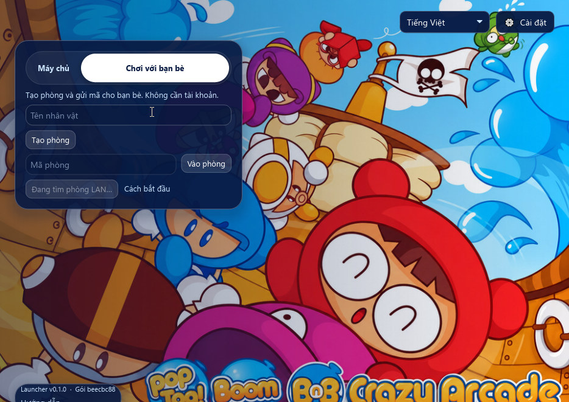
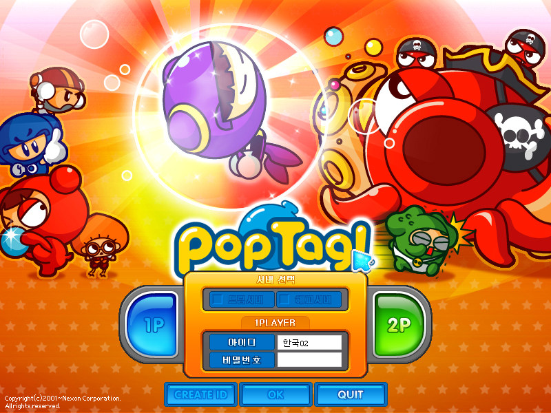
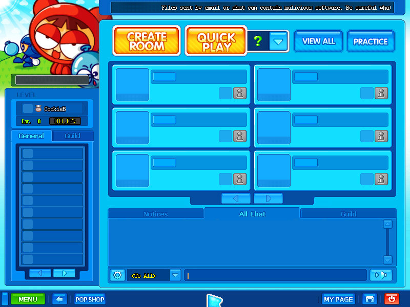
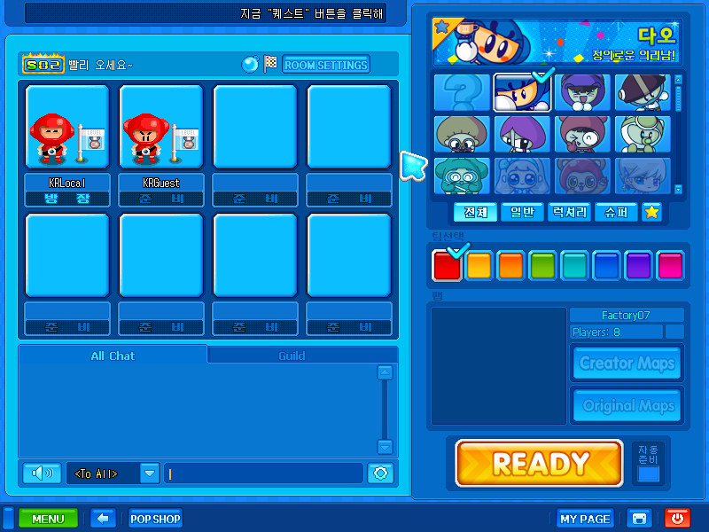
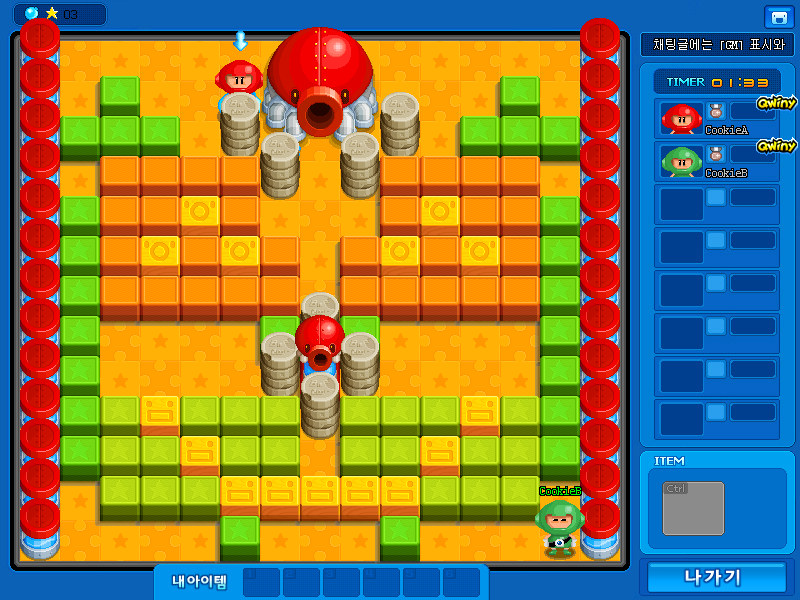

  

<h1 align="center">LANBoom</h1>

  <b><i>Drop the balloons, squabble and play, Stuck in a bubble? Friends save the day!</i></b>  
  <b>English</b> · <a href="README.vi.md">Tiếng Việt</a> · <a href="README.ko.md">한국어</a>

LANBoom is the classic water-balloon battle game, rebuilt from the **final Korean client (build 00967)**
released before the Korean service shut down. It keeps the original maps, items and characters,
and adds **English and Vietnamese**, **private rooms over LAN or the Internet**, and **servers you can host yourself**.

LANBoom is a **free community project**. There is no fee, no paid currency and no pay-to-win.

## Why LANBoom?

- **The complete original game.** Every normal-battle map, item and character from the final Korean build, played by the original rules.
- **Everything unlocked in private rooms.** All supported items, outfits and characters are open from the first game.
- **No server required.** Host a room on your PC and share a code with your friends. LANBoom connects you over LAN or the Internet, and you never need to open router ports.
- **It can't be shut down again.** The game runs on your own machines. Nobody can switch it off.
- **Your server, your rules.** Run your own server for your community and decide how accounts, progress and unlocks work.
- **Your language.** More than 33,000 lines are translated by hand into English and Vietnamese, with no machine translation. Korean stays as it was in the original.

## Screenshots

<table>
  <tr>
    <td align="center" valign="top"><strong>Launcher</strong> </td>
    <td align="center" valign="top"><strong>Login</strong> </td>
  </tr>
  <tr>
    <td align="center" valign="top"><strong>Lobby</strong> </td>
    <td align="center" valign="top"><strong>Game room</strong> </td>
  </tr>
  <tr>
    <td colspan="2" align="center"><strong>Normal battle (Korean UI)</strong> </td>
  </tr>
</table>

## Features

✅ Available now · 🚧 Coming soon

| | Feature | Details |
|---|---|---|
| ✅ | **Normal battle** | All **214** maps, including conveyor belts, mine rails, scripted maps and the 19×17 Big Battle map |
| ✅ | **Characters** | **31** characters with their original stats |
| ✅ | **Items** | The full classic item set, including Needle, Shield, Sensor, shoes, gloves, remote bombs, drills and darts |
| ✅ | **Vehicles** | **5** rideable vehicles and **22** ship types |
| ✅ | **Rooms** | Free-for-all or team battles with up to **8 players per room** on a server |
| ✅ | **Private rooms** | Join with a room code or pick a room from the LAN list. No account is needed, and two players can share one PC |
| ✅ | **Launcher** | Saved server list, automatic LAN room scan, file check and repair, a Windows Firewall helper and a download button for new versions |
| ✅ | **Self-hosted servers** | BoomServer for Windows and Linux (Docker or systemd), tested with **50 players in 8 rooms** at the same time. Tray icon, one-click backups and new invite codes |
| ✅ | **Server admin tools** | Audited admin commands, chat mutes and abuse logs, health monitoring, database backup, restore and rollback |
| ✅ | **Accounts and progress** | Server accounts with a recovery code, saved match results, levels and EXP, and Lucci |
| ✅ | **Web shop and wardrobe** | Browse the catalog, buy outfits with Lucci, and equip or remove them from your inventory |
| ✅ | **Web social page** | Friends and friend requests, block list and server rankings. Create or leave a guild; guild leaders can disband their guild |
| ✅ | **Languages** | English, Tiếng Việt and 한국어 in the game, launcher and server app, with Vietnamese accents in chat |
| 🚧 | **In-game shop and customization** | My Page, inventory and shop windows in the game, plus avatar, character, balloon, level and ID decorations, emoticons and titles |
| 🚧 | **Ladder and matchmaking** | Ranked 1v1, 2v2 and 3v3 ladder battles with grades and a bonus map, plus automatic matchmaking |
| 🚧 | **Big Brawl and 1-on-1 seasons** | 12-player ranked brawls on giant maps and seasonal 1-on-1 ranking (CA Jjang) |
| 🚧 | **Special modes** | **18** map modes on **122** maps (Baseball, Coloring, Zombie, Kart, Super Fighter, Popcade…), Airplane, Winning Streak Colosseum and rule variants such as Snowball Fight, Revival Battle, Time Bomb, Catch the Leader and Hedgehog |
| 🚧 | **Battles against AI** | Co-op battles against computer players with star difficulty levels, and points that unlock hidden characters |
| 🚧 | **Tournaments and channels** | Tournaments with a practice channel, and channels for beginners, events, item-free play and training |
| 🚧 | **Room options and super host** | No-item and no-shop rooms, priority rooms, vote kick, and host privileges such as starting the game right away |
| 🚧 | **Lobby square** | Walk around the plaza and visit the clothing, jewelry, pet and café areas |
| 🚧 | **Upgrades and synthesis** | Upgrade items, pets and water balloons with materials, and combine timed items to extend them |
| 🚧 | **Power-up kits and boosters** | Kits that raise starting stats, EXP and Lucci boosters and an all-maps pass, set by the server owner |
| 🚧 | **Level rewards** | Lucci on every level-up, level-up treasure boxes, a Lucci vault and record erasers |
| 🚧 | **Pets** | Affection and sealing, three upgrade tiers, dual pets, auto Shield and Needle, EXP and Lucci bonuses |
| 🚧 | **Gifts and coupons** | Send items to friends and redeem coupons |
| 🚧 | **Account security** | Second password for your game account |
| 🚧 | **PvE adventures** | **699** co-op stages: Monster mode, CA Hero with skills and equipment, Hidden Catch with its arcade mode, RPG, Sandbox, the Antarctic expedition, I am Boss, Golem Run, Dragon Palace, Escape Maze, solo play, bonus stages and a tutorial, with bosses, treasure chests and crafting |
| 🚧 | **In-game social** | Messenger, whispers, mail, megaphones, exchange chat rooms, guild windows with marks and private guilds, couples with couple rings and bonuses |
| 🚧 | **Quests and season pass** | Daily missions, quests, CA Pass and item collections |
| 🚧 | **Seasonal events** | About 20 event systems, including Lucky Cards, Mine Exploration, Magic Market, Grow a Sprout, DIY Bomb, Exchange, lucky draws (Pokki Pokki, hammer eggs, magic orbs, gift boxes) and Lucky Beans, daily check-in and returning-player stamps, the Magic Book Market, bingo, dice and quizzes, and fishing |
| 🚧 | **Custom maps** | Build your own maps and play them with friends |

## Two ways to play

| | 🏠 Private room | 🖥️ Server |
|---|---|---|
| **Who hosts?** | One friend opens a room in the launcher | A community runs BoomServer on a PC or VPS |
| **Account** | Not needed, just pick a name | One account per server |
| **Items, outfits and characters** | **100% unlocked** | Set by the server owner |
| **Progress** | Not saved | Saved by the server |
| **Connection** | Room code over LAN or the Internet | S1 invite code, with a relay when a direct connection fails |

**Hosting your own server?** You are the owner and you have full control. You decide whether players start
with everything unlocked or earn it, and what the server keeps.

## Get started

1. **Download** the LANBoom player package. *(Coming soon: December 2026)*
2. **Open the launcher** and pick your language.
3. **Choose how to play:**
   - **Private room:** enter a name, click **Host a private room** and send the code to your friends.
   - **Server:** paste an S1 invite, create an account and press **PLAY**.

The full walkthrough is in the [player guide](docs/player/guide.en.md). Server owners can find Windows and Linux setup in the
same guide under *Host your own server (S1)*.

**System requirements:** Windows 10 or 11 for the game. BoomServer runs on Windows or Linux, and Linux can also use Docker.

## FAQ

**Is it really free?**
Yes. LANBoom is a free community project. Nothing in the game is sold for real money.

**Is it the same as the old Korean game?**
Yes. LANBoom is built from the final Korean client before the shutdown. Maps, items, characters and rules follow the original.

**Do I need to set up port forwarding?**
No. Private rooms and S1 servers connect automatically and fall back to a relay when needed.

**Will my progress be lost?**
Private rooms do not keep progress. On a server, progress is stored by the server owner, and BoomServer can back up its database.

**What does 🚧 mean?**
The feature exists in the original client and is being brought to LANBoom. It will arrive in future updates.

## Community

- 💬 Discord / Facebook: *(Coming soon: December 2026)*
- 🐛 Bug reports and suggestions: [GitHub Issues](https://github.com/aquaplatinumberlitz/boom-kr-server/issues)
- 🛠️ Developers: see the [technical documentation](docs/DEVELOPMENT.md)
