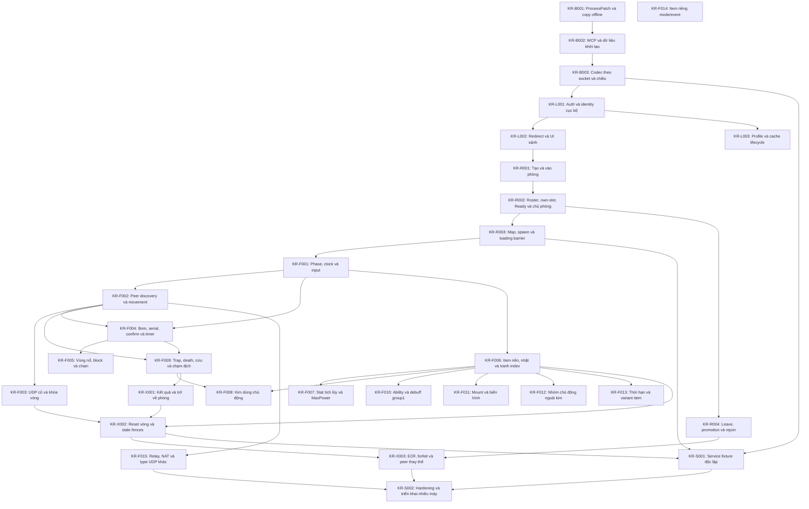

# Tra cứu chức năng KR00967

Sinh từ [catalog](features.json) bằng `python3 tools/feature_catalog.py --generate`; không sửa tay.

Catalog là chỉ mục khai báo có giới hạn theo nguồn. `present` chỉ xác nhận cơ chế hẹp hiện diện,
không xác nhận mọi biến thể. `partial` là một phần đã đọc/viết; `checked` là emulation có oracle;
`observed` là phạm vi runtime ở evidence. `unknown` không có nghĩa vắng mặt.
Integration `partial` chỉ một phần đường chạy đã đo; luôn đọc giới hạn tại nguồn, kể cả một hàng gồm nhiều tác dụng.
Không tính phần trăm hoặc suy gate từ các cột. Đồ thị thể hiện dependency của kịch bản, không phải thứ tự ưu tiên.

Tra một hàng → thẻ cùng ID → contract/giới hạn, bằng chứng/hash, khoảng trống/phép kiểm.
Thứ tự thực hiện chỉ ở [PLAN](PLAN.md#current-order); câu hỏi ở [RESEARCH](RESEARCH.md#feature-gaps);
lịch sử/review/merge ở [manifest](evidence/checkpoints/manifest.json).
Runtime tách Wine copy chẩn đoán / Windows nguyên bản / LAN / Internet; không suy tương đương giữa môi trường.
Implementation `branch_pending` chưa có PR; `via_pr` dẫn tới PR giữ trạng thái tích hợp hiện tại;
`baseline_merged` nói về code đã có tại baseline. Trạng thái GitHub không được checker suy từ runtime.
Review độc lập: [waived theo chủ dự án](evidence/checkpoints/review-waiver.json); Codex tự kiểm.

## Coverage khai báo

| ID / chức năng | Presence | VN ref | KR static | Emulation | Wine copy | Windows gốc | LAN | Internet | Implementation / delivery | Integration | Gate |
|---|---|---|---|---|---|---|---|---|---|---|---|
| [KR-B001 · ProcessPatch và copy offline](#kr-b001) | present | both | partial | checked | observed | observed | unknown | unknown | partial / via_pr | partial | K1: passed |
| [KR-B002 · WCP và dữ liệu khởi tạo](#kr-b002) | present | both | partial | checked | observed | unknown | unknown | unknown | partial / via_pr | partial | K2: passed |
| [KR-B003 · Codec theo socket và chiều](#kr-b003) | present | both | partial | checked | observed | unknown | unknown | unknown | partial / via_pr | partial | K2: passed |
| [KR-L001 · Auth và identity cục bộ](#kr-l001) | present | both | partial | checked | observed | unknown | unknown | unknown | partial / via_pr | partial | K3: passed |
| [KR-L002 · Redirect và UI sảnh](#kr-l002) | present | both | partial | checked | observed | unknown | unknown | unknown | partial / via_pr | partial | K3: passed |
| [KR-L003 · Profile và cache lifecycle](#kr-l003) | present | static | partial | checked | observed | unknown | unknown | unknown | partial / via_pr | partial | K3: passed |
| [KR-R001 · Tạo và vào phòng](#kr-r001) | present | both | partial | checked | observed | unknown | observed | unknown | partial / via_pr | partial | K4: passed |
| [KR-R002 · Roster, own-slot, Ready và chủ phòng](#kr-r002) | present | both | partial | checked | observed | unknown | observed | unknown | partial / via_pr | partial | K4: passed |
| [KR-R003 · Map, spawn và loading barrier](#kr-r003) | present | both | partial | checked | observed | unknown | unknown | unknown | partial / via_pr | partial | K4: passed |
| [KR-R004 · Leave, promotion và rejoin](#kr-r004) | present | both | partial | checked | observed | unknown | observed | unknown | partial / via_pr | partial | K4: passed |
| [KR-F001 · Phase, clock và input](#kr-f001) | present | both | partial | checked | observed | unknown | unknown | unknown | partial / via_pr | partial | K5: passed |
| [KR-F002 · Peer discovery và movement](#kr-f002) | present | both | partial | checked | observed | unknown | unknown | observed | partial / via_pr | partial | K6: passed |
| [KR-F003 · UDP cũ và khóa vòng](#kr-f003) | present | both | partial | checked | observed | unknown | unknown | unknown | partial / via_pr | partial | K6: passed |
| [KR-F004 · Bom, serial, confirm và timer](#kr-f004) | present | both | partial | checked | observed | unknown | unknown | unknown | partial / via_pr | partial | K5: passed |
| [KR-F005 · Vùng nổ, block và chain](#kr-f005) | present | both | partial | checked | observed | unknown | unknown | unknown | partial / via_pr | partial | K5: passed |
| [KR-F006 · Item nền, nhặt và tranh index](#kr-f006) | present | both | partial | checked | observed | unknown | unknown | unknown | partial / via_pr | partial | K5: passed |
| [KR-F007 · Stat tích lũy và MaxPower](#kr-f007) | present | both | partial | checked | observed | unknown | unknown | unknown | partial / via_pr | partial | K5: passed |
| [KR-F008 · Kim dùng chủ động](#kr-f008) | present | both | partial | checked | observed | unknown | unknown | unknown | partial / via_pr | unknown | K5: passed |
| [KR-F009 · Trap, death, cứu và chạm địch](#kr-f009) | present | both | partial | checked | observed | unknown | unknown | unknown | partial / via_pr | partial | K5: passed |
| [KR-F010 · Ability và debuff group1](#kr-f010) | present | static | partial | unknown | unknown | unknown | unknown | unknown | unknown / unknown | unknown | K5: passed |
| [KR-F011 · Mount và biến hình](#kr-f011) | present | static | partial | unknown | unknown | unknown | unknown | unknown | unknown / unknown | unknown | K5: passed |
| [KR-F012 · Nhóm chủ động ngoài kim](#kr-f012) | candidate | static | partial | unknown | unknown | unknown | unknown | unknown | unknown / unknown | unknown | K5: passed |
| [KR-F013 · Thời hạn và variant item](#kr-f013) | candidate | static | partial | unknown | unknown | unknown | unknown | unknown | unknown / unknown | unknown | K5: passed |
| [KR-F014 · Item riêng mode/event](#kr-f014) | candidate | static | partial | unknown | unknown | unknown | unknown | unknown | unknown / unknown | unknown | K5: passed |
| [KR-F015 · Relay, NAT và type UDP khác](#kr-f015) | candidate | both | partial | unknown | observed | unknown | unknown | observed | partial / baseline_merged | partial | K6: passed |
| [KR-X001 · Kết quả và trở về phòng](#kr-x001) | present | both | partial | checked | observed | unknown | unknown | unknown | partial / via_pr | partial | K5: passed |
| [KR-X002 · Reset vòng và stale fences](#kr-x002) | present | both | partial | checked | observed | unknown | unknown | unknown | partial / via_pr | partial | K6: passed |
| [KR-X003 · EOF, forfeit và peer thay thế](#kr-x003) | present | both | partial | checked | observed | unknown | unknown | unknown | partial / via_pr | partial | K6: passed |
| [KR-S001 · Service fixture độc lập](#kr-s001) | unknown | both | unknown | unknown | observed | unknown | unknown | unknown | partial / via_pr | partial | K6: passed |
| [KR-S002 · Hardening và triển khai nhiều máy](#kr-s002) | unknown | static | unknown | unknown | observed | unknown | observed | unknown | partial / via_pr | partial | K7: passed |

Số lượng theo trạng thái khai báo (không phải tỷ lệ hoàn thành):

- presence: candidate=4, present=24, unknown=2.
- kr_static: partial=28, unknown=2.
- emulation: checked=22, unknown=8.
- implementation: partial=25, unknown=5.
- integration: partial=24, unknown=6.
- gate: passed=30.

## Cây cơ chế

```mermaid
flowchart TD
  KR_G000["KR-G000: KR00967: Battle offline"]
  KR_G001["KR-G001: Bootstrap"]
  KR_G002["KR-G002: Login và sảnh"]
  KR_G003["KR-G003: Phòng và load"]
  KR_G004["KR-G004: Battle"]
  KR_G005["KR-G005: Kết quả và reset"]
  KR_G006["KR-G006: Service và vận hành"]
  KR_B001["KR-B001: ProcessPatch và copy offline"]
  KR_B002["KR-B002: WCP và dữ liệu khởi tạo"]
  KR_B003["KR-B003: Codec theo socket và chiều"]
  KR_L001["KR-L001: Auth và identity cục bộ"]
  KR_L002["KR-L002: Redirect và UI sảnh"]
  KR_L003["KR-L003: Profile và cache lifecycle"]
  KR_R001["KR-R001: Tạo và vào phòng"]
  KR_R002["KR-R002: Roster, own-slot, Ready và chủ phòng"]
  KR_R003["KR-R003: Map, spawn và loading barrier"]
  KR_R004["KR-R004: Leave, promotion và rejoin"]
  KR_F001["KR-F001: Phase, clock và input"]
  KR_F002["KR-F002: Peer discovery và movement"]
  KR_F003["KR-F003: UDP cũ và khóa vòng"]
  KR_F004["KR-F004: Bom, serial, confirm và timer"]
  KR_F005["KR-F005: Vùng nổ, block và chain"]
  KR_F006["KR-F006: Item nền, nhặt và tranh index"]
  KR_F007["KR-F007: Stat tích lũy và MaxPower"]
  KR_F008["KR-F008: Kim dùng chủ động"]
  KR_F009["KR-F009: Trap, death, cứu và chạm địch"]
  KR_F010["KR-F010: Ability và debuff group1"]
  KR_F011["KR-F011: Mount và biến hình"]
  KR_F012["KR-F012: Nhóm chủ động ngoài kim"]
  KR_F013["KR-F013: Thời hạn và variant item"]
  KR_F014["KR-F014: Item riêng mode/event"]
  KR_F015["KR-F015: Relay, NAT và type UDP khác"]
  KR_X001["KR-X001: Kết quả và trở về phòng"]
  KR_X002["KR-X002: Reset vòng và stale fences"]
  KR_X003["KR-X003: EOF, forfeit và peer thay thế"]
  KR_S001["KR-S001: Service fixture độc lập"]
  KR_S002["KR-S002: Hardening và triển khai nhiều máy"]
  KR_G000 --> KR_G001
  KR_G000 --> KR_G002
  KR_G000 --> KR_G003
  KR_G000 --> KR_G004
  KR_G000 --> KR_G005
  KR_G000 --> KR_G006
  KR_G001 --> KR_B001
  KR_G001 --> KR_B002
  KR_G001 --> KR_B003
  KR_G002 --> KR_L001
  KR_G002 --> KR_L002
  KR_G002 --> KR_L003
  KR_G003 --> KR_R001
  KR_G003 --> KR_R002
  KR_G003 --> KR_R003
  KR_G003 --> KR_R004
  KR_G004 --> KR_F001
  KR_G004 --> KR_F002
  KR_G004 --> KR_F003
  KR_G004 --> KR_F004
  KR_G004 --> KR_F005
  KR_G004 --> KR_F006
  KR_G004 --> KR_F007
  KR_G004 --> KR_F008
  KR_G004 --> KR_F009
  KR_G004 --> KR_F010
  KR_G004 --> KR_F011
  KR_G004 --> KR_F012
  KR_G004 --> KR_F013
  KR_G004 --> KR_F014
  KR_G004 --> KR_F015
  KR_G005 --> KR_X001
  KR_G005 --> KR_X002
  KR_G005 --> KR_X003
  KR_G006 --> KR_S001
  KR_G006 --> KR_S002
```

## Dependency kịch bản

## Tra theo cơ chế

### KR-B001 · ProcessPatch và copy offline

Dependency: —.

[Contract và giới hạn](protocol/bootstrap-codec.md#wcp) · [Câu hỏi gốc](RESEARCH.md#gap-process-patch) · [Thứ tự ở PLAN](PLAN.md#current-order).

Khoảng trống (trích bảng RESEARCH): [CP179](PROTOCOL.md#bootstrap-recipe-scope): K1 đạt riêng offlineR2 từ3coldstart/API đúngPID/contract-controls; K0CP178 giữ. Không originalWindowsbootstrap hoặc3e9coldstart.

Phép kiểm tối thiểu (trích cùng nguồn): Cold3R2 đã giải, không đo lại. WiderWCP/launcher/config còn ở #2; currente9input/state bridge và livecodec theo PLAN/#3, chỉ mở bootstrapcause nếu có trigger mới.

Issue/phạm vi công việc: [#285](https://github.com/aquaplatinumberlitz/boom-kr-server/issues/285), [#1](https://github.com/aquaplatinumberlitz/boom-kr-server/issues/1), [#2](https://github.com/aquaplatinumberlitz/boom-kr-server/issues/2), [#9](https://github.com/aquaplatinumberlitz/boom-kr-server/issues/9).

Bằng chứng/build/hash/recipe: [bootstrap-wire](evidence/bootstrap-wire/README.md), [probe-service](evidence/probe-service/README.md), [preclock-eof](evidence/preclock-eof/README.md), [nmco-locale-stability](evidence/nmco-locale-stability/README.md), [protocol](protocol/bootstrap-codec.md#original-windows-control), [peer-endpoints](evidence/peer-endpoints/README.md#cp178), [docs](PLAN.md#k0-k2a-acceptance), [wine-r2](evidence/wine-r2/README.md#cp179).

| Chiều chứng minh | Khai báo | Nguồn/phạm vi áp dụng |
|---|---|---|
| presence | present | [nguồn1](protocol/bootstrap-codec.md#wcp) |
| vn_reference | both | [nguồn1](REFERENCES.md) |
| kr_static | partial | [nguồn1](protocol/bootstrap-codec.md#wcp) |
| emulation | checked | [nguồn1](evidence/bootstrap-wire/README.md) |
| wine_diagnostic_copy | observed | [nguồn1](evidence/bootstrap-wire/README.md), [nguồn2](evidence/preclock-eof/README.md), [nguồn3](evidence/nmco-locale-stability/README.md), [nguồn4](evidence/wine-r2/README.md#cp179) |
| windows_original | observed | [nguồn1](protocol/bootstrap-codec.md#original-windows-control), [nguồn2](evidence/peer-endpoints/README.md#cp178) |
| lan | unknown | Chưa có bằng chứng trong phạm vi rà |
| internet | unknown | Chưa có bằng chứng trong phạm vi rà |
| implementation | partial / via_pr | [nguồn1](../server/probe_service.py), [nguồn2](protocol/rust-boundary.md#probe-service), [nguồn3](https://github.com/aquaplatinumberlitz/boom-kr-server/pull/57) |
| integration | partial | [nguồn1](evidence/probe-service/README.md), [nguồn2](evidence/preclock-eof/README.md), [nguồn3](evidence/nmco-locale-stability/README.md) |
| gate | K1: passed | [nguồn1](PLAN.md#k1-acceptance) |

### KR-B002 · WCP và dữ liệu khởi tạo

Dependency: [KR-B001](#kr-b001).

[Contract và giới hạn](protocol/bootstrap-codec.md#wcp) · [Câu hỏi gốc](RESEARCH.md#gap-wcp-config) · [Thứ tự ở PLAN](PLAN.md#current-order).

Khoảng trống (trích bảng RESEARCH): Fixture tổng hợp đã qua guard; oneclickuser/+E9C và dữ liệu/cache thật chưa đủ.

Phép kiểm tối thiểu (trích cùng nguồn): Chỉ mở consumer/config đang chặn runtime; so nhánh với và không tham số trên cùng copy, không đo lại +E78 đã giải.

Issue/phạm vi công việc: [#285](https://github.com/aquaplatinumberlitz/boom-kr-server/issues/285), [#2](https://github.com/aquaplatinumberlitz/boom-kr-server/issues/2).

Bằng chứng/build/hash/recipe: [wcp-sequence](evidence/wcp-sequence/README.md), [probe-service](evidence/probe-service/README.md), [live-codec-stream](evidence/live-codec-stream/README.md), [live-codec-stream](evidence/live-codec-stream/README.md#cp181), [rust-service](evidence/rust-service/README.md#cp231).

| Chiều chứng minh | Khai báo | Nguồn/phạm vi áp dụng |
|---|---|---|
| presence | present | [nguồn1](protocol/bootstrap-codec.md#wcp), [nguồn2](protocol/bootstrap-codec.md#rust-foundation) |
| vn_reference | both | [nguồn1](REFERENCES.md) |
| kr_static | partial | [nguồn1](protocol/bootstrap-codec.md#wcp) |
| emulation | checked | [nguồn1](evidence/wcp-sequence/README.md) |
| wine_diagnostic_copy | observed | [nguồn1](evidence/wcp-sequence/README.md), [nguồn2](evidence/live-codec-stream/README.md), [nguồn3](evidence/live-codec-stream/README.md#cp181), [nguồn4](protocol/bootstrap-codec.md#rust-foundation) |
| windows_original | unknown | Chưa có bằng chứng trong phạm vi rà |
| lan | unknown | Chưa có bằng chứng trong phạm vi rà |
| internet | unknown | Chưa có bằng chứng trong phạm vi rà |
| implementation | partial / via_pr | [nguồn1](../server/probe_service.py), [nguồn2](protocol/rust-boundary.md#probe-service), [nguồn3](https://github.com/aquaplatinumberlitz/boom-kr-server/pull/57) |
| integration | partial | [nguồn1](evidence/probe-service/README.md) |
| gate | K2: passed | [nguồn1](PLAN.md#k2-acceptance) |

### KR-B003 · Codec theo socket và chiều

Dependency: [KR-B002](#kr-b002).

[Contract và giới hạn](protocol/bootstrap-codec.md#wcp) · [Câu hỏi gốc](RESEARCH.md#gap-socket-codec) · [Thứ tự ở PLAN](PLAN.md#current-order).

Khoảng trống (trích bảng RESEARCH): [CP181](PROTOCOL.md#login-retry-codec) actualsameprocessretry/reset/authcursor + CP180stream/CRC + CP057boundednativeoracle đủ K2profile theo PLAN. Fullgrammar/prefixguardon/modes/headerauth/capenforcement/FFFFFFFF giữ unknown.

Phép kiểm tối thiểu (trích cùng nguồn): Codec backlog theo trigger K3; không lặp solvedretry/closeonly/HWwatchpoint/76modelsplit. Accountresume thuộc identity/lifecycle, không tự thêm gate.

Issue/phạm vi công việc: [#285](https://github.com/aquaplatinumberlitz/boom-kr-server/issues/285), [#3](https://github.com/aquaplatinumberlitz/boom-kr-server/issues/3).

Bằng chứng/build/hash/recipe: [primitives](evidence/primitives/README.md), [probe-service](evidence/probe-service/README.md), [codec-boundaries](evidence/codec-boundaries/README.md), [current-tcp-replay](evidence/current-tcp-replay/README.md), [docs](PLAN.md#k0-k2a-acceptance), [peer-endpoints](evidence/peer-endpoints/README.md#cp178), [protocol](protocol/bootstrap-codec.md#bootstrap-recipe-scope), [live-codec-stream](evidence/live-codec-stream/README.md), [live-codec-stream](evidence/live-codec-stream/README.md#cp181), [rust-service](evidence/rust-service/README.md#cp231), [rust-service](evidence/rust-service/four-owner-bombs.json), [rust-service](evidence/rust-service/README.md#cp246), [rust-service](evidence/rust-service/four-life.json), [rust-service](evidence/rust-service/README.md#cp247).

| Chiều chứng minh | Khai báo | Nguồn/phạm vi áp dụng |
|---|---|---|
| presence | present | [nguồn1](protocol/bootstrap-codec.md#wcp), [nguồn2](protocol/bootstrap-codec.md#rust-foundation) |
| vn_reference | both | [nguồn1](REFERENCES.md) |
| kr_static | partial | [nguồn1](protocol/bootstrap-codec.md#wcp), [nguồn2](protocol/bootstrap-codec.md#codec-stream-boundaries) |
| emulation | checked | [nguồn1](evidence/primitives/README.md), [nguồn2](evidence/codec-boundaries/README.md) |
| wine_diagnostic_copy | observed | [nguồn1](evidence/probe-service/README.md), [nguồn2](evidence/live-codec-stream/README.md), [nguồn3](evidence/live-codec-stream/README.md#cp181), [nguồn4](protocol/bootstrap-codec.md#rust-foundation), [nguồn5](protocol/multiplayer-team.md#rust-four-owner-bombs), [nguồn6](protocol/multiplayer-team.md#rust-four-life) |
| windows_original | unknown | Chưa có bằng chứng trong phạm vi rà |
| lan | unknown | Chưa có bằng chứng trong phạm vi rà |
| internet | unknown | Chưa có bằng chứng trong phạm vi rà |
| implementation | partial / via_pr | [nguồn1](../server/probe_service.py), [nguồn2](protocol/rust-boundary.md#probe-service), [nguồn3](https://github.com/aquaplatinumberlitz/boom-kr-server/pull/57), [nguồn4](protocol/multiplayer-team.md#rust-four-owner-bombs), [nguồn5](protocol/multiplayer-team.md#rust-four-life) |
| integration | partial | [nguồn1](evidence/probe-service/README.md), [nguồn2](protocol/udp-peer.md#current-tcp-replay) |
| gate | K2: passed | [nguồn1](PLAN.md#k2-acceptance) |

### KR-L001 · Auth và identity cục bộ

Dependency: [KR-B003](#kr-b003).

[Contract và giới hạn](protocol/auth-session.md#login-auth) · [Câu hỏi gốc](RESEARCH.md#gap-auth-identity) · [Thứ tự ở PLAN](PLAN.md#current-order).

Khoảng trống (trích bảng RESEARCH): [CP073](PROTOCOL.md#launcher-error-attribution): auxiliarylocale1,0 valid/init0→2000:0/noTCP; main currentA/Bactual67 positive. HistoricalmainSIGABRT/HTTPstartupcause vẫn unknown, không gánpopup là root. [CP217](PROTOCOL.md#auth-admission-prototype) valid/invalid32token cóproof; [CP223](PROTOCOL.md#auth-session-lifecycle) thêm endpoint-accountremap; [CP225](PROTOCOL.md#auth-fresh-process) freshprocesspositive/badtokennegative đã đo, sameprocessfatal/healthyEOFbefore17/fullidentityauthority vẫn mở.

Phép kiểm tối thiểu (trích cùng nguồn): Theo[PLAN](PLAN.md#current-order) tiếp RustM2haiidentity/phòng với bindings rõ; không mở lại authRE đã blocked hoặc tìm lại auth137/135/string/cache. Trace mainfail chỉ khi thực sự chặn. Providerinit sâu chỉ mở khi thực sự chặn main, chưa phải trọng tâm chơi.

Issue/phạm vi công việc: [#285](https://github.com/aquaplatinumberlitz/boom-kr-server/issues/285), [#9](https://github.com/aquaplatinumberlitz/boom-kr-server/issues/9), [#106](https://github.com/aquaplatinumberlitz/boom-kr-server/issues/106), [#369](https://github.com/aquaplatinumberlitz/boom-kr-server/issues/369), [#377](https://github.com/aquaplatinumberlitz/boom-kr-server/issues/377).

Bằng chứng/build/hash/recipe: [login-runtime](evidence/login-runtime/README.md), [probe-service](evidence/probe-service/README.md), [auth-profile](evidence/auth-profile/README.md), [current-profile-c](evidence/current-profile-c/README.md), [preclock-eof](evidence/preclock-eof/README.md), [nmco-locale-stability](evidence/nmco-locale-stability/README.md), [peer-endpoints](evidence/peer-endpoints/README.md#cp146), [peer-endpoints](evidence/peer-endpoints/README.md#cp148), [peer-endpoints](evidence/peer-endpoints/README.md#cp149), [live-codec-stream](evidence/live-codec-stream/README.md), [lobby-identity](evidence/lobby-identity/in-progress.json), [lobby-identity](evidence/lobby-identity/README.md), [lobby-identity](evidence/lobby-identity/k3-acceptance.json), [protocol](protocol/multiplayer-team.md#operator-incoming-binding), [protocol](protocol/multiplayer-team.md#native-interleaved-startup), [protocol](protocol/multiplayer-team.md#four-session-native), [protocol](protocol/multiplayer-team.md#eight-session-preview), [login-runtime](evidence/login-runtime/README.md#cp214), [login-runtime](evidence/login-runtime/README.md#cp215), [login-runtime](evidence/login-runtime/README.md#cp216), [login-runtime](evidence/login-runtime/README.md#cp217), [login-runtime](evidence/login-runtime/README.md#cp218), [login-runtime](evidence/login-runtime/README.md#cp219), [login-runtime](evidence/login-runtime/README.md#cp220), [login-runtime](evidence/login-runtime/README.md#cp221), [login-runtime](evidence/login-runtime/README.md#cp222), [login-runtime](evidence/login-runtime/README.md#cp223), [login-runtime](evidence/login-runtime/README.md#cp224), [login-runtime](evidence/login-runtime/README.md#cp225), [rust-service](evidence/rust-service/README.md#cp232), [rust-service](evidence/rust-service/README.md#cp233), [rust-service](evidence/rust-service/README.md#cp234), [rust-service](evidence/rust-service/README.md#cp235), [rust-service](evidence/rust-service/README.md#cp236), [rust-service](evidence/rust-service/accounts-backend.json), [rust-service](evidence/rust-service/README.md#cp243), [rust-service](evidence/rust-service/account-worker.json), [rust-service](evidence/rust-service/README.md#cp244), [rust-service](evidence/rust-service/account-idle-rate.json), [rust-service](evidence/rust-service/four-startup.json), [rust-service](evidence/rust-service/README.md#cp245), [protocol](protocol/auth-session.md#rust-account-bridge), [rust-service](evidence/rust-service/account-bridge.json), [rust-service](evidence/rust-service/account-serving.json), [protocol](protocol/auth-session.md#rust-account-serving), [rust-service](evidence/rust-service/account-native-lifecycle.json), [rust-service](evidence/rust-service/account-fresh-login.json), [rust-service](evidence/rust-service/account-basic.json), [protocol](protocol/auth-session.md#rust-account-basic), [protocol](protocol/networks.md#rust-internet-observation), [rust-service](evidence/rust-service/internet-observation.json), [docs](RUST_SERVICE_ARCHITECTURE.md#relay-endpoint-design), [protocol](protocol/udp-peer.md#rust-relay-endpoint-scope), [rust-service](evidence/rust-service/relay-endpoint-design.json), [protocol](protocol/room-membership.md#rust-r1f-session-binding), [rust-service](evidence/rust-service/r1f-session-binding.json), [protocol](protocol/rust-boundary.md#rust-r1g-admission), [rust-service](evidence/rust-service/r1g-admission.json), [rust-service](evidence/rust-service/m7d-account-ownership.json), [rust-service](evidence/rust-service/m5b-dynamic-accounts.json), [rust-service](evidence/rust-service/m5b-native-recovery.json).

| Chiều chứng minh | Khai báo | Nguồn/phạm vi áp dụng |
|---|---|---|
| presence | present | [nguồn1](protocol/auth-session.md#login-auth) |
| vn_reference | both | [nguồn1](REFERENCES.md) |
| kr_static | partial | [nguồn1](protocol/auth-session.md#login-auth), [nguồn2](protocol/lobby-profile.md#auth-profile), [nguồn3](protocol/lobby-profile.md#local-name-model), [nguồn4](protocol/lobby-profile.md#own-profile-291), [nguồn5](protocol/lobby-profile.md#own-profile-integration), [nguồn6](protocol/auth-session.md#auth-token-request), [nguồn7](protocol/auth-session.md#auth-token-bounds), [nguồn8](protocol/auth-session.md#auth-channel-echo) |
| emulation | checked | [nguồn1](evidence/login-runtime/README.md), [nguồn2](evidence/auth-profile/README.md), [nguồn3](evidence/lobby-identity/k3-acceptance.json), [nguồn4](evidence/login-runtime/channel-echo.json), [nguồn5](evidence/login-runtime/admission-prototype.json), [nguồn6](protocol/auth-session.md#auth-tcp-ownership), [nguồn7](evidence/login-runtime/two-account.json), [nguồn8](evidence/login-runtime/two-actual.json) |
| wine_diagnostic_copy | observed | [nguồn1](evidence/login-runtime/README.md), [nguồn2](evidence/auth-profile/README.md), [nguồn3](evidence/current-profile-c/README.md), [nguồn4](evidence/preclock-eof/README.md), [nguồn5](evidence/nmco-locale-stability/README.md), [nguồn6](evidence/peer-endpoints/README.md#cp146), [nguồn7](evidence/peer-endpoints/README.md#cp148), [nguồn8](evidence/peer-endpoints/README.md#cp149), [nguồn9](evidence/live-codec-stream/README.md), [nguồn10](protocol/lobby-profile.md#local-name-model), [nguồn11](protocol/lobby-profile.md#own-profile-291), [nguồn12](protocol/lobby-profile.md#own-profile-integration), [nguồn13](evidence/lobby-identity/k3-acceptance.json), [nguồn14](protocol/multiplayer-team.md#four-session-native), [nguồn15](evidence/login-runtime/README.md#cp214), [nguồn16](evidence/login-runtime/README.md#cp215), [nguồn17](evidence/login-runtime/README.md#cp216), [nguồn18](evidence/login-runtime/README.md#cp217), [nguồn19](evidence/login-runtime/README.md#cp218), [nguồn20](protocol/auth-session.md#auth-eof-dispatch), [nguồn21](evidence/login-runtime/README.md#cp220), [nguồn22](protocol/auth-session.md#auth-two-account), [nguồn23](protocol/auth-session.md#auth-two-actual), [nguồn24](protocol/auth-session.md#auth-session-lifecycle), [nguồn25](protocol/auth-session.md#auth-retry-validation), [nguồn26](protocol/auth-session.md#auth-fresh-process), [nguồn27](protocol/lobby-profile.md#rust-local-lobby), [nguồn28](protocol/lobby-profile.md#rust-two-lobby), [nguồn29](protocol/rust-boundary.md#rust-fixed-room), [nguồn30](protocol/rust-boundary.md#rust-m2-acceptance), [nguồn31](protocol/multiplayer-team.md#rust-four-startup), [nguồn32](protocol/auth-session.md#rust-account-serving), [nguồn33](protocol/auth-session.md#rust-account-native-lifecycle), [nguồn34](protocol/auth-session.md#rust-account-fresh-login), [nguồn35](protocol/auth-session.md#rust-account-basic), [nguồn36](protocol/room-membership.md#rust-managed-account-ownership), [nguồn37](protocol/auth-session.md#rust-db-account-profiles) |
| windows_original | unknown | Chưa có bằng chứng trong phạm vi rà |
| lan | unknown | Chưa có bằng chứng trong phạm vi rà |
| internet | unknown | Chưa có bằng chứng trong phạm vi rà |
| implementation | partial / via_pr | [nguồn1](../server/probe_service.py), [nguồn2](protocol/rust-boundary.md#probe-service), [nguồn3](https://github.com/aquaplatinumberlitz/boom-kr-server/pull/57), [nguồn4](../tools/export_probe_profile.py), [nguồn5](protocol/lobby-profile.md#auth-profile), [nguồn6](https://github.com/aquaplatinumberlitz/boom-kr-server/pull/77), [nguồn7](protocol/networks.md#service-channel-endpoint), [nguồn8](../server/own_profile.py), [nguồn9](protocol/lobby-profile.md#k3-version-identity-controls), [nguồn10](protocol/multiplayer-team.md#eight-session-preview), [nguồn11](protocol/auth-session.md#rust-account-backend), [nguồn12](../rust/crates/kr-service/src/accounts.rs), [nguồn13](../rust/crates/kr-service/src/bin/kr-admin.rs), [nguồn14](protocol/auth-session.md#rust-account-worker), [nguồn15](protocol/auth-session.md#rust-account-idle-rate), [nguồn16](protocol/multiplayer-team.md#rust-four-startup), [nguồn17](protocol/auth-session.md#rust-account-bridge), [nguồn18](../rust/crates/kr-service/src/account_bridge.rs), [nguồn19](../rust/crates/kr-service/src/account_bridge/wire.rs), [nguồn20](../rust/crates/kr-service/src/account_serving.rs), [nguồn21](protocol/auth-session.md#rust-account-serving), [nguồn22](protocol/room-membership.md#rust-managed-account-ownership), [nguồn23](protocol/auth-session.md#rust-db-account-profiles) |
| integration | partial | [nguồn1](evidence/probe-service/README.md), [nguồn2](evidence/auth-profile/README.md), [nguồn3](evidence/current-profile-c/README.md), [nguồn4](evidence/preclock-eof/README.md), [nguồn5](evidence/nmco-locale-stability/README.md), [nguồn6](protocol/networks.md#service-channel-endpoint), [nguồn7](protocol/auth-session.md#rust-account-backend), [nguồn8](../rust/crates/kr-service/src/accounts.rs), [nguồn9](../rust/crates/kr-service/src/bin/kr-admin.rs), [nguồn10](protocol/auth-session.md#rust-account-bridge), [nguồn11](protocol/auth-session.md#rust-account-serving), [nguồn12](protocol/auth-session.md#rust-account-native-lifecycle), [nguồn13](protocol/auth-session.md#rust-account-fresh-login), [nguồn14](protocol/auth-session.md#rust-account-basic), [nguồn15](protocol/room-membership.md#rust-managed-account-ownership), [nguồn16](protocol/auth-session.md#rust-db-account-profiles) |
| gate | K3: passed | [nguồn1](PLAN.md#k3-acceptance) |

### KR-L002 · Redirect và UI sảnh

Dependency: [KR-L001](#kr-l001).

[Contract và giới hạn](protocol/lobby-profile.md#channel-lobby) · [Câu hỏi gốc](RESEARCH.md#gap-redirect-lobby) · [Thứ tự ở PLAN](PLAN.md#current-order).

Khoảng trống (trích bảng RESEARCH): [CP186 K3local](PLAN.md#k3-acceptance) đạt; A291/nameguard/coldroute/versionnegative có nguồn. CP187actualAB291/currentroomintegration đủ K4scope; [CP200](PROTOCOL.md#four-session-native) bổ sung C/D291/name/ownslot. Caption/multichannel giữunknown.

Phép kiểm tối thiểu (trích cùng nguồn): [PLAN](PLAN.md#current-order): CP202–204 đã2v2outcomes/reset/bundle/bounds; tiếp lifecycle theoPLAN, không lặp ABCD291/room/start/NATtuple. Multichannel chỉ theo trigger.

Issue/phạm vi công việc: [#285](https://github.com/aquaplatinumberlitz/boom-kr-server/issues/285).

Bằng chứng/build/hash/recipe: [postwait](evidence/postwait/README.md), [probe-service](evidence/probe-service/README.md), [lobby-identity](evidence/lobby-identity/in-progress.json), [lobby-identity](evidence/lobby-identity/README.md), [lobby-identity](evidence/lobby-identity/k3-acceptance.json), [protocol](protocol/multiplayer-team.md#four-session-native), [rust-service](evidence/rust-service/README.md#cp232), [rust-service](evidence/rust-service/README.md#cp233), [rust-service](evidence/rust-service/README.md#cp234), [rust-service](evidence/rust-service/README.md#cp235).

| Chiều chứng minh | Khai báo | Nguồn/phạm vi áp dụng |
|---|---|---|
| presence | present | [nguồn1](protocol/lobby-profile.md#channel-lobby) |
| vn_reference | both | [nguồn1](REFERENCES.md) |
| kr_static | partial | [nguồn1](protocol/lobby-profile.md#channel-lobby), [nguồn2](protocol/lobby-profile.md#local-name-model), [nguồn3](protocol/lobby-profile.md#own-profile-291), [nguồn4](protocol/lobby-profile.md#own-profile-integration) |
| emulation | checked | [nguồn1](evidence/postwait/README.md), [nguồn2](evidence/lobby-identity/k3-acceptance.json) |
| wine_diagnostic_copy | observed | [nguồn1](evidence/postwait/README.md), [nguồn2](protocol/lobby-profile.md#local-name-model), [nguồn3](protocol/lobby-profile.md#own-profile-291), [nguồn4](protocol/lobby-profile.md#own-profile-integration), [nguồn5](protocol/lobby-profile.md#lobby-cache-route), [nguồn6](evidence/lobby-identity/k3-acceptance.json), [nguồn7](protocol/multiplayer-team.md#four-session-native), [nguồn8](protocol/lobby-profile.md#rust-local-lobby), [nguồn9](protocol/lobby-profile.md#rust-two-lobby), [nguồn10](protocol/rust-boundary.md#rust-fixed-room), [nguồn11](protocol/rust-boundary.md#rust-m2-acceptance) |
| windows_original | unknown | Chưa có bằng chứng trong phạm vi rà |
| lan | unknown | Chưa có bằng chứng trong phạm vi rà |
| internet | unknown | Chưa có bằng chứng trong phạm vi rà |
| implementation | partial / via_pr | [nguồn1](../server/probe_service.py), [nguồn2](protocol/rust-boundary.md#probe-service), [nguồn3](https://github.com/aquaplatinumberlitz/boom-kr-server/pull/57), [nguồn4](../server/own_profile.py), [nguồn5](protocol/lobby-profile.md#lobby-cache-route), [nguồn6](protocol/lobby-profile.md#k3-version-identity-controls) |
| integration | partial | [nguồn1](evidence/probe-service/README.md), [nguồn2](protocol/lobby-profile.md#lobby-cache-route) |
| gate | K3: passed | [nguồn1](PLAN.md#k3-acceptance) |

### KR-L003 · Profile và cache lifecycle

Dependency: [KR-L001](#kr-l001).

[Contract và giới hạn](protocol/lobby-profile.md#channel-lobby) · [Câu hỏi gốc](RESEARCH.md#gap-profile-cache) · [Thứ tự ở PLAN](PLAN.md#current-order).

Khoảng trống (trích bảng RESEARCH): [CP186](PROTOCOL.md#channel-cold-route) cold3cache/warm có nguồn, K3local đạt. Năm retainedSSI giống clientnguồn; stageCRC0, mọicache/corrupt/reconnect/profile rộng cònunknown.

Phép kiểm tối thiểu (trích cùng nguồn): Reuse [scope/CRC](PROTOCOL.md#dynamic-cache-representation) và [coldroute](PROTOCOL.md#channel-cold-route); chỉ mở cachevariant khác khi K4/integration có trigger. Không lặp3file/CRC hoặc gọi coldroute là toànasset.

Issue/phạm vi công việc: [#285](https://github.com/aquaplatinumberlitz/boom-kr-server/issues/285).

Bằng chứng/build/hash/recipe: [start-reply](evidence/start-reply/README.md), [cache-boundary](evidence/cache-boundary/README.md), [lobby-identity](evidence/lobby-identity/README.md), [lobby-identity](evidence/lobby-identity/k3-acceptance.json).

| Chiều chứng minh | Khai báo | Nguồn/phạm vi áp dụng |
|---|---|---|
| presence | present | [nguồn1](protocol/lobby-profile.md#channel-lobby), [nguồn2](protocol/lobby-profile.md#dynamic-cache-representation) |
| vn_reference | static | [nguồn1](REFERENCES.md) |
| kr_static | partial | [nguồn1](protocol/lobby-profile.md#channel-lobby), [nguồn2](protocol/lobby-profile.md#dynamic-cache-representation), [nguồn3](protocol/lobby-profile.md#local-name-model), [nguồn4](protocol/lobby-profile.md#own-profile-291), [nguồn5](protocol/lobby-profile.md#own-profile-integration) |
| emulation | checked | [nguồn1](evidence/cache-boundary/README.md), [nguồn2](evidence/lobby-identity/k3-acceptance.json) |
| wine_diagnostic_copy | observed | [nguồn1](evidence/cache-boundary/README.md), [nguồn2](protocol/lobby-profile.md#local-name-model), [nguồn3](protocol/lobby-profile.md#own-profile-291), [nguồn4](protocol/lobby-profile.md#own-profile-integration), [nguồn5](protocol/lobby-profile.md#lobby-cache-route), [nguồn6](evidence/lobby-identity/k3-acceptance.json) |
| windows_original | unknown | Chưa có bằng chứng trong phạm vi rà |
| lan | unknown | Chưa có bằng chứng trong phạm vi rà |
| internet | unknown | Chưa có bằng chứng trong phạm vi rà |
| implementation | partial / via_pr | [nguồn1](../tools/export_probe_profile.py), [nguồn2](protocol/lobby-profile.md#dynamic-cache-representation), [nguồn3](https://github.com/aquaplatinumberlitz/boom-kr-server/pull/79), [nguồn4](../server/own_profile.py), [nguồn5](protocol/lobby-profile.md#lobby-cache-route), [nguồn6](protocol/lobby-profile.md#k3-version-identity-controls) |
| integration | partial | [nguồn1](evidence/cache-boundary/README.md), [nguồn2](protocol/lobby-profile.md#lobby-cache-route) |
| gate | K3: passed | [nguồn1](PLAN.md#k3-acceptance) |

### KR-R001 · Tạo và vào phòng

Dependency: [KR-L002](#kr-l002).

[Contract và giới hạn](protocol/room-membership.md#duo-room-round) · [Câu hỏi gốc](RESEARCH.md#gap-create-join) · [Thứ tự ở PLAN](PLAN.md#current-order).

Khoảng trống (trích bảng RESEARCH): [M7a](protocol/room-membership.md#rust-managed-room-selection): bốn account/client KR, hai phòng, tuple/list/title mặc định, slot, chủ, chuyển phòng và delete90 đã đo.

Phép kiểm tối thiểu (trích cùng nguồn): Occupancy đã đo ở [contract](protocol/room-membership.md#rust-room-population); [lifecycle managed 2/4/8](protocol/room-membership.md#rust-managed-team-rosters) đã đo trong tập cấu hình. [M7c room-only](protocol/room-membership.md#rust-managed-player-choices) đã đo lựa chọn/full-error; M7d ownership tích hợp đã đạt trong tập profile hiện hành. Sửa title trong UI bị profile hiện tại chặn; không mở entitlement RE khi chưa cần. Restart/durable tuple, password/mode chưa có; profile DB zero/ASCII đã có M5b, nhánh profile khác giữ riêng.

Issue/phạm vi công việc: [#285](https://github.com/aquaplatinumberlitz/boom-kr-server/issues/285), [#369](https://github.com/aquaplatinumberlitz/boom-kr-server/issues/369), [#371](https://github.com/aquaplatinumberlitz/boom-kr-server/issues/371), [#377](https://github.com/aquaplatinumberlitz/boom-kr-server/issues/377).

Bằng chứng/build/hash/recipe: [duo-room-round](evidence/duo-room-round/README.md), [probe-service](evidence/probe-service/README.md), [host-normal-back](evidence/host-normal-back/README.md), [eight-player](evidence/eight-player/README.md), [peer-endpoints](evidence/peer-endpoints/README.md#cp160), [peer-endpoints](evidence/peer-endpoints/README.md#cp161), [peer-endpoints](evidence/peer-endpoints/README.md#cp162), [peer-endpoints](evidence/peer-endpoints/README.md#cp166), [peer-endpoints](evidence/peer-endpoints/README.md#cp167), [peer-endpoints](evidence/peer-endpoints/README.md#cp168), [protocol](protocol/multiplayer-team.md#four-session-native), [room-list](evidence/room-list/README.md), [room-list](evidence/room-list/README.md#cp227), [room-list](evidence/room-list/README.md#cp228), [room-list](evidence/room-list/README.md#cp229), [room-list](evidence/room-list/README.md#cp230), [rust-service](evidence/rust-service/README.md#cp234), [rust-service](evidence/rust-service/README.md#cp235), [rust-service](evidence/rust-service/four-startup.json), [rust-service](evidence/rust-service/README.md#cp245), [rust-service](evidence/rust-service/account-basic.json), [protocol](protocol/auth-session.md#rust-account-basic), [protocol](protocol/room-membership.md#rust-r1e-registry), [rust-service](evidence/rust-service/r1e-registry.json), [protocol](protocol/room-membership.md#rust-managed-room-selection), [rust-service](evidence/rust-service/m7a-room-selection.json), [rust-service](evidence/rust-service/m7b-room-population.json), [rust-service](evidence/rust-service/m7b-duel-lifecycle.json), [rust-service](evidence/rust-service/m7b-team-rosters.json), [rust-service](evidence/rust-service/m7c-room-choices.json), [rust-service](evidence/rust-service/m7d-account-ownership.json), [rust-service](evidence/rust-service/m7e-selected-rosters.json), [rust-service](evidence/rust-service/m5b-dynamic-accounts.json), [rust-service](evidence/rust-service/m5b-native-recovery.json), [rust-service](evidence/rust-service/n1rb-native-rosters.json).

| Chiều chứng minh | Khai báo | Nguồn/phạm vi áp dụng |
|---|---|---|
| presence | present | [nguồn1](protocol/room-membership.md#duo-room-round), [nguồn2](protocol/room-membership.md#room-list-lifecycle), [nguồn3](protocol/room-membership.md#room-join-projection), [nguồn4](protocol/room-membership.md#room-local-roster), [nguồn5](protocol/room-membership.md#room-membership-registry) |
| vn_reference | both | [nguồn1](REFERENCES.md) |
| kr_static | partial | [nguồn1](protocol/room-membership.md#duo-room-round), [nguồn2](protocol/multiplayer-team.md#battle-eight-roster), [nguồn3](protocol/room-membership.md#room-list-lifecycle), [nguồn4](protocol/room-membership.md#room-join-projection), [nguồn5](protocol/room-membership.md#rust-room-population) |
| emulation | checked | [nguồn1](evidence/duo-room-round/README.md) |
| wine_diagnostic_copy | observed | [nguồn1](evidence/duo-room-round/README.md), [nguồn2](evidence/host-normal-back/README.md), [nguồn3](evidence/eight-player/README.md), [nguồn4](evidence/peer-endpoints/README.md#cp160), [nguồn5](evidence/peer-endpoints/README.md#cp161), [nguồn6](evidence/peer-endpoints/README.md#cp162), [nguồn7](evidence/peer-endpoints/README.md#cp166), [nguồn8](evidence/peer-endpoints/README.md#cp167), [nguồn9](evidence/peer-endpoints/README.md#cp168), [nguồn10](protocol/room-membership.md#current-291-room-integration), [nguồn11](protocol/multiplayer-team.md#four-session-native), [nguồn12](protocol/room-membership.md#room-list-lifecycle), [nguồn13](evidence/room-list/README.md), [nguồn14](protocol/room-membership.md#room-join-projection), [nguồn15](protocol/room-membership.md#room-local-roster), [nguồn16](protocol/room-membership.md#room-membership-registry), [nguồn17](protocol/room-membership.md#room-shared-cleanup), [nguồn18](protocol/rust-boundary.md#rust-fixed-room), [nguồn19](protocol/rust-boundary.md#rust-m2-acceptance), [nguồn20](protocol/multiplayer-team.md#rust-four-startup), [nguồn21](evidence/rust-service/m7a-room-selection.json), [nguồn22](evidence/rust-service/m7b-room-population.json), [nguồn23](evidence/rust-service/m7b-duel-lifecycle.json), [nguồn24](evidence/rust-service/m7b-team-rosters.json), [nguồn25](evidence/rust-service/m7c-room-choices.json), [nguồn26](protocol/room-membership.md#rust-managed-account-ownership), [nguồn27](protocol/room-membership.md#rust-selected-player-rounds), [nguồn28](protocol/auth-session.md#rust-db-account-profiles), [nguồn29](protocol/udp-peer.md#rust-authenticated-serving-relay) |
| windows_original | unknown | Chưa có bằng chứng trong phạm vi rà |
| lan | observed | [nguồn1](evidence/rust-service/m7a-room-selection.json), [nguồn2](evidence/rust-service/m7b-room-population.json), [nguồn3](evidence/rust-service/m7b-duel-lifecycle.json), [nguồn4](evidence/rust-service/m7b-team-rosters.json) |
| internet | unknown | Chưa có bằng chứng trong phạm vi rà |
| implementation | partial / via_pr | [nguồn1](../server/probe_service.py), [nguồn2](protocol/rust-boundary.md#probe-service), [nguồn3](https://github.com/aquaplatinumberlitz/boom-kr-server/pull/57), [nguồn4](../server/test_host_back_rejoin.py), [nguồn5](protocol/room-membership.md#host-normal-back), [nguồn6](protocol/room-membership.md#current-room-title), [nguồn7](../server/room_title.py), [nguồn8](../server/test_room_title.py), [nguồn9](protocol/multiplayer-team.md#current-team-mode), [nguồn10](../server/room_team_mode.py), [nguồn11](../server/test_room_team_mode.py), [nguồn12](protocol/multiplayer-team.md#rust-four-startup), [nguồn13](protocol/room-membership.md#rust-managed-room-selection), [nguồn14](protocol/room-membership.md#rust-room-population), [nguồn15](protocol/room-membership.md#rust-managed-duel-lifecycle), [nguồn16](protocol/room-membership.md#rust-managed-team-rosters), [nguồn17](protocol/room-membership.md#rust-managed-player-choices), [nguồn18](protocol/room-membership.md#rust-managed-account-ownership), [nguồn19](protocol/room-membership.md#rust-selected-player-rounds), [nguồn20](protocol/auth-session.md#rust-db-account-profiles) |
| integration | partial | [nguồn1](evidence/probe-service/README.md), [nguồn2](evidence/host-normal-back/README.md), [nguồn3](evidence/peer-endpoints/README.md#cp161), [nguồn4](protocol/room-membership.md#current-291-room-integration), [nguồn5](protocol/room-membership.md#rust-managed-room-selection), [nguồn6](protocol/room-membership.md#rust-room-population), [nguồn7](protocol/room-membership.md#rust-managed-duel-lifecycle), [nguồn8](protocol/room-membership.md#rust-managed-team-rosters), [nguồn9](protocol/room-membership.md#rust-managed-player-choices), [nguồn10](protocol/room-membership.md#rust-managed-account-ownership), [nguồn11](protocol/room-membership.md#rust-selected-player-rounds), [nguồn12](protocol/auth-session.md#rust-db-account-profiles) |
| gate | K4: passed | [nguồn1](PLAN.md#k4-acceptance) |

### KR-R002 · Roster, own-slot, Ready và chủ phòng

Dependency: [KR-R001](#kr-r001).

[Contract và giới hạn](protocol/room-membership.md#room-player) · [Câu hỏi gốc](RESEARCH.md#gap-roster-ready-host) · [Thứ tự ở PLAN](PLAN.md#current-order).

Khoảng trống (trích bảng RESEARCH): [CP163](PROTOCOL.md#battle-eight-roster) actual selector1/8synthetic slots:4–4 check0/104,1–7 check7/no104, Ready/parser/map/capacity/getter có nguồn. CP162 actual Free/Manner/ACK/reset đã nối.

Phép kiểm tối thiểu (trích cùng nguồn): Không lặp guard/roster/map/input RE. CP165 actualpreset2cycles/Start3 đãđo; CP166 currentmodepromotion/rejoin đãtới clock; CP167đãhai cycleBhost; CP168BStart3/AUD050đãđo; CP171/172basiccycles/Start3 đã đo; tiếp PLAN theo gap thật; [CP208](PROTOCOL.md#eight-session-preview) có native8consumer trên2actual và adapter32TCP; tám actualclock/mesh56/stat8/ownerbom đã kiểm CP208209; CP210 có report-life/rank/reset/two4v4cycles8; [CP213](PROTOCOL.md#eight-team-variants) actualFree1–7/Manner4–4twooutcomes đã có; native8Manner1–7negative copy4b partialdoemptyJSONstartup; alternatecopy8d đãreturn7/no104/1543checks, emptyguardkhônghit nên khôngcause/fixproof. Còn interactiveC2Steamchange/generalroom-full/admission/Random/generalpromotion/row91 metadata. Theo PLAN; không coi sáu actor tổng hợp là sáu client.

Issue/phạm vi công việc: [#285](https://github.com/aquaplatinumberlitz/boom-kr-server/issues/285), [#369](https://github.com/aquaplatinumberlitz/boom-kr-server/issues/369), [#371](https://github.com/aquaplatinumberlitz/boom-kr-server/issues/371).

Bằng chứng/build/hash/recipe: [room-player](evidence/room-player/README.md), [probe-service](evidence/probe-service/README.md), [host-normal-back](evidence/host-normal-back/README.md), [eight-player](evidence/eight-player/README.md), [peer-endpoints](evidence/peer-endpoints/README.md#cp162), [eight-player](evidence/eight-player/README.md#cp163), [peer-endpoints](evidence/peer-endpoints/README.md#cp164), [peer-endpoints](evidence/peer-endpoints/README.md#cp165), [peer-endpoints](evidence/peer-endpoints/README.md#cp166), [peer-endpoints](evidence/peer-endpoints/README.md#cp167), [peer-endpoints](evidence/peer-endpoints/README.md#cp168), [protocol](protocol/multiplayer-team.md#native-interleaved-startup), [protocol](protocol/multiplayer-team.md#four-slot-native-consumers), [protocol](protocol/multiplayer-team.md#four-session-native), [protocol](protocol/multiplayer-team.md#eight-session-preview), [protocol](protocol/multiplayer-team.md#eight-mesh-owner-bombs), [protocol](protocol/multiplayer-team.md#eight-two-team-cycles), [protocol](protocol/multiplayer-team.md#eight-portable-battle), [protocol](protocol/multiplayer-team.md#eight-team-variants), [eight-player](evidence/eight-player/README.md#cp213), [rust-service](evidence/rust-service/README.md#cp234), [rust-service](evidence/rust-service/README.md#cp235), [rust-service](evidence/rust-service/four-startup.json), [rust-service](evidence/rust-service/README.md#cp245), [rust-service](evidence/rust-service/four-results.json), [rust-service](evidence/rust-service/README.md#cp248), [protocol](protocol/multiplayer-team.md#rust-eight-baseline), [rust-service](evidence/rust-service/eight-baseline.json), [rust-service](evidence/rust-service/README.md#cp250), [eight-player](evidence/eight-player/team-code-delivery.json), [protocol](protocol/multiplayer-team.md#rust-eight-teams), [rust-service](evidence/rust-service/eight-teams.json), [rust-service](evidence/rust-service/README.md#cp251), [protocol](protocol/multiplayer-team.md#rust-ninth-admission-wip), [protocol](protocol/multiplayer-team.md#rust-ninth-admission), [rust-service](evidence/rust-service/ninth-admission.json), [rust-service](evidence/rust-service/argv-provenance.json), [rust-service](evidence/rust-service/README.md#cp252), [rust-service](evidence/rust-service/account-basic.json), [protocol](protocol/auth-session.md#rust-account-basic), [protocol](protocol/networks.md#rust-internet-observation), [rust-service](evidence/rust-service/internet-observation.json), [protocol](protocol/room-membership.md#rust-r1f-session-binding), [rust-service](evidence/rust-service/r1f-session-binding.json), [protocol](protocol/room-membership.md#rust-managed-room-selection), [rust-service](evidence/rust-service/m7a-room-selection.json), [rust-service](evidence/rust-service/m7b-duel-lifecycle.json), [rust-service](evidence/rust-service/m7b-team-rosters.json), [rust-service](evidence/rust-service/m7c-choice-producer.json), [rust-service](evidence/rust-service/m7c-room-choices.json), [rust-service](evidence/rust-service/m7d-account-ownership.json), [rust-service](evidence/rust-service/m7e-selected-rosters.json).

| Chiều chứng minh | Khai báo | Nguồn/phạm vi áp dụng |
|---|---|---|
| presence | present | [nguồn1](protocol/room-membership.md#room-player) |
| vn_reference | both | [nguồn1](REFERENCES.md) |
| kr_static | partial | [nguồn1](protocol/room-membership.md#room-player), [nguồn2](protocol/multiplayer-team.md#battle-eight-roster) |
| emulation | checked | [nguồn1](evidence/room-player/README.md), [nguồn2](evidence/eight-player/README.md) |
| wine_diagnostic_copy | observed | [nguồn1](evidence/room-player/README.md), [nguồn2](evidence/host-normal-back/README.md), [nguồn3](evidence/eight-player/README.md), [nguồn4](evidence/peer-endpoints/README.md#cp162), [nguồn5](evidence/eight-player/README.md#cp163), [nguồn6](evidence/peer-endpoints/README.md#cp164), [nguồn7](evidence/peer-endpoints/README.md#cp165), [nguồn8](evidence/peer-endpoints/README.md#cp166), [nguồn9](evidence/peer-endpoints/README.md#cp167), [nguồn10](evidence/peer-endpoints/README.md#cp168), [nguồn11](protocol/room-membership.md#current-291-room-integration), [nguồn12](protocol/multiplayer-team.md#four-slot-native-consumers), [nguồn13](protocol/multiplayer-team.md#four-session-native), [nguồn14](protocol/multiplayer-team.md#eight-session-preview), [nguồn15](protocol/multiplayer-team.md#eight-mesh-owner-bombs), [nguồn16](protocol/multiplayer-team.md#eight-two-team-cycles), [nguồn17](protocol/multiplayer-team.md#eight-portable-battle), [nguồn18](protocol/multiplayer-team.md#eight-team-variants), [nguồn19](protocol/rust-boundary.md#rust-fixed-room), [nguồn20](protocol/rust-boundary.md#rust-m2-acceptance), [nguồn21](protocol/multiplayer-team.md#rust-four-startup), [nguồn22](protocol/multiplayer-team.md#rust-four-results), [nguồn23](protocol/multiplayer-team.md#rust-eight-baseline), [nguồn24](evidence/rust-service/eight-baseline.json), [nguồn25](evidence/rust-service/README.md#cp250), [nguồn26](evidence/rust-service/m7a-room-selection.json), [nguồn27](evidence/rust-service/m7b-duel-lifecycle.json), [nguồn28](evidence/rust-service/m7b-team-rosters.json), [nguồn29](evidence/rust-service/m7c-choice-producer.json), [nguồn30](evidence/rust-service/m7c-room-choices.json), [nguồn31](protocol/room-membership.md#rust-managed-account-ownership), [nguồn32](protocol/room-membership.md#rust-selected-player-rounds) |
| windows_original | unknown | Chưa có bằng chứng trong phạm vi rà |
| lan | observed | [nguồn1](evidence/rust-service/m7a-room-selection.json), [nguồn2](evidence/rust-service/m7b-duel-lifecycle.json), [nguồn3](evidence/rust-service/m7b-team-rosters.json) |
| internet | unknown | Chưa có bằng chứng trong phạm vi rà |
| implementation | partial / via_pr | [nguồn1](../server/probe_service.py), [nguồn2](protocol/rust-boundary.md#probe-service), [nguồn3](https://github.com/aquaplatinumberlitz/boom-kr-server/pull/57), [nguồn4](../server/test_host_back_rejoin.py), [nguồn5](protocol/room-membership.md#host-normal-back), [nguồn6](protocol/multiplayer-team.md#current-team-mode), [nguồn7](../server/room_team_mode.py), [nguồn8](../server/test_room_team_mode.py), [nguồn9](protocol/multiplayer-team.md#eight-session-preview), [nguồn10](protocol/multiplayer-team.md#eight-mesh-owner-bombs), [nguồn11](protocol/multiplayer-team.md#eight-two-team-cycles), [nguồn12](protocol/multiplayer-team.md#eight-portable-battle), [nguồn13](protocol/multiplayer-team.md#rust-four-startup), [nguồn14](protocol/multiplayer-team.md#rust-four-results), [nguồn15](protocol/multiplayer-team.md#rust-eight-baseline), [nguồn16](evidence/rust-service/eight-baseline.json), [nguồn17](evidence/rust-service/README.md#cp250), [nguồn18](protocol/room-membership.md#rust-managed-room-selection), [nguồn19](protocol/room-membership.md#rust-managed-duel-lifecycle), [nguồn20](protocol/room-membership.md#rust-managed-team-rosters), [nguồn21](protocol/room-membership.md#rust-managed-player-choices), [nguồn22](protocol/room-membership.md#rust-managed-account-ownership), [nguồn23](protocol/room-membership.md#rust-selected-player-rounds) |
| integration | partial | [nguồn1](evidence/probe-service/README.md), [nguồn2](evidence/host-normal-back/README.md), [nguồn3](protocol/room-membership.md#current-291-room-integration), [nguồn4](protocol/multiplayer-team.md#eight-two-team-cycles), [nguồn5](protocol/multiplayer-team.md#eight-portable-battle), [nguồn6](protocol/multiplayer-team.md#eight-team-variants), [nguồn7](protocol/multiplayer-team.md#rust-eight-baseline), [nguồn8](evidence/rust-service/eight-baseline.json), [nguồn9](evidence/rust-service/README.md#cp250), [nguồn10](protocol/room-membership.md#rust-managed-room-selection), [nguồn11](protocol/room-membership.md#rust-managed-duel-lifecycle), [nguồn12](protocol/room-membership.md#rust-managed-team-rosters), [nguồn13](protocol/room-membership.md#rust-managed-player-choices), [nguồn14](protocol/room-membership.md#rust-managed-account-ownership), [nguồn15](protocol/room-membership.md#rust-selected-player-rounds) |
| gate | K4: passed | [nguồn1](PLAN.md#k4-acceptance) |

### KR-R003 · Map, spawn và loading barrier

Dependency: [KR-R002](#kr-r002).

[Contract và giới hạn](protocol/load-phase.md#start-reply) · [Câu hỏi gốc](RESEARCH.md#gap-map-spawn-loading) · [Thứ tự ở PLAN](PLAN.md#current-order).

Khoảng trống (trích bảng RESEARCH): Loading/barrier của profile cũ đã đo. [Village10](protocol/load-phase.md#village10-map-selection): mã 1104 lookup đúng, tên profile cũ làm Start từ chối trước loading.

Phép kiểm tối thiểu (trích cùng nguồn): Cần adapter metadata/terrain đúng map trước gameplay G1; [unknown và phép đo](RESEARCH.md#gap-village10-map). Chưa có spawn, geometry, floor, item hoặc trận Village10. Phép thử ID đã dừng, không dò số hoặc tăng timeout.

Issue/phạm vi công việc: [#285](https://github.com/aquaplatinumberlitz/boom-kr-server/issues/285), [#104](https://github.com/aquaplatinumberlitz/boom-kr-server/issues/104), [#369](https://github.com/aquaplatinumberlitz/boom-kr-server/issues/369), [#371](https://github.com/aquaplatinumberlitz/boom-kr-server/issues/371).

Bằng chứng/build/hash/recipe: [start-reply](evidence/start-reply/README.md), [probe-service](evidence/probe-service/README.md), [service-eof](evidence/service-eof/README.md), [distinct-spawn](evidence/distinct-spawn/README.md), [preclock-eof](evidence/preclock-eof/README.md), [preclock-cleanup](evidence/preclock-cleanup/README.md), [current-map-chain](evidence/current-map-chain/README.md), [house-after-box](evidence/house-after-box/README.md), [map-flags](evidence/map-flags/README.md), [opposite-box-control](evidence/opposite-box-control/README.md), [loading-timeout](evidence/loading-timeout/README.md), [loading-timeout](evidence/loading-timeout/README.md#cp136), [peer-endpoints](evidence/peer-endpoints/README.md#cp151), [peer-endpoints](evidence/peer-endpoints/README.md#cp152), [peer-endpoints](evidence/peer-endpoints/README.md#cp153), [peer-endpoints](evidence/peer-endpoints/README.md#cp166), [peer-endpoints](evidence/peer-endpoints/README.md#cp167), [peer-endpoints](evidence/peer-endpoints/README.md#cp168), [protocol](protocol/multiplayer-team.md#four-slot-native-consumers), [protocol](protocol/multiplayer-team.md#four-session-native), [protocol](protocol/multiplayer-team.md#eight-session-preview), [protocol](protocol/multiplayer-team.md#eight-two-team-cycles), [rust-service](evidence/rust-service/four-startup.json), [rust-service](evidence/rust-service/README.md#cp245), [rust-service](evidence/rust-service/four-results.json), [rust-service](evidence/rust-service/README.md#cp248), [protocol](protocol/multiplayer-team.md#rust-eight-baseline), [rust-service](evidence/rust-service/eight-baseline.json), [rust-service](evidence/rust-service/README.md#cp250), [protocol](protocol/multiplayer-team.md#rust-eight-teams), [rust-service](evidence/rust-service/eight-teams.json), [rust-service](evidence/rust-service/README.md#cp251), [protocol](protocol/multiplayer-team.md#rust-ninth-admission-wip), [protocol](protocol/multiplayer-team.md#rust-ninth-admission), [rust-service](evidence/rust-service/ninth-admission.json), [rust-service](evidence/rust-service/argv-provenance.json), [rust-service](evidence/rust-service/README.md#cp252), [rust-service](evidence/rust-service/village10-map-probe.json), [rust-service](evidence/rust-service/m7d-account-ownership.json), [rust-service](evidence/rust-service/m7e-selected-rosters.json).

| Chiều chứng minh | Khai báo | Nguồn/phạm vi áp dụng |
|---|---|---|
| presence | present | [nguồn1](protocol/load-phase.md#start-reply) |
| vn_reference | both | [nguồn1](REFERENCES.md) |
| kr_static | partial | [nguồn1](protocol/load-phase.md#start-reply), [nguồn2](protocol/terrain.md#current-map-chain-state), [nguồn3](protocol/terrain.md#map-flags-snapshot), [nguồn4](protocol/load-phase.md#loading-observer-timing) |
| emulation | checked | [nguồn1](evidence/start-reply/README.md), [nguồn2](evidence/opposite-box-control/README.md) |
| wine_diagnostic_copy | observed | [nguồn1](evidence/start-reply/README.md), [nguồn2](evidence/service-eof/README.md), [nguồn3](evidence/distinct-spawn/README.md), [nguồn4](evidence/preclock-eof/README.md), [nguồn5](evidence/preclock-cleanup/README.md), [nguồn6](evidence/current-map-chain/README.md), [nguồn7](evidence/house-after-box/README.md), [nguồn8](evidence/map-flags/README.md), [nguồn9](evidence/opposite-box-control/README.md), [nguồn10](evidence/loading-timeout/README.md), [nguồn11](evidence/loading-timeout/README.md#cp136), [nguồn12](evidence/peer-endpoints/README.md#cp151), [nguồn13](evidence/peer-endpoints/README.md#cp152), [nguồn14](evidence/peer-endpoints/README.md#cp153), [nguồn15](evidence/peer-endpoints/README.md#cp166), [nguồn16](evidence/peer-endpoints/README.md#cp167), [nguồn17](evidence/peer-endpoints/README.md#cp168), [nguồn18](protocol/room-membership.md#current-291-room-integration), [nguồn19](protocol/multiplayer-team.md#four-slot-native-consumers), [nguồn20](protocol/multiplayer-team.md#four-session-native), [nguồn21](protocol/multiplayer-team.md#eight-session-preview), [nguồn22](protocol/multiplayer-team.md#eight-two-team-cycles), [nguồn23](protocol/multiplayer-team.md#rust-four-startup), [nguồn24](protocol/multiplayer-team.md#rust-four-results), [nguồn25](protocol/multiplayer-team.md#rust-eight-baseline), [nguồn26](evidence/rust-service/eight-baseline.json), [nguồn27](evidence/rust-service/README.md#cp250), [nguồn28](protocol/load-phase.md#village10-map-selection), [nguồn29](protocol/room-membership.md#rust-managed-account-ownership), [nguồn30](protocol/room-membership.md#rust-selected-player-rounds) |
| windows_original | unknown | Chưa có bằng chứng trong phạm vi rà |
| lan | unknown | Chưa có bằng chứng trong phạm vi rà |
| internet | unknown | Chưa có bằng chứng trong phạm vi rà |
| implementation | partial / via_pr | [nguồn1](../server/probe_service.py), [nguồn2](protocol/load-phase.md#service-eof), [nguồn3](https://github.com/aquaplatinumberlitz/boom-kr-server/pull/61), [nguồn4](protocol/load-phase.md#distinct-spawn), [nguồn5](https://github.com/aquaplatinumberlitz/boom-kr-server/pull/91), [nguồn6](protocol/load-phase.md#loading-timeout), [nguồn7](protocol/load-phase.md#loading-timeout-positive), [nguồn8](protocol/multiplayer-team.md#eight-session-preview), [nguồn9](protocol/multiplayer-team.md#eight-two-team-cycles), [nguồn10](protocol/multiplayer-team.md#rust-four-startup), [nguồn11](protocol/multiplayer-team.md#rust-four-results), [nguồn12](protocol/multiplayer-team.md#rust-eight-baseline), [nguồn13](evidence/rust-service/eight-baseline.json), [nguồn14](evidence/rust-service/README.md#cp250), [nguồn15](protocol/room-membership.md#rust-managed-account-ownership), [nguồn16](protocol/room-membership.md#rust-selected-player-rounds) |
| integration | partial | [nguồn1](evidence/service-eof/README.md), [nguồn2](evidence/distinct-spawn/README.md), [nguồn3](evidence/preclock-eof/README.md), [nguồn4](evidence/preclock-cleanup/README.md), [nguồn5](evidence/opposite-box-control/README.md), [nguồn6](protocol/load-phase.md#loading-timeout), [nguồn7](protocol/load-phase.md#loading-timeout-positive), [nguồn8](protocol/room-membership.md#current-291-room-integration), [nguồn9](protocol/multiplayer-team.md#eight-two-team-cycles), [nguồn10](protocol/multiplayer-team.md#rust-eight-baseline), [nguồn11](evidence/rust-service/eight-baseline.json), [nguồn12](evidence/rust-service/README.md#cp250), [nguồn13](protocol/room-membership.md#rust-managed-account-ownership), [nguồn14](protocol/room-membership.md#rust-selected-player-rounds) |
| gate | K4: passed | [nguồn1](PLAN.md#k4-acceptance) |

### KR-R004 · Leave, promotion và rejoin

Dependency: [KR-R002](#kr-r002).

[Contract và giới hạn](protocol/room-membership.md#room-rejoin) · [Câu hỏi gốc](RESEARCH.md#gap-room-membership) · [Thứ tự ở PLAN](PLAN.md#current-order).

Khoảng trống (trích bảng RESEARCH): [M7a](protocol/room-membership.md#rust-managed-room-selection) đã đo nhiều phòng, cross-room rejoin, EOF/revoke và slot độc lập identity; [CP230](PROTOCOL.md#room-shared-cleanup): guest86/EOF→A107ID2→0/base6-rewind0-UI1 vàhost86→B107ID1→0/110full6/UIchief; private registry/native2actual/565positive+166failure raw. Hostpostgetter unobservedbudget20, otherroomC exclusion9policycases only.

Phép kiểm tối thiểu (trích cùng nguồn): [PLAN](PLAN.md#current-order): reusable policy/reference and typed integration seam, recipient-specific sendfailure/partialsend/owner-visit fences beforeproduction. Native only if newimplementation/discrepancy; không lặp solved107/110/UI hoặc fullmembership/accountresume claim

Issue/phạm vi công việc: [#285](https://github.com/aquaplatinumberlitz/boom-kr-server/issues/285), [#60](https://github.com/aquaplatinumberlitz/boom-kr-server/issues/60), [#176](https://github.com/aquaplatinumberlitz/boom-kr-server/issues/176), [#369](https://github.com/aquaplatinumberlitz/boom-kr-server/issues/369), [#371](https://github.com/aquaplatinumberlitz/boom-kr-server/issues/371).

Bằng chứng/build/hash/recipe: [room-rejoin](evidence/room-rejoin/README.md), [service-eof](evidence/service-eof/README.md), [service-replacement](evidence/service-replacement/README.md), [setup-eof](evidence/setup-eof/README.md), [host-setup](evidence/host-setup/README.md), [prestart-replacement](evidence/prestart-replacement/README.md), [back86-membership](evidence/back86-membership/README.md), [guest-back-rejoin](evidence/guest-back-rejoin/README.md), [rejoin-battle-cycles](evidence/rejoin-battle-cycles/README.md), [return585-ready](evidence/return585-ready/README.md), [ready-input](evidence/ready-input/README.md), [host-normal-back](evidence/host-normal-back/README.md), [promoted-battle-cycles](evidence/promoted-battle-cycles/README.md), [promoted-outcome](evidence/promoted-outcome/README.md), [rescue-service](evidence/rescue-service/README.md#cp117), [rescue-service](evidence/rescue-service/README.md#cp119), [battle-exit](evidence/battle-exit/README.md), [battle-exit](evidence/battle-exit/README.md#cp126), [battle-exit](evidence/battle-exit/README.md#cp128), [battle-exit](evidence/battle-exit/README.md#cp129), [udp-generation](evidence/udp-generation/README.md#cp130), [peer-endpoints](evidence/peer-endpoints/README.md#cp156), [peer-endpoints](evidence/peer-endpoints/README.md#cp157), [peer-endpoints](evidence/peer-endpoints/README.md#cp164), [peer-endpoints](evidence/peer-endpoints/README.md#cp165), [peer-endpoints](evidence/peer-endpoints/README.md#cp166), [peer-endpoints](evidence/peer-endpoints/README.md#cp167), [peer-endpoints](evidence/peer-endpoints/README.md#cp168), [protocol](protocol/networks.md#a-survivor-admission), [peer-endpoints](evidence/peer-endpoints/README.md#cp175), [protocol](protocol/life-results.md#a-c-basic-cycles), [peer-endpoints](evidence/peer-endpoints/README.md#cp176), [room-list](evidence/room-list/README.md#cp229), [room-list](evidence/room-list/README.md#cp230), [rust-service](evidence/rust-service/README.md#cp234), [rust-service](evidence/rust-service/README.md#cp235), [protocol](protocol/multiplayer-team.md#rust-four-abort), [rust-service](evidence/rust-service/four-abort.json), [rust-service](evidence/rust-service/README.md#cp249), [protocol](protocol/room-membership.md#rust-r1e-registry), [rust-service](evidence/rust-service/r1e-registry.json), [protocol](protocol/room-membership.md#rust-managed-room-selection), [rust-service](evidence/rust-service/m7a-room-selection.json), [rust-service](evidence/rust-service/m7d-account-ownership.json), [rust-service](evidence/rust-service/m7e-selected-rosters.json).

| Chiều chứng minh | Khai báo | Nguồn/phạm vi áp dụng |
|---|---|---|
| presence | present | [nguồn1](protocol/room-membership.md#room-rejoin), [nguồn2](protocol/room-membership.md#room-membership-registry) |
| vn_reference | both | [nguồn1](REFERENCES.md) |
| kr_static | partial | [nguồn1](protocol/room-membership.md#room-rejoin) |
| emulation | checked | [nguồn1](evidence/room-rejoin/README.md) |
| wine_diagnostic_copy | observed | [nguồn1](evidence/room-rejoin/README.md), [nguồn2](evidence/service-eof/README.md), [nguồn3](evidence/service-replacement/README.md), [nguồn4](evidence/setup-eof/README.md), [nguồn5](evidence/host-setup/README.md), [nguồn6](evidence/prestart-replacement/README.md), [nguồn7](evidence/back86-membership/README.md), [nguồn8](evidence/guest-back-rejoin/README.md), [nguồn9](evidence/rejoin-battle-cycles/README.md), [nguồn10](evidence/return585-ready/README.md), [nguồn11](evidence/ready-input/README.md), [nguồn12](evidence/host-normal-back/README.md), [nguồn13](evidence/promoted-battle-cycles/README.md), [nguồn14](evidence/promoted-outcome/README.md), [nguồn15](protocol/load-phase.md#rescue-return-start-guard), [nguồn16](protocol/load-phase.md#rescue-slot-refresh), [nguồn17](protocol/room-membership.md#normal-battle-exit), [nguồn18](protocol/room-membership.md#battle-exit-rejoin), [nguồn19](protocol/room-membership.md#postbomb-exit-rejoin), [nguồn20](protocol/room-membership.md#host-battle-exit), [nguồn21](protocol/udp-peer.md#udp-membership-lifetime), [nguồn22](evidence/peer-endpoints/README.md#cp156), [nguồn23](evidence/peer-endpoints/README.md#cp157), [nguồn24](evidence/peer-endpoints/README.md#cp164), [nguồn25](evidence/peer-endpoints/README.md#cp165), [nguồn26](evidence/peer-endpoints/README.md#cp166), [nguồn27](evidence/peer-endpoints/README.md#cp167), [nguồn28](evidence/peer-endpoints/README.md#cp168), [nguồn29](protocol/networks.md#a-survivor-admission), [nguồn30](evidence/peer-endpoints/README.md#cp175), [nguồn31](protocol/life-results.md#a-c-basic-cycles), [nguồn32](evidence/peer-endpoints/README.md#cp176), [nguồn33](protocol/room-membership.md#current-291-room-integration), [nguồn34](protocol/room-membership.md#room-membership-registry), [nguồn35](protocol/room-membership.md#room-shared-cleanup), [nguồn36](protocol/rust-boundary.md#rust-fixed-room), [nguồn37](protocol/rust-boundary.md#rust-m2-acceptance), [nguồn38](protocol/multiplayer-team.md#rust-four-abort), [nguồn39](evidence/rust-service/four-abort.json), [nguồn40](evidence/rust-service/README.md#cp249), [nguồn41](evidence/rust-service/m7a-room-selection.json), [nguồn42](protocol/room-membership.md#rust-managed-account-ownership), [nguồn43](protocol/room-membership.md#rust-selected-player-rounds) |
| windows_original | unknown | Chưa có bằng chứng trong phạm vi rà |
| lan | observed | [nguồn1](evidence/rust-service/m7a-room-selection.json) |
| internet | unknown | Chưa có bằng chứng trong phạm vi rà |
| implementation | partial / via_pr | [nguồn1](../server/probe_service.py), [nguồn2](protocol/load-phase.md#service-eof), [nguồn3](https://github.com/aquaplatinumberlitz/boom-kr-server/pull/61), [nguồn4](protocol/room-membership.md#service-replacement), [nguồn5](https://github.com/aquaplatinumberlitz/boom-kr-server/pull/63), [nguồn6](protocol/room-membership.md#setup-eof), [nguồn7](https://github.com/aquaplatinumberlitz/boom-kr-server/pull/65), [nguồn8](protocol/room-membership.md#host-setup), [nguồn9](https://github.com/aquaplatinumberlitz/boom-kr-server/pull/67), [nguồn10](protocol/room-membership.md#prestart-replacement), [nguồn11](https://github.com/aquaplatinumberlitz/boom-kr-server/pull/69), [nguồn12](protocol/room-membership.md#back86-membership), [nguồn13](../server/test_room_reentry.py), [nguồn14](https://github.com/aquaplatinumberlitz/boom-kr-server/pull/113), [nguồn15](protocol/room-membership.md#guest-back-rejoin), [nguồn16](../server/test_guest_rejoin.py), [nguồn17](https://github.com/aquaplatinumberlitz/boom-kr-server/pull/115), [nguồn18](../server/test_host_back_rejoin.py), [nguồn19](protocol/room-membership.md#host-normal-back), [nguồn20](../server/test_host_battle_exit.py), [nguồn21](protocol/room-membership.md#current-mode-host-rejoin), [nguồn22](protocol/networks.md#a-survivor-admission), [nguồn23](evidence/peer-endpoints/README.md#cp175), [nguồn24](protocol/multiplayer-team.md#rust-four-abort), [nguồn25](evidence/rust-service/four-abort.json), [nguồn26](evidence/rust-service/README.md#cp249), [nguồn27](protocol/room-membership.md#rust-managed-room-selection), [nguồn28](protocol/room-membership.md#rust-managed-account-ownership), [nguồn29](protocol/room-membership.md#rust-selected-player-rounds) |
| integration | partial | [nguồn1](evidence/service-eof/README.md), [nguồn2](evidence/service-replacement/README.md), [nguồn3](evidence/setup-eof/README.md), [nguồn4](evidence/host-setup/README.md), [nguồn5](evidence/prestart-replacement/README.md), [nguồn6](evidence/back86-membership/README.md), [nguồn7](evidence/guest-back-rejoin/README.md), [nguồn8](evidence/rejoin-battle-cycles/README.md), [nguồn9](evidence/return585-ready/README.md), [nguồn10](evidence/ready-input/README.md), [nguồn11](evidence/host-normal-back/README.md), [nguồn12](evidence/promoted-battle-cycles/README.md), [nguồn13](evidence/promoted-outcome/README.md), [nguồn14](protocol/room-membership.md#normal-battle-exit), [nguồn15](protocol/room-membership.md#battle-exit-rejoin), [nguồn16](protocol/room-membership.md#postbomb-exit-rejoin), [nguồn17](protocol/room-membership.md#host-battle-exit), [nguồn18](protocol/udp-peer.md#udp-membership-lifetime), [nguồn19](protocol/room-membership.md#current-mode-host-rejoin), [nguồn20](protocol/networks.md#a-survivor-admission), [nguồn21](evidence/peer-endpoints/README.md#cp175), [nguồn22](protocol/life-results.md#a-c-basic-cycles), [nguồn23](evidence/peer-endpoints/README.md#cp176), [nguồn24](protocol/room-membership.md#current-291-room-integration), [nguồn25](protocol/multiplayer-team.md#rust-four-abort), [nguồn26](evidence/rust-service/four-abort.json), [nguồn27](evidence/rust-service/README.md#cp249), [nguồn28](protocol/room-membership.md#rust-managed-room-selection), [nguồn29](protocol/room-membership.md#rust-managed-account-ownership), [nguồn30](protocol/room-membership.md#rust-selected-player-rounds) |
| gate | K4: passed | [nguồn1](PLAN.md#k4-acceptance) |

### KR-F001 · Phase, clock và input

Dependency: [KR-R003](#kr-r003).

[Contract và giới hạn](protocol/load-phase.md#round-go) · [Câu hỏi gốc](RESEARCH.md#gap-round-clock) · [Thứ tự ở PLAN](PLAN.md#current-order).

Khoảng trống (trích bảng RESEARCH): CP155 baepoch actual99/nativeclock/barrier trước30s, B32390restore mỗi clock; same-run freshness/contest/EOF cónguồn.

Phép kiểm tối thiểu (trích cùng nguồn): Không RE lại99/load/clock; tiếp thứ tự hiện hành trong PLAN. Originalclock/timeoutauthority ngoài profile giữunknown.

Issue/phạm vi công việc: [#285](https://github.com/aquaplatinumberlitz/boom-kr-server/issues/285), [#371](https://github.com/aquaplatinumberlitz/boom-kr-server/issues/371).

Bằng chứng/build/hash/recipe: [round-go](evidence/round-go/README.md), [probe-service](evidence/probe-service/README.md), [loading-timeout](evidence/loading-timeout/README.md), [loading-timeout](evidence/loading-timeout/README.md#cp136), [integrated-survivor](evidence/integrated-survivor/README.md), [peer-endpoints](evidence/peer-endpoints/README.md#cp140), [peer-endpoints](evidence/peer-endpoints/README.md#cp152), [peer-endpoints](evidence/peer-endpoints/README.md#cp167), [peer-endpoints](evidence/peer-endpoints/README.md#cp168), [protocol](protocol/life-results.md#a-c-basic-cycles), [peer-endpoints](evidence/peer-endpoints/README.md#cp176), [protocol](protocol/life-results.md#current-basic-cycles-291), [protocol](protocol/rust-boundary.md#current-basic-contest-reset), [protocol](protocol/multiplayer-team.md#four-slot-native-consumers), [protocol](protocol/multiplayer-team.md#four-session-native), [protocol](protocol/multiplayer-team.md#eight-two-team-cycles), [rust-service](evidence/rust-service/README.md#cp234), [rust-service](evidence/rust-service/README.md#cp235), [rust-service](evidence/rust-service/four-startup.json), [rust-service](evidence/rust-service/README.md#cp245), [rust-service](evidence/rust-service/four-owner-bombs.json), [rust-service](evidence/rust-service/README.md#cp246), [rust-service](evidence/rust-service/m7b-duel-lifecycle.json), [rust-service](evidence/rust-service/m7b-team-rosters.json), [rust-service](evidence/rust-service/m7e-selected-rosters.json).

| Chiều chứng minh | Khai báo | Nguồn/phạm vi áp dụng |
|---|---|---|
| presence | present | [nguồn1](protocol/load-phase.md#round-go) |
| vn_reference | both | [nguồn1](REFERENCES.md) |
| kr_static | partial | [nguồn1](protocol/load-phase.md#round-go) |
| emulation | checked | [nguồn1](evidence/round-go/README.md) |
| wine_diagnostic_copy | observed | [nguồn1](evidence/round-go/README.md), [nguồn2](evidence/loading-timeout/README.md), [nguồn3](evidence/loading-timeout/README.md#cp136), [nguồn4](evidence/integrated-survivor/README.md), [nguồn5](evidence/peer-endpoints/README.md#cp140), [nguồn6](evidence/peer-endpoints/README.md#cp152), [nguồn7](evidence/peer-endpoints/README.md#cp167), [nguồn8](evidence/peer-endpoints/README.md#cp168), [nguồn9](protocol/life-results.md#a-c-basic-cycles), [nguồn10](evidence/peer-endpoints/README.md#cp176), [nguồn11](protocol/life-results.md#current-basic-cycles-291), [nguồn12](protocol/rust-boundary.md#current-basic-contest-reset), [nguồn13](protocol/multiplayer-team.md#four-slot-native-consumers), [nguồn14](protocol/multiplayer-team.md#four-session-native), [nguồn15](protocol/multiplayer-team.md#eight-two-team-cycles), [nguồn16](protocol/rust-boundary.md#rust-fixed-room), [nguồn17](protocol/rust-boundary.md#rust-m2-acceptance), [nguồn18](protocol/multiplayer-team.md#rust-four-startup), [nguồn19](protocol/multiplayer-team.md#rust-four-owner-bombs), [nguồn20](evidence/rust-service/m7b-duel-lifecycle.json), [nguồn21](evidence/rust-service/m7b-team-rosters.json), [nguồn22](protocol/room-membership.md#rust-selected-player-rounds) |
| windows_original | unknown | Chưa có bằng chứng trong phạm vi rà |
| lan | unknown | [nguồn1](evidence/rust-service/m7b-duel-lifecycle.json), [nguồn2](evidence/rust-service/m7b-team-rosters.json) |
| internet | unknown | Chưa có bằng chứng trong phạm vi rà |
| implementation | partial / via_pr | [nguồn1](../server/probe_service.py), [nguồn2](protocol/rust-boundary.md#probe-service), [nguồn3](https://github.com/aquaplatinumberlitz/boom-kr-server/pull/57), [nguồn4](protocol/load-phase.md#loading-timeout), [nguồn5](protocol/load-phase.md#loading-timeout-positive), [nguồn6](protocol/multiplayer-team.md#eight-two-team-cycles), [nguồn7](protocol/multiplayer-team.md#rust-four-startup), [nguồn8](protocol/multiplayer-team.md#rust-four-owner-bombs), [nguồn9](protocol/room-membership.md#rust-managed-duel-lifecycle), [nguồn10](protocol/room-membership.md#rust-managed-team-rosters), [nguồn11](protocol/room-membership.md#rust-selected-player-rounds) |
| integration | partial | [nguồn1](evidence/probe-service/README.md), [nguồn2](protocol/load-phase.md#loading-timeout), [nguồn3](protocol/load-phase.md#loading-timeout-positive), [nguồn4](protocol/life-results.md#integrated-survivor), [nguồn5](protocol/life-results.md#virtual-basic-cycles), [nguồn6](protocol/life-results.md#a-c-basic-cycles), [nguồn7](evidence/peer-endpoints/README.md#cp176), [nguồn8](protocol/life-results.md#current-basic-cycles-291), [nguồn9](protocol/rust-boundary.md#current-basic-contest-reset), [nguồn10](protocol/multiplayer-team.md#eight-two-team-cycles), [nguồn11](protocol/room-membership.md#rust-managed-duel-lifecycle), [nguồn12](protocol/room-membership.md#rust-managed-team-rosters), [nguồn13](protocol/room-membership.md#rust-selected-player-rounds) |
| gate | K5: passed | [nguồn1](PLAN.md#k5-acceptance) |

### KR-F002 · Peer discovery và movement

Dependency: [KR-F001](#kr-f001).

[Contract và giới hạn](protocol/udp-peer.md#peer-duo) · [Câu hỏi gốc](RESEARCH.md#gap-peer-movement) · [Thứ tự ở PLAN](PLAN.md#current-order).

Khoảng trống (trích bảng RESEARCH): [CP176](PROTOCOL.md#a-c-basic-cycles) current A/C4nativewindows/2keys/target/currentprogress cùng2normalcycles; CP173 giữ AB scope.

Phép kiểm tối thiểu (trích cùng nguồn): FullUDP/auth/reliability/generalphysics/NAT discovery còn unknown; [CP194–195](PROTOCOL.md#udp-netem-cycles) đã đo current AB trên NAT tĩnh/UDP impairment. [CP200](PROTOCOL.md#four-session-native) thêm4actualcurrentmovement12chiều; [CP209](PROTOCOL.md#eight-mesh-owner-bombs) thêm8actual/56remoteprogress, gameplay4 theo PLAN, không lặp consumer/AC peer/solvedcodec/K6b đã đạt.

Issue/phạm vi công việc: [#285](https://github.com/aquaplatinumberlitz/boom-kr-server/issues/285), [#176](https://github.com/aquaplatinumberlitz/boom-kr-server/issues/176), [#371](https://github.com/aquaplatinumberlitz/boom-kr-server/issues/371).

Bằng chứng/build/hash/recipe: [peer-duo](evidence/peer-duo/README.md), [probe-service](evidence/probe-service/README.md), [current-pair-round](evidence/current-pair-round/README.md), [current-udp-causality](evidence/current-udp-causality/README.md), [current-peer-targets](evidence/current-peer-targets/README.md), [ending34-state-boundary](evidence/ending34-state-boundary/README.md), [ending-udp-state-apply](evidence/ending-udp-state-apply/README.md), [current-movement-cycles](evidence/current-movement-cycles/README.md), [promoted-battle-cycles](evidence/promoted-battle-cycles/README.md), [promoted-outcome](evidence/promoted-outcome/README.md), [integrated-survivor](evidence/integrated-survivor/README.md), [peer-endpoints](evidence/peer-endpoints/README.md), [peer-endpoints](evidence/peer-endpoints/README.md#cp139), [peer-endpoints](evidence/peer-endpoints/README.md#cp142), [peer-endpoints](evidence/peer-endpoints/README.md#cp143), [peer-endpoints](evidence/peer-endpoints/README.md#cp144), [peer-endpoints](evidence/peer-endpoints/README.md#cp145), [peer-endpoints](evidence/peer-endpoints/README.md#cp148), [peer-endpoints](evidence/peer-endpoints/README.md#cp149), [peer-endpoints](evidence/peer-endpoints/README.md#cp153), [peer-endpoints](evidence/peer-endpoints/README.md#cp164), [peer-endpoints](evidence/peer-endpoints/README.md#cp165), [peer-endpoints](evidence/peer-endpoints/README.md#cp167), [peer-endpoints](evidence/peer-endpoints/README.md#cp168), [peer-endpoints](evidence/peer-endpoints/README.md#cp173), [protocol](protocol/life-results.md#a-c-basic-cycles), [peer-endpoints](evidence/peer-endpoints/README.md#cp176), [protocol](protocol/life-results.md#current-basic-cycles-291), [protocol](protocol/rust-boundary.md#current-basic-contest-reset), [protocol](protocol/networks.md#emulated-lan-acceptance), [protocol](protocol/networks.md#routed-Wine-network), [protocol](protocol/networks.md#nat-endpoint-control), [protocol](protocol/networks.md#nat-two-cycles), [protocol](protocol/networks.md#udp-netem-cycles), [protocol](protocol/multiplayer-team.md#four-slot-native-consumers), [protocol](protocol/multiplayer-team.md#four-session-native), [protocol](protocol/multiplayer-team.md#eight-session-preview), [protocol](protocol/multiplayer-team.md#eight-mesh-owner-bombs), [protocol](protocol/multiplayer-team.md#eight-team-variants), [eight-player](evidence/eight-player/README.md#cp213), [rust-service](evidence/rust-service/README.md#cp234), [rust-service](evidence/rust-service/README.md#cp235), [rust-service](evidence/rust-service/README.md#cp237), [rust-service](evidence/rust-service/movement-floor.json), [rust-service](evidence/rust-service/README.md#cp242), [rust-service](evidence/rust-service/m3-acceptance.json), [rust-service](evidence/rust-service/four-startup.json), [rust-service](evidence/rust-service/README.md#cp245), [rust-service](evidence/rust-service/four-owner-bombs.json), [rust-service](evidence/rust-service/README.md#cp246), [rust-service](evidence/rust-service/four-life.json), [rust-service](evidence/rust-service/README.md#cp247), [rust-service](evidence/rust-service/four-results.json), [rust-service](evidence/rust-service/README.md#cp248), [protocol](protocol/multiplayer-team.md#rust-eight-baseline), [rust-service](evidence/rust-service/eight-baseline.json), [rust-service](evidence/rust-service/README.md#cp250), [eight-player](evidence/eight-player/team-code-delivery.json), [protocol](protocol/multiplayer-team.md#rust-eight-teams), [rust-service](evidence/rust-service/eight-teams.json), [rust-service](evidence/rust-service/README.md#cp251), [protocol](protocol/multiplayer-team.md#rust-ninth-admission-wip), [protocol](protocol/multiplayer-team.md#rust-ninth-admission), [rust-service](evidence/rust-service/ninth-admission.json), [rust-service](evidence/rust-service/argv-provenance.json), [rust-service](evidence/rust-service/README.md#cp252), [protocol](protocol/networks.md#rust-internet-observation), [rust-service](evidence/rust-service/internet-observation.json), [protocol](protocol/networks.md#rust-n1-acceptance), [rust-service](evidence/rust-service/n1-acceptance.json), [protocol](protocol/networks.md#rust-n1b-dual-nat), [rust-service](evidence/rust-service/n1b-dual-nat.json), [docs](RUST_SERVICE_ARCHITECTURE.md#relay-endpoint-design), [protocol](protocol/udp-peer.md#rust-relay-endpoint-scope), [rust-service](evidence/rust-service/relay-endpoint-design.json), [protocol](protocol/room-membership.md#rust-r1f-session-binding), [rust-service](evidence/rust-service/r1f-session-binding.json), [rust-service](evidence/rust-service/r1-native-final.json), [rust-service](evidence/rust-service/m7b-duel-lifecycle.json), [rust-service](evidence/rust-service/m7b-team-rosters.json), [rust-service](evidence/rust-service/m7e-selected-rosters.json).

| Chiều chứng minh | Khai báo | Nguồn/phạm vi áp dụng |
|---|---|---|
| presence | present | [nguồn1](protocol/udp-peer.md#peer-duo) |
| vn_reference | both | [nguồn1](REFERENCES.md) |
| kr_static | partial | [nguồn1](protocol/udp-peer.md#peer-duo) |
| emulation | checked | [nguồn1](evidence/peer-duo/README.md) |
| wine_diagnostic_copy | observed | [nguồn1](evidence/peer-duo/README.md), [nguồn2](evidence/current-pair-round/README.md), [nguồn3](evidence/current-udp-causality/README.md), [nguồn4](evidence/current-peer-targets/README.md), [nguồn5](evidence/ending34-state-boundary/README.md), [nguồn6](evidence/ending-udp-state-apply/README.md), [nguồn7](evidence/current-movement-cycles/README.md), [nguồn8](evidence/promoted-battle-cycles/README.md), [nguồn9](evidence/promoted-outcome/README.md), [nguồn10](protocol/load-phase.md#receiver-prepost), [nguồn11](evidence/integrated-survivor/README.md), [nguồn12](evidence/peer-endpoints/README.md), [nguồn13](evidence/peer-endpoints/README.md#cp139), [nguồn14](evidence/peer-endpoints/README.md#cp142), [nguồn15](evidence/peer-endpoints/README.md#cp143), [nguồn16](evidence/peer-endpoints/README.md#cp144), [nguồn17](evidence/peer-endpoints/README.md#cp145), [nguồn18](evidence/peer-endpoints/README.md#cp148), [nguồn19](evidence/peer-endpoints/README.md#cp149), [nguồn20](evidence/peer-endpoints/README.md#cp153), [nguồn21](evidence/peer-endpoints/README.md#cp164), [nguồn22](evidence/peer-endpoints/README.md#cp165), [nguồn23](evidence/peer-endpoints/README.md#cp167), [nguồn24](evidence/peer-endpoints/README.md#cp168), [nguồn25](evidence/peer-endpoints/README.md#cp173), [nguồn26](protocol/life-results.md#a-c-basic-cycles), [nguồn27](evidence/peer-endpoints/README.md#cp176), [nguồn28](protocol/life-results.md#current-basic-cycles-291), [nguồn29](protocol/rust-boundary.md#current-basic-contest-reset), [nguồn30](protocol/networks.md#emulated-lan-acceptance), [nguồn31](protocol/networks.md#routed-Wine-network), [nguồn32](protocol/multiplayer-team.md#four-slot-native-consumers), [nguồn33](protocol/multiplayer-team.md#four-session-native), [nguồn34](protocol/multiplayer-team.md#eight-mesh-owner-bombs), [nguồn35](protocol/multiplayer-team.md#eight-team-variants), [nguồn36](protocol/rust-boundary.md#rust-fixed-room), [nguồn37](protocol/rust-boundary.md#rust-m2-acceptance), [nguồn38](protocol/udp-peer.md#rust-movement-floor), [nguồn39](protocol/multiplayer-team.md#rust-four-startup), [nguồn40](protocol/multiplayer-team.md#rust-four-owner-bombs), [nguồn41](protocol/multiplayer-team.md#rust-four-life), [nguồn42](protocol/multiplayer-team.md#rust-four-results), [nguồn43](protocol/multiplayer-team.md#rust-eight-baseline), [nguồn44](evidence/rust-service/eight-baseline.json), [nguồn45](evidence/rust-service/README.md#cp250), [nguồn46](protocol/networks.md#rust-n1b-dual-nat), [nguồn47](evidence/rust-service/m7b-duel-lifecycle.json), [nguồn48](evidence/rust-service/m7b-team-rosters.json), [nguồn49](protocol/room-membership.md#rust-selected-player-rounds) |
| windows_original | unknown | Chưa có bằng chứng trong phạm vi rà |
| lan | unknown | [nguồn1](evidence/rust-service/m7b-duel-lifecycle.json), [nguồn2](evidence/rust-service/m7b-team-rosters.json) |
| internet | observed | [nguồn1](protocol/networks.md#rust-n1-acceptance), [nguồn2](protocol/networks.md#rust-n1b-dual-nat) |
| implementation | partial / via_pr | [nguồn1](../server/probe_service.py), [nguồn2](protocol/rust-boundary.md#probe-service), [nguồn3](https://github.com/aquaplatinumberlitz/boom-kr-server/pull/57), [nguồn4](protocol/multiplayer-team.md#eight-session-preview), [nguồn5](protocol/multiplayer-team.md#eight-mesh-owner-bombs), [nguồn6](protocol/udp-peer.md#rust-movement-floor), [nguồn7](../rust/crates/kr-service/src/pickups.rs), [nguồn8](../rust/crates/kr-service/src/room_io.rs), [nguồn9](protocol/rust-boundary.md#rust-m3-acceptance), [nguồn10](protocol/multiplayer-team.md#rust-four-startup), [nguồn11](protocol/multiplayer-team.md#rust-four-owner-bombs), [nguồn12](protocol/multiplayer-team.md#rust-four-life), [nguồn13](protocol/multiplayer-team.md#rust-four-results), [nguồn14](protocol/multiplayer-team.md#rust-eight-baseline), [nguồn15](evidence/rust-service/eight-baseline.json), [nguồn16](evidence/rust-service/README.md#cp250), [nguồn17](protocol/room-membership.md#rust-managed-duel-lifecycle), [nguồn18](protocol/room-membership.md#rust-managed-team-rosters), [nguồn19](protocol/room-membership.md#rust-selected-player-rounds) |
| integration | partial | [nguồn1](evidence/probe-service/README.md), [nguồn2](evidence/current-pair-round/README.md), [nguồn3](evidence/current-udp-causality/README.md), [nguồn4](evidence/current-peer-targets/README.md), [nguồn5](evidence/ending34-state-boundary/README.md), [nguồn6](evidence/ending-udp-state-apply/README.md), [nguồn7](evidence/current-movement-cycles/README.md), [nguồn8](evidence/promoted-battle-cycles/README.md), [nguồn9](evidence/promoted-outcome/README.md), [nguồn10](protocol/life-results.md#integrated-survivor), [nguồn11](protocol/udp-peer.md#peer-endpoint-ip), [nguồn12](protocol/udp-peer.md#virtual-peer), [nguồn13](protocol/life-results.md#a-c-basic-cycles), [nguồn14](evidence/peer-endpoints/README.md#cp176), [nguồn15](protocol/life-results.md#current-basic-cycles-291), [nguồn16](protocol/rust-boundary.md#current-basic-contest-reset), [nguồn17](protocol/networks.md#emulated-lan-acceptance), [nguồn18](protocol/networks.md#routed-Wine-network), [nguồn19](protocol/multiplayer-team.md#eight-team-variants), [nguồn20](protocol/udp-peer.md#rust-movement-floor), [nguồn21](../rust/crates/kr-service/src/pickups.rs), [nguồn22](../rust/crates/kr-service/src/room_io.rs), [nguồn23](protocol/multiplayer-team.md#rust-eight-baseline), [nguồn24](evidence/rust-service/eight-baseline.json), [nguồn25](evidence/rust-service/README.md#cp250), [nguồn26](protocol/room-membership.md#rust-managed-duel-lifecycle), [nguồn27](protocol/room-membership.md#rust-managed-team-rosters), [nguồn28](protocol/room-membership.md#rust-selected-player-rounds) |
| gate | K6: passed | [nguồn1](PLAN.md#gates), [nguồn2](PLAN.md#k6a-acceptance), [nguồn3](PLAN.md#k6b-acceptance), [nguồn4](PLAN.md#k6c-acceptance) |

### KR-F003 · UDP cũ và khóa vòng

Dependency: [KR-F002](#kr-f002).

[Contract và giới hạn](protocol/udp-peer.md#udp-generation) · [Câu hỏi gốc](RESEARCH.md#gap-udp-freshness) · [Thứ tự ở PLAN](PLAN.md#current-order).

Khoảng trống (trích bảng RESEARCH): [CP155](PROTOCOL.md#direct-oldudp-contest-eof) exactR1Bframe→R2actualendpoint/queue/key59≠56/drop/noapply+11currentpositive vàfreshBRight trong cùng2contest/Ready/EOFrecipe.

Phép kiểm tối thiểu (trích cùng nguồn): Scope1key/currentIDs đã giải, không RE lại CP145consumer. low8wrap/forgedcurrentkey/fullgrammar/auth cònunknown theo trigger; tiếp thứ tự hiện hành trong PLAN.

Issue/phạm vi công việc: [#285](https://github.com/aquaplatinumberlitz/boom-kr-server/issues/285), [#371](https://github.com/aquaplatinumberlitz/boom-kr-server/issues/371).

Bằng chứng/build/hash/recipe: [udp-freshness](evidence/udp-freshness/README.md), [probe-service](evidence/probe-service/README.md), [current-udp-causality](evidence/current-udp-causality/README.md), [udp-generation](evidence/udp-generation/README.md#cp130), [peer-endpoints](evidence/peer-endpoints/README.md#cp155), [protocol](protocol/rust-boundary.md#current-basic-contest-reset), [protocol](protocol/networks.md#emulated-lan-acceptance), [protocol](protocol/networks.md#routed-Wine-network), [rust-service](evidence/rust-service/README.md#cp238), [rust-service](evidence/rust-service/bombs.json), [rust-service](evidence/rust-service/README.md#cp242), [rust-service](evidence/rust-service/m3-acceptance.json), [protocol](protocol/multiplayer-team.md#rust-eight-baseline), [rust-service](evidence/rust-service/eight-baseline.json), [rust-service](evidence/rust-service/README.md#cp250), [protocol](protocol/multiplayer-team.md#rust-eight-teams), [rust-service](evidence/rust-service/eight-teams.json), [rust-service](evidence/rust-service/README.md#cp251), [protocol](protocol/multiplayer-team.md#rust-ninth-admission-wip), [protocol](protocol/multiplayer-team.md#rust-ninth-admission), [rust-service](evidence/rust-service/ninth-admission.json), [rust-service](evidence/rust-service/argv-provenance.json), [rust-service](evidence/rust-service/README.md#cp252), [rust-service](evidence/rust-service/m7b-duel-lifecycle.json), [rust-service](evidence/rust-service/m7b-team-rosters.json), [rust-service](evidence/rust-service/m7e-selected-rosters.json), [rust-service](evidence/rust-service/n1rb-companion-foundation.json), [rust-service](evidence/rust-service/n1rb-owned-serving-four.json), [rust-service](evidence/rust-service/n1rb-native-rosters.json), [rust-service](evidence/rust-service/n1rb-controls-acceptance.json).

| Chiều chứng minh | Khai báo | Nguồn/phạm vi áp dụng |
|---|---|---|
| presence | present | [nguồn1](protocol/udp-peer.md#udp-generation) |
| vn_reference | both | [nguồn1](REFERENCES.md) |
| kr_static | partial | [nguồn1](protocol/udp-peer.md#udp-generation) |
| emulation | checked | [nguồn1](evidence/udp-freshness/README.md) |
| wine_diagnostic_copy | observed | [nguồn1](evidence/udp-freshness/README.md), [nguồn2](evidence/current-udp-causality/README.md), [nguồn3](protocol/udp-peer.md#udp-membership-lifetime), [nguồn4](evidence/peer-endpoints/README.md#cp155), [nguồn5](protocol/rust-boundary.md#current-basic-contest-reset), [nguồn6](protocol/networks.md#emulated-lan-acceptance), [nguồn7](protocol/networks.md#routed-Wine-network), [nguồn8](protocol/bombs.md#rust-bombs), [nguồn9](protocol/multiplayer-team.md#rust-eight-baseline), [nguồn10](evidence/rust-service/eight-baseline.json), [nguồn11](evidence/rust-service/README.md#cp250), [nguồn12](evidence/rust-service/m7b-duel-lifecycle.json), [nguồn13](evidence/rust-service/m7b-team-rosters.json), [nguồn14](protocol/room-membership.md#rust-selected-player-rounds), [nguồn15](protocol/udp-peer.md#rust-authenticated-companion-foundation), [nguồn16](protocol/udp-peer.md#rust-authenticated-serving-relay) |
| windows_original | unknown | Chưa có bằng chứng trong phạm vi rà |
| lan | unknown | [nguồn1](evidence/rust-service/m7b-duel-lifecycle.json), [nguồn2](evidence/rust-service/m7b-team-rosters.json) |
| internet | unknown | Chưa có bằng chứng trong phạm vi rà |
| implementation | partial / via_pr | [nguồn1](../server/probe_service.py), [nguồn2](protocol/rust-boundary.md#probe-service), [nguồn3](https://github.com/aquaplatinumberlitz/boom-kr-server/pull/57), [nguồn4](protocol/bombs.md#rust-bombs), [nguồn5](../rust/crates/kr-service/src/bombs.rs), [nguồn6](../rust/crates/kr-service/src/room_io.rs), [nguồn7](protocol/rust-boundary.md#rust-m3-acceptance), [nguồn8](protocol/multiplayer-team.md#rust-eight-baseline), [nguồn9](evidence/rust-service/eight-baseline.json), [nguồn10](evidence/rust-service/README.md#cp250), [nguồn11](protocol/room-membership.md#rust-managed-duel-lifecycle), [nguồn12](protocol/room-membership.md#rust-managed-team-rosters), [nguồn13](protocol/room-membership.md#rust-selected-player-rounds), [nguồn14](protocol/udp-peer.md#rust-authenticated-companion-foundation), [nguồn15](protocol/udp-peer.md#rust-authenticated-serving-relay) |
| integration | partial | [nguồn1](evidence/probe-service/README.md), [nguồn2](evidence/current-udp-causality/README.md), [nguồn3](protocol/udp-peer.md#udp-membership-lifetime), [nguồn4](protocol/rust-boundary.md#current-basic-contest-reset), [nguồn5](protocol/networks.md#emulated-lan-acceptance), [nguồn6](protocol/networks.md#routed-Wine-network), [nguồn7](protocol/bombs.md#rust-bombs), [nguồn8](../rust/crates/kr-service/src/bombs.rs), [nguồn9](../rust/crates/kr-service/src/room_io.rs), [nguồn10](protocol/multiplayer-team.md#rust-eight-baseline), [nguồn11](evidence/rust-service/eight-baseline.json), [nguồn12](evidence/rust-service/README.md#cp250), [nguồn13](protocol/room-membership.md#rust-managed-duel-lifecycle), [nguồn14](protocol/room-membership.md#rust-managed-team-rosters), [nguồn15](protocol/room-membership.md#rust-selected-player-rounds), [nguồn16](protocol/udp-peer.md#rust-authenticated-serving-relay) |
| gate | K6: passed | [nguồn1](PLAN.md#gates), [nguồn2](PLAN.md#k6a-acceptance), [nguồn3](PLAN.md#k6b-acceptance), [nguồn4](PLAN.md#k6c-acceptance) |

### KR-F004 · Bom, serial, confirm và timer

Dependency: [KR-F001](#kr-f001), [KR-F002](#kr-f002).

[Contract và giới hạn](protocol/bombs.md#bomb-serial) · [Câu hỏi gốc](RESEARCH.md#gap-bomb-lifetime) · [Thứ tự ở PLAN](PLAN.md#current-order).

Khoảng trống (trích bảng RESEARCH): [CP174](PROTOCOL.md#basic-host-b-eof) basicB/A/A IDs1..6/native195/reset rồithirdBID7pending/ownedBEOF/round_closed/no158; CP155scope cũ giữ.

Phép kiểm tối thiểu (trích cùng nguồn): [CP201](PROTOCOL.md#four-owner-bombs) có4owner/currentcapacity/159158broadcast/fencecontrols; [CP202](PROTOCOL.md#four-two-team-cycles) đã có2v2outcome/reset; [CP203](PROTOCOL.md#four-portable-guards) đã guarddeadowner118; transport/hardening tiếp theoPLAN. Genericpool/auth/races/low8wrap cònunknown, khônglặpknownfence.

Issue/phạm vi công việc: [#285](https://github.com/aquaplatinumberlitz/boom-kr-server/issues/285), [#110](https://github.com/aquaplatinumberlitz/boom-kr-server/issues/110), [#176](https://github.com/aquaplatinumberlitz/boom-kr-server/issues/176).

Bằng chứng/build/hash/recipe: [bomb-serial](evidence/bomb-serial/README.md), [probe-service](evidence/probe-service/README.md), [c2s118-admission](evidence/c2s118-admission/README.md), [current-tcp-replay](evidence/current-tcp-replay/README.md), [rejoin-battle-cycles](evidence/rejoin-battle-cycles/README.md), [tcp-guard-cycles](evidence/tcp-guard-cycles/README.md), [capacity-admission](evidence/capacity-admission/README.md), [capacity-reservations](evidence/capacity-reservations/README.md), [early-chain-window](evidence/early-chain-window/README.md), [chain-capacity-release](evidence/chain-capacity-release/README.md), [current-map-chain](evidence/current-map-chain/README.md), [house-after-box](evidence/house-after-box/README.md), [map-flags](evidence/map-flags/README.md), [terrain-shadow](evidence/terrain-shadow/README.md), [terrain-policy](evidence/terrain-policy/README.md), [opposite-box-control](evidence/opposite-box-control/README.md), [adjacent-owner-control](evidence/adjacent-owner-control/README.md), [terrain-tcp-guard-cycles](evidence/terrain-tcp-guard-cycles/README.md), [current-movement-cycles](evidence/current-movement-cycles/README.md), [promoted-battle-cycles](evidence/promoted-battle-cycles/README.md), [promoted-outcome](evidence/promoted-outcome/README.md), [three-bomb-chain](evidence/three-bomb-chain/README.md#cp122), [battle-exit](evidence/battle-exit/README.md#cp127), [battle-exit](evidence/battle-exit/README.md#cp128), [three-bomb-chain](evidence/three-bomb-chain/README.md#cp131), [three-bomb-chain](evidence/three-bomb-chain/README.md#cp132), [three-bomb-chain](evidence/three-bomb-chain/README.md#cp133), [peer-endpoints](evidence/peer-endpoints/README.md#cp140), [peer-endpoints](evidence/peer-endpoints/README.md#cp142), [peer-endpoints](evidence/peer-endpoints/README.md#cp143), [peer-endpoints](evidence/peer-endpoints/README.md#cp144), [peer-endpoints](evidence/peer-endpoints/README.md#cp150), [peer-endpoints](evidence/peer-endpoints/README.md#cp154), [peer-endpoints](evidence/peer-endpoints/README.md#cp167), [peer-endpoints](evidence/peer-endpoints/README.md#cp168), [peer-endpoints](evidence/peer-endpoints/README.md#cp173), [peer-endpoints](evidence/peer-endpoints/README.md#cp174), [protocol](protocol/load-phase.md#a-c-first-bomb), [peer-endpoints](evidence/peer-endpoints/README.md#cp176-in-progress), [protocol](protocol/life-results.md#a-c-basic-cycles), [peer-endpoints](evidence/peer-endpoints/README.md#cp176), [protocol](protocol/life-results.md#current-basic-cycles-291), [protocol](protocol/multiplayer-team.md#four-owner-bombs), [protocol](protocol/multiplayer-team.md#four-two-team-cycles), [protocol](protocol/multiplayer-team.md#four-portable-guards), [protocol](protocol/multiplayer-team.md#four-transport-bounds), [protocol](protocol/multiplayer-team.md#eight-mesh-owner-bombs), [rust-service](evidence/rust-service/README.md#cp238), [rust-service](evidence/rust-service/bombs.json), [rust-service](evidence/rust-service/return-cleanup.json), [rust-service](evidence/rust-service/README.md#cp242), [rust-service](evidence/rust-service/m3-acceptance.json).

| Chiều chứng minh | Khai báo | Nguồn/phạm vi áp dụng |
|---|---|---|
| presence | present | [nguồn1](protocol/bombs.md#bomb-serial) |
| vn_reference | both | [nguồn1](REFERENCES.md) |
| kr_static | partial | [nguồn1](protocol/bombs.md#bomb-serial), [nguồn2](protocol/terrain.md#current-map-chain-state), [nguồn3](protocol/terrain.md#map-flags-snapshot) |
| emulation | checked | [nguồn1](evidence/bomb-serial/README.md), [nguồn2](evidence/terrain-shadow/README.md) |
| wine_diagnostic_copy | observed | [nguồn1](evidence/bomb-serial/README.md), [nguồn2](evidence/c2s118-admission/README.md), [nguồn3](evidence/rejoin-battle-cycles/README.md), [nguồn4](evidence/tcp-guard-cycles/README.md), [nguồn5](evidence/capacity-admission/README.md), [nguồn6](evidence/capacity-reservations/README.md), [nguồn7](evidence/early-chain-window/README.md), [nguồn8](evidence/chain-capacity-release/README.md), [nguồn9](evidence/current-map-chain/README.md), [nguồn10](evidence/house-after-box/README.md), [nguồn11](evidence/map-flags/README.md), [nguồn12](evidence/terrain-policy/README.md), [nguồn13](evidence/opposite-box-control/README.md), [nguồn14](evidence/adjacent-owner-control/README.md), [nguồn15](evidence/terrain-tcp-guard-cycles/README.md), [nguồn16](evidence/current-movement-cycles/README.md), [nguồn17](evidence/promoted-battle-cycles/README.md), [nguồn18](evidence/promoted-outcome/README.md), [nguồn19](protocol/bombs.md#recursive-chain), [nguồn20](protocol/bombs.md#battle-exit-pending-bomb), [nguồn21](protocol/room-membership.md#postbomb-exit-rejoin), [nguồn22](protocol/terrain.md#shared-blocker), [nguồn23](protocol/terrain.md#shared-flag-timing), [nguồn24](protocol/terrain.md#shared-cell-state), [nguồn25](evidence/peer-endpoints/README.md#cp140), [nguồn26](evidence/peer-endpoints/README.md#cp142), [nguồn27](evidence/peer-endpoints/README.md#cp143), [nguồn28](evidence/peer-endpoints/README.md#cp144), [nguồn29](evidence/peer-endpoints/README.md#cp150), [nguồn30](evidence/peer-endpoints/README.md#cp154), [nguồn31](evidence/peer-endpoints/README.md#cp167), [nguồn32](evidence/peer-endpoints/README.md#cp168), [nguồn33](evidence/peer-endpoints/README.md#cp173), [nguồn34](evidence/peer-endpoints/README.md#cp174), [nguồn35](protocol/load-phase.md#a-c-first-bomb), [nguồn36](evidence/peer-endpoints/README.md#cp176-in-progress), [nguồn37](protocol/life-results.md#a-c-basic-cycles), [nguồn38](evidence/peer-endpoints/README.md#cp176), [nguồn39](protocol/life-results.md#current-basic-cycles-291), [nguồn40](protocol/multiplayer-team.md#four-owner-bombs), [nguồn41](protocol/multiplayer-team.md#four-two-team-cycles), [nguồn42](protocol/multiplayer-team.md#four-portable-guards), [nguồn43](protocol/multiplayer-team.md#four-transport-bounds), [nguồn44](protocol/multiplayer-team.md#eight-mesh-owner-bombs), [nguồn45](protocol/bombs.md#rust-bombs) |
| windows_original | unknown | Chưa có bằng chứng trong phạm vi rà |
| lan | unknown | Chưa có bằng chứng trong phạm vi rà |
| internet | unknown | Chưa có bằng chứng trong phạm vi rà |
| implementation | partial / via_pr | [nguồn1](../server/probe_service.py), [nguồn2](protocol/rust-boundary.md#probe-service), [nguồn3](https://github.com/aquaplatinumberlitz/boom-kr-server/pull/57), [nguồn4](protocol/bombs.md#c2s118-admission), [nguồn5](https://github.com/aquaplatinumberlitz/boom-kr-server/pull/95), [nguồn6](protocol/bombs.md#capacity-reservations), [nguồn7](../server/test_capacity_reservations.py), [nguồn8](protocol/bombs.md#chain-capacity-release), [nguồn9](../server/chain_capacity.py), [nguồn10](../server/test_chain_capacity.py), [nguồn11](protocol/terrain.md#terrain-policy), [nguồn12](../server/terrain_model.py), [nguồn13](../server/terrain_profile.py), [nguồn14](../server/test_terrain_policy.py), [nguồn15](../server/four_bomb_policy.py), [nguồn16](../server/test_four_bomb_policy.py), [nguồn17](../server/test_four_input_guards.py), [nguồn18](protocol/multiplayer-team.md#eight-mesh-owner-bombs), [nguồn19](protocol/bombs.md#rust-bombs), [nguồn20](../rust/crates/kr-service/src/bombs.rs), [nguồn21](../rust/crates/kr-service/src/room_io.rs), [nguồn22](protocol/life-results.md#rust-return-cleanup), [nguồn23](protocol/rust-boundary.md#rust-m3-acceptance) |
| integration | partial | [nguồn1](evidence/probe-service/README.md), [nguồn2](evidence/c2s118-admission/README.md), [nguồn3](protocol/udp-peer.md#current-tcp-replay), [nguồn4](evidence/rejoin-battle-cycles/README.md), [nguồn5](evidence/tcp-guard-cycles/README.md), [nguồn6](evidence/capacity-admission/README.md), [nguồn7](evidence/capacity-reservations/README.md), [nguồn8](evidence/early-chain-window/README.md), [nguồn9](evidence/chain-capacity-release/README.md), [nguồn10](evidence/terrain-policy/README.md), [nguồn11](evidence/opposite-box-control/README.md), [nguồn12](evidence/adjacent-owner-control/README.md), [nguồn13](evidence/terrain-tcp-guard-cycles/README.md), [nguồn14](evidence/current-movement-cycles/README.md), [nguồn15](evidence/promoted-battle-cycles/README.md), [nguồn16](evidence/promoted-outcome/README.md), [nguồn17](protocol/bombs.md#recursive-chain), [nguồn18](protocol/bombs.md#battle-exit-pending-bomb), [nguồn19](protocol/room-membership.md#postbomb-exit-rejoin), [nguồn20](protocol/terrain.md#shared-blocker), [nguồn21](protocol/terrain.md#shared-flag-timing), [nguồn22](protocol/terrain.md#shared-cell-state), [nguồn23](protocol/life-results.md#virtual-basic-cycles), [nguồn24](protocol/life-results.md#a-c-basic-cycles), [nguồn25](evidence/peer-endpoints/README.md#cp176), [nguồn26](protocol/life-results.md#current-basic-cycles-291), [nguồn27](protocol/multiplayer-team.md#four-transport-bounds), [nguồn28](protocol/bombs.md#rust-bombs), [nguồn29](../rust/crates/kr-service/src/bombs.rs), [nguồn30](../rust/crates/kr-service/src/room_io.rs), [nguồn31](protocol/life-results.md#rust-return-cleanup) |
| gate | K5: passed | [nguồn1](PLAN.md#k5-acceptance) |

### KR-F005 · Vùng nổ, block và chain

Dependency: [KR-F004](#kr-f004).

[Contract và giới hạn](protocol/bombs.md#bomb-chain) · [Câu hỏi gốc](RESEARCH.md#gap-blast-block-chain) · [Thứ tự ở PLAN](PLAN.md#current-order).

Khoảng trống (trích bảng RESEARCH): [CP172](PROTOCOL.md#hidden-cell-admission-current) basic Box/reveal27/28/142guard/3effects/reset/Start3 đã kiểm.

Phép kiểm tối thiểu (trích cùng nguồn): Generalmoving/order/allmaps/fullworldauthority unknown; không RE lại consumer. CP173 Bowner/native195 đã ghép; CP174BhostEOF đã kiểm; admission theoPLAN.

Issue/phạm vi công việc: [#285](https://github.com/aquaplatinumberlitz/boom-kr-server/issues/285), [#88](https://github.com/aquaplatinumberlitz/boom-kr-server/issues/88), [#102](https://github.com/aquaplatinumberlitz/boom-kr-server/issues/102), [#176](https://github.com/aquaplatinumberlitz/boom-kr-server/issues/176).

Bằng chứng/build/hash/recipe: [bomb-chain](evidence/bomb-chain/README.md), [mixed-owner-chain](evidence/mixed-owner-chain/README.md), [current-hidden-items](evidence/current-hidden-items/README.md), [basic-battle](evidence/basic-battle/README.md), [mixed-owner-power](evidence/mixed-owner-power/README.md), [mixed-input](evidence/mixed-input/README.md), [mixed-cycles](evidence/mixed-cycles/README.md), [all-dead-result](evidence/all-dead-result/README.md), [three-bomb-chain](evidence/three-bomb-chain/README.md), [capacity-reservations](evidence/capacity-reservations/README.md), [early-chain-window](evidence/early-chain-window/README.md), [chain-capacity-release](evidence/chain-capacity-release/README.md), [current-map-chain](evidence/current-map-chain/README.md), [house-after-box](evidence/house-after-box/README.md), [map-flags](evidence/map-flags/README.md), [terrain-shadow](evidence/terrain-shadow/README.md), [terrain-policy](evidence/terrain-policy/README.md), [opposite-box-control](evidence/opposite-box-control/README.md), [adjacent-owner-control](evidence/adjacent-owner-control/README.md), [terrain-tcp-guard-cycles](evidence/terrain-tcp-guard-cycles/README.md), [current-movement-cycles](evidence/current-movement-cycles/README.md), [promoted-outcome](evidence/promoted-outcome/README.md), [three-bomb-chain](evidence/three-bomb-chain/README.md#cp122), [three-bomb-chain](evidence/three-bomb-chain/README.md#cp123), [three-bomb-chain](evidence/three-bomb-chain/README.md#cp131), [three-bomb-chain](evidence/three-bomb-chain/README.md#cp132), [three-bomb-chain](evidence/three-bomb-chain/README.md#cp133), [three-bomb-chain](evidence/three-bomb-chain/README.md#cp134), [integrated-survivor](evidence/integrated-survivor/README.md), [peer-endpoints](evidence/peer-endpoints/README.md#cp142), [peer-endpoints](evidence/peer-endpoints/README.md#cp168), [peer-endpoints](evidence/peer-endpoints/README.md#cp169), [peer-endpoints](evidence/peer-endpoints/README.md#cp170), [peer-endpoints](evidence/peer-endpoints/README.md#cp171), [peer-endpoints](evidence/peer-endpoints/README.md#cp172), [peer-endpoints](evidence/peer-endpoints/README.md#cp173), [protocol](protocol/life-results.md#a-c-basic-cycles), [peer-endpoints](evidence/peer-endpoints/README.md#cp176), [protocol](protocol/life-results.md#current-basic-cycles-291), [protocol](protocol/multiplayer-team.md#four-owner-bombs), [rust-service](evidence/rust-service/README.md#cp238), [rust-service](evidence/rust-service/bombs.json), [rust-service](evidence/rust-service/README.md#cp239), [rust-service](evidence/rust-service/terrain.json), [rust-service](evidence/rust-service/README.md#cp242), [rust-service](evidence/rust-service/m3-acceptance.json).

| Chiều chứng minh | Khai báo | Nguồn/phạm vi áp dụng |
|---|---|---|
| presence | present | [nguồn1](protocol/bombs.md#bomb-chain) |
| vn_reference | both | [nguồn1](REFERENCES.md) |
| kr_static | partial | [nguồn1](protocol/bombs.md#bomb-chain), [nguồn2](protocol/terrain.md#current-map-chain-state), [nguồn3](protocol/terrain.md#map-flags-snapshot) |
| emulation | checked | [nguồn1](evidence/bomb-chain/README.md), [nguồn2](evidence/terrain-shadow/README.md) |
| wine_diagnostic_copy | observed | [nguồn1](evidence/bomb-chain/README.md), [nguồn2](evidence/mixed-owner-chain/README.md), [nguồn3](evidence/current-hidden-items/README.md), [nguồn4](evidence/basic-battle/README.md), [nguồn5](evidence/mixed-owner-power/README.md), [nguồn6](evidence/mixed-input/README.md), [nguồn7](evidence/mixed-cycles/README.md), [nguồn8](evidence/all-dead-result/README.md), [nguồn9](evidence/three-bomb-chain/README.md), [nguồn10](evidence/capacity-reservations/README.md), [nguồn11](evidence/early-chain-window/README.md), [nguồn12](evidence/chain-capacity-release/README.md), [nguồn13](evidence/current-map-chain/README.md), [nguồn14](evidence/house-after-box/README.md), [nguồn15](evidence/map-flags/README.md), [nguồn16](evidence/terrain-policy/README.md), [nguồn17](evidence/opposite-box-control/README.md), [nguồn18](evidence/adjacent-owner-control/README.md), [nguồn19](evidence/terrain-tcp-guard-cycles/README.md), [nguồn20](evidence/current-movement-cycles/README.md), [nguồn21](evidence/promoted-outcome/README.md), [nguồn22](protocol/bombs.md#recursive-chain), [nguồn23](protocol/bombs.md#recursive-chain-cycles), [nguồn24](protocol/terrain.md#shared-blocker), [nguồn25](protocol/terrain.md#shared-flag-timing), [nguồn26](protocol/terrain.md#shared-cell-state), [nguồn27](protocol/terrain.md#shared-cascade-cycles), [nguồn28](evidence/integrated-survivor/README.md), [nguồn29](evidence/peer-endpoints/README.md#cp142), [nguồn30](evidence/peer-endpoints/README.md#cp168), [nguồn31](evidence/peer-endpoints/README.md#cp169), [nguồn32](evidence/peer-endpoints/README.md#cp170), [nguồn33](evidence/peer-endpoints/README.md#cp171), [nguồn34](evidence/peer-endpoints/README.md#cp172), [nguồn35](evidence/peer-endpoints/README.md#cp173), [nguồn36](protocol/life-results.md#a-c-basic-cycles), [nguồn37](evidence/peer-endpoints/README.md#cp176), [nguồn38](protocol/life-results.md#current-basic-cycles-291), [nguồn39](protocol/multiplayer-team.md#four-owner-bombs), [nguồn40](protocol/terrain.md#rust-terrain) |
| windows_original | unknown | Chưa có bằng chứng trong phạm vi rà |
| lan | unknown | Chưa có bằng chứng trong phạm vi rà |
| internet | unknown | Chưa có bằng chứng trong phạm vi rà |
| implementation | partial / via_pr | [nguồn1](protocol/items-stats.md#current-hidden-items), [nguồn2](https://github.com/aquaplatinumberlitz/boom-kr-server/pull/97), [nguồn3](protocol/life-results.md#basic-battle), [nguồn4](https://github.com/aquaplatinumberlitz/boom-kr-server/pull/99), [nguồn5](protocol/bombs.md#chain-capacity-release), [nguồn6](../server/chain_capacity.py), [nguồn7](../server/test_chain_capacity.py), [nguồn8](protocol/terrain.md#terrain-policy), [nguồn9](../server/terrain_model.py), [nguồn10](../server/terrain_profile.py), [nguồn11](../server/test_terrain_policy.py), [nguồn12](protocol/bombs.md#rust-bombs), [nguồn13](../rust/crates/kr-service/src/bombs.rs), [nguồn14](../rust/crates/kr-service/src/room_io.rs), [nguồn15](protocol/terrain.md#rust-terrain), [nguồn16](../rust/crates/kr-service/src/terrain.rs), [nguồn17](protocol/rust-boundary.md#rust-m3-acceptance) |
| integration | partial | [nguồn1](evidence/mixed-owner-chain/README.md), [nguồn2](evidence/current-hidden-items/README.md), [nguồn3](evidence/basic-battle/README.md), [nguồn4](evidence/mixed-owner-power/README.md), [nguồn5](evidence/mixed-input/README.md), [nguồn6](evidence/mixed-cycles/README.md), [nguồn7](evidence/all-dead-result/README.md), [nguồn8](evidence/three-bomb-chain/README.md), [nguồn9](evidence/capacity-reservations/README.md), [nguồn10](evidence/early-chain-window/README.md), [nguồn11](evidence/chain-capacity-release/README.md), [nguồn12](evidence/terrain-policy/README.md), [nguồn13](evidence/opposite-box-control/README.md), [nguồn14](evidence/adjacent-owner-control/README.md), [nguồn15](evidence/terrain-tcp-guard-cycles/README.md), [nguồn16](evidence/current-movement-cycles/README.md), [nguồn17](evidence/promoted-outcome/README.md), [nguồn18](protocol/bombs.md#recursive-chain), [nguồn19](protocol/bombs.md#recursive-chain-cycles), [nguồn20](protocol/terrain.md#shared-blocker), [nguồn21](protocol/terrain.md#shared-flag-timing), [nguồn22](protocol/terrain.md#shared-cell-state), [nguồn23](protocol/terrain.md#shared-cascade-cycles), [nguồn24](protocol/life-results.md#integrated-survivor), [nguồn25](protocol/life-results.md#a-c-basic-cycles), [nguồn26](evidence/peer-endpoints/README.md#cp176), [nguồn27](protocol/life-results.md#current-basic-cycles-291), [nguồn28](protocol/bombs.md#rust-bombs), [nguồn29](../rust/crates/kr-service/src/bombs.rs), [nguồn30](../rust/crates/kr-service/src/room_io.rs), [nguồn31](protocol/terrain.md#rust-terrain), [nguồn32](../rust/crates/kr-service/src/terrain.rs) |
| gate | K5: passed | [nguồn1](PLAN.md#k5-acceptance) |

### KR-F006 · Item nền, nhặt và tranh index

Dependency: [KR-F001](#kr-f001).

[Contract và giới hạn](protocol/items-stats.md#item-pickup) · [Câu hỏi gốc](RESEARCH.md#gap-floor-pickup) · [Thứ tự ở PLAN](PLAN.md#current-order).

Khoảng trống (trích bảng RESEARCH): [CP172](PROTOCOL.md#hidden-cell-admission-current) terrain currentclearedcell/generation/commit/roster guard và native basic2cycles/reset/Start3 có nguồn; no-terrain giữ weak report scope.

Phép kiểm tối thiểu (trích cùng nguồn): Full142key/auth/distance/freshness/fairness/two-nativecontenders unknown. Same old142 sau legitimatecurrentclear chưa phân biệt; không gọi policy guard là original authority. CP173B118/bidirectional đã kiểm; CP174BhostEOF đã kiểm; admission theoPLAN.

Issue/phạm vi công việc: [#285](https://github.com/aquaplatinumberlitz/boom-kr-server/issues/285), [#58](https://github.com/aquaplatinumberlitz/boom-kr-server/issues/58), [#110](https://github.com/aquaplatinumberlitz/boom-kr-server/issues/110), [#176](https://github.com/aquaplatinumberlitz/boom-kr-server/issues/176).

Bằng chứng/build/hash/recipe: [item-pickup](evidence/item-pickup/README.md), [probe-service](evidence/probe-service/README.md), [stale124](evidence/stale124/README.md), [pickup-time](evidence/pickup-time/README.md), [pickup-state](evidence/pickup-state/README.md), [current-pair-round](evidence/current-pair-round/README.md), [current-pickup-race](evidence/current-pickup-race/README.md), [distinct-spawn-race](evidence/distinct-spawn-race/README.md), [current-hidden-items](evidence/current-hidden-items/README.md), [basic-battle](evidence/basic-battle/README.md), [current-tcp-replay](evidence/current-tcp-replay/README.md), [rejoin-battle-cycles](evidence/rejoin-battle-cycles/README.md), [tcp-guard-cycles](evidence/tcp-guard-cycles/README.md), [terrain-tcp-guard-cycles](evidence/terrain-tcp-guard-cycles/README.md), [current-movement-cycles](evidence/current-movement-cycles/README.md), [promoted-battle-cycles](evidence/promoted-battle-cycles/README.md), [promoted-outcome](evidence/promoted-outcome/README.md), [firstseen-admission](evidence/firstseen-admission/README.md), [needle-service](evidence/needle-service/README.md), [protocol](protocol/items-stats.md#needle-round-reset), [integrated-survivor](evidence/integrated-survivor/README.md), [peer-endpoints](evidence/peer-endpoints/README.md#cp142), [peer-endpoints](evidence/peer-endpoints/README.md#cp143), [peer-endpoints](evidence/peer-endpoints/README.md#cp144), [peer-endpoints](evidence/peer-endpoints/README.md#cp149), [peer-endpoints](evidence/peer-endpoints/README.md#cp150), [peer-endpoints](evidence/peer-endpoints/README.md#cp151), [peer-endpoints](evidence/peer-endpoints/README.md#cp152), [peer-endpoints](evidence/peer-endpoints/README.md#cp153), [peer-endpoints](evidence/peer-endpoints/README.md#cp154), [peer-endpoints](evidence/peer-endpoints/README.md#cp155), [peer-endpoints](evidence/peer-endpoints/README.md#cp159), [peer-endpoints](evidence/peer-endpoints/README.md#cp167), [peer-endpoints](evidence/peer-endpoints/README.md#cp168), [peer-endpoints](evidence/peer-endpoints/README.md#cp169), [peer-endpoints](evidence/peer-endpoints/README.md#cp170), [peer-endpoints](evidence/peer-endpoints/README.md#cp171), [peer-endpoints](evidence/peer-endpoints/README.md#cp172), [peer-endpoints](evidence/peer-endpoints/README.md#cp173), [protocol](protocol/life-results.md#a-c-basic-cycles), [peer-endpoints](evidence/peer-endpoints/README.md#cp176), [protocol](protocol/life-results.md#current-basic-cycles-291), [protocol](protocol/rust-boundary.md#current-basic-contest-reset), [rust-service](evidence/rust-service/README.md#cp237), [rust-service](evidence/rust-service/movement-floor.json), [rust-service](evidence/rust-service/README.md#cp239), [rust-service](evidence/rust-service/terrain.json), [rust-service](evidence/rust-service/README.md#cp242), [rust-service](evidence/rust-service/m3-acceptance.json).

| Chiều chứng minh | Khai báo | Nguồn/phạm vi áp dụng |
|---|---|---|
| presence | present | [nguồn1](protocol/items-stats.md#item-pickup) |
| vn_reference | both | [nguồn1](protocol/items-stats.md#item-pickup), [nguồn2](REFERENCES.md) |
| kr_static | partial | [nguồn1](protocol/items-stats.md#item-pickup), [nguồn2](protocol/items-stats.md#pickup-tick), [nguồn3](protocol/items-stats.md#pickup-report-state) |
| emulation | checked | [nguồn1](evidence/item-pickup/README.md), [nguồn2](evidence/pickup-time/README.md) |
| wine_diagnostic_copy | observed | [nguồn1](evidence/item-pickup/README.md), [nguồn2](evidence/stale124/README.md), [nguồn3](evidence/pickup-time/README.md), [nguồn4](evidence/pickup-state/README.md), [nguồn5](evidence/current-pair-round/README.md), [nguồn6](evidence/current-pickup-race/README.md), [nguồn7](evidence/distinct-spawn-race/README.md), [nguồn8](evidence/current-hidden-items/README.md), [nguồn9](evidence/basic-battle/README.md), [nguồn10](evidence/rejoin-battle-cycles/README.md), [nguồn11](evidence/tcp-guard-cycles/README.md), [nguồn12](evidence/terrain-tcp-guard-cycles/README.md), [nguồn13](evidence/current-movement-cycles/README.md), [nguồn14](evidence/promoted-battle-cycles/README.md), [nguồn15](evidence/promoted-outcome/README.md), [nguồn16](evidence/firstseen-admission/README.md), [nguồn17](evidence/needle-service/README.md), [nguồn18](protocol/items-stats.md#needle-round-reset), [nguồn19](evidence/integrated-survivor/README.md), [nguồn20](evidence/peer-endpoints/README.md#cp142), [nguồn21](evidence/peer-endpoints/README.md#cp143), [nguồn22](evidence/peer-endpoints/README.md#cp144), [nguồn23](evidence/peer-endpoints/README.md#cp149), [nguồn24](evidence/peer-endpoints/README.md#cp150), [nguồn25](evidence/peer-endpoints/README.md#cp151), [nguồn26](evidence/peer-endpoints/README.md#cp152), [nguồn27](evidence/peer-endpoints/README.md#cp153), [nguồn28](evidence/peer-endpoints/README.md#cp154), [nguồn29](evidence/peer-endpoints/README.md#cp155), [nguồn30](evidence/peer-endpoints/README.md#cp159), [nguồn31](evidence/peer-endpoints/README.md#cp167), [nguồn32](evidence/peer-endpoints/README.md#cp168), [nguồn33](evidence/peer-endpoints/README.md#cp169), [nguồn34](evidence/peer-endpoints/README.md#cp170), [nguồn35](evidence/peer-endpoints/README.md#cp171), [nguồn36](evidence/peer-endpoints/README.md#cp172), [nguồn37](evidence/peer-endpoints/README.md#cp173), [nguồn38](protocol/life-results.md#a-c-basic-cycles), [nguồn39](evidence/peer-endpoints/README.md#cp176), [nguồn40](protocol/life-results.md#current-basic-cycles-291), [nguồn41](protocol/rust-boundary.md#current-basic-contest-reset), [nguồn42](protocol/udp-peer.md#rust-movement-floor), [nguồn43](protocol/terrain.md#rust-terrain) |
| windows_original | unknown | Chưa có bằng chứng trong phạm vi rà |
| lan | unknown | Chưa có bằng chứng trong phạm vi rà |
| internet | unknown | Chưa có bằng chứng trong phạm vi rà |
| implementation | partial / via_pr | [nguồn1](../server/probe_service.py), [nguồn2](protocol/items-stats.md#pickup-round-key), [nguồn3](https://github.com/aquaplatinumberlitz/boom-kr-server/pull/59), [nguồn4](protocol/items-stats.md#pickup-report-state), [nguồn5](https://github.com/aquaplatinumberlitz/boom-kr-server/pull/73), [nguồn6](protocol/items-stats.md#current-hidden-items), [nguồn7](https://github.com/aquaplatinumberlitz/boom-kr-server/pull/97), [nguồn8](protocol/life-results.md#basic-battle), [nguồn9](https://github.com/aquaplatinumberlitz/boom-kr-server/pull/99), [nguồn10](protocol/udp-peer.md#rust-movement-floor), [nguồn11](../rust/crates/kr-service/src/pickups.rs), [nguồn12](../rust/crates/kr-service/src/room_io.rs), [nguồn13](protocol/terrain.md#rust-terrain), [nguồn14](../rust/crates/kr-service/src/terrain.rs), [nguồn15](protocol/rust-boundary.md#rust-m3-acceptance) |
| integration | partial | [nguồn1](evidence/stale124/README.md), [nguồn2](evidence/pickup-state/README.md), [nguồn3](evidence/current-pair-round/README.md), [nguồn4](evidence/current-pickup-race/README.md), [nguồn5](evidence/distinct-spawn-race/README.md), [nguồn6](evidence/current-hidden-items/README.md), [nguồn7](evidence/basic-battle/README.md), [nguồn8](protocol/udp-peer.md#current-tcp-replay), [nguồn9](evidence/rejoin-battle-cycles/README.md), [nguồn10](evidence/tcp-guard-cycles/README.md), [nguồn11](evidence/terrain-tcp-guard-cycles/README.md), [nguồn12](evidence/current-movement-cycles/README.md), [nguồn13](evidence/promoted-battle-cycles/README.md), [nguồn14](evidence/promoted-outcome/README.md), [nguồn15](evidence/firstseen-admission/README.md), [nguồn16](evidence/needle-service/README.md), [nguồn17](protocol/items-stats.md#needle-round-reset), [nguồn18](protocol/life-results.md#integrated-survivor), [nguồn19](protocol/life-results.md#a-c-basic-cycles), [nguồn20](evidence/peer-endpoints/README.md#cp176), [nguồn21](protocol/life-results.md#current-basic-cycles-291), [nguồn22](protocol/rust-boundary.md#current-basic-contest-reset), [nguồn23](protocol/udp-peer.md#rust-movement-floor), [nguồn24](../rust/crates/kr-service/src/pickups.rs), [nguồn25](../rust/crates/kr-service/src/room_io.rs), [nguồn26](protocol/terrain.md#rust-terrain), [nguồn27](../rust/crates/kr-service/src/terrain.rs) |
| gate | K5: passed | [nguồn1](PLAN.md#k5-acceptance) |

### KR-F007 · Stat tích lũy và MaxPower

Dependency: [KR-F006](#kr-f006).

[Contract và giới hạn](protocol/items-stats.md#item-families) · [Câu hỏi gốc](RESEARCH.md#gap-item-stats) · [Thứ tự ở PLAN](PLAN.md#current-order).

Khoảng trống (trích bảng RESEARCH): [CP087](PROTOCOL.md#capacity-reservations) profileAinitial1max10/B2max7, acceptedBomb tăngtracked/native1→2 và resetthật hai vòng. Runtimeatmax/character/mode/pxs/TTL/fullreset khôngđủ.

Phép kiểm tối thiểu (trích cùng nguồn): [CP201](PROTOCOL.md#four-owner-bombs) đã đo C/Dstat/maxima trêncurrent4clock, không ápABdefaultquaD. Servertrackingdesign/nativepoollaw/runtimeatmax/othercharacters vẫnunknown; mởtheotrigger.

Issue/phạm vi công việc: [#285](https://github.com/aquaplatinumberlitz/boom-kr-server/issues/285).

Bằng chứng/build/hash/recipe: [item-families](evidence/item-families/README.md), [probe-service](evidence/probe-service/README.md), [current-hidden-items](evidence/current-hidden-items/README.md), [basic-battle](evidence/basic-battle/README.md), [mixed-owner-power](evidence/mixed-owner-power/README.md), [rejoin-battle-cycles](evidence/rejoin-battle-cycles/README.md), [three-bomb-chain](evidence/three-bomb-chain/README.md), [capacity-admission](evidence/capacity-admission/README.md), [capacity-reservations](evidence/capacity-reservations/README.md), [three-bomb-chain](evidence/three-bomb-chain/README.md#cp122), [peer-endpoints](evidence/peer-endpoints/README.md#cp150), [peer-endpoints](evidence/peer-endpoints/README.md#cp153), [peer-endpoints](evidence/peer-endpoints/README.md#cp167), [peer-endpoints](evidence/peer-endpoints/README.md#cp168), [peer-endpoints](evidence/peer-endpoints/README.md#cp169), [peer-endpoints](evidence/peer-endpoints/README.md#cp170), [peer-endpoints](evidence/peer-endpoints/README.md#cp171), [peer-endpoints](evidence/peer-endpoints/README.md#cp172), [protocol](protocol/life-results.md#a-c-basic-cycles), [peer-endpoints](evidence/peer-endpoints/README.md#cp176), [protocol](protocol/life-results.md#current-basic-cycles-291), [protocol](protocol/rust-boundary.md#current-basic-contest-reset), [protocol](protocol/networks.md#emulated-lan-acceptance), [protocol](protocol/multiplayer-team.md#four-owner-bombs), [protocol](protocol/multiplayer-team.md#eight-mesh-owner-bombs), [rust-service](evidence/rust-service/README.md#cp237), [rust-service](evidence/rust-service/movement-floor.json), [rust-service](evidence/rust-service/README.md#cp239), [rust-service](evidence/rust-service/terrain.json), [rust-service](evidence/rust-service/README.md#cp242), [rust-service](evidence/rust-service/m3-acceptance.json).

| Chiều chứng minh | Khai báo | Nguồn/phạm vi áp dụng |
|---|---|---|
| presence | present | [nguồn1](protocol/items-stats.md#item-families) |
| vn_reference | both | [nguồn1](protocol/items-stats.md#item-families) |
| kr_static | partial | [nguồn1](protocol/items-stats.md#item-families) |
| emulation | checked | [nguồn1](evidence/item-families/README.md) |
| wine_diagnostic_copy | observed | [nguồn1](evidence/item-families/README.md), [nguồn2](evidence/current-hidden-items/README.md), [nguồn3](evidence/basic-battle/README.md), [nguồn4](evidence/mixed-owner-power/README.md), [nguồn5](evidence/rejoin-battle-cycles/README.md), [nguồn6](evidence/three-bomb-chain/README.md), [nguồn7](evidence/capacity-admission/README.md), [nguồn8](evidence/capacity-reservations/README.md), [nguồn9](protocol/bombs.md#recursive-chain), [nguồn10](evidence/peer-endpoints/README.md#cp150), [nguồn11](evidence/peer-endpoints/README.md#cp153), [nguồn12](evidence/peer-endpoints/README.md#cp167), [nguồn13](evidence/peer-endpoints/README.md#cp168), [nguồn14](evidence/peer-endpoints/README.md#cp169), [nguồn15](evidence/peer-endpoints/README.md#cp170), [nguồn16](evidence/peer-endpoints/README.md#cp171), [nguồn17](evidence/peer-endpoints/README.md#cp172), [nguồn18](protocol/life-results.md#a-c-basic-cycles), [nguồn19](evidence/peer-endpoints/README.md#cp176), [nguồn20](protocol/life-results.md#current-basic-cycles-291), [nguồn21](protocol/rust-boundary.md#current-basic-contest-reset), [nguồn22](protocol/networks.md#emulated-lan-acceptance), [nguồn23](protocol/multiplayer-team.md#four-owner-bombs), [nguồn24](protocol/multiplayer-team.md#eight-mesh-owner-bombs), [nguồn25](protocol/udp-peer.md#rust-movement-floor), [nguồn26](protocol/terrain.md#rust-terrain) |
| windows_original | unknown | Chưa có bằng chứng trong phạm vi rà |
| lan | unknown | Chưa có bằng chứng trong phạm vi rà |
| internet | unknown | Chưa có bằng chứng trong phạm vi rà |
| implementation | partial / via_pr | [nguồn1](../server/probe_service.py), [nguồn2](protocol/rust-boundary.md#probe-service), [nguồn3](https://github.com/aquaplatinumberlitz/boom-kr-server/pull/57), [nguồn4](protocol/items-stats.md#current-hidden-items), [nguồn5](https://github.com/aquaplatinumberlitz/boom-kr-server/pull/97), [nguồn6](protocol/life-results.md#basic-battle), [nguồn7](https://github.com/aquaplatinumberlitz/boom-kr-server/pull/99), [nguồn8](protocol/bombs.md#capacity-reservations), [nguồn9](../server/test_capacity_reservations.py), [nguồn10](protocol/multiplayer-team.md#eight-mesh-owner-bombs), [nguồn11](protocol/udp-peer.md#rust-movement-floor), [nguồn12](../rust/crates/kr-service/src/pickups.rs), [nguồn13](../rust/crates/kr-service/src/room_io.rs), [nguồn14](protocol/terrain.md#rust-terrain), [nguồn15](../rust/crates/kr-service/src/terrain.rs), [nguồn16](protocol/rust-boundary.md#rust-m3-acceptance) |
| integration | partial | [nguồn1](evidence/probe-service/README.md), [nguồn2](evidence/current-hidden-items/README.md), [nguồn3](evidence/basic-battle/README.md), [nguồn4](evidence/mixed-owner-power/README.md), [nguồn5](evidence/rejoin-battle-cycles/README.md), [nguồn6](evidence/three-bomb-chain/README.md), [nguồn7](evidence/capacity-admission/README.md), [nguồn8](evidence/capacity-reservations/README.md), [nguồn9](protocol/bombs.md#recursive-chain), [nguồn10](protocol/life-results.md#a-c-basic-cycles), [nguồn11](evidence/peer-endpoints/README.md#cp176), [nguồn12](protocol/life-results.md#current-basic-cycles-291), [nguồn13](protocol/rust-boundary.md#current-basic-contest-reset), [nguồn14](protocol/networks.md#emulated-lan-acceptance), [nguồn15](protocol/udp-peer.md#rust-movement-floor), [nguồn16](../rust/crates/kr-service/src/pickups.rs), [nguồn17](../rust/crates/kr-service/src/room_io.rs), [nguồn18](protocol/terrain.md#rust-terrain), [nguồn19](../rust/crates/kr-service/src/terrain.rs) |
| gate | K5: passed | [nguồn1](PLAN.md#k5-acceptance) |

### KR-F008 · Kim dùng chủ động

Dependency: [KR-F006](#kr-f006), [KR-F009](#kr-f009).

[Contract và giới hạn](protocol/life-results.md#needle-selfescape) · [Câu hỏi gốc](RESEARCH.md#gap-needle) · [Thứ tự ở PLAN](PLAN.md#current-order).

Khoảng trống (trích bảng RESEARCH): CP113opt-inonecredit/pair/peerescape; [CP114](PROTOCOL.md#needle-round-reset) currentR1secondtrapcạn/no1,0/actual19→resultreturn/Start2fresh145credit/escape. R2active, không2results.

Phép kiểm tối thiểu (trích cùng nguồn): Multi-charge/inventoryauth/generalresetvariants cònmởtheotrigger; khônglặpcurrentonecredit/depleted/reset. Rescue18độc lậpởcontactgap/PLAN.

Issue/phạm vi công việc: [#285](https://github.com/aquaplatinumberlitz/boom-kr-server/issues/285).

Bằng chứng/build/hash/recipe: [needle-repeat](evidence/needle-repeat/README.md), [needle-service](evidence/needle-service/README.md), [protocol](protocol/items-stats.md#needle-round-reset), [protocol](protocol/life-results.md#a-c-basic-cycles), [peer-endpoints](evidence/peer-endpoints/README.md#cp176).

| Chiều chứng minh | Khai báo | Nguồn/phạm vi áp dụng |
|---|---|---|
| presence | present | [nguồn1](protocol/life-results.md#needle-selfescape) |
| vn_reference | both | [nguồn1](protocol/life-results.md#needle-selfescape), [nguồn2](REFERENCES.md) |
| kr_static | partial | [nguồn1](protocol/life-results.md#needle-selfescape) |
| emulation | checked | [nguồn1](evidence/needle-repeat/README.md) |
| wine_diagnostic_copy | observed | [nguồn1](evidence/needle-repeat/README.md), [nguồn2](evidence/needle-service/README.md), [nguồn3](protocol/items-stats.md#needle-round-reset), [nguồn4](protocol/life-results.md#a-c-basic-cycles), [nguồn5](evidence/peer-endpoints/README.md#cp176) |
| windows_original | unknown | Chưa có bằng chứng trong phạm vi rà |
| lan | unknown | Chưa có bằng chứng trong phạm vi rà |
| internet | unknown | Chưa có bằng chứng trong phạm vi rà |
| implementation | partial / via_pr | [nguồn1](protocol/items-stats.md#needle-service), [nguồn2](../server/test_needle_escape.py), [nguồn3](https://github.com/aquaplatinumberlitz/boom-kr-server/pull/183) |
| integration | unknown | [nguồn1](evidence/needle-service/README.md), [nguồn2](protocol/items-stats.md#needle-round-reset), [nguồn3](protocol/life-results.md#a-c-basic-cycles), [nguồn4](evidence/peer-endpoints/README.md#cp176) |
| gate | K5: passed | [nguồn1](PLAN.md#k5-acceptance) |

### KR-F009 · Trap, death, cứu và chạm địch

Dependency: [KR-F004](#kr-f004), [KR-F002](#kr-f002).

[Contract và giới hạn](protocol/life-results.md#collision-rescue) · [Câu hỏi gốc](RESEARCH.md#gap-contact-state) · [Thứ tự ở PLAN](PLAN.md#current-order).

Khoảng trống (trích bảng RESEARCH): [CP158](PROTOCOL.md#current-trap-udp-counter): native smallgap4 drop/largegap17 accept/controlledremote56→0→56→1; two observational runs không tái hiện CP157.

Phép kiểm tối thiểu (trích cùng nguồn): Exact naturalCP157state0packet/apply vẫn candidate/unknown; controlledcapability không retrospectivecause. Không lặp counter/body RE; nếu trigger cần, đo actual non-replayed packet/queue trướctrap. Hiện theo PLAN production baseline, không tự sửa client/claimbugfixed.

Issue/phạm vi công việc: [#285](https://github.com/aquaplatinumberlitz/boom-kr-server/issues/285), [#110](https://github.com/aquaplatinumberlitz/boom-kr-server/issues/110).

Bằng chứng/build/hash/recipe: [collision-rescue](evidence/collision-rescue/README.md), [probe-service](evidence/probe-service/README.md), [report127-freshness](evidence/report127-freshness/README.md), [current-tcp-replay](evidence/current-tcp-replay/README.md), [rejoin-battle-cycles](evidence/rejoin-battle-cycles/README.md), [tcp-guard-cycles](evidence/tcp-guard-cycles/README.md), [terrain-tcp-guard-cycles](evidence/terrain-tcp-guard-cycles/README.md), [current-peer-targets](evidence/current-peer-targets/README.md), [trap-report-rank-order](evidence/trap-report-rank-order/README.md), [result-freshness](evidence/result-freshness/README.md), [drained-result-local-clear](evidence/drained-result-local-clear/README.md), [peer21-ending-order](evidence/peer21-ending-order/README.md), [ending34-state-boundary](evidence/ending34-state-boundary/README.md), [ending-udp-state-apply](evidence/ending-udp-state-apply/README.md), [current-movement-cycles](evidence/current-movement-cycles/README.md), [firstseen-admission](evidence/firstseen-admission/README.md), [needle-service](evidence/needle-service/README.md), [protocol](protocol/items-stats.md#needle-round-reset), [rescue-service](evidence/rescue-service/README.md), [rescue-service](evidence/rescue-service/README.md#cp117), [rescue-service](evidence/rescue-service/README.md#cp119), [rescue-service](evidence/rescue-service/README.md#cp120), [rescue-service](evidence/rescue-service/README.md#cp121), [life-admission](evidence/life-admission/README.md), [integrated-survivor](evidence/integrated-survivor/README.md), [peer-endpoints](evidence/peer-endpoints/README.md#cp140), [peer-endpoints](evidence/peer-endpoints/README.md#cp142), [peer-endpoints](evidence/peer-endpoints/README.md#cp143), [peer-endpoints](evidence/peer-endpoints/README.md#cp144), [peer-endpoints](evidence/peer-endpoints/README.md#cp155), [peer-endpoints](evidence/peer-endpoints/README.md#cp157), [peer-endpoints](evidence/peer-endpoints/README.md#cp158), [peer-endpoints](evidence/peer-endpoints/README.md#cp159), [peer-endpoints](evidence/peer-endpoints/README.md#cp170), [peer-endpoints](evidence/peer-endpoints/README.md#cp171), [peer-endpoints](evidence/peer-endpoints/README.md#cp172), [protocol](protocol/life-results.md#current-basic-cycles-291), [protocol](protocol/rust-boundary.md#current-basic-contest-reset), [protocol](protocol/multiplayer-team.md#four-two-team-cycles), [protocol](protocol/multiplayer-team.md#eight-two-team-cycles), [rust-service](evidence/rust-service/life-results.json), [rust-service](evidence/rust-service/README.md#cp242), [rust-service](evidence/rust-service/m3-acceptance.json), [protocol](protocol/multiplayer-team.md#rust-eight-baseline), [rust-service](evidence/rust-service/eight-baseline.json), [rust-service](evidence/rust-service/README.md#cp250), [protocol](protocol/multiplayer-team.md#rust-eight-teams), [rust-service](evidence/rust-service/eight-teams.json), [rust-service](evidence/rust-service/README.md#cp251), [protocol](protocol/multiplayer-team.md#rust-ninth-admission-wip), [protocol](protocol/multiplayer-team.md#rust-ninth-admission), [rust-service](evidence/rust-service/ninth-admission.json), [rust-service](evidence/rust-service/argv-provenance.json), [rust-service](evidence/rust-service/README.md#cp252).

| Chiều chứng minh | Khai báo | Nguồn/phạm vi áp dụng |
|---|---|---|
| presence | present | [nguồn1](protocol/life-results.md#collision-rescue) |
| vn_reference | both | [nguồn1](protocol/life-results.md#collision-rescue), [nguồn2](REFERENCES.md) |
| kr_static | partial | [nguồn1](protocol/life-results.md#collision-rescue), [nguồn2](protocol/life-results.md#rescue-service), [nguồn3](protocol/life-results.md#rescue-reverse) |
| emulation | checked | [nguồn1](evidence/collision-rescue/README.md), [nguồn2](protocol/life-results.md#rescue-service) |
| wine_diagnostic_copy | observed | [nguồn1](evidence/collision-rescue/README.md), [nguồn2](evidence/report127-freshness/README.md), [nguồn3](evidence/rejoin-battle-cycles/README.md), [nguồn4](evidence/tcp-guard-cycles/README.md), [nguồn5](evidence/terrain-tcp-guard-cycles/README.md), [nguồn6](evidence/current-peer-targets/README.md), [nguồn7](evidence/trap-report-rank-order/README.md), [nguồn8](evidence/result-freshness/README.md), [nguồn9](evidence/drained-result-local-clear/README.md), [nguồn10](evidence/peer21-ending-order/README.md), [nguồn11](evidence/ending34-state-boundary/README.md), [nguồn12](evidence/ending-udp-state-apply/README.md), [nguồn13](evidence/current-movement-cycles/README.md), [nguồn14](evidence/firstseen-admission/README.md), [nguồn15](evidence/needle-service/README.md), [nguồn16](protocol/items-stats.md#needle-round-reset), [nguồn17](evidence/rescue-service/README.md), [nguồn18](evidence/rescue-service/README.md#cp116), [nguồn19](protocol/load-phase.md#rescue-return-start-guard), [nguồn20](protocol/load-phase.md#rescue-slot-refresh), [nguồn21](protocol/life-results.md#rescue-round2-feedback), [nguồn22](protocol/life-results.md#rescue-two-results), [nguồn23](protocol/life-results.md#death-lifecycle-policy), [nguồn24](evidence/integrated-survivor/README.md), [nguồn25](evidence/peer-endpoints/README.md#cp140), [nguồn26](evidence/peer-endpoints/README.md#cp142), [nguồn27](evidence/peer-endpoints/README.md#cp143), [nguồn28](evidence/peer-endpoints/README.md#cp144), [nguồn29](evidence/peer-endpoints/README.md#cp155), [nguồn30](evidence/peer-endpoints/README.md#cp157), [nguồn31](evidence/peer-endpoints/README.md#cp158), [nguồn32](evidence/peer-endpoints/README.md#cp159), [nguồn33](evidence/peer-endpoints/README.md#cp170), [nguồn34](evidence/peer-endpoints/README.md#cp171), [nguồn35](evidence/peer-endpoints/README.md#cp172), [nguồn36](protocol/life-results.md#current-basic-cycles-291), [nguồn37](protocol/rust-boundary.md#current-basic-contest-reset), [nguồn38](protocol/multiplayer-team.md#four-two-team-cycles), [nguồn39](protocol/multiplayer-team.md#eight-two-team-cycles), [nguồn40](protocol/multiplayer-team.md#rust-eight-baseline), [nguồn41](evidence/rust-service/eight-baseline.json), [nguồn42](evidence/rust-service/README.md#cp250) |
| windows_original | unknown | Chưa có bằng chứng trong phạm vi rà |
| lan | unknown | Chưa có bằng chứng trong phạm vi rà |
| internet | unknown | Chưa có bằng chứng trong phạm vi rà |
| implementation | partial / via_pr | [nguồn1](../server/probe_service.py), [nguồn2](protocol/rust-boundary.md#probe-service), [nguồn3](https://github.com/aquaplatinumberlitz/boom-kr-server/pull/57), [nguồn4](protocol/udp-peer.md#report127-freshness), [nguồn5](https://github.com/aquaplatinumberlitz/boom-kr-server/pull/87), [nguồn6](protocol/life-results.md#result-freshness-guard), [nguồn7](../server/test_result_freshness.py), [nguồn8](protocol/life-results.md#drained-result-local-clear), [nguồn9](protocol/udp-peer.md#peer21-ending-order), [nguồn10](protocol/life-results.md#death-envelope-admission), [nguồn11](../server/test_death_envelope.py), [nguồn12](protocol/items-stats.md#needle-service), [nguồn13](../server/test_needle_escape.py), [nguồn14](https://github.com/aquaplatinumberlitz/boom-kr-server/pull/183), [nguồn15](protocol/life-results.md#rescue-service), [nguồn16](../server/test_rescue_contact.py), [nguồn17](protocol/life-results.md#rescue-reverse), [nguồn18](https://github.com/aquaplatinumberlitz/boom-kr-server/pull/185), [nguồn19](https://github.com/aquaplatinumberlitz/boom-kr-server/pull/186), [nguồn20](protocol/multiplayer-team.md#eight-two-team-cycles), [nguồn21](protocol/life-results.md#rust-life-results), [nguồn22](../rust/crates/kr-service/src/life.rs), [nguồn23](protocol/rust-boundary.md#rust-m3-acceptance), [nguồn24](protocol/multiplayer-team.md#rust-eight-baseline), [nguồn25](evidence/rust-service/eight-baseline.json), [nguồn26](evidence/rust-service/README.md#cp250) |
| integration | partial | [nguồn1](evidence/probe-service/README.md), [nguồn2](evidence/report127-freshness/README.md), [nguồn3](protocol/udp-peer.md#current-tcp-replay), [nguồn4](evidence/rejoin-battle-cycles/README.md), [nguồn5](evidence/tcp-guard-cycles/README.md), [nguồn6](evidence/terrain-tcp-guard-cycles/README.md), [nguồn7](evidence/current-peer-targets/README.md), [nguồn8](evidence/trap-report-rank-order/README.md), [nguồn9](evidence/result-freshness/README.md), [nguồn10](evidence/drained-result-local-clear/README.md), [nguồn11](evidence/peer21-ending-order/README.md), [nguồn12](evidence/ending34-state-boundary/README.md), [nguồn13](evidence/ending-udp-state-apply/README.md), [nguồn14](evidence/current-movement-cycles/README.md), [nguồn15](evidence/firstseen-admission/README.md), [nguồn16](evidence/needle-service/README.md), [nguồn17](protocol/items-stats.md#needle-round-reset), [nguồn18](protocol/life-results.md#rescue-service), [nguồn19](protocol/life-results.md#rescue-reverse), [nguồn20](protocol/life-results.md#rescue-two-results), [nguồn21](protocol/life-results.md#death-lifecycle-policy), [nguồn22](protocol/life-results.md#integrated-survivor), [nguồn23](protocol/life-results.md#virtual-basic-cycles), [nguồn24](protocol/life-results.md#current-basic-cycles-291), [nguồn25](protocol/rust-boundary.md#current-basic-contest-reset), [nguồn26](protocol/multiplayer-team.md#eight-two-team-cycles), [nguồn27](protocol/life-results.md#rust-life-results), [nguồn28](../rust/crates/kr-service/src/life.rs), [nguồn29](protocol/multiplayer-team.md#rust-eight-baseline), [nguồn30](evidence/rust-service/eight-baseline.json), [nguồn31](evidence/rust-service/README.md#cp250) |
| gate | K5: passed | [nguồn1](PLAN.md#k5-acceptance) |

### KR-F010 · Ability và debuff group1

Dependency: [KR-F006](#kr-f006).

[Contract và giới hạn](protocol/items-stats.md#item-families) · [Câu hỏi gốc](RESEARCH.md#gap-ability-debuff) · [Thứ tự ở PLAN](PLAN.md#current-order).

Khoảng trống (trích bảng RESEARCH): Shoe/Punch/debuff/TTL chỉ có bảng và một phần selector; không chuyển kết quả MaxPower sang mọi effect.

Phép kiểm tối thiểu (trích cùng nguồn): Chọn đúng ability cần cho Battle rồi trace1191840 selector/virtual tương ứng; đo consume/effect/peer/reset một case và control.

Issue/phạm vi công việc: [#285](https://github.com/aquaplatinumberlitz/boom-kr-server/issues/285).

Bằng chứng/build/hash/recipe: [item-families](evidence/item-families/README.md).

| Chiều chứng minh | Khai báo | Nguồn/phạm vi áp dụng |
|---|---|---|
| presence | present | [nguồn1](protocol/items-stats.md#item-families) |
| vn_reference | static | [nguồn1](protocol/items-stats.md#item-families) |
| kr_static | partial | [nguồn1](protocol/items-stats.md#item-families) |
| emulation | unknown | Chưa có bằng chứng trong phạm vi rà |
| wine_diagnostic_copy | unknown | Chưa có bằng chứng trong phạm vi rà |
| windows_original | unknown | Chưa có bằng chứng trong phạm vi rà |
| lan | unknown | Chưa có bằng chứng trong phạm vi rà |
| internet | unknown | Chưa có bằng chứng trong phạm vi rà |
| implementation | unknown / unknown | Chưa có bằng chứng trong phạm vi rà |
| integration | unknown | Chưa có bằng chứng trong phạm vi rà |
| gate | K5: passed | [nguồn1](PLAN.md#k5-acceptance) |

### KR-F011 · Mount và biến hình

Dependency: [KR-F006](#kr-f006).

[Contract và giới hạn](protocol/items-stats.md#item-families) · [Câu hỏi gốc](RESEARCH.md#gap-mount) · [Thứ tự ở PLAN](PLAN.md#current-order).

Khoảng trống (trích bảng RESEARCH): Group2 có nhánh riêng; điều kiện/effect/giới hạn/reset runtime KR chưa kiểm.

Phép kiểm tối thiểu (trích cùng nguồn): Chỉ khi fixture Battle cần mount: trace11928A2 tới consumer rồi một pickup/peer/reset; hiện loại khỏi fixture theo policy.

Issue/phạm vi công việc: [#285](https://github.com/aquaplatinumberlitz/boom-kr-server/issues/285).

Bằng chứng/build/hash/recipe: [item-families](evidence/item-families/README.md).

| Chiều chứng minh | Khai báo | Nguồn/phạm vi áp dụng |
|---|---|---|
| presence | present | [nguồn1](protocol/items-stats.md#item-families) |
| vn_reference | static | [nguồn1](protocol/items-stats.md#item-families) |
| kr_static | partial | [nguồn1](protocol/items-stats.md#item-families) |
| emulation | unknown | Chưa có bằng chứng trong phạm vi rà |
| wine_diagnostic_copy | unknown | Chưa có bằng chứng trong phạm vi rà |
| windows_original | unknown | Chưa có bằng chứng trong phạm vi rà |
| lan | unknown | Chưa có bằng chứng trong phạm vi rà |
| internet | unknown | Chưa có bằng chứng trong phạm vi rà |
| implementation | unknown / unknown | Chưa có bằng chứng trong phạm vi rà |
| integration | unknown | Chưa có bằng chứng trong phạm vi rà |
| gate | K5: passed | [nguồn1](PLAN.md#k5-acceptance) |

### KR-F012 · Nhóm chủ động ngoài kim

Dependency: [KR-F006](#kr-f006).

[Contract và giới hạn](protocol/items-stats.md#item-families) · [Câu hỏi gốc](RESEARCH.md#gap-active-other) · [Thứ tự ở PLAN](PLAN.md#current-order).

Khoảng trống (trích bảng RESEARCH): Dart/Oxygen/Potion/Spring/Drill/RemoteBomb mới là phân loại, chưa chứng minh cùng đường kim.

Phép kiểm tối thiểu (trích cùng nguồn): Chọn một group đang cần, tìm consumer Ctrl/report/confirm; đo điều kiện, tiêu hao, hiệu ứng và peer, không quét từng row.

Issue/phạm vi công việc: [#285](https://github.com/aquaplatinumberlitz/boom-kr-server/issues/285).

Bằng chứng/build/hash/recipe: [item-families](evidence/item-families/README.md).

| Chiều chứng minh | Khai báo | Nguồn/phạm vi áp dụng |
|---|---|---|
| presence | candidate | [nguồn1](protocol/items-stats.md#item-families) |
| vn_reference | static | [nguồn1](protocol/items-stats.md#item-families) |
| kr_static | partial | [nguồn1](protocol/items-stats.md#item-families) |
| emulation | unknown | Chưa có bằng chứng trong phạm vi rà |
| wine_diagnostic_copy | unknown | Chưa có bằng chứng trong phạm vi rà |
| windows_original | unknown | Chưa có bằng chứng trong phạm vi rà |
| lan | unknown | Chưa có bằng chứng trong phạm vi rà |
| internet | unknown | Chưa có bằng chứng trong phạm vi rà |
| implementation | unknown / unknown | Chưa có bằng chứng trong phạm vi rà |
| integration | unknown | Chưa có bằng chứng trong phạm vi rà |
| gate | K5: passed | [nguồn1](PLAN.md#k5-acceptance) |

### KR-F013 · Thời hạn và variant item

Dependency: [KR-F006](#kr-f006).

[Contract và giới hạn](protocol/items-stats.md#item-families) · [Câu hỏi gốc](RESEARCH.md#gap-timed-variants) · [Thứ tự ở PLAN](PLAN.md#current-order).

Khoảng trống (trích bảng RESEARCH): Shield/Sensor/SJNeedle raw tail chưa chứng minh đơn vị/thời hạn/hành vi KR.

Phép kiểm tối thiểu (trích cùng nguồn): Trace consumer timer/group cần dùng, đo start/expiry/cancel/reset và peer với control; không suy ms từ tên hoặc raw số.

Issue/phạm vi công việc: [#285](https://github.com/aquaplatinumberlitz/boom-kr-server/issues/285).

Bằng chứng/build/hash/recipe: [item-families](evidence/item-families/README.md).

| Chiều chứng minh | Khai báo | Nguồn/phạm vi áp dụng |
|---|---|---|
| presence | candidate | [nguồn1](protocol/items-stats.md#item-families) |
| vn_reference | static | [nguồn1](protocol/items-stats.md#item-families) |
| kr_static | partial | [nguồn1](protocol/items-stats.md#item-families) |
| emulation | unknown | Chưa có bằng chứng trong phạm vi rà |
| wine_diagnostic_copy | unknown | Chưa có bằng chứng trong phạm vi rà |
| windows_original | unknown | Chưa có bằng chứng trong phạm vi rà |
| lan | unknown | Chưa có bằng chứng trong phạm vi rà |
| internet | unknown | Chưa có bằng chứng trong phạm vi rà |
| implementation | unknown / unknown | Chưa có bằng chứng trong phạm vi rà |
| integration | unknown | Chưa có bằng chứng trong phạm vi rà |
| gate | K5: passed | [nguồn1](PLAN.md#k5-acceptance) |

### KR-F014 · Item riêng mode/event

Dependency: —.

[Contract và giới hạn](protocol/items-stats.md#item-families) · [Câu hỏi gốc](RESEARCH.md#gap-mode-items) · [Thứ tự ở PLAN](PLAN.md#current-order).

Khoảng trống (trích bảng RESEARCH): ItemAttr cho thấy row/group; presence cơ chế/mode guard/reward runtime vẫn candidate, ngoài Battle tối thiểu.

Phép kiểm tối thiểu (trích cùng nguồn): Chỉ mở group mode khi PLAN mở mode đó; bắt guard/consumer trước thử runtime, HPNeedle17 không là Needle145.

Issue/phạm vi công việc: [#285](https://github.com/aquaplatinumberlitz/boom-kr-server/issues/285).

Bằng chứng/build/hash/recipe: [item-families](evidence/item-families/README.md).

| Chiều chứng minh | Khai báo | Nguồn/phạm vi áp dụng |
|---|---|---|
| presence | candidate | [nguồn1](protocol/items-stats.md#item-families) |
| vn_reference | static | [nguồn1](protocol/items-stats.md#item-families) |
| kr_static | partial | [nguồn1](protocol/items-stats.md#item-families) |
| emulation | unknown | Chưa có bằng chứng trong phạm vi rà |
| wine_diagnostic_copy | unknown | Chưa có bằng chứng trong phạm vi rà |
| windows_original | unknown | Chưa có bằng chứng trong phạm vi rà |
| lan | unknown | Chưa có bằng chứng trong phạm vi rà |
| internet | unknown | Chưa có bằng chứng trong phạm vi rà |
| implementation | unknown / unknown | Chưa có bằng chứng trong phạm vi rà |
| integration | unknown | Chưa có bằng chứng trong phạm vi rà |
| gate | K5: passed | [nguồn1](PLAN.md#k5-acceptance) |

### KR-F015 · Relay, NAT và type UDP khác

Dependency: [KR-F002](#kr-f002).

[Contract và giới hạn](protocol/udp-peer.md#rust-relay-endpoint-scope) · [Câu hỏi gốc](RESEARCH.md#gap-peer-relay) · [Thứ tự ở PLAN](PLAN.md#current-order).

Khoảng trống (trích bảng RESEARCH): Relay opt-in đã tích hợp và có native prototype hai người: hai chiều, reset, gói cũ tới cổng đã nghỉ và EOF. [Contract](protocol/udp-peer.md#rust-relay-endpoint-scope), [evidence](evidence/rust-service/n1r-fixed2.json).

Phép kiểm tối thiểu (trích cùng nguồn): Còn spoof giữa người chung IP, rebinding, port reuse/restart, mọi loại UDP và mesh bốn/tám người; [phép đo](RESEARCH.md#gap-relay-endpoint). K6c/K7 và N1 cũ không đổi; không retry N1b.

Issue/phạm vi công việc: [#285](https://github.com/aquaplatinumberlitz/boom-kr-server/issues/285), [#369](https://github.com/aquaplatinumberlitz/boom-kr-server/issues/369), [#380](https://github.com/aquaplatinumberlitz/boom-kr-server/issues/380).

Bằng chứng/build/hash/recipe: [peer153](evidence/peer153/README.md), [peer-endpoints](evidence/peer-endpoints/README.md), [peer-endpoints](evidence/peer-endpoints/README.md#cp139), [peer-endpoints](evidence/peer-endpoints/README.md#cp140), [peer-endpoints](evidence/peer-endpoints/README.md#cp141), [peer-endpoints](evidence/peer-endpoints/README.md#cp142), [peer-endpoints](evidence/peer-endpoints/README.md#cp145), [peer-endpoints](evidence/peer-endpoints/README.md#cp146), [peer-endpoints](evidence/peer-endpoints/README.md#cp148), [peer-endpoints](evidence/peer-endpoints/README.md#cp149), [peer-endpoints](evidence/peer-endpoints/README.md#cp150), [peer-endpoints](evidence/peer-endpoints/README.md#cp151), [peer-endpoints](evidence/peer-endpoints/README.md#cp158), [peer-endpoints](evidence/peer-endpoints/README.md#cp193), [protocol](protocol/networks.md#nat-two-cycles), [protocol](protocol/networks.md#udp-netem-cycles), [protocol](protocol/networks.md#nat-netem-host-eof), [protocol](protocol/networks.md#emulated-wan-acceptance), [peer-endpoints](evidence/peer-endpoints/README.md#cp212), [protocol](protocol/networks.md#rust-n1b-dual-nat), [rust-service](evidence/rust-service/n1b-dual-nat.json), [docs](RUST_SERVICE_ARCHITECTURE.md#relay-endpoint-design), [protocol](protocol/udp-peer.md#rust-relay-endpoint-scope), [rust-service](evidence/rust-service/relay-endpoint-design.json), [rust-service](evidence/rust-service/n1r-fixed2.json), [rust-service](evidence/rust-service/r1-native-final.json), [rust-service](evidence/rust-service/n1rb-companion-foundation.json), [rust-service](evidence/rust-service/n1rb-owned-serving-four.json), [rust-service](evidence/rust-service/n1rb-native-rosters.json), [rust-service](evidence/rust-service/n1rb-controls-acceptance.json).

| Chiều chứng minh | Khai báo | Nguồn/phạm vi áp dụng |
|---|---|---|
| presence | candidate | [nguồn1](protocol/udp-peer.md#udp-generation) |
| vn_reference | both | [nguồn1](protocol/items-stats.md#item-families) |
| kr_static | partial | [nguồn1](protocol/udp-peer.md#udp-generation) |
| emulation | unknown | Chưa có bằng chứng trong phạm vi rà |
| wine_diagnostic_copy | observed | [nguồn1](protocol/networks.md#nat-endpoint-control), [nguồn2](evidence/peer-endpoints/README.md#cp193), [nguồn3](protocol/networks.md#nat-two-cycles), [nguồn4](protocol/networks.md#rust-n1b-dual-nat), [nguồn5](protocol/udp-peer.md#rust-relay-endpoint-scope), [nguồn6](protocol/udp-peer.md#rust-authenticated-companion-foundation), [nguồn7](protocol/udp-peer.md#rust-authenticated-serving-relay) |
| windows_original | unknown | Chưa có bằng chứng trong phạm vi rà |
| lan | unknown | Chưa có bằng chứng trong phạm vi rà |
| internet | observed | [nguồn1](protocol/networks.md#rust-n1-acceptance), [nguồn2](protocol/networks.md#rust-n1b-dual-nat), [nguồn3](protocol/udp-peer.md#rust-relay-endpoint-scope) |
| implementation | partial / baseline_merged | [nguồn1](protocol/udp-peer.md#rust-relay-endpoint-scope), [nguồn2](evidence/rust-service/n1r-fixed2.json), [nguồn3](protocol/udp-peer.md#rust-authenticated-companion-foundation), [nguồn4](protocol/udp-peer.md#rust-authenticated-serving-relay) |
| integration | partial | [nguồn1](protocol/udp-peer.md#rust-relay-endpoint-scope), [nguồn2](evidence/rust-service/n1r-fixed2.json), [nguồn3](protocol/udp-peer.md#rust-authenticated-serving-relay) |
| gate | K6: passed | [nguồn1](PLAN.md#gates), [nguồn2](PLAN.md#k6a-acceptance), [nguồn3](PLAN.md#k6b-acceptance), [nguồn4](PLAN.md#k6c-acceptance) |

### KR-X001 · Kết quả và trở về phòng

Dependency: [KR-F009](#kr-f009).

[Contract và giới hạn](protocol/life-results.md#round-finish) · [Câu hỏi gốc](RESEARCH.md#gap-result-return) · [Thứ tự ở PLAN](PLAN.md#current-order).

Khoảng trống (trích bảng RESEARCH): [CP176](PROTOCOL.md#a-c-basic-cycles) Ahost/Cguest2normalresults/180/room/actualCReady2/native110; CP174thirdforfeit giữ riêng.

Phép kiểm tối thiểu (trích cùng nguồn): [CP198](PROTOCOL.md#native-interleaved-startup) đã ABnormal2cycles/reset/Start3; CP176khôngStart3 chỉ là phạm vi ACcũ. [CP210](PROTOCOL.md#eight-two-team-cycles) thêm8actual/2normal4v4/resetStart3 và [CP211](PROTOCOL.md#eight-portable-battle) packagednativeproof; authority/fullvariants vẫn mở, không ghép khác run thànhfull4inventory.

Issue/phạm vi công việc: [#285](https://github.com/aquaplatinumberlitz/boom-kr-server/issues/285), [#176](https://github.com/aquaplatinumberlitz/boom-kr-server/issues/176), [#371](https://github.com/aquaplatinumberlitz/boom-kr-server/issues/371).

Bằng chứng/build/hash/recipe: [round-finish](evidence/round-finish/README.md), [probe-service](evidence/probe-service/README.md), [rejoin-battle-cycles](evidence/rejoin-battle-cycles/README.md), [mixed-cycles](evidence/mixed-cycles/README.md), [all-dead-result](evidence/all-dead-result/README.md), [three-bomb-chain](evidence/three-bomb-chain/README.md), [terrain-tcp-guard-cycles](evidence/terrain-tcp-guard-cycles/README.md), [current-peer-targets](evidence/current-peer-targets/README.md), [trap-report-rank-order](evidence/trap-report-rank-order/README.md), [result-freshness](evidence/result-freshness/README.md), [drained-result-local-clear](evidence/drained-result-local-clear/README.md), [peer21-ending-order](evidence/peer21-ending-order/README.md), [ending34-state-boundary](evidence/ending34-state-boundary/README.md), [ending-udp-state-apply](evidence/ending-udp-state-apply/README.md), [current-movement-cycles](evidence/current-movement-cycles/README.md), [promoted-battle-cycles](evidence/promoted-battle-cycles/README.md), [promoted-outcome](evidence/promoted-outcome/README.md), [rescue-service](evidence/rescue-service/README.md#cp117), [rescue-service](evidence/rescue-service/README.md#cp120), [rescue-service](evidence/rescue-service/README.md#cp121), [three-bomb-chain](evidence/three-bomb-chain/README.md#cp123), [three-bomb-chain](evidence/three-bomb-chain/README.md#cp134), [integrated-survivor](evidence/integrated-survivor/README.md), [peer-endpoints](evidence/peer-endpoints/README.md#cp140), [peer-endpoints](evidence/peer-endpoints/README.md#cp141), [peer-endpoints](evidence/peer-endpoints/README.md#cp142), [peer-endpoints](evidence/peer-endpoints/README.md#cp143), [peer-endpoints](evidence/peer-endpoints/README.md#cp144), [peer-endpoints](evidence/peer-endpoints/README.md#cp148), [peer-endpoints](evidence/peer-endpoints/README.md#cp149), [peer-endpoints](evidence/peer-endpoints/README.md#cp150), [peer-endpoints](evidence/peer-endpoints/README.md#cp151), [peer-endpoints](evidence/peer-endpoints/README.md#cp153), [peer-endpoints](evidence/peer-endpoints/README.md#cp154), [peer-endpoints](evidence/peer-endpoints/README.md#cp155), [peer-endpoints](evidence/peer-endpoints/README.md#cp159), [peer-endpoints](evidence/peer-endpoints/README.md#cp160), [peer-endpoints](evidence/peer-endpoints/README.md#cp165), [peer-endpoints](evidence/peer-endpoints/README.md#cp167), [peer-endpoints](evidence/peer-endpoints/README.md#cp168), [peer-endpoints](evidence/peer-endpoints/README.md#cp170), [peer-endpoints](evidence/peer-endpoints/README.md#cp171), [peer-endpoints](evidence/peer-endpoints/README.md#cp172), [peer-endpoints](evidence/peer-endpoints/README.md#cp173), [peer-endpoints](evidence/peer-endpoints/README.md#cp174), [protocol](protocol/life-results.md#a-c-basic-cycles), [peer-endpoints](evidence/peer-endpoints/README.md#cp176), [protocol](protocol/life-results.md#current-basic-cycles-291), [protocol](protocol/rust-boundary.md#current-basic-contest-reset), [protocol](protocol/networks.md#emulated-lan-acceptance), [protocol](protocol/multiplayer-team.md#four-two-team-cycles), [protocol](protocol/multiplayer-team.md#four-transport-bounds), [protocol](protocol/multiplayer-team.md#eight-two-team-cycles), [protocol](protocol/multiplayer-team.md#eight-portable-battle), [protocol](protocol/multiplayer-team.md#eight-team-variants), [eight-player](evidence/eight-player/README.md#cp213), [rust-service](evidence/rust-service/life-results.json), [rust-service](evidence/rust-service/return-cleanup.json), [rust-service](evidence/rust-service/README.md#cp242), [rust-service](evidence/rust-service/m3-acceptance.json), [rust-service](evidence/rust-service/four-life.json), [rust-service](evidence/rust-service/README.md#cp247), [rust-service](evidence/rust-service/four-results.json), [rust-service](evidence/rust-service/README.md#cp248), [protocol](protocol/multiplayer-team.md#rust-four-abort), [rust-service](evidence/rust-service/four-abort.json), [rust-service](evidence/rust-service/README.md#cp249), [protocol](protocol/multiplayer-team.md#rust-eight-baseline), [rust-service](evidence/rust-service/eight-baseline.json), [rust-service](evidence/rust-service/README.md#cp250), [eight-player](evidence/eight-player/team-code-delivery.json), [protocol](protocol/multiplayer-team.md#rust-eight-teams), [rust-service](evidence/rust-service/eight-teams.json), [rust-service](evidence/rust-service/README.md#cp251), [protocol](protocol/multiplayer-team.md#rust-ninth-admission-wip), [protocol](protocol/multiplayer-team.md#rust-ninth-admission), [rust-service](evidence/rust-service/ninth-admission.json), [rust-service](evidence/rust-service/argv-provenance.json), [rust-service](evidence/rust-service/README.md#cp252), [rust-service](evidence/rust-service/m7e-selected-rosters.json).

| Chiều chứng minh | Khai báo | Nguồn/phạm vi áp dụng |
|---|---|---|
| presence | present | [nguồn1](protocol/life-results.md#round-finish) |
| vn_reference | both | [nguồn1](REFERENCES.md) |
| kr_static | partial | [nguồn1](protocol/life-results.md#round-finish) |
| emulation | checked | [nguồn1](evidence/round-finish/README.md) |
| wine_diagnostic_copy | observed | [nguồn1](evidence/round-finish/README.md), [nguồn2](evidence/rejoin-battle-cycles/README.md), [nguồn3](evidence/mixed-cycles/README.md), [nguồn4](evidence/all-dead-result/README.md), [nguồn5](evidence/three-bomb-chain/README.md), [nguồn6](evidence/terrain-tcp-guard-cycles/README.md), [nguồn7](evidence/current-peer-targets/README.md), [nguồn8](evidence/trap-report-rank-order/README.md), [nguồn9](evidence/result-freshness/README.md), [nguồn10](evidence/drained-result-local-clear/README.md), [nguồn11](evidence/peer21-ending-order/README.md), [nguồn12](evidence/ending34-state-boundary/README.md), [nguồn13](evidence/ending-udp-state-apply/README.md), [nguồn14](evidence/current-movement-cycles/README.md), [nguồn15](evidence/promoted-battle-cycles/README.md), [nguồn16](evidence/promoted-outcome/README.md), [nguồn17](protocol/load-phase.md#rescue-return-start-guard), [nguồn18](protocol/life-results.md#rescue-round2-feedback), [nguồn19](protocol/life-results.md#rescue-two-results), [nguồn20](protocol/bombs.md#recursive-chain-cycles), [nguồn21](protocol/terrain.md#shared-cascade-cycles), [nguồn22](evidence/integrated-survivor/README.md), [nguồn23](evidence/peer-endpoints/README.md#cp140), [nguồn24](evidence/peer-endpoints/README.md#cp141), [nguồn25](evidence/peer-endpoints/README.md#cp142), [nguồn26](evidence/peer-endpoints/README.md#cp143), [nguồn27](evidence/peer-endpoints/README.md#cp144), [nguồn28](evidence/peer-endpoints/README.md#cp148), [nguồn29](evidence/peer-endpoints/README.md#cp149), [nguồn30](evidence/peer-endpoints/README.md#cp150), [nguồn31](evidence/peer-endpoints/README.md#cp151), [nguồn32](evidence/peer-endpoints/README.md#cp153), [nguồn33](evidence/peer-endpoints/README.md#cp154), [nguồn34](evidence/peer-endpoints/README.md#cp155), [nguồn35](evidence/peer-endpoints/README.md#cp159), [nguồn36](evidence/peer-endpoints/README.md#cp160), [nguồn37](evidence/peer-endpoints/README.md#cp165), [nguồn38](evidence/peer-endpoints/README.md#cp167), [nguồn39](evidence/peer-endpoints/README.md#cp168), [nguồn40](evidence/peer-endpoints/README.md#cp170), [nguồn41](evidence/peer-endpoints/README.md#cp171), [nguồn42](evidence/peer-endpoints/README.md#cp172), [nguồn43](evidence/peer-endpoints/README.md#cp173), [nguồn44](evidence/peer-endpoints/README.md#cp174), [nguồn45](protocol/life-results.md#a-c-basic-cycles), [nguồn46](evidence/peer-endpoints/README.md#cp176), [nguồn47](protocol/life-results.md#current-basic-cycles-291), [nguồn48](protocol/rust-boundary.md#current-basic-contest-reset), [nguồn49](protocol/networks.md#emulated-lan-acceptance), [nguồn50](protocol/multiplayer-team.md#four-two-team-cycles), [nguồn51](protocol/multiplayer-team.md#four-transport-bounds), [nguồn52](protocol/multiplayer-team.md#eight-two-team-cycles), [nguồn53](protocol/multiplayer-team.md#eight-portable-battle), [nguồn54](protocol/multiplayer-team.md#eight-team-variants), [nguồn55](protocol/multiplayer-team.md#rust-four-life), [nguồn56](protocol/multiplayer-team.md#rust-four-results), [nguồn57](protocol/multiplayer-team.md#rust-four-abort), [nguồn58](evidence/rust-service/four-abort.json), [nguồn59](evidence/rust-service/README.md#cp249), [nguồn60](protocol/multiplayer-team.md#rust-eight-baseline), [nguồn61](evidence/rust-service/eight-baseline.json), [nguồn62](evidence/rust-service/README.md#cp250), [nguồn63](protocol/room-membership.md#rust-selected-player-rounds) |
| windows_original | unknown | Chưa có bằng chứng trong phạm vi rà |
| lan | unknown | Chưa có bằng chứng trong phạm vi rà |
| internet | unknown | Chưa có bằng chứng trong phạm vi rà |
| implementation | partial / via_pr | [nguồn1](../server/probe_service.py), [nguồn2](protocol/rust-boundary.md#probe-service), [nguồn3](https://github.com/aquaplatinumberlitz/boom-kr-server/pull/57), [nguồn4](protocol/life-results.md#all-dead-result), [nguồn5](../server/test_all_dead_result.py), [nguồn6](../tools/export_probe_profile.py), [nguồn7](protocol/life-results.md#result-freshness-guard), [nguồn8](../server/test_result_freshness.py), [nguồn9](protocol/life-results.md#drained-result-local-clear), [nguồn10](protocol/udp-peer.md#peer21-ending-order), [nguồn11](../server/four_battle_policy.py), [nguồn12](../server/test_four_battle_policy.py), [nguồn13](protocol/multiplayer-team.md#eight-two-team-cycles), [nguồn14](protocol/multiplayer-team.md#eight-portable-battle), [nguồn15](protocol/life-results.md#rust-life-results), [nguồn16](../rust/crates/kr-service/src/life.rs), [nguồn17](protocol/life-results.md#rust-return-cleanup), [nguồn18](../rust/crates/kr-service/src/room_io.rs), [nguồn19](protocol/rust-boundary.md#rust-m3-acceptance), [nguồn20](protocol/multiplayer-team.md#rust-four-life), [nguồn21](protocol/multiplayer-team.md#rust-four-results), [nguồn22](protocol/multiplayer-team.md#rust-four-abort), [nguồn23](evidence/rust-service/four-abort.json), [nguồn24](evidence/rust-service/README.md#cp249), [nguồn25](protocol/multiplayer-team.md#rust-eight-baseline), [nguồn26](evidence/rust-service/eight-baseline.json), [nguồn27](evidence/rust-service/README.md#cp250), [nguồn28](protocol/room-membership.md#rust-selected-player-rounds) |
| integration | partial | [nguồn1](evidence/probe-service/README.md), [nguồn2](evidence/rejoin-battle-cycles/README.md), [nguồn3](evidence/mixed-cycles/README.md), [nguồn4](evidence/all-dead-result/README.md), [nguồn5](evidence/three-bomb-chain/README.md), [nguồn6](evidence/terrain-tcp-guard-cycles/README.md), [nguồn7](evidence/current-peer-targets/README.md), [nguồn8](evidence/trap-report-rank-order/README.md), [nguồn9](evidence/result-freshness/README.md), [nguồn10](evidence/drained-result-local-clear/README.md), [nguồn11](evidence/peer21-ending-order/README.md), [nguồn12](evidence/ending34-state-boundary/README.md), [nguồn13](evidence/ending-udp-state-apply/README.md), [nguồn14](evidence/current-movement-cycles/README.md), [nguồn15](evidence/promoted-battle-cycles/README.md), [nguồn16](evidence/promoted-outcome/README.md), [nguồn17](protocol/life-results.md#rescue-two-results), [nguồn18](protocol/bombs.md#recursive-chain-cycles), [nguồn19](protocol/terrain.md#shared-cascade-cycles), [nguồn20](protocol/life-results.md#integrated-survivor), [nguồn21](protocol/life-results.md#virtual-basic-cycles), [nguồn22](protocol/life-results.md#a-c-basic-cycles), [nguồn23](evidence/peer-endpoints/README.md#cp176), [nguồn24](protocol/life-results.md#current-basic-cycles-291), [nguồn25](protocol/rust-boundary.md#current-basic-contest-reset), [nguồn26](protocol/networks.md#emulated-lan-acceptance), [nguồn27](protocol/multiplayer-team.md#four-transport-bounds), [nguồn28](protocol/multiplayer-team.md#eight-two-team-cycles), [nguồn29](protocol/multiplayer-team.md#eight-portable-battle), [nguồn30](protocol/multiplayer-team.md#eight-team-variants), [nguồn31](protocol/life-results.md#rust-life-results), [nguồn32](../rust/crates/kr-service/src/life.rs), [nguồn33](protocol/life-results.md#rust-return-cleanup), [nguồn34](../rust/crates/kr-service/src/room_io.rs), [nguồn35](protocol/multiplayer-team.md#rust-four-abort), [nguồn36](evidence/rust-service/four-abort.json), [nguồn37](evidence/rust-service/README.md#cp249), [nguồn38](protocol/multiplayer-team.md#rust-eight-baseline), [nguồn39](evidence/rust-service/eight-baseline.json), [nguồn40](evidence/rust-service/README.md#cp250), [nguồn41](protocol/room-membership.md#rust-selected-player-rounds) |
| gate | K5: passed | [nguồn1](PLAN.md#k5-acceptance) |

### KR-X002 · Reset vòng và stale fences

Dependency: [KR-X001](#kr-x001), [KR-F003](#kr-f003), [KR-F006](#kr-f006).

[Contract và giới hạn](protocol/bombs.md#round-generation) · [Câu hỏi gốc](RESEARCH.md#gap-round-reset) · [Thứ tự ở PLAN](PLAN.md#current-order).

Khoảng trống (trích bảng RESEARCH): [CP176](PROTOCOL.md#a-c-basic-cycles) AC2keys/6entities/3Aeffects/195/stat/hiddeneligibility reset và Ready2 có nguồn.

Phép kiểm tối thiểu (trích cùng nguồn): ABStart3 đã có [CP198](PROTOCOL.md#native-interleaved-startup), ACscopeCP176giữ riêng; [CP202–204](PROTOCOL.md#four-transport-bounds) đãfourreset/Start2/3; wholeinventory/modes/low8wrap/generalreset còn thiếu, không lặp knownAB/ACcycles.

Issue/phạm vi công việc: [#285](https://github.com/aquaplatinumberlitz/boom-kr-server/issues/285), [#60](https://github.com/aquaplatinumberlitz/boom-kr-server/issues/60), [#110](https://github.com/aquaplatinumberlitz/boom-kr-server/issues/110), [#176](https://github.com/aquaplatinumberlitz/boom-kr-server/issues/176), [#369](https://github.com/aquaplatinumberlitz/boom-kr-server/issues/369), [#371](https://github.com/aquaplatinumberlitz/boom-kr-server/issues/371).

Bằng chứng/build/hash/recipe: [round-generation](evidence/round-generation/README.md), [probe-service](evidence/probe-service/README.md), [current-pair-round](evidence/current-pair-round/README.md), [current-pickup-race](evidence/current-pickup-race/README.md), [report127-freshness](evidence/report127-freshness/README.md), [distinct-spawn](evidence/distinct-spawn/README.md), [distinct-spawn-race](evidence/distinct-spawn-race/README.md), [c2s118-admission](evidence/c2s118-admission/README.md), [current-hidden-items](evidence/current-hidden-items/README.md), [basic-battle](evidence/basic-battle/README.md), [current-tcp-replay](evidence/current-tcp-replay/README.md), [rejoin-battle-cycles](evidence/rejoin-battle-cycles/README.md), [return585-ready](evidence/return585-ready/README.md), [ready-input](evidence/ready-input/README.md), [mixed-cycles](evidence/mixed-cycles/README.md), [all-dead-result](evidence/all-dead-result/README.md), [three-bomb-chain](evidence/three-bomb-chain/README.md), [tcp-guard-cycles](evidence/tcp-guard-cycles/README.md), [capacity-reservations](evidence/capacity-reservations/README.md), [chain-capacity-release](evidence/chain-capacity-release/README.md), [map-flags](evidence/map-flags/README.md), [terrain-policy](evidence/terrain-policy/README.md), [terrain-tcp-guard-cycles](evidence/terrain-tcp-guard-cycles/README.md), [current-peer-targets](evidence/current-peer-targets/README.md), [trap-report-rank-order](evidence/trap-report-rank-order/README.md), [ending34-state-boundary](evidence/ending34-state-boundary/README.md), [ending-udp-state-apply](evidence/ending-udp-state-apply/README.md), [current-movement-cycles](evidence/current-movement-cycles/README.md), [promoted-battle-cycles](evidence/promoted-battle-cycles/README.md), [promoted-outcome](evidence/promoted-outcome/README.md), [firstseen-admission](evidence/firstseen-admission/README.md), [needle-service](evidence/needle-service/README.md), [protocol](protocol/items-stats.md#needle-round-reset), [rescue-service](evidence/rescue-service/README.md#cp117), [rescue-service](evidence/rescue-service/README.md#cp119), [rescue-service](evidence/rescue-service/README.md#cp120), [rescue-service](evidence/rescue-service/README.md#cp121), [three-bomb-chain](evidence/three-bomb-chain/README.md#cp123), [life-admission](evidence/life-admission/README.md), [battle-exit](evidence/battle-exit/README.md#cp126), [three-bomb-chain](evidence/three-bomb-chain/README.md#cp134), [loading-timeout](evidence/loading-timeout/README.md#cp136), [integrated-survivor](evidence/integrated-survivor/README.md), [peer-endpoints](evidence/peer-endpoints/README.md#cp140), [peer-endpoints](evidence/peer-endpoints/README.md#cp141), [peer-endpoints](evidence/peer-endpoints/README.md#cp142), [peer-endpoints](evidence/peer-endpoints/README.md#cp143), [peer-endpoints](evidence/peer-endpoints/README.md#cp144), [peer-endpoints](evidence/peer-endpoints/README.md#cp145), [peer-endpoints](evidence/peer-endpoints/README.md#cp148), [peer-endpoints](evidence/peer-endpoints/README.md#cp149), [peer-endpoints](evidence/peer-endpoints/README.md#cp150), [peer-endpoints](evidence/peer-endpoints/README.md#cp153), [peer-endpoints](evidence/peer-endpoints/README.md#cp159), [peer-endpoints](evidence/peer-endpoints/README.md#cp160), [peer-endpoints](evidence/peer-endpoints/README.md#cp162), [peer-endpoints](evidence/peer-endpoints/README.md#cp164), [peer-endpoints](evidence/peer-endpoints/README.md#cp165), [peer-endpoints](evidence/peer-endpoints/README.md#cp167), [peer-endpoints](evidence/peer-endpoints/README.md#cp168), [peer-endpoints](evidence/peer-endpoints/README.md#cp169), [peer-endpoints](evidence/peer-endpoints/README.md#cp170), [peer-endpoints](evidence/peer-endpoints/README.md#cp171), [peer-endpoints](evidence/peer-endpoints/README.md#cp172), [peer-endpoints](evidence/peer-endpoints/README.md#cp173), [peer-endpoints](evidence/peer-endpoints/README.md#cp174), [protocol](protocol/life-results.md#a-c-basic-cycles), [peer-endpoints](evidence/peer-endpoints/README.md#cp176), [protocol](protocol/life-results.md#current-basic-cycles-291), [protocol](protocol/rust-boundary.md#current-basic-contest-reset), [protocol](protocol/networks.md#emulated-lan-acceptance), [protocol](protocol/networks.md#routed-Wine-network), [protocol](protocol/multiplayer-team.md#four-two-team-cycles), [protocol](protocol/multiplayer-team.md#four-portable-guards), [protocol](protocol/multiplayer-team.md#four-transport-bounds), [protocol](protocol/multiplayer-team.md#four-member-abort-room), [protocol](protocol/multiplayer-team.md#four-health-identity), [protocol](protocol/multiplayer-team.md#four-netem-restart), [protocol](protocol/multiplayer-team.md#eight-two-team-cycles), [protocol](protocol/multiplayer-team.md#eight-portable-battle), [protocol](protocol/multiplayer-team.md#eight-team-variants), [eight-player](evidence/eight-player/README.md#cp213), [rust-service](evidence/rust-service/life-results.json), [rust-service](evidence/rust-service/return-cleanup.json), [rust-service](evidence/rust-service/README.md#cp242), [rust-service](evidence/rust-service/m3-acceptance.json), [rust-service](evidence/rust-service/four-life.json), [rust-service](evidence/rust-service/README.md#cp247), [rust-service](evidence/rust-service/four-results.json), [rust-service](evidence/rust-service/README.md#cp248), [protocol](protocol/multiplayer-team.md#rust-four-abort), [rust-service](evidence/rust-service/four-abort.json), [rust-service](evidence/rust-service/README.md#cp249), [protocol](protocol/multiplayer-team.md#rust-eight-baseline), [rust-service](evidence/rust-service/eight-baseline.json), [rust-service](evidence/rust-service/README.md#cp250), [eight-player](evidence/eight-player/team-code-delivery.json), [protocol](protocol/multiplayer-team.md#rust-eight-teams), [rust-service](evidence/rust-service/eight-teams.json), [rust-service](evidence/rust-service/README.md#cp251), [protocol](protocol/multiplayer-team.md#rust-ninth-admission-wip), [protocol](protocol/multiplayer-team.md#rust-ninth-admission), [rust-service](evidence/rust-service/ninth-admission.json), [rust-service](evidence/rust-service/argv-provenance.json), [rust-service](evidence/rust-service/README.md#cp252), [protocol](protocol/networks.md#rust-internet-observation), [rust-service](evidence/rust-service/internet-observation.json), [docs](RUST_SERVICE_ARCHITECTURE.md#relay-endpoint-design), [protocol](protocol/udp-peer.md#rust-relay-endpoint-scope), [rust-service](evidence/rust-service/relay-endpoint-design.json), [protocol](protocol/room-membership.md#rust-r1f-session-binding), [rust-service](evidence/rust-service/r1f-session-binding.json), [rust-service](evidence/rust-service/m7d-account-ownership.json), [rust-service](evidence/rust-service/m7e-selected-rosters.json).

| Chiều chứng minh | Khai báo | Nguồn/phạm vi áp dụng |
|---|---|---|
| presence | present | [nguồn1](protocol/bombs.md#round-generation) |
| vn_reference | both | [nguồn1](REFERENCES.md) |
| kr_static | partial | [nguồn1](protocol/bombs.md#round-generation), [nguồn2](protocol/terrain.md#map-flags-snapshot) |
| emulation | checked | [nguồn1](evidence/round-generation/README.md) |
| wine_diagnostic_copy | observed | [nguồn1](evidence/round-generation/README.md), [nguồn2](evidence/current-pair-round/README.md), [nguồn3](evidence/current-pickup-race/README.md), [nguồn4](evidence/report127-freshness/README.md), [nguồn5](evidence/distinct-spawn/README.md), [nguồn6](evidence/distinct-spawn-race/README.md), [nguồn7](evidence/c2s118-admission/README.md), [nguồn8](evidence/current-hidden-items/README.md), [nguồn9](evidence/basic-battle/README.md), [nguồn10](evidence/rejoin-battle-cycles/README.md), [nguồn11](evidence/return585-ready/README.md), [nguồn12](evidence/ready-input/README.md), [nguồn13](evidence/mixed-cycles/README.md), [nguồn14](evidence/all-dead-result/README.md), [nguồn15](evidence/three-bomb-chain/README.md), [nguồn16](evidence/tcp-guard-cycles/README.md), [nguồn17](evidence/capacity-reservations/README.md), [nguồn18](evidence/chain-capacity-release/README.md), [nguồn19](evidence/map-flags/README.md), [nguồn20](evidence/terrain-policy/README.md), [nguồn21](evidence/terrain-tcp-guard-cycles/README.md), [nguồn22](evidence/current-peer-targets/README.md), [nguồn23](evidence/trap-report-rank-order/README.md), [nguồn24](evidence/ending34-state-boundary/README.md), [nguồn25](evidence/ending-udp-state-apply/README.md), [nguồn26](evidence/current-movement-cycles/README.md), [nguồn27](evidence/promoted-battle-cycles/README.md), [nguồn28](evidence/promoted-outcome/README.md), [nguồn29](protocol/load-phase.md#receiver-prepost), [nguồn30](evidence/firstseen-admission/README.md), [nguồn31](evidence/needle-service/README.md), [nguồn32](protocol/items-stats.md#needle-round-reset), [nguồn33](protocol/load-phase.md#rescue-return-start-guard), [nguồn34](protocol/load-phase.md#rescue-slot-refresh), [nguồn35](protocol/life-results.md#rescue-round2-feedback), [nguồn36](protocol/life-results.md#rescue-two-results), [nguồn37](protocol/bombs.md#recursive-chain-cycles), [nguồn38](protocol/life-results.md#death-lifecycle-policy), [nguồn39](protocol/room-membership.md#battle-exit-rejoin), [nguồn40](protocol/terrain.md#shared-cascade-cycles), [nguồn41](evidence/loading-timeout/README.md#cp136), [nguồn42](evidence/integrated-survivor/README.md), [nguồn43](evidence/peer-endpoints/README.md#cp140), [nguồn44](evidence/peer-endpoints/README.md#cp141), [nguồn45](evidence/peer-endpoints/README.md#cp142), [nguồn46](evidence/peer-endpoints/README.md#cp143), [nguồn47](evidence/peer-endpoints/README.md#cp144), [nguồn48](evidence/peer-endpoints/README.md#cp145), [nguồn49](evidence/peer-endpoints/README.md#cp148), [nguồn50](evidence/peer-endpoints/README.md#cp149), [nguồn51](evidence/peer-endpoints/README.md#cp150), [nguồn52](evidence/peer-endpoints/README.md#cp153), [nguồn53](evidence/peer-endpoints/README.md#cp159), [nguồn54](evidence/peer-endpoints/README.md#cp160), [nguồn55](evidence/peer-endpoints/README.md#cp162), [nguồn56](evidence/peer-endpoints/README.md#cp164), [nguồn57](evidence/peer-endpoints/README.md#cp165), [nguồn58](evidence/peer-endpoints/README.md#cp167), [nguồn59](evidence/peer-endpoints/README.md#cp168), [nguồn60](evidence/peer-endpoints/README.md#cp169), [nguồn61](evidence/peer-endpoints/README.md#cp170), [nguồn62](evidence/peer-endpoints/README.md#cp171), [nguồn63](evidence/peer-endpoints/README.md#cp172), [nguồn64](evidence/peer-endpoints/README.md#cp173), [nguồn65](evidence/peer-endpoints/README.md#cp174), [nguồn66](protocol/life-results.md#a-c-basic-cycles), [nguồn67](evidence/peer-endpoints/README.md#cp176), [nguồn68](protocol/life-results.md#current-basic-cycles-291), [nguồn69](protocol/rust-boundary.md#current-basic-contest-reset), [nguồn70](protocol/networks.md#emulated-lan-acceptance), [nguồn71](protocol/networks.md#routed-Wine-network), [nguồn72](protocol/multiplayer-team.md#four-two-team-cycles), [nguồn73](protocol/multiplayer-team.md#four-portable-guards), [nguồn74](protocol/multiplayer-team.md#four-transport-bounds), [nguồn75](protocol/multiplayer-team.md#four-member-abort-room), [nguồn76](protocol/multiplayer-team.md#four-health-identity), [nguồn77](protocol/multiplayer-team.md#four-netem-restart), [nguồn78](protocol/multiplayer-team.md#eight-two-team-cycles), [nguồn79](protocol/multiplayer-team.md#eight-portable-battle), [nguồn80](protocol/multiplayer-team.md#eight-team-variants), [nguồn81](protocol/multiplayer-team.md#rust-four-life), [nguồn82](protocol/multiplayer-team.md#rust-four-results), [nguồn83](protocol/multiplayer-team.md#rust-four-abort), [nguồn84](evidence/rust-service/four-abort.json), [nguồn85](evidence/rust-service/README.md#cp249), [nguồn86](protocol/multiplayer-team.md#rust-eight-baseline), [nguồn87](evidence/rust-service/eight-baseline.json), [nguồn88](evidence/rust-service/README.md#cp250), [nguồn89](protocol/room-membership.md#rust-managed-account-ownership), [nguồn90](protocol/room-membership.md#rust-selected-player-rounds) |
| windows_original | unknown | Chưa có bằng chứng trong phạm vi rà |
| lan | unknown | Chưa có bằng chứng trong phạm vi rà |
| internet | unknown | Chưa có bằng chứng trong phạm vi rà |
| implementation | partial / via_pr | [nguồn1](../server/probe_service.py), [nguồn2](protocol/rust-boundary.md#probe-service), [nguồn3](https://github.com/aquaplatinumberlitz/boom-kr-server/pull/57), [nguồn4](protocol/udp-peer.md#report127-freshness), [nguồn5](https://github.com/aquaplatinumberlitz/boom-kr-server/pull/87), [nguồn6](protocol/load-phase.md#distinct-spawn), [nguồn7](https://github.com/aquaplatinumberlitz/boom-kr-server/pull/91), [nguồn8](protocol/bombs.md#c2s118-admission), [nguồn9](https://github.com/aquaplatinumberlitz/boom-kr-server/pull/95), [nguồn10](protocol/items-stats.md#current-hidden-items), [nguồn11](https://github.com/aquaplatinumberlitz/boom-kr-server/pull/97), [nguồn12](protocol/life-results.md#basic-battle), [nguồn13](https://github.com/aquaplatinumberlitz/boom-kr-server/pull/99), [nguồn14](protocol/load-phase.md#loading-timeout-positive), [nguồn15](protocol/multiplayer-team.md#current-team-mode), [nguồn16](../server/room_team_mode.py), [nguồn17](../server/test_room_team_mode.py), [nguồn18](../server/four_battle_policy.py), [nguồn19](../server/test_four_battle_policy.py), [nguồn20](protocol/multiplayer-team.md#four-member-abort-room), [nguồn21](protocol/multiplayer-team.md#four-health-identity), [nguồn22](protocol/multiplayer-team.md#eight-two-team-cycles), [nguồn23](protocol/multiplayer-team.md#eight-portable-battle), [nguồn24](protocol/life-results.md#rust-life-results), [nguồn25](../rust/crates/kr-service/src/life.rs), [nguồn26](protocol/life-results.md#rust-return-cleanup), [nguồn27](../rust/crates/kr-service/src/room_io.rs), [nguồn28](protocol/rust-boundary.md#rust-m3-acceptance), [nguồn29](protocol/multiplayer-team.md#rust-four-life), [nguồn30](protocol/multiplayer-team.md#rust-four-results), [nguồn31](protocol/multiplayer-team.md#rust-four-abort), [nguồn32](evidence/rust-service/four-abort.json), [nguồn33](evidence/rust-service/README.md#cp249), [nguồn34](protocol/multiplayer-team.md#rust-eight-baseline), [nguồn35](evidence/rust-service/eight-baseline.json), [nguồn36](evidence/rust-service/README.md#cp250), [nguồn37](protocol/room-membership.md#rust-managed-account-ownership), [nguồn38](protocol/room-membership.md#rust-selected-player-rounds) |
| integration | partial | [nguồn1](evidence/probe-service/README.md), [nguồn2](evidence/current-pair-round/README.md), [nguồn3](evidence/current-pickup-race/README.md), [nguồn4](evidence/report127-freshness/README.md), [nguồn5](evidence/distinct-spawn/README.md), [nguồn6](evidence/distinct-spawn-race/README.md), [nguồn7](evidence/c2s118-admission/README.md), [nguồn8](evidence/current-hidden-items/README.md), [nguồn9](evidence/basic-battle/README.md), [nguồn10](protocol/udp-peer.md#current-tcp-replay), [nguồn11](evidence/rejoin-battle-cycles/README.md), [nguồn12](evidence/return585-ready/README.md), [nguồn13](evidence/ready-input/README.md), [nguồn14](evidence/mixed-cycles/README.md), [nguồn15](evidence/all-dead-result/README.md), [nguồn16](evidence/three-bomb-chain/README.md), [nguồn17](evidence/tcp-guard-cycles/README.md), [nguồn18](evidence/capacity-reservations/README.md), [nguồn19](evidence/chain-capacity-release/README.md), [nguồn20](evidence/terrain-policy/README.md), [nguồn21](evidence/terrain-tcp-guard-cycles/README.md), [nguồn22](evidence/current-peer-targets/README.md), [nguồn23](evidence/trap-report-rank-order/README.md), [nguồn24](evidence/ending34-state-boundary/README.md), [nguồn25](evidence/ending-udp-state-apply/README.md), [nguồn26](evidence/current-movement-cycles/README.md), [nguồn27](evidence/promoted-battle-cycles/README.md), [nguồn28](evidence/promoted-outcome/README.md), [nguồn29](evidence/firstseen-admission/README.md), [nguồn30](evidence/needle-service/README.md), [nguồn31](protocol/items-stats.md#needle-round-reset), [nguồn32](protocol/life-results.md#rescue-two-results), [nguồn33](protocol/bombs.md#recursive-chain-cycles), [nguồn34](protocol/life-results.md#death-lifecycle-policy), [nguồn35](protocol/room-membership.md#battle-exit-rejoin), [nguồn36](protocol/terrain.md#shared-cascade-cycles), [nguồn37](protocol/load-phase.md#loading-timeout-positive), [nguồn38](protocol/life-results.md#integrated-survivor), [nguồn39](protocol/life-results.md#virtual-basic-cycles), [nguồn40](protocol/life-results.md#a-c-basic-cycles), [nguồn41](evidence/peer-endpoints/README.md#cp176), [nguồn42](protocol/life-results.md#current-basic-cycles-291), [nguồn43](protocol/rust-boundary.md#current-basic-contest-reset), [nguồn44](protocol/networks.md#emulated-lan-acceptance), [nguồn45](protocol/networks.md#routed-Wine-network), [nguồn46](protocol/multiplayer-team.md#four-transport-bounds), [nguồn47](protocol/multiplayer-team.md#four-member-abort-room), [nguồn48](protocol/multiplayer-team.md#four-health-identity), [nguồn49](protocol/multiplayer-team.md#four-netem-restart), [nguồn50](protocol/multiplayer-team.md#eight-two-team-cycles), [nguồn51](protocol/multiplayer-team.md#eight-portable-battle), [nguồn52](protocol/multiplayer-team.md#eight-team-variants), [nguồn53](protocol/life-results.md#rust-life-results), [nguồn54](../rust/crates/kr-service/src/life.rs), [nguồn55](protocol/life-results.md#rust-return-cleanup), [nguồn56](../rust/crates/kr-service/src/room_io.rs), [nguồn57](protocol/multiplayer-team.md#rust-four-abort), [nguồn58](evidence/rust-service/four-abort.json), [nguồn59](evidence/rust-service/README.md#cp249), [nguồn60](protocol/multiplayer-team.md#rust-eight-baseline), [nguồn61](evidence/rust-service/eight-baseline.json), [nguồn62](evidence/rust-service/README.md#cp250), [nguồn63](protocol/room-membership.md#rust-managed-account-ownership), [nguồn64](protocol/room-membership.md#rust-selected-player-rounds) |
| gate | K6: passed | [nguồn1](PLAN.md#gates), [nguồn2](PLAN.md#k6a-acceptance), [nguồn3](PLAN.md#k6b-acceptance), [nguồn4](PLAN.md#k6c-acceptance) |

### KR-X003 · EOF, forfeit và peer thay thế

Dependency: [KR-X002](#kr-x002), [KR-R004](#kr-r004).

[Contract và giới hạn](protocol/room-membership.md#replacement-profile) · [Câu hỏi gốc](RESEARCH.md#gap-disconnect-replacement) · [Thứ tự ở PLAN](PLAN.md#current-order).

Khoảng trống (trích bảng RESEARCH): [CP177](PROTOCOL.md#replacement-profile) optional exported preset/capacity theo vacancy và actual C0/C1 initial/118/159158 đã kiểm; CP176 giữ AC2normalcycles riêng.

Phép kiểm tối thiểu (trích cùng nguồn): Maximum/exhaustion/general membership/account resume chưa biết; C0 startup SIGSEGV giữ nguyên, đối chứng pass không là rootcause. Theo PLAN acceptance/control, không lặp known C0/C1 entry hoặc ACcycles.

Issue/phạm vi công việc: [#285](https://github.com/aquaplatinumberlitz/boom-kr-server/issues/285), [#60](https://github.com/aquaplatinumberlitz/boom-kr-server/issues/60), [#104](https://github.com/aquaplatinumberlitz/boom-kr-server/issues/104), [#162](https://github.com/aquaplatinumberlitz/boom-kr-server/issues/162).

Bằng chứng/build/hash/recipe: [abort-timer](evidence/abort-timer/README.md), [service-eof](evidence/service-eof/README.md), [service-replacement](evidence/service-replacement/README.md), [setup-eof](evidence/setup-eof/README.md), [host-setup](evidence/host-setup/README.md), [prestart-replacement](evidence/prestart-replacement/README.md), [preclock-eof](evidence/preclock-eof/README.md), [nmco-locale-stability](evidence/nmco-locale-stability/README.md), [preclock-cleanup](evidence/preclock-cleanup/README.md), [back86-membership](evidence/back86-membership/README.md), [guest-back-rejoin](evidence/guest-back-rejoin/README.md), [tcp-guard-cycles](evidence/tcp-guard-cycles/README.md), [host-normal-back](evidence/host-normal-back/README.md), [battle-exit](evidence/battle-exit/README.md), [battle-exit](evidence/battle-exit/README.md#cp126), [battle-exit](evidence/battle-exit/README.md#cp127), [battle-exit](evidence/battle-exit/README.md#cp128), [battle-exit](evidence/battle-exit/README.md#cp129), [udp-generation](evidence/udp-generation/README.md#cp130), [loading-timeout](evidence/loading-timeout/README.md), [loading-timeout](evidence/loading-timeout/README.md#cp136), [peer-endpoints](evidence/peer-endpoints/README.md#cp144), [peer-endpoints](evidence/peer-endpoints/README.md#cp154), [peer-endpoints](evidence/peer-endpoints/README.md#cp155), [peer-endpoints](evidence/peer-endpoints/README.md#cp156), [peer-endpoints](evidence/peer-endpoints/README.md#cp157), [peer-endpoints](evidence/peer-endpoints/README.md#cp174), [protocol](protocol/networks.md#a-survivor-admission), [peer-endpoints](evidence/peer-endpoints/README.md#cp175), [protocol](protocol/load-phase.md#a-c-first-bomb), [peer-endpoints](evidence/peer-endpoints/README.md#cp176-in-progress), [protocol](protocol/life-results.md#a-c-basic-cycles), [peer-endpoints](evidence/peer-endpoints/README.md#cp176), [protocol](protocol/room-membership.md#replacement-profile), [peer-endpoints](evidence/peer-endpoints/README.md#cp177), [protocol](protocol/life-results.md#current-basic-cycles-291), [protocol](protocol/rust-boundary.md#current-basic-contest-reset), [protocol](protocol/networks.md#emulated-lan-acceptance), [protocol](protocol/networks.md#nat-netem-host-eof), [protocol](protocol/multiplayer-team.md#four-transport-bounds), [rust-service](evidence/rust-service/README.md#cp242), [rust-service](evidence/rust-service/m3-acceptance.json).

| Chiều chứng minh | Khai báo | Nguồn/phạm vi áp dụng |
|---|---|---|
| presence | present | [nguồn1](protocol/bombs.md#abort-timer) |
| vn_reference | both | [nguồn1](REFERENCES.md) |
| kr_static | partial | [nguồn1](protocol/bombs.md#abort-timer) |
| emulation | checked | [nguồn1](evidence/abort-timer/README.md) |
| wine_diagnostic_copy | observed | [nguồn1](evidence/abort-timer/README.md), [nguồn2](evidence/service-eof/README.md), [nguồn3](evidence/service-replacement/README.md), [nguồn4](evidence/setup-eof/README.md), [nguồn5](evidence/host-setup/README.md), [nguồn6](evidence/prestart-replacement/README.md), [nguồn7](evidence/preclock-eof/README.md), [nguồn8](evidence/nmco-locale-stability/README.md), [nguồn9](evidence/preclock-cleanup/README.md), [nguồn10](evidence/back86-membership/README.md), [nguồn11](evidence/guest-back-rejoin/README.md), [nguồn12](evidence/tcp-guard-cycles/README.md), [nguồn13](evidence/host-normal-back/README.md), [nguồn14](protocol/room-membership.md#normal-battle-exit), [nguồn15](protocol/room-membership.md#battle-exit-rejoin), [nguồn16](protocol/bombs.md#battle-exit-pending-bomb), [nguồn17](protocol/room-membership.md#postbomb-exit-rejoin), [nguồn18](protocol/room-membership.md#host-battle-exit), [nguồn19](protocol/udp-peer.md#udp-membership-lifetime), [nguồn20](evidence/loading-timeout/README.md), [nguồn21](evidence/loading-timeout/README.md#cp136), [nguồn22](evidence/peer-endpoints/README.md#cp144), [nguồn23](evidence/peer-endpoints/README.md#cp154), [nguồn24](evidence/peer-endpoints/README.md#cp155), [nguồn25](evidence/peer-endpoints/README.md#cp156), [nguồn26](evidence/peer-endpoints/README.md#cp157), [nguồn27](evidence/peer-endpoints/README.md#cp174), [nguồn28](protocol/networks.md#a-survivor-admission), [nguồn29](evidence/peer-endpoints/README.md#cp175), [nguồn30](protocol/load-phase.md#a-c-first-bomb), [nguồn31](evidence/peer-endpoints/README.md#cp176-in-progress), [nguồn32](protocol/life-results.md#a-c-basic-cycles), [nguồn33](evidence/peer-endpoints/README.md#cp176), [nguồn34](protocol/room-membership.md#replacement-profile), [nguồn35](evidence/peer-endpoints/README.md#cp177), [nguồn36](protocol/life-results.md#current-basic-cycles-291), [nguồn37](protocol/rust-boundary.md#current-basic-contest-reset), [nguồn38](protocol/networks.md#emulated-lan-acceptance), [nguồn39](protocol/multiplayer-team.md#four-transport-bounds) |
| windows_original | unknown | Chưa có bằng chứng trong phạm vi rà |
| lan | unknown | Chưa có bằng chứng trong phạm vi rà |
| internet | unknown | Chưa có bằng chứng trong phạm vi rà |
| implementation | partial / via_pr | [nguồn1](../server/probe_service.py), [nguồn2](protocol/load-phase.md#service-eof), [nguồn3](https://github.com/aquaplatinumberlitz/boom-kr-server/pull/61), [nguồn4](protocol/room-membership.md#service-replacement), [nguồn5](https://github.com/aquaplatinumberlitz/boom-kr-server/pull/63), [nguồn6](protocol/room-membership.md#setup-eof), [nguồn7](https://github.com/aquaplatinumberlitz/boom-kr-server/pull/65), [nguồn8](protocol/room-membership.md#host-setup), [nguồn9](https://github.com/aquaplatinumberlitz/boom-kr-server/pull/67), [nguồn10](protocol/room-membership.md#prestart-replacement), [nguồn11](https://github.com/aquaplatinumberlitz/boom-kr-server/pull/69), [nguồn12](protocol/room-membership.md#back86-membership), [nguồn13](../server/test_room_reentry.py), [nguồn14](https://github.com/aquaplatinumberlitz/boom-kr-server/pull/113), [nguồn15](protocol/room-membership.md#guest-back-rejoin), [nguồn16](../server/test_guest_rejoin.py), [nguồn17](https://github.com/aquaplatinumberlitz/boom-kr-server/pull/115), [nguồn18](protocol/udp-peer.md#tcp-guard-cycles), [nguồn19](../server/test_departure_send_failure.py), [nguồn20](../server/test_host_back_rejoin.py), [nguồn21](protocol/room-membership.md#host-normal-back), [nguồn22](../server/test_host_battle_exit.py), [nguồn23](protocol/load-phase.md#loading-timeout), [nguồn24](protocol/load-phase.md#loading-timeout-positive), [nguồn25](protocol/networks.md#a-survivor-admission), [nguồn26](evidence/peer-endpoints/README.md#cp175), [nguồn27](protocol/room-membership.md#replacement-profile), [nguồn28](evidence/peer-endpoints/README.md#cp177), [nguồn29](protocol/rust-boundary.md#rust-m3-acceptance) |
| integration | partial | [nguồn1](evidence/service-eof/README.md), [nguồn2](evidence/service-replacement/README.md), [nguồn3](evidence/setup-eof/README.md), [nguồn4](evidence/host-setup/README.md), [nguồn5](evidence/prestart-replacement/README.md), [nguồn6](evidence/preclock-eof/README.md), [nguồn7](evidence/nmco-locale-stability/README.md), [nguồn8](evidence/preclock-cleanup/README.md), [nguồn9](evidence/back86-membership/README.md), [nguồn10](evidence/guest-back-rejoin/README.md), [nguồn11](evidence/tcp-guard-cycles/README.md), [nguồn12](evidence/host-normal-back/README.md), [nguồn13](protocol/room-membership.md#normal-battle-exit), [nguồn14](protocol/room-membership.md#battle-exit-rejoin), [nguồn15](protocol/bombs.md#battle-exit-pending-bomb), [nguồn16](protocol/room-membership.md#postbomb-exit-rejoin), [nguồn17](protocol/room-membership.md#host-battle-exit), [nguồn18](protocol/udp-peer.md#udp-membership-lifetime), [nguồn19](protocol/load-phase.md#loading-timeout), [nguồn20](protocol/load-phase.md#loading-timeout-positive), [nguồn21](protocol/networks.md#a-survivor-admission), [nguồn22](evidence/peer-endpoints/README.md#cp175), [nguồn23](protocol/life-results.md#a-c-basic-cycles), [nguồn24](evidence/peer-endpoints/README.md#cp176), [nguồn25](protocol/room-membership.md#replacement-profile), [nguồn26](evidence/peer-endpoints/README.md#cp177), [nguồn27](protocol/life-results.md#current-basic-cycles-291), [nguồn28](protocol/rust-boundary.md#current-basic-contest-reset), [nguồn29](protocol/networks.md#emulated-lan-acceptance), [nguồn30](protocol/multiplayer-team.md#four-transport-bounds) |
| gate | K6: passed | [nguồn1](PLAN.md#gates), [nguồn2](PLAN.md#k6a-acceptance), [nguồn3](PLAN.md#k6b-acceptance), [nguồn4](PLAN.md#k6c-acceptance) |

### KR-S001 · Service fixture độc lập

Dependency: [KR-B003](#kr-b003), [KR-R003](#kr-r003), [KR-X002](#kr-x002).

[Contract và giới hạn](protocol/room-membership.md#replacement-profile) · [Câu hỏi gốc](RESEARCH.md#gap-diagnostic-service) · [Thứ tự ở PLAN](PLAN.md#current-order).

Khoảng trống (trích bảng RESEARCH): [CP190](PROTOCOL.md#portable-probe-bundle) gói service/47fixture relocation đã actualKRWine/nativeidentity/room/load/EOFcontrol;  [CP177](PROTOCOL.md#replacement-profile) optional replacement preset/47pins/derived capacity/284server và7export tests; native C0/C1 actual118159158 đã đo.

Phép kiểm tối thiểu (trích cùng nguồn): Theo PLAN đối chiếu acceptance/dependency/control trước phép đo còn thiếu; nofullauth/physicalLANInternet8client/gate. Startup unknown không được suy thành capacity regression/fix.

Issue/phạm vi công việc: [#285](https://github.com/aquaplatinumberlitz/boom-kr-server/issues/285), [#110](https://github.com/aquaplatinumberlitz/boom-kr-server/issues/110), [#162](https://github.com/aquaplatinumberlitz/boom-kr-server/issues/162), [#176](https://github.com/aquaplatinumberlitz/boom-kr-server/issues/176), [#178](https://github.com/aquaplatinumberlitz/boom-kr-server/issues/178), [#188](https://github.com/aquaplatinumberlitz/boom-kr-server/issues/188), [#369](https://github.com/aquaplatinumberlitz/boom-kr-server/issues/369), [#371](https://github.com/aquaplatinumberlitz/boom-kr-server/issues/371).

Bằng chứng/build/hash/recipe: [probe-service](evidence/probe-service/README.md), [stale124](evidence/stale124/README.md), [service-eof](evidence/service-eof/README.md), [service-replacement](evidence/service-replacement/README.md), [setup-eof](evidence/setup-eof/README.md), [host-setup](evidence/host-setup/README.md), [prestart-replacement](evidence/prestart-replacement/README.md), [pickup-state](evidence/pickup-state/README.md), [current-profile-c](evidence/current-profile-c/README.md), [current-pair-round](evidence/current-pair-round/README.md), [current-pickup-race](evidence/current-pickup-race/README.md), [report127-freshness](evidence/report127-freshness/README.md), [mixed-owner-chain](evidence/mixed-owner-chain/README.md), [distinct-spawn](evidence/distinct-spawn/README.md), [distinct-spawn-race](evidence/distinct-spawn-race/README.md), [c2s118-admission](evidence/c2s118-admission/README.md), [current-hidden-items](evidence/current-hidden-items/README.md), [basic-battle](evidence/basic-battle/README.md), [current-udp-causality](evidence/current-udp-causality/README.md), [mixed-owner-power](evidence/mixed-owner-power/README.md), [preclock-eof](evidence/preclock-eof/README.md), [nmco-locale-stability](evidence/nmco-locale-stability/README.md), [preclock-cleanup](evidence/preclock-cleanup/README.md), [current-tcp-replay](evidence/current-tcp-replay/README.md), [back86-membership](evidence/back86-membership/README.md), [guest-back-rejoin](evidence/guest-back-rejoin/README.md), [rejoin-battle-cycles](evidence/rejoin-battle-cycles/README.md), [return585-ready](evidence/return585-ready/README.md), [ready-input](evidence/ready-input/README.md), [mixed-input](evidence/mixed-input/README.md), [mixed-cycles](evidence/mixed-cycles/README.md), [all-dead-result](evidence/all-dead-result/README.md), [three-bomb-chain](evidence/three-bomb-chain/README.md), [tcp-guard-cycles](evidence/tcp-guard-cycles/README.md), [capacity-admission](evidence/capacity-admission/README.md), [capacity-reservations](evidence/capacity-reservations/README.md), [early-chain-window](evidence/early-chain-window/README.md), [chain-capacity-release](evidence/chain-capacity-release/README.md), [current-map-chain](evidence/current-map-chain/README.md), [house-after-box](evidence/house-after-box/README.md), [map-flags](evidence/map-flags/README.md), [terrain-shadow](evidence/terrain-shadow/README.md), [terrain-policy](evidence/terrain-policy/README.md), [opposite-box-control](evidence/opposite-box-control/README.md), [adjacent-owner-control](evidence/adjacent-owner-control/README.md), [terrain-tcp-guard-cycles](evidence/terrain-tcp-guard-cycles/README.md), [current-peer-targets](evidence/current-peer-targets/README.md), [trap-report-rank-order](evidence/trap-report-rank-order/README.md), [result-freshness](evidence/result-freshness/README.md), [selector-closed-readiness](evidence/selector-closed-readiness/README.md), [drained-result-local-clear](evidence/drained-result-local-clear/README.md), [peer21-ending-order](evidence/peer21-ending-order/README.md), [ending34-state-boundary](evidence/ending34-state-boundary/README.md), [ending-udp-state-apply](evidence/ending-udp-state-apply/README.md), [current-movement-cycles](evidence/current-movement-cycles/README.md), [host-normal-back](evidence/host-normal-back/README.md), [promoted-battle-cycles](evidence/promoted-battle-cycles/README.md), [promoted-outcome](evidence/promoted-outcome/README.md), [firstseen-admission](evidence/firstseen-admission/README.md), [needle-service](evidence/needle-service/README.md), [protocol](protocol/items-stats.md#needle-round-reset), [rescue-service](evidence/rescue-service/README.md), [rescue-service](evidence/rescue-service/README.md#cp117), [rescue-service](evidence/rescue-service/README.md#cp119), [rescue-service](evidence/rescue-service/README.md#cp120), [rescue-service](evidence/rescue-service/README.md#cp121), [three-bomb-chain](evidence/three-bomb-chain/README.md#cp122), [three-bomb-chain](evidence/three-bomb-chain/README.md#cp123), [life-admission](evidence/life-admission/README.md), [battle-exit](evidence/battle-exit/README.md), [battle-exit](evidence/battle-exit/README.md#cp126), [battle-exit](evidence/battle-exit/README.md#cp127), [battle-exit](evidence/battle-exit/README.md#cp128), [battle-exit](evidence/battle-exit/README.md#cp129), [udp-generation](evidence/udp-generation/README.md#cp130), [three-bomb-chain](evidence/three-bomb-chain/README.md#cp131), [three-bomb-chain](evidence/three-bomb-chain/README.md#cp132), [three-bomb-chain](evidence/three-bomb-chain/README.md#cp133), [three-bomb-chain](evidence/three-bomb-chain/README.md#cp134), [loading-timeout](evidence/loading-timeout/README.md), [loading-timeout](evidence/loading-timeout/README.md#cp136), [integrated-survivor](evidence/integrated-survivor/README.md), [peer-endpoints](evidence/peer-endpoints/README.md), [peer-endpoints](evidence/peer-endpoints/README.md#cp139), [peer-endpoints](evidence/peer-endpoints/README.md#cp140), [peer-endpoints](evidence/peer-endpoints/README.md#cp141), [peer-endpoints](evidence/peer-endpoints/README.md#cp142), [peer-endpoints](evidence/peer-endpoints/README.md#cp143), [peer-endpoints](evidence/peer-endpoints/README.md#cp144), [peer-endpoints](evidence/peer-endpoints/README.md#cp145), [peer-endpoints](evidence/peer-endpoints/README.md#cp146), [peer-endpoints](evidence/peer-endpoints/README.md#cp148), [peer-endpoints](evidence/peer-endpoints/README.md#cp149), [peer-endpoints](evidence/peer-endpoints/README.md#cp150), [peer-endpoints](evidence/peer-endpoints/README.md#cp151), [peer-endpoints](evidence/peer-endpoints/README.md#cp152), [peer-endpoints](evidence/peer-endpoints/README.md#cp153), [peer-endpoints](evidence/peer-endpoints/README.md#cp154), [peer-endpoints](evidence/peer-endpoints/README.md#cp155), [peer-endpoints](evidence/peer-endpoints/README.md#cp156), [peer-endpoints](evidence/peer-endpoints/README.md#cp157), [peer-endpoints](evidence/peer-endpoints/README.md#cp158), [peer-endpoints](evidence/peer-endpoints/README.md#cp159), [peer-endpoints](evidence/peer-endpoints/README.md#cp160), [peer-endpoints](evidence/peer-endpoints/README.md#cp161), [peer-endpoints](evidence/peer-endpoints/README.md#cp162), [eight-player](evidence/eight-player/README.md#cp163), [peer-endpoints](evidence/peer-endpoints/README.md#cp164), [peer-endpoints](evidence/peer-endpoints/README.md#cp165), [peer-endpoints](evidence/peer-endpoints/README.md#cp166), [peer-endpoints](evidence/peer-endpoints/README.md#cp167), [peer-endpoints](evidence/peer-endpoints/README.md#cp168), [peer-endpoints](evidence/peer-endpoints/README.md#cp169), [peer-endpoints](evidence/peer-endpoints/README.md#cp170), [peer-endpoints](evidence/peer-endpoints/README.md#cp171), [peer-endpoints](evidence/peer-endpoints/README.md#cp172), [peer-endpoints](evidence/peer-endpoints/README.md#cp173), [peer-endpoints](evidence/peer-endpoints/README.md#cp174), [protocol](protocol/networks.md#a-survivor-admission), [peer-endpoints](evidence/peer-endpoints/README.md#cp175), [protocol](protocol/load-phase.md#a-c-first-bomb), [peer-endpoints](evidence/peer-endpoints/README.md#cp176-in-progress), [protocol](protocol/life-results.md#a-c-basic-cycles), [peer-endpoints](evidence/peer-endpoints/README.md#cp176), [protocol](protocol/room-membership.md#replacement-profile), [peer-endpoints](evidence/peer-endpoints/README.md#cp177), [protocol](protocol/rust-boundary.md#portable-probe-bundle), [protocol](protocol/networks.md#emulated-lan-acceptance), [protocol](protocol/networks.md#routed-Wine-network), [protocol](protocol/networks.md#nat-netem-host-eof), [protocol](protocol/multiplayer-team.md#operator-incoming-binding), [protocol](protocol/multiplayer-team.md#native-interleaved-startup), [protocol](protocol/multiplayer-team.md#four-session-native), [protocol](protocol/multiplayer-team.md#four-owner-bombs), [protocol](protocol/multiplayer-team.md#four-two-team-cycles), [protocol](protocol/multiplayer-team.md#four-portable-guards), [protocol](protocol/multiplayer-team.md#four-transport-bounds), [rust-service](evidence/rust-service/README.md#cp237), [rust-service](evidence/rust-service/movement-floor.json), [rust-service](evidence/rust-service/README.md#cp238), [rust-service](evidence/rust-service/bombs.json), [rust-service](evidence/rust-service/README.md#cp239), [rust-service](evidence/rust-service/terrain.json), [rust-service](evidence/rust-service/life-results.json), [rust-service](evidence/rust-service/return-cleanup.json), [rust-service](evidence/rust-service/README.md#cp242), [rust-service](evidence/rust-service/m3-acceptance.json), [rust-service](evidence/rust-service/README.md#cp243), [rust-service](evidence/rust-service/account-worker.json), [rust-service](evidence/rust-service/README.md#cp244), [rust-service](evidence/rust-service/account-idle-rate.json), [rust-service](evidence/rust-service/four-startup.json), [rust-service](evidence/rust-service/README.md#cp245), [rust-service](evidence/rust-service/four-owner-bombs.json), [rust-service](evidence/rust-service/README.md#cp246), [rust-service](evidence/rust-service/four-life.json), [rust-service](evidence/rust-service/README.md#cp247), [rust-service](evidence/rust-service/four-results.json), [rust-service](evidence/rust-service/README.md#cp248), [protocol](protocol/multiplayer-team.md#rust-four-abort), [rust-service](evidence/rust-service/four-abort.json), [rust-service](evidence/rust-service/README.md#cp249), [protocol](protocol/multiplayer-team.md#rust-eight-baseline), [rust-service](evidence/rust-service/eight-baseline.json), [rust-service](evidence/rust-service/README.md#cp250), [protocol](protocol/multiplayer-team.md#rust-eight-teams), [rust-service](evidence/rust-service/eight-teams.json), [rust-service](evidence/rust-service/README.md#cp251), [protocol](protocol/multiplayer-team.md#rust-ninth-admission-wip), [protocol](protocol/multiplayer-team.md#rust-ninth-admission), [rust-service](evidence/rust-service/ninth-admission.json), [rust-service](evidence/rust-service/argv-provenance.json), [rust-service](evidence/rust-service/README.md#cp252), [protocol](protocol/networks.md#rust-internet-observation), [rust-service](evidence/rust-service/internet-observation.json), [protocol](protocol/rust-boundary.md#rust-r1b-policies), [rust-service](evidence/rust-service/r1b-policies.json), [protocol](protocol/room-membership.md#rust-r1c-player-slots), [rust-service](evidence/rust-service/r1c-player-slots.json), [protocol](protocol/rust-boundary.md#rust-r1d-wire-builders), [rust-service](evidence/rust-service/r1d-wire-builders.json), [protocol](protocol/networks.md#rust-n1-acceptance), [rust-service](evidence/rust-service/n1-acceptance.json), [protocol](protocol/room-membership.md#rust-r1e-registry), [rust-service](evidence/rust-service/r1e-registry.json), [protocol](protocol/networks.md#rust-n1b-dual-nat), [rust-service](evidence/rust-service/n1b-dual-nat.json), [docs](RUST_SERVICE_ARCHITECTURE.md#relay-endpoint-design), [protocol](protocol/udp-peer.md#rust-relay-endpoint-scope), [rust-service](evidence/rust-service/relay-endpoint-design.json), [protocol](protocol/room-membership.md#rust-r1f-session-binding), [rust-service](evidence/rust-service/r1f-session-binding.json), [protocol](protocol/rust-boundary.md#rust-r1g-admission), [rust-service](evidence/rust-service/r1g-admission.json), [rust-service](evidence/rust-service/m7d-account-ownership.json), [rust-service](evidence/rust-service/m7e-selected-rosters.json), [rust-service](evidence/rust-service/n1rb-controls-acceptance.json).

| Chiều chứng minh | Khai báo | Nguồn/phạm vi áp dụng |
|---|---|---|
| presence | unknown | Chưa có bằng chứng trong phạm vi rà |
| vn_reference | both | [nguồn1](REFERENCES.md) |
| kr_static | unknown | [nguồn1](protocol/terrain.md#current-map-chain-state), [nguồn2](protocol/terrain.md#map-flags-snapshot), [nguồn3](protocol/life-results.md#rescue-service), [nguồn4](protocol/life-results.md#rescue-reverse) |
| emulation | unknown | [nguồn1](evidence/terrain-shadow/README.md), [nguồn2](protocol/life-results.md#rescue-service) |
| wine_diagnostic_copy | observed | [nguồn1](evidence/probe-service/README.md), [nguồn2](evidence/stale124/README.md), [nguồn3](evidence/service-eof/README.md), [nguồn4](evidence/service-replacement/README.md), [nguồn5](evidence/setup-eof/README.md), [nguồn6](evidence/host-setup/README.md), [nguồn7](evidence/prestart-replacement/README.md), [nguồn8](evidence/pickup-state/README.md), [nguồn9](evidence/current-profile-c/README.md), [nguồn10](evidence/current-pair-round/README.md), [nguồn11](evidence/current-pickup-race/README.md), [nguồn12](evidence/report127-freshness/README.md), [nguồn13](evidence/mixed-owner-chain/README.md), [nguồn14](evidence/distinct-spawn/README.md), [nguồn15](evidence/distinct-spawn-race/README.md), [nguồn16](evidence/c2s118-admission/README.md), [nguồn17](evidence/current-hidden-items/README.md), [nguồn18](evidence/basic-battle/README.md), [nguồn19](evidence/current-udp-causality/README.md), [nguồn20](evidence/mixed-owner-power/README.md), [nguồn21](evidence/preclock-eof/README.md), [nguồn22](evidence/nmco-locale-stability/README.md), [nguồn23](evidence/preclock-cleanup/README.md), [nguồn24](evidence/back86-membership/README.md), [nguồn25](evidence/guest-back-rejoin/README.md), [nguồn26](evidence/rejoin-battle-cycles/README.md), [nguồn27](evidence/return585-ready/README.md), [nguồn28](evidence/ready-input/README.md), [nguồn29](evidence/mixed-input/README.md), [nguồn30](evidence/mixed-cycles/README.md), [nguồn31](evidence/all-dead-result/README.md), [nguồn32](evidence/three-bomb-chain/README.md), [nguồn33](evidence/tcp-guard-cycles/README.md), [nguồn34](evidence/capacity-admission/README.md), [nguồn35](evidence/capacity-reservations/README.md), [nguồn36](evidence/early-chain-window/README.md), [nguồn37](evidence/chain-capacity-release/README.md), [nguồn38](evidence/current-map-chain/README.md), [nguồn39](evidence/house-after-box/README.md), [nguồn40](evidence/map-flags/README.md), [nguồn41](evidence/terrain-policy/README.md), [nguồn42](evidence/opposite-box-control/README.md), [nguồn43](evidence/adjacent-owner-control/README.md), [nguồn44](evidence/terrain-tcp-guard-cycles/README.md), [nguồn45](evidence/current-peer-targets/README.md), [nguồn46](evidence/trap-report-rank-order/README.md), [nguồn47](evidence/result-freshness/README.md), [nguồn48](evidence/drained-result-local-clear/README.md), [nguồn49](evidence/peer21-ending-order/README.md), [nguồn50](evidence/ending34-state-boundary/README.md), [nguồn51](evidence/ending-udp-state-apply/README.md), [nguồn52](evidence/current-movement-cycles/README.md), [nguồn53](evidence/host-normal-back/README.md), [nguồn54](evidence/promoted-battle-cycles/README.md), [nguồn55](evidence/promoted-outcome/README.md), [nguồn56](evidence/firstseen-admission/README.md), [nguồn57](evidence/needle-service/README.md), [nguồn58](protocol/items-stats.md#needle-round-reset), [nguồn59](evidence/rescue-service/README.md), [nguồn60](evidence/rescue-service/README.md#cp116), [nguồn61](protocol/load-phase.md#rescue-return-start-guard), [nguồn62](protocol/load-phase.md#rescue-slot-refresh), [nguồn63](protocol/life-results.md#rescue-round2-feedback), [nguồn64](protocol/life-results.md#rescue-two-results), [nguồn65](protocol/bombs.md#recursive-chain), [nguồn66](protocol/bombs.md#recursive-chain-cycles), [nguồn67](protocol/life-results.md#death-lifecycle-policy), [nguồn68](protocol/room-membership.md#normal-battle-exit), [nguồn69](protocol/room-membership.md#battle-exit-rejoin), [nguồn70](protocol/bombs.md#battle-exit-pending-bomb), [nguồn71](protocol/room-membership.md#postbomb-exit-rejoin), [nguồn72](protocol/room-membership.md#host-battle-exit), [nguồn73](protocol/udp-peer.md#udp-membership-lifetime), [nguồn74](protocol/terrain.md#shared-blocker), [nguồn75](protocol/terrain.md#shared-flag-timing), [nguồn76](protocol/terrain.md#shared-cell-state), [nguồn77](protocol/terrain.md#shared-cascade-cycles), [nguồn78](evidence/loading-timeout/README.md), [nguồn79](evidence/loading-timeout/README.md#cp136), [nguồn80](evidence/integrated-survivor/README.md), [nguồn81](evidence/peer-endpoints/README.md), [nguồn82](evidence/peer-endpoints/README.md#cp139), [nguồn83](evidence/peer-endpoints/README.md#cp140), [nguồn84](evidence/peer-endpoints/README.md#cp141), [nguồn85](evidence/peer-endpoints/README.md#cp142), [nguồn86](evidence/peer-endpoints/README.md#cp143), [nguồn87](evidence/peer-endpoints/README.md#cp144), [nguồn88](evidence/peer-endpoints/README.md#cp145), [nguồn89](evidence/peer-endpoints/README.md#cp146), [nguồn90](evidence/peer-endpoints/README.md#cp148), [nguồn91](evidence/peer-endpoints/README.md#cp149), [nguồn92](evidence/peer-endpoints/README.md#cp150), [nguồn93](evidence/peer-endpoints/README.md#cp151), [nguồn94](evidence/peer-endpoints/README.md#cp152), [nguồn95](evidence/peer-endpoints/README.md#cp153), [nguồn96](evidence/peer-endpoints/README.md#cp154), [nguồn97](evidence/peer-endpoints/README.md#cp155), [nguồn98](evidence/peer-endpoints/README.md#cp156), [nguồn99](evidence/peer-endpoints/README.md#cp157), [nguồn100](evidence/peer-endpoints/README.md#cp158), [nguồn101](evidence/peer-endpoints/README.md#cp159), [nguồn102](evidence/peer-endpoints/README.md#cp160), [nguồn103](evidence/peer-endpoints/README.md#cp161), [nguồn104](evidence/peer-endpoints/README.md#cp162), [nguồn105](evidence/eight-player/README.md#cp163), [nguồn106](evidence/peer-endpoints/README.md#cp164), [nguồn107](evidence/peer-endpoints/README.md#cp165), [nguồn108](evidence/peer-endpoints/README.md#cp166), [nguồn109](evidence/peer-endpoints/README.md#cp167), [nguồn110](evidence/peer-endpoints/README.md#cp168), [nguồn111](evidence/peer-endpoints/README.md#cp169), [nguồn112](evidence/peer-endpoints/README.md#cp170), [nguồn113](evidence/peer-endpoints/README.md#cp171), [nguồn114](evidence/peer-endpoints/README.md#cp172), [nguồn115](evidence/peer-endpoints/README.md#cp173), [nguồn116](evidence/peer-endpoints/README.md#cp174), [nguồn117](protocol/networks.md#a-survivor-admission), [nguồn118](evidence/peer-endpoints/README.md#cp175), [nguồn119](protocol/load-phase.md#a-c-first-bomb), [nguồn120](evidence/peer-endpoints/README.md#cp176-in-progress), [nguồn121](protocol/life-results.md#a-c-basic-cycles), [nguồn122](evidence/peer-endpoints/README.md#cp176), [nguồn123](protocol/room-membership.md#replacement-profile), [nguồn124](evidence/peer-endpoints/README.md#cp177), [nguồn125](protocol/rust-boundary.md#portable-probe-bundle), [nguồn126](protocol/networks.md#emulated-lan-acceptance), [nguồn127](protocol/networks.md#routed-Wine-network), [nguồn128](protocol/multiplayer-team.md#four-session-native), [nguồn129](protocol/multiplayer-team.md#four-owner-bombs), [nguồn130](protocol/multiplayer-team.md#four-two-team-cycles), [nguồn131](protocol/multiplayer-team.md#four-portable-guards), [nguồn132](protocol/multiplayer-team.md#four-transport-bounds), [nguồn133](protocol/multiplayer-team.md#rust-four-startup), [nguồn134](protocol/multiplayer-team.md#rust-four-owner-bombs), [nguồn135](protocol/multiplayer-team.md#rust-four-life), [nguồn136](protocol/multiplayer-team.md#rust-four-results), [nguồn137](protocol/multiplayer-team.md#rust-four-abort), [nguồn138](evidence/rust-service/four-abort.json), [nguồn139](evidence/rust-service/README.md#cp249), [nguồn140](protocol/multiplayer-team.md#rust-eight-baseline), [nguồn141](evidence/rust-service/eight-baseline.json), [nguồn142](evidence/rust-service/README.md#cp250), [nguồn143](protocol/networks.md#rust-n1b-dual-nat), [nguồn144](protocol/room-membership.md#rust-managed-account-ownership), [nguồn145](protocol/room-membership.md#rust-selected-player-rounds) |
| windows_original | unknown | Chưa có bằng chứng trong phạm vi rà |
| lan | unknown | Chưa có bằng chứng trong phạm vi rà |
| internet | unknown | Chưa có bằng chứng trong phạm vi rà |
| implementation | partial / via_pr | [nguồn1](../server/probe_service.py), [nguồn2](protocol/load-phase.md#service-eof), [nguồn3](https://github.com/aquaplatinumberlitz/boom-kr-server/pull/61), [nguồn4](protocol/room-membership.md#service-replacement), [nguồn5](https://github.com/aquaplatinumberlitz/boom-kr-server/pull/63), [nguồn6](protocol/room-membership.md#setup-eof), [nguồn7](https://github.com/aquaplatinumberlitz/boom-kr-server/pull/65), [nguồn8](protocol/room-membership.md#host-setup), [nguồn9](https://github.com/aquaplatinumberlitz/boom-kr-server/pull/67), [nguồn10](protocol/room-membership.md#prestart-replacement), [nguồn11](https://github.com/aquaplatinumberlitz/boom-kr-server/pull/69), [nguồn12](protocol/items-stats.md#pickup-report-state), [nguồn13](https://github.com/aquaplatinumberlitz/boom-kr-server/pull/73), [nguồn14](protocol/udp-peer.md#report127-freshness), [nguồn15](https://github.com/aquaplatinumberlitz/boom-kr-server/pull/87), [nguồn16](protocol/load-phase.md#distinct-spawn), [nguồn17](https://github.com/aquaplatinumberlitz/boom-kr-server/pull/91), [nguồn18](protocol/bombs.md#c2s118-admission), [nguồn19](https://github.com/aquaplatinumberlitz/boom-kr-server/pull/95), [nguồn20](protocol/items-stats.md#current-hidden-items), [nguồn21](https://github.com/aquaplatinumberlitz/boom-kr-server/pull/97), [nguồn22](protocol/life-results.md#basic-battle), [nguồn23](https://github.com/aquaplatinumberlitz/boom-kr-server/pull/99), [nguồn24](protocol/room-membership.md#back86-membership), [nguồn25](../server/test_room_reentry.py), [nguồn26](https://github.com/aquaplatinumberlitz/boom-kr-server/pull/113), [nguồn27](protocol/room-membership.md#guest-back-rejoin), [nguồn28](../server/test_guest_rejoin.py), [nguồn29](https://github.com/aquaplatinumberlitz/boom-kr-server/pull/115), [nguồn30](protocol/life-results.md#all-dead-result), [nguồn31](../server/test_all_dead_result.py), [nguồn32](../tools/export_probe_profile.py), [nguồn33](protocol/udp-peer.md#tcp-guard-cycles), [nguồn34](../server/test_departure_send_failure.py), [nguồn35](protocol/bombs.md#capacity-reservations), [nguồn36](../server/test_capacity_reservations.py), [nguồn37](protocol/bombs.md#chain-capacity-release), [nguồn38](../server/chain_capacity.py), [nguồn39](../server/test_chain_capacity.py), [nguồn40](protocol/terrain.md#terrain-policy), [nguồn41](../server/terrain_model.py), [nguồn42](../server/terrain_profile.py), [nguồn43](../server/test_terrain_policy.py), [nguồn44](protocol/life-results.md#result-freshness-guard), [nguồn45](../server/test_result_freshness.py), [nguồn46](protocol/life-results.md#selector-closed-readiness), [nguồn47](protocol/life-results.md#drained-result-local-clear), [nguồn48](protocol/udp-peer.md#peer21-ending-order), [nguồn49](../tools/probe_channel_identity.py), [nguồn50](../tools/test_probe_channel_identity.py), [nguồn51](../server/test_host_back_rejoin.py), [nguồn52](protocol/room-membership.md#host-normal-back), [nguồn53](protocol/life-results.md#death-envelope-admission), [nguồn54](../server/test_death_envelope.py), [nguồn55](protocol/items-stats.md#needle-service), [nguồn56](../server/test_needle_escape.py), [nguồn57](https://github.com/aquaplatinumberlitz/boom-kr-server/pull/183), [nguồn58](protocol/life-results.md#rescue-service), [nguồn59](../server/test_rescue_contact.py), [nguồn60](protocol/life-results.md#rescue-reverse), [nguồn61](https://github.com/aquaplatinumberlitz/boom-kr-server/pull/185), [nguồn62](https://github.com/aquaplatinumberlitz/boom-kr-server/pull/186), [nguồn63](../server/test_death_lifecycle.py), [nguồn64](../server/test_battle_exit.py), [nguồn65](../server/test_battle_exit_pending.py), [nguồn66](../server/test_host_battle_exit.py), [nguồn67](protocol/load-phase.md#loading-timeout), [nguồn68](protocol/load-phase.md#loading-timeout-positive), [nguồn69](protocol/networks.md#service-address-config), [nguồn70](protocol/networks.md#service-channel-endpoint), [nguồn71](protocol/room-membership.md#current-room-title), [nguồn72](../server/room_title.py), [nguồn73](../server/test_room_title.py), [nguồn74](protocol/multiplayer-team.md#current-team-mode), [nguồn75](../server/room_team_mode.py), [nguồn76](../server/test_room_team_mode.py), [nguồn77](protocol/room-membership.md#current-mode-host-rejoin), [nguồn78](protocol/networks.md#a-survivor-admission), [nguồn79](evidence/peer-endpoints/README.md#cp175), [nguồn80](protocol/room-membership.md#replacement-profile), [nguồn81](evidence/peer-endpoints/README.md#cp177), [nguồn82](../tools/probe_bundle.py), [nguồn83](../tools/test_probe_bundle.py), [nguồn84](../server/four_player_profile.py), [nguồn85](../server/four_player_service.py), [nguồn86](../server/test_four_player_service.py), [nguồn87](../server/four_battle_policy.py), [nguồn88](../server/test_four_battle_policy.py), [nguồn89](../server/test_four_input_guards.py), [nguồn90](protocol/udp-peer.md#rust-movement-floor), [nguồn91](../rust/crates/kr-service/src/pickups.rs), [nguồn92](../rust/crates/kr-service/src/room_io.rs), [nguồn93](protocol/bombs.md#rust-bombs), [nguồn94](../rust/crates/kr-service/src/bombs.rs), [nguồn95](protocol/terrain.md#rust-terrain), [nguồn96](../rust/crates/kr-service/src/terrain.rs), [nguồn97](protocol/life-results.md#rust-life-results), [nguồn98](../rust/crates/kr-service/src/life.rs), [nguồn99](protocol/life-results.md#rust-return-cleanup), [nguồn100](protocol/rust-boundary.md#rust-m3-acceptance), [nguồn101](protocol/auth-session.md#rust-account-worker), [nguồn102](protocol/auth-session.md#rust-account-idle-rate), [nguồn103](protocol/multiplayer-team.md#rust-four-startup), [nguồn104](protocol/multiplayer-team.md#rust-four-owner-bombs), [nguồn105](protocol/multiplayer-team.md#rust-four-life), [nguồn106](protocol/multiplayer-team.md#rust-four-results), [nguồn107](protocol/multiplayer-team.md#rust-four-abort), [nguồn108](evidence/rust-service/four-abort.json), [nguồn109](evidence/rust-service/README.md#cp249), [nguồn110](protocol/multiplayer-team.md#rust-eight-baseline), [nguồn111](evidence/rust-service/eight-baseline.json), [nguồn112](evidence/rust-service/README.md#cp250), [nguồn113](protocol/networks.md#rust-controlled-network), [nguồn114](../rust/crates/kr-service/src/network.rs), [nguồn115](../rust/crates/kr-service/src/rules.rs), [nguồn116](protocol/rust-boundary.md#rust-r1b-policies), [nguồn117](../rust/crates/kr-service/src/player_template.rs), [nguồn118](protocol/room-membership.md#rust-r1c-player-slots), [nguồn119](../rust/crates/kr-wire/src/kr00967.rs), [nguồn120](../rust/crates/kr-service/src/room_packets.rs), [nguồn121](../rust/crates/kr-service/src/room_registry.rs), [nguồn122](protocol/room-membership.md#rust-r1e-registry), [nguồn123](protocol/room-membership.md#rust-managed-account-ownership), [nguồn124](protocol/room-membership.md#rust-selected-player-rounds), [nguồn125](protocol/udp-peer.md#rust-authenticated-serving-relay) |
| integration | partial | [nguồn1](evidence/service-eof/README.md), [nguồn2](evidence/service-replacement/README.md), [nguồn3](evidence/setup-eof/README.md), [nguồn4](evidence/host-setup/README.md), [nguồn5](evidence/prestart-replacement/README.md), [nguồn6](evidence/pickup-state/README.md), [nguồn7](evidence/current-profile-c/README.md), [nguồn8](evidence/current-pair-round/README.md), [nguồn9](evidence/current-pickup-race/README.md), [nguồn10](evidence/report127-freshness/README.md), [nguồn11](evidence/mixed-owner-chain/README.md), [nguồn12](evidence/distinct-spawn/README.md), [nguồn13](evidence/distinct-spawn-race/README.md), [nguồn14](evidence/c2s118-admission/README.md), [nguồn15](evidence/current-hidden-items/README.md), [nguồn16](evidence/basic-battle/README.md), [nguồn17](evidence/current-udp-causality/README.md), [nguồn18](evidence/mixed-owner-power/README.md), [nguồn19](evidence/preclock-eof/README.md), [nguồn20](evidence/nmco-locale-stability/README.md), [nguồn21](evidence/preclock-cleanup/README.md), [nguồn22](protocol/udp-peer.md#current-tcp-replay), [nguồn23](evidence/back86-membership/README.md), [nguồn24](evidence/guest-back-rejoin/README.md), [nguồn25](evidence/rejoin-battle-cycles/README.md), [nguồn26](evidence/return585-ready/README.md), [nguồn27](evidence/ready-input/README.md), [nguồn28](evidence/mixed-input/README.md), [nguồn29](evidence/mixed-cycles/README.md), [nguồn30](evidence/all-dead-result/README.md), [nguồn31](evidence/three-bomb-chain/README.md), [nguồn32](evidence/tcp-guard-cycles/README.md), [nguồn33](evidence/capacity-admission/README.md), [nguồn34](evidence/capacity-reservations/README.md), [nguồn35](evidence/early-chain-window/README.md), [nguồn36](evidence/chain-capacity-release/README.md), [nguồn37](evidence/terrain-policy/README.md), [nguồn38](evidence/opposite-box-control/README.md), [nguồn39](evidence/adjacent-owner-control/README.md), [nguồn40](evidence/terrain-tcp-guard-cycles/README.md), [nguồn41](evidence/current-peer-targets/README.md), [nguồn42](evidence/trap-report-rank-order/README.md), [nguồn43](evidence/result-freshness/README.md), [nguồn44](evidence/drained-result-local-clear/README.md), [nguồn45](evidence/peer21-ending-order/README.md), [nguồn46](evidence/ending34-state-boundary/README.md), [nguồn47](evidence/ending-udp-state-apply/README.md), [nguồn48](evidence/current-movement-cycles/README.md), [nguồn49](evidence/host-normal-back/README.md), [nguồn50](evidence/promoted-battle-cycles/README.md), [nguồn51](evidence/promoted-outcome/README.md), [nguồn52](evidence/firstseen-admission/README.md), [nguồn53](evidence/needle-service/README.md), [nguồn54](protocol/items-stats.md#needle-round-reset), [nguồn55](protocol/life-results.md#rescue-service), [nguồn56](protocol/life-results.md#rescue-reverse), [nguồn57](protocol/life-results.md#rescue-two-results), [nguồn58](protocol/bombs.md#recursive-chain), [nguồn59](protocol/bombs.md#recursive-chain-cycles), [nguồn60](protocol/life-results.md#death-lifecycle-policy), [nguồn61](protocol/room-membership.md#normal-battle-exit), [nguồn62](protocol/room-membership.md#battle-exit-rejoin), [nguồn63](protocol/bombs.md#battle-exit-pending-bomb), [nguồn64](protocol/room-membership.md#postbomb-exit-rejoin), [nguồn65](protocol/room-membership.md#host-battle-exit), [nguồn66](protocol/udp-peer.md#udp-membership-lifetime), [nguồn67](protocol/terrain.md#shared-blocker), [nguồn68](protocol/terrain.md#shared-flag-timing), [nguồn69](protocol/terrain.md#shared-cell-state), [nguồn70](protocol/terrain.md#shared-cascade-cycles), [nguồn71](protocol/load-phase.md#loading-timeout), [nguồn72](protocol/load-phase.md#loading-timeout-positive), [nguồn73](protocol/life-results.md#integrated-survivor), [nguồn74](protocol/udp-peer.md#peer-endpoint-ip), [nguồn75](protocol/udp-peer.md#virtual-peer), [nguồn76](protocol/life-results.md#virtual-basic-cycles), [nguồn77](protocol/networks.md#service-channel-endpoint), [nguồn78](evidence/peer-endpoints/README.md#cp161), [nguồn79](protocol/room-membership.md#current-mode-host-rejoin), [nguồn80](protocol/networks.md#a-survivor-admission), [nguồn81](evidence/peer-endpoints/README.md#cp175), [nguồn82](protocol/life-results.md#a-c-basic-cycles), [nguồn83](evidence/peer-endpoints/README.md#cp176), [nguồn84](protocol/room-membership.md#replacement-profile), [nguồn85](evidence/peer-endpoints/README.md#cp177), [nguồn86](protocol/rust-boundary.md#portable-probe-bundle), [nguồn87](protocol/networks.md#emulated-lan-acceptance), [nguồn88](protocol/networks.md#routed-Wine-network), [nguồn89](protocol/multiplayer-team.md#four-transport-bounds), [nguồn90](protocol/udp-peer.md#rust-movement-floor), [nguồn91](../rust/crates/kr-service/src/pickups.rs), [nguồn92](../rust/crates/kr-service/src/room_io.rs), [nguồn93](protocol/bombs.md#rust-bombs), [nguồn94](../rust/crates/kr-service/src/bombs.rs), [nguồn95](protocol/terrain.md#rust-terrain), [nguồn96](../rust/crates/kr-service/src/terrain.rs), [nguồn97](protocol/life-results.md#rust-life-results), [nguồn98](../rust/crates/kr-service/src/life.rs), [nguồn99](protocol/life-results.md#rust-return-cleanup), [nguồn100](protocol/multiplayer-team.md#rust-four-abort), [nguồn101](evidence/rust-service/four-abort.json), [nguồn102](evidence/rust-service/README.md#cp249), [nguồn103](protocol/multiplayer-team.md#rust-eight-baseline), [nguồn104](evidence/rust-service/eight-baseline.json), [nguồn105](evidence/rust-service/README.md#cp250), [nguồn106](evidence/rust-service/controlled-network.json), [nguồn107](protocol/room-membership.md#rust-managed-account-ownership), [nguồn108](protocol/room-membership.md#rust-selected-player-rounds), [nguồn109](protocol/udp-peer.md#rust-authenticated-serving-relay) |
| gate | K6: passed | [nguồn1](PLAN.md#gates), [nguồn2](PLAN.md#k6a-acceptance), [nguồn3](PLAN.md#k6b-acceptance), [nguồn4](PLAN.md#k6c-acceptance) |

### KR-S002 · Hardening và triển khai nhiều máy

Dependency: [KR-S001](#kr-s001), [KR-X003](#kr-x003), [KR-F015](#kr-f015).

[Contract và giới hạn](protocol/udp-peer.md#udp-generation) · [Câu hỏi gốc](RESEARCH.md#gap-service-hardening) · [Thứ tự ở PLAN](PLAN.md#current-order).

Khoảng trống (trích bảng RESEARCH): LAN giả lập đạtCP191; [CP193–196](PROTOCOL.md#nat-netem-host-eof) có NAT tĩnh/UDP delay-loss/two cycles/EOF. Interleaved admission sai6/8 đã có CP190.

Phép kiểm tối thiểu (trích cùng nguồn): [CP202203](PROTOCOL.md#four-two-team-cycles) đã4normal2v2/reset/bundle, [CP204](PROTOCOL.md#four-transport-bounds) córecipient-safe/bounds/rate; [CP205](PROTOCOL.md#four-member-abort-room) bổ sung native3survivorEOFcleanup; [CP206](PROTOCOL.md#four-health-identity) thêm health/identity/processrestart; [CP207](PROTOCOL.md#four-netem-restart) đã nativefreshrestart/fourUDPimpairment; [CP210211](PROTOCOL.md#eight-portable-battle) có8actualtwo4v4cycles/relocatedbundle; [K7 đạt scoped CP212](PLAN.md#k7-evidence-review); N1 đã đạt phạm vi riêng và N1b âm, không thêm dependency K6c/K7. Phần đội tương tác còn ở M7. Theo PLAN, không tái mở NEXT-K7-FOUR-BATTLE-OUTCOME đã giải. Binding incoming là design riêng, không auth gốc.

Issue/phạm vi công việc: [#285](https://github.com/aquaplatinumberlitz/boom-kr-server/issues/285), [#369](https://github.com/aquaplatinumberlitz/boom-kr-server/issues/369).

Bằng chứng/build/hash/recipe: [udp-freshness](evidence/udp-freshness/README.md), [firstseen-admission](evidence/firstseen-admission/README.md), [protocol](protocol/rust-boundary.md#portable-probe-bundle), [protocol](protocol/networks.md#emulated-lan-acceptance), [protocol](protocol/networks.md#routed-Wine-network), [protocol](protocol/networks.md#nat-endpoint-control), [protocol](protocol/networks.md#nat-two-cycles), [protocol](protocol/networks.md#udp-netem-cycles), [protocol](protocol/networks.md#nat-netem-host-eof), [protocol](protocol/multiplayer-team.md#operator-incoming-binding), [protocol](protocol/multiplayer-team.md#native-interleaved-startup), [protocol](protocol/multiplayer-team.md#four-slot-native-consumers), [protocol](protocol/multiplayer-team.md#four-session-native), [protocol](protocol/multiplayer-team.md#four-owner-bombs), [protocol](protocol/multiplayer-team.md#four-two-team-cycles), [protocol](protocol/multiplayer-team.md#four-portable-guards), [protocol](protocol/multiplayer-team.md#four-transport-bounds), [protocol](protocol/multiplayer-team.md#four-member-abort-room), [protocol](protocol/multiplayer-team.md#four-health-identity), [protocol](protocol/multiplayer-team.md#four-netem-restart), [protocol](protocol/multiplayer-team.md#eight-session-preview), [protocol](protocol/multiplayer-team.md#eight-mesh-owner-bombs), [protocol](protocol/multiplayer-team.md#eight-two-team-cycles), [protocol](protocol/multiplayer-team.md#eight-portable-battle), [protocol](protocol/networks.md#emulated-wan-acceptance), [peer-endpoints](evidence/peer-endpoints/README.md#cp212), [protocol](protocol/multiplayer-team.md#eight-team-variants), [eight-player](evidence/eight-player/README.md#cp213), [rust-service](evidence/rust-service/README.md#cp236), [rust-service](evidence/rust-service/accounts-backend.json), [rust-service](evidence/rust-service/README.md#cp237), [rust-service](evidence/rust-service/movement-floor.json), [rust-service](evidence/rust-service/README.md#cp238), [rust-service](evidence/rust-service/bombs.json), [rust-service](evidence/rust-service/README.md#cp239), [rust-service](evidence/rust-service/terrain.json), [rust-service](evidence/rust-service/life-results.json), [rust-service](evidence/rust-service/return-cleanup.json), [rust-service](evidence/rust-service/README.md#cp242), [rust-service](evidence/rust-service/m3-acceptance.json), [rust-service](evidence/rust-service/README.md#cp243), [rust-service](evidence/rust-service/account-worker.json), [rust-service](evidence/rust-service/README.md#cp244), [rust-service](evidence/rust-service/account-idle-rate.json), [eight-player](evidence/eight-player/team-code-delivery.json), [protocol](protocol/networks.md#rust-n1b-dual-nat), [rust-service](evidence/rust-service/n1b-dual-nat.json), [docs](RUST_SERVICE_ARCHITECTURE.md#relay-endpoint-design), [protocol](protocol/udp-peer.md#rust-relay-endpoint-scope), [rust-service](evidence/rust-service/relay-endpoint-design.json), [protocol](protocol/rust-boundary.md#documentation-checkpoint-identity), [rust-service](evidence/rust-service/documentation-identity.json), [protocol](protocol/room-membership.md#rust-r1f-session-binding), [rust-service](evidence/rust-service/r1f-session-binding.json), [protocol](protocol/rust-boundary.md#rust-r1g-admission), [rust-service](evidence/rust-service/r1g-admission.json).

| Chiều chứng minh | Khai báo | Nguồn/phạm vi áp dụng |
|---|---|---|
| presence | unknown | Chưa có bằng chứng trong phạm vi rà |
| vn_reference | static | [nguồn1](REFERENCES.md) |
| kr_static | unknown | Chưa có bằng chứng trong phạm vi rà |
| emulation | unknown | Chưa có bằng chứng trong phạm vi rà |
| wine_diagnostic_copy | observed | [nguồn1](protocol/networks.md#udp-netem-cycles), [nguồn2](protocol/multiplayer-team.md#four-slot-native-consumers), [nguồn3](protocol/multiplayer-team.md#four-session-native), [nguồn4](protocol/multiplayer-team.md#four-owner-bombs), [nguồn5](protocol/multiplayer-team.md#four-two-team-cycles), [nguồn6](protocol/multiplayer-team.md#four-portable-guards), [nguồn7](protocol/multiplayer-team.md#four-transport-bounds), [nguồn8](protocol/multiplayer-team.md#four-member-abort-room), [nguồn9](protocol/multiplayer-team.md#four-health-identity), [nguồn10](protocol/multiplayer-team.md#four-netem-restart), [nguồn11](protocol/multiplayer-team.md#eight-mesh-owner-bombs), [nguồn12](protocol/multiplayer-team.md#eight-two-team-cycles), [nguồn13](protocol/multiplayer-team.md#eight-portable-battle), [nguồn14](protocol/multiplayer-team.md#eight-team-variants), [nguồn15](protocol/networks.md#rust-n1b-dual-nat) |
| windows_original | unknown | Chưa có bằng chứng trong phạm vi rà |
| lan | observed | [nguồn1](protocol/multiplayer-team.md#four-transport-bounds), [nguồn2](evidence/owner-directives/emulated-lan.json) |
| internet | unknown | Chưa có bằng chứng trong phạm vi rà |
| implementation | partial / via_pr | [nguồn1](../tools/export_probe_profile.py), [nguồn2](../tools/probe_bundle.py), [nguồn3](../tools/test_probe_bundle.py), [nguồn4](../server/profiles/four-client-battle.json), [nguồn5](../tools/test_four_bundle.py), [nguồn6](../server/four_input_limits.py), [nguồn7](../server/test_four_input_limits.py), [nguồn8](../server/test_four_delivery.py), [nguồn9](https://github.com/aquaplatinumberlitz/boom-kr-server/pull/275), [nguồn10](protocol/multiplayer-team.md#four-member-abort-room), [nguồn11](protocol/multiplayer-team.md#four-health-identity), [nguồn12](../server/four_observability.py), [nguồn13](../server/four_identity_store.py), [nguồn14](../server/test_four_observability.py), [nguồn15](../server/test_four_identity_store.py), [nguồn16](https://github.com/aquaplatinumberlitz/boom-kr-server/pull/278), [nguồn17](protocol/multiplayer-team.md#eight-session-preview), [nguồn18](protocol/multiplayer-team.md#eight-mesh-owner-bombs), [nguồn19](protocol/multiplayer-team.md#eight-two-team-cycles), [nguồn20](protocol/multiplayer-team.md#eight-portable-battle), [nguồn21](protocol/auth-session.md#rust-account-backend), [nguồn22](../rust/crates/kr-service/src/accounts.rs), [nguồn23](../rust/crates/kr-service/src/bin/kr-admin.rs), [nguồn24](protocol/udp-peer.md#rust-movement-floor), [nguồn25](../rust/crates/kr-service/src/pickups.rs), [nguồn26](../rust/crates/kr-service/src/room_io.rs), [nguồn27](protocol/bombs.md#rust-bombs), [nguồn28](../rust/crates/kr-service/src/bombs.rs), [nguồn29](protocol/terrain.md#rust-terrain), [nguồn30](../rust/crates/kr-service/src/terrain.rs), [nguồn31](protocol/life-results.md#rust-life-results), [nguồn32](../rust/crates/kr-service/src/life.rs), [nguồn33](protocol/life-results.md#rust-return-cleanup), [nguồn34](protocol/rust-boundary.md#rust-m3-acceptance), [nguồn35](protocol/auth-session.md#rust-account-worker), [nguồn36](protocol/auth-session.md#rust-account-idle-rate) |
| integration | partial | [nguồn1](evidence/firstseen-admission/README.md), [nguồn2](protocol/rust-boundary.md#portable-probe-bundle), [nguồn3](protocol/networks.md#emulated-lan-acceptance), [nguồn4](protocol/networks.md#routed-Wine-network), [nguồn5](protocol/multiplayer-team.md#four-transport-bounds), [nguồn6](protocol/multiplayer-team.md#four-member-abort-room), [nguồn7](protocol/multiplayer-team.md#four-health-identity), [nguồn8](protocol/multiplayer-team.md#four-netem-restart), [nguồn9](protocol/multiplayer-team.md#eight-two-team-cycles), [nguồn10](protocol/multiplayer-team.md#eight-portable-battle), [nguồn11](protocol/multiplayer-team.md#eight-team-variants), [nguồn12](protocol/auth-session.md#rust-account-backend), [nguồn13](../rust/crates/kr-service/src/accounts.rs), [nguồn14](../rust/crates/kr-service/src/bin/kr-admin.rs), [nguồn15](protocol/udp-peer.md#rust-movement-floor), [nguồn16](../rust/crates/kr-service/src/pickups.rs), [nguồn17](../rust/crates/kr-service/src/room_io.rs), [nguồn18](protocol/bombs.md#rust-bombs), [nguồn19](../rust/crates/kr-service/src/bombs.rs), [nguồn20](protocol/terrain.md#rust-terrain), [nguồn21](../rust/crates/kr-service/src/terrain.rs), [nguồn22](protocol/life-results.md#rust-life-results), [nguồn23](../rust/crates/kr-service/src/life.rs), [nguồn24](protocol/life-results.md#rust-return-cleanup) |
| gate | K7: passed | [nguồn1](PLAN.md#gates), [nguồn2](PLAN.md#k7-evidence-review) |
