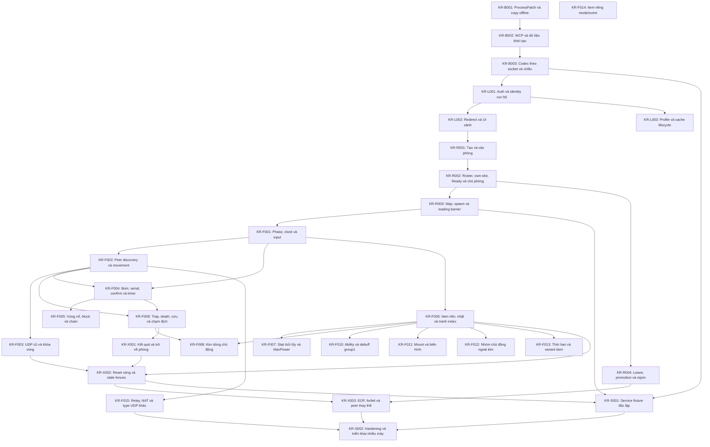

# Tra cứu chức năng KR00967

Sinh từ [catalog](features.json) bằng `python3 tools/feature_catalog.py --generate`; không sửa tay.

Catalog là chỉ mục khai báo có giới hạn theo nguồn. `present` chỉ xác nhận cơ chế hẹp hiện diện,
không xác nhận mọi biến thể. `partial` là một phần đã đọc/viết; `checked` là emulation có oracle;
`observed` là phạm vi runtime ở evidence. `unknown` không có nghĩa vắng mặt.
Integration `partial` chỉ một phần đường chạy đã đo; luôn đọc giới hạn tại nguồn, kể cả một hàng gồm nhiều tác dụng.
Không tính phần trăm hoặc suy gate từ các cột. Đồ thị thể hiện dependency của kịch bản, không phải thứ tự ưu tiên.

Tra một hàng → thẻ cùng ID → contract/giới hạn, bằng chứng/hash, khoảng trống/phép kiểm.
Thứ tự thực hiện chỉ ở [PLAN](PLAN.md#current-order); câu hỏi ở [RESEARCH](RESEARCH.md#feature-gaps);
lịch sử/review/merge ở [manifest](evidence/checkpoints/manifest.json).
Runtime tách Wine copy chẩn đoán / Windows nguyên bản / LAN / Internet; không suy tương đương giữa môi trường.
Implementation `branch_pending` chưa có PR; `via_pr` dẫn tới PR giữ trạng thái tích hợp hiện tại;
`baseline_merged` nói về code đã có tại baseline. Trạng thái GitHub không được checker suy từ runtime.
Review độc lập: [waived theo chủ dự án](evidence/checkpoints/review-waiver.json); Codex tự kiểm.

## Coverage khai báo

| ID / chức năng | Presence | VN ref | KR static | Emulation | Wine copy | Windows gốc | LAN | Internet | Implementation / delivery | Integration | Gate |
|---|---|---|---|---|---|---|---|---|---|---|---|
| [KR-B001 · ProcessPatch và copy offline](#kr-b001) | present | both | partial | checked | observed | unknown | unknown | unknown | partial / via_pr | partial | K1: open |
| [KR-B002 · WCP và dữ liệu khởi tạo](#kr-b002) | present | both | partial | checked | observed | unknown | unknown | unknown | partial / via_pr | partial | K2: open |
| [KR-B003 · Codec theo socket và chiều](#kr-b003) | present | both | partial | checked | observed | unknown | unknown | unknown | partial / via_pr | partial | K2: open |
| [KR-L001 · Auth và identity cục bộ](#kr-l001) | present | both | partial | checked | observed | unknown | unknown | unknown | partial / via_pr | partial | K3: open |
| [KR-L002 · Redirect và UI sảnh](#kr-l002) | present | both | partial | checked | observed | unknown | unknown | unknown | partial / via_pr | partial | K3: open |
| [KR-L003 · Profile và cache lifecycle](#kr-l003) | present | static | partial | checked | observed | unknown | unknown | unknown | partial / via_pr | partial | K3: open |
| [KR-R001 · Tạo và vào phòng](#kr-r001) | present | both | partial | checked | observed | unknown | unknown | unknown | partial / via_pr | partial | K4: open |
| [KR-R002 · Roster, own-slot, Ready và chủ phòng](#kr-r002) | present | both | partial | checked | observed | unknown | unknown | unknown | partial / via_pr | partial | K4: open |
| [KR-R003 · Map, spawn và loading barrier](#kr-r003) | present | both | partial | checked | observed | unknown | unknown | unknown | partial / via_pr | partial | K4: open |
| [KR-R004 · Leave, promotion và rejoin](#kr-r004) | present | both | partial | checked | observed | unknown | unknown | unknown | partial / via_pr | partial | K4: open |
| [KR-F001 · Phase, clock và input](#kr-f001) | present | both | partial | checked | observed | unknown | unknown | unknown | partial / via_pr | partial | K5: open |
| [KR-F002 · Peer discovery và movement](#kr-f002) | present | both | partial | checked | observed | unknown | unknown | unknown | partial / via_pr | partial | K6: open |
| [KR-F003 · UDP cũ và khóa vòng](#kr-f003) | present | both | partial | checked | observed | unknown | unknown | unknown | partial / via_pr | partial | K6: open |
| [KR-F004 · Bom, serial, confirm và timer](#kr-f004) | present | both | partial | checked | observed | unknown | unknown | unknown | partial / via_pr | partial | K5: open |
| [KR-F005 · Vùng nổ, block và chain](#kr-f005) | present | both | partial | checked | observed | unknown | unknown | unknown | unknown / unknown | unknown | K5: open |
| [KR-F006 · Item nền, nhặt và tranh index](#kr-f006) | present | both | partial | checked | observed | unknown | unknown | unknown | partial / via_pr | partial | K5: open |
| [KR-F007 · Stat tích lũy và MaxPower](#kr-f007) | present | both | partial | checked | observed | unknown | unknown | unknown | partial / via_pr | partial | K5: open |
| [KR-F008 · Kim dùng chủ động](#kr-f008) | present | both | partial | checked | observed | unknown | unknown | unknown | unknown / unknown | unknown | K5: open |
| [KR-F009 · Trap, death, cứu và chạm địch](#kr-f009) | present | both | partial | checked | observed | unknown | unknown | unknown | partial / via_pr | partial | K5: open |
| [KR-F010 · Ability và debuff group1](#kr-f010) | present | static | partial | unknown | unknown | unknown | unknown | unknown | unknown / unknown | unknown | K5: open |
| [KR-F011 · Mount và biến hình](#kr-f011) | present | static | partial | unknown | unknown | unknown | unknown | unknown | unknown / unknown | unknown | K5: open |
| [KR-F012 · Nhóm chủ động ngoài kim](#kr-f012) | candidate | static | partial | unknown | unknown | unknown | unknown | unknown | unknown / unknown | unknown | K5: open |
| [KR-F013 · Thời hạn và variant item](#kr-f013) | candidate | static | partial | unknown | unknown | unknown | unknown | unknown | unknown / unknown | unknown | K5: open |
| [KR-F014 · Item riêng mode/event](#kr-f014) | candidate | static | partial | unknown | unknown | unknown | unknown | unknown | unknown / unknown | unknown | K5: open |
| [KR-F015 · Relay, NAT và type UDP khác](#kr-f015) | candidate | both | partial | unknown | unknown | unknown | unknown | unknown | unknown / unknown | unknown | K6: open |
| [KR-X001 · Kết quả và trở về phòng](#kr-x001) | present | both | partial | checked | observed | unknown | unknown | unknown | partial / via_pr | partial | K5: open |
| [KR-X002 · Reset vòng và stale fences](#kr-x002) | present | both | partial | checked | observed | unknown | unknown | unknown | partial / via_pr | partial | K6: open |
| [KR-X003 · EOF, forfeit và peer thay thế](#kr-x003) | present | both | partial | checked | observed | unknown | unknown | unknown | partial / via_pr | partial | K6: open |
| [KR-S001 · Service fixture độc lập](#kr-s001) | unknown | both | unknown | unknown | observed | unknown | unknown | unknown | partial / via_pr | partial | K6: open |
| [KR-S002 · Hardening và triển khai nhiều máy](#kr-s002) | unknown | static | unknown | unknown | unknown | unknown | unknown | unknown | unknown / unknown | unknown | K7: open |

Số lượng theo trạng thái khai báo (không phải tỷ lệ hoàn thành):

- presence: candidate=4, present=24, unknown=2.
- kr_static: partial=28, unknown=2.
- emulation: checked=22, unknown=8.
- implementation: partial=21, unknown=9.
- integration: partial=21, unknown=9.
- gate: open=30.

## Cây cơ chế

```mermaid
flowchart TD
  KR_G000["KR-G000: KR00967: Battle offline"]
  KR_G001["KR-G001: Bootstrap"]
  KR_G002["KR-G002: Login và sảnh"]
  KR_G003["KR-G003: Phòng và load"]
  KR_G004["KR-G004: Battle"]
  KR_G005["KR-G005: Kết quả và reset"]
  KR_G006["KR-G006: Service và vận hành"]
  KR_B001["KR-B001: ProcessPatch và copy offline"]
  KR_B002["KR-B002: WCP và dữ liệu khởi tạo"]
  KR_B003["KR-B003: Codec theo socket và chiều"]
  KR_L001["KR-L001: Auth và identity cục bộ"]
  KR_L002["KR-L002: Redirect và UI sảnh"]
  KR_L003["KR-L003: Profile và cache lifecycle"]
  KR_R001["KR-R001: Tạo và vào phòng"]
  KR_R002["KR-R002: Roster, own-slot, Ready và chủ phòng"]
  KR_R003["KR-R003: Map, spawn và loading barrier"]
  KR_R004["KR-R004: Leave, promotion và rejoin"]
  KR_F001["KR-F001: Phase, clock và input"]
  KR_F002["KR-F002: Peer discovery và movement"]
  KR_F003["KR-F003: UDP cũ và khóa vòng"]
  KR_F004["KR-F004: Bom, serial, confirm và timer"]
  KR_F005["KR-F005: Vùng nổ, block và chain"]
  KR_F006["KR-F006: Item nền, nhặt và tranh index"]
  KR_F007["KR-F007: Stat tích lũy và MaxPower"]
  KR_F008["KR-F008: Kim dùng chủ động"]
  KR_F009["KR-F009: Trap, death, cứu và chạm địch"]
  KR_F010["KR-F010: Ability và debuff group1"]
  KR_F011["KR-F011: Mount và biến hình"]
  KR_F012["KR-F012: Nhóm chủ động ngoài kim"]
  KR_F013["KR-F013: Thời hạn và variant item"]
  KR_F014["KR-F014: Item riêng mode/event"]
  KR_F015["KR-F015: Relay, NAT và type UDP khác"]
  KR_X001["KR-X001: Kết quả và trở về phòng"]
  KR_X002["KR-X002: Reset vòng và stale fences"]
  KR_X003["KR-X003: EOF, forfeit và peer thay thế"]
  KR_S001["KR-S001: Service fixture độc lập"]
  KR_S002["KR-S002: Hardening và triển khai nhiều máy"]
  KR_G000 --> KR_G001
  KR_G000 --> KR_G002
  KR_G000 --> KR_G003
  KR_G000 --> KR_G004
  KR_G000 --> KR_G005
  KR_G000 --> KR_G006
  KR_G001 --> KR_B001
  KR_G001 --> KR_B002
  KR_G001 --> KR_B003
  KR_G002 --> KR_L001
  KR_G002 --> KR_L002
  KR_G002 --> KR_L003
  KR_G003 --> KR_R001
  KR_G003 --> KR_R002
  KR_G003 --> KR_R003
  KR_G003 --> KR_R004
  KR_G004 --> KR_F001
  KR_G004 --> KR_F002
  KR_G004 --> KR_F003
  KR_G004 --> KR_F004
  KR_G004 --> KR_F005
  KR_G004 --> KR_F006
  KR_G004 --> KR_F007
  KR_G004 --> KR_F008
  KR_G004 --> KR_F009
  KR_G004 --> KR_F010
  KR_G004 --> KR_F011
  KR_G004 --> KR_F012
  KR_G004 --> KR_F013
  KR_G004 --> KR_F014
  KR_G004 --> KR_F015
  KR_G005 --> KR_X001
  KR_G005 --> KR_X002
  KR_G005 --> KR_X003
  KR_G006 --> KR_S001
  KR_G006 --> KR_S002
```

## Dependency kịch bản

## Tra theo cơ chế

### KR-B001 · ProcessPatch và copy offline

Dependency: —.

[Contract và giới hạn](PROTOCOL.md#wcp) · [Câu hỏi gốc](RESEARCH.md#gap-process-patch) · [Thứ tự ở PLAN](PLAN.md#current-order).

Khoảng trống (trích bảng RESEARCH): Đối chứng Windows nguyên bản/ownership và recipe cùng cold start chưa nghiệm thu.

Phép kiểm tối thiểu (trích cùng nguồn): Tái dùng recipe có hash; ba cold start đúng một recipe, gắn network attempt với PID; so Windows control khi mở nhánh bootstrap.

Bằng chứng/build/hash/recipe: [bootstrap-wire](evidence/bootstrap-wire/README.md), [probe-service](evidence/probe-service/README.md).

| Chiều chứng minh | Khai báo | Nguồn/phạm vi áp dụng |
|---|---|---|
| presence | present | [nguồn1](PROTOCOL.md#wcp) |
| vn_reference | both | [nguồn1](REFERENCES.md) |
| kr_static | partial | [nguồn1](PROTOCOL.md#wcp) |
| emulation | checked | [nguồn1](evidence/bootstrap-wire/README.md) |
| wine_diagnostic_copy | observed | [nguồn1](evidence/bootstrap-wire/README.md) |
| windows_original | unknown | Chưa có bằng chứng trong phạm vi rà |
| lan | unknown | Chưa có bằng chứng trong phạm vi rà |
| internet | unknown | Chưa có bằng chứng trong phạm vi rà |
| implementation | partial / via_pr | [nguồn1](../server/probe_service.py), [nguồn2](PROTOCOL.md#probe-service), [nguồn3](https://github.com/aquaplatinumberlitz/boom-kr-server/pull/57) |
| integration | partial | [nguồn1](evidence/probe-service/README.md) |
| gate | K1: open | [nguồn1](PLAN.md#gates) |

### KR-B002 · WCP và dữ liệu khởi tạo

Dependency: [KR-B001](#kr-b001).

[Contract và giới hạn](PROTOCOL.md#wcp) · [Câu hỏi gốc](RESEARCH.md#gap-wcp-config) · [Thứ tự ở PLAN](PLAN.md#current-order).

Khoảng trống (trích bảng RESEARCH): Fixture tổng hợp đã qua guard; oneclickuser/+E9C và dữ liệu/cache thật chưa đủ.

Phép kiểm tối thiểu (trích cùng nguồn): Chỉ mở consumer/config đang chặn runtime; so nhánh với và không tham số trên cùng copy, không đo lại +E78 đã giải.

Bằng chứng/build/hash/recipe: [wcp-sequence](evidence/wcp-sequence/README.md), [probe-service](evidence/probe-service/README.md).

| Chiều chứng minh | Khai báo | Nguồn/phạm vi áp dụng |
|---|---|---|
| presence | present | [nguồn1](PROTOCOL.md#wcp) |
| vn_reference | both | [nguồn1](REFERENCES.md) |
| kr_static | partial | [nguồn1](PROTOCOL.md#wcp) |
| emulation | checked | [nguồn1](evidence/wcp-sequence/README.md) |
| wine_diagnostic_copy | observed | [nguồn1](evidence/wcp-sequence/README.md) |
| windows_original | unknown | Chưa có bằng chứng trong phạm vi rà |
| lan | unknown | Chưa có bằng chứng trong phạm vi rà |
| internet | unknown | Chưa có bằng chứng trong phạm vi rà |
| implementation | partial / via_pr | [nguồn1](../server/probe_service.py), [nguồn2](PROTOCOL.md#probe-service), [nguồn3](https://github.com/aquaplatinumberlitz/boom-kr-server/pull/57) |
| integration | partial | [nguồn1](evidence/probe-service/README.md) |
| gate | K2: open | [nguồn1](PLAN.md#gates) |

### KR-B003 · Codec theo socket và chiều

Dependency: [KR-B002](#kr-b002).

[Contract và giới hạn](PROTOCOL.md#wcp) · [Câu hỏi gốc](RESEARCH.md#gap-socket-codec) · [Thứ tự ở PLAN](PLAN.md#current-order).

Khoảng trống (trích bảng RESEARCH): CP057 native stream splits/coalesce/seq và socketpair khớp; prefixguardoff/modelcap,FFFFFFFF allocationmodel blocked, full modes/string/blob/reset/live reconnect chưa nghiệm thu.

Phép kiểm tối thiểu (trích cùng nguồn): Reuse [scope/model](PROTOCOL.md#codec-stream-boundaries); không chạy lại76split hoặc tăng allocator để làm pass. Khi consumer auth/cache gây trigger mới, đo đúng field/mode/prefix/lifecycle trên actual connection; fresh synthetic socket không là reconnect thật.

Bằng chứng/build/hash/recipe: [primitives](evidence/primitives/README.md), [probe-service](evidence/probe-service/README.md), [codec-boundaries](evidence/codec-boundaries/README.md).

| Chiều chứng minh | Khai báo | Nguồn/phạm vi áp dụng |
|---|---|---|
| presence | present | [nguồn1](PROTOCOL.md#wcp) |
| vn_reference | both | [nguồn1](REFERENCES.md) |
| kr_static | partial | [nguồn1](PROTOCOL.md#wcp), [nguồn2](PROTOCOL.md#codec-stream-boundaries) |
| emulation | checked | [nguồn1](evidence/primitives/README.md), [nguồn2](evidence/codec-boundaries/README.md) |
| wine_diagnostic_copy | observed | [nguồn1](evidence/probe-service/README.md) |
| windows_original | unknown | Chưa có bằng chứng trong phạm vi rà |
| lan | unknown | Chưa có bằng chứng trong phạm vi rà |
| internet | unknown | Chưa có bằng chứng trong phạm vi rà |
| implementation | partial / via_pr | [nguồn1](../server/probe_service.py), [nguồn2](PROTOCOL.md#probe-service), [nguồn3](https://github.com/aquaplatinumberlitz/boom-kr-server/pull/57) |
| integration | partial | [nguồn1](evidence/probe-service/README.md) |
| gate | K2: open | [nguồn1](PLAN.md#gates) |

### KR-L001 · Auth và identity cục bộ

Dependency: [KR-B003](#kr-b003).

[Contract và giới hạn](PROTOCOL.md#login-auth) · [Câu hỏi gốc](RESEARCH.md#gap-auth-identity) · [Thứ tự ở PLAN](PLAN.md#current-order).

Khoảng trống (trích bảng RESEARCH): CP060 C135/errors0/ID3/actual6KRNew và B/Ccycle đã kiểm cùngprofile; fieldmeaning/token/accountauthority/count2/otherfeatures vẫn thiếu.

Phép kiểm tối thiểu (trích cùng nguồn): Reuse [Cintegration](PROTOCOL.md#current-profile-c); không lặp Cauth/body/ID. Chỉ mở missingsemantic/variant khi gate/integration có trigger; currentprofiletwo-cycle ở service/resetgap.

Bằng chứng/build/hash/recipe: [login-runtime](evidence/login-runtime/README.md), [probe-service](evidence/probe-service/README.md), [auth-profile](evidence/auth-profile/README.md), [current-profile-c](evidence/current-profile-c/README.md).

| Chiều chứng minh | Khai báo | Nguồn/phạm vi áp dụng |
|---|---|---|
| presence | present | [nguồn1](PROTOCOL.md#login-auth) |
| vn_reference | both | [nguồn1](REFERENCES.md) |
| kr_static | partial | [nguồn1](PROTOCOL.md#login-auth), [nguồn2](PROTOCOL.md#auth-profile) |
| emulation | checked | [nguồn1](evidence/login-runtime/README.md), [nguồn2](evidence/auth-profile/README.md) |
| wine_diagnostic_copy | observed | [nguồn1](evidence/login-runtime/README.md), [nguồn2](evidence/auth-profile/README.md), [nguồn3](evidence/current-profile-c/README.md) |
| windows_original | unknown | Chưa có bằng chứng trong phạm vi rà |
| lan | unknown | Chưa có bằng chứng trong phạm vi rà |
| internet | unknown | Chưa có bằng chứng trong phạm vi rà |
| implementation | partial / via_pr | [nguồn1](../server/probe_service.py), [nguồn2](PROTOCOL.md#probe-service), [nguồn3](https://github.com/aquaplatinumberlitz/boom-kr-server/pull/57), [nguồn4](../tools/export_probe_profile.py), [nguồn5](PROTOCOL.md#auth-profile), [nguồn6](https://github.com/aquaplatinumberlitz/boom-kr-server/pull/77) |
| integration | partial | [nguồn1](evidence/probe-service/README.md), [nguồn2](evidence/auth-profile/README.md), [nguồn3](evidence/current-profile-c/README.md) |
| gate | K3: open | [nguồn1](PLAN.md#gates) |

### KR-L002 · Redirect và UI sảnh

Dependency: [KR-L001](#kr-l001).

[Contract và giới hạn](PROTOCOL.md#channel-lobby) · [Câu hỏi gốc](RESEARCH.md#gap-redirect-lobby) · [Thứ tự ở PLAN](PLAN.md#current-order).

Khoảng trống (trích bảng RESEARCH): UI sảnh copy đã có; thông tin user/cache/version và variants chưa đủ K3.

Phép kiểm tối thiểu (trích cùng nguồn): Kiểm identity hiển thị cùng request6/17/241 trên cold/warm/missing cache, log stage/seq; không suy từ cửa sổ.

Bằng chứng/build/hash/recipe: [postwait](evidence/postwait/README.md), [probe-service](evidence/probe-service/README.md).

| Chiều chứng minh | Khai báo | Nguồn/phạm vi áp dụng |
|---|---|---|
| presence | present | [nguồn1](PROTOCOL.md#channel-lobby) |
| vn_reference | both | [nguồn1](REFERENCES.md) |
| kr_static | partial | [nguồn1](PROTOCOL.md#channel-lobby) |
| emulation | checked | [nguồn1](evidence/postwait/README.md) |
| wine_diagnostic_copy | observed | [nguồn1](evidence/postwait/README.md) |
| windows_original | unknown | Chưa có bằng chứng trong phạm vi rà |
| lan | unknown | Chưa có bằng chứng trong phạm vi rà |
| internet | unknown | Chưa có bằng chứng trong phạm vi rà |
| implementation | partial / via_pr | [nguồn1](../server/probe_service.py), [nguồn2](PROTOCOL.md#probe-service), [nguồn3](https://github.com/aquaplatinumberlitz/boom-kr-server/pull/57) |
| integration | partial | [nguồn1](evidence/probe-service/README.md) |
| gate | K3: open | [nguồn1](PLAN.md#gates) |

### KR-L003 · Profile và cache lifecycle

Dependency: [KR-L001](#kr-l001).

[Contract và giới hạn](PROTOCOL.md#channel-lobby) · [Câu hỏi gốc](RESEARCH.md#gap-profile-cache) · [Thứ tự ở PLAN](PLAN.md#current-order).

Khoảng trống (trích bảng RESEARCH): CP059 namedfxdynmapinfo missing→write→warm đã nhận; CRC selector+representation trướcinflate giải lệchraw/nén. Toàncache/profile/version/corrupt/reconnect vẫn mở.

Phép kiểm tối thiểu (trích cùng nguồn): Reuse [scope/CRC](PROTOCOL.md#dynamic-cache-representation); không lặp namedcache này. Chỉ mở cachefile/variant khác khi native consumer hoặc acceptance có trigger; freshprefix không là coldallcache.

Bằng chứng/build/hash/recipe: [start-reply](evidence/start-reply/README.md), [cache-boundary](evidence/cache-boundary/README.md).

| Chiều chứng minh | Khai báo | Nguồn/phạm vi áp dụng |
|---|---|---|
| presence | present | [nguồn1](PROTOCOL.md#channel-lobby), [nguồn2](PROTOCOL.md#dynamic-cache-representation) |
| vn_reference | static | [nguồn1](REFERENCES.md) |
| kr_static | partial | [nguồn1](PROTOCOL.md#channel-lobby), [nguồn2](PROTOCOL.md#dynamic-cache-representation) |
| emulation | checked | [nguồn1](evidence/cache-boundary/README.md) |
| wine_diagnostic_copy | observed | [nguồn1](evidence/cache-boundary/README.md) |
| windows_original | unknown | Chưa có bằng chứng trong phạm vi rà |
| lan | unknown | Chưa có bằng chứng trong phạm vi rà |
| internet | unknown | Chưa có bằng chứng trong phạm vi rà |
| implementation | partial / via_pr | [nguồn1](../tools/export_probe_profile.py), [nguồn2](PROTOCOL.md#dynamic-cache-representation), [nguồn3](https://github.com/aquaplatinumberlitz/boom-kr-server/pull/79) |
| integration | partial | [nguồn1](evidence/cache-boundary/README.md) |
| gate | K3: open | [nguồn1](PLAN.md#gates) |

### KR-R001 · Tạo và vào phòng

Dependency: [KR-L002](#kr-l002).

[Contract và giới hạn](PROTOCOL.md#duo-room-round) · [Câu hỏi gốc](RESEARCH.md#gap-create-join) · [Thứ tự ở PLAN](PLAN.md#current-order).

Khoảng trống (trích bảng RESEARCH): Password/full/error/capacity và auth roster tổng quát chưa kiểm.

Phép kiểm tối thiểu (trích cùng nguồn): So actual81/82 với consumer86/87 và slot hai phía; bổ sung lỗi/room-full từng ca khi service cần, không copy opcode VN.

Bằng chứng/build/hash/recipe: [duo-room-round](evidence/duo-room-round/README.md), [probe-service](evidence/probe-service/README.md).

| Chiều chứng minh | Khai báo | Nguồn/phạm vi áp dụng |
|---|---|---|
| presence | present | [nguồn1](PROTOCOL.md#duo-room-round) |
| vn_reference | both | [nguồn1](REFERENCES.md) |
| kr_static | partial | [nguồn1](PROTOCOL.md#duo-room-round) |
| emulation | checked | [nguồn1](evidence/duo-room-round/README.md) |
| wine_diagnostic_copy | observed | [nguồn1](evidence/duo-room-round/README.md) |
| windows_original | unknown | Chưa có bằng chứng trong phạm vi rà |
| lan | unknown | Chưa có bằng chứng trong phạm vi rà |
| internet | unknown | Chưa có bằng chứng trong phạm vi rà |
| implementation | partial / via_pr | [nguồn1](../server/probe_service.py), [nguồn2](PROTOCOL.md#probe-service), [nguồn3](https://github.com/aquaplatinumberlitz/boom-kr-server/pull/57) |
| integration | partial | [nguồn1](evidence/probe-service/README.md) |
| gate | K4: open | [nguồn1](PLAN.md#gates) |

### KR-R002 · Roster, own-slot, Ready và chủ phòng

Dependency: [KR-R001](#kr-r001).

[Contract và giới hạn](PROTOCOL.md#room-player) · [Câu hỏi gốc](RESEARCH.md#gap-roster-ready-host) · [Thứ tự ở PLAN](PLAN.md#current-order).

Khoảng trống (trích bảng RESEARCH): Full roster/ID thay đổi và unready/load race chưa nghiệm thu.

Phép kiểm tối thiểu (trích cùng nguồn): Kiểm socket→ID→slot hiện hành và Ready/host controls; dùng ca promotion đã đo làm reference cho service.

Bằng chứng/build/hash/recipe: [room-player](evidence/room-player/README.md), [probe-service](evidence/probe-service/README.md).

| Chiều chứng minh | Khai báo | Nguồn/phạm vi áp dụng |
|---|---|---|
| presence | present | [nguồn1](PROTOCOL.md#room-player) |
| vn_reference | both | [nguồn1](REFERENCES.md) |
| kr_static | partial | [nguồn1](PROTOCOL.md#room-player) |
| emulation | checked | [nguồn1](evidence/room-player/README.md) |
| wine_diagnostic_copy | observed | [nguồn1](evidence/room-player/README.md) |
| windows_original | unknown | Chưa có bằng chứng trong phạm vi rà |
| lan | unknown | Chưa có bằng chứng trong phạm vi rà |
| internet | unknown | Chưa có bằng chứng trong phạm vi rà |
| implementation | partial / via_pr | [nguồn1](../server/probe_service.py), [nguồn2](PROTOCOL.md#probe-service), [nguồn3](https://github.com/aquaplatinumberlitz/boom-kr-server/pull/57) |
| integration | partial | [nguồn1](evidence/probe-service/README.md) |
| gate | K4: open | [nguồn1](PLAN.md#gates) |

### KR-R003 · Map, spawn và loading barrier

Dependency: [KR-R002](#kr-r002).

[Contract và giới hạn](PROTOCOL.md#start-reply) · [Câu hỏi gốc](RESEARCH.md#gap-map-spawn-loading) · [Thứ tự ở PLAN](PLAN.md#current-order).

Khoảng trống (trích bảng RESEARCH): CP050 giữ actualB99 dispatch10s: chưa phase trước release, hai clock sau; timeout/loadfail/latejoin và variants/104growth còn mở.

Phép kiểm tối thiểu (trích cùng nguồn): Reuse ca hold99, không chạy lại cùng phép để lấp unknown cũ. Khi cần kiểm loadfail/timeout, chặn đúng99 hoặc reply có log và quan sát policy/consumer còn thiếu.

Bằng chứng/build/hash/recipe: [start-reply](evidence/start-reply/README.md), [probe-service](evidence/probe-service/README.md), [service-eof](evidence/service-eof/README.md).

| Chiều chứng minh | Khai báo | Nguồn/phạm vi áp dụng |
|---|---|---|
| presence | present | [nguồn1](PROTOCOL.md#start-reply) |
| vn_reference | both | [nguồn1](REFERENCES.md) |
| kr_static | partial | [nguồn1](PROTOCOL.md#start-reply) |
| emulation | checked | [nguồn1](evidence/start-reply/README.md) |
| wine_diagnostic_copy | observed | [nguồn1](evidence/start-reply/README.md), [nguồn2](evidence/service-eof/README.md) |
| windows_original | unknown | Chưa có bằng chứng trong phạm vi rà |
| lan | unknown | Chưa có bằng chứng trong phạm vi rà |
| internet | unknown | Chưa có bằng chứng trong phạm vi rà |
| implementation | partial / via_pr | [nguồn1](../server/probe_service.py), [nguồn2](PROTOCOL.md#service-eof), [nguồn3](https://github.com/aquaplatinumberlitz/boom-kr-server/pull/61) |
| integration | partial | [nguồn1](evidence/service-eof/README.md) |
| gate | K4: open | [nguồn1](PLAN.md#gates) |

### KR-R004 · Leave, promotion và rejoin

Dependency: [KR-R002](#kr-r002).

[Contract và giới hạn](PROTOCOL.md#room-rejoin) · [Câu hỏi gốc](RESEARCH.md#gap-room-membership) · [Thứ tự ở PLAN](PLAN.md#current-order).

Khoảng trống (trích bảng RESEARCH): CP054 C3 thay A trước round1/BStart/B-Cresult đã có native proof; admission sau cleanup+mappedB/idle đã tích hợp. Account/general membership/UI Back service tổng quát vẫn mở.

Phép kiểm tối thiểu (trích cùng nguồn): Theo PLAN chỉ mở membership variant có trigger đang chặn integration; giữ ID/account/slot tách nhau và fixture limits, không tìm lại C106/87/110.

Bằng chứng/build/hash/recipe: [room-rejoin](evidence/room-rejoin/README.md), [service-eof](evidence/service-eof/README.md), [service-replacement](evidence/service-replacement/README.md), [setup-eof](evidence/setup-eof/README.md), [host-setup](evidence/host-setup/README.md), [prestart-replacement](evidence/prestart-replacement/README.md).

| Chiều chứng minh | Khai báo | Nguồn/phạm vi áp dụng |
|---|---|---|
| presence | present | [nguồn1](PROTOCOL.md#room-rejoin) |
| vn_reference | both | [nguồn1](REFERENCES.md) |
| kr_static | partial | [nguồn1](PROTOCOL.md#room-rejoin) |
| emulation | checked | [nguồn1](evidence/room-rejoin/README.md) |
| wine_diagnostic_copy | observed | [nguồn1](evidence/room-rejoin/README.md), [nguồn2](evidence/service-eof/README.md), [nguồn3](evidence/service-replacement/README.md), [nguồn4](evidence/setup-eof/README.md), [nguồn5](evidence/host-setup/README.md), [nguồn6](evidence/prestart-replacement/README.md) |
| windows_original | unknown | Chưa có bằng chứng trong phạm vi rà |
| lan | unknown | Chưa có bằng chứng trong phạm vi rà |
| internet | unknown | Chưa có bằng chứng trong phạm vi rà |
| implementation | partial / via_pr | [nguồn1](../server/probe_service.py), [nguồn2](PROTOCOL.md#service-eof), [nguồn3](https://github.com/aquaplatinumberlitz/boom-kr-server/pull/61), [nguồn4](PROTOCOL.md#service-replacement), [nguồn5](https://github.com/aquaplatinumberlitz/boom-kr-server/pull/63), [nguồn6](PROTOCOL.md#setup-eof), [nguồn7](https://github.com/aquaplatinumberlitz/boom-kr-server/pull/65), [nguồn8](PROTOCOL.md#host-setup), [nguồn9](https://github.com/aquaplatinumberlitz/boom-kr-server/pull/67), [nguồn10](PROTOCOL.md#prestart-replacement), [nguồn11](https://github.com/aquaplatinumberlitz/boom-kr-server/pull/69) |
| integration | partial | [nguồn1](evidence/service-eof/README.md), [nguồn2](evidence/service-replacement/README.md), [nguồn3](evidence/setup-eof/README.md), [nguồn4](evidence/host-setup/README.md), [nguồn5](evidence/prestart-replacement/README.md) |
| gate | K4: open | [nguồn1](PLAN.md#gates) |

### KR-F001 · Phase, clock và input

Dependency: [KR-R003](#kr-r003).

[Contract và giới hạn](PROTOCOL.md#round-go) · [Câu hỏi gốc](RESEARCH.md#gap-round-clock) · [Thứ tự ở PLAN](PLAN.md#current-order).

Khoảng trống (trích bảng RESEARCH): 153 đã dùng hai phía; loading delay/phase race và loss chưa nghiệm thu.

Phép kiểm tối thiểu (trích cùng nguồn): Giữ native clock marker và input thật ở cả hai view trong một run có barrier control.

Bằng chứng/build/hash/recipe: [round-go](evidence/round-go/README.md), [probe-service](evidence/probe-service/README.md).

| Chiều chứng minh | Khai báo | Nguồn/phạm vi áp dụng |
|---|---|---|
| presence | present | [nguồn1](PROTOCOL.md#round-go) |
| vn_reference | both | [nguồn1](REFERENCES.md) |
| kr_static | partial | [nguồn1](PROTOCOL.md#round-go) |
| emulation | checked | [nguồn1](evidence/round-go/README.md) |
| wine_diagnostic_copy | observed | [nguồn1](evidence/round-go/README.md) |
| windows_original | unknown | Chưa có bằng chứng trong phạm vi rà |
| lan | unknown | Chưa có bằng chứng trong phạm vi rà |
| internet | unknown | Chưa có bằng chứng trong phạm vi rà |
| implementation | partial / via_pr | [nguồn1](../server/probe_service.py), [nguồn2](PROTOCOL.md#probe-service), [nguồn3](https://github.com/aquaplatinumberlitz/boom-kr-server/pull/57) |
| integration | partial | [nguồn1](evidence/probe-service/README.md) |
| gate | K5: open | [nguồn1](PLAN.md#gates) |

### KR-F002 · Peer discovery và movement

Dependency: [KR-F001](#kr-f001).

[Contract và giới hạn](PROTOCOL.md#peer-duo) · [Câu hỏi gốc](RESEARCH.md#gap-peer-movement) · [Thứ tự ở PLAN](PLAN.md#current-order).

Khoảng trống (trích bảng RESEARCH): Hai client local đã đo; grammar/type khác/reliability và roster thay còn thiếu.

Phép kiểm tối thiểu (trích cùng nguồn): Tái dùng99/153 và consumer đã biết; bắt callback thực cho packet type đang chặn, không quét toàn UDP.

Bằng chứng/build/hash/recipe: [peer-duo](evidence/peer-duo/README.md), [probe-service](evidence/probe-service/README.md), [current-pair-round](evidence/current-pair-round/README.md).

| Chiều chứng minh | Khai báo | Nguồn/phạm vi áp dụng |
|---|---|---|
| presence | present | [nguồn1](PROTOCOL.md#peer-duo) |
| vn_reference | both | [nguồn1](REFERENCES.md) |
| kr_static | partial | [nguồn1](PROTOCOL.md#peer-duo) |
| emulation | checked | [nguồn1](evidence/peer-duo/README.md) |
| wine_diagnostic_copy | observed | [nguồn1](evidence/peer-duo/README.md), [nguồn2](evidence/current-pair-round/README.md) |
| windows_original | unknown | Chưa có bằng chứng trong phạm vi rà |
| lan | unknown | Chưa có bằng chứng trong phạm vi rà |
| internet | unknown | Chưa có bằng chứng trong phạm vi rà |
| implementation | partial / via_pr | [nguồn1](../server/probe_service.py), [nguồn2](PROTOCOL.md#probe-service), [nguồn3](https://github.com/aquaplatinumberlitz/boom-kr-server/pull/57) |
| integration | partial | [nguồn1](evidence/probe-service/README.md), [nguồn2](evidence/current-pair-round/README.md) |
| gate | K6: open | [nguồn1](PLAN.md#gates) |

### KR-F003 · UDP cũ và khóa vòng

Dependency: [KR-F002](#kr-f002).

[Contract và giới hạn](PROTOCOL.md#udp-generation) · [Câu hỏi gốc](RESEARCH.md#gap-udp-freshness) · [Thứ tự ở PLAN](PLAN.md#current-order).

Khoảng trống (trích bảng RESEARCH): low8 key không là auth/epoch tổng quát; reuse sau256 và slot/profileID đổi còn mở.

Phép kiểm tối thiểu (trích cùng nguồn): Tái dùng same-run CP048 đã có one-key/Start và old-drop/current-apply; chỉ đo lifetime/roster/ID thay hoặc packet type còn thiếu theo blocker.

Bằng chứng/build/hash/recipe: [udp-freshness](evidence/udp-freshness/README.md), [probe-service](evidence/probe-service/README.md).

| Chiều chứng minh | Khai báo | Nguồn/phạm vi áp dụng |
|---|---|---|
| presence | present | [nguồn1](PROTOCOL.md#udp-generation) |
| vn_reference | both | [nguồn1](REFERENCES.md) |
| kr_static | partial | [nguồn1](PROTOCOL.md#udp-generation) |
| emulation | checked | [nguồn1](evidence/udp-freshness/README.md) |
| wine_diagnostic_copy | observed | [nguồn1](evidence/udp-freshness/README.md) |
| windows_original | unknown | Chưa có bằng chứng trong phạm vi rà |
| lan | unknown | Chưa có bằng chứng trong phạm vi rà |
| internet | unknown | Chưa có bằng chứng trong phạm vi rà |
| implementation | partial / via_pr | [nguồn1](../server/probe_service.py), [nguồn2](PROTOCOL.md#probe-service), [nguồn3](https://github.com/aquaplatinumberlitz/boom-kr-server/pull/57) |
| integration | partial | [nguồn1](evidence/probe-service/README.md) |
| gate | K6: open | [nguồn1](PLAN.md#gates) |

### KR-F004 · Bom, serial, confirm và timer

Dependency: [KR-F001](#kr-f001), [KR-F002](#kr-f002).

[Contract và giới hạn](PROTOCOL.md#bomb-serial) · [Câu hỏi gốc](RESEARCH.md#gap-bomb-lifetime) · [Thứ tự ở PLAN](PLAN.md#current-order).

Khoảng trống (trích bảng RESEARCH): Serial wrap/concurrent/old159 pending match và validator đầy đủ còn mở.

Phép kiểm tối thiểu (trích cùng nguồn): Tái dùng CP041/043/044; kiểm ticket gốc trước159/158 ở result/EOF và vòng mới, không cấp ticket mới từ wire_id cũ.

Bằng chứng/build/hash/recipe: [bomb-serial](evidence/bomb-serial/README.md), [probe-service](evidence/probe-service/README.md).

| Chiều chứng minh | Khai báo | Nguồn/phạm vi áp dụng |
|---|---|---|
| presence | present | [nguồn1](PROTOCOL.md#bomb-serial) |
| vn_reference | both | [nguồn1](REFERENCES.md) |
| kr_static | partial | [nguồn1](PROTOCOL.md#bomb-serial) |
| emulation | checked | [nguồn1](evidence/bomb-serial/README.md) |
| wine_diagnostic_copy | observed | [nguồn1](evidence/bomb-serial/README.md) |
| windows_original | unknown | Chưa có bằng chứng trong phạm vi rà |
| lan | unknown | Chưa có bằng chứng trong phạm vi rà |
| internet | unknown | Chưa có bằng chứng trong phạm vi rà |
| implementation | partial / via_pr | [nguồn1](../server/probe_service.py), [nguồn2](PROTOCOL.md#probe-service), [nguồn3](https://github.com/aquaplatinumberlitz/boom-kr-server/pull/57) |
| integration | partial | [nguồn1](evidence/probe-service/README.md) |
| gate | K5: open | [nguồn1](PLAN.md#gates) |

### KR-F005 · Vùng nổ, block và chain

Dependency: [KR-F004](#kr-f004).

[Contract và giới hạn](PROTOCOL.md#bomb-chain) · [Câu hỏi gốc](RESEARCH.md#gap-blast-block-chain) · [Thứ tự ở PLAN](PLAN.md#current-order).

Khoảng trống (trích bảng RESEARCH): Đã đo chain hai bom một owner và block/list2; nhiều owner/ba bom/vật cản/list3 chưa kiểm.

Phép kiểm tối thiểu (trích cùng nguồn): Một ca chain khác owner có control cách ô và entity ID/cursor cả hai view; chỉ mở consumer biến thể gây khác biệt.

Bằng chứng/build/hash/recipe: [bomb-chain](evidence/bomb-chain/README.md).

| Chiều chứng minh | Khai báo | Nguồn/phạm vi áp dụng |
|---|---|---|
| presence | present | [nguồn1](PROTOCOL.md#bomb-chain) |
| vn_reference | both | [nguồn1](REFERENCES.md) |
| kr_static | partial | [nguồn1](PROTOCOL.md#bomb-chain) |
| emulation | checked | [nguồn1](evidence/bomb-chain/README.md) |
| wine_diagnostic_copy | observed | [nguồn1](evidence/bomb-chain/README.md) |
| windows_original | unknown | Chưa có bằng chứng trong phạm vi rà |
| lan | unknown | Chưa có bằng chứng trong phạm vi rà |
| internet | unknown | Chưa có bằng chứng trong phạm vi rà |
| implementation | unknown / unknown | Chưa có bằng chứng trong phạm vi rà |
| integration | unknown | Chưa có bằng chứng trong phạm vi rà |
| gate | K5: open | [nguồn1](PLAN.md#gates) |

### KR-F006 · Item nền, nhặt và tranh index

Dependency: [KR-F001](#kr-f001).

[Contract và giới hạn](PROTOCOL.md#item-pickup) · [Câu hỏi gốc](RESEARCH.md#gap-floor-pickup) · [Thứ tự ở PLAN](PLAN.md#current-order).

Khoảng trống (trích bảng RESEARCH): CP056 đã loại bốn forged-current-key dispatch sau17/19 theo report; chưa distance/auth/TCP replay/native eligibility tổng quát, stale/forged127 hoặc rescue/selfescape transition. Nguồn t đã giải, time policy chưa có.

Phép kiểm tối thiểu (trích cùng nguồn): Reuse [report guard](PROTOCOL.md#pickup-report-state); chỉ khi integration mở kim/cứu thì nối1/18/reset thay marker đến Start. Với transport/geometry cần actual C2S path và vị trí/state cùng run; không chạy lại nguồn t/k hoặc coi dispatcher injection là TCP admission.

Bằng chứng/build/hash/recipe: [item-pickup](evidence/item-pickup/README.md), [probe-service](evidence/probe-service/README.md), [stale124](evidence/stale124/README.md), [pickup-time](evidence/pickup-time/README.md), [pickup-state](evidence/pickup-state/README.md), [current-pair-round](evidence/current-pair-round/README.md).

| Chiều chứng minh | Khai báo | Nguồn/phạm vi áp dụng |
|---|---|---|
| presence | present | [nguồn1](PROTOCOL.md#item-pickup) |
| vn_reference | both | [nguồn1](PROTOCOL.md#item-pickup), [nguồn2](REFERENCES.md) |
| kr_static | partial | [nguồn1](PROTOCOL.md#item-pickup), [nguồn2](PROTOCOL.md#pickup-tick), [nguồn3](PROTOCOL.md#pickup-report-state) |
| emulation | checked | [nguồn1](evidence/item-pickup/README.md), [nguồn2](evidence/pickup-time/README.md) |
| wine_diagnostic_copy | observed | [nguồn1](evidence/item-pickup/README.md), [nguồn2](evidence/stale124/README.md), [nguồn3](evidence/pickup-time/README.md), [nguồn4](evidence/pickup-state/README.md), [nguồn5](evidence/current-pair-round/README.md) |
| windows_original | unknown | Chưa có bằng chứng trong phạm vi rà |
| lan | unknown | Chưa có bằng chứng trong phạm vi rà |
| internet | unknown | Chưa có bằng chứng trong phạm vi rà |
| implementation | partial / via_pr | [nguồn1](../server/probe_service.py), [nguồn2](PROTOCOL.md#pickup-round-key), [nguồn3](https://github.com/aquaplatinumberlitz/boom-kr-server/pull/59), [nguồn4](PROTOCOL.md#pickup-report-state), [nguồn5](https://github.com/aquaplatinumberlitz/boom-kr-server/pull/73) |
| integration | partial | [nguồn1](evidence/stale124/README.md), [nguồn2](evidence/pickup-state/README.md), [nguồn3](evidence/current-pair-round/README.md) |
| gate | K5: open | [nguồn1](PLAN.md#gates) |

### KR-F007 · Stat tích lũy và MaxPower

Dependency: [KR-F006](#kr-f006).

[Contract và giới hạn](PROTOCOL.md#item-families) · [Câu hỏi gốc](RESEARCH.md#gap-item-stats) · [Thứ tự ở PLAN](PLAN.md#current-order).

Khoảng trống (trích bảng RESEARCH): Bomb/Fire/Roller/MaxPower có delta hẹp; runtime tại max/pxs KR/TTL/toàn reset chưa đủ.

Phép kiểm tối thiểu (trích cùng nguồn): Tái dùng CP045 và paired165/stat CP048 r3/clock2reset; chỉ đo runtime tại max hoặc pxs khi ca Battle cần, không đo lại Roller5→6 để lấp unknown cũ.

Bằng chứng/build/hash/recipe: [item-families](evidence/item-families/README.md), [probe-service](evidence/probe-service/README.md).

| Chiều chứng minh | Khai báo | Nguồn/phạm vi áp dụng |
|---|---|---|
| presence | present | [nguồn1](PROTOCOL.md#item-families) |
| vn_reference | both | [nguồn1](PROTOCOL.md#item-families) |
| kr_static | partial | [nguồn1](PROTOCOL.md#item-families) |
| emulation | checked | [nguồn1](evidence/item-families/README.md) |
| wine_diagnostic_copy | observed | [nguồn1](evidence/item-families/README.md) |
| windows_original | unknown | Chưa có bằng chứng trong phạm vi rà |
| lan | unknown | Chưa có bằng chứng trong phạm vi rà |
| internet | unknown | Chưa có bằng chứng trong phạm vi rà |
| implementation | partial / via_pr | [nguồn1](../server/probe_service.py), [nguồn2](PROTOCOL.md#probe-service), [nguồn3](https://github.com/aquaplatinumberlitz/boom-kr-server/pull/57) |
| integration | partial | [nguồn1](evidence/probe-service/README.md) |
| gate | K5: open | [nguồn1](PLAN.md#gates) |

### KR-F008 · Kim dùng chủ động

Dependency: [KR-F006](#kr-f006), [KR-F009](#kr-f009).

[Contract và giới hạn](PROTOCOL.md#needle-selfescape) · [Câu hỏi gốc](RESEARCH.md#gap-needle) · [Thứ tự ở PLAN](PLAN.md#current-order).

Khoảng trống (trích bảng RESEARCH): Kim một lần/cạn đã đo; multi-charge/duplicate/inventory validation và Ctrl cạnh tranh còn mở.

Phép kiểm tối thiểu (trích cùng nguồn): Dùng lại actual pickup/Ctrl/170, kiểm một inventory transition cần cho service; không RE lại145/117 hoặc receiver.

Bằng chứng/build/hash/recipe: [needle-repeat](evidence/needle-repeat/README.md).

| Chiều chứng minh | Khai báo | Nguồn/phạm vi áp dụng |
|---|---|---|
| presence | present | [nguồn1](PROTOCOL.md#needle-selfescape) |
| vn_reference | both | [nguồn1](PROTOCOL.md#needle-selfescape), [nguồn2](REFERENCES.md) |
| kr_static | partial | [nguồn1](PROTOCOL.md#needle-selfescape) |
| emulation | checked | [nguồn1](evidence/needle-repeat/README.md) |
| wine_diagnostic_copy | observed | [nguồn1](evidence/needle-repeat/README.md) |
| windows_original | unknown | Chưa có bằng chứng trong phạm vi rà |
| lan | unknown | Chưa có bằng chứng trong phạm vi rà |
| internet | unknown | Chưa có bằng chứng trong phạm vi rà |
| implementation | unknown / unknown | Chưa có bằng chứng trong phạm vi rà |
| integration | unknown | Chưa có bằng chứng trong phạm vi rà |
| gate | K5: open | [nguồn1](PLAN.md#gates) |

### KR-F009 · Trap, death, cứu và chạm địch

Dependency: [KR-F004](#kr-f004), [KR-F002](#kr-f002).

[Contract và giới hạn](PROTOCOL.md#collision-rescue) · [Câu hỏi gốc](RESEARCH.md#gap-contact-state) · [Thứ tự ở PLAN](PLAN.md#current-order).

Khoảng trống (trích bảng RESEARCH): First-eligible native đã biết; both-eligible cùng update/list-order runtime,21/sub34 và authority đầy đủ còn thiếu.

Phép kiểm tối thiểu (trích cùng nguồn): Ưu tiên consistency17/19→170/state hai view→21/result trong cùng run; exact simultaneous chỉ kiểm bổ sung khi có setup cụ thể.

Bằng chứng/build/hash/recipe: [collision-rescue](evidence/collision-rescue/README.md), [probe-service](evidence/probe-service/README.md).

| Chiều chứng minh | Khai báo | Nguồn/phạm vi áp dụng |
|---|---|---|
| presence | present | [nguồn1](PROTOCOL.md#collision-rescue) |
| vn_reference | both | [nguồn1](PROTOCOL.md#collision-rescue), [nguồn2](REFERENCES.md) |
| kr_static | partial | [nguồn1](PROTOCOL.md#collision-rescue) |
| emulation | checked | [nguồn1](evidence/collision-rescue/README.md) |
| wine_diagnostic_copy | observed | [nguồn1](evidence/collision-rescue/README.md) |
| windows_original | unknown | Chưa có bằng chứng trong phạm vi rà |
| lan | unknown | Chưa có bằng chứng trong phạm vi rà |
| internet | unknown | Chưa có bằng chứng trong phạm vi rà |
| implementation | partial / via_pr | [nguồn1](../server/probe_service.py), [nguồn2](PROTOCOL.md#probe-service), [nguồn3](https://github.com/aquaplatinumberlitz/boom-kr-server/pull/57) |
| integration | partial | [nguồn1](evidence/probe-service/README.md) |
| gate | K5: open | [nguồn1](PLAN.md#gates) |

### KR-F010 · Ability và debuff group1

Dependency: [KR-F006](#kr-f006).

[Contract và giới hạn](PROTOCOL.md#item-families) · [Câu hỏi gốc](RESEARCH.md#gap-ability-debuff) · [Thứ tự ở PLAN](PLAN.md#current-order).

Khoảng trống (trích bảng RESEARCH): Shoe/Punch/debuff/TTL chỉ có bảng và một phần selector; không chuyển kết quả MaxPower sang mọi effect.

Phép kiểm tối thiểu (trích cùng nguồn): Chọn đúng ability cần cho Battle rồi trace1191840 selector/virtual tương ứng; đo consume/effect/peer/reset một case và control.

Bằng chứng/build/hash/recipe: [item-families](evidence/item-families/README.md).

| Chiều chứng minh | Khai báo | Nguồn/phạm vi áp dụng |
|---|---|---|
| presence | present | [nguồn1](PROTOCOL.md#item-families) |
| vn_reference | static | [nguồn1](PROTOCOL.md#item-families) |
| kr_static | partial | [nguồn1](PROTOCOL.md#item-families) |
| emulation | unknown | Chưa có bằng chứng trong phạm vi rà |
| wine_diagnostic_copy | unknown | Chưa có bằng chứng trong phạm vi rà |
| windows_original | unknown | Chưa có bằng chứng trong phạm vi rà |
| lan | unknown | Chưa có bằng chứng trong phạm vi rà |
| internet | unknown | Chưa có bằng chứng trong phạm vi rà |
| implementation | unknown / unknown | Chưa có bằng chứng trong phạm vi rà |
| integration | unknown | Chưa có bằng chứng trong phạm vi rà |
| gate | K5: open | [nguồn1](PLAN.md#gates) |

### KR-F011 · Mount và biến hình

Dependency: [KR-F006](#kr-f006).

[Contract và giới hạn](PROTOCOL.md#item-families) · [Câu hỏi gốc](RESEARCH.md#gap-mount) · [Thứ tự ở PLAN](PLAN.md#current-order).

Khoảng trống (trích bảng RESEARCH): Group2 có nhánh riêng; điều kiện/effect/giới hạn/reset runtime KR chưa kiểm.

Phép kiểm tối thiểu (trích cùng nguồn): Chỉ khi fixture Battle cần mount: trace11928A2 tới consumer rồi một pickup/peer/reset; hiện loại khỏi fixture theo policy.

Bằng chứng/build/hash/recipe: [item-families](evidence/item-families/README.md).

| Chiều chứng minh | Khai báo | Nguồn/phạm vi áp dụng |
|---|---|---|
| presence | present | [nguồn1](PROTOCOL.md#item-families) |
| vn_reference | static | [nguồn1](PROTOCOL.md#item-families) |
| kr_static | partial | [nguồn1](PROTOCOL.md#item-families) |
| emulation | unknown | Chưa có bằng chứng trong phạm vi rà |
| wine_diagnostic_copy | unknown | Chưa có bằng chứng trong phạm vi rà |
| windows_original | unknown | Chưa có bằng chứng trong phạm vi rà |
| lan | unknown | Chưa có bằng chứng trong phạm vi rà |
| internet | unknown | Chưa có bằng chứng trong phạm vi rà |
| implementation | unknown / unknown | Chưa có bằng chứng trong phạm vi rà |
| integration | unknown | Chưa có bằng chứng trong phạm vi rà |
| gate | K5: open | [nguồn1](PLAN.md#gates) |

### KR-F012 · Nhóm chủ động ngoài kim

Dependency: [KR-F006](#kr-f006).

[Contract và giới hạn](PROTOCOL.md#item-families) · [Câu hỏi gốc](RESEARCH.md#gap-active-other) · [Thứ tự ở PLAN](PLAN.md#current-order).

Khoảng trống (trích bảng RESEARCH): Dart/Oxygen/Potion/Spring/Drill/RemoteBomb mới là phân loại, chưa chứng minh cùng đường kim.

Phép kiểm tối thiểu (trích cùng nguồn): Chọn một group đang cần, tìm consumer Ctrl/report/confirm; đo điều kiện, tiêu hao, hiệu ứng và peer, không quét từng row.

Bằng chứng/build/hash/recipe: [item-families](evidence/item-families/README.md).

| Chiều chứng minh | Khai báo | Nguồn/phạm vi áp dụng |
|---|---|---|
| presence | candidate | [nguồn1](PROTOCOL.md#item-families) |
| vn_reference | static | [nguồn1](PROTOCOL.md#item-families) |
| kr_static | partial | [nguồn1](PROTOCOL.md#item-families) |
| emulation | unknown | Chưa có bằng chứng trong phạm vi rà |
| wine_diagnostic_copy | unknown | Chưa có bằng chứng trong phạm vi rà |
| windows_original | unknown | Chưa có bằng chứng trong phạm vi rà |
| lan | unknown | Chưa có bằng chứng trong phạm vi rà |
| internet | unknown | Chưa có bằng chứng trong phạm vi rà |
| implementation | unknown / unknown | Chưa có bằng chứng trong phạm vi rà |
| integration | unknown | Chưa có bằng chứng trong phạm vi rà |
| gate | K5: open | [nguồn1](PLAN.md#gates) |

### KR-F013 · Thời hạn và variant item

Dependency: [KR-F006](#kr-f006).

[Contract và giới hạn](PROTOCOL.md#item-families) · [Câu hỏi gốc](RESEARCH.md#gap-timed-variants) · [Thứ tự ở PLAN](PLAN.md#current-order).

Khoảng trống (trích bảng RESEARCH): Shield/Sensor/SJNeedle raw tail chưa chứng minh đơn vị/thời hạn/hành vi KR.

Phép kiểm tối thiểu (trích cùng nguồn): Trace consumer timer/group cần dùng, đo start/expiry/cancel/reset và peer với control; không suy ms từ tên hoặc raw số.

Bằng chứng/build/hash/recipe: [item-families](evidence/item-families/README.md).

| Chiều chứng minh | Khai báo | Nguồn/phạm vi áp dụng |
|---|---|---|
| presence | candidate | [nguồn1](PROTOCOL.md#item-families) |
| vn_reference | static | [nguồn1](PROTOCOL.md#item-families) |
| kr_static | partial | [nguồn1](PROTOCOL.md#item-families) |
| emulation | unknown | Chưa có bằng chứng trong phạm vi rà |
| wine_diagnostic_copy | unknown | Chưa có bằng chứng trong phạm vi rà |
| windows_original | unknown | Chưa có bằng chứng trong phạm vi rà |
| lan | unknown | Chưa có bằng chứng trong phạm vi rà |
| internet | unknown | Chưa có bằng chứng trong phạm vi rà |
| implementation | unknown / unknown | Chưa có bằng chứng trong phạm vi rà |
| integration | unknown | Chưa có bằng chứng trong phạm vi rà |
| gate | K5: open | [nguồn1](PLAN.md#gates) |

### KR-F014 · Item riêng mode/event

Dependency: —.

[Contract và giới hạn](PROTOCOL.md#item-families) · [Câu hỏi gốc](RESEARCH.md#gap-mode-items) · [Thứ tự ở PLAN](PLAN.md#current-order).

Khoảng trống (trích bảng RESEARCH): ItemAttr cho thấy row/group; presence cơ chế/mode guard/reward runtime vẫn candidate, ngoài Battle tối thiểu.

Phép kiểm tối thiểu (trích cùng nguồn): Chỉ mở group mode khi PLAN mở mode đó; bắt guard/consumer trước thử runtime, HPNeedle17 không là Needle145.

Bằng chứng/build/hash/recipe: [item-families](evidence/item-families/README.md).

| Chiều chứng minh | Khai báo | Nguồn/phạm vi áp dụng |
|---|---|---|
| presence | candidate | [nguồn1](PROTOCOL.md#item-families) |
| vn_reference | static | [nguồn1](PROTOCOL.md#item-families) |
| kr_static | partial | [nguồn1](PROTOCOL.md#item-families) |
| emulation | unknown | Chưa có bằng chứng trong phạm vi rà |
| wine_diagnostic_copy | unknown | Chưa có bằng chứng trong phạm vi rà |
| windows_original | unknown | Chưa có bằng chứng trong phạm vi rà |
| lan | unknown | Chưa có bằng chứng trong phạm vi rà |
| internet | unknown | Chưa có bằng chứng trong phạm vi rà |
| implementation | unknown / unknown | Chưa có bằng chứng trong phạm vi rà |
| integration | unknown | Chưa có bằng chứng trong phạm vi rà |
| gate | K5: open | [nguồn1](PLAN.md#gates) |

### KR-F015 · Relay, NAT và type UDP khác

Dependency: [KR-F002](#kr-f002).

[Contract và giới hạn](PROTOCOL.md#udp-generation) · [Câu hỏi gốc](RESEARCH.md#gap-peer-relay) · [Thứ tự ở PLAN](PLAN.md#current-order).

Khoảng trống (trích bảng RESEARCH): Relay/NAT và toàn grammar/reliability KR chưa xác nhận; local P2P không là LAN/Internet.

Phép kiểm tối thiểu (trích cùng nguồn): Sau local consistency, chọn endpoint thử được kiểm soát và capture native route; không thiết kế relay như contract đã phục hồi.

Bằng chứng/build/hash/recipe: [peer153](evidence/peer153/README.md).

| Chiều chứng minh | Khai báo | Nguồn/phạm vi áp dụng |
|---|---|---|
| presence | candidate | [nguồn1](PROTOCOL.md#udp-generation) |
| vn_reference | both | [nguồn1](PROTOCOL.md#item-families) |
| kr_static | partial | [nguồn1](PROTOCOL.md#udp-generation) |
| emulation | unknown | Chưa có bằng chứng trong phạm vi rà |
| wine_diagnostic_copy | unknown | Chưa có bằng chứng trong phạm vi rà |
| windows_original | unknown | Chưa có bằng chứng trong phạm vi rà |
| lan | unknown | Chưa có bằng chứng trong phạm vi rà |
| internet | unknown | Chưa có bằng chứng trong phạm vi rà |
| implementation | unknown / unknown | Chưa có bằng chứng trong phạm vi rà |
| integration | unknown | Chưa có bằng chứng trong phạm vi rà |
| gate | K6: open | [nguồn1](PLAN.md#gates) |

### KR-X001 · Kết quả và trở về phòng

Dependency: [KR-F009](#kr-f009).

[Contract và giới hạn](PROTOCOL.md#round-finish) · [Câu hỏi gốc](RESEARCH.md#gap-result-return) · [Thứ tự ở PLAN](PLAN.md#current-order).

Khoảng trống (trích bảng RESEARCH): 175/outcome do policy chọn;21/sub34/chọn rank/authority chưa phục hồi đầy đủ.

Phép kiểm tối thiểu (trích cùng nguồn): Đối chiếu deathstate hai view trước175, cursor/full blob và180/reset trong cùng service run; không coi rank thay state.

Bằng chứng/build/hash/recipe: [round-finish](evidence/round-finish/README.md), [probe-service](evidence/probe-service/README.md).

| Chiều chứng minh | Khai báo | Nguồn/phạm vi áp dụng |
|---|---|---|
| presence | present | [nguồn1](PROTOCOL.md#round-finish) |
| vn_reference | both | [nguồn1](REFERENCES.md) |
| kr_static | partial | [nguồn1](PROTOCOL.md#round-finish) |
| emulation | checked | [nguồn1](evidence/round-finish/README.md) |
| wine_diagnostic_copy | observed | [nguồn1](evidence/round-finish/README.md) |
| windows_original | unknown | Chưa có bằng chứng trong phạm vi rà |
| lan | unknown | Chưa có bằng chứng trong phạm vi rà |
| internet | unknown | Chưa có bằng chứng trong phạm vi rà |
| implementation | partial / via_pr | [nguồn1](../server/probe_service.py), [nguồn2](PROTOCOL.md#probe-service), [nguồn3](https://github.com/aquaplatinumberlitz/boom-kr-server/pull/57) |
| integration | partial | [nguồn1](evidence/probe-service/README.md) |
| gate | K5: open | [nguồn1](PLAN.md#gates) |

### KR-X002 · Reset vòng và stale fences

Dependency: [KR-X001](#kr-x001), [KR-F003](#kr-f003), [KR-F006](#kr-f006).

[Contract và giới hạn](PROTOCOL.md#round-generation) · [Câu hỏi gốc](RESEARCH.md#gap-round-reset) · [Thứ tự ở PLAN](PLAN.md#current-order).

Khoảng trống (trích bảng RESEARCH): Reset field đã đo không là toàn entity/seq/queue/timer/túi; CP049 đã loại old124 khác k, transport/forged-current-key/roster lifetime còn mở.

Phép kiểm tối thiểu (trích cùng nguồn): Tái dùng CP041–047; kiểm job/claim/key owner cùng run ở vòng2 và sau abort, đối chiếu field hiện hành với baseline vòng1.

Bằng chứng/build/hash/recipe: [round-generation](evidence/round-generation/README.md), [probe-service](evidence/probe-service/README.md), [current-pair-round](evidence/current-pair-round/README.md).

| Chiều chứng minh | Khai báo | Nguồn/phạm vi áp dụng |
|---|---|---|
| presence | present | [nguồn1](PROTOCOL.md#round-generation) |
| vn_reference | both | [nguồn1](REFERENCES.md) |
| kr_static | partial | [nguồn1](PROTOCOL.md#round-generation) |
| emulation | checked | [nguồn1](evidence/round-generation/README.md) |
| wine_diagnostic_copy | observed | [nguồn1](evidence/round-generation/README.md), [nguồn2](evidence/current-pair-round/README.md) |
| windows_original | unknown | Chưa có bằng chứng trong phạm vi rà |
| lan | unknown | Chưa có bằng chứng trong phạm vi rà |
| internet | unknown | Chưa có bằng chứng trong phạm vi rà |
| implementation | partial / via_pr | [nguồn1](../server/probe_service.py), [nguồn2](PROTOCOL.md#probe-service), [nguồn3](https://github.com/aquaplatinumberlitz/boom-kr-server/pull/57) |
| integration | partial | [nguồn1](evidence/probe-service/README.md), [nguồn2](evidence/current-pair-round/README.md) |
| gate | K6: open | [nguồn1](PLAN.md#gates) |

### KR-X003 · EOF, forfeit và peer thay thế

Dependency: [KR-X002](#kr-x002), [KR-R004](#kr-r004).

[Contract và giới hạn](PROTOCOL.md#abort-timer) · [Câu hỏi gốc](RESEARCH.md#gap-disconnect-replacement) · [Thứ tự ở PLAN](PLAN.md#current-order).

Khoảng trống (trích bảng RESEARCH): CP052/053 setup guest/hostEOF, CP054 C mới trước vòng1 và một B/C playedround đã đo; không account resume/full reset/idleEOF/sendfailure/timeout/loadfail proof.

Phép kiểm tối thiểu (trích cùng nguồn): Giữ source controls; nếu ca acceptance phát hiện sendfailure/timeout/latejoin thì đo đúng boundary/current roster. Không chạy lại C3/BStart hoặc mở mọi race trước validator/auth debt.

Bằng chứng/build/hash/recipe: [abort-timer](evidence/abort-timer/README.md), [service-eof](evidence/service-eof/README.md), [service-replacement](evidence/service-replacement/README.md), [setup-eof](evidence/setup-eof/README.md), [host-setup](evidence/host-setup/README.md), [prestart-replacement](evidence/prestart-replacement/README.md).

| Chiều chứng minh | Khai báo | Nguồn/phạm vi áp dụng |
|---|---|---|
| presence | present | [nguồn1](PROTOCOL.md#abort-timer) |
| vn_reference | both | [nguồn1](REFERENCES.md) |
| kr_static | partial | [nguồn1](PROTOCOL.md#abort-timer) |
| emulation | checked | [nguồn1](evidence/abort-timer/README.md) |
| wine_diagnostic_copy | observed | [nguồn1](evidence/abort-timer/README.md), [nguồn2](evidence/service-eof/README.md), [nguồn3](evidence/service-replacement/README.md), [nguồn4](evidence/setup-eof/README.md), [nguồn5](evidence/host-setup/README.md), [nguồn6](evidence/prestart-replacement/README.md) |
| windows_original | unknown | Chưa có bằng chứng trong phạm vi rà |
| lan | unknown | Chưa có bằng chứng trong phạm vi rà |
| internet | unknown | Chưa có bằng chứng trong phạm vi rà |
| implementation | partial / via_pr | [nguồn1](../server/probe_service.py), [nguồn2](PROTOCOL.md#service-eof), [nguồn3](https://github.com/aquaplatinumberlitz/boom-kr-server/pull/61), [nguồn4](PROTOCOL.md#service-replacement), [nguồn5](https://github.com/aquaplatinumberlitz/boom-kr-server/pull/63), [nguồn6](PROTOCOL.md#setup-eof), [nguồn7](https://github.com/aquaplatinumberlitz/boom-kr-server/pull/65), [nguồn8](PROTOCOL.md#host-setup), [nguồn9](https://github.com/aquaplatinumberlitz/boom-kr-server/pull/67), [nguồn10](PROTOCOL.md#prestart-replacement), [nguồn11](https://github.com/aquaplatinumberlitz/boom-kr-server/pull/69) |
| integration | partial | [nguồn1](evidence/service-eof/README.md), [nguồn2](evidence/service-replacement/README.md), [nguồn3](evidence/setup-eof/README.md), [nguồn4](evidence/host-setup/README.md), [nguồn5](evidence/prestart-replacement/README.md) |
| gate | K6: open | [nguồn1](PLAN.md#gates) |

### KR-S001 · Service fixture độc lập

Dependency: [KR-B003](#kr-b003), [KR-R003](#kr-r003), [KR-X002](#kr-x002).

[Contract và giới hạn](PROTOCOL.md#probe-service) · [Câu hỏi gốc](RESEARCH.md#gap-diagnostic-service) · [Thứ tự ở PLAN](PLAN.md#current-order).

Khoảng trống (trích bảng RESEARCH): CP061 current41profile A/B2cycles/actualpickup/reset/bomb/state/result đã kiểm; sampled movement hai actor khớp. Chưa currentservice contestedindex/fullreset/authority/transport.

Phép kiểm tối thiểu (trích cùng nguồn): Theo PLAN tái dùng CP030race và ItemClaims với actualtwo124/sameindex; kiểm winner/stat/peer/reset cùngrun, delaydelivery đo nếu cần, không encoderrequest hoặc2rank thay K6a.

Bằng chứng/build/hash/recipe: [probe-service](evidence/probe-service/README.md), [stale124](evidence/stale124/README.md), [service-eof](evidence/service-eof/README.md), [service-replacement](evidence/service-replacement/README.md), [setup-eof](evidence/setup-eof/README.md), [host-setup](evidence/host-setup/README.md), [prestart-replacement](evidence/prestart-replacement/README.md), [pickup-state](evidence/pickup-state/README.md), [current-profile-c](evidence/current-profile-c/README.md), [current-pair-round](evidence/current-pair-round/README.md).

| Chiều chứng minh | Khai báo | Nguồn/phạm vi áp dụng |
|---|---|---|
| presence | unknown | Chưa có bằng chứng trong phạm vi rà |
| vn_reference | both | [nguồn1](REFERENCES.md) |
| kr_static | unknown | Chưa có bằng chứng trong phạm vi rà |
| emulation | unknown | Chưa có bằng chứng trong phạm vi rà |
| wine_diagnostic_copy | observed | [nguồn1](evidence/probe-service/README.md), [nguồn2](evidence/stale124/README.md), [nguồn3](evidence/service-eof/README.md), [nguồn4](evidence/service-replacement/README.md), [nguồn5](evidence/setup-eof/README.md), [nguồn6](evidence/host-setup/README.md), [nguồn7](evidence/prestart-replacement/README.md), [nguồn8](evidence/pickup-state/README.md), [nguồn9](evidence/current-profile-c/README.md), [nguồn10](evidence/current-pair-round/README.md) |
| windows_original | unknown | Chưa có bằng chứng trong phạm vi rà |
| lan | unknown | Chưa có bằng chứng trong phạm vi rà |
| internet | unknown | Chưa có bằng chứng trong phạm vi rà |
| implementation | partial / via_pr | [nguồn1](../server/probe_service.py), [nguồn2](PROTOCOL.md#service-eof), [nguồn3](https://github.com/aquaplatinumberlitz/boom-kr-server/pull/61), [nguồn4](PROTOCOL.md#service-replacement), [nguồn5](https://github.com/aquaplatinumberlitz/boom-kr-server/pull/63), [nguồn6](PROTOCOL.md#setup-eof), [nguồn7](https://github.com/aquaplatinumberlitz/boom-kr-server/pull/65), [nguồn8](PROTOCOL.md#host-setup), [nguồn9](https://github.com/aquaplatinumberlitz/boom-kr-server/pull/67), [nguồn10](PROTOCOL.md#prestart-replacement), [nguồn11](https://github.com/aquaplatinumberlitz/boom-kr-server/pull/69), [nguồn12](PROTOCOL.md#pickup-report-state), [nguồn13](https://github.com/aquaplatinumberlitz/boom-kr-server/pull/73) |
| integration | partial | [nguồn1](evidence/service-eof/README.md), [nguồn2](evidence/service-replacement/README.md), [nguồn3](evidence/setup-eof/README.md), [nguồn4](evidence/host-setup/README.md), [nguồn5](evidence/prestart-replacement/README.md), [nguồn6](evidence/pickup-state/README.md), [nguồn7](evidence/current-profile-c/README.md), [nguồn8](evidence/current-pair-round/README.md) |
| gate | K6: open | [nguồn1](PLAN.md#gates) |

### KR-S002 · Hardening và triển khai nhiều máy

Dependency: [KR-S001](#kr-s001), [KR-X003](#kr-x003), [KR-F015](#kr-f015).

[Contract và giới hạn](PROTOCOL.md#udp-generation) · [Câu hỏi gốc](RESEARCH.md#gap-service-hardening) · [Thứ tự ở PLAN](PLAN.md#current-order).

Khoảng trống (trích bảng RESEARCH): Chưa LAN/Internet/bốn client/restart/backpressure/rate limit/persistence đủ K7.

Phép kiểm tối thiểu (trích cùng nguồn): Sau local gate có evidence, thử hai máy theo K6b rồi loss/disconnect/restart; không lấy loopback accept làm multiplayer.

Bằng chứng/build/hash/recipe: [udp-freshness](evidence/udp-freshness/README.md).

| Chiều chứng minh | Khai báo | Nguồn/phạm vi áp dụng |
|---|---|---|
| presence | unknown | Chưa có bằng chứng trong phạm vi rà |
| vn_reference | static | [nguồn1](REFERENCES.md) |
| kr_static | unknown | Chưa có bằng chứng trong phạm vi rà |
| emulation | unknown | Chưa có bằng chứng trong phạm vi rà |
| wine_diagnostic_copy | unknown | Chưa có bằng chứng trong phạm vi rà |
| windows_original | unknown | Chưa có bằng chứng trong phạm vi rà |
| lan | unknown | Chưa có bằng chứng trong phạm vi rà |
| internet | unknown | Chưa có bằng chứng trong phạm vi rà |
| implementation | unknown / unknown | Chưa có bằng chứng trong phạm vi rà |
| integration | unknown | Chưa có bằng chứng trong phạm vi rà |
| gate | K7: open | [nguồn1](PLAN.md#gates) |
