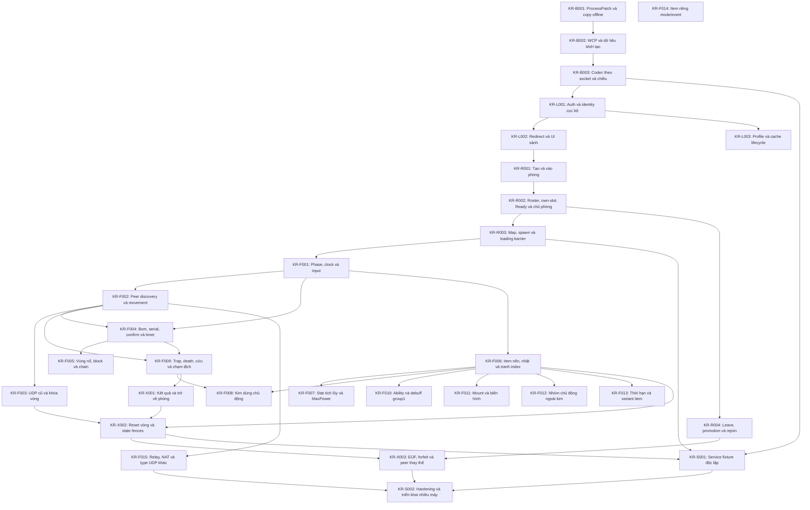

# Tra cứu chức năng KR00967

Sinh từ [catalog](features.json) bằng `python3 tools/feature_catalog.py --generate`; không sửa tay.

Catalog là chỉ mục khai báo có giới hạn theo nguồn. `present` chỉ xác nhận cơ chế hẹp hiện diện,
không xác nhận mọi biến thể. `partial` là một phần đã đọc/viết; `checked` là emulation có oracle;
`observed` là phạm vi runtime ở evidence. `unknown` không có nghĩa vắng mặt.
Integration `partial` chỉ một phần đường chạy đã đo; luôn đọc giới hạn tại nguồn, kể cả một hàng gồm nhiều tác dụng.
Không tính phần trăm hoặc suy gate từ các cột. Đồ thị thể hiện dependency của kịch bản, không phải thứ tự ưu tiên.

Tra một hàng → thẻ cùng ID → contract/giới hạn, bằng chứng/hash, khoảng trống/phép kiểm.
Thứ tự thực hiện chỉ ở [PLAN](PLAN.md#current-order); câu hỏi ở [RESEARCH](RESEARCH.md#feature-gaps);
lịch sử/review/merge ở [manifest](evidence/checkpoints/manifest.json).
Runtime tách Wine copy chẩn đoán / Windows nguyên bản / LAN / Internet; không suy tương đương giữa môi trường.
Implementation `branch_pending` chưa có PR; `via_pr` dẫn tới PR giữ trạng thái tích hợp hiện tại;
`baseline_merged` nói về code đã có tại baseline. Trạng thái GitHub không được checker suy từ runtime.
Review độc lập: [waived theo chủ dự án](evidence/checkpoints/review-waiver.json); Codex tự kiểm.

## Coverage khai báo

| ID / chức năng | Presence | VN ref | KR static | Emulation | Wine copy | Windows gốc | LAN | Internet | Implementation / delivery | Integration | Gate |
|---|---|---|---|---|---|---|---|---|---|---|---|
| [KR-B001 · ProcessPatch và copy offline](#kr-b001) | present | both | partial | checked | observed | unknown | unknown | unknown | partial / via_pr | partial | K1: open |
| [KR-B002 · WCP và dữ liệu khởi tạo](#kr-b002) | present | both | partial | checked | observed | unknown | unknown | unknown | partial / via_pr | partial | K2: open |
| [KR-B003 · Codec theo socket và chiều](#kr-b003) | present | both | partial | checked | observed | unknown | unknown | unknown | partial / via_pr | partial | K2: open |
| [KR-L001 · Auth và identity cục bộ](#kr-l001) | present | both | partial | checked | observed | unknown | unknown | unknown | partial / via_pr | partial | K3: open |
| [KR-L002 · Redirect và UI sảnh](#kr-l002) | present | both | partial | checked | observed | unknown | unknown | unknown | partial / via_pr | partial | K3: open |
| [KR-L003 · Profile và cache lifecycle](#kr-l003) | present | static | partial | checked | observed | unknown | unknown | unknown | partial / via_pr | partial | K3: open |
| [KR-R001 · Tạo và vào phòng](#kr-r001) | present | both | partial | checked | observed | unknown | unknown | unknown | partial / via_pr | partial | K4: open |
| [KR-R002 · Roster, own-slot, Ready và chủ phòng](#kr-r002) | present | both | partial | checked | observed | unknown | unknown | unknown | partial / via_pr | partial | K4: open |
| [KR-R003 · Map, spawn và loading barrier](#kr-r003) | present | both | partial | checked | observed | unknown | unknown | unknown | partial / via_pr | partial | K4: open |
| [KR-R004 · Leave, promotion và rejoin](#kr-r004) | present | both | partial | checked | observed | unknown | unknown | unknown | partial / via_pr | partial | K4: open |
| [KR-F001 · Phase, clock và input](#kr-f001) | present | both | partial | checked | observed | unknown | unknown | unknown | partial / via_pr | partial | K5: open |
| [KR-F002 · Peer discovery và movement](#kr-f002) | present | both | partial | checked | observed | unknown | unknown | unknown | partial / via_pr | partial | K6: open |
| [KR-F003 · UDP cũ và khóa vòng](#kr-f003) | present | both | partial | checked | observed | unknown | unknown | unknown | partial / via_pr | partial | K6: open |
| [KR-F004 · Bom, serial, confirm và timer](#kr-f004) | present | both | partial | checked | observed | unknown | unknown | unknown | partial / via_pr | partial | K5: open |
| [KR-F005 · Vùng nổ, block và chain](#kr-f005) | present | both | partial | checked | observed | unknown | unknown | unknown | partial / via_pr | partial | K5: open |
| [KR-F006 · Item nền, nhặt và tranh index](#kr-f006) | present | both | partial | checked | observed | unknown | unknown | unknown | partial / via_pr | partial | K5: open |
| [KR-F007 · Stat tích lũy và MaxPower](#kr-f007) | present | both | partial | checked | observed | unknown | unknown | unknown | partial / via_pr | partial | K5: open |
| [KR-F008 · Kim dùng chủ động](#kr-f008) | present | both | partial | checked | observed | unknown | unknown | unknown | partial / via_pr | unknown | K5: open |
| [KR-F009 · Trap, death, cứu và chạm địch](#kr-f009) | present | both | partial | checked | observed | unknown | unknown | unknown | partial / via_pr | partial | K5: open |
| [KR-F010 · Ability và debuff group1](#kr-f010) | present | static | partial | unknown | unknown | unknown | unknown | unknown | unknown / unknown | unknown | K5: open |
| [KR-F011 · Mount và biến hình](#kr-f011) | present | static | partial | unknown | unknown | unknown | unknown | unknown | unknown / unknown | unknown | K5: open |
| [KR-F012 · Nhóm chủ động ngoài kim](#kr-f012) | candidate | static | partial | unknown | unknown | unknown | unknown | unknown | unknown / unknown | unknown | K5: open |
| [KR-F013 · Thời hạn và variant item](#kr-f013) | candidate | static | partial | unknown | unknown | unknown | unknown | unknown | unknown / unknown | unknown | K5: open |
| [KR-F014 · Item riêng mode/event](#kr-f014) | candidate | static | partial | unknown | unknown | unknown | unknown | unknown | unknown / unknown | unknown | K5: open |
| [KR-F015 · Relay, NAT và type UDP khác](#kr-f015) | candidate | both | partial | unknown | unknown | unknown | unknown | unknown | unknown / unknown | unknown | K6: open |
| [KR-X001 · Kết quả và trở về phòng](#kr-x001) | present | both | partial | checked | observed | unknown | unknown | unknown | partial / via_pr | partial | K5: open |
| [KR-X002 · Reset vòng và stale fences](#kr-x002) | present | both | partial | checked | observed | unknown | unknown | unknown | partial / via_pr | partial | K6: open |
| [KR-X003 · EOF, forfeit và peer thay thế](#kr-x003) | present | both | partial | checked | observed | unknown | unknown | unknown | partial / via_pr | partial | K6: open |
| [KR-S001 · Service fixture độc lập](#kr-s001) | unknown | both | unknown | unknown | observed | unknown | unknown | unknown | partial / via_pr | partial | K6: open |
| [KR-S002 · Hardening và triển khai nhiều máy](#kr-s002) | unknown | static | unknown | unknown | unknown | unknown | unknown | unknown | unknown / unknown | unknown | K7: open |

Số lượng theo trạng thái khai báo (không phải tỷ lệ hoàn thành):

- presence: candidate=4, present=24, unknown=2.
- kr_static: partial=28, unknown=2.
- emulation: checked=22, unknown=8.
- implementation: partial=23, unknown=7.
- integration: partial=22, unknown=8.
- gate: open=30.

## Cây cơ chế

```mermaid
flowchart TD
  KR_G000["KR-G000: KR00967: Battle offline"]
  KR_G001["KR-G001: Bootstrap"]
  KR_G002["KR-G002: Login và sảnh"]
  KR_G003["KR-G003: Phòng và load"]
  KR_G004["KR-G004: Battle"]
  KR_G005["KR-G005: Kết quả và reset"]
  KR_G006["KR-G006: Service và vận hành"]
  KR_B001["KR-B001: ProcessPatch và copy offline"]
  KR_B002["KR-B002: WCP và dữ liệu khởi tạo"]
  KR_B003["KR-B003: Codec theo socket và chiều"]
  KR_L001["KR-L001: Auth và identity cục bộ"]
  KR_L002["KR-L002: Redirect và UI sảnh"]
  KR_L003["KR-L003: Profile và cache lifecycle"]
  KR_R001["KR-R001: Tạo và vào phòng"]
  KR_R002["KR-R002: Roster, own-slot, Ready và chủ phòng"]
  KR_R003["KR-R003: Map, spawn và loading barrier"]
  KR_R004["KR-R004: Leave, promotion và rejoin"]
  KR_F001["KR-F001: Phase, clock và input"]
  KR_F002["KR-F002: Peer discovery và movement"]
  KR_F003["KR-F003: UDP cũ và khóa vòng"]
  KR_F004["KR-F004: Bom, serial, confirm và timer"]
  KR_F005["KR-F005: Vùng nổ, block và chain"]
  KR_F006["KR-F006: Item nền, nhặt và tranh index"]
  KR_F007["KR-F007: Stat tích lũy và MaxPower"]
  KR_F008["KR-F008: Kim dùng chủ động"]
  KR_F009["KR-F009: Trap, death, cứu và chạm địch"]
  KR_F010["KR-F010: Ability và debuff group1"]
  KR_F011["KR-F011: Mount và biến hình"]
  KR_F012["KR-F012: Nhóm chủ động ngoài kim"]
  KR_F013["KR-F013: Thời hạn và variant item"]
  KR_F014["KR-F014: Item riêng mode/event"]
  KR_F015["KR-F015: Relay, NAT và type UDP khác"]
  KR_X001["KR-X001: Kết quả và trở về phòng"]
  KR_X002["KR-X002: Reset vòng và stale fences"]
  KR_X003["KR-X003: EOF, forfeit và peer thay thế"]
  KR_S001["KR-S001: Service fixture độc lập"]
  KR_S002["KR-S002: Hardening và triển khai nhiều máy"]
  KR_G000 --> KR_G001
  KR_G000 --> KR_G002
  KR_G000 --> KR_G003
  KR_G000 --> KR_G004
  KR_G000 --> KR_G005
  KR_G000 --> KR_G006
  KR_G001 --> KR_B001
  KR_G001 --> KR_B002
  KR_G001 --> KR_B003
  KR_G002 --> KR_L001
  KR_G002 --> KR_L002
  KR_G002 --> KR_L003
  KR_G003 --> KR_R001
  KR_G003 --> KR_R002
  KR_G003 --> KR_R003
  KR_G003 --> KR_R004
  KR_G004 --> KR_F001
  KR_G004 --> KR_F002
  KR_G004 --> KR_F003
  KR_G004 --> KR_F004
  KR_G004 --> KR_F005
  KR_G004 --> KR_F006
  KR_G004 --> KR_F007
  KR_G004 --> KR_F008
  KR_G004 --> KR_F009
  KR_G004 --> KR_F010
  KR_G004 --> KR_F011
  KR_G004 --> KR_F012
  KR_G004 --> KR_F013
  KR_G004 --> KR_F014
  KR_G004 --> KR_F015
  KR_G005 --> KR_X001
  KR_G005 --> KR_X002
  KR_G005 --> KR_X003
  KR_G006 --> KR_S001
  KR_G006 --> KR_S002
```

## Dependency kịch bản

## Tra theo cơ chế

### KR-B001 · ProcessPatch và copy offline

Dependency: —.

[Contract và giới hạn](PROTOCOL.md#wcp) · [Câu hỏi gốc](RESEARCH.md#gap-process-patch) · [Thứ tự ở PLAN](PLAN.md#current-order).

Khoảng trống (trích bảng RESEARCH): Đối chứng Windows nguyên bản/ownership và recipe cùng cold start chưa nghiệm thu.

Phép kiểm tối thiểu (trích cùng nguồn): Tái dùng recipe có hash; ba cold start đúng một recipe, gắn network attempt với PID; so Windows control khi mở nhánh bootstrap.

Issue/phạm vi công việc: [#14](https://github.com/aquaplatinumberlitz/boom-kr-server/issues/14), [#1](https://github.com/aquaplatinumberlitz/boom-kr-server/issues/1), [#2](https://github.com/aquaplatinumberlitz/boom-kr-server/issues/2), [#9](https://github.com/aquaplatinumberlitz/boom-kr-server/issues/9).

Bằng chứng/build/hash/recipe: [bootstrap-wire](evidence/bootstrap-wire/README.md), [probe-service](evidence/probe-service/README.md), [preclock-eof](evidence/preclock-eof/README.md), [nmco-locale-stability](evidence/nmco-locale-stability/README.md).

| Chiều chứng minh | Khai báo | Nguồn/phạm vi áp dụng |
|---|---|---|
| presence | present | [nguồn1](PROTOCOL.md#wcp) |
| vn_reference | both | [nguồn1](REFERENCES.md) |
| kr_static | partial | [nguồn1](PROTOCOL.md#wcp) |
| emulation | checked | [nguồn1](evidence/bootstrap-wire/README.md) |
| wine_diagnostic_copy | observed | [nguồn1](evidence/bootstrap-wire/README.md), [nguồn2](evidence/preclock-eof/README.md), [nguồn3](evidence/nmco-locale-stability/README.md) |
| windows_original | unknown | Chưa có bằng chứng trong phạm vi rà |
| lan | unknown | Chưa có bằng chứng trong phạm vi rà |
| internet | unknown | Chưa có bằng chứng trong phạm vi rà |
| implementation | partial / via_pr | [nguồn1](../server/probe_service.py), [nguồn2](PROTOCOL.md#probe-service), [nguồn3](https://github.com/aquaplatinumberlitz/boom-kr-server/pull/57) |
| integration | partial | [nguồn1](evidence/probe-service/README.md), [nguồn2](evidence/preclock-eof/README.md), [nguồn3](evidence/nmco-locale-stability/README.md) |
| gate | K1: open | [nguồn1](PLAN.md#gates) |

### KR-B002 · WCP và dữ liệu khởi tạo

Dependency: [KR-B001](#kr-b001).

[Contract và giới hạn](PROTOCOL.md#wcp) · [Câu hỏi gốc](RESEARCH.md#gap-wcp-config) · [Thứ tự ở PLAN](PLAN.md#current-order).

Khoảng trống (trích bảng RESEARCH): Fixture tổng hợp đã qua guard; oneclickuser/+E9C và dữ liệu/cache thật chưa đủ.

Phép kiểm tối thiểu (trích cùng nguồn): Chỉ mở consumer/config đang chặn runtime; so nhánh với và không tham số trên cùng copy, không đo lại +E78 đã giải.

Issue/phạm vi công việc: [#14](https://github.com/aquaplatinumberlitz/boom-kr-server/issues/14), [#2](https://github.com/aquaplatinumberlitz/boom-kr-server/issues/2).

Bằng chứng/build/hash/recipe: [wcp-sequence](evidence/wcp-sequence/README.md), [probe-service](evidence/probe-service/README.md).

| Chiều chứng minh | Khai báo | Nguồn/phạm vi áp dụng |
|---|---|---|
| presence | present | [nguồn1](PROTOCOL.md#wcp) |
| vn_reference | both | [nguồn1](REFERENCES.md) |
| kr_static | partial | [nguồn1](PROTOCOL.md#wcp) |
| emulation | checked | [nguồn1](evidence/wcp-sequence/README.md) |
| wine_diagnostic_copy | observed | [nguồn1](evidence/wcp-sequence/README.md) |
| windows_original | unknown | Chưa có bằng chứng trong phạm vi rà |
| lan | unknown | Chưa có bằng chứng trong phạm vi rà |
| internet | unknown | Chưa có bằng chứng trong phạm vi rà |
| implementation | partial / via_pr | [nguồn1](../server/probe_service.py), [nguồn2](PROTOCOL.md#probe-service), [nguồn3](https://github.com/aquaplatinumberlitz/boom-kr-server/pull/57) |
| integration | partial | [nguồn1](evidence/probe-service/README.md) |
| gate | K2: open | [nguồn1](PLAN.md#gates) |

### KR-B003 · Codec theo socket và chiều

Dependency: [KR-B002](#kr-b002).

[Contract và giới hạn](PROTOCOL.md#wcp) · [Câu hỏi gốc](RESEARCH.md#gap-socket-codec) · [Thứ tự ở PLAN](PLAN.md#current-order).

Khoảng trống (trích bảng RESEARCH): CP057 native stream splits/coalesce/seq và socketpair khớp; prefixguardoff/modelcap,FFFFFFFF allocationmodel blocked, full modes/string/blob/reset/live reconnect chưa nghiệm thu.

Phép kiểm tối thiểu (trích cùng nguồn): Reuse [scope/model](PROTOCOL.md#codec-stream-boundaries); không chạy lại76split hoặc tăng allocator để làm pass. Khi consumer auth/cache gây trigger mới, đo đúng field/mode/prefix/lifecycle trên actual connection; fresh synthetic socket không là reconnect thật.

Issue/phạm vi công việc: [#14](https://github.com/aquaplatinumberlitz/boom-kr-server/issues/14), [#3](https://github.com/aquaplatinumberlitz/boom-kr-server/issues/3).

Bằng chứng/build/hash/recipe: [primitives](evidence/primitives/README.md), [probe-service](evidence/probe-service/README.md), [codec-boundaries](evidence/codec-boundaries/README.md), [current-tcp-replay](evidence/current-tcp-replay/README.md).

| Chiều chứng minh | Khai báo | Nguồn/phạm vi áp dụng |
|---|---|---|
| presence | present | [nguồn1](PROTOCOL.md#wcp) |
| vn_reference | both | [nguồn1](REFERENCES.md) |
| kr_static | partial | [nguồn1](PROTOCOL.md#wcp), [nguồn2](PROTOCOL.md#codec-stream-boundaries) |
| emulation | checked | [nguồn1](evidence/primitives/README.md), [nguồn2](evidence/codec-boundaries/README.md) |
| wine_diagnostic_copy | observed | [nguồn1](evidence/probe-service/README.md) |
| windows_original | unknown | Chưa có bằng chứng trong phạm vi rà |
| lan | unknown | Chưa có bằng chứng trong phạm vi rà |
| internet | unknown | Chưa có bằng chứng trong phạm vi rà |
| implementation | partial / via_pr | [nguồn1](../server/probe_service.py), [nguồn2](PROTOCOL.md#probe-service), [nguồn3](https://github.com/aquaplatinumberlitz/boom-kr-server/pull/57) |
| integration | partial | [nguồn1](evidence/probe-service/README.md), [nguồn2](PROTOCOL.md#current-tcp-replay) |
| gate | K2: open | [nguồn1](PLAN.md#gates) |

### KR-L001 · Auth và identity cục bộ

Dependency: [KR-B003](#kr-b003).

[Contract và giới hạn](PROTOCOL.md#login-auth) · [Câu hỏi gốc](RESEARCH.md#gap-auth-identity) · [Thứ tự ở PLAN](PLAN.md#current-order).

Khoảng trống (trích bảng RESEARCH): [CP073](PROTOCOL.md#launcher-error-attribution): auxiliarylocale1,0 valid/init0→2000:0/noTCP; main currentA/Bactual67 positive. HistoricalmainSIGABRT/HTTPstartupcause vẫn unknown, không gánpopup là root. Fullidentity/token/accountauthority còn mở.

Phép kiểm tối thiểu (trích cùng nguồn): TheoPLAN trace actualerrorstate/caller nếu mainfail; không bypasslocale hoặc tìm lại auth137/135/string/cache. Providerinit sâu chỉ mở khi thực sự chặn main, chưa phải trọng tâm chơi.

Issue/phạm vi công việc: [#14](https://github.com/aquaplatinumberlitz/boom-kr-server/issues/14), [#9](https://github.com/aquaplatinumberlitz/boom-kr-server/issues/9), [#106](https://github.com/aquaplatinumberlitz/boom-kr-server/issues/106).

Bằng chứng/build/hash/recipe: [login-runtime](evidence/login-runtime/README.md), [probe-service](evidence/probe-service/README.md), [auth-profile](evidence/auth-profile/README.md), [current-profile-c](evidence/current-profile-c/README.md), [preclock-eof](evidence/preclock-eof/README.md), [nmco-locale-stability](evidence/nmco-locale-stability/README.md), [peer-endpoints](evidence/peer-endpoints/README.md#cp146), [peer-endpoints](evidence/peer-endpoints/README.md#cp148), [peer-endpoints](evidence/peer-endpoints/README.md#cp149).

| Chiều chứng minh | Khai báo | Nguồn/phạm vi áp dụng |
|---|---|---|
| presence | present | [nguồn1](PROTOCOL.md#login-auth) |
| vn_reference | both | [nguồn1](REFERENCES.md) |
| kr_static | partial | [nguồn1](PROTOCOL.md#login-auth), [nguồn2](PROTOCOL.md#auth-profile) |
| emulation | checked | [nguồn1](evidence/login-runtime/README.md), [nguồn2](evidence/auth-profile/README.md) |
| wine_diagnostic_copy | observed | [nguồn1](evidence/login-runtime/README.md), [nguồn2](evidence/auth-profile/README.md), [nguồn3](evidence/current-profile-c/README.md), [nguồn4](evidence/preclock-eof/README.md), [nguồn5](evidence/nmco-locale-stability/README.md), [nguồn6](evidence/peer-endpoints/README.md#cp146), [nguồn7](evidence/peer-endpoints/README.md#cp148), [nguồn8](evidence/peer-endpoints/README.md#cp149) |
| windows_original | unknown | Chưa có bằng chứng trong phạm vi rà |
| lan | unknown | Chưa có bằng chứng trong phạm vi rà |
| internet | unknown | Chưa có bằng chứng trong phạm vi rà |
| implementation | partial / via_pr | [nguồn1](../server/probe_service.py), [nguồn2](PROTOCOL.md#probe-service), [nguồn3](https://github.com/aquaplatinumberlitz/boom-kr-server/pull/57), [nguồn4](../tools/export_probe_profile.py), [nguồn5](PROTOCOL.md#auth-profile), [nguồn6](https://github.com/aquaplatinumberlitz/boom-kr-server/pull/77), [nguồn7](PROTOCOL.md#service-channel-endpoint) |
| integration | partial | [nguồn1](evidence/probe-service/README.md), [nguồn2](evidence/auth-profile/README.md), [nguồn3](evidence/current-profile-c/README.md), [nguồn4](evidence/preclock-eof/README.md), [nguồn5](evidence/nmco-locale-stability/README.md), [nguồn6](PROTOCOL.md#service-channel-endpoint) |
| gate | K3: open | [nguồn1](PLAN.md#gates) |

### KR-L002 · Redirect và UI sảnh

Dependency: [KR-L001](#kr-l001).

[Contract và giới hạn](PROTOCOL.md#channel-lobby) · [Câu hỏi gốc](RESEARCH.md#gap-redirect-lobby) · [Thứ tự ở PLAN](PLAN.md#current-order).

Khoảng trống (trích bảng RESEARCH): UI sảnh copy đã có; thông tin user/cache/version và variants chưa đủ K3.

Phép kiểm tối thiểu (trích cùng nguồn): Kiểm identity hiển thị cùng request6/17/241 trên cold/warm/missing cache, log stage/seq; không suy từ cửa sổ.

Issue/phạm vi công việc: [#14](https://github.com/aquaplatinumberlitz/boom-kr-server/issues/14).

Bằng chứng/build/hash/recipe: [postwait](evidence/postwait/README.md), [probe-service](evidence/probe-service/README.md).

| Chiều chứng minh | Khai báo | Nguồn/phạm vi áp dụng |
|---|---|---|
| presence | present | [nguồn1](PROTOCOL.md#channel-lobby) |
| vn_reference | both | [nguồn1](REFERENCES.md) |
| kr_static | partial | [nguồn1](PROTOCOL.md#channel-lobby) |
| emulation | checked | [nguồn1](evidence/postwait/README.md) |
| wine_diagnostic_copy | observed | [nguồn1](evidence/postwait/README.md) |
| windows_original | unknown | Chưa có bằng chứng trong phạm vi rà |
| lan | unknown | Chưa có bằng chứng trong phạm vi rà |
| internet | unknown | Chưa có bằng chứng trong phạm vi rà |
| implementation | partial / via_pr | [nguồn1](../server/probe_service.py), [nguồn2](PROTOCOL.md#probe-service), [nguồn3](https://github.com/aquaplatinumberlitz/boom-kr-server/pull/57) |
| integration | partial | [nguồn1](evidence/probe-service/README.md) |
| gate | K3: open | [nguồn1](PLAN.md#gates) |

### KR-L003 · Profile và cache lifecycle

Dependency: [KR-L001](#kr-l001).

[Contract và giới hạn](PROTOCOL.md#channel-lobby) · [Câu hỏi gốc](RESEARCH.md#gap-profile-cache) · [Thứ tự ở PLAN](PLAN.md#current-order).

Khoảng trống (trích bảng RESEARCH): CP059 namedfxdynmapinfo missing→write→warm đã nhận; CRC selector+representation trướcinflate giải lệchraw/nén. Toàncache/profile/version/corrupt/reconnect vẫn mở.

Phép kiểm tối thiểu (trích cùng nguồn): Reuse [scope/CRC](PROTOCOL.md#dynamic-cache-representation); không lặp namedcache này. Chỉ mở cachefile/variant khác khi native consumer hoặc acceptance có trigger; freshprefix không là coldallcache.

Issue/phạm vi công việc: [#14](https://github.com/aquaplatinumberlitz/boom-kr-server/issues/14).

Bằng chứng/build/hash/recipe: [start-reply](evidence/start-reply/README.md), [cache-boundary](evidence/cache-boundary/README.md).

| Chiều chứng minh | Khai báo | Nguồn/phạm vi áp dụng |
|---|---|---|
| presence | present | [nguồn1](PROTOCOL.md#channel-lobby), [nguồn2](PROTOCOL.md#dynamic-cache-representation) |
| vn_reference | static | [nguồn1](REFERENCES.md) |
| kr_static | partial | [nguồn1](PROTOCOL.md#channel-lobby), [nguồn2](PROTOCOL.md#dynamic-cache-representation) |
| emulation | checked | [nguồn1](evidence/cache-boundary/README.md) |
| wine_diagnostic_copy | observed | [nguồn1](evidence/cache-boundary/README.md) |
| windows_original | unknown | Chưa có bằng chứng trong phạm vi rà |
| lan | unknown | Chưa có bằng chứng trong phạm vi rà |
| internet | unknown | Chưa có bằng chứng trong phạm vi rà |
| implementation | partial / via_pr | [nguồn1](../tools/export_probe_profile.py), [nguồn2](PROTOCOL.md#dynamic-cache-representation), [nguồn3](https://github.com/aquaplatinumberlitz/boom-kr-server/pull/79) |
| integration | partial | [nguồn1](evidence/cache-boundary/README.md) |
| gate | K3: open | [nguồn1](PLAN.md#gates) |

### KR-R001 · Tạo và vào phòng

Dependency: [KR-L002](#kr-l002).

[Contract và giới hạn](PROTOCOL.md#duo-room-round) · [Câu hỏi gốc](RESEARCH.md#gap-create-join) · [Thứ tự ở PLAN](PLAN.md#current-order).

Khoảng trống (trích bảng RESEARCH): Password/full/error và auth roster tổng quát chưa kiểm; CP147 có capacity8/9 ở Start phía client, chưa là admission room-full.

Phép kiểm tối thiểu (trích cùng nguồn): So actual81/82 với consumer86/87 và slot hai phía; bổ sung lỗi/room-full khi service cần; reuse [capacity hẹp](PROTOCOL.md#battle-eight-roster), không copy opcode VN.

Issue/phạm vi công việc: [#14](https://github.com/aquaplatinumberlitz/boom-kr-server/issues/14).

Bằng chứng/build/hash/recipe: [duo-room-round](evidence/duo-room-round/README.md), [probe-service](evidence/probe-service/README.md), [host-normal-back](evidence/host-normal-back/README.md), [eight-player](evidence/eight-player/README.md).

| Chiều chứng minh | Khai báo | Nguồn/phạm vi áp dụng |
|---|---|---|
| presence | present | [nguồn1](PROTOCOL.md#duo-room-round) |
| vn_reference | both | [nguồn1](REFERENCES.md) |
| kr_static | partial | [nguồn1](PROTOCOL.md#duo-room-round), [nguồn2](PROTOCOL.md#battle-eight-roster) |
| emulation | checked | [nguồn1](evidence/duo-room-round/README.md) |
| wine_diagnostic_copy | observed | [nguồn1](evidence/duo-room-round/README.md), [nguồn2](evidence/host-normal-back/README.md), [nguồn3](evidence/eight-player/README.md) |
| windows_original | unknown | Chưa có bằng chứng trong phạm vi rà |
| lan | unknown | Chưa có bằng chứng trong phạm vi rà |
| internet | unknown | Chưa có bằng chứng trong phạm vi rà |
| implementation | partial / via_pr | [nguồn1](../server/probe_service.py), [nguồn2](PROTOCOL.md#probe-service), [nguồn3](https://github.com/aquaplatinumberlitz/boom-kr-server/pull/57), [nguồn4](../server/test_host_back_rejoin.py), [nguồn5](PROTOCOL.md#host-normal-back) |
| integration | partial | [nguồn1](evidence/probe-service/README.md), [nguồn2](evidence/host-normal-back/README.md) |
| gate | K4: open | [nguồn1](PLAN.md#gates) |

### KR-R002 · Roster, own-slot, Ready và chủ phòng

Dependency: [KR-R001](#kr-r001).

[Contract và giới hạn](PROTOCOL.md#room-player) · [Câu hỏi gốc](RESEARCH.md#gap-roster-ready-host) · [Thứ tự ở PLAN](PLAN.md#current-order).

Khoảng trống (trích bảng RESEARCH): [CP147](PROTOCOL.md#battle-eight-roster): một copy Wine nhận8 slot, Start4–4/1–7 gửi104,9 người bị chặn5; selector1 cân bằng đã kiểm tĩnh/emulation. Tên Manner/Free và input selector1,8 client thật, ID thay đổi/unready/load race chưa đủ.

Phép kiểm tối thiểu (trích cùng nguồn): Tái dùng106/110/104/capacity278 và getter123FA10/+9C; truy setter/input selector1, kiểm KR balanced4–4/negative1–7 qua wire/UI. Sau K6/K7 theo PLAN mới mở roster service tổng quát và8 peer thật; không lặp dump map hoặc gọi roster tổng hợp là multiplayer.

Issue/phạm vi công việc: [#14](https://github.com/aquaplatinumberlitz/boom-kr-server/issues/14).

Bằng chứng/build/hash/recipe: [room-player](evidence/room-player/README.md), [probe-service](evidence/probe-service/README.md), [host-normal-back](evidence/host-normal-back/README.md), [eight-player](evidence/eight-player/README.md).

| Chiều chứng minh | Khai báo | Nguồn/phạm vi áp dụng |
|---|---|---|
| presence | present | [nguồn1](PROTOCOL.md#room-player) |
| vn_reference | both | [nguồn1](REFERENCES.md) |
| kr_static | partial | [nguồn1](PROTOCOL.md#room-player), [nguồn2](PROTOCOL.md#battle-eight-roster) |
| emulation | checked | [nguồn1](evidence/room-player/README.md), [nguồn2](evidence/eight-player/README.md) |
| wine_diagnostic_copy | observed | [nguồn1](evidence/room-player/README.md), [nguồn2](evidence/host-normal-back/README.md), [nguồn3](evidence/eight-player/README.md) |
| windows_original | unknown | Chưa có bằng chứng trong phạm vi rà |
| lan | unknown | Chưa có bằng chứng trong phạm vi rà |
| internet | unknown | Chưa có bằng chứng trong phạm vi rà |
| implementation | partial / via_pr | [nguồn1](../server/probe_service.py), [nguồn2](PROTOCOL.md#probe-service), [nguồn3](https://github.com/aquaplatinumberlitz/boom-kr-server/pull/57), [nguồn4](../server/test_host_back_rejoin.py), [nguồn5](PROTOCOL.md#host-normal-back) |
| integration | partial | [nguồn1](evidence/probe-service/README.md), [nguồn2](evidence/host-normal-back/README.md) |
| gate | K4: open | [nguồn1](PLAN.md#gates) |

### KR-R003 · Map, spawn và loading barrier

Dependency: [KR-R002](#kr-r002).

[Contract và giới hạn](PROTOCOL.md#start-reply) · [Câu hỏi gốc](RESEARCH.md#gap-map-spawn-loading) · [Thứ tự ở PLAN](PLAN.md#current-order).

Khoảng trống (trích bảng RESEARCH): [CP153](PROTOCOL.md#loading-hot-gate-contest): B32390 gate riêng khi load/restoreclock/0loadinghits; hai actual99/barrier5,94s/4,60s. CP151R2 historicalcause không bị tự sửa.

Phép kiểm tối thiểu (trích cùng nguồn): Scope loading recipe đã giải; không lặp writer/loader RE hoặc tăng30s. Generalcoldload/membership/timeout variants chỉ mở theo trigger; theo PLAN tiếp currentdirectEOF acceptance.

Issue/phạm vi công việc: [#14](https://github.com/aquaplatinumberlitz/boom-kr-server/issues/14), [#104](https://github.com/aquaplatinumberlitz/boom-kr-server/issues/104).

Bằng chứng/build/hash/recipe: [start-reply](evidence/start-reply/README.md), [probe-service](evidence/probe-service/README.md), [service-eof](evidence/service-eof/README.md), [distinct-spawn](evidence/distinct-spawn/README.md), [preclock-eof](evidence/preclock-eof/README.md), [preclock-cleanup](evidence/preclock-cleanup/README.md), [current-map-chain](evidence/current-map-chain/README.md), [house-after-box](evidence/house-after-box/README.md), [map-flags](evidence/map-flags/README.md), [opposite-box-control](evidence/opposite-box-control/README.md), [loading-timeout](evidence/loading-timeout/README.md), [loading-timeout](evidence/loading-timeout/README.md#cp136), [peer-endpoints](evidence/peer-endpoints/README.md#cp151), [peer-endpoints](evidence/peer-endpoints/README.md#cp152), [peer-endpoints](evidence/peer-endpoints/README.md#cp153).

| Chiều chứng minh | Khai báo | Nguồn/phạm vi áp dụng |
|---|---|---|
| presence | present | [nguồn1](PROTOCOL.md#start-reply) |
| vn_reference | both | [nguồn1](REFERENCES.md) |
| kr_static | partial | [nguồn1](PROTOCOL.md#start-reply), [nguồn2](PROTOCOL.md#current-map-chain-state), [nguồn3](PROTOCOL.md#map-flags-snapshot), [nguồn4](PROTOCOL.md#loading-observer-timing) |
| emulation | checked | [nguồn1](evidence/start-reply/README.md), [nguồn2](evidence/opposite-box-control/README.md) |
| wine_diagnostic_copy | observed | [nguồn1](evidence/start-reply/README.md), [nguồn2](evidence/service-eof/README.md), [nguồn3](evidence/distinct-spawn/README.md), [nguồn4](evidence/preclock-eof/README.md), [nguồn5](evidence/preclock-cleanup/README.md), [nguồn6](evidence/current-map-chain/README.md), [nguồn7](evidence/house-after-box/README.md), [nguồn8](evidence/map-flags/README.md), [nguồn9](evidence/opposite-box-control/README.md), [nguồn10](evidence/loading-timeout/README.md), [nguồn11](evidence/loading-timeout/README.md#cp136), [nguồn12](evidence/peer-endpoints/README.md#cp151), [nguồn13](evidence/peer-endpoints/README.md#cp152), [nguồn14](evidence/peer-endpoints/README.md#cp153) |
| windows_original | unknown | Chưa có bằng chứng trong phạm vi rà |
| lan | unknown | Chưa có bằng chứng trong phạm vi rà |
| internet | unknown | Chưa có bằng chứng trong phạm vi rà |
| implementation | partial / via_pr | [nguồn1](../server/probe_service.py), [nguồn2](PROTOCOL.md#service-eof), [nguồn3](https://github.com/aquaplatinumberlitz/boom-kr-server/pull/61), [nguồn4](PROTOCOL.md#distinct-spawn), [nguồn5](https://github.com/aquaplatinumberlitz/boom-kr-server/pull/91), [nguồn6](PROTOCOL.md#loading-timeout), [nguồn7](PROTOCOL.md#loading-timeout-positive) |
| integration | partial | [nguồn1](evidence/service-eof/README.md), [nguồn2](evidence/distinct-spawn/README.md), [nguồn3](evidence/preclock-eof/README.md), [nguồn4](evidence/preclock-cleanup/README.md), [nguồn5](evidence/opposite-box-control/README.md), [nguồn6](PROTOCOL.md#loading-timeout), [nguồn7](PROTOCOL.md#loading-timeout-positive) |
| gate | K4: open | [nguồn1](PLAN.md#gates) |

### KR-R004 · Leave, promotion và rejoin

Dependency: [KR-R002](#kr-r002).

[Contract và giới hạn](PROTOCOL.md#room-rejoin) · [Câu hỏi gốc](RESEARCH.md#gap-room-membership) · [Thứ tự ở PLAN](PLAN.md#current-order).

Khoảng trống (trích bảng RESEARCH): CP129hostexit/promotion/rejoin và [CP130](PROTOCOL.md#udp-membership-lifetime) same-sourceoldUDPquaPreparequeue/R2keydrop/currentapply có nguồn.

Phép kiểm tối thiểu (trích cùng nguồn): Generalhostpending/dead/multiple/accountresume/IDreplacement/nativepool/allqueue-reset chưa đủ; mở theo trigger, không lặp hostunbombed/guestcase đã giải.

Issue/phạm vi công việc: [#14](https://github.com/aquaplatinumberlitz/boom-kr-server/issues/14), [#60](https://github.com/aquaplatinumberlitz/boom-kr-server/issues/60), [#176](https://github.com/aquaplatinumberlitz/boom-kr-server/issues/176).

Bằng chứng/build/hash/recipe: [room-rejoin](evidence/room-rejoin/README.md), [service-eof](evidence/service-eof/README.md), [service-replacement](evidence/service-replacement/README.md), [setup-eof](evidence/setup-eof/README.md), [host-setup](evidence/host-setup/README.md), [prestart-replacement](evidence/prestart-replacement/README.md), [back86-membership](evidence/back86-membership/README.md), [guest-back-rejoin](evidence/guest-back-rejoin/README.md), [rejoin-battle-cycles](evidence/rejoin-battle-cycles/README.md), [return585-ready](evidence/return585-ready/README.md), [ready-input](evidence/ready-input/README.md), [host-normal-back](evidence/host-normal-back/README.md), [promoted-battle-cycles](evidence/promoted-battle-cycles/README.md), [promoted-outcome](evidence/promoted-outcome/README.md), [rescue-service](evidence/rescue-service/README.md#cp117), [rescue-service](evidence/rescue-service/README.md#cp119), [battle-exit](evidence/battle-exit/README.md), [battle-exit](evidence/battle-exit/README.md#cp126), [battle-exit](evidence/battle-exit/README.md#cp128), [battle-exit](evidence/battle-exit/README.md#cp129), [udp-generation](evidence/udp-generation/README.md#cp130).

| Chiều chứng minh | Khai báo | Nguồn/phạm vi áp dụng |
|---|---|---|
| presence | present | [nguồn1](PROTOCOL.md#room-rejoin) |
| vn_reference | both | [nguồn1](REFERENCES.md) |
| kr_static | partial | [nguồn1](PROTOCOL.md#room-rejoin) |
| emulation | checked | [nguồn1](evidence/room-rejoin/README.md) |
| wine_diagnostic_copy | observed | [nguồn1](evidence/room-rejoin/README.md), [nguồn2](evidence/service-eof/README.md), [nguồn3](evidence/service-replacement/README.md), [nguồn4](evidence/setup-eof/README.md), [nguồn5](evidence/host-setup/README.md), [nguồn6](evidence/prestart-replacement/README.md), [nguồn7](evidence/back86-membership/README.md), [nguồn8](evidence/guest-back-rejoin/README.md), [nguồn9](evidence/rejoin-battle-cycles/README.md), [nguồn10](evidence/return585-ready/README.md), [nguồn11](evidence/ready-input/README.md), [nguồn12](evidence/host-normal-back/README.md), [nguồn13](evidence/promoted-battle-cycles/README.md), [nguồn14](evidence/promoted-outcome/README.md), [nguồn15](PROTOCOL.md#rescue-return-start-guard), [nguồn16](PROTOCOL.md#rescue-slot-refresh), [nguồn17](PROTOCOL.md#normal-battle-exit), [nguồn18](PROTOCOL.md#battle-exit-rejoin), [nguồn19](PROTOCOL.md#postbomb-exit-rejoin), [nguồn20](PROTOCOL.md#host-battle-exit), [nguồn21](PROTOCOL.md#udp-membership-lifetime) |
| windows_original | unknown | Chưa có bằng chứng trong phạm vi rà |
| lan | unknown | Chưa có bằng chứng trong phạm vi rà |
| internet | unknown | Chưa có bằng chứng trong phạm vi rà |
| implementation | partial / via_pr | [nguồn1](../server/probe_service.py), [nguồn2](PROTOCOL.md#service-eof), [nguồn3](https://github.com/aquaplatinumberlitz/boom-kr-server/pull/61), [nguồn4](PROTOCOL.md#service-replacement), [nguồn5](https://github.com/aquaplatinumberlitz/boom-kr-server/pull/63), [nguồn6](PROTOCOL.md#setup-eof), [nguồn7](https://github.com/aquaplatinumberlitz/boom-kr-server/pull/65), [nguồn8](PROTOCOL.md#host-setup), [nguồn9](https://github.com/aquaplatinumberlitz/boom-kr-server/pull/67), [nguồn10](PROTOCOL.md#prestart-replacement), [nguồn11](https://github.com/aquaplatinumberlitz/boom-kr-server/pull/69), [nguồn12](PROTOCOL.md#back86-membership), [nguồn13](../server/test_room_reentry.py), [nguồn14](https://github.com/aquaplatinumberlitz/boom-kr-server/pull/113), [nguồn15](PROTOCOL.md#guest-back-rejoin), [nguồn16](../server/test_guest_rejoin.py), [nguồn17](https://github.com/aquaplatinumberlitz/boom-kr-server/pull/115), [nguồn18](../server/test_host_back_rejoin.py), [nguồn19](PROTOCOL.md#host-normal-back), [nguồn20](../server/test_host_battle_exit.py) |
| integration | partial | [nguồn1](evidence/service-eof/README.md), [nguồn2](evidence/service-replacement/README.md), [nguồn3](evidence/setup-eof/README.md), [nguồn4](evidence/host-setup/README.md), [nguồn5](evidence/prestart-replacement/README.md), [nguồn6](evidence/back86-membership/README.md), [nguồn7](evidence/guest-back-rejoin/README.md), [nguồn8](evidence/rejoin-battle-cycles/README.md), [nguồn9](evidence/return585-ready/README.md), [nguồn10](evidence/ready-input/README.md), [nguồn11](evidence/host-normal-back/README.md), [nguồn12](evidence/promoted-battle-cycles/README.md), [nguồn13](evidence/promoted-outcome/README.md), [nguồn14](PROTOCOL.md#normal-battle-exit), [nguồn15](PROTOCOL.md#battle-exit-rejoin), [nguồn16](PROTOCOL.md#postbomb-exit-rejoin), [nguồn17](PROTOCOL.md#host-battle-exit), [nguồn18](PROTOCOL.md#udp-membership-lifetime) |
| gate | K4: open | [nguồn1](PLAN.md#gates) |

### KR-F001 · Phase, clock và input

Dependency: [KR-R003](#kr-r003).

[Contract và giới hạn](PROTOCOL.md#round-go) · [Câu hỏi gốc](RESEARCH.md#gap-round-clock) · [Thứ tự ở PLAN](PLAN.md#current-order).

Khoảng trống (trích bảng RESEARCH): CP153 actual99/nativeclock hai epoch cùng run, barrier5,9445s/4,5982s với deadline30s; B32390observer restore tại clock.

Phép kiểm tối thiểu (trích cùng nguồn): Không RE lại clock/writer/loader. Theo PLAN currentdirectEOF; originalclock/timeoutauthority ngoài profile cònunknown.

Issue/phạm vi công việc: [#14](https://github.com/aquaplatinumberlitz/boom-kr-server/issues/14).

Bằng chứng/build/hash/recipe: [round-go](evidence/round-go/README.md), [probe-service](evidence/probe-service/README.md), [loading-timeout](evidence/loading-timeout/README.md), [loading-timeout](evidence/loading-timeout/README.md#cp136), [integrated-survivor](evidence/integrated-survivor/README.md), [peer-endpoints](evidence/peer-endpoints/README.md#cp140), [peer-endpoints](evidence/peer-endpoints/README.md#cp152).

| Chiều chứng minh | Khai báo | Nguồn/phạm vi áp dụng |
|---|---|---|
| presence | present | [nguồn1](PROTOCOL.md#round-go) |
| vn_reference | both | [nguồn1](REFERENCES.md) |
| kr_static | partial | [nguồn1](PROTOCOL.md#round-go) |
| emulation | checked | [nguồn1](evidence/round-go/README.md) |
| wine_diagnostic_copy | observed | [nguồn1](evidence/round-go/README.md), [nguồn2](evidence/loading-timeout/README.md), [nguồn3](evidence/loading-timeout/README.md#cp136), [nguồn4](evidence/integrated-survivor/README.md), [nguồn5](evidence/peer-endpoints/README.md#cp140), [nguồn6](evidence/peer-endpoints/README.md#cp152) |
| windows_original | unknown | Chưa có bằng chứng trong phạm vi rà |
| lan | unknown | Chưa có bằng chứng trong phạm vi rà |
| internet | unknown | Chưa có bằng chứng trong phạm vi rà |
| implementation | partial / via_pr | [nguồn1](../server/probe_service.py), [nguồn2](PROTOCOL.md#probe-service), [nguồn3](https://github.com/aquaplatinumberlitz/boom-kr-server/pull/57), [nguồn4](PROTOCOL.md#loading-timeout), [nguồn5](PROTOCOL.md#loading-timeout-positive) |
| integration | partial | [nguồn1](evidence/probe-service/README.md), [nguồn2](PROTOCOL.md#loading-timeout), [nguồn3](PROTOCOL.md#loading-timeout-positive), [nguồn4](PROTOCOL.md#integrated-survivor), [nguồn5](PROTOCOL.md#virtual-basic-cycles) |
| gate | K5: open | [nguồn1](PLAN.md#gates) |

### KR-F002 · Peer discovery và movement

Dependency: [KR-F001](#kr-f001).

[Contract và giới hạn](PROTOCOL.md#peer-duo) · [Câu hỏi gốc](RESEARCH.md#gap-peer-movement) · [Thứ tự ở PLAN](PLAN.md#current-order).

Khoảng trống (trích bảng RESEARCH): CP153 cùng-run4pha input/nativeendpointapply/target/currentcoordinateprogress;499assertions/324nativepeergettermodel.

Phép kiểm tối thiểu (trích cùng nguồn): Low8wrap/currentforgery/fullUDP/reliability vẫn thiếu. Theo PLAN currentdirectEOF; không lặp movement/endpoint đã đủ scope.

Issue/phạm vi công việc: [#14](https://github.com/aquaplatinumberlitz/boom-kr-server/issues/14), [#176](https://github.com/aquaplatinumberlitz/boom-kr-server/issues/176).

Bằng chứng/build/hash/recipe: [peer-duo](evidence/peer-duo/README.md), [probe-service](evidence/probe-service/README.md), [current-pair-round](evidence/current-pair-round/README.md), [current-udp-causality](evidence/current-udp-causality/README.md), [current-peer-targets](evidence/current-peer-targets/README.md), [ending34-state-boundary](evidence/ending34-state-boundary/README.md), [ending-udp-state-apply](evidence/ending-udp-state-apply/README.md), [current-movement-cycles](evidence/current-movement-cycles/README.md), [promoted-battle-cycles](evidence/promoted-battle-cycles/README.md), [promoted-outcome](evidence/promoted-outcome/README.md), [integrated-survivor](evidence/integrated-survivor/README.md), [peer-endpoints](evidence/peer-endpoints/README.md), [peer-endpoints](evidence/peer-endpoints/README.md#cp139), [peer-endpoints](evidence/peer-endpoints/README.md#cp142), [peer-endpoints](evidence/peer-endpoints/README.md#cp143), [peer-endpoints](evidence/peer-endpoints/README.md#cp144), [peer-endpoints](evidence/peer-endpoints/README.md#cp145), [peer-endpoints](evidence/peer-endpoints/README.md#cp148), [peer-endpoints](evidence/peer-endpoints/README.md#cp149), [peer-endpoints](evidence/peer-endpoints/README.md#cp153).

| Chiều chứng minh | Khai báo | Nguồn/phạm vi áp dụng |
|---|---|---|
| presence | present | [nguồn1](PROTOCOL.md#peer-duo) |
| vn_reference | both | [nguồn1](REFERENCES.md) |
| kr_static | partial | [nguồn1](PROTOCOL.md#peer-duo) |
| emulation | checked | [nguồn1](evidence/peer-duo/README.md) |
| wine_diagnostic_copy | observed | [nguồn1](evidence/peer-duo/README.md), [nguồn2](evidence/current-pair-round/README.md), [nguồn3](evidence/current-udp-causality/README.md), [nguồn4](evidence/current-peer-targets/README.md), [nguồn5](evidence/ending34-state-boundary/README.md), [nguồn6](evidence/ending-udp-state-apply/README.md), [nguồn7](evidence/current-movement-cycles/README.md), [nguồn8](evidence/promoted-battle-cycles/README.md), [nguồn9](evidence/promoted-outcome/README.md), [nguồn10](PROTOCOL.md#receiver-prepost), [nguồn11](evidence/integrated-survivor/README.md), [nguồn12](evidence/peer-endpoints/README.md), [nguồn13](evidence/peer-endpoints/README.md#cp139), [nguồn14](evidence/peer-endpoints/README.md#cp142), [nguồn15](evidence/peer-endpoints/README.md#cp143), [nguồn16](evidence/peer-endpoints/README.md#cp144), [nguồn17](evidence/peer-endpoints/README.md#cp145), [nguồn18](evidence/peer-endpoints/README.md#cp148), [nguồn19](evidence/peer-endpoints/README.md#cp149), [nguồn20](evidence/peer-endpoints/README.md#cp153) |
| windows_original | unknown | Chưa có bằng chứng trong phạm vi rà |
| lan | unknown | Chưa có bằng chứng trong phạm vi rà |
| internet | unknown | Chưa có bằng chứng trong phạm vi rà |
| implementation | partial / via_pr | [nguồn1](../server/probe_service.py), [nguồn2](PROTOCOL.md#probe-service), [nguồn3](https://github.com/aquaplatinumberlitz/boom-kr-server/pull/57) |
| integration | partial | [nguồn1](evidence/probe-service/README.md), [nguồn2](evidence/current-pair-round/README.md), [nguồn3](evidence/current-udp-causality/README.md), [nguồn4](evidence/current-peer-targets/README.md), [nguồn5](evidence/ending34-state-boundary/README.md), [nguồn6](evidence/ending-udp-state-apply/README.md), [nguồn7](evidence/current-movement-cycles/README.md), [nguồn8](evidence/promoted-battle-cycles/README.md), [nguồn9](evidence/promoted-outcome/README.md), [nguồn10](PROTOCOL.md#integrated-survivor), [nguồn11](PROTOCOL.md#peer-endpoint-ip), [nguồn12](PROTOCOL.md#virtual-peer) |
| gate | K6: open | [nguồn1](PLAN.md#gates) |

### KR-F003 · UDP cũ và khóa vòng

Dependency: [KR-F002](#kr-f002).

[Contract và giới hạn](PROTOCOL.md#udp-generation) · [Câu hỏi gốc](RESEARCH.md#gap-udp-freshness) · [Thứ tự ở PLAN](PLAN.md#current-order).

Khoảng trống (trích bảng RESEARCH): CP130/145 exactoldUDP/source/queue/drain/keydrop/currentpositive đã giải trong scope riêng; CP154 currentdirect2contests+EOF chưa có replay trong cùngrun.

Phép kiểm tối thiểu (trích cùng nguồn): Theo PLAN reuseCP14512probe/armedack/AF_PACKET/offload controls; chỉ ghép measurement vào currentrecipe, actualR1B→A bytes/SHA→R2keydrop/noapply/currentpositive. Không RE lại consumer hoặc gọi knownkeydrop unknown.

Issue/phạm vi công việc: [#14](https://github.com/aquaplatinumberlitz/boom-kr-server/issues/14).

Bằng chứng/build/hash/recipe: [udp-freshness](evidence/udp-freshness/README.md), [probe-service](evidence/probe-service/README.md), [current-udp-causality](evidence/current-udp-causality/README.md), [udp-generation](evidence/udp-generation/README.md#cp130).

| Chiều chứng minh | Khai báo | Nguồn/phạm vi áp dụng |
|---|---|---|
| presence | present | [nguồn1](PROTOCOL.md#udp-generation) |
| vn_reference | both | [nguồn1](REFERENCES.md) |
| kr_static | partial | [nguồn1](PROTOCOL.md#udp-generation) |
| emulation | checked | [nguồn1](evidence/udp-freshness/README.md) |
| wine_diagnostic_copy | observed | [nguồn1](evidence/udp-freshness/README.md), [nguồn2](evidence/current-udp-causality/README.md), [nguồn3](PROTOCOL.md#udp-membership-lifetime) |
| windows_original | unknown | Chưa có bằng chứng trong phạm vi rà |
| lan | unknown | Chưa có bằng chứng trong phạm vi rà |
| internet | unknown | Chưa có bằng chứng trong phạm vi rà |
| implementation | partial / via_pr | [nguồn1](../server/probe_service.py), [nguồn2](PROTOCOL.md#probe-service), [nguồn3](https://github.com/aquaplatinumberlitz/boom-kr-server/pull/57) |
| integration | partial | [nguồn1](evidence/probe-service/README.md), [nguồn2](evidence/current-udp-causality/README.md), [nguồn3](PROTOCOL.md#udp-membership-lifetime) |
| gate | K6: open | [nguồn1](PLAN.md#gates) |

### KR-F004 · Bom, serial, confirm và timer

Dependency: [KR-F001](#kr-f001), [KR-F002](#kr-f002).

[Contract và giới hạn](PROTOCOL.md#bomb-serial) · [Câu hỏi gốc](RESEARCH.md#gap-bomb-lifetime) · [Thứ tự ở PLAN](PLAN.md#current-order).

Khoảng trống (trích bảng RESEARCH): CP154 currentdirectR3 B118/ID3/owner1/power1 pending→actualEOF/fence round_closed/no158, sau2normalbombs/outcomes.

Phép kiểm tối thiểu (trích cùng nguồn): Ca pendingdirectEOF đã giải; genericpool/auth/multiple/races khác cònunknown theo trigger. Tiếp PLAN freshnessintegration, không lặp fence/detonationRE.

Issue/phạm vi công việc: [#14](https://github.com/aquaplatinumberlitz/boom-kr-server/issues/14), [#110](https://github.com/aquaplatinumberlitz/boom-kr-server/issues/110), [#176](https://github.com/aquaplatinumberlitz/boom-kr-server/issues/176).

Bằng chứng/build/hash/recipe: [bomb-serial](evidence/bomb-serial/README.md), [probe-service](evidence/probe-service/README.md), [c2s118-admission](evidence/c2s118-admission/README.md), [current-tcp-replay](evidence/current-tcp-replay/README.md), [rejoin-battle-cycles](evidence/rejoin-battle-cycles/README.md), [tcp-guard-cycles](evidence/tcp-guard-cycles/README.md), [capacity-admission](evidence/capacity-admission/README.md), [capacity-reservations](evidence/capacity-reservations/README.md), [early-chain-window](evidence/early-chain-window/README.md), [chain-capacity-release](evidence/chain-capacity-release/README.md), [current-map-chain](evidence/current-map-chain/README.md), [house-after-box](evidence/house-after-box/README.md), [map-flags](evidence/map-flags/README.md), [terrain-shadow](evidence/terrain-shadow/README.md), [terrain-policy](evidence/terrain-policy/README.md), [opposite-box-control](evidence/opposite-box-control/README.md), [adjacent-owner-control](evidence/adjacent-owner-control/README.md), [terrain-tcp-guard-cycles](evidence/terrain-tcp-guard-cycles/README.md), [current-movement-cycles](evidence/current-movement-cycles/README.md), [promoted-battle-cycles](evidence/promoted-battle-cycles/README.md), [promoted-outcome](evidence/promoted-outcome/README.md), [three-bomb-chain](evidence/three-bomb-chain/README.md#cp122), [battle-exit](evidence/battle-exit/README.md#cp127), [battle-exit](evidence/battle-exit/README.md#cp128), [three-bomb-chain](evidence/three-bomb-chain/README.md#cp131), [three-bomb-chain](evidence/three-bomb-chain/README.md#cp132), [three-bomb-chain](evidence/three-bomb-chain/README.md#cp133), [peer-endpoints](evidence/peer-endpoints/README.md#cp140), [peer-endpoints](evidence/peer-endpoints/README.md#cp142), [peer-endpoints](evidence/peer-endpoints/README.md#cp143), [peer-endpoints](evidence/peer-endpoints/README.md#cp144), [peer-endpoints](evidence/peer-endpoints/README.md#cp150), [peer-endpoints](evidence/peer-endpoints/README.md#cp154).

| Chiều chứng minh | Khai báo | Nguồn/phạm vi áp dụng |
|---|---|---|
| presence | present | [nguồn1](PROTOCOL.md#bomb-serial) |
| vn_reference | both | [nguồn1](REFERENCES.md) |
| kr_static | partial | [nguồn1](PROTOCOL.md#bomb-serial), [nguồn2](PROTOCOL.md#current-map-chain-state), [nguồn3](PROTOCOL.md#map-flags-snapshot) |
| emulation | checked | [nguồn1](evidence/bomb-serial/README.md), [nguồn2](evidence/terrain-shadow/README.md) |
| wine_diagnostic_copy | observed | [nguồn1](evidence/bomb-serial/README.md), [nguồn2](evidence/c2s118-admission/README.md), [nguồn3](evidence/rejoin-battle-cycles/README.md), [nguồn4](evidence/tcp-guard-cycles/README.md), [nguồn5](evidence/capacity-admission/README.md), [nguồn6](evidence/capacity-reservations/README.md), [nguồn7](evidence/early-chain-window/README.md), [nguồn8](evidence/chain-capacity-release/README.md), [nguồn9](evidence/current-map-chain/README.md), [nguồn10](evidence/house-after-box/README.md), [nguồn11](evidence/map-flags/README.md), [nguồn12](evidence/terrain-policy/README.md), [nguồn13](evidence/opposite-box-control/README.md), [nguồn14](evidence/adjacent-owner-control/README.md), [nguồn15](evidence/terrain-tcp-guard-cycles/README.md), [nguồn16](evidence/current-movement-cycles/README.md), [nguồn17](evidence/promoted-battle-cycles/README.md), [nguồn18](evidence/promoted-outcome/README.md), [nguồn19](PROTOCOL.md#recursive-chain), [nguồn20](PROTOCOL.md#battle-exit-pending-bomb), [nguồn21](PROTOCOL.md#postbomb-exit-rejoin), [nguồn22](PROTOCOL.md#shared-blocker), [nguồn23](PROTOCOL.md#shared-flag-timing), [nguồn24](PROTOCOL.md#shared-cell-state), [nguồn25](evidence/peer-endpoints/README.md#cp140), [nguồn26](evidence/peer-endpoints/README.md#cp142), [nguồn27](evidence/peer-endpoints/README.md#cp143), [nguồn28](evidence/peer-endpoints/README.md#cp144), [nguồn29](evidence/peer-endpoints/README.md#cp150), [nguồn30](evidence/peer-endpoints/README.md#cp154) |
| windows_original | unknown | Chưa có bằng chứng trong phạm vi rà |
| lan | unknown | Chưa có bằng chứng trong phạm vi rà |
| internet | unknown | Chưa có bằng chứng trong phạm vi rà |
| implementation | partial / via_pr | [nguồn1](../server/probe_service.py), [nguồn2](PROTOCOL.md#probe-service), [nguồn3](https://github.com/aquaplatinumberlitz/boom-kr-server/pull/57), [nguồn4](PROTOCOL.md#c2s118-admission), [nguồn5](https://github.com/aquaplatinumberlitz/boom-kr-server/pull/95), [nguồn6](PROTOCOL.md#capacity-reservations), [nguồn7](../server/test_capacity_reservations.py), [nguồn8](PROTOCOL.md#chain-capacity-release), [nguồn9](../server/chain_capacity.py), [nguồn10](../server/test_chain_capacity.py), [nguồn11](PROTOCOL.md#terrain-policy), [nguồn12](../server/terrain_model.py), [nguồn13](../server/terrain_profile.py), [nguồn14](../server/test_terrain_policy.py) |
| integration | partial | [nguồn1](evidence/probe-service/README.md), [nguồn2](evidence/c2s118-admission/README.md), [nguồn3](PROTOCOL.md#current-tcp-replay), [nguồn4](evidence/rejoin-battle-cycles/README.md), [nguồn5](evidence/tcp-guard-cycles/README.md), [nguồn6](evidence/capacity-admission/README.md), [nguồn7](evidence/capacity-reservations/README.md), [nguồn8](evidence/early-chain-window/README.md), [nguồn9](evidence/chain-capacity-release/README.md), [nguồn10](evidence/terrain-policy/README.md), [nguồn11](evidence/opposite-box-control/README.md), [nguồn12](evidence/adjacent-owner-control/README.md), [nguồn13](evidence/terrain-tcp-guard-cycles/README.md), [nguồn14](evidence/current-movement-cycles/README.md), [nguồn15](evidence/promoted-battle-cycles/README.md), [nguồn16](evidence/promoted-outcome/README.md), [nguồn17](PROTOCOL.md#recursive-chain), [nguồn18](PROTOCOL.md#battle-exit-pending-bomb), [nguồn19](PROTOCOL.md#postbomb-exit-rejoin), [nguồn20](PROTOCOL.md#shared-blocker), [nguồn21](PROTOCOL.md#shared-flag-timing), [nguồn22](PROTOCOL.md#shared-cell-state), [nguồn23](PROTOCOL.md#virtual-basic-cycles) |
| gate | K5: open | [nguồn1](PLAN.md#gates) |

### KR-F005 · Vùng nổ, block và chain

Dependency: [KR-F004](#kr-f004).

[Contract và giới hạn](PROTOCOL.md#bomb-chain) · [Câu hỏi gốc](RESEARCH.md#gap-blast-block-chain) · [Thứ tự ở PLAN](PLAN.md#current-order).

Khoảng trống (trích bảng RESEARCH): CP133/134 sharedgeometry/cascade/195/reset hai epoch đã đo; CP154 không mở lại cơ chế nổ.

Phép kiểm tối thiểu (trích cùng nguồn): Generalmoving/order/allmaps/nativeflagwriteinstruction vẫn mở theo trigger; không lặp cascade/query trước acceptance currentrecipe trong PLAN.

Issue/phạm vi công việc: [#14](https://github.com/aquaplatinumberlitz/boom-kr-server/issues/14), [#88](https://github.com/aquaplatinumberlitz/boom-kr-server/issues/88), [#102](https://github.com/aquaplatinumberlitz/boom-kr-server/issues/102), [#176](https://github.com/aquaplatinumberlitz/boom-kr-server/issues/176).

Bằng chứng/build/hash/recipe: [bomb-chain](evidence/bomb-chain/README.md), [mixed-owner-chain](evidence/mixed-owner-chain/README.md), [current-hidden-items](evidence/current-hidden-items/README.md), [basic-battle](evidence/basic-battle/README.md), [mixed-owner-power](evidence/mixed-owner-power/README.md), [mixed-input](evidence/mixed-input/README.md), [mixed-cycles](evidence/mixed-cycles/README.md), [all-dead-result](evidence/all-dead-result/README.md), [three-bomb-chain](evidence/three-bomb-chain/README.md), [capacity-reservations](evidence/capacity-reservations/README.md), [early-chain-window](evidence/early-chain-window/README.md), [chain-capacity-release](evidence/chain-capacity-release/README.md), [current-map-chain](evidence/current-map-chain/README.md), [house-after-box](evidence/house-after-box/README.md), [map-flags](evidence/map-flags/README.md), [terrain-shadow](evidence/terrain-shadow/README.md), [terrain-policy](evidence/terrain-policy/README.md), [opposite-box-control](evidence/opposite-box-control/README.md), [adjacent-owner-control](evidence/adjacent-owner-control/README.md), [terrain-tcp-guard-cycles](evidence/terrain-tcp-guard-cycles/README.md), [current-movement-cycles](evidence/current-movement-cycles/README.md), [promoted-outcome](evidence/promoted-outcome/README.md), [three-bomb-chain](evidence/three-bomb-chain/README.md#cp122), [three-bomb-chain](evidence/three-bomb-chain/README.md#cp123), [three-bomb-chain](evidence/three-bomb-chain/README.md#cp131), [three-bomb-chain](evidence/three-bomb-chain/README.md#cp132), [three-bomb-chain](evidence/three-bomb-chain/README.md#cp133), [three-bomb-chain](evidence/three-bomb-chain/README.md#cp134), [integrated-survivor](evidence/integrated-survivor/README.md), [peer-endpoints](evidence/peer-endpoints/README.md#cp142).

| Chiều chứng minh | Khai báo | Nguồn/phạm vi áp dụng |
|---|---|---|
| presence | present | [nguồn1](PROTOCOL.md#bomb-chain) |
| vn_reference | both | [nguồn1](REFERENCES.md) |
| kr_static | partial | [nguồn1](PROTOCOL.md#bomb-chain), [nguồn2](PROTOCOL.md#current-map-chain-state), [nguồn3](PROTOCOL.md#map-flags-snapshot) |
| emulation | checked | [nguồn1](evidence/bomb-chain/README.md), [nguồn2](evidence/terrain-shadow/README.md) |
| wine_diagnostic_copy | observed | [nguồn1](evidence/bomb-chain/README.md), [nguồn2](evidence/mixed-owner-chain/README.md), [nguồn3](evidence/current-hidden-items/README.md), [nguồn4](evidence/basic-battle/README.md), [nguồn5](evidence/mixed-owner-power/README.md), [nguồn6](evidence/mixed-input/README.md), [nguồn7](evidence/mixed-cycles/README.md), [nguồn8](evidence/all-dead-result/README.md), [nguồn9](evidence/three-bomb-chain/README.md), [nguồn10](evidence/capacity-reservations/README.md), [nguồn11](evidence/early-chain-window/README.md), [nguồn12](evidence/chain-capacity-release/README.md), [nguồn13](evidence/current-map-chain/README.md), [nguồn14](evidence/house-after-box/README.md), [nguồn15](evidence/map-flags/README.md), [nguồn16](evidence/terrain-policy/README.md), [nguồn17](evidence/opposite-box-control/README.md), [nguồn18](evidence/adjacent-owner-control/README.md), [nguồn19](evidence/terrain-tcp-guard-cycles/README.md), [nguồn20](evidence/current-movement-cycles/README.md), [nguồn21](evidence/promoted-outcome/README.md), [nguồn22](PROTOCOL.md#recursive-chain), [nguồn23](PROTOCOL.md#recursive-chain-cycles), [nguồn24](PROTOCOL.md#shared-blocker), [nguồn25](PROTOCOL.md#shared-flag-timing), [nguồn26](PROTOCOL.md#shared-cell-state), [nguồn27](PROTOCOL.md#shared-cascade-cycles), [nguồn28](evidence/integrated-survivor/README.md), [nguồn29](evidence/peer-endpoints/README.md#cp142) |
| windows_original | unknown | Chưa có bằng chứng trong phạm vi rà |
| lan | unknown | Chưa có bằng chứng trong phạm vi rà |
| internet | unknown | Chưa có bằng chứng trong phạm vi rà |
| implementation | partial / via_pr | [nguồn1](PROTOCOL.md#current-hidden-items), [nguồn2](https://github.com/aquaplatinumberlitz/boom-kr-server/pull/97), [nguồn3](PROTOCOL.md#basic-battle), [nguồn4](https://github.com/aquaplatinumberlitz/boom-kr-server/pull/99), [nguồn5](PROTOCOL.md#chain-capacity-release), [nguồn6](../server/chain_capacity.py), [nguồn7](../server/test_chain_capacity.py), [nguồn8](PROTOCOL.md#terrain-policy), [nguồn9](../server/terrain_model.py), [nguồn10](../server/terrain_profile.py), [nguồn11](../server/test_terrain_policy.py) |
| integration | partial | [nguồn1](evidence/mixed-owner-chain/README.md), [nguồn2](evidence/current-hidden-items/README.md), [nguồn3](evidence/basic-battle/README.md), [nguồn4](evidence/mixed-owner-power/README.md), [nguồn5](evidence/mixed-input/README.md), [nguồn6](evidence/mixed-cycles/README.md), [nguồn7](evidence/all-dead-result/README.md), [nguồn8](evidence/three-bomb-chain/README.md), [nguồn9](evidence/capacity-reservations/README.md), [nguồn10](evidence/early-chain-window/README.md), [nguồn11](evidence/chain-capacity-release/README.md), [nguồn12](evidence/terrain-policy/README.md), [nguồn13](evidence/opposite-box-control/README.md), [nguồn14](evidence/adjacent-owner-control/README.md), [nguồn15](evidence/terrain-tcp-guard-cycles/README.md), [nguồn16](evidence/current-movement-cycles/README.md), [nguồn17](evidence/promoted-outcome/README.md), [nguồn18](PROTOCOL.md#recursive-chain), [nguồn19](PROTOCOL.md#recursive-chain-cycles), [nguồn20](PROTOCOL.md#shared-blocker), [nguồn21](PROTOCOL.md#shared-flag-timing), [nguồn22](PROTOCOL.md#shared-cell-state), [nguồn23](PROTOCOL.md#shared-cascade-cycles), [nguồn24](PROTOCOL.md#integrated-survivor) |
| gate | K5: open | [nguồn1](PLAN.md#gates) |

### KR-F006 · Item nền, nhặt và tranh index

Dependency: [KR-F001](#kr-f001).

[Contract và giới hạn](PROTOCOL.md#item-pickup) · [Câu hỏi gốc](RESEARCH.md#gap-floor-pickup) · [Thứ tự ở PLAN](PLAN.md#current-order).

Khoảng trống (trích bảng RESEARCH): CP154 hai actualFire124/vòng/Awinner/Breject/nativeone165/onlyApowerdelta/reset qua2key; CP153 Bwinner là run riêng.

Phép kiểm tối thiểu (trích cùng nguồn): Contested integration hẹp đã giải. Theo PLAN ghép exactoldUDP/currentpositive vào cùng recipe; fullauth/position/originalfairness cònunknown, không RE lại124165.

Issue/phạm vi công việc: [#14](https://github.com/aquaplatinumberlitz/boom-kr-server/issues/14), [#58](https://github.com/aquaplatinumberlitz/boom-kr-server/issues/58), [#110](https://github.com/aquaplatinumberlitz/boom-kr-server/issues/110), [#176](https://github.com/aquaplatinumberlitz/boom-kr-server/issues/176).

Bằng chứng/build/hash/recipe: [item-pickup](evidence/item-pickup/README.md), [probe-service](evidence/probe-service/README.md), [stale124](evidence/stale124/README.md), [pickup-time](evidence/pickup-time/README.md), [pickup-state](evidence/pickup-state/README.md), [current-pair-round](evidence/current-pair-round/README.md), [current-pickup-race](evidence/current-pickup-race/README.md), [distinct-spawn-race](evidence/distinct-spawn-race/README.md), [current-hidden-items](evidence/current-hidden-items/README.md), [basic-battle](evidence/basic-battle/README.md), [current-tcp-replay](evidence/current-tcp-replay/README.md), [rejoin-battle-cycles](evidence/rejoin-battle-cycles/README.md), [tcp-guard-cycles](evidence/tcp-guard-cycles/README.md), [terrain-tcp-guard-cycles](evidence/terrain-tcp-guard-cycles/README.md), [current-movement-cycles](evidence/current-movement-cycles/README.md), [promoted-battle-cycles](evidence/promoted-battle-cycles/README.md), [promoted-outcome](evidence/promoted-outcome/README.md), [firstseen-admission](evidence/firstseen-admission/README.md), [needle-service](evidence/needle-service/README.md), [docs](PROTOCOL.md#needle-round-reset), [integrated-survivor](evidence/integrated-survivor/README.md), [peer-endpoints](evidence/peer-endpoints/README.md#cp142), [peer-endpoints](evidence/peer-endpoints/README.md#cp143), [peer-endpoints](evidence/peer-endpoints/README.md#cp144), [peer-endpoints](evidence/peer-endpoints/README.md#cp149), [peer-endpoints](evidence/peer-endpoints/README.md#cp150), [peer-endpoints](evidence/peer-endpoints/README.md#cp151), [peer-endpoints](evidence/peer-endpoints/README.md#cp152), [peer-endpoints](evidence/peer-endpoints/README.md#cp153), [peer-endpoints](evidence/peer-endpoints/README.md#cp154).

| Chiều chứng minh | Khai báo | Nguồn/phạm vi áp dụng |
|---|---|---|
| presence | present | [nguồn1](PROTOCOL.md#item-pickup) |
| vn_reference | both | [nguồn1](PROTOCOL.md#item-pickup), [nguồn2](REFERENCES.md) |
| kr_static | partial | [nguồn1](PROTOCOL.md#item-pickup), [nguồn2](PROTOCOL.md#pickup-tick), [nguồn3](PROTOCOL.md#pickup-report-state) |
| emulation | checked | [nguồn1](evidence/item-pickup/README.md), [nguồn2](evidence/pickup-time/README.md) |
| wine_diagnostic_copy | observed | [nguồn1](evidence/item-pickup/README.md), [nguồn2](evidence/stale124/README.md), [nguồn3](evidence/pickup-time/README.md), [nguồn4](evidence/pickup-state/README.md), [nguồn5](evidence/current-pair-round/README.md), [nguồn6](evidence/current-pickup-race/README.md), [nguồn7](evidence/distinct-spawn-race/README.md), [nguồn8](evidence/current-hidden-items/README.md), [nguồn9](evidence/basic-battle/README.md), [nguồn10](evidence/rejoin-battle-cycles/README.md), [nguồn11](evidence/tcp-guard-cycles/README.md), [nguồn12](evidence/terrain-tcp-guard-cycles/README.md), [nguồn13](evidence/current-movement-cycles/README.md), [nguồn14](evidence/promoted-battle-cycles/README.md), [nguồn15](evidence/promoted-outcome/README.md), [nguồn16](evidence/firstseen-admission/README.md), [nguồn17](evidence/needle-service/README.md), [nguồn18](PROTOCOL.md#needle-round-reset), [nguồn19](evidence/integrated-survivor/README.md), [nguồn20](evidence/peer-endpoints/README.md#cp142), [nguồn21](evidence/peer-endpoints/README.md#cp143), [nguồn22](evidence/peer-endpoints/README.md#cp144), [nguồn23](evidence/peer-endpoints/README.md#cp149), [nguồn24](evidence/peer-endpoints/README.md#cp150), [nguồn25](evidence/peer-endpoints/README.md#cp151), [nguồn26](evidence/peer-endpoints/README.md#cp152), [nguồn27](evidence/peer-endpoints/README.md#cp153), [nguồn28](evidence/peer-endpoints/README.md#cp154) |
| windows_original | unknown | Chưa có bằng chứng trong phạm vi rà |
| lan | unknown | Chưa có bằng chứng trong phạm vi rà |
| internet | unknown | Chưa có bằng chứng trong phạm vi rà |
| implementation | partial / via_pr | [nguồn1](../server/probe_service.py), [nguồn2](PROTOCOL.md#pickup-round-key), [nguồn3](https://github.com/aquaplatinumberlitz/boom-kr-server/pull/59), [nguồn4](PROTOCOL.md#pickup-report-state), [nguồn5](https://github.com/aquaplatinumberlitz/boom-kr-server/pull/73), [nguồn6](PROTOCOL.md#current-hidden-items), [nguồn7](https://github.com/aquaplatinumberlitz/boom-kr-server/pull/97), [nguồn8](PROTOCOL.md#basic-battle), [nguồn9](https://github.com/aquaplatinumberlitz/boom-kr-server/pull/99) |
| integration | partial | [nguồn1](evidence/stale124/README.md), [nguồn2](evidence/pickup-state/README.md), [nguồn3](evidence/current-pair-round/README.md), [nguồn4](evidence/current-pickup-race/README.md), [nguồn5](evidence/distinct-spawn-race/README.md), [nguồn6](evidence/current-hidden-items/README.md), [nguồn7](evidence/basic-battle/README.md), [nguồn8](PROTOCOL.md#current-tcp-replay), [nguồn9](evidence/rejoin-battle-cycles/README.md), [nguồn10](evidence/tcp-guard-cycles/README.md), [nguồn11](evidence/terrain-tcp-guard-cycles/README.md), [nguồn12](evidence/current-movement-cycles/README.md), [nguồn13](evidence/promoted-battle-cycles/README.md), [nguồn14](evidence/promoted-outcome/README.md), [nguồn15](evidence/firstseen-admission/README.md), [nguồn16](evidence/needle-service/README.md), [nguồn17](PROTOCOL.md#needle-round-reset), [nguồn18](PROTOCOL.md#integrated-survivor) |
| gate | K5: open | [nguồn1](PLAN.md#gates) |

### KR-F007 · Stat tích lũy và MaxPower

Dependency: [KR-F006](#kr-f006).

[Contract và giới hạn](PROTOCOL.md#item-families) · [Câu hỏi gốc](RESEARCH.md#gap-item-stats) · [Thứ tự ở PLAN](PLAN.md#current-order).

Khoảng trống (trích bảng RESEARCH): [CP087](PROTOCOL.md#capacity-reservations) profileAinitial1max10/B2max7, acceptedBomb tăngtracked/native1→2 và resetthật hai vòng. Runtimeatmax/character/mode/pxs/TTL/fullreset khôngđủ.

Phép kiểm tối thiểu (trích cùng nguồn): Reuse source/currentstat; servertracking làdesign, chưa nativepoollaw. Không port base/max quaC/characterchưađo; khivào nhánh max/ability phải consumer/control riêng.

Issue/phạm vi công việc: [#14](https://github.com/aquaplatinumberlitz/boom-kr-server/issues/14).

Bằng chứng/build/hash/recipe: [item-families](evidence/item-families/README.md), [probe-service](evidence/probe-service/README.md), [current-hidden-items](evidence/current-hidden-items/README.md), [basic-battle](evidence/basic-battle/README.md), [mixed-owner-power](evidence/mixed-owner-power/README.md), [rejoin-battle-cycles](evidence/rejoin-battle-cycles/README.md), [three-bomb-chain](evidence/three-bomb-chain/README.md), [capacity-admission](evidence/capacity-admission/README.md), [capacity-reservations](evidence/capacity-reservations/README.md), [three-bomb-chain](evidence/three-bomb-chain/README.md#cp122), [peer-endpoints](evidence/peer-endpoints/README.md#cp150), [peer-endpoints](evidence/peer-endpoints/README.md#cp153).

| Chiều chứng minh | Khai báo | Nguồn/phạm vi áp dụng |
|---|---|---|
| presence | present | [nguồn1](PROTOCOL.md#item-families) |
| vn_reference | both | [nguồn1](PROTOCOL.md#item-families) |
| kr_static | partial | [nguồn1](PROTOCOL.md#item-families) |
| emulation | checked | [nguồn1](evidence/item-families/README.md) |
| wine_diagnostic_copy | observed | [nguồn1](evidence/item-families/README.md), [nguồn2](evidence/current-hidden-items/README.md), [nguồn3](evidence/basic-battle/README.md), [nguồn4](evidence/mixed-owner-power/README.md), [nguồn5](evidence/rejoin-battle-cycles/README.md), [nguồn6](evidence/three-bomb-chain/README.md), [nguồn7](evidence/capacity-admission/README.md), [nguồn8](evidence/capacity-reservations/README.md), [nguồn9](PROTOCOL.md#recursive-chain), [nguồn10](evidence/peer-endpoints/README.md#cp150), [nguồn11](evidence/peer-endpoints/README.md#cp153) |
| windows_original | unknown | Chưa có bằng chứng trong phạm vi rà |
| lan | unknown | Chưa có bằng chứng trong phạm vi rà |
| internet | unknown | Chưa có bằng chứng trong phạm vi rà |
| implementation | partial / via_pr | [nguồn1](../server/probe_service.py), [nguồn2](PROTOCOL.md#probe-service), [nguồn3](https://github.com/aquaplatinumberlitz/boom-kr-server/pull/57), [nguồn4](PROTOCOL.md#current-hidden-items), [nguồn5](https://github.com/aquaplatinumberlitz/boom-kr-server/pull/97), [nguồn6](PROTOCOL.md#basic-battle), [nguồn7](https://github.com/aquaplatinumberlitz/boom-kr-server/pull/99), [nguồn8](PROTOCOL.md#capacity-reservations), [nguồn9](../server/test_capacity_reservations.py) |
| integration | partial | [nguồn1](evidence/probe-service/README.md), [nguồn2](evidence/current-hidden-items/README.md), [nguồn3](evidence/basic-battle/README.md), [nguồn4](evidence/mixed-owner-power/README.md), [nguồn5](evidence/rejoin-battle-cycles/README.md), [nguồn6](evidence/three-bomb-chain/README.md), [nguồn7](evidence/capacity-admission/README.md), [nguồn8](evidence/capacity-reservations/README.md), [nguồn9](PROTOCOL.md#recursive-chain) |
| gate | K5: open | [nguồn1](PLAN.md#gates) |

### KR-F008 · Kim dùng chủ động

Dependency: [KR-F006](#kr-f006), [KR-F009](#kr-f009).

[Contract và giới hạn](PROTOCOL.md#needle-selfescape) · [Câu hỏi gốc](RESEARCH.md#gap-needle) · [Thứ tự ở PLAN](PLAN.md#current-order).

Khoảng trống (trích bảng RESEARCH): CP113opt-inonecredit/pair/peerescape; [CP114](PROTOCOL.md#needle-round-reset) currentR1secondtrapcạn/no1,0/actual19→resultreturn/Start2fresh145credit/escape. R2active, không2results.

Phép kiểm tối thiểu (trích cùng nguồn): Multi-charge/inventoryauth/generalresetvariants cònmởtheotrigger; khônglặpcurrentonecredit/depleted/reset. Rescue18độc lậpởcontactgap/PLAN.

Issue/phạm vi công việc: [#14](https://github.com/aquaplatinumberlitz/boom-kr-server/issues/14).

Bằng chứng/build/hash/recipe: [needle-repeat](evidence/needle-repeat/README.md), [needle-service](evidence/needle-service/README.md), [docs](PROTOCOL.md#needle-round-reset).

| Chiều chứng minh | Khai báo | Nguồn/phạm vi áp dụng |
|---|---|---|
| presence | present | [nguồn1](PROTOCOL.md#needle-selfescape) |
| vn_reference | both | [nguồn1](PROTOCOL.md#needle-selfescape), [nguồn2](REFERENCES.md) |
| kr_static | partial | [nguồn1](PROTOCOL.md#needle-selfescape) |
| emulation | checked | [nguồn1](evidence/needle-repeat/README.md) |
| wine_diagnostic_copy | observed | [nguồn1](evidence/needle-repeat/README.md), [nguồn2](evidence/needle-service/README.md), [nguồn3](PROTOCOL.md#needle-round-reset) |
| windows_original | unknown | Chưa có bằng chứng trong phạm vi rà |
| lan | unknown | Chưa có bằng chứng trong phạm vi rà |
| internet | unknown | Chưa có bằng chứng trong phạm vi rà |
| implementation | partial / via_pr | [nguồn1](PROTOCOL.md#needle-service), [nguồn2](../server/test_needle_escape.py), [nguồn3](https://github.com/aquaplatinumberlitz/boom-kr-server/pull/183) |
| integration | unknown | [nguồn1](evidence/needle-service/README.md), [nguồn2](PROTOCOL.md#needle-round-reset) |
| gate | K5: open | [nguồn1](PLAN.md#gates) |

### KR-F009 · Trap, death, cứu và chạm địch

Dependency: [KR-F004](#kr-f004), [KR-F002](#kr-f002).

[Contract và giới hạn](PROTOCOL.md#collision-rescue) · [Câu hỏi gốc](RESEARCH.md#gap-contact-state) · [Thứ tự ở PLAN](PLAN.md#current-order).

Khoảng trống (trích bảng RESEARCH): CP124 guardcurrenttrap đã có; CP137 normal survivor/resultdrain/deadline2 đã nhậnB19 nối exactcurrentB17SHA trong cùngrun.

Phép kiểm tối thiểu (trích cùng nguồn): Tổ hợp nativeđãđo; fullworld/lifeauthority còn mở. Khônglặp corpus/guard hoặc dùng acceptedreport làm worldoracle.

Issue/phạm vi công việc: [#14](https://github.com/aquaplatinumberlitz/boom-kr-server/issues/14), [#110](https://github.com/aquaplatinumberlitz/boom-kr-server/issues/110).

Bằng chứng/build/hash/recipe: [collision-rescue](evidence/collision-rescue/README.md), [probe-service](evidence/probe-service/README.md), [report127-freshness](evidence/report127-freshness/README.md), [current-tcp-replay](evidence/current-tcp-replay/README.md), [rejoin-battle-cycles](evidence/rejoin-battle-cycles/README.md), [tcp-guard-cycles](evidence/tcp-guard-cycles/README.md), [terrain-tcp-guard-cycles](evidence/terrain-tcp-guard-cycles/README.md), [current-peer-targets](evidence/current-peer-targets/README.md), [trap-report-rank-order](evidence/trap-report-rank-order/README.md), [result-freshness](evidence/result-freshness/README.md), [drained-result-local-clear](evidence/drained-result-local-clear/README.md), [peer21-ending-order](evidence/peer21-ending-order/README.md), [ending34-state-boundary](evidence/ending34-state-boundary/README.md), [ending-udp-state-apply](evidence/ending-udp-state-apply/README.md), [current-movement-cycles](evidence/current-movement-cycles/README.md), [firstseen-admission](evidence/firstseen-admission/README.md), [needle-service](evidence/needle-service/README.md), [docs](PROTOCOL.md#needle-round-reset), [rescue-service](evidence/rescue-service/README.md), [rescue-service](evidence/rescue-service/README.md#cp117), [rescue-service](evidence/rescue-service/README.md#cp119), [rescue-service](evidence/rescue-service/README.md#cp120), [rescue-service](evidence/rescue-service/README.md#cp121), [life-admission](evidence/life-admission/README.md), [integrated-survivor](evidence/integrated-survivor/README.md), [peer-endpoints](evidence/peer-endpoints/README.md#cp140), [peer-endpoints](evidence/peer-endpoints/README.md#cp142), [peer-endpoints](evidence/peer-endpoints/README.md#cp143), [peer-endpoints](evidence/peer-endpoints/README.md#cp144).

| Chiều chứng minh | Khai báo | Nguồn/phạm vi áp dụng |
|---|---|---|
| presence | present | [nguồn1](PROTOCOL.md#collision-rescue) |
| vn_reference | both | [nguồn1](PROTOCOL.md#collision-rescue), [nguồn2](REFERENCES.md) |
| kr_static | partial | [nguồn1](PROTOCOL.md#collision-rescue), [nguồn2](PROTOCOL.md#rescue-service), [nguồn3](PROTOCOL.md#rescue-reverse) |
| emulation | checked | [nguồn1](evidence/collision-rescue/README.md), [nguồn2](PROTOCOL.md#rescue-service) |
| wine_diagnostic_copy | observed | [nguồn1](evidence/collision-rescue/README.md), [nguồn2](evidence/report127-freshness/README.md), [nguồn3](evidence/rejoin-battle-cycles/README.md), [nguồn4](evidence/tcp-guard-cycles/README.md), [nguồn5](evidence/terrain-tcp-guard-cycles/README.md), [nguồn6](evidence/current-peer-targets/README.md), [nguồn7](evidence/trap-report-rank-order/README.md), [nguồn8](evidence/result-freshness/README.md), [nguồn9](evidence/drained-result-local-clear/README.md), [nguồn10](evidence/peer21-ending-order/README.md), [nguồn11](evidence/ending34-state-boundary/README.md), [nguồn12](evidence/ending-udp-state-apply/README.md), [nguồn13](evidence/current-movement-cycles/README.md), [nguồn14](evidence/firstseen-admission/README.md), [nguồn15](evidence/needle-service/README.md), [nguồn16](PROTOCOL.md#needle-round-reset), [nguồn17](evidence/rescue-service/README.md), [nguồn18](evidence/rescue-service/README.md#cp116), [nguồn19](PROTOCOL.md#rescue-return-start-guard), [nguồn20](PROTOCOL.md#rescue-slot-refresh), [nguồn21](PROTOCOL.md#rescue-round2-feedback), [nguồn22](PROTOCOL.md#rescue-two-results), [nguồn23](PROTOCOL.md#death-lifecycle-policy), [nguồn24](evidence/integrated-survivor/README.md), [nguồn25](evidence/peer-endpoints/README.md#cp140), [nguồn26](evidence/peer-endpoints/README.md#cp142), [nguồn27](evidence/peer-endpoints/README.md#cp143), [nguồn28](evidence/peer-endpoints/README.md#cp144) |
| windows_original | unknown | Chưa có bằng chứng trong phạm vi rà |
| lan | unknown | Chưa có bằng chứng trong phạm vi rà |
| internet | unknown | Chưa có bằng chứng trong phạm vi rà |
| implementation | partial / via_pr | [nguồn1](../server/probe_service.py), [nguồn2](PROTOCOL.md#probe-service), [nguồn3](https://github.com/aquaplatinumberlitz/boom-kr-server/pull/57), [nguồn4](PROTOCOL.md#report127-freshness), [nguồn5](https://github.com/aquaplatinumberlitz/boom-kr-server/pull/87), [nguồn6](PROTOCOL.md#result-freshness-guard), [nguồn7](../server/test_result_freshness.py), [nguồn8](PROTOCOL.md#drained-result-local-clear), [nguồn9](PROTOCOL.md#peer21-ending-order), [nguồn10](PROTOCOL.md#death-envelope-admission), [nguồn11](../server/test_death_envelope.py), [nguồn12](PROTOCOL.md#needle-service), [nguồn13](../server/test_needle_escape.py), [nguồn14](https://github.com/aquaplatinumberlitz/boom-kr-server/pull/183), [nguồn15](PROTOCOL.md#rescue-service), [nguồn16](../server/test_rescue_contact.py), [nguồn17](PROTOCOL.md#rescue-reverse), [nguồn18](https://github.com/aquaplatinumberlitz/boom-kr-server/pull/185), [nguồn19](https://github.com/aquaplatinumberlitz/boom-kr-server/pull/186) |
| integration | partial | [nguồn1](evidence/probe-service/README.md), [nguồn2](evidence/report127-freshness/README.md), [nguồn3](PROTOCOL.md#current-tcp-replay), [nguồn4](evidence/rejoin-battle-cycles/README.md), [nguồn5](evidence/tcp-guard-cycles/README.md), [nguồn6](evidence/terrain-tcp-guard-cycles/README.md), [nguồn7](evidence/current-peer-targets/README.md), [nguồn8](evidence/trap-report-rank-order/README.md), [nguồn9](evidence/result-freshness/README.md), [nguồn10](evidence/drained-result-local-clear/README.md), [nguồn11](evidence/peer21-ending-order/README.md), [nguồn12](evidence/ending34-state-boundary/README.md), [nguồn13](evidence/ending-udp-state-apply/README.md), [nguồn14](evidence/current-movement-cycles/README.md), [nguồn15](evidence/firstseen-admission/README.md), [nguồn16](evidence/needle-service/README.md), [nguồn17](PROTOCOL.md#needle-round-reset), [nguồn18](PROTOCOL.md#rescue-service), [nguồn19](PROTOCOL.md#rescue-reverse), [nguồn20](PROTOCOL.md#rescue-two-results), [nguồn21](PROTOCOL.md#death-lifecycle-policy), [nguồn22](PROTOCOL.md#integrated-survivor), [nguồn23](PROTOCOL.md#virtual-basic-cycles) |
| gate | K5: open | [nguồn1](PLAN.md#gates) |

### KR-F010 · Ability và debuff group1

Dependency: [KR-F006](#kr-f006).

[Contract và giới hạn](PROTOCOL.md#item-families) · [Câu hỏi gốc](RESEARCH.md#gap-ability-debuff) · [Thứ tự ở PLAN](PLAN.md#current-order).

Khoảng trống (trích bảng RESEARCH): Shoe/Punch/debuff/TTL chỉ có bảng và một phần selector; không chuyển kết quả MaxPower sang mọi effect.

Phép kiểm tối thiểu (trích cùng nguồn): Chọn đúng ability cần cho Battle rồi trace1191840 selector/virtual tương ứng; đo consume/effect/peer/reset một case và control.

Issue/phạm vi công việc: [#14](https://github.com/aquaplatinumberlitz/boom-kr-server/issues/14).

Bằng chứng/build/hash/recipe: [item-families](evidence/item-families/README.md).

| Chiều chứng minh | Khai báo | Nguồn/phạm vi áp dụng |
|---|---|---|
| presence | present | [nguồn1](PROTOCOL.md#item-families) |
| vn_reference | static | [nguồn1](PROTOCOL.md#item-families) |
| kr_static | partial | [nguồn1](PROTOCOL.md#item-families) |
| emulation | unknown | Chưa có bằng chứng trong phạm vi rà |
| wine_diagnostic_copy | unknown | Chưa có bằng chứng trong phạm vi rà |
| windows_original | unknown | Chưa có bằng chứng trong phạm vi rà |
| lan | unknown | Chưa có bằng chứng trong phạm vi rà |
| internet | unknown | Chưa có bằng chứng trong phạm vi rà |
| implementation | unknown / unknown | Chưa có bằng chứng trong phạm vi rà |
| integration | unknown | Chưa có bằng chứng trong phạm vi rà |
| gate | K5: open | [nguồn1](PLAN.md#gates) |

### KR-F011 · Mount và biến hình

Dependency: [KR-F006](#kr-f006).

[Contract và giới hạn](PROTOCOL.md#item-families) · [Câu hỏi gốc](RESEARCH.md#gap-mount) · [Thứ tự ở PLAN](PLAN.md#current-order).

Khoảng trống (trích bảng RESEARCH): Group2 có nhánh riêng; điều kiện/effect/giới hạn/reset runtime KR chưa kiểm.

Phép kiểm tối thiểu (trích cùng nguồn): Chỉ khi fixture Battle cần mount: trace11928A2 tới consumer rồi một pickup/peer/reset; hiện loại khỏi fixture theo policy.

Issue/phạm vi công việc: [#14](https://github.com/aquaplatinumberlitz/boom-kr-server/issues/14).

Bằng chứng/build/hash/recipe: [item-families](evidence/item-families/README.md).

| Chiều chứng minh | Khai báo | Nguồn/phạm vi áp dụng |
|---|---|---|
| presence | present | [nguồn1](PROTOCOL.md#item-families) |
| vn_reference | static | [nguồn1](PROTOCOL.md#item-families) |
| kr_static | partial | [nguồn1](PROTOCOL.md#item-families) |
| emulation | unknown | Chưa có bằng chứng trong phạm vi rà |
| wine_diagnostic_copy | unknown | Chưa có bằng chứng trong phạm vi rà |
| windows_original | unknown | Chưa có bằng chứng trong phạm vi rà |
| lan | unknown | Chưa có bằng chứng trong phạm vi rà |
| internet | unknown | Chưa có bằng chứng trong phạm vi rà |
| implementation | unknown / unknown | Chưa có bằng chứng trong phạm vi rà |
| integration | unknown | Chưa có bằng chứng trong phạm vi rà |
| gate | K5: open | [nguồn1](PLAN.md#gates) |

### KR-F012 · Nhóm chủ động ngoài kim

Dependency: [KR-F006](#kr-f006).

[Contract và giới hạn](PROTOCOL.md#item-families) · [Câu hỏi gốc](RESEARCH.md#gap-active-other) · [Thứ tự ở PLAN](PLAN.md#current-order).

Khoảng trống (trích bảng RESEARCH): Dart/Oxygen/Potion/Spring/Drill/RemoteBomb mới là phân loại, chưa chứng minh cùng đường kim.

Phép kiểm tối thiểu (trích cùng nguồn): Chọn một group đang cần, tìm consumer Ctrl/report/confirm; đo điều kiện, tiêu hao, hiệu ứng và peer, không quét từng row.

Issue/phạm vi công việc: [#14](https://github.com/aquaplatinumberlitz/boom-kr-server/issues/14).

Bằng chứng/build/hash/recipe: [item-families](evidence/item-families/README.md).

| Chiều chứng minh | Khai báo | Nguồn/phạm vi áp dụng |
|---|---|---|
| presence | candidate | [nguồn1](PROTOCOL.md#item-families) |
| vn_reference | static | [nguồn1](PROTOCOL.md#item-families) |
| kr_static | partial | [nguồn1](PROTOCOL.md#item-families) |
| emulation | unknown | Chưa có bằng chứng trong phạm vi rà |
| wine_diagnostic_copy | unknown | Chưa có bằng chứng trong phạm vi rà |
| windows_original | unknown | Chưa có bằng chứng trong phạm vi rà |
| lan | unknown | Chưa có bằng chứng trong phạm vi rà |
| internet | unknown | Chưa có bằng chứng trong phạm vi rà |
| implementation | unknown / unknown | Chưa có bằng chứng trong phạm vi rà |
| integration | unknown | Chưa có bằng chứng trong phạm vi rà |
| gate | K5: open | [nguồn1](PLAN.md#gates) |

### KR-F013 · Thời hạn và variant item

Dependency: [KR-F006](#kr-f006).

[Contract và giới hạn](PROTOCOL.md#item-families) · [Câu hỏi gốc](RESEARCH.md#gap-timed-variants) · [Thứ tự ở PLAN](PLAN.md#current-order).

Khoảng trống (trích bảng RESEARCH): Shield/Sensor/SJNeedle raw tail chưa chứng minh đơn vị/thời hạn/hành vi KR.

Phép kiểm tối thiểu (trích cùng nguồn): Trace consumer timer/group cần dùng, đo start/expiry/cancel/reset và peer với control; không suy ms từ tên hoặc raw số.

Issue/phạm vi công việc: [#14](https://github.com/aquaplatinumberlitz/boom-kr-server/issues/14).

Bằng chứng/build/hash/recipe: [item-families](evidence/item-families/README.md).

| Chiều chứng minh | Khai báo | Nguồn/phạm vi áp dụng |
|---|---|---|
| presence | candidate | [nguồn1](PROTOCOL.md#item-families) |
| vn_reference | static | [nguồn1](PROTOCOL.md#item-families) |
| kr_static | partial | [nguồn1](PROTOCOL.md#item-families) |
| emulation | unknown | Chưa có bằng chứng trong phạm vi rà |
| wine_diagnostic_copy | unknown | Chưa có bằng chứng trong phạm vi rà |
| windows_original | unknown | Chưa có bằng chứng trong phạm vi rà |
| lan | unknown | Chưa có bằng chứng trong phạm vi rà |
| internet | unknown | Chưa có bằng chứng trong phạm vi rà |
| implementation | unknown / unknown | Chưa có bằng chứng trong phạm vi rà |
| integration | unknown | Chưa có bằng chứng trong phạm vi rà |
| gate | K5: open | [nguồn1](PLAN.md#gates) |

### KR-F014 · Item riêng mode/event

Dependency: —.

[Contract và giới hạn](PROTOCOL.md#item-families) · [Câu hỏi gốc](RESEARCH.md#gap-mode-items) · [Thứ tự ở PLAN](PLAN.md#current-order).

Khoảng trống (trích bảng RESEARCH): ItemAttr cho thấy row/group; presence cơ chế/mode guard/reward runtime vẫn candidate, ngoài Battle tối thiểu.

Phép kiểm tối thiểu (trích cùng nguồn): Chỉ mở group mode khi PLAN mở mode đó; bắt guard/consumer trước thử runtime, HPNeedle17 không là Needle145.

Issue/phạm vi công việc: [#14](https://github.com/aquaplatinumberlitz/boom-kr-server/issues/14).

Bằng chứng/build/hash/recipe: [item-families](evidence/item-families/README.md).

| Chiều chứng minh | Khai báo | Nguồn/phạm vi áp dụng |
|---|---|---|
| presence | candidate | [nguồn1](PROTOCOL.md#item-families) |
| vn_reference | static | [nguồn1](PROTOCOL.md#item-families) |
| kr_static | partial | [nguồn1](PROTOCOL.md#item-families) |
| emulation | unknown | Chưa có bằng chứng trong phạm vi rà |
| wine_diagnostic_copy | unknown | Chưa có bằng chứng trong phạm vi rà |
| windows_original | unknown | Chưa có bằng chứng trong phạm vi rà |
| lan | unknown | Chưa có bằng chứng trong phạm vi rà |
| internet | unknown | Chưa có bằng chứng trong phạm vi rà |
| implementation | unknown / unknown | Chưa có bằng chứng trong phạm vi rà |
| integration | unknown | Chưa có bằng chứng trong phạm vi rà |
| gate | K5: open | [nguồn1](PLAN.md#gates) |

### KR-F015 · Relay, NAT và type UDP khác

Dependency: [KR-F002](#kr-f002).

[Contract và giới hạn](PROTOCOL.md#udp-generation) · [Câu hỏi gốc](RESEARCH.md#gap-peer-relay) · [Thứ tự ở PLAN](PLAN.md#current-order).

Khoảng trống (trích bảng RESEARCH): CP154 allTCPdirect/2contest/4peerwindows/ownedpendingBEOF/nativeAcleanup; CP145exactoldUDP vẫn run riêng.

Phép kiểm tối thiểu (trích cùng nguồn): LAN/NAT/Internet/relay/fullUDP unknown; theo PLAN same-run freshnessintegration, không ghép run rời thành LAN/gate.

Issue/phạm vi công việc: [#14](https://github.com/aquaplatinumberlitz/boom-kr-server/issues/14).

Bằng chứng/build/hash/recipe: [peer153](evidence/peer153/README.md), [peer-endpoints](evidence/peer-endpoints/README.md), [peer-endpoints](evidence/peer-endpoints/README.md#cp139), [peer-endpoints](evidence/peer-endpoints/README.md#cp140), [peer-endpoints](evidence/peer-endpoints/README.md#cp141), [peer-endpoints](evidence/peer-endpoints/README.md#cp142), [peer-endpoints](evidence/peer-endpoints/README.md#cp145), [peer-endpoints](evidence/peer-endpoints/README.md#cp146), [peer-endpoints](evidence/peer-endpoints/README.md#cp148), [peer-endpoints](evidence/peer-endpoints/README.md#cp149), [peer-endpoints](evidence/peer-endpoints/README.md#cp150), [peer-endpoints](evidence/peer-endpoints/README.md#cp151).

| Chiều chứng minh | Khai báo | Nguồn/phạm vi áp dụng |
|---|---|---|
| presence | candidate | [nguồn1](PROTOCOL.md#udp-generation) |
| vn_reference | both | [nguồn1](PROTOCOL.md#item-families) |
| kr_static | partial | [nguồn1](PROTOCOL.md#udp-generation) |
| emulation | unknown | Chưa có bằng chứng trong phạm vi rà |
| wine_diagnostic_copy | unknown | [nguồn1](evidence/peer-endpoints/README.md), [nguồn2](evidence/peer-endpoints/README.md#cp139), [nguồn3](evidence/peer-endpoints/README.md#cp140), [nguồn4](evidence/peer-endpoints/README.md#cp141), [nguồn5](evidence/peer-endpoints/README.md#cp142), [nguồn6](evidence/peer-endpoints/README.md#cp145), [nguồn7](evidence/peer-endpoints/README.md#cp146), [nguồn8](evidence/peer-endpoints/README.md#cp148), [nguồn9](evidence/peer-endpoints/README.md#cp149), [nguồn10](evidence/peer-endpoints/README.md#cp150), [nguồn11](evidence/peer-endpoints/README.md#cp151) |
| windows_original | unknown | Chưa có bằng chứng trong phạm vi rà |
| lan | unknown | Chưa có bằng chứng trong phạm vi rà |
| internet | unknown | Chưa có bằng chứng trong phạm vi rà |
| implementation | unknown / unknown | Chưa có bằng chứng trong phạm vi rà |
| integration | unknown | Chưa có bằng chứng trong phạm vi rà |
| gate | K6: open | [nguồn1](PLAN.md#gates) |

### KR-X001 · Kết quả và trở về phòng

Dependency: [KR-F009](#kr-f009).

[Contract và giới hạn](PROTOCOL.md#round-finish) · [Câu hỏi gốc](RESEARCH.md#gap-result-return) · [Thứ tự ở PLAN](PLAN.md#current-order).

Khoảng trống (trích bảng RESEARCH): CP154 A/B hai normal175180110/Ready; thirdforfeit chỉA/native107ID2→0/110chief1/phòngBempty, không3matches.

Phép kiểm tối thiểu (trích cùng nguồn): Originalarbitration/generalreset/CP137UI/sharedgeometry mở. Theo PLAN freshnessintegration; không lặp currentdirectEOFcleanup hoặc đếm killedB nhậnforfeit.

Issue/phạm vi công việc: [#14](https://github.com/aquaplatinumberlitz/boom-kr-server/issues/14), [#176](https://github.com/aquaplatinumberlitz/boom-kr-server/issues/176).

Bằng chứng/build/hash/recipe: [round-finish](evidence/round-finish/README.md), [probe-service](evidence/probe-service/README.md), [rejoin-battle-cycles](evidence/rejoin-battle-cycles/README.md), [mixed-cycles](evidence/mixed-cycles/README.md), [all-dead-result](evidence/all-dead-result/README.md), [three-bomb-chain](evidence/three-bomb-chain/README.md), [terrain-tcp-guard-cycles](evidence/terrain-tcp-guard-cycles/README.md), [current-peer-targets](evidence/current-peer-targets/README.md), [trap-report-rank-order](evidence/trap-report-rank-order/README.md), [result-freshness](evidence/result-freshness/README.md), [drained-result-local-clear](evidence/drained-result-local-clear/README.md), [peer21-ending-order](evidence/peer21-ending-order/README.md), [ending34-state-boundary](evidence/ending34-state-boundary/README.md), [ending-udp-state-apply](evidence/ending-udp-state-apply/README.md), [current-movement-cycles](evidence/current-movement-cycles/README.md), [promoted-battle-cycles](evidence/promoted-battle-cycles/README.md), [promoted-outcome](evidence/promoted-outcome/README.md), [rescue-service](evidence/rescue-service/README.md#cp117), [rescue-service](evidence/rescue-service/README.md#cp120), [rescue-service](evidence/rescue-service/README.md#cp121), [three-bomb-chain](evidence/three-bomb-chain/README.md#cp123), [three-bomb-chain](evidence/three-bomb-chain/README.md#cp134), [integrated-survivor](evidence/integrated-survivor/README.md), [peer-endpoints](evidence/peer-endpoints/README.md#cp140), [peer-endpoints](evidence/peer-endpoints/README.md#cp141), [peer-endpoints](evidence/peer-endpoints/README.md#cp142), [peer-endpoints](evidence/peer-endpoints/README.md#cp143), [peer-endpoints](evidence/peer-endpoints/README.md#cp144), [peer-endpoints](evidence/peer-endpoints/README.md#cp148), [peer-endpoints](evidence/peer-endpoints/README.md#cp149), [peer-endpoints](evidence/peer-endpoints/README.md#cp150), [peer-endpoints](evidence/peer-endpoints/README.md#cp151), [peer-endpoints](evidence/peer-endpoints/README.md#cp153), [peer-endpoints](evidence/peer-endpoints/README.md#cp154).

| Chiều chứng minh | Khai báo | Nguồn/phạm vi áp dụng |
|---|---|---|
| presence | present | [nguồn1](PROTOCOL.md#round-finish) |
| vn_reference | both | [nguồn1](REFERENCES.md) |
| kr_static | partial | [nguồn1](PROTOCOL.md#round-finish) |
| emulation | checked | [nguồn1](evidence/round-finish/README.md) |
| wine_diagnostic_copy | observed | [nguồn1](evidence/round-finish/README.md), [nguồn2](evidence/rejoin-battle-cycles/README.md), [nguồn3](evidence/mixed-cycles/README.md), [nguồn4](evidence/all-dead-result/README.md), [nguồn5](evidence/three-bomb-chain/README.md), [nguồn6](evidence/terrain-tcp-guard-cycles/README.md), [nguồn7](evidence/current-peer-targets/README.md), [nguồn8](evidence/trap-report-rank-order/README.md), [nguồn9](evidence/result-freshness/README.md), [nguồn10](evidence/drained-result-local-clear/README.md), [nguồn11](evidence/peer21-ending-order/README.md), [nguồn12](evidence/ending34-state-boundary/README.md), [nguồn13](evidence/ending-udp-state-apply/README.md), [nguồn14](evidence/current-movement-cycles/README.md), [nguồn15](evidence/promoted-battle-cycles/README.md), [nguồn16](evidence/promoted-outcome/README.md), [nguồn17](PROTOCOL.md#rescue-return-start-guard), [nguồn18](PROTOCOL.md#rescue-round2-feedback), [nguồn19](PROTOCOL.md#rescue-two-results), [nguồn20](PROTOCOL.md#recursive-chain-cycles), [nguồn21](PROTOCOL.md#shared-cascade-cycles), [nguồn22](evidence/integrated-survivor/README.md), [nguồn23](evidence/peer-endpoints/README.md#cp140), [nguồn24](evidence/peer-endpoints/README.md#cp141), [nguồn25](evidence/peer-endpoints/README.md#cp142), [nguồn26](evidence/peer-endpoints/README.md#cp143), [nguồn27](evidence/peer-endpoints/README.md#cp144), [nguồn28](evidence/peer-endpoints/README.md#cp148), [nguồn29](evidence/peer-endpoints/README.md#cp149), [nguồn30](evidence/peer-endpoints/README.md#cp150), [nguồn31](evidence/peer-endpoints/README.md#cp151), [nguồn32](evidence/peer-endpoints/README.md#cp153), [nguồn33](evidence/peer-endpoints/README.md#cp154) |
| windows_original | unknown | Chưa có bằng chứng trong phạm vi rà |
| lan | unknown | Chưa có bằng chứng trong phạm vi rà |
| internet | unknown | Chưa có bằng chứng trong phạm vi rà |
| implementation | partial / via_pr | [nguồn1](../server/probe_service.py), [nguồn2](PROTOCOL.md#probe-service), [nguồn3](https://github.com/aquaplatinumberlitz/boom-kr-server/pull/57), [nguồn4](PROTOCOL.md#all-dead-result), [nguồn5](../server/test_all_dead_result.py), [nguồn6](../tools/export_probe_profile.py), [nguồn7](PROTOCOL.md#result-freshness-guard), [nguồn8](../server/test_result_freshness.py), [nguồn9](PROTOCOL.md#drained-result-local-clear), [nguồn10](PROTOCOL.md#peer21-ending-order) |
| integration | partial | [nguồn1](evidence/probe-service/README.md), [nguồn2](evidence/rejoin-battle-cycles/README.md), [nguồn3](evidence/mixed-cycles/README.md), [nguồn4](evidence/all-dead-result/README.md), [nguồn5](evidence/three-bomb-chain/README.md), [nguồn6](evidence/terrain-tcp-guard-cycles/README.md), [nguồn7](evidence/current-peer-targets/README.md), [nguồn8](evidence/trap-report-rank-order/README.md), [nguồn9](evidence/result-freshness/README.md), [nguồn10](evidence/drained-result-local-clear/README.md), [nguồn11](evidence/peer21-ending-order/README.md), [nguồn12](evidence/ending34-state-boundary/README.md), [nguồn13](evidence/ending-udp-state-apply/README.md), [nguồn14](evidence/current-movement-cycles/README.md), [nguồn15](evidence/promoted-battle-cycles/README.md), [nguồn16](evidence/promoted-outcome/README.md), [nguồn17](PROTOCOL.md#rescue-two-results), [nguồn18](PROTOCOL.md#recursive-chain-cycles), [nguồn19](PROTOCOL.md#shared-cascade-cycles), [nguồn20](PROTOCOL.md#integrated-survivor), [nguồn21](PROTOCOL.md#virtual-basic-cycles) |
| gate | K5: open | [nguồn1](PLAN.md#gates) |

### KR-X002 · Reset vòng và stale fences

Dependency: [KR-X001](#kr-x001), [KR-F003](#kr-f003), [KR-F006](#kr-f006).

[Contract và giới hạn](PROTOCOL.md#round-generation) · [Câu hỏi gốc](RESEARCH.md#gap-round-reset) · [Thứ tự ở PLAN](PLAN.md#current-order).

Khoảng trống (trích bảng RESEARCH): CP153 contestedFire/statbaseline qua2key/nativeeffects/hai outcome/reset/Ready cùngrun. AUD046 qua152/kế156.

Phép kiểm tối thiểu (trích cùng nguồn): Fullinventory/character/mode/low8reuse/generalreset cònmở theo trigger; không re-open selected2epochstatreset.

Issue/phạm vi công việc: [#14](https://github.com/aquaplatinumberlitz/boom-kr-server/issues/14), [#60](https://github.com/aquaplatinumberlitz/boom-kr-server/issues/60), [#110](https://github.com/aquaplatinumberlitz/boom-kr-server/issues/110), [#176](https://github.com/aquaplatinumberlitz/boom-kr-server/issues/176).

Bằng chứng/build/hash/recipe: [round-generation](evidence/round-generation/README.md), [probe-service](evidence/probe-service/README.md), [current-pair-round](evidence/current-pair-round/README.md), [current-pickup-race](evidence/current-pickup-race/README.md), [report127-freshness](evidence/report127-freshness/README.md), [distinct-spawn](evidence/distinct-spawn/README.md), [distinct-spawn-race](evidence/distinct-spawn-race/README.md), [c2s118-admission](evidence/c2s118-admission/README.md), [current-hidden-items](evidence/current-hidden-items/README.md), [basic-battle](evidence/basic-battle/README.md), [current-tcp-replay](evidence/current-tcp-replay/README.md), [rejoin-battle-cycles](evidence/rejoin-battle-cycles/README.md), [return585-ready](evidence/return585-ready/README.md), [ready-input](evidence/ready-input/README.md), [mixed-cycles](evidence/mixed-cycles/README.md), [all-dead-result](evidence/all-dead-result/README.md), [three-bomb-chain](evidence/three-bomb-chain/README.md), [tcp-guard-cycles](evidence/tcp-guard-cycles/README.md), [capacity-reservations](evidence/capacity-reservations/README.md), [chain-capacity-release](evidence/chain-capacity-release/README.md), [map-flags](evidence/map-flags/README.md), [terrain-policy](evidence/terrain-policy/README.md), [terrain-tcp-guard-cycles](evidence/terrain-tcp-guard-cycles/README.md), [current-peer-targets](evidence/current-peer-targets/README.md), [trap-report-rank-order](evidence/trap-report-rank-order/README.md), [ending34-state-boundary](evidence/ending34-state-boundary/README.md), [ending-udp-state-apply](evidence/ending-udp-state-apply/README.md), [current-movement-cycles](evidence/current-movement-cycles/README.md), [promoted-battle-cycles](evidence/promoted-battle-cycles/README.md), [promoted-outcome](evidence/promoted-outcome/README.md), [firstseen-admission](evidence/firstseen-admission/README.md), [needle-service](evidence/needle-service/README.md), [docs](PROTOCOL.md#needle-round-reset), [rescue-service](evidence/rescue-service/README.md#cp117), [rescue-service](evidence/rescue-service/README.md#cp119), [rescue-service](evidence/rescue-service/README.md#cp120), [rescue-service](evidence/rescue-service/README.md#cp121), [three-bomb-chain](evidence/three-bomb-chain/README.md#cp123), [life-admission](evidence/life-admission/README.md), [battle-exit](evidence/battle-exit/README.md#cp126), [three-bomb-chain](evidence/three-bomb-chain/README.md#cp134), [loading-timeout](evidence/loading-timeout/README.md#cp136), [integrated-survivor](evidence/integrated-survivor/README.md), [peer-endpoints](evidence/peer-endpoints/README.md#cp140), [peer-endpoints](evidence/peer-endpoints/README.md#cp141), [peer-endpoints](evidence/peer-endpoints/README.md#cp142), [peer-endpoints](evidence/peer-endpoints/README.md#cp143), [peer-endpoints](evidence/peer-endpoints/README.md#cp144), [peer-endpoints](evidence/peer-endpoints/README.md#cp145), [peer-endpoints](evidence/peer-endpoints/README.md#cp148), [peer-endpoints](evidence/peer-endpoints/README.md#cp149), [peer-endpoints](evidence/peer-endpoints/README.md#cp150), [peer-endpoints](evidence/peer-endpoints/README.md#cp153).

| Chiều chứng minh | Khai báo | Nguồn/phạm vi áp dụng |
|---|---|---|
| presence | present | [nguồn1](PROTOCOL.md#round-generation) |
| vn_reference | both | [nguồn1](REFERENCES.md) |
| kr_static | partial | [nguồn1](PROTOCOL.md#round-generation), [nguồn2](PROTOCOL.md#map-flags-snapshot) |
| emulation | checked | [nguồn1](evidence/round-generation/README.md) |
| wine_diagnostic_copy | observed | [nguồn1](evidence/round-generation/README.md), [nguồn2](evidence/current-pair-round/README.md), [nguồn3](evidence/current-pickup-race/README.md), [nguồn4](evidence/report127-freshness/README.md), [nguồn5](evidence/distinct-spawn/README.md), [nguồn6](evidence/distinct-spawn-race/README.md), [nguồn7](evidence/c2s118-admission/README.md), [nguồn8](evidence/current-hidden-items/README.md), [nguồn9](evidence/basic-battle/README.md), [nguồn10](evidence/rejoin-battle-cycles/README.md), [nguồn11](evidence/return585-ready/README.md), [nguồn12](evidence/ready-input/README.md), [nguồn13](evidence/mixed-cycles/README.md), [nguồn14](evidence/all-dead-result/README.md), [nguồn15](evidence/three-bomb-chain/README.md), [nguồn16](evidence/tcp-guard-cycles/README.md), [nguồn17](evidence/capacity-reservations/README.md), [nguồn18](evidence/chain-capacity-release/README.md), [nguồn19](evidence/map-flags/README.md), [nguồn20](evidence/terrain-policy/README.md), [nguồn21](evidence/terrain-tcp-guard-cycles/README.md), [nguồn22](evidence/current-peer-targets/README.md), [nguồn23](evidence/trap-report-rank-order/README.md), [nguồn24](evidence/ending34-state-boundary/README.md), [nguồn25](evidence/ending-udp-state-apply/README.md), [nguồn26](evidence/current-movement-cycles/README.md), [nguồn27](evidence/promoted-battle-cycles/README.md), [nguồn28](evidence/promoted-outcome/README.md), [nguồn29](PROTOCOL.md#receiver-prepost), [nguồn30](evidence/firstseen-admission/README.md), [nguồn31](evidence/needle-service/README.md), [nguồn32](PROTOCOL.md#needle-round-reset), [nguồn33](PROTOCOL.md#rescue-return-start-guard), [nguồn34](PROTOCOL.md#rescue-slot-refresh), [nguồn35](PROTOCOL.md#rescue-round2-feedback), [nguồn36](PROTOCOL.md#rescue-two-results), [nguồn37](PROTOCOL.md#recursive-chain-cycles), [nguồn38](PROTOCOL.md#death-lifecycle-policy), [nguồn39](PROTOCOL.md#battle-exit-rejoin), [nguồn40](PROTOCOL.md#shared-cascade-cycles), [nguồn41](evidence/loading-timeout/README.md#cp136), [nguồn42](evidence/integrated-survivor/README.md), [nguồn43](evidence/peer-endpoints/README.md#cp140), [nguồn44](evidence/peer-endpoints/README.md#cp141), [nguồn45](evidence/peer-endpoints/README.md#cp142), [nguồn46](evidence/peer-endpoints/README.md#cp143), [nguồn47](evidence/peer-endpoints/README.md#cp144), [nguồn48](evidence/peer-endpoints/README.md#cp145), [nguồn49](evidence/peer-endpoints/README.md#cp148), [nguồn50](evidence/peer-endpoints/README.md#cp149), [nguồn51](evidence/peer-endpoints/README.md#cp150), [nguồn52](evidence/peer-endpoints/README.md#cp153) |
| windows_original | unknown | Chưa có bằng chứng trong phạm vi rà |
| lan | unknown | Chưa có bằng chứng trong phạm vi rà |
| internet | unknown | Chưa có bằng chứng trong phạm vi rà |
| implementation | partial / via_pr | [nguồn1](../server/probe_service.py), [nguồn2](PROTOCOL.md#probe-service), [nguồn3](https://github.com/aquaplatinumberlitz/boom-kr-server/pull/57), [nguồn4](PROTOCOL.md#report127-freshness), [nguồn5](https://github.com/aquaplatinumberlitz/boom-kr-server/pull/87), [nguồn6](PROTOCOL.md#distinct-spawn), [nguồn7](https://github.com/aquaplatinumberlitz/boom-kr-server/pull/91), [nguồn8](PROTOCOL.md#c2s118-admission), [nguồn9](https://github.com/aquaplatinumberlitz/boom-kr-server/pull/95), [nguồn10](PROTOCOL.md#current-hidden-items), [nguồn11](https://github.com/aquaplatinumberlitz/boom-kr-server/pull/97), [nguồn12](PROTOCOL.md#basic-battle), [nguồn13](https://github.com/aquaplatinumberlitz/boom-kr-server/pull/99), [nguồn14](PROTOCOL.md#loading-timeout-positive) |
| integration | partial | [nguồn1](evidence/probe-service/README.md), [nguồn2](evidence/current-pair-round/README.md), [nguồn3](evidence/current-pickup-race/README.md), [nguồn4](evidence/report127-freshness/README.md), [nguồn5](evidence/distinct-spawn/README.md), [nguồn6](evidence/distinct-spawn-race/README.md), [nguồn7](evidence/c2s118-admission/README.md), [nguồn8](evidence/current-hidden-items/README.md), [nguồn9](evidence/basic-battle/README.md), [nguồn10](PROTOCOL.md#current-tcp-replay), [nguồn11](evidence/rejoin-battle-cycles/README.md), [nguồn12](evidence/return585-ready/README.md), [nguồn13](evidence/ready-input/README.md), [nguồn14](evidence/mixed-cycles/README.md), [nguồn15](evidence/all-dead-result/README.md), [nguồn16](evidence/three-bomb-chain/README.md), [nguồn17](evidence/tcp-guard-cycles/README.md), [nguồn18](evidence/capacity-reservations/README.md), [nguồn19](evidence/chain-capacity-release/README.md), [nguồn20](evidence/terrain-policy/README.md), [nguồn21](evidence/terrain-tcp-guard-cycles/README.md), [nguồn22](evidence/current-peer-targets/README.md), [nguồn23](evidence/trap-report-rank-order/README.md), [nguồn24](evidence/ending34-state-boundary/README.md), [nguồn25](evidence/ending-udp-state-apply/README.md), [nguồn26](evidence/current-movement-cycles/README.md), [nguồn27](evidence/promoted-battle-cycles/README.md), [nguồn28](evidence/promoted-outcome/README.md), [nguồn29](evidence/firstseen-admission/README.md), [nguồn30](evidence/needle-service/README.md), [nguồn31](PROTOCOL.md#needle-round-reset), [nguồn32](PROTOCOL.md#rescue-two-results), [nguồn33](PROTOCOL.md#recursive-chain-cycles), [nguồn34](PROTOCOL.md#death-lifecycle-policy), [nguồn35](PROTOCOL.md#battle-exit-rejoin), [nguồn36](PROTOCOL.md#shared-cascade-cycles), [nguồn37](PROTOCOL.md#loading-timeout-positive), [nguồn38](PROTOCOL.md#integrated-survivor), [nguồn39](PROTOCOL.md#virtual-basic-cycles) |
| gate | K6: open | [nguồn1](PLAN.md#gates) |

### KR-X003 · EOF, forfeit và peer thay thế

Dependency: [KR-X002](#kr-x002), [KR-R004](#kr-r004).

[Contract và giới hạn](PROTOCOL.md#abort-timer) · [Câu hỏi gốc](RESEARCH.md#gap-disconnect-replacement) · [Thứ tự ở PLAN](PLAN.md#current-order).

Khoảng trống (trích bảng RESEARCH): [CP154](PROTOCOL.md#direct-contest-pending-eof) actualownedBEOF/directservice/fence/no158/nativeAforfeit107110slotclear sau2contestedcycles đã đo.

Phép kiểm tối thiểu (trích cùng nguồn): SelecteddirectEOF đã giải; normalleave/halfclose/loss/accountresume/replace/Start4 cònmở theo trigger. Tiếp PLAN freshnessintegration, không RE lại107/EOFhandler.

Issue/phạm vi công việc: [#14](https://github.com/aquaplatinumberlitz/boom-kr-server/issues/14), [#60](https://github.com/aquaplatinumberlitz/boom-kr-server/issues/60), [#104](https://github.com/aquaplatinumberlitz/boom-kr-server/issues/104), [#162](https://github.com/aquaplatinumberlitz/boom-kr-server/issues/162).

Bằng chứng/build/hash/recipe: [abort-timer](evidence/abort-timer/README.md), [service-eof](evidence/service-eof/README.md), [service-replacement](evidence/service-replacement/README.md), [setup-eof](evidence/setup-eof/README.md), [host-setup](evidence/host-setup/README.md), [prestart-replacement](evidence/prestart-replacement/README.md), [preclock-eof](evidence/preclock-eof/README.md), [nmco-locale-stability](evidence/nmco-locale-stability/README.md), [preclock-cleanup](evidence/preclock-cleanup/README.md), [back86-membership](evidence/back86-membership/README.md), [guest-back-rejoin](evidence/guest-back-rejoin/README.md), [tcp-guard-cycles](evidence/tcp-guard-cycles/README.md), [host-normal-back](evidence/host-normal-back/README.md), [battle-exit](evidence/battle-exit/README.md), [battle-exit](evidence/battle-exit/README.md#cp126), [battle-exit](evidence/battle-exit/README.md#cp127), [battle-exit](evidence/battle-exit/README.md#cp128), [battle-exit](evidence/battle-exit/README.md#cp129), [udp-generation](evidence/udp-generation/README.md#cp130), [loading-timeout](evidence/loading-timeout/README.md), [loading-timeout](evidence/loading-timeout/README.md#cp136), [peer-endpoints](evidence/peer-endpoints/README.md#cp144), [peer-endpoints](evidence/peer-endpoints/README.md#cp154).

| Chiều chứng minh | Khai báo | Nguồn/phạm vi áp dụng |
|---|---|---|
| presence | present | [nguồn1](PROTOCOL.md#abort-timer) |
| vn_reference | both | [nguồn1](REFERENCES.md) |
| kr_static | partial | [nguồn1](PROTOCOL.md#abort-timer) |
| emulation | checked | [nguồn1](evidence/abort-timer/README.md) |
| wine_diagnostic_copy | observed | [nguồn1](evidence/abort-timer/README.md), [nguồn2](evidence/service-eof/README.md), [nguồn3](evidence/service-replacement/README.md), [nguồn4](evidence/setup-eof/README.md), [nguồn5](evidence/host-setup/README.md), [nguồn6](evidence/prestart-replacement/README.md), [nguồn7](evidence/preclock-eof/README.md), [nguồn8](evidence/nmco-locale-stability/README.md), [nguồn9](evidence/preclock-cleanup/README.md), [nguồn10](evidence/back86-membership/README.md), [nguồn11](evidence/guest-back-rejoin/README.md), [nguồn12](evidence/tcp-guard-cycles/README.md), [nguồn13](evidence/host-normal-back/README.md), [nguồn14](PROTOCOL.md#normal-battle-exit), [nguồn15](PROTOCOL.md#battle-exit-rejoin), [nguồn16](PROTOCOL.md#battle-exit-pending-bomb), [nguồn17](PROTOCOL.md#postbomb-exit-rejoin), [nguồn18](PROTOCOL.md#host-battle-exit), [nguồn19](PROTOCOL.md#udp-membership-lifetime), [nguồn20](evidence/loading-timeout/README.md), [nguồn21](evidence/loading-timeout/README.md#cp136), [nguồn22](evidence/peer-endpoints/README.md#cp144), [nguồn23](evidence/peer-endpoints/README.md#cp154) |
| windows_original | unknown | Chưa có bằng chứng trong phạm vi rà |
| lan | unknown | Chưa có bằng chứng trong phạm vi rà |
| internet | unknown | Chưa có bằng chứng trong phạm vi rà |
| implementation | partial / via_pr | [nguồn1](../server/probe_service.py), [nguồn2](PROTOCOL.md#service-eof), [nguồn3](https://github.com/aquaplatinumberlitz/boom-kr-server/pull/61), [nguồn4](PROTOCOL.md#service-replacement), [nguồn5](https://github.com/aquaplatinumberlitz/boom-kr-server/pull/63), [nguồn6](PROTOCOL.md#setup-eof), [nguồn7](https://github.com/aquaplatinumberlitz/boom-kr-server/pull/65), [nguồn8](PROTOCOL.md#host-setup), [nguồn9](https://github.com/aquaplatinumberlitz/boom-kr-server/pull/67), [nguồn10](PROTOCOL.md#prestart-replacement), [nguồn11](https://github.com/aquaplatinumberlitz/boom-kr-server/pull/69), [nguồn12](PROTOCOL.md#back86-membership), [nguồn13](../server/test_room_reentry.py), [nguồn14](https://github.com/aquaplatinumberlitz/boom-kr-server/pull/113), [nguồn15](PROTOCOL.md#guest-back-rejoin), [nguồn16](../server/test_guest_rejoin.py), [nguồn17](https://github.com/aquaplatinumberlitz/boom-kr-server/pull/115), [nguồn18](PROTOCOL.md#tcp-guard-cycles), [nguồn19](../server/test_departure_send_failure.py), [nguồn20](../server/test_host_back_rejoin.py), [nguồn21](PROTOCOL.md#host-normal-back), [nguồn22](../server/test_host_battle_exit.py), [nguồn23](PROTOCOL.md#loading-timeout), [nguồn24](PROTOCOL.md#loading-timeout-positive) |
| integration | partial | [nguồn1](evidence/service-eof/README.md), [nguồn2](evidence/service-replacement/README.md), [nguồn3](evidence/setup-eof/README.md), [nguồn4](evidence/host-setup/README.md), [nguồn5](evidence/prestart-replacement/README.md), [nguồn6](evidence/preclock-eof/README.md), [nguồn7](evidence/nmco-locale-stability/README.md), [nguồn8](evidence/preclock-cleanup/README.md), [nguồn9](evidence/back86-membership/README.md), [nguồn10](evidence/guest-back-rejoin/README.md), [nguồn11](evidence/tcp-guard-cycles/README.md), [nguồn12](evidence/host-normal-back/README.md), [nguồn13](PROTOCOL.md#normal-battle-exit), [nguồn14](PROTOCOL.md#battle-exit-rejoin), [nguồn15](PROTOCOL.md#battle-exit-pending-bomb), [nguồn16](PROTOCOL.md#postbomb-exit-rejoin), [nguồn17](PROTOCOL.md#host-battle-exit), [nguồn18](PROTOCOL.md#udp-membership-lifetime), [nguồn19](PROTOCOL.md#loading-timeout), [nguồn20](PROTOCOL.md#loading-timeout-positive) |
| gate | K6: open | [nguồn1](PLAN.md#gates) |

### KR-S001 · Service fixture độc lập

Dependency: [KR-B003](#kr-b003), [KR-R003](#kr-r003), [KR-X002](#kr-x002).

[Contract và giới hạn](PROTOCOL.md#probe-service) · [Câu hỏi gốc](RESEARCH.md#gap-diagnostic-service) · [Thứ tự ở PLAN](PLAN.md#current-order).

Khoảng trống (trích bảng RESEARCH): CP153/PR224 merged3468200; CP154 samecurrentproduction/profile/30s/gateB32390/2s165:2contests/Ready→actualdirectEOF/fence/nativeAcleanup có nguồn.

Phép kiểm tối thiểu (trích cùng nguồn): Theo PLAN same-run exactoldUDP/currentpositive integration; fullauth/authority/gates/8realclients/Windows/CP137UI/generalreset mở.

Issue/phạm vi công việc: [#14](https://github.com/aquaplatinumberlitz/boom-kr-server/issues/14), [#110](https://github.com/aquaplatinumberlitz/boom-kr-server/issues/110), [#162](https://github.com/aquaplatinumberlitz/boom-kr-server/issues/162), [#176](https://github.com/aquaplatinumberlitz/boom-kr-server/issues/176), [#178](https://github.com/aquaplatinumberlitz/boom-kr-server/issues/178), [#188](https://github.com/aquaplatinumberlitz/boom-kr-server/issues/188).

Bằng chứng/build/hash/recipe: [probe-service](evidence/probe-service/README.md), [stale124](evidence/stale124/README.md), [service-eof](evidence/service-eof/README.md), [service-replacement](evidence/service-replacement/README.md), [setup-eof](evidence/setup-eof/README.md), [host-setup](evidence/host-setup/README.md), [prestart-replacement](evidence/prestart-replacement/README.md), [pickup-state](evidence/pickup-state/README.md), [current-profile-c](evidence/current-profile-c/README.md), [current-pair-round](evidence/current-pair-round/README.md), [current-pickup-race](evidence/current-pickup-race/README.md), [report127-freshness](evidence/report127-freshness/README.md), [mixed-owner-chain](evidence/mixed-owner-chain/README.md), [distinct-spawn](evidence/distinct-spawn/README.md), [distinct-spawn-race](evidence/distinct-spawn-race/README.md), [c2s118-admission](evidence/c2s118-admission/README.md), [current-hidden-items](evidence/current-hidden-items/README.md), [basic-battle](evidence/basic-battle/README.md), [current-udp-causality](evidence/current-udp-causality/README.md), [mixed-owner-power](evidence/mixed-owner-power/README.md), [preclock-eof](evidence/preclock-eof/README.md), [nmco-locale-stability](evidence/nmco-locale-stability/README.md), [preclock-cleanup](evidence/preclock-cleanup/README.md), [current-tcp-replay](evidence/current-tcp-replay/README.md), [back86-membership](evidence/back86-membership/README.md), [guest-back-rejoin](evidence/guest-back-rejoin/README.md), [rejoin-battle-cycles](evidence/rejoin-battle-cycles/README.md), [return585-ready](evidence/return585-ready/README.md), [ready-input](evidence/ready-input/README.md), [mixed-input](evidence/mixed-input/README.md), [mixed-cycles](evidence/mixed-cycles/README.md), [all-dead-result](evidence/all-dead-result/README.md), [three-bomb-chain](evidence/three-bomb-chain/README.md), [tcp-guard-cycles](evidence/tcp-guard-cycles/README.md), [capacity-admission](evidence/capacity-admission/README.md), [capacity-reservations](evidence/capacity-reservations/README.md), [early-chain-window](evidence/early-chain-window/README.md), [chain-capacity-release](evidence/chain-capacity-release/README.md), [current-map-chain](evidence/current-map-chain/README.md), [house-after-box](evidence/house-after-box/README.md), [map-flags](evidence/map-flags/README.md), [terrain-shadow](evidence/terrain-shadow/README.md), [terrain-policy](evidence/terrain-policy/README.md), [opposite-box-control](evidence/opposite-box-control/README.md), [adjacent-owner-control](evidence/adjacent-owner-control/README.md), [terrain-tcp-guard-cycles](evidence/terrain-tcp-guard-cycles/README.md), [current-peer-targets](evidence/current-peer-targets/README.md), [trap-report-rank-order](evidence/trap-report-rank-order/README.md), [result-freshness](evidence/result-freshness/README.md), [selector-closed-readiness](evidence/selector-closed-readiness/README.md), [drained-result-local-clear](evidence/drained-result-local-clear/README.md), [peer21-ending-order](evidence/peer21-ending-order/README.md), [ending34-state-boundary](evidence/ending34-state-boundary/README.md), [ending-udp-state-apply](evidence/ending-udp-state-apply/README.md), [current-movement-cycles](evidence/current-movement-cycles/README.md), [host-normal-back](evidence/host-normal-back/README.md), [promoted-battle-cycles](evidence/promoted-battle-cycles/README.md), [promoted-outcome](evidence/promoted-outcome/README.md), [firstseen-admission](evidence/firstseen-admission/README.md), [needle-service](evidence/needle-service/README.md), [docs](PROTOCOL.md#needle-round-reset), [rescue-service](evidence/rescue-service/README.md), [rescue-service](evidence/rescue-service/README.md#cp117), [rescue-service](evidence/rescue-service/README.md#cp119), [rescue-service](evidence/rescue-service/README.md#cp120), [rescue-service](evidence/rescue-service/README.md#cp121), [three-bomb-chain](evidence/three-bomb-chain/README.md#cp122), [three-bomb-chain](evidence/three-bomb-chain/README.md#cp123), [life-admission](evidence/life-admission/README.md), [battle-exit](evidence/battle-exit/README.md), [battle-exit](evidence/battle-exit/README.md#cp126), [battle-exit](evidence/battle-exit/README.md#cp127), [battle-exit](evidence/battle-exit/README.md#cp128), [battle-exit](evidence/battle-exit/README.md#cp129), [udp-generation](evidence/udp-generation/README.md#cp130), [three-bomb-chain](evidence/three-bomb-chain/README.md#cp131), [three-bomb-chain](evidence/three-bomb-chain/README.md#cp132), [three-bomb-chain](evidence/three-bomb-chain/README.md#cp133), [three-bomb-chain](evidence/three-bomb-chain/README.md#cp134), [loading-timeout](evidence/loading-timeout/README.md), [loading-timeout](evidence/loading-timeout/README.md#cp136), [integrated-survivor](evidence/integrated-survivor/README.md), [peer-endpoints](evidence/peer-endpoints/README.md), [peer-endpoints](evidence/peer-endpoints/README.md#cp139), [peer-endpoints](evidence/peer-endpoints/README.md#cp140), [peer-endpoints](evidence/peer-endpoints/README.md#cp141), [peer-endpoints](evidence/peer-endpoints/README.md#cp142), [peer-endpoints](evidence/peer-endpoints/README.md#cp143), [peer-endpoints](evidence/peer-endpoints/README.md#cp144), [peer-endpoints](evidence/peer-endpoints/README.md#cp145), [peer-endpoints](evidence/peer-endpoints/README.md#cp146), [peer-endpoints](evidence/peer-endpoints/README.md#cp148), [peer-endpoints](evidence/peer-endpoints/README.md#cp149), [peer-endpoints](evidence/peer-endpoints/README.md#cp150), [peer-endpoints](evidence/peer-endpoints/README.md#cp151), [peer-endpoints](evidence/peer-endpoints/README.md#cp152), [peer-endpoints](evidence/peer-endpoints/README.md#cp153), [peer-endpoints](evidence/peer-endpoints/README.md#cp154).

| Chiều chứng minh | Khai báo | Nguồn/phạm vi áp dụng |
|---|---|---|
| presence | unknown | Chưa có bằng chứng trong phạm vi rà |
| vn_reference | both | [nguồn1](REFERENCES.md) |
| kr_static | unknown | [nguồn1](PROTOCOL.md#current-map-chain-state), [nguồn2](PROTOCOL.md#map-flags-snapshot), [nguồn3](PROTOCOL.md#rescue-service), [nguồn4](PROTOCOL.md#rescue-reverse) |
| emulation | unknown | [nguồn1](evidence/terrain-shadow/README.md), [nguồn2](PROTOCOL.md#rescue-service) |
| wine_diagnostic_copy | observed | [nguồn1](evidence/probe-service/README.md), [nguồn2](evidence/stale124/README.md), [nguồn3](evidence/service-eof/README.md), [nguồn4](evidence/service-replacement/README.md), [nguồn5](evidence/setup-eof/README.md), [nguồn6](evidence/host-setup/README.md), [nguồn7](evidence/prestart-replacement/README.md), [nguồn8](evidence/pickup-state/README.md), [nguồn9](evidence/current-profile-c/README.md), [nguồn10](evidence/current-pair-round/README.md), [nguồn11](evidence/current-pickup-race/README.md), [nguồn12](evidence/report127-freshness/README.md), [nguồn13](evidence/mixed-owner-chain/README.md), [nguồn14](evidence/distinct-spawn/README.md), [nguồn15](evidence/distinct-spawn-race/README.md), [nguồn16](evidence/c2s118-admission/README.md), [nguồn17](evidence/current-hidden-items/README.md), [nguồn18](evidence/basic-battle/README.md), [nguồn19](evidence/current-udp-causality/README.md), [nguồn20](evidence/mixed-owner-power/README.md), [nguồn21](evidence/preclock-eof/README.md), [nguồn22](evidence/nmco-locale-stability/README.md), [nguồn23](evidence/preclock-cleanup/README.md), [nguồn24](evidence/back86-membership/README.md), [nguồn25](evidence/guest-back-rejoin/README.md), [nguồn26](evidence/rejoin-battle-cycles/README.md), [nguồn27](evidence/return585-ready/README.md), [nguồn28](evidence/ready-input/README.md), [nguồn29](evidence/mixed-input/README.md), [nguồn30](evidence/mixed-cycles/README.md), [nguồn31](evidence/all-dead-result/README.md), [nguồn32](evidence/three-bomb-chain/README.md), [nguồn33](evidence/tcp-guard-cycles/README.md), [nguồn34](evidence/capacity-admission/README.md), [nguồn35](evidence/capacity-reservations/README.md), [nguồn36](evidence/early-chain-window/README.md), [nguồn37](evidence/chain-capacity-release/README.md), [nguồn38](evidence/current-map-chain/README.md), [nguồn39](evidence/house-after-box/README.md), [nguồn40](evidence/map-flags/README.md), [nguồn41](evidence/terrain-policy/README.md), [nguồn42](evidence/opposite-box-control/README.md), [nguồn43](evidence/adjacent-owner-control/README.md), [nguồn44](evidence/terrain-tcp-guard-cycles/README.md), [nguồn45](evidence/current-peer-targets/README.md), [nguồn46](evidence/trap-report-rank-order/README.md), [nguồn47](evidence/result-freshness/README.md), [nguồn48](evidence/drained-result-local-clear/README.md), [nguồn49](evidence/peer21-ending-order/README.md), [nguồn50](evidence/ending34-state-boundary/README.md), [nguồn51](evidence/ending-udp-state-apply/README.md), [nguồn52](evidence/current-movement-cycles/README.md), [nguồn53](evidence/host-normal-back/README.md), [nguồn54](evidence/promoted-battle-cycles/README.md), [nguồn55](evidence/promoted-outcome/README.md), [nguồn56](evidence/firstseen-admission/README.md), [nguồn57](evidence/needle-service/README.md), [nguồn58](PROTOCOL.md#needle-round-reset), [nguồn59](evidence/rescue-service/README.md), [nguồn60](evidence/rescue-service/README.md#cp116), [nguồn61](PROTOCOL.md#rescue-return-start-guard), [nguồn62](PROTOCOL.md#rescue-slot-refresh), [nguồn63](PROTOCOL.md#rescue-round2-feedback), [nguồn64](PROTOCOL.md#rescue-two-results), [nguồn65](PROTOCOL.md#recursive-chain), [nguồn66](PROTOCOL.md#recursive-chain-cycles), [nguồn67](PROTOCOL.md#death-lifecycle-policy), [nguồn68](PROTOCOL.md#normal-battle-exit), [nguồn69](PROTOCOL.md#battle-exit-rejoin), [nguồn70](PROTOCOL.md#battle-exit-pending-bomb), [nguồn71](PROTOCOL.md#postbomb-exit-rejoin), [nguồn72](PROTOCOL.md#host-battle-exit), [nguồn73](PROTOCOL.md#udp-membership-lifetime), [nguồn74](PROTOCOL.md#shared-blocker), [nguồn75](PROTOCOL.md#shared-flag-timing), [nguồn76](PROTOCOL.md#shared-cell-state), [nguồn77](PROTOCOL.md#shared-cascade-cycles), [nguồn78](evidence/loading-timeout/README.md), [nguồn79](evidence/loading-timeout/README.md#cp136), [nguồn80](evidence/integrated-survivor/README.md), [nguồn81](evidence/peer-endpoints/README.md), [nguồn82](evidence/peer-endpoints/README.md#cp139), [nguồn83](evidence/peer-endpoints/README.md#cp140), [nguồn84](evidence/peer-endpoints/README.md#cp141), [nguồn85](evidence/peer-endpoints/README.md#cp142), [nguồn86](evidence/peer-endpoints/README.md#cp143), [nguồn87](evidence/peer-endpoints/README.md#cp144), [nguồn88](evidence/peer-endpoints/README.md#cp145), [nguồn89](evidence/peer-endpoints/README.md#cp146), [nguồn90](evidence/peer-endpoints/README.md#cp148), [nguồn91](evidence/peer-endpoints/README.md#cp149), [nguồn92](evidence/peer-endpoints/README.md#cp150), [nguồn93](evidence/peer-endpoints/README.md#cp151), [nguồn94](evidence/peer-endpoints/README.md#cp152), [nguồn95](evidence/peer-endpoints/README.md#cp153), [nguồn96](evidence/peer-endpoints/README.md#cp154) |
| windows_original | unknown | Chưa có bằng chứng trong phạm vi rà |
| lan | unknown | Chưa có bằng chứng trong phạm vi rà |
| internet | unknown | Chưa có bằng chứng trong phạm vi rà |
| implementation | partial / via_pr | [nguồn1](../server/probe_service.py), [nguồn2](PROTOCOL.md#service-eof), [nguồn3](https://github.com/aquaplatinumberlitz/boom-kr-server/pull/61), [nguồn4](PROTOCOL.md#service-replacement), [nguồn5](https://github.com/aquaplatinumberlitz/boom-kr-server/pull/63), [nguồn6](PROTOCOL.md#setup-eof), [nguồn7](https://github.com/aquaplatinumberlitz/boom-kr-server/pull/65), [nguồn8](PROTOCOL.md#host-setup), [nguồn9](https://github.com/aquaplatinumberlitz/boom-kr-server/pull/67), [nguồn10](PROTOCOL.md#prestart-replacement), [nguồn11](https://github.com/aquaplatinumberlitz/boom-kr-server/pull/69), [nguồn12](PROTOCOL.md#pickup-report-state), [nguồn13](https://github.com/aquaplatinumberlitz/boom-kr-server/pull/73), [nguồn14](PROTOCOL.md#report127-freshness), [nguồn15](https://github.com/aquaplatinumberlitz/boom-kr-server/pull/87), [nguồn16](PROTOCOL.md#distinct-spawn), [nguồn17](https://github.com/aquaplatinumberlitz/boom-kr-server/pull/91), [nguồn18](PROTOCOL.md#c2s118-admission), [nguồn19](https://github.com/aquaplatinumberlitz/boom-kr-server/pull/95), [nguồn20](PROTOCOL.md#current-hidden-items), [nguồn21](https://github.com/aquaplatinumberlitz/boom-kr-server/pull/97), [nguồn22](PROTOCOL.md#basic-battle), [nguồn23](https://github.com/aquaplatinumberlitz/boom-kr-server/pull/99), [nguồn24](PROTOCOL.md#back86-membership), [nguồn25](../server/test_room_reentry.py), [nguồn26](https://github.com/aquaplatinumberlitz/boom-kr-server/pull/113), [nguồn27](PROTOCOL.md#guest-back-rejoin), [nguồn28](../server/test_guest_rejoin.py), [nguồn29](https://github.com/aquaplatinumberlitz/boom-kr-server/pull/115), [nguồn30](PROTOCOL.md#all-dead-result), [nguồn31](../server/test_all_dead_result.py), [nguồn32](../tools/export_probe_profile.py), [nguồn33](PROTOCOL.md#tcp-guard-cycles), [nguồn34](../server/test_departure_send_failure.py), [nguồn35](PROTOCOL.md#capacity-reservations), [nguồn36](../server/test_capacity_reservations.py), [nguồn37](PROTOCOL.md#chain-capacity-release), [nguồn38](../server/chain_capacity.py), [nguồn39](../server/test_chain_capacity.py), [nguồn40](PROTOCOL.md#terrain-policy), [nguồn41](../server/terrain_model.py), [nguồn42](../server/terrain_profile.py), [nguồn43](../server/test_terrain_policy.py), [nguồn44](PROTOCOL.md#result-freshness-guard), [nguồn45](../server/test_result_freshness.py), [nguồn46](PROTOCOL.md#selector-closed-readiness), [nguồn47](../server/test_departure_send_failure.py), [nguồn48](PROTOCOL.md#drained-result-local-clear), [nguồn49](PROTOCOL.md#peer21-ending-order), [nguồn50](../tools/probe_channel_identity.py), [nguồn51](../tools/test_probe_channel_identity.py), [nguồn52](../server/test_host_back_rejoin.py), [nguồn53](PROTOCOL.md#host-normal-back), [nguồn54](PROTOCOL.md#death-envelope-admission), [nguồn55](../server/test_death_envelope.py), [nguồn56](PROTOCOL.md#needle-service), [nguồn57](../server/test_needle_escape.py), [nguồn58](https://github.com/aquaplatinumberlitz/boom-kr-server/pull/183), [nguồn59](PROTOCOL.md#rescue-service), [nguồn60](../server/test_rescue_contact.py), [nguồn61](PROTOCOL.md#rescue-reverse), [nguồn62](https://github.com/aquaplatinumberlitz/boom-kr-server/pull/185), [nguồn63](https://github.com/aquaplatinumberlitz/boom-kr-server/pull/186), [nguồn64](../server/test_death_lifecycle.py), [nguồn65](../server/test_battle_exit.py), [nguồn66](../server/test_battle_exit_pending.py), [nguồn67](../server/test_host_battle_exit.py), [nguồn68](PROTOCOL.md#loading-timeout), [nguồn69](PROTOCOL.md#loading-timeout-positive), [nguồn70](PROTOCOL.md#service-address-config), [nguồn71](PROTOCOL.md#service-channel-endpoint) |
| integration | partial | [nguồn1](evidence/service-eof/README.md), [nguồn2](evidence/service-replacement/README.md), [nguồn3](evidence/setup-eof/README.md), [nguồn4](evidence/host-setup/README.md), [nguồn5](evidence/prestart-replacement/README.md), [nguồn6](evidence/pickup-state/README.md), [nguồn7](evidence/current-profile-c/README.md), [nguồn8](evidence/current-pair-round/README.md), [nguồn9](evidence/current-pickup-race/README.md), [nguồn10](evidence/report127-freshness/README.md), [nguồn11](evidence/mixed-owner-chain/README.md), [nguồn12](evidence/distinct-spawn/README.md), [nguồn13](evidence/distinct-spawn-race/README.md), [nguồn14](evidence/c2s118-admission/README.md), [nguồn15](evidence/current-hidden-items/README.md), [nguồn16](evidence/basic-battle/README.md), [nguồn17](evidence/current-udp-causality/README.md), [nguồn18](evidence/mixed-owner-power/README.md), [nguồn19](evidence/preclock-eof/README.md), [nguồn20](evidence/nmco-locale-stability/README.md), [nguồn21](evidence/preclock-cleanup/README.md), [nguồn22](PROTOCOL.md#current-tcp-replay), [nguồn23](evidence/back86-membership/README.md), [nguồn24](evidence/guest-back-rejoin/README.md), [nguồn25](evidence/rejoin-battle-cycles/README.md), [nguồn26](evidence/return585-ready/README.md), [nguồn27](evidence/ready-input/README.md), [nguồn28](evidence/mixed-input/README.md), [nguồn29](evidence/mixed-cycles/README.md), [nguồn30](evidence/all-dead-result/README.md), [nguồn31](evidence/three-bomb-chain/README.md), [nguồn32](evidence/tcp-guard-cycles/README.md), [nguồn33](evidence/capacity-admission/README.md), [nguồn34](evidence/capacity-reservations/README.md), [nguồn35](evidence/early-chain-window/README.md), [nguồn36](evidence/chain-capacity-release/README.md), [nguồn37](evidence/terrain-policy/README.md), [nguồn38](evidence/opposite-box-control/README.md), [nguồn39](evidence/adjacent-owner-control/README.md), [nguồn40](evidence/terrain-tcp-guard-cycles/README.md), [nguồn41](evidence/current-peer-targets/README.md), [nguồn42](evidence/trap-report-rank-order/README.md), [nguồn43](evidence/result-freshness/README.md), [nguồn44](evidence/drained-result-local-clear/README.md), [nguồn45](evidence/peer21-ending-order/README.md), [nguồn46](evidence/ending34-state-boundary/README.md), [nguồn47](evidence/ending-udp-state-apply/README.md), [nguồn48](evidence/current-movement-cycles/README.md), [nguồn49](evidence/host-normal-back/README.md), [nguồn50](evidence/promoted-battle-cycles/README.md), [nguồn51](evidence/promoted-outcome/README.md), [nguồn52](evidence/firstseen-admission/README.md), [nguồn53](evidence/needle-service/README.md), [nguồn54](PROTOCOL.md#needle-round-reset), [nguồn55](PROTOCOL.md#rescue-service), [nguồn56](PROTOCOL.md#rescue-reverse), [nguồn57](PROTOCOL.md#rescue-two-results), [nguồn58](PROTOCOL.md#recursive-chain), [nguồn59](PROTOCOL.md#recursive-chain-cycles), [nguồn60](PROTOCOL.md#death-lifecycle-policy), [nguồn61](PROTOCOL.md#normal-battle-exit), [nguồn62](PROTOCOL.md#battle-exit-rejoin), [nguồn63](PROTOCOL.md#battle-exit-pending-bomb), [nguồn64](PROTOCOL.md#postbomb-exit-rejoin), [nguồn65](PROTOCOL.md#host-battle-exit), [nguồn66](PROTOCOL.md#udp-membership-lifetime), [nguồn67](PROTOCOL.md#shared-blocker), [nguồn68](PROTOCOL.md#shared-flag-timing), [nguồn69](PROTOCOL.md#shared-cell-state), [nguồn70](PROTOCOL.md#shared-cascade-cycles), [nguồn71](PROTOCOL.md#loading-timeout), [nguồn72](PROTOCOL.md#loading-timeout-positive), [nguồn73](PROTOCOL.md#integrated-survivor), [nguồn74](PROTOCOL.md#peer-endpoint-ip), [nguồn75](PROTOCOL.md#virtual-peer), [nguồn76](PROTOCOL.md#virtual-basic-cycles), [nguồn77](PROTOCOL.md#service-channel-endpoint) |
| gate | K6: open | [nguồn1](PLAN.md#gates) |

### KR-S002 · Hardening và triển khai nhiều máy

Dependency: [KR-S001](#kr-s001), [KR-X003](#kr-x003), [KR-F015](#kr-f015).

[Contract và giới hạn](PROTOCOL.md#udp-generation) · [Câu hỏi gốc](RESEARCH.md#gap-service-hardening) · [Thứ tự ở PLAN](PLAN.md#current-order).

Khoảng trống (trích bảng RESEARCH): Chưa LAN/Internet/bốn client/restart/backpressure/rate limit/persistence đủ K7.

Phép kiểm tối thiểu (trích cùng nguồn): Sau local gate có evidence, thử hai máy theo K6b rồi loss/disconnect/restart; không lấy loopback accept làm multiplayer.

Issue/phạm vi công việc: [#14](https://github.com/aquaplatinumberlitz/boom-kr-server/issues/14).

Bằng chứng/build/hash/recipe: [udp-freshness](evidence/udp-freshness/README.md), [firstseen-admission](evidence/firstseen-admission/README.md).

| Chiều chứng minh | Khai báo | Nguồn/phạm vi áp dụng |
|---|---|---|
| presence | unknown | Chưa có bằng chứng trong phạm vi rà |
| vn_reference | static | [nguồn1](REFERENCES.md) |
| kr_static | unknown | Chưa có bằng chứng trong phạm vi rà |
| emulation | unknown | Chưa có bằng chứng trong phạm vi rà |
| wine_diagnostic_copy | unknown | [nguồn1](evidence/firstseen-admission/README.md) |
| windows_original | unknown | Chưa có bằng chứng trong phạm vi rà |
| lan | unknown | Chưa có bằng chứng trong phạm vi rà |
| internet | unknown | Chưa có bằng chứng trong phạm vi rà |
| implementation | unknown / unknown | Chưa có bằng chứng trong phạm vi rà |
| integration | unknown | [nguồn1](evidence/firstseen-admission/README.md) |
| gate | K7: open | [nguồn1](PLAN.md#gates) |
