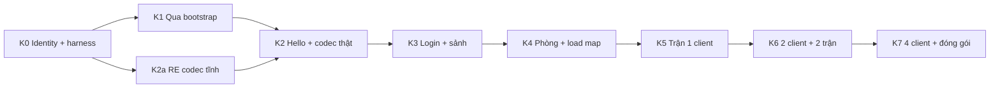

# Kế hoạch server giả lập KR 00967

Nguồn chuẩn của project `boom-kr-server`; bản nhập từ plan đã được dsh1/dsh2 review tại `1eee46d`.
Cập nhật29/10 JST (CP018): triển khai K0/K1, K2/K3 từng phần và player/controls phòng trên copy;bảng gate là scope nghiệm thu,chưa phải checklist đã pass.


### Mục tiêu, baseline và phạm vi

Yêu cầu chủ dự án 26/10/2026: dùng kiến thức RE VN `VBNB_116` để dựng server giả lập cho
**chính `CA.exe` KR `00967`**. Đây là project độc lập `boom-kr-server`; không dùng scope, gate,
registry hoặc tỷ lệ tiến độ V1 của bản viết lại `boom-rs` làm điều kiện của repo này.

Revision kế hoạch **`KR-00967-EMU-1`**, trạng thái **đang triển khai harness/bootstrap Wine và RE codec từng phần;chưa có demo chơi KR**.
Các mốc nguồn được phân biệt rõ:

- **Tài liệu tham chiếu lịch sử:** `boom-rs@dae5e1c717ad31b9e8d32a9b20a76d65942807eb`.
- **Plan KRE trước khi tách, đã review:** `boom-rs@1eee46d0ecf5c7f4eeedeadd7e258ef1cd64bf43`.
- **Snapshot khởi tạo repo mới:** `boom-kr-server@a19c8f68af68b01844c92a7870aa2a22eebf5f5f`;
  các sửa sau migration nằm trong lịch sử của chính repo này.
- **Nguồn RE:** `boom-re@9ac2075bbec0c16217741aaedea968cf685e39a9` và
  `boomkr-re@88e11ed30764c753a00f4f23a2f33dafadc4c890`.

Hash client và ma trận tái sử dụng:
[LEGACY_KR_PROTOCOL](PROTOCOL.md).

Đích đầu: bản copy client KR → bootstrap offline → đăng nhập identity cục bộ → một kênh/sảnh →
tạo/vào phòng → ready/start → Battle thường hai client → kết quả → về phòng → trận thứ hai.
Một map thật của KR, ưu tiên Village00 sau khi xác nhận loader/mode cho phép; nhân vật cơ bản theo
ID/Attr KR. Không áp index Village01, roster, drop override hoặc policy ready của V1 Rust lên client gốc.
Mở rộng bốn client chỉ sau khi hai client ổn. Shop, economy, guild, mode phụ và kết nối Nexon thật
để sau. Không dùng client Rust thay bằng chứng nghiệm thu `CA.exe`.

**Quyết định kỹ thuật:** ưu tiên chứng minh tương thích bằng service nhỏ và state machine theo
client; chưa ghép `boom-core` vào đường trận. VN có P2P và client tự tính một phần gameplay;
KR đã có consumer nổ/trap ở client nhưng chưa có bản đồ authority đầy đủ. Một server mới chạy được
với client Rust không chứng minh có thể điều khiển client KR bằng snapshot/command của ADR 0009.

### Tiến độ hiện hành theo bằng chứng

| Task/mốc | Trạng thái tại CP018 | Nguồn chuẩn |
|---|---|---|
| KRE-004/issue6 | Đã review/merge PR7 và đóng issue:recipe r1 đến local accept;không phải full K1 | [Wine r1](evidence/wine/README.md) |
| Bootstrap reply | PR8 đã merge;debugger ProcessPatchreturn1,không ép success | [bootstrap evidence](evidence/bootstrap-wire/README.md) |
| KRE-005a/issue9,R2 | PR10 đã merge:3 cold start cửa sổ/second accept;issue9 còn mở | [R2 evidence](evidence/wine-r2/README.md) |
| WCP hai-reply | Run CP001 là lịch sử chưa C→S; CP006 đã đo request đầu trên copy tham số hóa | [PROTOCOL](PROTOCOL.md#wcp),[WCP evidence](evidence/wcp/README.md) |
| KRE-005b/issue14 | CP006–017 đã merge; CP018 có player106, own ID match và controls110/Bắt đầu; map/full auth còn thiếu | [Q-023](RESEARCH.md#q-023), [evidence](evidence/room-player/README.md) |
| K0/K1 | Chưa nghiệm thu toàn gate;Windows vanilla/control ownership và các điều kiện còn thiếu giữ mở | Gate dưới,[Q-022](RESEARCH.md) |
| K2a/K2 | Primitive/WCP từng phần; request auth đã capture/native replay, phản hồi lỗi đã dispatch; full codec/reconnect và gate chưa pass | [PROTOCOL](PROTOCOL.md#login-auth),[Q-023](RESEARCH.md#q-023) |
| K3 | Copy chẩn đoán đã vẽ UI sảnh và đóng notice; chưa nghiệm thu identity/cache/codec đủ gate | [Contract sảnh](PROTOCOL.md#channel-lobby) |
| K4–K7 | Player/ownslot/Bắt đầu đã đo trên copy; map/load/trận và hai client chưa có | Không có phần trăm ước lượng |

Thứ tự tiếp: phục hồi dữ liệu map và điều kiện start từ request96/handler117, kiểm roster/ready
tại [Q-023](RESEARCH.md#q-023); đồng thời giữ body result0/user/cache còn thiếu
trước khi xét K2/K3. Chỉ mở contract cần cho phép thử tiếp; UI phòng chờ không tự đóng K4.
Chu kỳ docs/audit theo [workflow](evidence/checkpoints/README.md);
counter ở [manifest](evidence/checkpoints/manifest.json). Không tạo plan theo phiên.

### Bản đồ đường chạy, CP018

| Bước | Quan sát/bước tiếp |
|---|---|
| Bootstrap | ProcessPatch có response local trong Wine copy; K1 còn thiếu đối chứng/gate. |
| WCP → request đầu | Consumer chấp nhận fixture; một run debug và một run plain có C→S66 byte; xem [contract](PROTOCOL.md#wcp). |
| Dữ liệu khởi tạo | Tám response tổng hợp đã dẫn tới guard trả1 trên copy; chưa chứng minh tài nguyên thật hay K2. |
| Login → sảnh | Đã đo redirect/request6, S→C17 và241; UI sảnh hết notice trên copy, profile/auth body còn thiếu; xem [contract](PROTOCOL.md#channel-lobby). |
| Sảnh → phòng | Click/dialog → C→S81 → S→C86/result0 → CPrepareStage/stage12; [contract](PROTOCOL.md#room-create). |
| Player/controls phòng | KR106 profile/roster, ID0 match và KR110/pending0; có nút Bắt đầu. [Contract](PROTOCOL.md#room-player). |
| Phòng → trận | Hai player giả/đội đỏ-vàng tới chặn map capacity0; tiếp tục bảng map/117/start. Chưa có contract load/trận. |

RE động là chính; gom phép đo thành checkpoint mốc/blocker, audit định kỳ theo workflow.
Review độc lập được chủ dự án miễn từ28/10; Codex tự kiểm, giữ PR và điều kiện bằng chứng của gate.

### Bằng chứng lịch sử khi lập plan (26/10)

- Tài liệu KR cũ chưa chứng minh qua `ProcessPatch`. §31 của `boomkr-re/docs/kr.md` ghi một run CA
  còn sống (45 thread/~75 MB), snapshot `netstat` không có kết nối; dòng `EndOfInit! exitcode=1` là
  log run trước. Không gọi đây là trạng thái runtime hiện tại khi chưa chạy lại; snapshot không có
  kết nối cũng chưa loại trừ connect ngắn đã xảy ra. §33 tách dialog **Nexon của NewPatcher** và
  dialog **CA** có title `??? ??`; quan hệ nhân quả với `ProcessPatch` vẫn unknown. Trạng thái unpack
  khác nhau giữa run/dump; không dùng entropy `.themida` để kết luận toàn bộ code game chưa đọc được.
- REA mới đọc được `NewPatcher.exe`: consumer manifest `sub_4118E0` phân biệt `files.nfo`/`files.nfo2`,
  `.gz` và delta; có đường báo lỗi mạng/file. Đây là cạnh RE tĩnh mới cho bootstrap, **chưa** chứng minh
  nguyên nhân `ProcessPatch` lỗi, IPC với CA hoặc schema patch service đầy đủ. Xem
  [evidence bootstrap](evidence/bootstrap/README.md).
- VN đã có codec kiểm bằng hàm binary và server chạy 1–2 client. Dùng lại cách kiểm và kiến trúc
  thăm dò; mọi key/seq/opcode/schema KR cần chứng minh riêng. Không có “port VN sang KR bằng đổi version”.
- `kr.md` §12 tìm **bảng handler VM Themida**, không phải kiểm kê dispatcher packet KR. Không suy
  “không có dispatcher mạng” từ kết quả âm tính về VM. Message nội bộ 27 cũng không phải wire opcode.

### Dependency và gate



| Mốc | Công việc và đầu ra | Gate bắt buộc trước khi mở phần phụ thuộc |
|---|---|---|
| **K0: identity/harness** | Manifest source/copy/dump/DB: SHA, image base, RVA, section hoặc memory-layout, patch và config; DB dùng copy/private workspace, không ghi DB nguồn/shared. Windows VM là control bootstrap chính: copy đầy đủ lên ổ local fixed, cwd cạnh exe/DLL, kiểm manifest `requireAdministrator` và effective token; không dùng share/UNC làm đường chạy control. Mỗi run ghi PID/parent/start-time/image SHA/command line, window owner/class/title, CALog mới, log/capture cùng run ID. | Khớp artifact KR/VN; không ghi vào `clients/`; không nhầm CA/NewPatcher/CAWH hoặc log run cũ. Không suy thiếu DLL chỉ từ dialog (inject từng gây cùng lỗi giả). Có lệnh tái tạo và cleanup chỉ PID thuộc run. |
| **K1: bootstrap** | Ba bước K1a ownership/control → K1b contract/caller → K1c stub/patch có đối chứng, theo định nghĩa dưới bảng. NewPatcher manifest là một giả thuyết để kiểm, không phải route đã chốt. | Ba cold start của cùng recipe đi xa hơn điểm chặn được định danh, tới **network attempt local/state chờ hello**, có event API/capture gắn đúng PID; CALog marker mới nếu có. Không dùng alive/không exit/không còn dòng ProcessPatch làm proof. Màn login thuộc K3; không đòi server trả hello trước K2. |
| **K2a: bước con RE tĩnh** | Tìm primitive reader/writer, framer, checksum/crypto/seq và mode/hello từ **KR**, dùng mỏ neo167/184/183 hoặc socket call graph. Fixture hàm KR thật (emulation nếu đủ context), kiểm cursor/endian/bounds, chiều/socket và reset; lưu phần chưa mở được. | Có oracle độc lập cho phần codec probe K2 cần; không lấy encoder tự sinh golden làm proof. Không đòi registry toàn game trước hello; nếu primitive cần thiết chưa có oracle thì K2 chưa mở, ghi checkpoint Codex. |
| **K2: codec/hello** | RE `send/recv` → buffer/frame → primitive reader/writer → checksum/crypto/seq → callback hello/version; lập profile KR riêng theo từng kết nối và chiều. Fixture dùng hàm KR thật hoặc quan sát KR; probe server chỉ có accept/hello/log. | Client nhận hello, gửi request kế tiếp; parse đủ byte, checksum/seq đúng qua nhiều frame và reconnect. Kiểm boundary length, chia/gộp TCP, đổi mode sau hello và reset state. Golden do encoder tự sinh chỉ là regression. |
| **K3: login/kênh/sảnh** | State machine bootstrap-data → identity local → auth result → redirect/chọn kênh → lobby. RE consumer cache/version và gói tối thiểu theo thứ tự; cấp ID ổn định giữa socket login/channel, ghi encoding chuỗi. Patch/game/redirect socket có codec state riêng theo lifecycle KR đã đo. | Cold cache, cache thiếu và warm cache đều có kết quả rõ; UI identity/kênh đúng, keepalive không timeout. Kiểm gửi đúng byte nhưng sai socket/stage bị từ chối có log; không gửi blob trước stage/cache-path init hoặc tái dùng seq của socket trước. Sai version/identity lỗi rõ. |
| **K4: phòng/load** | RE room list/create/join/slot/host/ready/start; map name/id/spawn/roster/seed/placement; loading barrier và điều kiện chuyển scene. Mỗi field có provenance và ghi vào `kr-emu-dev`; không trộn KR native với `emu_choice`/`design` hoặc áp V1 Rust implicit. Mỗi request có reply/broadcast theo stage. | Hai client thấy cùng phòng/slot/host; map đúng payload KR; spawn khác nhau trên ô hợp lệ; một người chưa load không làm người kia vào trận sai state. Kiểm host rời, join/leave và start lặp; reviewer kiểm source/design của các field cần để load. |
| **K5: trận một client** | Chạy clock thật; di chuyển, đặt/nổ bom, phá block, hiện/nhặt item cơ bản, trapped/dead, kết quả và về phòng. Hoàn thiện authority matrix theo contract §5; fuse/drop/timeout không khôi phục được là `design`, có profile riêng. | Chu kỳ trận hoàn chỉnh bằng client KR; cùng bom có ID ổn định, không xác nhận pickup lặp, không kẹt GO/loading. **Reviewer duyệt authority matrix** cho từng hành vi đang dùng: creator/simulator/validator/broadcast/peer-editable state; unknown lịch sử được ghi giới hạn và policy design tương thích có kiểm, không mặc định server-authoritative. Trace client và capture cùng run. |
| **K6: hai client** | RE peer-discovery, session key/slot, UDP packet/reliability/relay nếu có; chọn P2P local hoặc relay theo consumer thật. Đồng bộ hai chiều, bom/item/trap/result rồi reset round. | A di chuyển B thấy và ngược lại; A đặt bom B thấy; tranh item chỉ một kết quả; hai máy đồng thuận trapped/death/result. Hai trận liên tiếp không rò entity/timer/seq/peer. Disconnect/host rời không treo peer còn lại. Reviewer cập nhật authority matrix bằng ca peer thực; unknown làm thiếu consistency của demo thì chưa qua gate. |
| **K7: hardening/demo** | Mở bốn client, bounded parser, backpressure, rate limit, persistence identity tối thiểu, log/health, loss/jitter và server restart. Đóng gói server Linux cùng config/harness hướng dẫn. | Fresh launch theo README; hai và bốn client tái lập; malformed/duplicate/stale input không nhân kết quả hoặc làm crash server; log xác định được build/run/session/room/round. Báo giới hạn authority và sửa client cần thiết. |

K2a chạy song song K1 bằng dump/DB có sẵn. Nếu K1 thất bại, kết quả K2a vẫn là RE tĩnh và K2 chưa
qua gate. Không dựng cả lobby trước khi có hello KR thật. Không hứa ngày xong K6 khi K1/K2 còn
unknown; ước lượng lại sau từng gate từ số câu hỏi đã đóng và lượt đo thực tế.

**Điều kiện network từ K0/K1 trở đi:** cô lập outbound của VM/client trước khi chạy; chỉ cho host
local stub/capture theo allowlist. Không có traffic tới Nexon/NGM/live auth thật là điều kiện pass.
Nếu quan sát attempt tới endpoint thật, giữ egress block, lưu API/log/pcap rồi dừng run để sửa local
redirect/config theo contract; không nới egress hoặc fetch patch CDN để vượt gate. Attempt bị chặn
chưa phải traffic đã tới server thật, nhưng run đó không được dùng làm demo local hoàn chỉnh.

**Ba bước của K1:**

- **K1a — ownership/control:** kiểm ba recipe CA đơn lẻ, NewPatcher đơn lẻ và CA+NewPatcher trên cùng
  bản copy/VM; recipe được chọn để qua gate K1 phải có **ba cold start riêng của recipe đó**. Ghi process tree,
  module CA tại base tương ứng, cửa sổ đúng PID và event file/registry/network bằng quan sát ngoài
  process (ETW/Procmon khi có). Kết quả phải phân biệt exit, loop, alive-stall và modal dialog. Đây là
  characterization; chứng minh stall giúp đóng bước này nhưng **không** cho K1 qua gate network.
- **K1b — contract:** truy `CA!ProcessPatch` riêng và caller/config `NewPatcher!4118E0`, ghép command
  line/IPC/token/file/return mà CA thật sự chờ. Chỉ kết nối hai đường khi có evidence; có thể loại bỏ
  giả thuyết NewPatcher nếu không nằm trên route đã quan sát. Không đoán patch schema từ literal NFO.
- **K1c — thử nghiệm:** điều phối chọn stub local đúng contract trước; nếu không đủ thì patch bản copy
  theo KRE-D01. Giữ control plain, chỉ đổi một yếu tố mỗi ca, rồi kiểm gate ba cold start. Khi cả hai
  lượt không có cạnh/observable mới, dừng nhánh và Codex ghi checkpoint để đổi phép đo.

**Quyết định vận hành DESIGN KRE-D01 (26/10/2026):** theo quyền offline-preservation và chỉ đạo toàn
quyền mới của chủ dự án, Codex được chọn stub launcher/patch service, loại bỏ/đổi tên thành phần AC
và patch **file trên bản copy offline** của CA/NewPatcher khi có bằng chứng cần thiết; không phải xin
lại quyết định đó. Trước mỗi thí nghiệm ghi target/hash, module/process ownership, lý do, offset/RVA,
byte trước/sau, file bị loại/đổi tên, giả thuyết side effect và recipe rollback. Control dùng bản copy
plain đầy đủ, cùng VM/config/cache và log mới; so với ca sửa một yếu tố. Chọn quan sát ngoài process
trước vì inject/hook CA từng làm nhiễu. Không lặp DLL/IAT/prologue hook đã thất bại nếu chưa có điều
kiện mới; patch memory/hook xâm lấn không thuộc recipe mặc định. Runtime cô lập khỏi Nexon, không
phân phối binary/AC; lựa chọn policy này không biến kết quả modified-client thành vanilla behavior.

### Thứ tự RE và điểm dừng

1. **Bootstrap trước:** K1a xác định process/cửa sổ và điểm chờ; sau đó kiểm riêng `CA!ProcessPatch`
   và giả thuyết `NewPatcher` consumer/caller/config → tham số/IPC → điều kiện thành công. Đọc request
   thực trước khi dựng HTTP/DNS/launcher stub. Không đoán `version=967`
   là toàn bộ handshake và không lấy URL có trong binary làm endpoint đã quan sát.
2. **Wire từ hai đầu:** xref socket API và serializer từ phía gửi; đi ngược handler nhận từ các
   mỏ neo KR đã biết. Ghép cặp theo field order/width/consumer, không theo số opcode gần nhau.
   Chỉ mở những wrapper/VM chặn hello hoặc packet đang cần, không devirt toàn Themida.
3. **Phục hồi state machine:** ghi state trước/sau, guard, request→reply/broadcast, timer, cache,
   socket nào và byte nào được tiêu thụ; kiểm từng chuyển cảnh rồi mới thêm gói.
4. **Authority trước core:** phân biệt vị trí hiển thị, mô phỏng local, báo cáo client, xác nhận server
   và peer. Không ghép handler KR183 dành cho `CGOGhost` thành movement packet của bomber sống.

Mỗi câu hỏi tối đa **hai lượt**, mỗi lượt mặc định **8 request phân tích / 4 thân hàm mới**;
caller/callee đọc từ cache cùng hash không tính như phát hiện. Hết lượt không có cạnh mới:
ghi entry/blocker, vùng đã tìm, dữ liệu runtime còn thiếu và thí nghiệm tiếp; điều phối tự chuyển
hướng có bằng chứng. Bootstrap/codec đang unknown không được “giải” bằng design packet rồi đánh dấu
tương thích. Design được dùng cho policy server mất nguồn sau khi client đã chấp nhận wire contract.

Runtime dùng bản copy, chỉ network cục bộ; không sửa binary/pack/DB gốc. Linux giữ CI/build server.
Theo chỉ đạo26/10,ưu tiên Wine;recipe/merge ở bảng hiện hành.
Các run socket hai silent giữ trong evidence từng recipe;probe WCP sau đó có phạm vi riêng tại
[PROTOCOL](PROTOCOL.md#wcp). Không ghi kết quả mới thành plan khác.
Windows VM cô lập giữ vai trò
đối chứng nguyên bản; lỗi Wine không tự bác kết quả Windows. Không mở lại CI/đóng gói
Windows/macOS của Rust. Patch offline theo KRE-D01, phạm vi triển khai vẫn theo từng task KRE.

### Kiến trúc server đề xuất và mức tái sử dụng

Triển khai tại `server/` trong **chính repo `boom-kr-server`**; tool ở `tools/`, docs ở `docs/`.
Các repo VN/KR/Rust cũ chỉ là nguồn tham chiếu. Không thêm code/doc mới vào chúng để tránh hai nguồn chuẩn.

```text
CA.exe KR (bản copy) ── TCP ── KrWire/PacketReader ── KrSession/Stage ── lobby/room/round
         │                         │                    │                   │
         └── UDP peer/relay ? ──────┴────────────────────┴── authority audit ┘
                                   └── raw + decoded trace → fixture/replay
```

| Thành phần | Thiết kế / cách tái sử dụng |
|---|---|
| `kr-wire` (đề xuất) | Buffer TCP có giới hạn, codec state riêng từng socket/chiều, packet registry `(build,direction,stage,opcode)`, reader có cursor và báo trailing bytes. Dùng VN làm reference/fixture control; constants KR vào profile có nguồn. |
| `kr-session` / server (đề xuất) | Auth local, redirect token một lần, ID account/session/slot tách nhau; state machine idempotent, timer gắn round generation. SQLite chỉ cần khi identity contract ổn; không thiết kế economy sớm. |
| Room/round | Một owner cập nhật mỗi phòng, broadcast theo roster, phân biệt request/ack/result. Tái dùng ý tưởng generation guard từ VN; policy ready/host/timeout phải khớp consumer KR hoặc ghi design. |
| UDP | K6 quyết định P2P local/relay sau capture. Không mặc định TCP mang movement; không mặc định 3 port login VN là endpoint movement. |
| `boom-core` | Ứng viên dùng sau audit authority: shadow validation trước; chỉ phát kết quả authoritative khi chứng minh client có đường nhận/correction phù hợp. Nếu không có, giữ mô hình lai để đạt demo tương thích và ghi rõ giới hạn. |
| Content | Dùng reader pack/map/ODT đã có và inventory KR; map/item/character numeric ID có crosswalk theo build. Client gốc tự render/audio; không port renderer mới để giải wire. |

### Task nhỏ và phân công worker

Các task đang chạy nằm tại chính repo này: **KRE-001 [#1](https://github.com/aquaplatinumberlitz/boom-kr-server/issues/1)**,
**KRE-002 [#2](https://github.com/aquaplatinumberlitz/boom-kr-server/issues/2)**,
**KRE-003 [#3](https://github.com/aquaplatinumberlitz/boom-kr-server/issues/3)**. Issue cũ boom-rs đã được
transfer, không giữ hai bảng việc. Mỗi task có baseline, owner/reviewer, file và acceptance theo AGENTS.

| Task | Câu hỏi / đầu ra | Dependency | Owner đề xuất / reviewer |
|---|---|---|---|
| KRE-001 | Khóa target/copy/dump/DB, chạy control và manifest | — | Codex / tự kiểm (review miễn28/10) |
| KRE-002 | CA ProcessPatch: response/caller/guard; bootstrap local và điểm chặn sau đó; NewPatcher là nhánh tham chiếu | KRE-001 | Codex RE/code/runtime / tự kiểm (review miễn28/10) |
| KRE-003 | KR socket→framer→reader/writer; constants và fixture độc lập | KRE-001; gate runtime cần KRE-002 | Codex RE / tự kiểm (review miễn28/10) |
| KRE-004 | Wine unpack/patch copy + harness, issue6/PR7 đã xong trong scope tới local accept; chưa nghiệm thu toàn K1 | KRE-001/002 | Codex / tự kiểm (review miễn28/10) |
| KRE-005 | Probe server hello, version/mode/seq, qua K2 | KRE-003/004 | Codex / tự kiểm (review miễn28/10) |
| KRE-006 | Login/channel/cache→lobby và K3 | KRE-005 | Codex RE/code / tự kiểm (review miễn28/10) |
| KRE-007 | Room/roster/map/spawn/loading và K4 | KRE-006 | Codex RE/code / tự kiểm (review miễn28/10) |
| KRE-008 | Bomb/item/trap/result, authority map và K5 | KRE-007 | Codex RE/code / tự kiểm (review miễn28/10) |
| KRE-009 | UDP/peer hoặc relay, đồng bộ hai client và K6 | KRE-008; có thể RE static từ KRE-003 | Codex RE/code / tự kiểm (review miễn28/10) |
| KRE-010 | Race/disconnect, bốn client, Linux packaging và K7 | KRE-009 | Codex / tự kiểm (review miễn28/10) |

Từ chỉ đạo28/10, Codex solo RE/code/runtime và tự kiểm; không gọi dsh/Claude nữa.
Review độc lập được chủ dự án miễn theo [nguồn](evidence/checkpoints/review-waiver.json).
Các tiêu chí evidence/verification/gate và PR vẫn giữ; yêu cầu reviewer trong plan trước đây
được thay bằng tự kiểm theo AGENTS, không tự coi gate đã pass. Report/approval cũ giữ provenance.
Một owner mỗi target/runtime, DB riêng; raw giữ local và checkpoint theo mốc/blocker.


Trong lượt lập kế hoạch26/10 (lịch sử), sau khi mở quyền và sửa alias cwd cũ, hai session đã research/review độc
lập. Findings vòng đầu đã được xử lý; **dsh1 và dsh2 APPROVE nội dung plan ở `5e9ebb64`** theo phạm vi
bootstrap và protocol/authority. Bằng chứng review xem [hồ sơ](evidence/bootstrap/README.md).
Đây là duyệt kế hoạch, không phải đã chạy KR hoặc nghiệm thu gate K0–K7; lỗi điều phối ban đầu không
phải kết quả RE phủ định.
Câu hỏi cần đóng: [Q-022…Q-029](RESEARCH.md).
