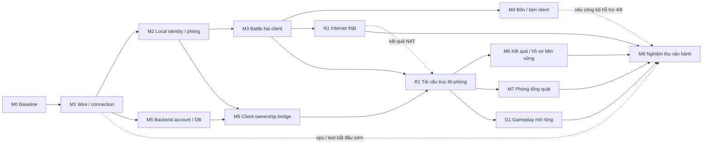
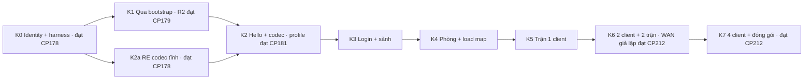

# Kế hoạch server giả lập KR 00967

Nguồn chuẩn của project `boom-kr-server`; bản nhập từ plan đã được dsh1/dsh2 review tại `1eee46d`.

<a id="dashboard"></a>
## Bảng điều hành

**Mỗi phiên chỉ cần đọc mục này.** Phần còn lại của file là tham chiếu (acceptance, lịch sử), tra theo anchor khi cần.
Các dòng ở đây được **ghi đè**, không nối thêm; lịch sử checkpoint ở manifest, PROTOCOL và [HISTORY](HISTORY.md).
Codex cập nhật bảng trạng thái và danh sách việc khi xong một bước hoặc đổi blocker. Claude cập nhật đích và thứ tự
theo quyết định của chủ dự án. Cập nhật gần nhất: **12/11, CP270 / AUD087**.

**Đích giai đoạn 1** ([chi tiết](#delivery-target)): dịch vụ nội bộ bền vững, người chơi qua Internet thật, 50 người
đồng thời và tối thiểu 8 phòng, chế độ thường trên sáu map ladder với item của các map đó. Dài hạn: gameplay đầy đủ.

| Mốc | Trạng thái | Còn lại |
|---|---|---|
| M0–M3 nền tảng, phòng cố định, trận hai người | Đạt trong phạm vi đã ghi | Không |
| M4 bốn và tám người | Đạt phần đội cố định và Manner | Free 1v7 là giới hạn đã biết, không retry |
| M5 tài khoản | Account → phòng → trận → kết quả đã chạy native (CP258) | Hồ sơ tổng quát cho mọi account; lỗi hàng đợi DB khi đang native |
| [N1](#rust-n1) Internet thật | **Đạt phạm vi một phía tới được** (CP264 ghi nhận CP261 + owner, [kết luận](#rust-n1-result)) | N1b âm; thiết kế CP267 đã chốt, relay implementation/native còn thiếu |
| [R1](#rust-r1) lõi phòng | R1a–R1f đã merge; R1g source/TCP đạt, đang bàn giao | Relay opt-in và native hồi quy/acceptance riêng |
| M7 phòng tổng quát | Chưa bắt đầu | Toàn bộ; cần R1 |
| [G1](#rust-g1) sáu map ladder và item | Chưa bắt đầu; có [kiểm kê](CONTENT.md) | Phép thử đổi map, rồi từng map và nhóm item |
| M6 lưu kết quả, thưởng 0 | Chưa bắt đầu | Toàn bộ; cần R1 |
| M8 vận hành | CI đã có (PR #334, #340) | Nâng trần kết nối, giám sát, backup/restore, kiểm tải 50 người |

**Thứ tự việc:**

1. Hoàn tất PR R1g:105Rust/306TCPlegacy/3169+24frameCP269,10admission; chưa native hoặc50người chơi.
2. R1f đã merge PR347; nguồn/test R1g đã seal. Lượt sai cwd trước giữ raw và loại khỏi chứng nhận source.
3. **[RUST-N1R relay opt-in](#rust-relay)**: implementation và native riêng sau R1f/R1g; không gộp tính năng relay
   vào PR refactor. N1b đã dùng đủ2lượt; đây là nghiệm thu implementation mới, không retry baseline N1b.
4. Native hồi quy cuối R1: mỗi profile 2,4,8 và account một lượt. Relay phải có bằng chứng riêng hai NAT/UDP/stale/
   reset/EOF; không suy từ hồi quy legacy. Có thể gom capture phù hợp khi cùng source/config đã seal và tiêu chí đủ.
5. Phép thử đổi map sang Village10 (`local/research/claude/codex-prompt-map-probe.md`), tối đa hai lượt.
6. M7, rồi G1 song song M6, rồi M8.

**Blocker và việc tồn:**

- Direct UDP âm ở hai NAT đổi cổng; thiết kế CP267 đã tách việc R1f khỏi relay opt-in. Chưa có relay implementation/native proof; N1b không retry. PR345 đã merge. CP267–268 đã merge sau exact-head/history/CI; record CP267 giữ nguyên.
- R1e serving vẫn fixed-room cũ; cấu hình/tạo/chọn nhiều phòng tổng quát và occupancy thuộc M7, không suy đã có từ container/unit.
- `local/` (bằng chứng thô và fixture) chưa có backup ngoài máy này.

**Quy ước:**

- Trước khi merge PR, `gh pr checks <số>` phải đạt. CI đỏ thì sửa, không merge.
- Không thêm dòng trạng thái theo checkpoint vào đầu file này hay vào mục thứ tự cũ; ghi đè bảng trên. README chỉ giữ
  mốc mới nhất, mốc cũ chuyển sang [HISTORY](HISTORY.md).
- Lát cắt mới không thêm cờ theo sức chứa, alias theo identity hay nhánh `capacity() == N` vào lõi phòng.

<!-- dashboard-end -->
CP263: R1c slot allocation và template106 chung đã kiểm 94 Rust/305 TCP/3189 frame cũ/30 fixture. Audit nhóm AUD080; NEXT R1d header chuẩn và opcode builders. R1b đã merge PR337. N1 uplink pending, R1f shared-NAT và native cuối R1 2/4/8/account giữ dependency/giới hạn.
CP262: R1b typedpolicies đãkiểm90Rust/298TCPmỗibinary/3189exactroomframes, JSON/wirelegacy2/4/8giữ. AuditnhómAUD079; NEXT R1c identity/slot/template106. N1physicaluplinkfactpending/OPEN, khôngẩnR1f/M8dependency; nativefinalR1 2/4/8/account vẫnchưađo. ProjectorWIPgiữnguồnriêng.
CP261: actualInternetpath2KR/account/profile/room/basic2oppositeoutcomes/reset/Start3 đođạt;99postNATmismatch/Bobserved-source reply/nativeUDP2chiều cóproof. SharedNATnegativeBdenied/Aheld8s xácnhậnR1f gap. N1OPEN: mobile/ISP-CGNAT môi trường tốithiểu chưaxácnhận; khôngsuytừIP/agentlabel. NEXT chốtprovenanceuplink vàfield51policyimplementation; R1brefactorWIP cóthểtiếpđộc lập theođiềukiện accountmerge củaowner, chưabỏN1dependencyR1f/M8.
CP260: controlled network/mapping metadata account có90Rust/hai59TCP/9network+5metadata guards; native auth0 trên hai KR qua NAT. Lỗi chờ channel có trước HTTP JSON rỗng; N1OPEN, chưa direct/learning/relay. NEXT đo timer/recv trước modal2 tại1113AA0, đối chiếu packet17 trên PCAP; không dựng HTTPstub như causalfix. R1bWIP/projector giữ nguyên; không đóng nhóm/gate.
CP258: account-owned fixed2/basic end-to-end + revoke/expiry/disconnect + manualfresh rejoin/oldUDPdrop-currentpositive đã đạt scope;5run280raw375exactTCP/cleanup0. M5OPEN/generalprofile/nativeDBqueuefault/recoverylimits; AUD076auditnhóm, không lịch4CP. Internet thật chưa kiểm.


### Mục tiêu, baseline và phạm vi

Yêu cầu chủ dự án 26/10/2026: dùng kiến thức RE VN `VBNB_116` để dựng server giả lập cho
**chính `CA.exe` KR `00967`**. Đây là project độc lập `boom-kr-server`; không dùng scope, gate,
registry hoặc tỷ lệ tiến độ V1 của bản viết lại `boom-rs` làm điều kiện của repo này.

Revision kế hoạch **`KR-00967-EMU-1`**, trạng thái **K0–K7 đã đạt trong phạm vi từng acceptance; K6c WAN giả lập. Internet thật chưa kiểm; full game ngoài scope**.
Các mốc nguồn được phân biệt rõ:

- **Tài liệu tham chiếu lịch sử:** `boom-rs@dae5e1c717ad31b9e8d32a9b20a76d65942807eb`.
- **Plan KRE trước khi tách, đã review:** `boom-rs@1eee46d0ecf5c7f4eeedeadd7e258ef1cd64bf43`.
- **Snapshot khởi tạo repo mới:** `boom-kr-server@a19c8f68af68b01844c92a7870aa2a22eebf5f5f`;
  các sửa sau migration nằm trong lịch sử của chính repo này.
- **Nguồn RE:** `boom-re@9ac2075bbec0c16217741aaedea968cf685e39a9` và
  `boomkr-re@88e11ed30764c753a00f4f23a2f33dafadc4c890`.

Hash client và ma trận tái sử dụng:
[LEGACY_KR_PROTOCOL](PROTOCOL.md).

Đích đầu: bản copy client KR → bootstrap offline → đăng nhập identity cục bộ → một kênh/sảnh →
tạo/vào phòng → ready/start → Battle thường hai client → kết quả → về phòng → trận thứ hai.
Một map thật của KR, ưu tiên Village00 sau khi xác nhận loader/mode cho phép; nhân vật cơ bản theo
ID/Attr KR. Không áp index Village01, roster, drop override hoặc policy ready của V1 Rust lên client gốc.
Mở rộng bốn client chỉ sau khi hai client ổn. Shop, economy, guild, mode phụ và kết nối Nexon thật
để sau. Không dùng client Rust thay bằng chứng nghiệm thu `CA.exe`.

**Quyết định kỹ thuật:** ưu tiên chứng minh tương thích bằng service nhỏ và state machine theo
client; chưa ghép `boom-core` vào đường trận. VN có P2P và client tự tính một phần gameplay;
KR đã có consumer nổ/trap ở client nhưng chưa có bản đồ authority đầy đủ. Một server mới chạy được
với client Rust không chứng minh có thể điều khiển client KR bằng snapshot/command của ADR 0009.

<a id="delivery-target"></a>
### Đích bàn giao giai đoạn 1 cho công ty — chốt 11/11

Nguồn: [chỉ đạo chủ dự án](evidence/owner-directives/delivery-target.json). Mục này chỉ chốt **đích và đường cắt
phạm vi**; không đóng gate hay milestone nào. Trạng thái từng milestone vẫn ở các mục bên dưới.

**Định hướng dài hạn vẫn là gameplay đầy đủ của game gốc.** Phạm vi dưới đây là giai đoạn 1, được chọn vì giới hạn
thời gian và tài nguyên; các phần chưa làm thuộc giai đoạn sau chứ không bị loại bỏ.

| Câu hỏi | Quyết định của chủ dự án |
|---|---|
| Mức bàn giao | **Dịch vụ nội bộ bền vững** (hàng giữa trong [bảng ba mức](#rust-service-exit-criteria)) |
| Người chơi | Kết nối qua **Internet thật**, khoảng 10–50 người đồng thời, vài phòng cùng lúc |
| Gameplay giai đoạn 1 | Chế độ thường, **nhiều map chọn lọc và các item phổ biến**, kim/cứu, chọn nhân vật, chọn đội |
| Gameplay dài hạn | Đầy đủ như game gốc, làm tiếp sau giai đoạn 1 khi có thời gian và tài nguyên |
| Hạn chót | Không có hạn cứng; theo dõi bằng milestone và cỡ việc tương đối |

**Trong đích giai đoạn 1:** tài khoản thật cho mọi người chơi (không chỉ hai profile cố định), nhiều phòng độc lập trên một kênh,
lưu hồ sơ và kết quả trận, công cụ admin có audit, backup đã thử restore, người chơi sau NAT gia đình hoặc CGNAT.
Mục tiêu tải dùng để nghiệm thu: **50 người chơi đồng thời, tối thiểu 8 phòng độc lập**, một instance Linux.

**Giai đoạn sau (không là dependency của giai đoạn 1):** cửa hàng, tiền tệ, cấp độ/EXP, inventory mua bán, mode phụ,
boss, mission, event, guild, chat/bạn bè, toàn bộ map và item còn lại, nhiều kênh. HA và tiêu chí của mức
"phát hành rộng hơn" chỉ mở khi công ty quyết định phát hành ra ngoài.

**Ràng buộc thiết kế từ định hướng dài hạn:** giai đoạn 1 không được chặn đường mở rộng. Luật phòng, map, item và
mode phải là dữ liệu hoặc chính sách thêm được, không hardcode giả định "chỉ chế độ thường". Schema DB giữ chỗ cho
inventory/ledger đã thiết kế trong [kiến trúc](RUST_SERVICE_ARCHITECTURE.md). Đây là lý do [RUST-R1](#rust-r1) đi
trước các mốc tính năng.

#### Việc còn lại để đạt đích giai đoạn 1

Cỡ việc là **tương đối** (S nhỏ, M vừa, L lớn), không phải cam kết ngày. "Rủi ro RE" là mức phụ thuộc vào phép đo
trên client KR chưa có; rủi ro cao nghĩa là cỡ việc có thể tăng.

| Thứ tự | Mốc | Còn lại để đạt đích | Cỡ | Rủi ro RE |
|---|---|---|---|---|
| 1 | RUST-M5 (lát cắt fixed2 đã merge CP258) | Account→fixedroom/basic→results/reset/Start3 và lifecycle đã có; hồ sơ tổng quát còn thiếu, giữ WIP và gắn R1c/R1f theo thứ tự mới | M | Vừa: phép chiếu hồ sơ 291 |
| 2 | [RUST-N1](#rust-n1) Internet thật (đang đo) | UDP trực tiếp giữa hai NAT thật khác nhau. Kết quả quyết định có cần học cổng sau NAT, hole punching hoặc relay | S nếu thông, L nếu cần relay | Cao nếu cần relay |
| 3 | [RUST-R1](#rust-r1) tái cấu trúc lõi phòng | Gỡ giả định phòng cố định trước khi xây M7/G1/M6; không thêm tính năng | M | Không |
| 4 | RUST-M7 phòng tổng quát | Danh sách phòng động, tạo/vào/rời, lỗi phòng đầy, chọn nhân vật, chọn đội bằng thao tác trong phòng | L | Cao |
| 5 | [RUST-G1](#rust-g1) gameplay mở rộng | Kim/cứu trên Rust, thêm map, thêm nhóm item phổ biến; terrain/item cho phòng 4 và 8 người | L | Cao: mỗi nhóm item cần consumer và ca runtime riêng |
| 5 | RUST-M6 thu hẹp | Lưu kết quả trận và hồ sơ (nhân vật đã chọn) bền vững, thưởng bằng 0. Ledger tiền tệ và inventory để giai đoạn sau, giữ chỗ trong schema | S–M | Thấp |
| 6 | RUST-M8 vận hành | Nâng trần kết nối, cấu hình, giám sát, admin, backup/restore, kiểm tải 50 người/8 phòng, đóng gói | M–L | Thấp |

RUST-M4 đã đủ cho đích ở phần đội hình cố định 2/4/8 và Manner; Free 1v7 còn kẹt ở lỗi khởi động client chưa rõ
nguyên nhân và đã được chốt là giới hạn đã biết của giai đoạn 1. Thứ tự 5 có hai mốc chạy song song vì không phụ thuộc nhau.

Vì sao thứ tự này: N1 đi sớm vì nếu cần relay thì cách trao đổi địa chỉ peer (packet 153) và kiến trúc mạng đổi theo.
R1 đi trước M7, G1 và M6 vì cả ba đều sửa lõi phòng; làm R1 sau thì phải viết lại phần đã xây trên giả định phòng cố định.

#### Hệ quả đã biết từ code hiện tại

- Trần kết nối đang là 64 (`max_connections` trong `kr-service/src/lib.rs`) và mỗi client dùng khoảng bốn transport;
  50 người cần khoảng 200 kết nối cộng dự phòng. Việc nâng trần thuộc R1/M8, có kiểm tải.
- Client được nhận diện theo IP nguồn và danh sách `allowed_peers` phải khớp số actor. Hai người chơi chung một NAT
  sẽ trùng IP, nên đường account (session) phải thay hẳn binding theo IP trước khi mở cho Internet.
- Địa chỉ peer gửi trong packet 153 ghép IP cấu hình với cổng UDP do client tự báo ở packet 99. Sau NAT đổi cổng,
  địa chỉ này có thể sai; N1 đo điều đó.

#### Quyết định đã chốt 11/11

Nguồn: [chỉ đạo chủ dự án](evidence/owner-directives/phase1-scope-decisions.json). Ba quyết định này chỉ chốt phạm vi,
không đóng gate hay milestone nào.

1. **Map và item cho G1.** Sáu map trong `LadderMapGroup` của client: **Camp08, Factory07, Forest07, Village10,
   Tomb12, Patrit14**. Cả sáu không có script. Nhóm item của G1 lấy từ bảng item của chính sáu map này trong
   [kiểm kê](CONTENT.md): phần đã đo (Bomb, Fire, Roller, MaxPower, kim) cộng phần chưa đo (keo, phi tiêu, máy quét,
   cú, bẫy, lò xo và các item còn lại trong bảng). Map và item khác thuộc giai đoạn sau.
2. **RUST-M4 Free 1v7.** Là giới hạn đã biết của bản bàn giao giai đoạn 1, không chặn đích. Không retry; chỉ mở lại
   khi có quan sát mới về lỗi khởi động client. Trạng thái M4 vẫn do checkpoint/audit ghi theo quy trình.
3. **Kết quả trận (M6).** Lưu lịch sử trận bền vững, thưởng bằng 0; kim dùng số lượt cố định mỗi vòng theo policy
   hiện tại. Điểm, bảng xếp hạng, tiền tệ và inventory thuộc giai đoạn sau.

### Tiến độ hiện hành theo bằng chứng

| Task/mốc | Trạng thái theo nguồn dẫn, cập nhậtCP212 | Nguồn chuẩn |
|---|---|---|
| KRE-004/issue6 | Đã review/merge PR7 và đóng issue:recipe r1 đến local accept;không phải full K1 | [Wine r1](evidence/wine/README.md) |
| Bootstrap reply | PR8 đã merge;debugger ProcessPatchreturn1,không ép success | [bootstrap evidence](evidence/bootstrap-wire/README.md) |
| KRE-005a/issue9,R2 | PR10 đã merge:3 cold start cửa sổ/second accept;issue9 còn mở | [R2 evidence](evidence/wine-r2/README.md) |
| WCP hai-reply | Run CP001 là lịch sử chưa C→S; CP006 đã đo request đầu trên copy tham số hóa | [PROTOCOL](PROTOCOL.md#wcp),[WCP evidence](evidence/wcp/README.md) |
| KRE-005b/issue14 | CP202–207four2v2/bundle/bounds/EOF/health/freshserver/UDPimpairment đã merge; CP208adapter8/nativeclock đã merge; CP209mesh/stat/8ownerbom đã merge; CP210same8two4v4/reset đã merge; CP211native8relocatedbundle có runtime. K6c WAN giả lập/K7 đạt CP212; fullauth/authority/phần ngoài scope là backlog, task ở current-order | [Q-023](RESEARCH.md#q-023), [service](evidence/probe-service/README.md) |
| K0 | Đã nghiệm thu identity/harness tại CP178: originalWindowsVM fullfixedcopy/PID/token/cwd/window/ETW/isolation/cleanup; không bootstrap/gameplay success | [Acceptance](#k0-k2a-acceptance) |
| K1 | Đạt CP179 cho recipe offline R2: 3 coldstart/API đúng PID/contract/patch controls; không e9cold3 hoặc originalWindows bootstrap | [Acceptance](#k1-acceptance) |
| K2a/K2 | K2a đạt CP178; K2 đạt profileoffline CP181 với native sameprocessretry/reset/cursor/stream và boundednativeoracles. Không toàncodec/accountauthority | [Acceptance](#k2-acceptance),[contract](PROTOCOL.md#login-retry-codec) |
| K3 | Đạt CP186 trong scope A/local/Wine/một kênh normal; cold3cache/version/identity/stage và nguồn CP015/016/034/058/181–185 đã đối chiếu. Không fullauth/Windows/multichannel-caption hoặc hai-client291 | [Nghiệm thu](#k3-acceptance), [contract](PROTOCOL.md#k3-version-identity-controls) |
| K4 | CP187 đạt riêng phòng/load/start local currentAB291/copyABIcorrected; oneoutcome/reset/Start2, không gameplay2outcomes | [Nghiệm thu](#k4-acceptance) |
| K5 | Basic local đạt CP188; current2cycles/peer/Bowner/EOFcontrol riêng, designauthority được rà. Không fullinventory/mode/map | [Nghiệm thu](#k5-acceptance) |
| K6a | Local hai actualAB/basic/cùnghost đạt CP189; nativecontestedindex/reset/life và CP188peer/Bowner/EOF cóscope riêng. Không physicalLAN/Internet | [Nghiệm thu](#k6a-acceptance) |
| K6b | Đạt CP191 cho LANgiảlập hai netns/IP/NIC/actualKR theo owner; physicaltwohosts không required | [Nghiệm thu](#k6b-acceptance) |
| K6c WAN giả lập | Đạt CP212 sau chỉ đạo môi trường mới và đối chiếu CP192–196 native/routing/NAT/UDP/two cycles/EOF. Internet thật chưa kiểm | [Acceptance](#k6c-acceptance), [topology/giới hạn](PROTOCOL.md#emulated-wan-acceptance) |
| K7 | Đạt CP212 sau đối chiếu riêng từng tiêu chí với CP190/198/203–207; K6c dependency đạt scope WAN giả lập. Không full game/fullauth/tám client là điều kiện | [Đối chiếu K7](#k7-evidence-review) |

<a id="current-order"></a>
### Thứ tự công việc hiện hành

**Thứ tự theo [đích giai đoạn 1](#delivery-target), chốt 11/11:** (1) hoàn tất lát cắt account → phòng cố định → trận
ở mục 1 dưới đây; (2) đo Internet thật [RUST-N1](#rust-n1); (3) tái cấu trúc lõi phòng [RUST-R1](#rust-r1);
(4) RUST-M7; (5) [RUST-G1](#rust-g1) song song RUST-M6 thu hẹp; (6) RUST-M8. Từ nay lát cắt mới **không thêm** cờ
`four_*`/`eight_*`, alias theo identity hay nhánh `capacity() == N` mới vào `room_io.rs`; luật mới đặt trong `RoomRules`.

**Kế hoạch Rust đã giao CP213/PR286 `4f9a963`; owner đã mở implementation theo [chỉ đạo mới09/11](evidence/owner-directives/rust-implementation.json). M0/M1 đã giao, M2 đã nghiệm thu phạm vi hai identity/một phòng/loading; RE chỉ theo blocker của lát cắt.**
[KRE-005b/#14](https://github.com/aquaplatinumberlitz/boom-kr-server/issues/14) giữ RE/reference backlog theo trigger; KR-L001 giữ blocker có nguồn;
<!-- active-issue: 14 --> [KRE-074/#285](https://github.com/aquaplatinumberlitz/boom-kr-server/issues/285) giữ epic chuyển Rust. <!-- active-issue: 285 -->
K0–K7 đạt đúng scope, K6c WAN giả lập; **Internet thật chưa kiểm** là backlog riêng.
Theo [policy mới](evidence/owner-directives/feature-group-audits.json), không deadline audit theo sốCP. Nhóm công việc đang ưu tiên
là các lát cắt M5 dưới đây; **account-owned fixedroom/basic end-to-end** hoàn tất scope CP258/AUD076. Audit khi nhóm kế hoàn tất, hoặc ngay khi có
mâu thuẫn nghiêm trọng. Checkpoint trung gian không tự phát sinh audit. Counter/audit cũ giữ lịch sử.

Team source CP213 đã giao riêng qua PR322/`83abe4b`, giữ nguyên bytes đã đo; [provenance/kiểm](evidence/eight-player/team-code-delivery.json). Baseline Rust cũ không hồi quy theo delivery này.

1. **NEXT-RUST-FIRST-SLICE / M5 worker-to-KR và ownership bridge / M4 Free startup bị chặn / KRE-074/#285**:
   [CP236](PROTOCOL.md#rust-account-backend) đã giao lát cắt backend M5 bằng SQLite thật/CLI: account,
   password/session, identity/profile/version và audited admin. Không cần chờ gameplay để viết backend;
   cũng không lấy KR authbridge chưa giao làm dependency chặn M3. Codex solo luân phiên hai nhánh công việc,
   không có subagent hoặc hai thí nghiệm runtime đồng thời; DBworker là thread trong backend. [CP243](PROTOCOL.md#rust-account-worker) đã có boundedworker/handoff/compensation; [CP244](PROTOCOL.md#rust-account-idle-rate) thêm idleTTL/rate; M5 còn authlease nhiều transport/worker-to-KR và native bridge;
   inventory/progression/resultreward ở M6, restore đầy đủ ở M8. [CLI/giới hạn](../rust/README.md#account-admin-cli).
   [CP235](PROTOCOL.md#rust-m2-acceptance)/[checklist](evidence/rust-service/m2-acceptance.json) chốt M2:
   bootstrap→identity/sảnh→fixedroom/ownslots→hostBack/chief→rejoin/Ready→native2actualloadingbarrier/spawn;
   survivor sau ownedpeerEOF giữ process/channel/clock và late report drop có giới hạn. Không làm lại M2 positive.
   [CP237](PROTOCOL.md#rust-movement-floor) đã đo **UDP/movement hai chiều và floorRoller124→165**:
   PCAP/nativeAPI-key/apply/currentprogress, native165/5→6 cảhai. Không làm lại hai cửa sổ đã đủ proof chỉ để tăngCP.
   [CP238](PROTOCOL.md#rust-bombs) đã có **haiowner118→159→158**/serial-ID1-2/nativeentity-kind0-cleanup,
   fuse6/reservation/ticket-round-recipientfences; không lặp positive chỉđể thêmCP.
   [CP239](PROTOCOL.md#rust-terrain) đã đo **terrain195flags/reveal142/hidden27-28/ba165effects**
   trênhaiKR/Wine: currentclearedcell/committed158fullroster→onewinneritem27/28, Roller5→6/Fire1→2/Bomb1→2.
   Không lặp lại nativepositive chỉđể thêmCP; oneepoch này chưa native reset/chainvariants/generalphysics.
   [CP240](PROTOCOL.md#rust-life-results) đã có report17/19→170, hai outcome đối nghịch/175-180/refresh/Ready2-Start3
   trên hai KR/Wine; 44 kernelTCP gồm cursor qua vòng mới/closed202-585/idle deadline. Native peer21clear/all-dead chưa chạy.
   [CP241](PROTOCOL.md#rust-return-cleanup) đã đo hostB EOF sau actual118/159 trước fuse: A nhận forfeit175/180,
   native107ID2→0/110chief/UI phòng/4s hold và no158; dead-owner118/noID, drain/fresh21/EOF kiểm riêng trong50kernelTCP.
   [CP242](PROTOCOL.md#rust-m3-acceptance)/[acceptance](evidence/rust-service/m3-acceptance.json) **chốt M3 đúng scope**:
   consumed-item reset/ba effects ở hai epoch/OScontest, exact UDP cũ native key-drop/noapply + currentpositive,
   Start3/hold6s và atomic outcome queues. Dùng CP237–241 cho movement hai chiều/oppositeoutcomes/hostEOF đã đủ;
   không lặp lại hay broadRE. Native contest chỉ một actual124/index17/epoch, hai claimant kiểm kernel riêng.
   [CP243](PROTOCOL.md#rust-account-worker) đã giao worker DB/hash/thread riêng/queue1–64+one active,
   cancel/queueexpiry/handoff/compensate exact token/audit và rootfault/join, 5retainedDBs/49tests.
   [CP244](PROTOCOL.md#rust-account-idle-rate) đã giao schema2/idleTTL opt-in và per-principal rate worker
   (process-local),55tests/7workerDBs/5schema1copies-10CLIopens/33CLIregression; 0001 hash và mọi old rows giữ.
   [CP245](PROTOCOL.md#rust-four-startup) đã có bốn native startup/room/loading/currentmovement:
   Manner1/cố định2v2, ownID-slot1–4/0–3, đủ4ACK mớiGO,12remoteprogress;64raw/cleanup0/58tests/7fourTCP/51twoTCP.
   [CP246](PROTOCOL.md#rust-four-owner-bombs) đã có four-owner118→16native159entity/full39→16native158/full13/
   lookup-kind0-cleanup, currentManner1 knownstats/capacity1-2-1-1/power1/fuse6/7.196copiedgetters;84raw/cleanup0.
   Opt-in four_owner_bombs giữ startup mặc định;142aux37/-1 và16722 chỉ boundedobserve/noeffect, không reveal/life.
   [CP247](PROTOCOL.md#rust-four-life) đã có A/C actual17/19→12recipient170/native56→1/all4states[1,0,1,0],
   76raw/cleanup0/7.240copiedgetters; clear21 đủ3currentrecipients mới complete kiểm17fourTCP, nativeclear21 chưa đo.
   Gap own-peertrap/death CP246 được giải đúng path này; không lặp positive. Accepteddeath4 nay chặn118/afterdeathreports,
   kiểm TCP; chưa native dead-ownernegative. [CP248](PROTOCOL.md#rust-four-results) đã có cùng4haiopposite2v2/
   rank4native175562outer-552inner-16rows/1803/reset/actualReady-Start2-3/keys12346–48/all4alive sau6sStart3;
   84raw/cleanup0/1691TCP280reply. Outcome đợi allrecipient17/19/21writes/currentwitness/bombdrain/latestdeath-blast/settle8;
   ranktyped4/hashkhớpCP202không là nativeoracle. Không lặp hai normalcycles/codecRE.
   [CP249](PROTOCOL.md#rust-four-abort) đã port CP205 scoped guestD/hostA EOF khi bom còn chờ:
   ba native180/actual585/107 đúng IDclear/9slot110/Room; hostA mất thì B lên chủ, không175/158 muộn.
   `four_abort_room` opt-in; roomsealed/no3memberStart-replacement-resume, secondlossfailclosed chỉunit.
   [CP250](PROTOCOL.md#rust-eight-baseline) đã có Rust8currentManner1/fixed4v4/cùng32transports:
   actual8ACKbarrier/56remoteprogress/current8capacity-power-speed/8owner118→64native159-158/life7peer/
   native1751082outer1072inner16rows/1803/64refresh/7Ready2–3/Start3/freshall8state0hold6s.
   R1actualdead[1,3,4,5,7] (Dcollateral), R2[2,4,6,8]; đúngteamrankđối nghịch, không tô thànhCP210exactvectors.
   156raw/384,236s/5019TCP912reply/53616copiedgetters riêng;24ảnh tám bảng điểm2vòng/Start3đãxem.
   [CP251](PROTOCOL.md#rust-eight-teams) đã port fixed1v7 cùng106/110/121/rank/outcome và guardManner trướcbegin;
   71tests/Free1v7TCP16/Manner4v4TCP16/Mannerforged104negative3/8prebind/32fourregression đạt.
   Native8Manner1v7/copy8d/count8-cap8-2teams/selector1/balancebranch/return7/no104,90raw/cleanup0 đã có.
   **Free1v7 native haioutcomes/selector0persist vẫn bị chặn ở startup**: copy4bD52,509s/66raw và copy8dG60,841s/67raw
   đều post17 trướcRoom, không phải policyteamfailure đã xác định. Cùng family CP250H/G; không repeat8startup/SDKgraph
   hoặc đổi copy để retry khi chưa có observable mới. Hai lượt sourcefrozen/seal/cleanup giữ nguyên.
   [CP252](PROTOCOL.md#rust-ninth-admission) đã có bridge visitor9: một KR thật/Wine/copy4b, tám member TCP tổng hợp,
   validlobby/C2S6ID9/actual82/full87generic2/native1of1-errors0/ordinaryReturn/hold3s/no585-noRoomgrant.
   19raw/35,408s/cleanup0/1.384TCP249reply,73Rusttests/6TCP/4prebind đạt; không gọi là9native hoặc generalroomadmission.
   NativeR1thiếuReturn nên modalwait→120sidle/runfail giữ17raw; R2chỉ sửa controller. Verifiercleanup-tail correction giữ
   7Brokenpipe trong syntheticteardown; PCAP chứng minh mọi channelFIN/RST sau completion, không xóa lỗi hay rerun native.
   AUD072 sửa claimCP250restore32: actualper-role13 cũ, scalar32khônglaunch. Control actualperrole32 mới/cùngcopy4b/
   currentbinarydefault-offninth vẫn Dpost17 trướcRoom (66raw/48,888s/cleanup0). IndependentCAargv A–G gồmD, Hchưa quan sát;
   không nativeFreegameplay/causalSDKfix. **Dừng Free retry** tới khi có observable call/return/error mới; không SDKgraph/copycycling.
   [CP253](PROTOCOL.md#rust-account-bridge) đã giao **thư viện admission account**, tái dùng Store/worker hiện có:
   session64 → frontend32 riêng → login một lần → actual redirect-delivery seam → channel owner/generation.
   Worker lấy UTC lúc thực thi, check expiry/revoke/profile ở issue/login/channel; không mutex qua await.
   7 ca/6 DB thật/3 body CP217 replay ngoại tuyến/80 workspace tests; cancellation/queue Busy/Closed/stale/drop/fault có kiểm.
   Tại CP253 chưa có listener, writer profile account, launcher API hoặc native M5; không suy parser replay thành authentication.
   **CP254: account listener opt-in và hai account native lobby đã có.** [Contract](PROTOCOL.md#rust-account-serving),
   [metadata](evidence/rust-service/account-serving.json); CP253 merge PR325/f09c59c. SQLite2accounts/private Unix API/session64→
   frontend32/actualC2S1→ownedID-name/field36→C2S6/67→native137/291/render và independentCAargv cảhai đã đối chiếu.
   100raw41,852s/cleanup0/318TCP/18exactreplies; hai ảnh đã xem. DB/log/raw privateTMPFS/exporthash, khôngBtrfsdurabilityfix.
   82workspace tests/9library8DB3retained-nativebody/16syntheticTCP/11startupguard đạt; native negatives khác TCP controls.
   LaunchTTL60/handoff10/periodicinspect1s không renew idle; current67 activity mới renew. Exactopaque87/body2 chỉaccountLobby,
   budget16/noACK-noeffect, semanticsunknown. Knownlogin3848 từCP234, không mở mọi port hoặc unknown opcode.
   Fixed KRLocal/ID1 vàKRGuest/ID2/zero-profile/version1, reject profilekhác/rename/room/battle, không fallback theo IP.
   [CP255](PROTOCOL.md#rust-account-native-lifecycle) đã có **ba native account negative/lifecycle** trên sameCP254Rust/4b:
   controlled AID1/nameA+pendingB echo→no17/no291/nochannelgrant; B6hold≤6s→release→nativeown291/render/8shold.
   Counter chỉ4byte setterargument/index0/callerđãđoCP216, A send1gate trướcauth giữhandoff10s; không forceauthstate/functioncall.
   ActiveA revoke→currentchannelFIN và naturalbackendabsoluteTTL60s→FIN, B giữ8s/DBsessioncurrent; measured0,718s/0,485s,
   chỉ quietTMPFS/LANrun, khôngSLO. 78+79+123raw/49exactTCP/nativeoracles/CAargv/SQLite-audit/6UIảnh kiểm, cleanup0.
   NativeA chỉ noticeerror10/boundednoterminal, **chưa modalclose/retry/recovery**; CP220/224 blockers không bị rút.
   PR326/CP254 đã merge5dcb9af; không Rustsourcechange. Native counter semantics là declared input fault/compoundguard,
   không originalclientnormalbehavior, independentbranchcoverage hoặc alreadyactiveBmatch proof. Backend/C2S6echo32khácstrong64.
   **CP258 đã nghiệm thu nhóm account-owned fixed2/basic xuyên suốt**, theo [chỉ đạo](evidence/owner-directives/account-basic-end-to-end.json)
   và [contract/limits](PROTOCOL.md#rust-account-basic): create→session→private launcher→native đúngprofile/channel/slot→fixedroom→
   basic2oppositeoutcomes→175180/reset/Start3. Normal68raw203,751s/106exactreply; ba hostB revoke/expiry/disconnect
   khiownbombpending→survivorA175180/107ID2clear/110chief/Room/no158pastdue, mỗi48raw/60reply. NativeB revoke/expiry
   hiệngameSessionError2000/Winefatal; chỉserver/survivorfenceđạt, khônggracefulrecovery. Khôngsửa raw hoặcgọi fatal là logoutsuccess.
   Manualfresh B process/backend/frontend mới saurevoke-stop→sameID/newchannel/rejoinslot/Ready/AStart/current12347;
   exactoldBUDP12346/nativekeydrop/noapply, freshBcurrentmovementapply/progress.68raw172,400s/89exactreply/cleanup0.
   Tổng5run280raw375exactTCP;84Rust/59account-basicTCP/16lobbyregression. Oldchannel6roguereplay/newmembership/nextkey
   kiểmTCP riêng, khôngsuy thành nativehostilepeer/strongUDPauth. Group auditAUD076, không lịchcheckpointcốđịnh.
   **Ưu tiên theo [chỉ đạo PR329 của chủ dự án](evidence/owner-directives/pr329-integration-order.json):**
   nhóm account/basic hai người đã merge PR330 tại `1b8d6f2`; nhánh `rust/m5-account-basic` đã đồng bộ main,
   gồm PR329/R1a. WIP projector gồm 5 file, 88 test Rust và 17 ca TCP được giữ trong snapshot và stash riêng;
   chưa chạy native hoặc merge. Không tiếp tục projector trước N1/R1.

   **[RUST-N1](#rust-n1): đã có native quan sát trên đường Internet, còn mở điều kiện môi trường.**
   [CP261](PROTOCOL.md#rust-internet-observation) xác nhận field51/u16/body121 của auth137 đi qua setter/cache194/
   getter13B4030→dialog460. Fixture0 gâyactualtimeout trước17; control30000 và frontendTTL120 (config hiện có)
   cho hai native account/own291/room/basic/haioutcomes/reset/Start3, không patchthreshold/client.
   Native99/153 soactualpostNAT: Aportremap, Btrả lời vềnguồnquan sát; UDP2chiều/nativehelper/apply và3clock cóproof.
   Không cần relay hoặc serverhọcport trong đường đã đo; không suy thành mọiNAT/holepunch/supportInternetphổquát.
   Ca cùngNAT actual2native/2correctfrontend/sharedpeer: Aown291rendergiữ8s, Bauth1/nogrant do lookupmetadata theoIP;
   đưa vàoR1f session/lease transportidentity, không coi đây là sharedNATgameđạt.
   **Còn thiếu trước đóngN1 đúng acceptance:** xácnhận uplinkA là diđộng/CGNAT thật hoặc đonative ởuplinkphùhợp.
   Nguồn đã lưu chỉ xácnhận Internet/publictuple/NATđổicổng; nhãnagent cũ mobile/CGNAT khôngcóprovenance bịloại.
   Ownerquestion đangchờ; không tự đổimôi trường hoặc mở thêmISP/topology. Chưa tuyênbốN1passed.
   Phầnquan sátkiếntrúc đã đủ cho đườnghiệncó; R1b→R1e táicấutrúc khôngđổiwire độc lập cóthểtiếptục theoowner
   choR1bắtđầusauaccountmerge; R1f/M8 vẫn giữN1/mạngchungNAT limits. Không làm lạiJSONguard/SDK/provider rộng.
   Field51control chỉ ởfixturelocal; phép triểnkhai policytườngminh vàoadapter cần giữdefault/nativebinaryprovenance
   và acceptance riêng, không tựđổi toànzeroauthprofile thànhoriginaldefault. Raw/địnhdanh/cấuhìnhVPS chỉlocal.

   R1b đã merge PR337; R1c đã qua source/TCP/differential CP263. Tiếp R1d→R1g theo bảng, giữ byte các profile cũ.
   R1a đã merge PR329/`073700e`; N1 vẫn mở điều kiện uplink, R1f/M8 giữ dependency đó.
   R1f dùng kết quả N1. Cuối R1 mới chạy native hồi quy 2/4/8 người và đường account theo acceptance.
   M5 tổng thể còn projection hồ sơ tổng quát, native DB/queue-fault và giới hạn recovery; giữ WIP để dùng
   ở R1c/R1f hoặc phần M5 sau N1/R1. Tiếp theo là M7 → G1 song song M6 thu hẹp → M8.
   Ba quyết định đã được chủ dự án chốt tại [phạm vi giai đoạn 1](evidence/owner-directives/phase1-scope-decisions.json):
   G1 dùng sáu map LadderMapGroup và item tương ứng; Free 1v7 là giới hạn đã biết, không chặn đích;
   M6 lưu lịch sử trận bền vững, thưởng 0, kim cố định theo policy mỗi vòng. Không hỏi lại các quyết định này.
   M4 vẫn mở do Free1v7haioutcomes/selector0nativepersist; native9 criterion có bằng chứng scope riêng, không tự đóng cả M4.
   Không nâng baseline8 thành fullM4/terrain-items8/auth. Shared8EOF chỉmodel/TCPfence/no175180, chưa7nativeRoomreturn.
   Queue8inbox16 giữlocalpending16/2-4inbox8; unique7life/8bomballwrites. CP209sealedraw142/167 khácfour đã đối chiếu,
   chỉ boundednoeffect/semanticsunknown. R1args540>hardcap480prelaunchrejected;R2wrongnativeports/controller4scope/captureIPs
   controlledstop-seal;R3H/R4Gnativepost17EOF causeunknown. R5exactprior8argvpositive, không SDKcausalfix/authclaim.
   Verifiercollateral/EIGHT_SLOT/meshvariablecorrections giữoldsource/log/inputhash/raw, không rerun native.
   UDPcapturerR5 còn4IPguard/threadstop/3Aoutgoingframes, fullTCP+56nativeprogress độc lập; không nhận14/56UDPwireproof.
   Trong plannedteamvariantnativecontrol mởcaptureIP2..9/supervisethreadfailure và đo14Aedges, không rerun2solvedcycles.
   Ảnh A rank CP248 vẫnBattle/no panel; nativeA175/180/rank/reset đã đủ proof riêng. EOFcontrols không cần normaloutcome
   nên không chạy thêm chỉ lấy ảnh; CP250meaningful8control đã có Aboardcảhai vòng, không backfill ảnhfourCP248 hoặc nhận fullUIclaim.
   R1normalTCP race pendingD158/quiet được sửa bằng explicitdrain, không đổi service. R2/R3 samebinary logflush timeout
   events292/208, raw/PIDgone/sourcefrozen giữ; R2threadreserve_bytes.cold chỉ observable, nguyên nhân chưa kết luận.
   32normalfour+51two và hai native EOF dùng explicittmpfs evidence sinks/export-hashverify saucleanup;
   giữ2sflush/I/Odeadlines/failclosed. Không coi đây là sửa Btrfs, durability/load/SLO hoặc nghiệm thu production.
   Không tiếp tục rerun Btrfs vô hạn; điều tra causalI/O ở M8 theo trigger, không chặn portknown8contract.
   KernelCP247R1 cleanupdeadline/PIDgone giữ, R2instrumentedpass/51twoTCP tuần tự; nguyên nhân shutdown chưa rõ/deadline giữ.
   Rank4typed riêng đã có; legacy `battle` schema hai người vàterraincfg4 vẫn reject. Không dùng chosen-forfeit hai người cho abort bốn.
   M5 native ownership bridge/worker-to-KR độc lập; chỉ RE route/token/multi-socket thật sự chặn binding.
   Không làm lại startup positive, không chờ fullauth/SDK/generalroom.
   Queue TTL/handoff khác idleTTL/sessionexpiry/rate; typed backend đã đạt không chứng minh KR authentication.
   LoadingEOF/EOF khi Ending đã chọn có giới hạn riêng, không suy mọi disconnect. Logger supervision giữ lỗi gốc;
   kernelR2 flush timeout khi inputcopy chạy đồng thời, repeatR3/R5pass, rootcause chưa rõ/deadline giữ nguyên.
   Giữ report-derived/designauthority; M5backend độc lập, không chờ fullauth/SDKRE.
   Opaque167/body4,16hoặc32 giữArmedmember/budget64/noACK-effect-forward/semanticsunknown; không mởmọiopcode.
   Catalog lấy từcùng582 đã pin, hiddenlist2 chỉeligible saucurrentclearance+142đúngô; `123/10` là observedopaque có budget64/Armedmember,
   noACK-effect-forward, semanticsunknown. Không lấy nativepositive để suy originalauthority/fullmovementlaw hoặc chức năng ngoài scope M3 đã nghiệm thu CP242.
   Chọn backend/config trước run, freeze đến seal/cleanup; Python giữ reference/serving và rollback.
   Sprite/scene sau active hostEOF đã có control CP241; không backfill CP235/240107-110 giữa Battle thành fullreturn.
   Native wrong-version error UI chưa kiểm; guard unsupportedoperatorprofile trước bind đã đủ scope M2 được nêu rõ.
   Shutdown timeout CP234 chưa rõ rootcause, tái hiện kernelCP237/SIGKILLwait rồiPIDgone;22caserepeatinstrumented đạt; giữ phép đo PID/thread
   khi tái hiện ở M7, không tăng deadline hoặc gọi đã fix. Không mở fullauth/SDK/generalroom/broadRE làm dependency.
   Pythonrollback giữ; team CP213 delivery riêng; AUD071 quaCP248 audit README→PLAN→PROTOCOL→RESEARCH→evidence/code/raw CP245–248, audit kếCP252.
2. **NEXT-AUTH-SESSION-BINDING — blocked sameprocessrecovery**: [CP224](PROTOCOL.md#auth-retry-validation)
   fullretryfatal sauhello/validation1; [CP225](PROTOCOL.md#auth-fresh-process) getter12562C0 trả11→storeEBP-28
   trước setter12562F0(request1), errorlocal10. FreshprocessBnewlease/sessionpositive/invalidtokennegative đã đo;
   không lặp getter/hello/codec/failedretry hoặc quét SDK/VM. Chỉ mở automaticresume khi có observable/input
   mới có nguồn hoặc thực sự chặn milestone. Sessionexpiry/revoke/restartfence/DB qua CLIbackend đã có CP236; KRbridge/API phục vụ chưa đạt; freshlogin
   không là accountresume/matchrestore. Phần backenddesign/port readiness không cần chờ mọiclientRE.
3. **NEXT-AUTH-CHANNEL-EOF — blocked về observable receiver selection**:
   [CP219](PROTOCOL.md#auth-eof-dispatch) đã đo native bad-dispatch; [CP220](PROTOCOL.md#auth-tcp-ownership)
   getter13AEBE0 trả null ở caller khác, selected-store125783B không hit; hardwarewatch không snapshot,
   không có proof nguồn chọn receiver. Hai followup đã seal; không lặp broad getter/watch/EOF controls.
   Chỉ mở lại khi có cạnh native mới hoặc graceful error recipe có nguồn; không patch vtable/RTTI,
   linear protected decode hoặc mở SDK/VM graph. Chuyển việc độc lập ở mục1 trong lúc blocker này còn mở.
4. **NEXT-ROOM-REGISTRY — backlog theo implementation trigger**: [CP229](PROTOCOL.md#room-membership-registry)/
   [CP230](PROTOCOL.md#room-shared-cleanup) đã đo private sharedjoin/move/guestBack/EOF/hostBack/IDclear/promotionUI.
   Module Python/reference extraction hoặc typed session→membership→recipient seam chỉ làm khi port M2 cần;
   không là dependency M1. Default ProbeService vẫn globalroom/round/jobs/host, chưa multiroom production.
   Otherroom cleanup exclusion mới modelonly/no thirdnative, listoccupancy fixture, hostpostgetter unobservedbudget20;
   known110/UIchief đã có nên không lặp để thêm cùng kết luận. Quota/restartfence/password/full/mode/round theo room
   giữ trigger riêng. Internalqueuedfence không là raw585zero wire-replay protection. Audit kếCP244.


[Owner design](evidence/owner-directives/rust-service.json), [kiến trúc/readiness](RUST_SERVICE_ARCHITECTURE.md),
[unknown/phép đo](RESEARCH.md#rust-service-gaps). Codex solo/tự kiểm, review waived; CP235 M2scopedaccepted/CP242 M3scopedaccepted; M4four/eight tiếp và M5bridge riêng giữ ở mục1, M0/M1 giữ scope, không nâng K0–K7/fullservice; AUD071 qua248/audit kếCP252.

<a id="rust-service-milestones"></a>
### Milestone Rust: dependency, đầu ra và nghiệm thu

Các ID dưới giữ milestone design và acceptance; trạng thái từng milestone ở bảng, implementation đã được owner mở.
M0/M1 đạt scope hẹp không suy thành fullservice hoặc mọi milestone đã đạt. Không mở hàng loạt issue trùng;
implementation issue chỉ tách khi bắt đầu milestone, gắn existingfeature/KRE/contract/evidence và baseline.
Owner/selfcheck Codex, independentreviewwaived; PR/exacthead vẫn bắt buộc.

| Milestone / giá trị bàn giao | Dependency thật và việc độc lập |
|---|---|
| RUST-M0 Baseline/reproducibility | Đạt scopeCP231: exactPython784a0d8/archive/server-tools/47fixturepins/CP181recipe/rollback; támWIP loại khỏi baseline. Không standaloneclientbundle |
| RUST-M1 Foundation + wire/connection chạy native | Đạt scopeCP231: Rustmode2/selector3/pinnedhello-WCP/nativeerror1→ordinaryretry→error1/seqreset;5wire+14TCPcases. Chưa login thành công/sảnh/fullcodec; M2 tiếp, M5backend độc lập |
| RUST-M2 Bootstrap→local login/identity→sảnh→fixedroom | CP235đạt scoped:2actualfixedroom/ownslots/hostBack-rejoin/Ready/barrier/clock-spawn+healthyBsessionEOF;negative/profileguard có phương pháp và giới hạn. Khôngaccountauth/generalroom/Battle. Diagnosticidentity không fullauth, tiếp contract đã biết |
| RUST-M3 Hai client native→Battlebasic→result/reset/trận2 | CP242 scopedaccepted: CP237–241 movement/bom/terrain/life/oppositeoutcomes/activehostEOF + native itemreset/contest/exactoldUDP-currentpositive/Start3/queue controls. Không fullgame; M5backendworker/idleTTL/rate CP243–244 đã có; M4 tiếp. M2; account/DB backend không cần đợi M3. GiữUDP trực tiếp, không authoritativeengine rewrite |
| RUST-M4 Bốn rồi tám/đội hình cố định theo contract | CP245 four startup/loading và CP246 four-ownerbom/knownstats/16native159158 đã có, M4partial; CP247fourlife/three170/clear21completion và CP248nativeopposite2v2/rank4-reset-Start3 đã có; CP249scopedguest-hostEOF/unrankedreturn-threeRoom đã có; CP250eightbaselineManner4v4/mesh-statbom8/life-rankreset đã có; CP252native9bridge1KR+8synthetic đã có; Free2nativeoutcomes/selector0persist vẫn startupblocked cảactual32control. M4OPEN/M5bridgeindependentnext. M3; baselinefourmain trước eight; dùng CP213teamdelta sau PR Python delivery riêng, không chờ mọi item/mission |
| RUST-M5 Account/profile/DB và sessionownership | CP236 backend SQLite/Argon2id/identity-profile/session/auditCLI và CP243 boundedworker/handoff/compensation đã có; CP244 thêm idleTTL/rate/schema2; CP253 admission library/worker-time UTC/7ca6DB3bodyreplay đã có; CP254 có native2account positive trên fixedzero-profile/private launcher; native negatives/lifecycle/accountroom-game còn thiếu, chưa fullM5. Backend có thể đi trước M3/M4; binding client phụ thuộc M2 + measuredKRauthbridge. Không khôi phục phiên tài khoản/khôi phục trậnmặcđịnh |
| RUST-M6 Inventory/progression/result-reward durability | Backend M5, actualmatchinput M3; KRwireprojection/effect cần từngconsumer. Không cần full8/mọiitem để làm ledger |
| RUST-M7 General lobby/rooms/selection và userflows cần cho nội bộ | M2 + M5ownership, M3lifecycle; M4 chỉ cần nếu mở8capacity. RE roomlist/member/character/team/equip theo phép đo, không mọi mode |
| RUST-M8 Hardening/admin/backup/restore/package và nghiệm thu service | M1–3/M5–7 cho internalservice; M4 nếu quảng bá4/8 theo scope. Ops/tests phát triển từM1, không chờ cuối mới thêm |
| RUST-N1 Internet thật giữa hai NAT khác nhau | Cần M3 (trận hai client). Độc lập với M5–M8; kết quả là đầu vào của R1 (bước R1f) và M8 |
| RUST-R1 Tái cấu trúc lõi phòng, không thêm tính năng | Cần lát cắt account → phòng → trận của M5 đã merge (cùng file). Phải xong trước M7, G1 và M6 |
| RUST-G1 Gameplay mở rộng: kim/cứu, map, nhóm item phổ biến | Cần R1. Song song được với M6/M7; mỗi map và nhóm item cần phép đo KR riêng |



**RUST-M0 — đóng băng một baseline phục vụ rollback.**
Phạm vi: Pythonmerged/copy4b/47fixture2basic hoặc67filefourbundle đãnative, config/hash policy/recipe/hash raw,
không dùng bảnWIP8teams như code đãmerge. Input CP180/181 codec, CP186–189 basic, CP190/198 package,
CP203–207fourhardening và CP212gate decisions; [limits](PROTOCOL.md#authority).
Implementation khi mở: fixturemanifestloader trong kr-service, runtime/backendselector trong harness qua config
đóng băng **trước** run; không viết packetgrammar mới. RE: không có nếu artifacts đủ; thiếu một input thì lấy từ
existingseal, không regenerateoracle. Acceptance: original/copy/profile/hash source kiểm đầy đủ, backend hiện tại
reproducible command và cleanup tài nguyên thuộc run, source/WIP/failedruns tách rõ. Không phải chạy lặp lại mọi gate cho bước docs.
Rollback: chọn exactPythonbundle/fixture/copy ở thư mục riêng; không mutate prefix/source của run đang chạy.
Chuyển M1 khi provenance/permissions/pins đầy đủ; unknown coldreliability/fullassetprofile không là scopeclaim.

**RUST-M1 — lát cắt đầu tiên nên viết.**
Module: kr-wire primitive/typedfields/crypt-CRC/frame/seq; kr-service config/listener/connection/stage tối thiểu,
boundedread/write/timeout và logbuild/connection. Input KR-B002/B003/CP057/180/181, fixtureunknownheader giữ opaque,
mode0hello và mode2/3 đúng scope; Python vẫn phục vụ mọi tính năng còn lại, harness vẫn nguồn input native.
Implementation: toolchainlock/CI Linuxfmt-clippy-test; bytesexact encode/decode với **retained independent native**
vectors, arbitrarysplit/coalescing/partialEOF/invalidlength/CRC/seqwrap boundary theo boundsđãbiết; không build
toàn codec mode chưa khôi phục. RE chỉ khi actual Rust trace lệch oracle hiện có; giới hạn vào field/caller đó.
Acceptance: synthetic/kernelTCPnegative khôngpanics/unboundedallocation, theo connection/directionseq/reset độc lập;
clientKRcopyWine thật nhận hello/validresult1, cùng processretry/newloginconnection/reset theo CP181 vớiRust
listeners và sealedcursor native/CRC/sockettrace, không TCPacceptonly. Trong lát cắt đầu được dừng ở native
login-error/retry, chưa cần DB/sảnh hoàn chỉnh. No badCRCsuccess/sai stage mutation.
Rollback: route toànrun sangPython saucleanup, khônghot-swap connection. Chuyển M2 khi oracle/parity/đường native
và failurelog đủ; mode/headerunknown không suy toàn bộ codec, vẫn failclosed ngoài profile.

**RUST-M2 — đường xuyên bootstrap→localidentity→sảnh→fixedroom.**
Module KRpacketadapters/bootstrap/login/channel/lobby/room; legacy stage/ports/caches/encoding theo CP186/187/198.
Implementation: chuyển bootstrapreplies/typedredirect/137-291/profile-cache/room81-86-87-106-110/Ready và
loading từ pinnedprofile thành builders nhỏ, fieldopaque giữprovenance. Không nhét dịch vụ hoàn chỉnh trongfixtureblob;
không đổi packetheader đồng thời với token/account design. Python giữ servingBattle và RE/reference; native fullrun
chọn một backend từ đầu, không chia giữa active connection khi chưa có handoffcontract.
RE: cold/missing/warm/profileversion/error đã biết dùng lại; chỉ nếu dynamicidentity/listroom fields chặn mới trace.
Acceptance: actualABWine tên/ID/ownslot khác, sảnh/room/spawn đúngprofile; sai socket/stage/version/identity
negative rõ; hostBack→survivorclear/chief→rejoin/Ready, oneunloadedclient không cho GO sớm. Verifybytes/seq/
cursor native/actor và screenshotsbổsung. No xác thực đầy đủ/passwordsignup/multichannel/multiroomclaim.
Rollback: fullPythonprofile, không trộn transportsRust/Python trong mộtlease. Chuyển M3 sau native2actualbarrier.

**RUST-M3 — Battle hai client và hai trận liên tiếp.**
Module round/policies bomb, claims, basictterrain, life-result, scheduler/fences/peerendpoints; input main
CP188/189/155/171–174 và authoritymatrix. Scope một ExVillage01/basicBomb-Fluid-Roller/current291/profile/copy,
UDP trực tiếp, haiownerbom/contest/56→1/result/room/reset/Start3; kim/cứu optional port riêng sau basic, không tự kèm
mọiitem. Fuse6/drop/rank/reportguards giữD revision, không quyền quyết định thế giới gamerewrite.
Implementation: allocator/reservation/159158/124165/142gatedterrain/keys/tickets/witness-result/175180; no
duplicatecommit/latejob, queueentrytag epoch+recipient. RE: chỉ discrepancy currentcell/life/report đang chặn;
nguồn kim/cứu có sẵn thì chuyển riêng rồi nativepair/depleted/reset, không rediscoverconsumer.
Acceptance: actualKRABRust A↔B peerprogress/PCAPwireSHA→nativeAPI/key/apply; actual118 cảhai→sameIDentity/
explode; mộtwinner/effect mỗiclaimindex, 3basichiệu ứng natives/reset, two normal outcomes/Ready2/Start3.
Selectedmalformed/duplicate/stale/wrongslot/key/deadowner/không cấp ID/state và **exact UDP cũ ởvòngmới + currentpositive**;
lateTCP/sendqueue/EOF/bomchờ đi đúnggeneration. HostEOF peer vềphòng/IDclear/chief/fencepastdue; no deadlock.
NegativekernelTCP và native lifecycle tách nguồn; không spoof packet chứng minh originalauthority.
Rollback: before-runPython pin, restart affectedround không cấp thưởng. Chuyển M4 khi native proof + negatives scoped đủ;
auth/collisionallmaps/low8wrap chưa đo giữ debt, không tuyên bố toàn bộ game.

**RUST-M4 — bốn rồi tám và nhóm đội hình cố định.**
Module sessionbindings/roomcapacity/Readybarrier/roster/peer/ranklist, per-role measuredstats; input
CP202–211 mainfour/eight và CP213teamcontracts/PythonPR322 đã giao riêng. Không mặc định eightclient
acceptance cho K6c/K7 lịch sử. Implementation: loại hardcodeAB thành boundedroster trong model, four2v2 trước
eight; identity vẫn diagnosticnếu M5bridgechưa xong. FixedFree4v4/1v7 và balancedManner4v4, rejectunbalanced.
RE: interactiveC2Steamchange chỉ nếu sản phẩm cần userclickchọnđội; fixedpreset của operator không thay proof đó.
Acceptance: Rust4actualcùng process/opposite2v2/reset/Start3/hostguestEOF-survivors; rồi8actual32TCP/ownslots/
56directedremoteprogress/eightdistinctcap-power/8ownerbom/oppositerank8/reset. Free1v7/Manner4v4 haioutcomes/
selector86-87-180persist; Manner1v7 nativecheck7/no104 theo exactcopyhash/profile, synthetic104guard riêng.
Ninthjoinrejectkhông cấp ID/state cần actualadmissionbridge/consumer; unknownsourceIPnegative khôngnative9fullroom.
Guestthiếu ACK load/lateACK/deadowner/disconnect/backpressure không làmpartialbroadcast→grant. Four/eight native
results không chứng minh items/kim/cứu4/8. Rollback package/profile percapacity, fenceemptyroom trước thay;
chuyển milestone khi từng capacity advertised đủ; không chờ modesphụ.

**RUST-M5 — account/profileDB và ownership; có thể tiến hành độc lập gameplay.**
CP236 đã có [backend](PROTOCOL.md#rust-account-backend)/[CLI](../rust/README.md#account-admin-cli) dùng SQLite thật;
[CP243](PROTOCOL.md#rust-account-worker) có boundedworker/handoff và [CP244](PROTOCOL.md#rust-account-idle-rate) có idleTTL/rate/schema2; CP254 thêm fixed2native account lobby/private launcher, CP255 thêm ba native negative/lifecycle; CP258 đã có freshlogin/replay/account-owned fixedroom-basic end-to-end scope2knownprofiles và lifecycle; generalprofile/nativeDBqueuefault/affectedclientrecovery còn giới hạn nên **không đóng M5**. Production restore thuộc M8, không là dependency M5. Không bắt M3/M4 đợi phần đó.
Module application/accounts/profiles/session/store/sqlite/migrations/adminCLI; architecture định schema/invariants.
Backendimplementation: Argon2id/PHC/CSPRNG/hash-atrest/sessionTTL-revoke/oneactive; account→player→wireidentity,
lease nhiềustage/sockets thay rolearrival/sourceIP, nameencoding/bounds, schema/version/conflict/startupvalidation.
Backendtests realSQLite concurrentlogin/duplicateuser/hashquota/dummyverify/entropyfailure/expiry-clockrollback/
ban-reset-revoke/freshserver/DBbusy-diskfull. Python vẫn diagnosticRE, không là oracleauth backend.
RE riêng **bắt buộc** trước KRbinding: exact credential/token localroute, request→verification→identity/projection,
crosssocketlink/retry/sai account/replay/expired/revoked/unknownprincipal. Không coi auth137success/name291
là ownership. Tối thiểu hai testaccounts hai client native, accountA không được claimplayerB qua channelswap.
Acceptancebackend có thể đạt trước M3/M4; acceptanceclient chỉ khi ca native dương tính/negative/expiry và freshlogin
trênRust cósource. Nếu không có bridge xác thực an toàn khảthi thì clientaccountgateblocked, vẫn deliverCLI backend/tests.
Không tự thêm màn login/register vàoKR hoặc bypassprovider thànhauthproof. Rollback diagnosticisolatedteststore,
không downgrade schema/deleteusers; không fallback successful unauthenticated khiDB/authlỗi.

**RUST-M6 — inventory/progression/result-reward đúng một lần.**
Module itemdefinitions/inventory/equipment/profile/matchresults/ledger/outbox; scope basicnhóm đã biết/explicit
nonredeemablepolicy trước, shop/premium/randommonetizedreward đểsau. DependencybackendM5 và roundresultM3;
full8khôngđiềukiện. Implementation: resultID từserverroundnonce, grantunique/matchplayerpolicy/transaction,
balances-quantityrevision/checks, reservation/refundconsumables/expiry, durablepending/outbox/reconcile.
Idempotency key không đổi theo policy version: pin policy vào match/kết quả, unique(match,player,rewardslot);
replay sau đổi công thức phải không cấp lại thưởng. Durable-success chỉ sau DB commit/outbox.
RE: KRprofileXP/character/equip/inventory-count/use-result/rewarddisplay actualconsumer+negative; wikiEXPtable
chỉ rule/productreference, không tựportoffset/ID hoặc chọn servergốcformula. AccountDB đã có không suy clientUI dùng.
Acceptance: DB thật concurrentduplicatefinalize/replayedreport/spendnegative/twoplayerswrongowner/race,
crashbeforecommit/aftercommit-beforepacket/restart-retry/outboxdup khôngdoublegrant/doubledebit; matchedledger
vàinventory saurestore. NativeRust thực dùngitem/quantityconsume→effect→peer/reset, kếtquả cập nhật đúngprofile
sau freshlogin; dữliệuwireunknown disabled thay vìfakeACK. Persistedresult và economyaward tách low-trustreport.
Rollback disable awarding/spend và giữledger/pendingaudit, không rollbacknativeoutcome thànhreaward.
Chuyển khi durabletruth/nativeprojection reconcile; không chờ toànitem/mode.

**RUST-M7 — luồng service cho nhiều người dùng thực.**
Module lobby/roomregistry/membership/sessionauthorization/character-equipprojection; phụ thuộc M2/M5, lifecycleM3.
Implementation: tạo/vào/rời đúngroom, listupdate/removal, capacity/mapguard/hosttransfer/Ready/reset; fixedteam
support trước interactive nếuchưaRE. Không mộtroomfixture cho mọiuser nhưVNhubdemo. Chọn ít nhất hai phòng
độc lập/mộtchannel trước khi gọi dịchvụnhiềuphòng; IDs/domainstate khôngarrayA..H hardcode.
RE: dynamicmultirowroomlist/create/join/error-full/ownership/kick/selectedcharacter/teamclick đúngKR00967;
khôngdùngVN89layout. Hidden/password/private/spectator giữoutscope cho tới producttask.
Acceptance: native trên Rusthairoom độc lập/roomAlist-Bupdates, cùng accountkhôngsameplayer2slots, wrongroomcommand/
outsiderhost/reset-oldmembership rejected và observednativecleanup. Sessionrevoke/DBfailure không phóng
slotma/crosstalk/UDP cũkey hiện tạireuse; accountlogout/relogin làfreshsession trừresumeđãđo.
Rollback cấulạisingle-roominternalprofile/disableunprovedactions, khôngxoapersistentprofile.

**RUST-M8 — vận hành nội bộ, admin và readiness phát hành.**
Module telemetry/config/health/admin/storebackup/deployrunbook; làm xuyên từM1. Scope một Linuxinstance,
projectaccounts/onechannel/measuredmaps/modes, explicit UDP trực tiếp/NATsettings. Implementation configschema/
secretspermission/redactedlogs/build-boot-session-room-round-matchIDs/metrics/healthreadiness, authrate/
boundedIO/deadlines/gracefulshutdown, adminban-unban/reset/revoke/reconcile/audit, migrator/snapshotbackup.
RE chỉ targetedwire/lifecycle/securityexposure chặn acceptance; không quét toànclient vì còn backlog.
Acceptance: fmt/clippy/tests/oracle/native E2E/packagefailbeforelisten/relocation; corruption/futureDBschema/
wrongconfig failclearly. **Backup đã restore** vào freshpath, ledger/integrity/accountprofiles/nativefreshlogin
và newmatch đúng; rehearsal binaryupgrade→badconfig/DBerror→compatible rollback; RPO/RTO ghiđothực.
Actualpeer không đọc/load/rate/ghi một phần/slowDB/diskfull/SIGTERM-SIGKILL kiểm isolation/fence/không cấp thưởng/cleanup tài nguyên thuộc run.
4actualRusttwoopposite2v2/reset/Start3 dướiUDP40±5ms/loss5%/TCPbaseline và freshserver cùng DBidentity; topology/
MTU/reorder/bandwidthcấu hìnhthực côngkhai, K6cWANgiảlập scope táidùng, Internet thật chưa kiểm.
Loadacceptance dùng workloadtarget chốt trướcbenchmark (connections/rooms/Hz/p95latency/queue/RAM), không
gán targetproduction từ8Wine/GDB. Không hứa HA hoặc chốngmọicheat khi movementP2P/reportauthoritycònhạn.
Rollback drain/stopadmission/fenceuncommittedround, compatiblebinary+testedDBrestore; không silentgrantloss.

### Mốc bổ sung từ đích bàn giao 11/11

Ba mốc dưới sinh ra từ [đích giai đoạn 1](#delivery-target). Chúng không đổi acceptance của M0–M8 đã ghi ở trên.

<a id="rust-n1"></a>
**RUST-N1 — Internet thật giữa hai NAT khác nhau.**
Mục đích: biết sớm UDP trực tiếp giữa client có dùng được cho người chơi thật hay cần học cổng sau NAT, hole punching
hoặc relay. K6c/K7 đã nghiệm thu bằng WAN giả lập giữ nguyên; N1 là gate của đích bàn giao, không sửa lại gate cũ.
Topology tối thiểu: server trên VPS có IP public; client A ra bằng mạng di động (CGNAT thật); client B ra bằng một IP
public khác (tunnel qua VPS, server trong netns riêng và SNAT để server thấy B bằng IP public). Giữ allowlist outbound
của client theo AGENTS.
Phép đo: chạy recipe hai client hai vòng đã có; bắt PCAP ở cả hai đầu; so **cổng UDP client tự báo trong packet 99**
với **cổng nguồn thật** của gói UDP sau NAT; ghi chiều nào thông, chiều nào không, và client có trả lời về địa chỉ nguồn
quan sát được hay chỉ gửi tới địa chỉ server báo trong 153.
Acceptance: kết luận có bằng chứng cho một trong ba nhánh — (a) trực tiếp dùng được như hiện tại; (b) cần server học
endpoint thật (đầu vào cho R1f); (c) cần relay, khi đó mở mốc thiết kế relay riêng trước M7. Một ca hai người chơi
chung một NAT cũng phải được ghi nhận, vì binding theo IP nguồn hiện tại không phân biệt được họ.
Ngoài phạm vi: mọi loại NAT, IPv6, nhiều ISP. Một nhà mạng di động và một IP public là đủ cho quyết định kiến trúc.

<a id="rust-n1-result"></a>
**Kết luận N1 — chốt 12/11.** Nguồn: [bằng chứng CP261](evidence/rust-service/internet-observation.json) và
[xác nhận của chủ dự án](evidence/owner-directives/n1-uplink-and-result.json). Chủ dự án xác nhận uplink của máy chạy
client trong đợt đo là **hotspot điện thoại 4G**; đây là câu trả lời cho câu hỏi uplink mà CP261 để mở.
Kết quả: hai client KR thật qua đường Internet đã đo chạy trọn account → phòng → hai kết quả đối nghịch → reset →
trận tiếp. Cổng UDP client A tự báo ở packet 99 **khác** cổng thật sau NAT, nhưng client B **trả lời về địa chỉ nguồn nó
quan sát được**, nên UDP vẫn thông hai chiều. **N1 đạt trong phạm vi: ít nhất một phía tới được theo địa chỉ server báo**
(ở đây phía B đi qua NAT do ta kiểm soát). CP264 đã đối chiếu lại1124 pin CP261 và ghi nhận đóng phạm vi này; [quyết định/evidence](evidence/rust-service/n1-acceptance.json).

Khoảng trống khi chốt N1 ban đầu là **cả hai phía sau NAT đổi cổng**. CP266 bên dưới đã đo ca đó; kết quả âm
không mở rộng phạm vi N1 đã đạt.

**N1b — hai phía đều sau NAT đổi cổng.** Giữ nguyên topology N1, đổi NAT phía B sang đổi cổng nguồn ngẫu nhiên và bỏ
ánh xạ cổng tĩnh, để B giống một người chơi sau NAT gia đình. Chạy recipe hai client, tối đa hai lượt native, bắt PCAP
hai đầu. Kết luận cần có: (a) vẫn thông, ghi rõ nhờ cơ chế nào; (b) không thông nhưng client có gửi UDP tới một địa chỉ
mà server học được, khi đó R1f cho server học endpoint thật; (c) không thông và không có đường học, khi đó mở mốc thiết
kế relay trước R1f. Ca hai người chung một NAT không thuộc N1b; nó được sửa ở R1f.

**Kết quả N1b — CP266:** đã dùng đúng hai lượt native trên binary baseline CP261, giữ riêng raw/hash/cleanup.
Cả hai đi hết account/phòng → hai kết quả/reset → Start3, nhưng các cửa sổ native UDP không có ingress/helper ở cả hai
phía. Lượt2 cho phép quan sát gói ở lớp cloud, vẫn không có ánh xạ DNAT public, đã thấy **cả hai cổng nguồn sau NAT
khác packet99**. Native gửi tới cổng153, không có UDP tới service trong capture để học endpoint.
[Contract/đối chiếu](PROTOCOL.md#rust-n1b-dual-nat), [evidence](evidence/rust-service/n1b-dual-nat.json).
Kết luận theo nhánh **(c) cho đúng recipe đã đo**: mở lát cắt thiết kế relay/endpoint trước R1f; không retry N1b,
không coi relay đã triển khai hoặc không thể có traversal ở mọi nhánh client. TCP kết quả không chứng minh đồng bộ UDP.
Thiết kế phải tách endpoint khỏi session identity, giữ direct legacy; nêu binding socket/recipient/round, giới hạn queue,
nguồn datagram/học mapping/rebinding, cleanup/reset/revoke và phép native tối thiểu. Acceptance thiết kế: quyết định
module/interface và phép đo gap rõ, không cần RE toàn client. Implementation relay chỉ được claim sau native chứng minh
send→relay capture→peer ingress/key/helper/apply, hai chiều/hai vòng/reset/old packet/EOF; ngoài phạm vi đo CP266.
K6c/K7/N1 acceptance cũ không đổi; shared-NAT identity vẫn R1f, không bị lẫn với failure UDP của N1b.

<a id="rust-relay"></a>
**RUST-N1R — relay opt-in theo thiết kế CP267, chưa implementation.** [Quyết định/module/lifecycle](RUST_SERVICE_ARCHITECTURE.md#relay-endpoint-design),
[unknown/phép đo](RESEARCH.md#gap-relay-endpoint). Thiết kế trước R1f đã xong phạm vi docs; chưa UDP acceptance.
Dependency thật: session/membership ownership R1f, trần tài nguyên R1g. Giữ Python/harness RE, direct legacy và
source/binary cũ làm đối chứng. Không phụ thuộc M7/G1/M6 hoặc full RE.

- Implementation: typed route/endpoint plan, reserve/commit socket trước publish153, reverse-edge forwarding nguyên
  payload, bounded queue/rate/TTL, tuple pinning, invalidation/reset/revoke/EOF. Key/port exhaustion và quarantine phải
  có chính sách kiểm được; không sửa behavior legacy như thể chỉ refactor.
- Kiểm source/unit/TCP: cùng IP nhiều session không chọn nhầm profile; route hai phòng/vòng không lẫn recipient,
  late reservation/callback/timer, queue full/nonreader/partialsend, missing/late tuple, tuple lạ/rebind, duplicate,
  close/reset/revoke/shutdown. Byte profile legacy2/4/8/account khớp baseline đã seal; differential không là native proof.
- Native fixed2/Wine qua hai NAT đổi cổng: getter99/153, payloadSHA native-send→relay ingress→reverse socket egress→
  peer ingress/key/helper/currentactor apply, hai chiều/cửa sổ input riêng; hai kết quả/reset/Start3. Exact old datagram
  ở vòng mới phải có đối chứng current positive; kiểm disconnect/lease invalidation không forward tới membership mới.
  Cấu hình topology/NAT/impairment thực, build/copy/hash, raw/frozen/cleanup lưu đúng privacy. Không suy từ logserver/TCP.
- Lát cắt fixed2 không đủ relay4/8 hoặc tải50/8room: mở rộng theo cùng thuật toán sau proof fixed2, kiểm resource/mesh
  và shared-IP isolation phù hợp; M8 vẫn cần tải đích, backup/restore, restart/port reuse có đối chứng.
- Rollback: tắt policy opt-in trước Start, dùng binary/config baseline đã nghiệm thu; không đổi route giữa vòng hoặc
  mang observed tuple sang instance mới. Chỉ tiếp acceptance khi native joins/currentprogress và negative guards đủ.
  SameIP UDP spoofing, unknown types, portreuse/restart và trần key còn là giới hạn công khai, không tự đóng vì thiết kế.

**Lịch sử CP261 — lúc ghi chưa đóng gate (CP264 đã chốt theo phạm vi bên trên):** recipe hai account/basic đạt haioutcomes/reset/Start3 vàactualUDP2chiều;
99 tựbáo≠postNAT ởA, Bnative trảvềnguồnquan sát. Ca chungNAT đãghi negative; session/lease binding R1f cònthiếu.
Nhánh(a) **chỉ trên đường đã đo**, không cần relay/serverhọcport ởđườngnày. Chưa xácnhận điều kiện uplinkdiđộng/
ISP-CGNAT ởtrên; không dùngnhãnagent/IPprefix làm bằngchứng, giữN1OPEN và acceptance nguyênvẹn.
[Provenance/giới hạn/phép tiếp](PROTOCOL.md#rust-internet-observation).

<a id="rust-r1"></a>
**RUST-R1 — tái cấu trúc lõi phòng trước khi xây tiếp.**
Lý do, theo code tại `78daa71`: cả service chỉ có **một phòng toàn cục** (`BoundProfiles.room: Option<Shared>`,
`lib.rs`); identity chính là slot (`Room::enter` yêu cầu identity 1..=capacity, slot = identity − 1, chỉ identity 1 được
tạo phòng, `room.rs`); mỗi identity cần một fixture 106 riêng theo alias `player_A..H` (`room_io.rs`); mỗi sức chứa bật
bằng cờ riêng (`four_owner_bombs`, `four_life_reports`, `four_results`, `four_abort_room`, `eight_battle`,
`ninth_admission_probe`) và có ba đường rời phòng, hai đường tính kết quả khác nhau; một số nhánh chọn theo việc
"có fixture `rank` hay không"; header khung được mượn từ fixture bất kỳ (ví dụ header của `start` cho packet 180);
client được nhận diện theo IP nguồn. M7, G1 và M6 đều phải sửa đúng các chỗ này.

Nguyên tắc: **không thêm tính năng, không đổi byte trên wire** của ba profile đã nghiệm thu (2, 4, 8 người). Mỗi bước
một PR nhỏ. Không gộp R1 với RE mới.

| Bước | Nội dung | Kiểm |
|---|---|---|
| R1a | Gom luật phòng vào một kiểu `RoomRules` (`rules.rs`): sức chứa, sáu cờ, bảng bom mặc định, cỡ hàng đợi, kiểm chéo cấu hình. Chỉ chuyển chỗ, không đổi logic | fmt, clippy, cargo test |
| R1b | Đổi cờ thành chính sách có tên (`ResultPolicy`, `DeparturePolicy`, `BombPolicy`, `LifePolicy`); bỏ công tắc "có fixture `rank`". Ba profile chọn đúng tổ hợp chính sách cũ | Như R1a, thêm các bộ TCP `tools/test_rust_{room,four_room,eight_room,life}.py` khớp byte |
| R1c | Tách identity khỏi slot: `PlayerId` lấy từ session, slot theo luật cấp phát, host là người tạo. Một template 106 chung, vá identity/tên/slot/đội. Profile cũ giữ luật "slot = identity − 1" | Như R1b; đối chiếu byte với tám fixture 106 hiện có, field lệch ngoài phần đã hiểu ghi unknown trong RESEARCH |
| R1d | Một header chuẩn đã pin và builder body theo opcode trong `kr-wire` (module `kr00967`); packet không còn phụ thuộc alias fixture | Như R1b |
| R1e | Registry phòng `RoomId → phòng`; listing 91 dựng từ registry; mỗi phòng một `RoomRules`. Giữ mutex đồng bộ, không giữ lock qua await | Như R1b, thêm unit test hai phòng không lẫn recipient |
| R1f | Transport lấy identity từ session/lease thay cho IP nguồn; endpoint 153 theo kết quả N1 | Như R1b, thêm ca hai session cùng IP |
| R1g | Trần kết nối và `allowed_peers` thành cấu hình theo tải đích (50 người, khoảng 200 transport) | Unit test giới hạn; kiểm tải thật thuộc M8 |

**R1b — CP262:** các cờ nội bộ được chuyển thành Result/Departure/Bomb/Life/TeamPolicy trong `RoomRules`;
JSON compatibility được normalize tại admission. Không chọn authority từ sự tồn tại của fixture `rank`.
90Rust/fmt/clippy/lockedbuild; baseline vàcandidate đều239caTCP2/4/8 +59account;3189roomframes/13suite
khớp identity/visit/alias/opcode/sequence/size/fullSHA. Các ca8team/ninth cóunreadfinallytail được đoriêng
bằngreceiverboundary; rawkhácbanđầugiữ. N1nativeR10vẫngắnARMCP260/copy4b, khôngtựcertifyR1bbinary.
AuditnhómAUD079; [contract/evidence](PROTOCOL.md#rust-r1b-policies). NEXT R1c, nativecuốiR1vẫntheoacceptancedưới.

**R1c — CP263:** `SlotAllocation::LegacyIdentity` giữ mặc định; `FirstVacant` cấp slot trống độc lập với
PlayerId, người tạo là host. Một template106 tái tạo đúng cả 30 fixture đã pin; runtime cache theo PlayerId,
không lookup alias identity. 94 Rust/305 TCP đạt; 298 ca cũ và 3.189 frame phòng khớp baseline CP262.
Bộ mới có B tạo phòng/A vào slot1, chuyển host/rejoin và năm guard hợp lệ pin nhưng sai body/header/identity/tên/policy.
Chỉ kiểm source/TCP, chưa native candidate; profile account tổng quát và session cùng NAT không được suy là đã sửa.
Audit nhóm AUD080; [contract/giới hạn](PROTOCOL.md#rust-r1c-player-slots). **Tiếp R1d**, cuối R1 vẫn giữ native bên dưới.

**R1f — CP269:** account profiles keyed PlayerId, legacy IP index riêng; frontend token chọn expectedmetadata sau
lookup issuedplayer, transport/sourceIP chỉ restriction. Channel lease chọn owner/profile, không có fixedroom IP→identity
fence cũ. Shared-IPconfig chỉ accountmode; endpoint theo currentchannelconnection và LegacyDirectPlan(round/members/slot).
104Rust/fmt/clippy/lockedbuild,306TCPlegacy và3169+24frameCP265 khớp;59sharedIPfullaccountlife/16accountserving đạt.
Chỉ source/TCP; native cuối R1 vẫn bắt buộc. Relay/key256/portreuse/M5generalprofile giữ riêng; [scope/evidence](PROTOCOL.md#rust-r1f-session-binding).

**R1g — CP270:** `max_connections` được validate1..1024 và allowlist1..256entry, độc lập số actor/profile.
Mỗi actor cấu hình vẫn phải nằm trong allowlist; diagnostic không map được IP thì không có identity, account giữ lease.
105Rust/fmt/clippy/lockedbuild,306TCPlegacy/3169+24frameCP269 khớp;10ca admission gồm65held/66thdenied/release recovery,
invalidbounds prebind và extraallowedIP không cấp actor. Không nhận65socket là65KR hoặc tải50người.
R2 giữ đúng actualcheckout/producer/sourcefreeze, R1wrongcwd giữ raw/excluded. [Scope/evidence](PROTOCOL.md#rust-r1g-admission).
Native cuối R1 và relay opt-in/50playerM8 vẫn chưa đạt; không đóng fullR1 từ refactor.

R1a–R1b và R1d không đổi hành vi. R1c, R1e, R1f và R1g chỉ thêm hành vi ở chế độ mới; profile cũ phải giữ nguyên byte.
Acceptance cuối R1: toàn bộ bộ TCP hiện có đạt, cộng **một lượt native hồi quy cho mỗi profile 2, 4, 8 người và đường
account**, không thêm claim mới. R1b trở đi bắt đầu sau khi lát cắt account → phòng → trận merge, vì cùng sửa `room_io.rs`
và `lib.rs`.

**R1a đã làm 11/11**, đã merge [PR329](https://github.com/aquaplatinumberlitz/boom-kr-server/pull/329)/`073700e`; lần PR329 không tạo checkpoint. Bản đồng bộ thật sau accountPR330 được ghi ở CP259, không sửa evidence cũ: `rules.rs` giữ
sáu cờ, ba luật dẫn xuất, bảng bom mặc định, cỡ hàng đợi và kiểm chéo cấu hình; `room.rs`/`room_io.rs` chỉ đổi chỗ gọi.
Kiểm: fmt và clippy đạt; 86 test Rust đạt (84 cũ, 2 mới). Các bộ TCP tổng hợp đạt trên binary sau refactor: hai người
room 43 ca và life 51 ca; bốn người normal 32 ca, abort A và D mỗi bộ 20 ca; tám người Manner và đội cố định mỗi bộ
16 ca; visitor thứ chín 6 ca; guard cấu hình trước bind 6 ca. Đối chứng: binary dựng từ `78daa71` cho cùng kết quả ở
bộ room và guard. Raw và hash ở `local/research/claude/r1a-tcp-regression-r1/`. Đây là TCP tổng hợp trên loopback,
**không phải bằng chứng native**; lượt native hồi quy nằm ở acceptance cuối R1.
Rollback: từng bước revert được độc lập; Python reference không đổi.

<a id="rust-g1"></a>
**RUST-G1 — gameplay mở rộng cho giai đoạn 1.**
Phạm vi: (1) kim và cứu trên Rust theo contract đã đo ở Python; (2) terrain và item nền cho phòng 4 và 8 người, hiện
bị từ chối ở cấu hình; (3) sáu map ladder đã chốt 11/11 (Camp08, Factory07, Forest07, Village10, Tomb12, Patrit14)
và các item trong bảng item của chúng, xem [quyết định](#delivery-target). Mỗi map cần đúng dữ liệu và consumer của nó; mỗi nhóm item cần consumer cùng một ca dùng, một ca
không đủ điều kiện, hết hạn/tiêu thụ, peer thấy đúng và reset — theo đúng yêu cầu đã ghi ở
[kiến trúc](RUST_SERVICE_ARCHITECTURE.md). Luật đặt trong `RoomRules` và dữ liệu map/item, không thêm nhánh theo sức chứa.
Đầu vào để chọn danh sách: [kiểm kê nội dung](CONTENT.md) sinh từ pack (map theo họ, item được map dùng, script).
Kiểm kê là dữ liệu tĩnh; cột "server phải làm gì" điền dần bằng ca chạy thử, mỗi họ map hoặc nhóm item một ca.
Acceptance: native trên Rust cho từng map/nhóm item được công bố, hai vòng liên tiếp, có ca âm tính. Phần chưa đo thì
tắt, không gửi ACK giả. Toàn bộ map/item/mode còn lại thuộc giai đoạn sau theo định hướng dài hạn.

<a id="rust-service-exit-criteria"></a>
### Khi nào đủ demo, dịch vụ nội bộ và phát hành rộng hơn?

| Mức bàn giao | Điều kiện đủ, chưa đạt chỉ từ Pythongate/build |
|---|---|
| Rust demo nội bộ tương thích | M0–3 nativeactual2/twocycles/reset/Start3/basic+negative/lifecycle trênRust, package/limits. Identitydiagnostic phải ghi rõ; M4 nếu quảng bá4/8; không tựgọixác thực đầy đủ/toàn bộ game |
| Dịch vụ nội bộ bền vững | Thêm M5clientbridge có kiểm quyền sở hữu, M6durableprofiles/inventory/resultreward trongphạm vi đã chọn, M7roomflow, M8restore/admin/rate/lỗi DB/monitoring/rollback; native4 nếu quảng bá bốnngười. Explicitproductpolicy/unsupportedactionsdisabled; audit/reconcile |
| Phát hành rộng hơn | Tất cả internalcriteria và kiểm bảo mật/credential bridge/threat model có bằng chứng, giữ owner review waiver, độ tin cậy của report/abuse-validation theo phạm vi công bố, measuredcapacity/soak/SLO/alert/oncall/retention/upgrade-drain/recoverydrill, delivery/provisioning hỗ trợ người dùng. Không khẳng định mạngInternet thực/ISP/CGNAT hoặc mọiNAT nếuchưakiểm; khi quảng bá endpointInternetthực thì đo riêng trênendpointkiểmsoát, không sửa lại K6cWAN/K7đãđạt thànhdependencyngầm |

Chat/social/friends/whisper ưu tiên sau basic/accountstability; roomchat cầnrate/moderation/wireconsumer.
Shop/economymởrộng sauledger/inventory vàproductpolicy; guild/mission/boss/revival/event/modesphụ sau đó
theo nhu cầu, không làblocker bảnchơicơbản. Không hứa ngày/phầntrăm/sốcheckpointcòn lại: authbridge/roomdynamic/
inventoryprojection/authorityvalidation làunknown effort; ước lượng chỉ sau số liệu lát cắt đầu, nêuassumptions.

### Nhánh RE trước chỉ đạo Rust — giữ làm đầu vào, không thứ tự song song


CP048 tổ chức catalog/service fixture, CP049 bổ sung guard124 trong scope hẹp;
[KRE-011/issue56](https://github.com/aquaplatinumberlitz/boom-kr-server/issues/56) giữ acceptance của refactor.
KRE-005b/issue14 vẫn mở. Các bước dưới ghi **thứ tự RE trước chỉ đạo Rust**, giữ để truy nguồn; thứ tự hiện hành duy nhất là milestone Rust phía trên. Chúng không sửa dependency/nghiệm thu K0–K7.

**Yêu cầu chủ dự án01/11:** [làm liên tục qua các checkpoint](evidence/owner-directives/continuous-work.json);
xong checkpoint/commit/PR thì chuyển ngay việc kế tiếp trong thứ tự này, không tự dừng/chờ nhắc.
Một blocker chỉ kết thúc nhánh đo tương ứng; ghi rõ rồi tiếp việc độc lập có thể làm, không tự đóng gate.

KRE-073/[#188](https://github.com/aquaplatinumberlitz/boom-kr-server/issues/188) đã giao
[PR189](https://github.com/aquaplatinumberlitz/boom-kr-server/pull/189)/merge`dae23b7`, CP118 vàđóng;
selectiveCLI/historicalmigration xong, không còn taskactive tổ chức. CP119 đãtiếpactualRE sau merge.
Yêu cầu kiểm8 người có kết quả hẹp [CP147/163](PROTOCOL.md#battle-eight-roster), không thay gate:
Free0/Manner1 input/ACK/reset đã nối CP162; selector1 actual4–4/1–7 đã đo. Không lặp roster/dump/guard. Service8 peer và trận8 fixed4v4 đã được kiểm CP208–211; biến thể team/interactivechange vẫn thiếu ở bước5.
Nguồn luật mới [wiki KR được chủ dự án tin cậy](REFERENCES.md#owner-trusted-namu-wiki) dùng trước
khi hỏi lại ý nghĩa stat/item/mode; chỉ đo phần khác biệt KR00967. Nguồn này phục vụ gate đang mở,
không tạo nhánh kiểm kê wiki hoặc mở mode phụ trước K3/K4/K5/K6a.

1. **KRE-005b — hoàn thiện nhánh Battle sau demo K0–K7 scoped:**
   Theo [chỉ đạo mới](evidence/owner-directives/emulated-lan.json), hostgiảlập/netns được chấp nhận thay
   hai máy vật lý. `NEXT-K6B-LAN-PREFLIGHT` khép CP191 theo [acceptance](#k6b-acceptance): actualKR/
   distinctNIC-IP-netns/directTCPUDP/nativePCAP/2normalcycles/rejoin/EOFcontrol có nguồn; không yêu cầu
   cung cấp physicalendpoint mới. [Portablebundle](PROTOCOL.md#portable-probe-bundle) và [reset B](PROTOCOL.md#emulated-lan-acceptance)
   đã córuntimecontrol, không làm lại các ca đó.
   `NEXT-K6C-ROUTED-PREFLIGHT` khép phần2subnet/router CP192: transportforward0negative→1positive và
   actualKR2cycles/reset/Start3/PCAPnativeendpoint đã cónguồn. Khônglặp routing/hàngđợi/codec đãgiải.
   `NEXT-K6C-NAT-TUPLE` khép phần tuple/control ở CP193: [đối chứng native](PROTOCOL.md#nat-endpoint-control)
   đã đo nguồn sau SNAT, helper trả0 với153 riêng và khác0/output13/apply/current progress với153 mapped+DNAT.
   `NEXT-K6C-MAPPED-CYCLES` khép integration CP194: [hai vòng NAT tĩnh](PROTOCOL.md#nat-two-cycles)
   đã có normal outcomes/reset/Ready2/Start3 và native peer/capture từng epoch. Không lặp tuple/codec/queue.
   `NEXT-K6C-NETEM-CONTROL` khép ca UDP40±5ms/loss5% CP195: [transport controls và native hai vòng](PROTOCOL.md#udp-netem-cycles)
   có counter/capture/timing/key/state/result/reset, TCP baseline; không phải Internet gate.
   `NEXT-K6C-NAT-EOF` khép control hẹp CP196: [pending B EOF/A native cleanup/fence](PROTOCOL.md#nat-netem-host-eof),
   r1 probe partial và r2 positive giữ riêng; không account resume/general reconnect/Internet gate.
   `NEXT-K7-ADMISSION-CONTROL` khép scope CP197: [opt-in incoming IP](PROTOCOL.md#operator-incoming-binding),
   realTCP interleaving/unknown/exhaustion/default controls và native serial-start two-cycles trên bundle mới.
   `NEXT-K7-NATIVE-INTERLEAVE` khép lịch CP198: [actual A1,A2,B1,B2,A3,A4,B3,B4](PROTOCOL.md#native-interleaved-startup)
   đúng role/stage/identity/room và hai normalcycles/reset/Start3 trên samebundle/source/profile.
   `NEXT-K7-FOUR-PLAYER-SCOPE` khép phạm vi chọn CP199: [native four-slot consumers](PROTOCOL.md#four-slot-native-consumers)
   trên hai actualKR + hai actor tổng hợp đã có full121/153/fouractor/ABpeer. Reuse CP020/026/036/147/163,
   không lặp codec/guard. Chọn tối thiểu4session A/B/C/D/slots0–3/IDs1–4/team0/1 xen kẽ/mộtroom/
   ExVillage01/normalBattle; không auth gốc/mode/item expansion hoặc bốnclientgate từ synthetic.
   `NEXT-K7-FOUR-SESSION-CONTROL` khép scope phòng/load/input CP200: [entrypoint4riêng/native4](PROTOCOL.md#four-session-native),
   16realTCP/session/ID/name/seq/Ready/4ACK99barrier/3remote153 và bốn actualWine vàoBattle/currentmovement12chiều
   đã có evidence. Cslot2/ID3 đồng thời khác replacementCslot0; default hai người/bundle cũ giữ nguyên.
   `NEXT-K7-FOUR-BATTLE-OUTCOME` khép scope CP202: [cùng4actual2v2/1754rows/180/reset/Start3](PROTOCOL.md#four-two-team-cycles),
   17/19→3peer/native56→1, survivor21postdeath/blast/drain, hai đội thắng ở2normalcycles cónguồn. Khônglặp knownreport/rank/room/codec.
   `NEXT-K7-FOUR-INPUT-GUARDS` khép CP203: [post19owner118/negative0mutation/alive+newroundpositive](PROTOCOL.md#four-portable-guards),
   247realTCPcontrols/325servertests; không còn gapđặtbomaccepteddead củaCP202. Genericfullauth/stale vẫnngoàiphạmvi.
   `NEXT-K7-FOUR-PORTABLE` khép scope CP203: same4profile/preset47aliases/64hashpins/relocation/Python-I,
   actual4normal2v2haioutcomes/reset/Start3 trênbundleR2; R1knownCstartupcontentpartial giữriêng, khôngstartupfix.
   `NEXT-K7-FOUR-TRANSPORT-HARDENING` khép scope CP204: [recipient-safe/default2s/partialreportfence/IO-log-ratebudgets](PROTOCOL.md#four-transport-bounds),
   214actualTCPnonreader/247guard/335server/16bundle vàcurrentnative4hai2v2outcomes/reset/Start3. Khôngqueuednonblocking/lawservergốc.
   `NEXT-K7-FOUR-EOF-ROOM-CLEANUP` khép scope CP205: [guestD/hostA pendingEOF→three-native180/107IDclear/Room/Bchief](PROTOCOL.md#four-member-abort-room),
   1258+1286checks/twoownedruns/pastfuse+15s/no158175.222TCP/341server; không rankAB/normalwin/3memberStart/accountresume.
   `NEXT-K7-FOUR-HEALTH-IDENTITY` khép scope CP206: [localhealth/run-session-room-round/digests/identitypin/processrestart](PROTOCOL.md#four-health-identity),
   352server/240TCP/19twoactualprocesscontrols;67pinbundle/current4native2normaloutcomes/reset/Start3 vẫn qua2202+208checks/32getters.
   Processrestart không là nativeaccountresume; tạiCP206 nativefreshserver/sameidentitystore vàfourUDPimpairment còn thiếu, CP207 đã bổ sung.
   `NEXT-K7-FOUR-NETEM-RESTART` khép scope CP207: [samebundle/store/freshserver/4UDPqdiscs/native4twooutcomes/resetStart3](PROTOCOL.md#four-netem-restart),
   118transportcontrols/24remoteprogress/2412PCAP/2200+208+2528checks/32getters; currentFourrunloop vẫn214kernelcontrols.
   [K7acceptancereview](#k7-evidence-review) CP212 đã đối chiếu đủ các criteria sau khi
   [owner thay môi trường K6c](evidence/owner-directives/emulated-wan.json). Internet thật chưa kiểm, không dependency.
   `NEXT-EIGHT-SESSION-SCOPE` khép scope hẹp CP208: [native8consumer trên2actual+6synthetic/adapter32TCP](PROTOCOL.md#eight-session-preview).
   Không lặp capacity/teamguard/codec hoặc coi 32TCP tổng hợp là8client. Policy bom/rank4 không bật cho8.
   `NEXT-EIGHT-NATIVE-CLOCK` khép scope CP208: [8actualKR/32TCP/own291-slot/8ACK99/285-205/8actorsclock](PROTOCOL.md#eight-session-preview),
   1468raw/nativejoins/192copiedgetters/9netns/870raw/cleanup0. R1preclientfail giữriêng, R2sourcefrozen/pass.
   `NEXT-EIGHT-MESH-STATS` khép scope CP209: [56remoteprogress/8stat/actual118](PROTOCOL.md#eight-mesh-owner-bombs),
   4610joins/704copiedgetters/PCAP14Aedges/cleanup0. `NEXT-EIGHT-OWNER-BOMBS` khép cùngbatch: measured8profile/
   672TCP/8actualowner118→64confirm-entity→64blast/2256joins/128getters/cleanup0; không fullmatch.
   `NEXT-EIGHT-OUTCOME-RESET` khép scope CP210: [same8actual2opposite4v4/1758rows/180/reset/Start3](PROTOCOL.md#eight-two-team-cycles),
   4351joins/128copiedgetters/767TCP/363server/cleanup0; không1–7/allmechanics hoặc Internet/K7.
   `NEXT-EIGHT-PORTABLE-ADMISSION` khép scope CP211: [gói71pins/47aliases/relocation/Python-I/8native2cycles](PROTOCOL.md#eight-portable-battle),
   18bundletests/767packagedTCP/4417gameplay+112deliveryjoins/128getters/cleanup0; khôngninthnative/generalroomauth.
   `NEXT-EIGHT-TEAM-VARIANTS` có hai positivecases tại CP213: [8actualFree1–7/Manner4–4twooppositeoutcomes/resetStart3](PROTOCOL.md#eight-team-variants).
   Tái dùng CP147/162/163/210/211; 366server/13bundle+5preset/typedTCP713-775-180; selector86/87/180 giữ0/1 cả8view.
   Operatorlayout1v7/4v4, không interactiveC2Steamchange. Manner1–7 copy4b hai run partial trướcStart, raw giữ nguyên;
   native guardreturn7/no104 đã có CP163 với mộtactual+tám slot tổng hợp, không suy thành támactualnegative.
   `NEXT-EIGHT-STARTUP-EMPTY-CONTROL` khép hẹp CP213: R2Factual96A480inputsize0/cap15→JSONexpectedvalue→SIGABRT,
   nguồn CP073201 dùng lại. Guardempty-only8d7194 nativeconstructor/model/rollback đã có; ca8negative trên copyguard
   có8native/rule1/count8/return7/no104/cleanup0 trêncopy8d, guardkhônghit nên khôngstartupfixclaim. Không randomretry/globalabortbypass.
   NativeinteractiveC2Steamchange (VNroom89 chỉseed/KRopcodeunknown) là RE theo trigger RustM4/M7;
   ưu tiên hiện hành chỉ ở mục Rust phía trên, không tiếp mở nhánh riêng sau planning-only này.
   Actual9outsideallowlist chỉoperatorIPadmission nếu đo; generalmap-awarefullauth chưacó. G/Hpower2
   raylength/exactblastlookup/full8items-terrain-kim-cứu chỉ mở theo trigger; Internet thật chưa kiểm, backlog không chặn K6c/K7.
   Bốn-player item/terrain/kim/cứu chưa tíchhợp; giữgiớihạn, không coi hai-clientproof là4playerproof.
   Quyết định thứ tự: NAT/two-cycles/UDP impairment/EOF và incoming admission đã có proof; CP202đã có gameplay2v2haioutcomes/reset/Start3; CP203–207 hardening
   bốn client đã có bằng chứng theo scope; CP212 nghiệm thu K6c WAN giả lập và đánh giá lại K7 đạt từng tiêu chí.
   [Owner directive](evidence/owner-directives/emulated-wan.json) bỏ điều kiện endpoint Internet thật, không thay hành vi;
   Internet thật/ISP/CGNAT chưa kiểm và không dependency ngầm. Không thêm biến thể NAT/tám client vào acceptance.
   AUD062 periodic qua212; audit thủ công kế CP216, không reset counter.
   Wine thay Windows và LAN giả lập theo [directive](evidence/owner-directives/wine-accepted.json);
   [#14](https://github.com/aquaplatinumberlitz/boom-kr-server/issues/14) tiếp tục mở.
   <!-- active-issue: 14 --> AUD062 qua212, audit kế **CP216**.

2. **KR-B003/KR-F006 — nợ có giới hạn:** [CP057](PROTOCOL.md#codec-stream-boundaries) đã đo stream/
   seq/bounds trong model, không mở lại76split hoặc cấp buffer lớn chỉ để vượt allocationguardFFFFFFFF.
   Full modes/prefix guard/live reset, distance/auth/transport/kim-cứu của reportguard giữ trong RESEARCH;
   chỉ mở đúng variant gây blocker integration. Không lặp nguồn t/k/forgedbody hoặc mọi EOF.
3. **Battle tối thiểu theo trigger sau integration:** CP084 có ba bom fork, CP095 có actualbox control, CP096 có adjacentmixedowner; CP122–123 deep recursion vàCP131sharedblocker ca hẹp đã đo; genericmoving/order/allmaps còn thiếu. List2 chỉ gắn item vào FixedBox đã có, không tạo tường mới; ca vật cản phải có actualmap/tile/control. Runtime max/speed hoặc ability khi ca Battle dùng
   nhóm đó. Tái dùng [item families](PROTOCOL.md#item-families), không quét mọi row hoặc tìm lại kim/Roller.
4. **Lifecycle còn thiếu:** account reconnect/general membership/idleEOF/sendfailure/timeout/loadfail/
   reset variants chưa đủ; chỉ mở ca có trigger cụ thể khi chặn integration/acceptance, không kiểm
   kê hết mọi race trước validator/auth. C mới không là account resume; một vòng B/C không K6a.
5. **Nghiệm thu local rồi nhiều máy:** gom cùng-run consistency/malformed/stale/reset/disconnect theo
   K5/K6a và [authority](PROTOCOL.md#authority); K6b LAN giả lập/K6c WAN giả lập/K7 bốn client đã đạt scoped. Internet thật chưa kiểm, backlog riêng.
   Sau baseline hai/bốn client, mở rộng service roster/slot/session/Ready/barrier/peer tới8;
   kiểm8 client thật, reject người thứ9 theo map,4–4/1–7 và kiểu cân bằng sau khi input KR đã phục hồi,
   kết quả/reset hai vòng. Không coi CP147 đã nghiệm thu phần mở rộng này.
   Không ghép các run riêng thành một trận đã nghiệm thu. LAN giả lập đã đạt CP191; WAN giả lập/K7 đạt CP212. Internet thật/relay gốc còn unknown, không dependency của gate đã nghiệm thu.

[Bằng chứng service](evidence/probe-service/README.md) phân biệt run đủ hai chu kỳ với run partial.
Policy fuse/drop/rank/forfeit vẫn là emulator choice. K0 đã nghiệm thu theo đối chiếu thủ công CP178; K2a tĩnh đã đạt. K1 đạt recipe R2 tại CP179; K2 đạt profileoffline CP181; K3 local đạt CP186; K4 local đạt CP187; K5 basic local đạt CP188; K6a CP189/K6b giả lập CP191/K6c WAN giả lập và K7 CP212 đạt scope riêng. Internet thật chưa kiểm; checker không tự đóng gate.
Chu kỳ audit/counter tại [manifest](evidence/checkpoints/manifest.json), không tạo plan theo phiên.

<a id="issue-order"></a>
### Issue hiện hành và backlog theo nguồn chuẩn

Bảng này chỉ phân công/thứtự; acceptance/PR/bằngchứng ởissue. [Catalog](COVERAGE.md) dẫn featureID→issue,
[reconciliation cóngày](evidence/issue-reconciliation/README.md) giữ lýdođóng/thaythế, khônglàplan thứhai.

| Thứ tự/scope | Issue | Trạng thái/phần còn thiếu |
|---|---|---|
| RE được giữ làm đầu vào | [#14/KRE-005b](https://github.com/aquaplatinumberlitz/boom-kr-server/issues/14) | K5 basic/K6a/K6b giả lập đã đạt trong scope. CP193–196 NAT/UDP delay-loss/EOF có nguồn; CP197incoming opt-in có controls; CP207native4freshrestart/UDPimpairment đã kiểm; K6c WAN giả lập/K7 đạt CP212; CP211 native8relocatedbundle/two4v4 đã merge PR283. CP213 positivevariants copy4b và negativeManner1v7 copy8d đã đo; source CP213 được giao riêng theo provenance team-code-delivery, không sửa raw cũ. Không còn taskactiveemptyretry; tiếp Rustmilestones theo chỉ đạo mới; audit kếCP216. Internet thật chưa kiểm; fullauth/authority/general variants backlog ngoài gate. |
| Control theo trigger/gate | [#1/KRE-001](https://github.com/aquaplatinumberlitz/boom-kr-server/issues/1), [#2/KRE-002](https://github.com/aquaplatinumberlitz/boom-kr-server/issues/2) | CP178 K0 originalWindowscontrol/ownership đã đủ, #1 đã đóng qua PR250; #2 giữ widerWCP/launcherconfig; K1 R2 đã đạt CP179, không lặp cold3. |
| Codec backlog/identity hiện hành | [#3/KRE-003](https://github.com/aquaplatinumberlitz/boom-kr-server/issues/3), [#9/KRE-005a](https://github.com/aquaplatinumberlitz/boom-kr-server/issues/9) | Fullcodec/livebounds vàintermittentmainstartupcause cònthiếu; khônglặpprimitive/auxiliarylocale. |

### Tra theo chức năng

[Cây/coverage/dependency sinh từ catalog](COVERAGE.md) thay bản đồ lặp theo checkpoint tại đây.
Catalog chỉ dẫn về contract/câu hỏi/evidence; không giữ một thứ tự công việc khác.
Lịch sử từng checkpoint bất biến ở [manifest](evidence/checkpoints/manifest.json).

<a id="k7-evidence-review"></a>
### Đối chiếu K7 hardening/demo — đánh giá lại CP212

**K7 đạt trong scope demo bốn client**, Codex tự đối chiếu từng tiêu chí hiện hữu; review độc lập waived.
[Decision/nguồn/giới hạn theo tiêu chí](evidence/peer-endpoints/k7-acceptance.json),
[scope WAN mới](#k6c-acceptance), [authority](PROTOCOL.md#authority).
Đánh giá CP207 giữ nguyên trong record complete; khi đó còn dependency Internet thật. CP212 chỉ đổi môi trường
K6c theo owner rồi kiểm lại các hàng dưới, không lấy waiver môi trường làm chứng minh hành vi.

| Criteria hiện hữu | Bằng chứng / giới hạn đối chiếu CP212 |
|---|---|
| Bốn client/Linux package/fresh launch/hai-và-bốn tái lập | CP190/191/198 hai; CP203–207 bốn từ relocated Python-I. CP206→207 cùng67pinbundle/store, server dừng→server mới/newUUID/16freshTCP→hai opposite2v2/reset/Start3. Source two-core byte exact CP198; không accountresume/coldreliability |
| Bounded parser/backpressure/rate/malformed-duplicate-stale | CP203247guard/CP204finiteIO-rate/default2s214TCP/CP206352tests240TCP; CP207current214kernelTCP. Finiteblocking/failclosed/partialreportfence, không fullgrammar/nonblockingqueue/publicloadbenchmark |
| Minimum identity persistence/log-health/build-run-session-room-round | CP206 operatoridentitypin/19processrestart/UUID/digests/context; CP207 cùng storehash/freshnative/208health. Không accountDB/resume/powerlossdurability; pairfiles cần sequence/hash |
| Loss/jitter/server restart/lifecycle | CP207 bốn recipient UDP40±5ms/loss5%/TCPbaseline,118socketcontrols,4actualtwooutcomes/24remoteprogress/newserver. CP205 guest/host EOF→3nativeSurvivorRoom/IDclear/chief/fence là run riêng. Không matchrestore/liveclientresume |
| Authority/client copy/dependency | K0–K6a/b scoped đạt, [K6c WAN giả lập đạt CP212](#k6c-acceptance). Copy Wine/patch/operator identity/report-derivedlife/rank/fuse/budgets công khai. Full4items-terrain-kim-cứu ngoài proof; không tự thêm làm gate. **Internet thật chưa kiểm**, backlog riêng |

### Bằng chứng lịch sử khi lập plan (26/10)

- Tài liệu KR cũ chưa chứng minh qua `ProcessPatch`. §31 của `boomkr-re/docs/kr.md` ghi một run CA
  còn sống (45 thread/~75 MB), snapshot `netstat` không có kết nối; dòng `EndOfInit! exitcode=1` là
  log run trước. Không gọi đây là trạng thái runtime hiện tại khi chưa chạy lại; snapshot không có
  kết nối cũng chưa loại trừ connect ngắn đã xảy ra. §33 tách dialog **Nexon của NewPatcher** và
  dialog **CA** có title `??? ??`; quan hệ nhân quả với `ProcessPatch` vẫn unknown. Trạng thái unpack
  khác nhau giữa run/dump; không dùng entropy `.themida` để kết luận toàn bộ code game chưa đọc được.
- REA mới đọc được `NewPatcher.exe`: consumer manifest `sub_4118E0` phân biệt `files.nfo`/`files.nfo2`,
  `.gz` và delta; có đường báo lỗi mạng/file. Đây là cạnh RE tĩnh mới cho bootstrap, **chưa** chứng minh
  nguyên nhân `ProcessPatch` lỗi, IPC với CA hoặc schema patch service đầy đủ. Xem
  [evidence bootstrap](evidence/bootstrap/README.md).
- VN đã có codec kiểm bằng hàm binary và server chạy 1–2 client. Dùng lại cách kiểm và kiến trúc
  thăm dò; mọi key/seq/opcode/schema KR cần chứng minh riêng. Không có “port VN sang KR bằng đổi version”.
- `kr.md` §12 tìm **bảng handler VM Themida**, không phải kiểm kê dispatcher packet KR. Không suy
  “không có dispatcher mạng” từ kết quả âm tính về VM. Message nội bộ 27 cũng không phải wire opcode.

<a id="basic-acceptance-review"></a>
<a id="k5-acceptance"></a>
### Nghiệm thu K5 basic local và phần thiếu K6a — CP188

Codex đối chiếu thủ công **tiêu chí K5 giữ nguyên**, [review waived](evidence/checkpoints/review-waiver.json);
[decision/nguồn/giới hạn](evidence/peer-endpoints/k5-acceptance.json), [contract](PROTOCOL.md#current-basic-cycles-291).
**K5 đạt trong scope basic A trên hai actualAB/copyWine4b781f…/privatevirtualhosts/Manner/ExVillage01,
optionalbasic+291/nameguard.** Không toàn inventory/mode/map/auth hoặc nguyên bảnWindows.

| Acceptance giữ nguyên / phần liên quan K6 | Đối chiếu bằng chứng và giới hạn |
|---|---|
| Clock thật, move, bom, phá block, item cơ bản, trap/dead, result/room | Hai currentrun độc lập đều hai normalcycles/reset/Ready2/Start3. Nativeactual118/159158/currentIDs/195flags/hidden142/124/165/baeffects mỗi key; strict56→1/other0 trước175 ở hai view. Không encoder tự sinh hoặc syntheticguest |
| ID bom ổn định, không doubleconfirm, không kẹt GO/load | Peer run IDs1..6/B,A,A; samepointer/matched159158/fullcursor, one165/view/index/epoch; three30sbarriers sau99both; native121/clock3. No allpools/timers/resetvariants claim |
| Authority từng hành vi thực dùng | [Matrix](PROTOCOL.md#authority) đã Codex rà creator/simulator/validator/broadcaster/peer-editable; native input/simulation/peer state tách service policy6sfuse/drop/rank/terrain/guards. Originalauth/distance/142freshness/arbitration unknown; design không đổi thành luật gốc |
| Trace/capture cùng run và dependencies | RunSHA/seals/inputfreeze/ownedcleanup/nativepayload/getter/capture liên kết từngrun; K0–K4 scoped giữ đạt. Import-onlycopy/.imageidentical đã control CP187 |
| K6a A↔B/hai owner/hai outcomes/reset | Currentpeer run có4nativewindows/2keys/currentprogress/B,A,A và2results/Start3; không physicalLAN hoặc fulltransportgrammar |
| K6a disconnect/host cleanup | CurrentEOF focusedfirstepoch riêng có pendingB/ownedkill/A107ID2clear/chief110/room và round_closed pastdue+4s. Forfeit của control không thay một normalending |
| K6a tranh item/freshness | CP155 controlledcontest+exactoldUDP và CP159160 immediateproduction giữ source riêng. **Tại CP188 currentbasic291 contest chưa đo**; [CP189 đã bổ sung](#k6a-acceptance), không ghép thành cùng-run. Tại CP188 K6a còn mở; CP189 nghiệm thu K6a hẹp, K6b/c/K7 vẫn mở |

CP187 R2partial và currentEOF r1partial không bị sửa thành pass. Neutralkeyrelease có positive nhưng
không chứng minh nguyên nhân oldnotstable; entrycolumn reuseCP175 có control riêng. Không đổi gatecriteria.

<a id="gates"></a>
### Dependency và gate

Từ CP192, [ownerWineacceptance](evidence/owner-directives/wine-accepted.json) cho dùngWine thayWindows
thật ởmọi nghiệmthu project; [LANgiảlập](evidence/owner-directives/emulated-lan.json) thayphysicaltwohosts
choK6b. Từ CP212, [WAN giả lập](evidence/owner-directives/emulated-wan.json) thay hai mạng Internet thật cho K6c;
**Internet thật chưa kiểm**, không là dependency K6c/K7. Các yêu cầu WindowsVM/ETW/fixedNTFS trongđịnhnghĩa hoặc bảngđốichiếu cũ bên dưới giữprovenance
của controlđãđo, không là blocker đòi chạyWindowsmới. Mỗi run mới vẫn pinmôi trường/copy/patch/isolation/
ownedPID/capture/nativebehavior; không suy đổimôi trườngnghiệmthu thành proof vềAPI chưađo.



| Mốc | Công việc và đầu ra | Gate bắt buộc trước khi mở phần phụ thuộc |
|---|---|---|
| **K0: identity/harness** | Manifest source/copy/dump/DB: SHA, image base, RVA, section hoặc memory-layout, patch và config; DB dùng copy/private workspace, không ghi DB nguồn/shared. Windows VM là control bootstrap chính: copy đầy đủ lên ổ local fixed, cwd cạnh exe/DLL, kiểm manifest `requireAdministrator` và effective token; không dùng share/UNC làm đường chạy control. Mỗi run ghi PID/parent/start-time/image SHA/command line, window owner/class/title, CALog mới, log/capture cùng run ID. | Khớp artifact KR/VN; không ghi vào `clients/`; không nhầm CA/NewPatcher/CAWH hoặc log run cũ. Không suy thiếu DLL chỉ từ dialog (inject từng gây cùng lỗi giả). Có lệnh tái tạo và cleanup chỉ PID thuộc run. |
| **K1: bootstrap** | Ba bước K1a ownership/control → K1b contract/caller → K1c stub/patch có đối chứng, theo định nghĩa dưới bảng. NewPatcher manifest là một giả thuyết để kiểm, không phải route đã chốt. | Ba cold start của cùng recipe đi xa hơn điểm chặn được định danh, tới **network attempt local/state chờ hello**, có event API/capture gắn đúng PID; CALog marker mới nếu có. Không dùng alive/không exit/không còn dòng ProcessPatch làm proof. Màn login thuộc K3; không đòi server trả hello trước K2. |
| **K2a: bước con RE tĩnh** | Tìm primitive reader/writer, framer, checksum/crypto/seq và mode/hello từ **KR**, dùng mỏ neo167/184/183 hoặc socket call graph. Fixture hàm KR thật (emulation nếu đủ context), kiểm cursor/endian/bounds, chiều/socket và reset; lưu phần chưa mở được. | Có oracle độc lập cho phần codec probe K2 cần; không lấy encoder tự sinh golden làm proof. Không đòi registry toàn game trước hello; nếu primitive cần thiết chưa có oracle thì K2 chưa mở, ghi checkpoint Codex. |
| **K2: codec/hello** | RE `send/recv` → buffer/frame → primitive reader/writer → checksum/crypto/seq → callback hello/version; lập profile KR riêng theo từng kết nối và chiều. Fixture dùng hàm KR thật hoặc quan sát KR; probe server chỉ có accept/hello/log. | Client nhận hello, gửi request kế tiếp; parse đủ byte, checksum/seq đúng qua nhiều frame và reconnect. Kiểm boundary length, chia/gộp TCP, đổi mode sau hello và reset state. Golden do encoder tự sinh chỉ là regression. |
| **K3: login/kênh/sảnh** | State machine bootstrap-data → identity local → auth result → redirect/chọn kênh → lobby. RE consumer cache/version và gói tối thiểu theo thứ tự; cấp ID ổn định giữa socket login/channel, ghi encoding chuỗi. Patch/game/redirect socket có codec state riêng theo lifecycle KR đã đo. | Cold cache, cache thiếu và warm cache đều có kết quả rõ; UI identity/kênh đúng, keepalive không timeout. Kiểm gửi đúng byte nhưng sai socket/stage bị từ chối có log; không gửi blob trước stage/cache-path init hoặc tái dùng seq của socket trước. Sai version/identity lỗi rõ. |
| **K4: phòng/load** | RE room list/create/join/slot/host/ready/start; map name/id/spawn/roster/seed/placement; loading barrier và điều kiện chuyển scene. Mỗi field có provenance và ghi vào `kr-emu-dev`; không trộn KR native với `emu_choice`/`design` hoặc áp V1 Rust implicit. Mỗi request có reply/broadcast theo stage. | Hai client thấy cùng phòng/slot/host; map đúng payload KR; spawn khác nhau trên ô hợp lệ; một người chưa load không làm người kia vào trận sai state. Kiểm host rời, join/leave và start lặp; reviewer kiểm source/design của các field cần để load. |
| **K5: trận một client** | Chạy clock thật; di chuyển, đặt/nổ bom, phá block, hiện/nhặt item cơ bản, trapped/dead, kết quả và về phòng. Hoàn thiện authority matrix theo contract §5; fuse/drop/timeout không khôi phục được là `design`, có profile riêng. | Chu kỳ trận hoàn chỉnh bằng client KR; cùng bom có ID ổn định, không xác nhận pickup lặp, không kẹt GO/loading. **Reviewer duyệt authority matrix** cho từng hành vi đang dùng: creator/simulator/validator/broadcast/peer-editable state; unknown lịch sử được ghi giới hạn và policy design tương thích có kiểm, không mặc định server-authoritative. Trace client và capture cùng run. |
| **K6: hai client** | RE peer-discovery, session key/slot, UDP packet/reliability/relay nếu có; chọn P2P local hoặc relay theo consumer thật. Đồng bộ hai chiều, bom/item/trap/result rồi reset round. | A di chuyển B thấy và ngược lại; A đặt bom B thấy; tranh item chỉ một kết quả; hai máy đồng thuận trapped/death/result. Hai trận liên tiếp không rò entity/timer/seq/peer. Disconnect/host rời không treo peer còn lại. Reviewer cập nhật authority matrix bằng ca peer thực; unknown làm thiếu consistency của demo thì chưa qua gate. |
| **K7: hardening/demo** | Mở bốn client, bounded parser, backpressure, rate limit, persistence identity tối thiểu, log/health, loss/jitter và server restart. Đóng gói server Linux cùng config/harness hướng dẫn. | Fresh launch theo README; hai và bốn client tái lập; malformed/duplicate/stale input không nhân kết quả hoặc làm crash server; log xác định được build/run/session/room/round. Báo giới hạn authority và sửa client cần thiết. |

<a id="k0-k2a-acceptance"></a>
### Nghiệm thu K0 và bước tĩnh K2a tại CP178

Codex đối chiếu thủ công từng acceptance ở bảng trên, [review waived](evidence/checkpoints/review-waiver.json);
decision/nguồn/giới hạn tại [evidence CP178](evidence/peer-endpoints/README.md#cp178). Không đổi tiêu chí,
không dùng checker hoặc số checkpoint để đóng gate. **K0 đạt về identity/harness; K2a đạt phần tĩnh
cần cho probe K2. Tại CP178 K1/fullK2 và K3–K7 còn mở.** K1 có nghiệm thu hẹp ở CP179; K2 profile đã đạt CP181 bên dưới, widercodec vẫn backlog. PR/Git giữ delivery status; PR250 đã merge tại `2f2b87f`.

| Acceptance giữ nguyên | Đối chiếu bằng chứng | Quyết định / giới hạn |
|---|---|---|
| K0 source/copy/dump/DB SHA/layout/private provenance | Current5KRartifactverify + VNoriginal/patchedreference hash; source187file tree, fullfixedC copies187/187/hash; old private analysis provenance giữ nguyên | Đạt identity; không suy image memory nguyên bản tương đương copy Wine/model |
| K0 fixedlocal/cwd/admin | CNTFS/DriveType3, CA RT_MANIFEST1 requireAdministrator, actualPEB32cwd/TokenQuery+kernelEvent1high/elevated | Đạt trong Windows10 VM; không bareWindows/gameplay claim |
| K0 PID/parent/start/image/cmd/window/newlog/capture | CA1328, NP9656, Both11136/7876; native+ETW exactstartticks/modulebase; modal đúng PID, freshCALog/PCAP/ETW | Đạt ownership; CA cómarkerProcessPatch/modal, exactPC/return chưa đo; title không là rootcause hoặc K1success |
| K0 isolation/recipe/cleanup | IPv4/6DROP/DNSproxy, owned local sentinelSYN trênbridge/khôngeth0/khôngaccept; inputfreeze/ownedPIDguards/exactfirewallrestore | Đạt harness; không file/registry/networkcontract đầy đủ hoặc máy pristine |
| K2a writer/reader/framer/CRC/crypto/seq/hello | KRnativehelpers/exhaustive, WCP0/0→2/3, CP006/014 actualnativeframe, CP057stream/bounds/resetmodel, CP058strings/cursor/errors0 | Đạt oracle cho probe; model prefixguardoff/cap/FFFFFFFF/fullmodes/livereset vẫn giới hạn K2 |
| Dependency | K0 đã đạt; K2a cho chạy song song K1 theo kế hoạch gốc | K2 vẫn đòi K1 và livecodec acceptance; không đóng toàn KRE-003/#3 |

AUD053 ad-hoc qua178 không reset periodic176/kế180. KRE-001/#1 đã đóng sau PR250 đúng scope identity/control;
KRE-002/#2 bootstrap, KRE-003/#3 fullcodec và #14 giữ mở. Thứ tự duy nhất ở current-order.

<a id="k1-acceptance"></a>
### Nghiệm thu K1 recipe offline R2 tại CP179

Codex tự đối chiếu **tiêu chí K1 giữ nguyên** ở bảng gate; [review waived](evidence/checkpoints/review-waiver.json).
**K1 đạt cho recipe `post-bootstrap-r2` SHA7b3b435… trên Wine đã pin**, dựa ba coldstart tuần tự
`defproc-1`, `final-cold-2`, `final-cold-3`. [Nguồn/recipe/hash](evidence/wine-r2/README.md#cp179),
[contract/giới hạn](PROTOCOL.md#bootstrap-recipe-scope). Record CP179 giữ snapshot trước PR/merge.

| Tiêu chí giữ nguyên | Bằng chứng đối chiếu / giới hạn |
|---|---|
| K0/control và contract/caller | K0 CP178/PR250; native R1 `1234875/EAX1`, equal-version và silent/badguard controls. Không ghép các control thành cold3 hoặc suy Windowsmodalcause. |
| Ba coldstart cùng recipe vượt blocker tới local network attempt/state chờ hello | Cùng SHA R2/harness/Wine/reply/hostmap/listeners; `init_peb` và native `connect` cùng PID01a0/01ac/0174; reply socket1 trước localattempt socket2. Tất cả milestone nằm trong10s đầu; thời gian quan sát15/10/10s giữ nguyên, không là thay client input. |
| Recipe/stub/patch/rollback | Game/prefix copy riêng từ template đã init; không ba Wine install mới. Builder/NGinit omission/imports/negativecontrols có nguồn; không ép ProcessPatchreturn. Harness cleanup riêng prefix/children, run end và isolation có raw. |
| Giới hạn nghiệm thu | Chỉ offline R2; không originalWindowsbootstrap, không3e9coldstarts hoặc coldallcache. R2/e9 khớp vùng bootstrap/framer, nhưng e9 thêm patch/state nên không suy whole-program tương đương. Socket2silent/zeroC2S/timeout không là login hoặc K2. |

Tại CP179 K2 còn mở; CP181 đã nghiệm thu profile K2. KRE-002/#2 widerWCP/config và #3 widercodec giữ backlog; K3–K7 mở.
Thứ tự công việc duy nhất ở current-order, không thay record complete hoặc tiêu chí để đóng gate.
Periodic audit kế CP180, AUD053 ad-hoc không reset lịch.

<a id="k2-acceptance"></a>
### Nghiệm thu K2 codec/hello profile offline tại CP181

Codex tự đối chiếu từng acceptance K2 ở bảng gate, [review waived](evidence/checkpoints/review-waiver.json),
không đổi9dòng tiêu chí. **K2 đạt cho profile offline copye9/Wine đã pin**, mode0/selector0→mode2/
selector3/prefixguard0, header37 và các frame thực dùng trên route probe. [Contract](PROTOCOL.md#login-retry-codec),
[recipe/hash/controls](evidence/live-codec-stream/README.md#cp181). Decision không do checker/sốCP/UI.

| Acceptance giữ nguyên | Bằng chứng / giới hạn đối chiếu |
|---|---|
| Dependency K0/K1/K2a và oracle KR | CP178K0/K2a, CP179K1R2; e9 actualnativebootstrap/hello có nguồn riêng CP180/181. Helper/nativeconsumer/capturedwriter là oracle, không tự sinhgolden hoặc3e9coldstarts. |
| Hello/request kế, đủ byte/checksum/seq qua nhiều frame và reconnect | CP180 nativeactualsplit/coalesced/CRCret7; CP181result1 hợp lệ→UI1002→actualTCP4loginretry→137cursor/errors0→TCP5channel. C2S1/60 ở cảhai login reset40/43; S2Cauthseq43→46, typedbody/cursor native sạch. |
| Boundarylength | CP05714nativecase hoàn tất: partial/length/CRC/wrongseq/capexact-vs-onebelow; modelcaps rõ. CP180actual13/175partial→full và leftbuffer; CP18139byteresult1/175auth consumeall. ModelFFFFFFFFblocked, full1MiBenforcement/overflow chưa biết, không ghi làpasscases. |
| Chia/gộpTCP, mode sauhello và resetstate | CP180 split13/162/coalesced2+3frames; CP181same CA/GDBinferior/actualLinuxPID,3nativehello0/0seq40→43, mode2/3seq43 tại login/retry/channel. Không đồng nhất objectaddress tái dùng với cùngTCPconnection. |

Gate này là codec/hello profile thực dùng, **không toàn grammar/headerauthority/allmodes/prefixguardon,
accountresume hoặc K3identity/cache/UI**. Labadapter chỉ map ordinal4/5 theo route đã quan sát, không
recoveredaccountpolicy hoặc productiongeneralreconnect. Native boundarycaps/modelguard và WinSockAPI
trace thiếu trongharness giữ rõ giới hạn. KRE-003/#3 còn backlog broadercodec; K3–K7/fullmatch/LAN/
Internet chưa nghiệm thu. CP181 snapshot trước PRdelivery, periodic audit vẫn kếCP184.

<a id="k3-evidence-review"></a>
<a id="k3-acceptance"></a>
### Nghiệm thu K3 profile local tại CP186

Codex đối chiếu thủ công **tiêu chí K3 giữ nguyên**, [review waived](evidence/checkpoints/review-waiver.json).
**K3 đạt cho một A, Winecopy e9 offline/identity ID1–KRLocal/một kênh normal index0**, pinned47fixtures
và opt-in291/request528/request6-name guard. [Quyết định/nguồn/giới hạn](evidence/lobby-identity/k3-acceptance.json),
[contract](PROTOCOL.md#k3-version-identity-controls), [run/hash](evidence/lobby-identity/README.md#cp186).
Đây không là fullauth, originalWindows hoặc nghiệm thu hai-client291/K4.

| Tiêu chí giữ nguyên | Đối chiếu và giới hạn nghiệm thu |
|---|---|
| Cold / thiếu / warm cache có kết quả rõ | CP186 trước run cả channel2_000/dynamic-map/stage-map đều vắng; native channel/dynamic rebuild, warm nhận lại. CP059/185 missing→write→warm/CRC đã có. Năm SSI resource giữ nguyên hash client nguồn; cold ở đây là cache route đã quan sát, không xóa asset/toànclient. Stage-map vắng chỉ CRC0. |
| Identity/kênh trên UI và ID giữa socket | CP058/182 ID1/authgetter/request6; CP183/184 producer291/panelKRLocal/roomID1. CP016 selected0/level1 và CP034 kind1→normalfactory/UI tái dùng; CP186 A vẫn tới đúng sảnh/panel sau guard. Named row đọc đúng9byte, **chưa** chứng minh caption vẽ trên UI hoặc warm deserialize trước14; baseline một sảnh/emptycaption được giữ, không đa kênh. |
| Keepalive / lifecycle codec | CP181 sameprocessretry/reset; CP184 hai run80s A panel→room/map; CP185/186 bounded65s channel và actualC2S. Không timeout trong cửa sổ đã đo, không SLA/resume tổng quát. |
| Đúng bytes nhưng sai socket/stage bị từ chối có log | Tám AF_UNIX/publicreceive cases, nativeframer độc lập chấp nhận mọi frame, exactreason/no reply/no ứng dụng marker; positivesA/B/C và sequence riêng. Frames sai là input dựng từ capture, policy emulator, không original auth law. |
| Sai version/identity lỗi rõ | Bootstrap65535 nativeguard0/return0/ErrCannotLogin;966 compare0→NGMPatchError→OSACK→nativeReturn0→ErrCannotLogin(5:1754). Không tự gán errorcode/rootcause. Identity profile/ID/name sai fail trướclisten; request6 name/shape sai logged/rejected theo localpolicy. CP181 giữ genericautherror/retry riêng, không gán là version/credential mapping. |

Không suy K3 thành fullaccount/token/resume, WCPu16/versionfield auth, updater thành công, arbitrarycache/
multichannel, B/Cactual291, K4 hoặc fullmatch/LAN/Internet. Các phần đó giữ backlog theo trigger;
không mở lại namedcache/version/selector đã giải chỉ để tăng sốCP. K0/K1/K2 dependency profile đã đạt.

<a id="k4-evidence-review"></a>
<a id="k4-acceptance"></a>
### Nghiệm thu K4 phòng/load/start local tại CP187

Codex đối chiếu thủ công **tiêu chí K4 giữ nguyên**, reviewwaived; [quyết định/scope/nguồn](evidence/lobby-identity/k4-acceptance.json),
[contract/runtime](PROTOCOL.md#current-291-room-integration), [run/hash](evidence/lobby-identity/README.md#cp187).
**K4 đạt cho hai actualAB, Winecopy4b781f…/offline/currentbasicpreset+291/nameguard/normalManner/mộtmap**.
Đây là room/map/load/startgate, không K5/K6a hoặc hai outcome. Run hiện có một outcome/reset/Start2,
sau đó inputcontroller alignmentfail vòng2; giữ exit1/cleanupabort, không làm checkpass bằng xóa lỗi.

| Tiêu chí giữ nguyên | Đối chiếu / giới hạn |
|---|---|
| Hai client cùng phòng/slot/host, create/join | Native291128/128/errors0/name/panelKRLocal/KRGuest; currentcreate/join/teamACK1 và native106/110/117. A86→slotID1clear/Bchief1→A82rejoin; ảnh cảhai và actualC2S/sequence khớp. Reuse CP161/162/166; không đa phòng/password/fullaccountauth. |
| Map/roster/spawn hợp lệ | CP065 native121/spawn0/1 và CP171195flags/knownmap tái dùng; current47fixture/policies byteidentical ngoại trừ own_profile, actual121129/129 và clockboth hai lần. Không suy mọi map/8clients. |
| Chờ người chưa load | CP135/136 connectedhold/deadline negative+positive và CP153 observercontrol giữ phạm vi. Currenthai30sbarriers chỉ complete sau actual99củacảhai;6.079/6.790s, không thay deadline. Không tự claim currentBhostdeadline variant mới. |
| Host rời, join/leave, Start lặp | CurrentactualAhostBack/Bpromotion/Arejoin; A95/B104→firstnormal175180/roomreset→A95/B104→nativeclock2. Hai starts là Start lặp; currentStart3/secondoutcome chưa đo. CP168/171Start3 cũ giữ historical riêng. |
| Provenance/authority/dependency | K0/K1/K2/K3profile đã đạt; copyimportABI-only correction/native.imageunchanged và currentABidentity cónguồn. Codexmanual/selfcheck theo waiver, field/timeouts/rank/hostpolicy vẫn design. Không originalWindows/fullauth/fullmatch/LANInternet. |

Giới hạn inputalignment vòng2 thuộc bước K5/K6a; không đổi tiêu chí hoặc gọi bộ2outcomes đã thành công.
Phạm vi feature ngoài profile vẫn partial/unknown; `gate=passed` không là `presence/allimplementation=complete`.

<a id="k6a-acceptance"></a>
### K6a hai client cùng host — đạt scope basic local tại CP189

Tiêu chí K6a giữ nguyên: identity/slot riêng trong mạng thử cô lập; hai chiều movement/bom,
cùng trap/death/result và hai trận liên tiếp, không dùng guest tổng hợp thay client B.

Codex tự đối chiếu **tiêu chí K6 giữ nguyên cho bước K6a**, reviewwaived;
[decision theo từng tiêu chí](evidence/peer-endpoints/k6a-acceptance.json),
[contract/limits](PROTOCOL.md#current-basic-contest-reset), [recipe/hash](evidence/peer-endpoints/README.md#cp189).
K0–K5 scoped giữ đạt. CurrentCP189 có hai contestedcycles/normalending/Ready2, per-role statreset,
strict life và4peerwindows; CP188 currentBowner/hiddenbasic2cycles/Start3 và pendinghostEOF là control
riêng, oldCP155exactoldUDP cũng giữ riêng. Đã đối chiếu source/profile/copyconsumer continuity;
không gọi chúng cùng một run, không suy fulloriginalauthority.

**K6a đạt cho hai actualAB trên cùnghost/privatevirtualhosts/Winecopy4b/basic+291/nameguard/Manner/ExVillage01.**
Không fullinventory/maps/resetvariants hoặc originalWindows. Catalog K6 passed chỉ các scope nghiệm thu dẫn nguồn, không phủ mọi cơ chế trong feature.
Bước LAN được đối chiếu tiếp bên dưới:

<a id="k6b-acceptance"></a>
### K6b LAN giả lập — đạt tại CP191 theo điều kiện môi trường mới

[Owner directive](evidence/owner-directives/emulated-lan.json) thay yêu cầu hai máy vật lý bằng hai host
mô phỏng; giữ yêu cầu actualKR/endpoint/port/2normalcycles/consistency/disconnect/rejoin. [Decision theo
mỗi tiêu chí](evidence/peer-endpoints/k6b-acceptance.json), [contract/limits](PROTOCOL.md#emulated-lan-acceptance).
Đối chiếu thủ công CP189 raw/native/capture 2cycles và CP190EOFcontrol riêng;2CA/2wineserver trong
hai netns/NIC/IP .2/.3, bridge .1/directTCPUDP,1282PCAPrecords→nativepeer4windows/2keys. NormalAhostBack/
rejoin cólog, pendingBEOF/Acleanup/fence riêng. Không resume killedBaccount hoặc allfailurevariants.
**K6b đạt đúng scope LANgiảlập/sharedphysicalhost/kernel**; không có phép đo physicalLAN hoặc Internet mới.
CP191 cũng xác nhận BpostwinRollerreset hai lần quaStart2/3 trênportablebundle; không mở rộng gateitem/map.
Lịch sửCP189190 không sửa; quyết định nghiệmthu mới phát sinh sau chỉ đạoowner, scriptskhông tựđónggate.

<a id="k6c-acceptance"></a>
### K6c WAN giả lập — đạt tại CP212; Internet thật chưa kiểm

[Chỉ đạo chủ dự án](evidence/owner-directives/emulated-wan.json) thay môi trường hai mạng Internet thật
bằng hai mạng/endpoint và router/NAT ảo cô lập. **Giữ ID K6c và mọi tiêu chí hành vi**: endpoint/NAT và
P2P hoặc relay được chọn; hai bên cùng state/result; hai trận liên tiếp; latency/loss/disconnect được ghi.
Không bổ sung tám client hoặc NAT discovery/relay gốc thành yêu cầu mới.

Codex đối chiếu thủ công [decision từng tiêu chí](evidence/peer-endpoints/k6c-acceptance.json) với raw/native/hash
đã seal CP192–196 và prerequisite K6a/b. CP195 là cùng-run hai normal outcomes/reset/Ready2/Start3 qua
NAT tĩnh/UDP40±5ms/loss5%; CP193 là endpoint negative/positive; CP196R2 là host EOF/native survivorcleanup/fence
riêng. Không ghép các run thành một trận, không suy từ service log hoặc chỉ đạo môi trường. Không cần runtime
lặp lại khi không còn khoảng trống trong acceptance sửa môi trường. [Topology/mapping/filtering/MTU/tham số](PROTOCOL.md#emulated-wan-acceptance).

**K6c WAN giả lập đạt** cho hai actual KR00967 Wine copy4b/basic291/Manner/ExVillage01/sharedkernel.
Internet thật/ISP/CGNAT thực tế/mọi topology chưa kiểm; giữ backlog riêng tại [RESEARCH](RESEARCH.md#gap-real-internet),
không đưa lại thành dependency ngầm của K6c/K7. NAT discovery/relay gốc/fullUDP/accountresume ngoài scope.
Lịch sử checkpoint/audit/runtime cũ và kết luận gate tại thời điểm đó giữ nguyên; quyết định mới chỉ ở CP212.

**Ghi chú khi lập kế hoạch26/10 (lịch sử, không phải task hiện hành):**
K2a chạy song song K1 bằng dump/DB có sẵn. Nếu K1 thất bại, kết quả K2a vẫn là RE tĩnh và K2 chưa
qua gate. Không dựng cả lobby trước khi có hello KR thật. Không hứa ngày xong K6 khi K1/K2 còn
unknown; ước lượng lại sau từng gate từ số câu hỏi đã đóng và lượt đo thực tế.

**Điều kiện network từ K0/K1 trở đi:** cô lập outbound của VM/client trước khi chạy; chỉ cho host
local stub/capture theo allowlist. Không có traffic tới Nexon/NGM/live auth thật là điều kiện pass.
Nếu quan sát attempt tới endpoint thật, giữ egress block, lưu API/log/pcap rồi dừng run để sửa local
redirect/config theo contract; không nới egress hoặc fetch patch CDN để vượt gate. Attempt bị chặn
chưa phải traffic đã tới server thật, nhưng run đó không được dùng làm demo local hoàn chỉnh.

**Ba bước của K1:**

- **K1a — ownership/control:** kiểm ba recipe CA đơn lẻ, NewPatcher đơn lẻ và CA+NewPatcher trên cùng
  bản copy/VM; recipe được chọn để qua gate K1 phải có **ba cold start riêng của recipe đó**. Ghi process tree,
  module CA tại base tương ứng, cửa sổ đúng PID và event file/registry/network bằng quan sát ngoài
  process (ETW/Procmon khi có). Kết quả phải phân biệt exit, loop, alive-stall và modal dialog. Đây là
  characterization; chứng minh stall giúp đóng bước này nhưng **không** cho K1 qua gate network.
- **K1b — contract:** truy `CA!ProcessPatch` riêng và caller/config `NewPatcher!4118E0`, ghép command
  line/IPC/token/file/return mà CA thật sự chờ. Chỉ kết nối hai đường khi có evidence; có thể loại bỏ
  giả thuyết NewPatcher nếu không nằm trên route đã quan sát. Không đoán patch schema từ literal NFO.
- **K1c — thử nghiệm:** điều phối chọn stub local đúng contract trước; nếu không đủ thì patch bản copy
  theo KRE-D01. Giữ control plain, chỉ đổi một yếu tố mỗi ca, rồi kiểm gate ba cold start. Khi cả hai
  lượt không có cạnh/observable mới, dừng nhánh và Codex ghi checkpoint để đổi phép đo.

**Quyết định vận hành DESIGN KRE-D01 (26/10/2026):** theo quyền offline-preservation và chỉ đạo toàn
quyền mới của chủ dự án, Codex được chọn stub launcher/patch service, loại bỏ/đổi tên thành phần AC
và patch **file trên bản copy offline** của CA/NewPatcher khi có bằng chứng cần thiết; không phải xin
lại quyết định đó. Trước mỗi thí nghiệm ghi target/hash, module/process ownership, lý do, offset/RVA,
byte trước/sau, file bị loại/đổi tên, giả thuyết side effect và recipe rollback. Control dùng bản copy
plain đầy đủ, cùng VM/config/cache và log mới; so với ca sửa một yếu tố. Chọn quan sát ngoài process
trước vì inject/hook CA từng làm nhiễu. Không lặp DLL/IAT/prologue hook đã thất bại nếu chưa có điều
kiện mới; patch memory/hook xâm lấn không thuộc recipe mặc định. Runtime cô lập khỏi Nexon, không
phân phối binary/AC; lựa chọn policy này không biến kết quả modified-client thành vanilla behavior.

### Phương pháp khi mở nhánh và điểm dừng

Khi mở một nhánh, áp dụng phương pháp tương ứng; backlog hiện hành chỉ ở mục thứ tự phía trên.

1. **Nhánh bootstrap:** K1a xác định process/cửa sổ và điểm chờ; sau đó kiểm riêng `CA!ProcessPatch`
   và giả thuyết `NewPatcher` consumer/caller/config → tham số/IPC → điều kiện thành công. Đọc request
   thực trước khi dựng HTTP/DNS/launcher stub. Không đoán `version=967`
   là toàn bộ handshake và không lấy URL có trong binary làm endpoint đã quan sát.
2. **Wire từ hai đầu:** xref socket API và serializer từ phía gửi; đi ngược handler nhận từ các
   mỏ neo KR đã biết. Ghép cặp theo field order/width/consumer, không theo số opcode gần nhau.
   Chỉ mở những wrapper/VM chặn hello hoặc packet đang cần, không devirt toàn Themida.
3. **Phục hồi state machine:** ghi state trước/sau, guard, request→reply/broadcast, timer, cache,
   socket nào và byte nào được tiêu thụ; kiểm từng chuyển cảnh rồi mới thêm gói.
4. **Authority trước core:** phân biệt vị trí hiển thị, mô phỏng local, báo cáo client, xác nhận server
   và peer. Không ghép handler KR183 dành cho `CGOGhost` thành movement packet của bomber sống.

Mỗi câu hỏi tối đa **hai lượt**, mỗi lượt mặc định **8 request phân tích / 4 thân hàm mới**;
caller/callee đọc từ cache cùng hash không tính như phát hiện. Hết lượt không có cạnh mới:
ghi entry/blocker, vùng đã tìm, dữ liệu runtime còn thiếu và thí nghiệm tiếp; điều phối tự chuyển
hướng có bằng chứng. Bootstrap/codec đang unknown không được “giải” bằng design packet rồi đánh dấu
tương thích. Design được dùng cho policy server mất nguồn sau khi client đã chấp nhận wire contract.

Runtime dùng bản copy, chỉ network cục bộ; không sửa binary/pack/DB gốc. Linux giữ CI/build server.
Theo chỉ đạo26/10,ưu tiên Wine;recipe/merge ở bảng hiện hành.
Các run socket hai silent giữ trong evidence từng recipe;probe WCP sau đó có phạm vi riêng tại
[PROTOCOL](PROTOCOL.md#wcp). Không ghi kết quả mới thành plan khác.
Windows VM cô lập giữ vai trò
đối chứng nguyên bản; lỗi Wine không tự bác kết quả Windows. Không mở lại CI/đóng gói
Windows/macOS của Rust. Patch offline theo KRE-D01, phạm vi triển khai vẫn theo từng task KRE.

### Kiến trúc server đề xuất và mức tái sử dụng

Triển khai tại `server/` trong **chính repo `boom-kr-server`**; tool ở `tools/`, docs ở `docs/`.
Các repo VN/KR/Rust cũ chỉ là nguồn tham chiếu. Không thêm code/doc mới vào chúng để tránh hai nguồn chuẩn.

```text
CA.exe KR (bản copy) ── TCP ── KrWire/PacketReader ── KrSession/Stage ── lobby/room/round
         │                         │                    │                   │
         └── UDP peer đã đo; relay ? ──────┴────────────────────┴── authority audit ┘
                                   └── raw + decoded trace → fixture/replay
```

| Thành phần | Thiết kế / cách tái sử dụng |
|---|---|
| `kr-wire` (đề xuất) | Buffer TCP có giới hạn, codec state riêng từng socket/chiều, packet registry `(build,direction,stage,opcode)`, reader có cursor và báo trailing bytes. Dùng VN làm reference/fixture control; constants KR vào profile có nguồn. |
| `kr-session` / server (đề xuất) | Auth local, redirect token một lần, ID account/session/slot tách nhau; state machine idempotent, timer gắn round generation. SQLite chỉ cần khi identity contract ổn; không thiết kế economy sớm. |
| Room/round | Một owner cập nhật mỗi phòng, broadcast theo roster, phân biệt request/ack/result. Tái dùng ý tưởng generation guard từ VN; policy ready/host/timeout phải khớp consumer KR hoặc ghi design. |
| UDP | P2P local đã đo ở CP027–028 qua actual99→153 và UDP receive. NAT tĩnh/LANgiảlập đã có CP191–196; relay/NATdiscovery/Internet còn unknown, không đọc thiết kế banđầu thành chưa đo LAN. Không dùng 3 port login VN làm endpoint movement. |
| `boom-core` | Ứng viên dùng sau audit authority: shadow validation trước; chỉ phát kết quả authoritative khi chứng minh client có đường nhận/correction phù hợp. Nếu không có, giữ mô hình lai để đạt demo tương thích và ghi rõ giới hạn. |
| Content | Dùng reader pack/map/ODT đã có và inventory KR; map/item/character numeric ID có crosswalk theo build. Client gốc tự render/audio; không port renderer mới để giải wire. |

### Danh mục task lịch sử và phân công

Thứ tự/trạng thái hiện hành ở issue-order; danh mục dưới giữ phạm vi lịch sử. KRE-001/#1 đã đóng, #2/#3 backlog. Các task thuộc repo này: **KRE-001 [#1](https://github.com/aquaplatinumberlitz/boom-kr-server/issues/1)**,
**KRE-002 [#2](https://github.com/aquaplatinumberlitz/boom-kr-server/issues/2)**,
**KRE-003 [#3](https://github.com/aquaplatinumberlitz/boom-kr-server/issues/3)**. Issue cũ boom-rs đã được
transfer, không giữ hai bảng việc. Mỗi task có baseline, owner/reviewer, file và acceptance theo AGENTS.

| Task | Câu hỏi / đầu ra | Dependency | Owner đề xuất / reviewer |
|---|---|---|---|
| KRE-001 | Khóa target/copy/dump/DB, chạy control và manifest | — | Codex / tự kiểm (review miễn28/10) |
| KRE-002 | CA ProcessPatch: response/caller/guard; bootstrap local và điểm chặn sau đó; NewPatcher là nhánh tham chiếu | KRE-001 | Codex RE/code/runtime / tự kiểm (review miễn28/10) |
| KRE-003 | KR socket→framer→reader/writer; constants và fixture độc lập | KRE-001; gate runtime cần KRE-002 | Codex RE / tự kiểm (review miễn28/10) |
| KRE-004 | Wine unpack/patch copy + harness, issue6/PR7 đã xong trong scope tới local accept; chưa nghiệm thu toàn K1 | KRE-001/002 | Codex / tự kiểm (review miễn28/10) |
| KRE-005 | Probe server hello, version/mode/seq, qua K2 | KRE-003/004 | Codex / tự kiểm (review miễn28/10) |
| KRE-006 | Login/channel/cache→lobby và K3 | KRE-005 | Codex RE/code / tự kiểm (review miễn28/10) |
| KRE-007 | Room/roster/map/spawn/loading và K4 | KRE-006 | Codex RE/code / tự kiểm (review miễn28/10) |
| KRE-008 | Bomb/item/trap/result, authority map và K5 | KRE-007 | Codex RE/code / tự kiểm (review miễn28/10) |
| KRE-009 | UDP/peer hoặc relay, đồng bộ hai client và K6 | KRE-008; có thể RE static từ KRE-003 | Codex RE/code / tự kiểm (review miễn28/10) |
| KRE-010 | Race/disconnect, bốn client, Linux packaging và K7 | KRE-009 | Codex / tự kiểm (review miễn28/10) |
| KRE-017 / issue68 | Admission C trước round1 sau host setup EOF; B/C played round CP054; baseline75606eb; tự kiểm/integration theo [PR69](https://github.com/aquaplatinumberlitz/boom-kr-server/pull/69) | KRE-005b/CP040/051/053 | Codex / tự kiểm (waived) |
| KRE-016 / issue66 | Host EOF khi B chưa map: deferred cleanup/promotion CP053; baseline3617e69; tự kiểm/integration theo [PR67](https://github.com/aquaplatinumberlitz/boom-kr-server/pull/67) | KRE-005b/CP034/050–052 | Codex / tự kiểm (waived) |
| KRE-015 / issue64 | Guest setup EOF/slot ma: control + native fix CP052, audit AUD016; baselinec764aa5; tự kiểm/integration theo [PR65](https://github.com/aquaplatinumberlitz/boom-kr-server/pull/65) | KRE-005b/CP034/050/051 | Codex / tự kiểm (waived) |
| KRE-014 / issue62 | Service A/B→B/C: C identity3, B Start và một vòng bom/statepeer/result/return CP051; baseline9c6ac92; tự kiểm/integration theo [PR63](https://github.com/aquaplatinumberlitz/boom-kr-server/pull/63) | KRE-005b/CP040/044/050 | Codex / tự kiểm (waived) |
| KRE-013 / issue60 | Service EOF/forfeit/cleanup + hold99 CP050; baselinea6b62cd; integration theo [PR61](https://github.com/aquaplatinumberlitz/boom-kr-server/pull/61) | KRE-005b/CP039–044 | Codex / tự kiểm (waived) |
| KRE-012 / issue58 | Guard124 old/current, native client effect CP049; baseline4d77eaf; integration theo [PR59](https://github.com/aquaplatinumberlitz/boom-kr-server/pull/59) | KRE-005b/CP048 | Codex / tự kiểm (waived) |
| KRE-011 / issue56 | Catalog/cây/coverage và consistency check CP048; baseline5ffd925; PR57 đã merge/issue56 đóng | KRE-005b/current evidence | Codex / tự kiểm (waived) |

Từ chỉ đạo28/10, Codex solo RE/code/runtime và tự kiểm; không gọi dsh/Claude nữa.
Review độc lập được chủ dự án miễn theo [nguồn](evidence/checkpoints/review-waiver.json).
Các tiêu chí evidence/verification/gate và PR vẫn giữ; yêu cầu reviewer trong plan trước đây
được thay bằng tự kiểm theo AGENTS, không tự coi gate đã pass. Report/approval cũ giữ provenance.
Một owner mỗi target/runtime, DB riêng; raw giữ local và checkpoint theo mốc/blocker.


Trong lượt lập kế hoạch26/10 (lịch sử), sau khi mở quyền và sửa alias cwd cũ, hai session đã research/review độc
lập. Findings vòng đầu đã được xử lý; **dsh1 và dsh2 APPROVE nội dung plan ở `5e9ebb64`** theo phạm vi
bootstrap và protocol/authority. Bằng chứng review xem [hồ sơ](evidence/bootstrap/README.md).
Đây là duyệt kế hoạch, không phải đã chạy KR hoặc nghiệm thu gate K0–K7; lỗi điều phối ban đầu không
phải kết quả RE phủ định.
Câu hỏi cần đóng: [Q-022…Q-029](RESEARCH.md).
