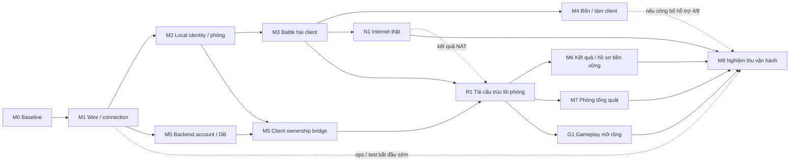

# Kế hoạch server giả lập KR 00967

Nguồn chuẩn của project `boom-kr-server`; bản nhập từ plan đã được dsh1/dsh2 review tại `1eee46d`.

## Bảng điều hành

**Mỗi phiên chỉ cần đọc mục này.** Phần còn lại của file là tham chiếu (đích, milestone Rust, acceptance), tra theo anchor
khi cần; gate K0–K7 và nhánh RE cũ nằm ở [PLAN_ARCHIVE](PLAN_ARCHIVE.md).
Các dòng ở đây được **ghi đè**, không nối thêm; lịch sử checkpoint ở manifest, PROTOCOL và [HISTORY](HISTORY.md).
Codex cập nhật bảng trạng thái và danh sách việc khi xong một bước hoặc đổi blocker. Claude cập nhật đích và thứ tự
theo quyết định của chủ dự án. Cập nhật gần nhất: **12/11, CP282 / AUD098**.

**Đích giai đoạn 1** ([chi tiết](#delivery-target)): dịch vụ nội bộ bền vững, người chơi qua Internet thật, 50 người
đồng thời và tối thiểu 8 phòng, chế độ thường trên sáu map ladder với item của các map đó. Sau giai đoạn 1: gameplay đầy đủ theo
[lộ trình sáu đợt F1–F6](#full-game-roadmap), chưa mở việc nào.

| Mốc | Trạng thái | Còn lại |
|---|---|---|
| M0–M3 nền tảng, phòng cố định, trận hai người | Đạt trong phạm vi đã ghi | Không |
| M4 bốn và tám người | Đạt phần đội cố định và Manner | Free 1v7 là giới hạn đã biết, không retry |
| M5 tài khoản | Account → phòng → trận → kết quả đã chạy native (CP258) | Hồ sơ tổng quát cho mọi account; lỗi hàng đợi DB khi đang native |
| [N1](#rust-n1) Internet thật | **Đạt phạm vi một phía tới được** (CP264 ghi nhận CP261 + owner, [kết luận](#rust-n1-result)) | N1b âm; relay opt-in đạt prototype hai người, còn mở rộng và vận hành |
| [R1](#rust-r1) lõi phòng | Đạt refactor và hồi quy native cho profile 2/4/8 người và account | Không mở rộng tính năng; relay ngoài prototype hai người và vận hành còn riêng |
| M7 phòng tổng quát | M7a/b đạt tập profile đã đo; M7c đạt lựa chọn/full-error trong phòng chờ; M7d đạt ownership tích hợp | M7e roster tự do, chosen-character Start/stat và rời giữa trận |
| [G1](#rust-g1) sáu map ladder và item | Đã đo điều kiện chọn Village10; chưa triển khai gameplay mới | Metadata map phải đồng bộ; spawn, terrain, floor và item chưa đo trên Village10 |
| M6 lưu kết quả, thưởng 0 | Chưa bắt đầu; dependency R1 đã đạt | Sửa acceptance giai đoạn 1; thực hiện song song G1 |
| M8 vận hành | CI đã có (PR #334, #340) | Kiểm tải/budgets, giám sát, backup/restore cho 50 người/8 phòng |

**Thứ tự việc:**

1. **M7e roster tự do** là việc kế tiếp. [M7d ownership tích hợp đã đạt](protocol/room-membership.md#rust-managed-account-ownership)
   trong tập known profiles: native revoke giữa trận cách ly hai phòng; các ca âm tính SQLite/TCP và giới hạn DB/fatal
   được ghi riêng. [M7c room-only](protocol/room-membership.md#rust-managed-player-choices) giữ lựa chọn nhân vật0/1,
   đội A0/B3 và Ready/full-error; chưa kết hợp battle profile. Không lặp producer/slot reader hoặc baseline đã đạt.
   Phạm vi **M7e**: phòng bắt đầu được với số người bất kỳ từ 2 tới 8, slot không cần liên tục, đội theo
   lựa chọn của người chơi ở M7c. Hàng Start và chỉ số của từng người sinh từ nhân vật đã chọn
   ([chỉ số đã giải sẵn](CONTENT.md#dữ-liệu-đã-giải-sẵn)), không lấy từ hàng fixture theo slot. Native tối thiểu: một trận
   3 người, một trận 5 tới 7 người, một trận sau khi có người rời khỏi slot ở giữa. M7b hiện chỉ cho đúng 2, 4 hoặc 8
   người theo profile cấu hình sẵn của phòng; người dùng thật không chơi được nếu thiếu bước này.
   Theo [quyết định 12/11](evidence/owner-directives/m7e-disconnect.json), M7e gồm cả **rớt mạng hoặc rời giữa trận**:
   trong phòng từ 3 người, những người còn lại chơi tiếp và trận kết thúc có kết quả; mất hết một đội thì đội kia thắng;
   sau đó phòng bắt đầu được ván kế với roster còn lại. Hành vi gửi cho client còn lại phải đo trên client thật, không
   tự đặt luật rồi ACK giả. Native tối thiểu: một trận từ 4 người có một client bị ngắt giữa ván, tới kết quả và ván kế.
2. **M5b hồ sơ cho account bất kỳ**: account mới tạo đăng nhập, vào phòng và chơi được mà không cần thêm fixture theo
   từng account. Native với ít nhất một account chưa từng có profile cấu hình sẵn, cùng ca lỗi hàng đợi DB còn nợ của M5.
3. **N1R-b relay cho phòng nhiều người**, sau M7e và trước G1: phòng bốn và phòng tám người chơi qua relay trên
   client thật, mỗi cỡ một lượt; dùng lại cổng và key khi hết pool và sau restart; chặn giả mạo gói đầu giữa hai
   người chung IP. Làm sau M7 để không phải nghiệm thu hai lần trên hai kiểu phòng. Đây là điều kiện của đích
   giai đoạn 1, không phải việc tuỳ chọn.
4. G1 song song M6. G1 cần adapter dữ liệu map nhất quán trước native gameplay mới. Không chạy lại baseline N1b.
5. M8, gồm kiểm tải 50 người và 8 phòng có relay.

Tiêu chí nghiệm thu của M5b, N1R-b, G1, M6 và M8 theo đích giai đoạn 1: [mục riêng](#phase1-acceptance).

**Blocker và việc tồn:**

- Direct UDP âm ở hai NAT đổi cổng trong recipe đã đo; N1b không retry. Relay opt-in đã đạt prototype hai người.
  Cổng không tái dùng trong instance nên có giới hạn số vòng; spoof giữa người chung IP, restart và tải đích còn mở.
- M7a selection đã đo bốn profile; M7b lifecycle đã đo tám profile cấu hình và contiguous2/4/8. Occupancy chỉ phục hồi
  current/capacity, 20 byte còn lại giữ opaque. Roster khác bị chặn; lựa chọn/full-error đã đo riêng trong phòng chờ. Chosen-character Battle và profile account bất kỳ chưa nghiệm thu.
- Village10 được lookup đúng nhưng tên trong Start còn thuộc ExVillage01 nên client từ chối trước loading.
  Terrain cũ cũng khóa với fixture map cũ; cần dữ liệu nhất quán, không nới guard hoặc coi đổi ID đã đủ chơi.
- `local/` không backup ngoài máy theo [quyết định 12/11](evidence/owner-directives/local-backup.json), không phải blocker.
  Fixture mà server cần để chạy không được phụ thuộc `local/` khi bàn giao: đóng gói kèm manifest hash ở M8.
- Dọn issue khi đóng M7, trong cùng PR giao M7e (cần cập nhật catalog và bản đối chiếu issue nên không dọn lẻ):
  đóng issue của lát đã giao (#369); đóng #14 vì #285 đã thay vai trò issue gốc, chuyển link catalog sang #285;
  rút mô tả #285 về trạng thái hiện tại và trỏ tới bảng này. #2, #3 và #9 giữ mở làm backlog ngoài giai đoạn 1.
  Riêng #9 (client thỉnh thoảng abort lúc khởi động trên Wine, chưa rõ nguyên nhân) phải xem lại ở M8 vì người chơi
  thật có thể gặp.

**Quy ước:**

- Trước khi merge PR, `gh pr checks <số>` phải đạt. CI đỏ thì sửa, không merge.
- Không thêm dòng trạng thái theo checkpoint vào đầu file này hay vào mục thứ tự cũ; ghi đè bảng trên. README chỉ giữ
  mốc mới nhất, mốc cũ chuyển sang [HISTORY](HISTORY.md).
- Lát cắt mới không thêm cờ theo sức chứa, alias theo identity hay nhánh `capacity() == N` vào lõi phòng.
- Viết Bảng điều hành cho người chưa theo dõi đọc được: câu đầy đủ, có dấu cách giữa các từ, không dính chữ kiểu
  `actualmatchinput`. Mỗi dòng nói trạng thái và việc còn lại; số lượt chạy, số frame, số PR và diễn biến checkpoint
  để ở record checkpoint. Trước khi mở một mốc mới (M7, G1, M6, M8), viết lại tiêu chí nghiệm thu của mốc đó theo
  đích giai đoạn 1 đã thu hẹp; định nghĩa cũ trong mục milestone viết cho phạm vi rộng hơn.

<!-- dashboard-end -->

### Mục tiêu, baseline và phạm vi

Yêu cầu chủ dự án 26/10/2026: dùng kiến thức RE VN `VBNB_116` để dựng server giả lập cho
**chính `CA.exe` KR `00967`**. Đây là project độc lập `boom-kr-server`; không dùng scope, gate,
registry hoặc tỷ lệ tiến độ V1 của bản viết lại `boom-rs` làm điều kiện của repo này.

Baseline lịch sử **`KR-00967-EMU-1`**: K0–K7 đạt trong từng acceptance; K6c WAN giả lập ghi
**Internet thật chưa kiểm** tại mốc nghiệm thu đó, full game nằm ngoài scope demo. Đích Rust hiện hành ở
[giai đoạn 1](#delivery-target); Internet thật đã có kết luận riêng [N1/N1b](#rust-n1-result).
Các mốc nguồn được phân biệt rõ:

- **Tài liệu tham chiếu lịch sử:** `boom-rs@dae5e1c717ad31b9e8d32a9b20a76d65942807eb`.
- **Plan KRE trước khi tách, đã review:** `boom-rs@1eee46d0ecf5c7f4eeedeadd7e258ef1cd64bf43`.
- **Snapshot khởi tạo repo mới:** `boom-kr-server@a19c8f68af68b01844c92a7870aa2a22eebf5f5f`;
  các sửa sau migration nằm trong lịch sử của chính repo này.
- **Nguồn RE:** `boom-re@9ac2075bbec0c16217741aaedea968cf685e39a9` và
  `boomkr-re@88e11ed30764c753a00f4f23a2f33dafadc4c890`.

Hash client và ma trận tái sử dụng:
[LEGACY_KR_PROTOCOL](PROTOCOL.md).

Đích đầu: bản copy client KR → bootstrap offline → đăng nhập identity cục bộ → một kênh/sảnh →
tạo/vào phòng → ready/start → Battle thường hai client → kết quả → về phòng → trận thứ hai.
Một map thật của KR, ưu tiên Village00 sau khi xác nhận loader/mode cho phép; nhân vật cơ bản theo
ID/Attr KR. Không áp index Village01, roster, drop override hoặc policy ready của V1 Rust lên client gốc.
Mở rộng bốn client chỉ sau khi hai client ổn. Shop, economy, guild, mode phụ và kết nối Nexon thật
để sau. Không dùng client Rust thay bằng chứng nghiệm thu `CA.exe`.

**Quyết định kỹ thuật:** ưu tiên chứng minh tương thích bằng service nhỏ và state machine theo
client; chưa ghép `boom-core` vào đường trận. VN có P2P và client tự tính một phần gameplay;
KR đã có consumer nổ/trap ở client nhưng chưa có bản đồ authority đầy đủ. Một server mới chạy được
với client Rust không chứng minh có thể điều khiển client KR bằng snapshot/command của ADR 0009.

### Đích bàn giao giai đoạn 1 cho công ty — chốt 11/11

Nguồn: [chỉ đạo chủ dự án](evidence/owner-directives/delivery-target.json). Mục này chỉ chốt **đích và đường cắt
phạm vi**; không đóng gate hay milestone nào. Trạng thái từng milestone vẫn ở các mục bên dưới.

**Định hướng dài hạn vẫn là gameplay đầy đủ của game gốc.** Thứ tự các đợt sau giai đoạn 1 ở [lộ trình](#full-game-roadmap). Phạm vi dưới đây là giai đoạn 1, được chọn vì giới hạn
thời gian và tài nguyên; các phần chưa làm thuộc giai đoạn sau chứ không bị loại bỏ.

| Câu hỏi | Quyết định của chủ dự án |
|---|---|
| Mức bàn giao | **Dịch vụ nội bộ bền vững** (hàng giữa trong [bảng ba mức](#rust-service-exit-criteria)) |
| Người chơi | Kết nối qua **Internet thật**, khoảng 10–50 người đồng thời, vài phòng cùng lúc |
| Gameplay giai đoạn 1 | Chế độ thường, **nhiều map chọn lọc và các item phổ biến**, kim/cứu, chọn nhân vật, chọn đội |
| Gameplay dài hạn | Đầy đủ như game gốc, làm tiếp sau giai đoạn 1 khi có thời gian và tài nguyên |
| Hạn chót | Không có hạn cứng; theo dõi bằng milestone và cỡ việc tương đối |

**Trong đích giai đoạn 1:** tài khoản thật cho mọi người chơi (không chỉ hai profile cố định), nhiều phòng độc lập trên một kênh,
lưu hồ sơ và kết quả trận, công cụ admin có audit, backup đã thử restore, người chơi sau NAT gia đình hoặc CGNAT.
Mục tiêu tải dùng để nghiệm thu: **50 người chơi đồng thời, tối thiểu 8 phòng độc lập**, một instance Linux.

**Giai đoạn sau (không là dependency của giai đoạn 1):** cửa hàng, tiền tệ, cấp độ/EXP, inventory mua bán, mode phụ,
boss, mission, event, guild, chat/bạn bè, toàn bộ map và item còn lại, nhiều kênh. HA và tiêu chí của mức
"phát hành rộng hơn" chỉ mở khi công ty quyết định phát hành ra ngoài.

**Ràng buộc thiết kế từ định hướng dài hạn:** giai đoạn 1 không được chặn đường mở rộng. Luật phòng, map, item và
mode phải là dữ liệu hoặc chính sách thêm được, không hardcode giả định "chỉ chế độ thường". Schema DB giữ chỗ cho
inventory/ledger đã thiết kế trong [kiến trúc](RUST_SERVICE_ARCHITECTURE.md). Đây là lý do [RUST-R1](#rust-r1) đi
trước các mốc tính năng.

#### Việc còn lại để đạt đích giai đoạn 1

Cỡ việc là **tương đối** (S nhỏ, M vừa, L lớn), không phải cam kết ngày. "Rủi ro RE" là mức phụ thuộc vào phép đo
trên client KR chưa có; rủi ro cao nghĩa là cỡ việc có thể tăng.

| Thứ tự | Mốc | Còn lại để đạt đích | Cỡ | Rủi ro RE |
|---|---|---|---|---|
| Theo dashboard | RUST-M5 | Fixed2 account/basic đã đạt; còn hồ sơ tổng quát và native DB-queue fault. R1c/R1f đã merge source/TCP | M | Vừa: phép chiếu hồ sơ 291 |
| Theo dashboard | [N1/N1R](#rust-n1-result) | N1 đạt một phía tới được; N1b âm và hết hai lượt. Relay hai người đã đạt prototype; còn mesh, restart và tải vận hành | L | Cao: mở rộng relay |
| Theo dashboard | [RUST-R1](#rust-r1) | R1a–g và native hồi quy profile 2/4/8/account đã đạt | — | Không còn RE cho refactor; tính năng mới có acceptance riêng |
| 4 | RUST-M7 phòng tổng quát | Danh sách phòng động, tạo/vào/rời, lỗi phòng đầy, chọn nhân vật, chọn đội bằng thao tác trong phòng | L | Cao |
| 5 | [RUST-G1](#rust-g1) gameplay mở rộng | Kim/cứu trên Rust, thêm map, thêm nhóm item phổ biến; terrain/item cho phòng 4 và 8 người | L | Cao: mỗi nhóm item cần consumer và ca runtime riêng |
| 5 | RUST-M6 thu hẹp | Lưu kết quả trận và hồ sơ (nhân vật đã chọn) bền vững, thưởng bằng 0. Ledger tiền tệ và inventory để giai đoạn sau, giữ chỗ trong schema | S–M | Thấp |
| 6 | RUST-M8 vận hành | Nâng trần kết nối, cấu hình, giám sát, admin, backup/restore, kiểm tải 50 người/8 phòng, đóng gói | M–L | Thấp |

RUST-M4 đã đủ cho đích ở phần đội hình cố định 2/4/8 và Manner; Free 1v7 còn kẹt ở lỗi khởi động client chưa rõ
nguyên nhân và đã được chốt là giới hạn đã biết của giai đoạn 1. Thứ tự 5 có hai mốc chạy song song vì không phụ thuộc nhau.

Vì sao thứ tự này: N1 đi sớm vì nếu cần relay thì cách trao đổi địa chỉ peer (packet 153) và kiến trúc mạng đổi theo.
R1 đi trước M7, G1 và M6 vì cả ba đều sửa lõi phòng; làm R1 sau thì phải viết lại phần đã xây trên giả định phòng cố định.

#### Hệ quả từ code sau R1g

- R1g cho cấu hình 1–1024 transport và 1–256 entry allowlist, độc lập số profile. Defaults cũ giữ nguyên;
  khoảng 200 transport cho 50 người vẫn cần headroom và kiểm tải M8, không được suy từ test admission.
- Đường account dùng session-owned PlayerId; IP chỉ là restriction, diagnostic vẫn có legacy IP index.
  Hồ sơ tổng quát và native shared-NAT chưa được suy từ source/TCP R1f.
- `LegacyDirectPlan` dùng endpoint channel hiện hành với cổng99. N1b đã chứng minh sai cổng sau NAT ở cả hai phía
  trong recipe đã đo; relay opt-in có acceptance riêng, chưa phục hồi tự động NAT discovery.

#### Quyết định đã chốt 11/11

Nguồn: [chỉ đạo chủ dự án](evidence/owner-directives/phase1-scope-decisions.json). Ba quyết định này chỉ chốt phạm vi,
không đóng gate hay milestone nào.

1. **Map và item cho G1.** Sáu map trong `LadderMapGroup` của client: **Camp08, Factory07, Forest07, Village10,
   Tomb12, Patrit14**. Cả sáu không có script. Nhóm item của G1 lấy từ bảng item của chính sáu map này trong
   [kiểm kê](CONTENT.md): phần đã đo (Bomb, Fire, Roller, MaxPower, kim) cộng phần chưa đo (keo, phi tiêu, máy quét,
   cú, bẫy, lò xo và các item còn lại trong bảng). Map và item khác thuộc giai đoạn sau.
2. **RUST-M4 Free 1v7.** Là giới hạn đã biết của bản bàn giao giai đoạn 1, không chặn đích. Không retry; chỉ mở lại
   khi có quan sát mới về lỗi khởi động client. Trạng thái M4 vẫn do checkpoint/audit ghi theo quy trình.
3. **Kết quả trận (M6).** Lưu lịch sử trận bền vững, thưởng bằng 0; kim dùng số lượt cố định mỗi vòng theo policy
   hiện tại. Điểm, bảng xếp hạng, tiền tệ và inventory thuộc giai đoạn sau.

[Bảng gate tại CP212 đã chuyển sang lịch sử](HISTORY.md#tiến-độ-hiện-hành-theo-bằng-chứng);
hiện trạng ở [Bảng điều hành](#dashboard), acceptance K0–K7 ở [PLAN_ARCHIVE](PLAN_ARCHIVE.md).

### Thứ tự công việc hiện hành

Theo [Bảng điều hành](#dashboard), nguồn duy nhất giữ thứ tự và blocker. Milestone/acceptance ở
[mục Rust](#rust-service-milestones); thứ tự cũ chuyển nguyên văn sang [HISTORY](HISTORY.md#plan-order-before-topic-refactor).

### Milestone Rust: dependency, đầu ra và nghiệm thu

Các ID dưới giữ milestone design và acceptance; trạng thái từng milestone ở bảng, implementation đã được owner mở.
M0/M1 đạt scope hẹp không suy thành fullservice hoặc mọi milestone đã đạt. Không mở hàng loạt issue trùng;
implementation issue chỉ tách khi bắt đầu milestone, gắn existingfeature/KRE/contract/evidence và baseline.
Owner/selfcheck Codex, independentreviewwaived; PR/exacthead vẫn bắt buộc.

| Milestone / giá trị bàn giao | Dependency thật và việc độc lập |
|---|---|
| RUST-M0 Baseline/reproducibility | Đạt scopeCP231: exactPython784a0d8/archive/server-tools/47fixturepins/CP181recipe/rollback; támWIP loại khỏi baseline. Không standaloneclientbundle |
| RUST-M1 Foundation + wire/connection chạy native | Đạt scopeCP231: Rustmode2/selector3/pinnedhello-WCP/nativeerror1→ordinaryretry→error1/seqreset;5wire+14TCPcases. Chưa login thành công/sảnh/fullcodec; M2 tiếp, M5backend độc lập |
| RUST-M2 Bootstrap→local login/identity→sảnh→fixedroom | CP235đạt scoped:2actualfixedroom/ownslots/hostBack-rejoin/Ready/barrier/clock-spawn+healthyBsessionEOF;negative/profileguard có phương pháp và giới hạn. Khôngaccountauth/generalroom/Battle. Diagnosticidentity không fullauth, tiếp contract đã biết |
| RUST-M3 Hai client native→Battlebasic→result/reset/trận2 | CP242 scopedaccepted: CP237–241 movement/bom/terrain/life/oppositeoutcomes/activehostEOF + native itemreset/contest/exactoldUDP-currentpositive/Start3/queue controls. Không fullgame; M5backendworker/idleTTL/rate CP243–244 đã có; M4 tiếp. M2; account/DB backend không cần đợi M3. GiữUDP trực tiếp, không authoritativeengine rewrite |
| RUST-M4 Bốn rồi tám/đội hình cố định theo contract | CP245 four startup/loading và CP246 four-ownerbom/knownstats/16native159158 đã có, M4partial; CP247fourlife/three170/clear21completion và CP248nativeopposite2v2/rank4-reset-Start3 đã có; CP249scopedguest-hostEOF/unrankedreturn-threeRoom đã có; CP250eightbaselineManner4v4/mesh-statbom8/life-rankreset đã có; CP252native9bridge1KR+8synthetic đã có; Free2nativeoutcomes/selector0persist vẫn startupblocked cảactual32control. M4OPEN/M5bridgeindependentnext. M3; baselinefourmain trước eight; dùng CP213teamdelta sau PR Python delivery riêng, không chờ mọi item/mission |
| RUST-M5 Account/profile/DB và sessionownership | CP236 backend SQLite/Argon2id/identity-profile/session/auditCLI và CP243 boundedworker/handoff/compensation đã có; CP244 thêm idleTTL/rate/schema2; CP253 admission library/worker-time UTC/7ca6DB3bodyreplay đã có; CP254 có native2account positive trên fixedzero-profile/private launcher; native negatives/lifecycle/accountroom-game còn thiếu, chưa fullM5. Backend có thể đi trước M3/M4; binding client phụ thuộc M2 + measuredKRauthbridge. Không khôi phục phiên tài khoản/khôi phục trậnmặcđịnh |
| RUST-M6 Inventory/progression/result-reward durability | Backend M5, actualmatchinput M3; KRwireprojection/effect cần từngconsumer. Không cần full8/mọiitem để làm ledger |
| RUST-M7 General lobby/rooms/selection và userflows cần cho nội bộ | M2 + M5ownership, M3lifecycle; M4 chỉ cần nếu mở8capacity. RE roomlist/member/character/team/equip theo phép đo, không mọi mode |
| RUST-M8 Hardening/admin/backup/restore/package và nghiệm thu service | M1–3/M5–7 cho internalservice; M4 nếu quảng bá4/8 theo scope. Ops/tests phát triển từM1, không chờ cuối mới thêm |
| RUST-N1 Internet thật giữa hai NAT khác nhau | Cần M3 (trận hai client). Độc lập với M5–M8; kết quả là đầu vào của R1 (bước R1f) và M8 |
| RUST-R1 Tái cấu trúc lõi phòng, không thêm tính năng | Cần lát cắt account → phòng → trận của M5 đã merge (cùng file). Phải xong trước M7, G1 và M6 |
| RUST-G1 Gameplay mở rộng: kim/cứu, map, nhóm item phổ biến | Cần R1. Song song được với M6/M7; mỗi map và nhóm item cần phép đo KR riêng |

**RUST-M0 — đóng băng một baseline phục vụ rollback.**
Phạm vi: Pythonmerged/copy4b/47fixture2basic hoặc67filefourbundle đãnative, config/hash policy/recipe/hash raw,
không dùng bảnWIP8teams như code đãmerge. Input CP180/181 codec, CP186–189 basic, CP190/198 package,
CP203–207fourhardening và CP212gate decisions; [limits](PROTOCOL.md#authority).
Implementation khi mở: fixturemanifestloader trong kr-service, runtime/backendselector trong harness qua config
đóng băng **trước** run; không viết packetgrammar mới. RE: không có nếu artifacts đủ; thiếu một input thì lấy từ
existingseal, không regenerateoracle. Acceptance: original/copy/profile/hash source kiểm đầy đủ, backend hiện tại
reproducible command và cleanup tài nguyên thuộc run, source/WIP/failedruns tách rõ. Không phải chạy lặp lại mọi gate cho bước docs.
Rollback: chọn exactPythonbundle/fixture/copy ở thư mục riêng; không mutate prefix/source của run đang chạy.
Chuyển M1 khi provenance/permissions/pins đầy đủ; unknown coldreliability/fullassetprofile không là scopeclaim.

**RUST-M1 — lát cắt đầu tiên nên viết.**
Module: kr-wire primitive/typedfields/crypt-CRC/frame/seq; kr-service config/listener/connection/stage tối thiểu,
boundedread/write/timeout và logbuild/connection. Input KR-B002/B003/CP057/180/181, fixtureunknownheader giữ opaque,
mode0hello và mode2/3 đúng scope; Python vẫn phục vụ mọi tính năng còn lại, harness vẫn nguồn input native.
Implementation: toolchainlock/CI Linuxfmt-clippy-test; bytesexact encode/decode với **retained independent native**
vectors, arbitrarysplit/coalescing/partialEOF/invalidlength/CRC/seqwrap boundary theo boundsđãbiết; không build
toàn codec mode chưa khôi phục. RE chỉ khi actual Rust trace lệch oracle hiện có; giới hạn vào field/caller đó.
Acceptance: synthetic/kernelTCPnegative khôngpanics/unboundedallocation, theo connection/directionseq/reset độc lập;
clientKRcopyWine thật nhận hello/validresult1, cùng processretry/newloginconnection/reset theo CP181 vớiRust
listeners và sealedcursor native/CRC/sockettrace, không TCPacceptonly. Trong lát cắt đầu được dừng ở native
login-error/retry, chưa cần DB/sảnh hoàn chỉnh. No badCRCsuccess/sai stage mutation.
Rollback: route toànrun sangPython saucleanup, khônghot-swap connection. Chuyển M2 khi oracle/parity/đường native
và failurelog đủ; mode/headerunknown không suy toàn bộ codec, vẫn failclosed ngoài profile.

**RUST-M2 — đường xuyên bootstrap→localidentity→sảnh→fixedroom.**
Module KRpacketadapters/bootstrap/login/channel/lobby/room; legacy stage/ports/caches/encoding theo CP186/187/198.
Implementation: chuyển bootstrapreplies/typedredirect/137-291/profile-cache/room81-86-87-106-110/Ready và
loading từ pinnedprofile thành builders nhỏ, fieldopaque giữprovenance. Không nhét dịch vụ hoàn chỉnh trongfixtureblob;
không đổi packetheader đồng thời với token/account design. Python giữ servingBattle và RE/reference; native fullrun
chọn một backend từ đầu, không chia giữa active connection khi chưa có handoffcontract.
RE: cold/missing/warm/profileversion/error đã biết dùng lại; chỉ nếu dynamicidentity/listroom fields chặn mới trace.
Acceptance: actualABWine tên/ID/ownslot khác, sảnh/room/spawn đúngprofile; sai socket/stage/version/identity
negative rõ; hostBack→survivorclear/chief→rejoin/Ready, oneunloadedclient không cho GO sớm. Verifybytes/seq/
cursor native/actor và screenshotsbổsung. No xác thực đầy đủ/passwordsignup/multichannel/multiroomclaim.
Rollback: fullPythonprofile, không trộn transportsRust/Python trong mộtlease. Chuyển M3 sau native2actualbarrier.

**RUST-M3 — Battle hai client và hai trận liên tiếp.**
Module round/policies bomb, claims, basictterrain, life-result, scheduler/fences/peerendpoints; input main
CP188/189/155/171–174 và authoritymatrix. Scope một ExVillage01/basicBomb-Fluid-Roller/current291/profile/copy,
UDP trực tiếp, haiownerbom/contest/56→1/result/room/reset/Start3; kim/cứu optional port riêng sau basic, không tự kèm
mọiitem. Fuse6/drop/rank/reportguards giữD revision, không quyền quyết định thế giới gamerewrite.
Implementation: allocator/reservation/159158/124165/142gatedterrain/keys/tickets/witness-result/175180; no
duplicatecommit/latejob, queueentrytag epoch+recipient. RE: chỉ discrepancy currentcell/life/report đang chặn;
nguồn kim/cứu có sẵn thì chuyển riêng rồi nativepair/depleted/reset, không rediscoverconsumer.
Acceptance: actualKRABRust A↔B peerprogress/PCAPwireSHA→nativeAPI/key/apply; actual118 cảhai→sameIDentity/
explode; mộtwinner/effect mỗiclaimindex, 3basichiệu ứng natives/reset, two normal outcomes/Ready2/Start3.
Selectedmalformed/duplicate/stale/wrongslot/key/deadowner/không cấp ID/state và **exact UDP cũ ởvòngmới + currentpositive**;
lateTCP/sendqueue/EOF/bomchờ đi đúnggeneration. HostEOF peer vềphòng/IDclear/chief/fencepastdue; no deadlock.
NegativekernelTCP và native lifecycle tách nguồn; không spoof packet chứng minh originalauthority.
Rollback: before-runPython pin, restart affectedround không cấp thưởng. Chuyển M4 khi native proof + negatives scoped đủ;
auth/collisionallmaps/low8wrap chưa đo giữ debt, không tuyên bố toàn bộ game.

**RUST-M4 — bốn rồi tám và nhóm đội hình cố định.**
Module sessionbindings/roomcapacity/Readybarrier/roster/peer/ranklist, per-role measuredstats; input
CP202–211 mainfour/eight và CP213teamcontracts/PythonPR322 đã giao riêng. Không mặc định eightclient
acceptance cho K6c/K7 lịch sử. Implementation: loại hardcodeAB thành boundedroster trong model, four2v2 trước
eight; identity vẫn diagnosticnếu M5bridgechưa xong. FixedFree4v4/1v7 và balancedManner4v4, rejectunbalanced.
RE: interactiveC2Steamchange chỉ nếu sản phẩm cần userclickchọnđội; fixedpreset của operator không thay proof đó.
Acceptance: Rust4actualcùng process/opposite2v2/reset/Start3/hostguestEOF-survivors; rồi8actual32TCP/ownslots/
56directedremoteprogress/eightdistinctcap-power/8ownerbom/oppositerank8/reset. Free1v7/Manner4v4 haioutcomes/
selector86-87-180persist; Manner1v7 nativecheck7/no104 theo exactcopyhash/profile, synthetic104guard riêng.
Ninthjoinrejectkhông cấp ID/state cần actualadmissionbridge/consumer; unknownsourceIPnegative khôngnative9fullroom.
Guestthiếu ACK load/lateACK/deadowner/disconnect/backpressure không làmpartialbroadcast→grant. Four/eight native
results không chứng minh items/kim/cứu4/8. Rollback package/profile percapacity, fenceemptyroom trước thay;
chuyển milestone khi từng capacity advertised đủ; không chờ modesphụ.

**RUST-M5 — account/profileDB và ownership; có thể tiến hành độc lập gameplay.**
CP236 đã có [backend](PROTOCOL.md#rust-account-backend)/[CLI](../rust/README.md#account-admin-cli) dùng SQLite thật;
[CP243](PROTOCOL.md#rust-account-worker) có boundedworker/handoff và [CP244](PROTOCOL.md#rust-account-idle-rate) có idleTTL/rate/schema2; CP254 thêm fixed2native account lobby/private launcher, CP255 thêm ba native negative/lifecycle; CP258 đã có freshlogin/replay/account-owned fixedroom-basic end-to-end scope2knownprofiles và lifecycle; generalprofile/nativeDBqueuefault/affectedclientrecovery còn giới hạn nên **không đóng M5**. Production restore thuộc M8, không là dependency M5. Không bắt M3/M4 đợi phần đó.
Module application/accounts/profiles/session/store/sqlite/migrations/adminCLI; architecture định schema/invariants.
Backendimplementation: Argon2id/PHC/CSPRNG/hash-atrest/sessionTTL-revoke/oneactive; account→player→wireidentity,
lease nhiềustage/sockets thay rolearrival/sourceIP, nameencoding/bounds, schema/version/conflict/startupvalidation.
Backendtests realSQLite concurrentlogin/duplicateuser/hashquota/dummyverify/entropyfailure/expiry-clockrollback/
ban-reset-revoke/freshserver/DBbusy-diskfull. Python vẫn diagnosticRE, không là oracleauth backend.
RE riêng **bắt buộc** trước KRbinding: exact credential/token localroute, request→verification→identity/projection,
crosssocketlink/retry/sai account/replay/expired/revoked/unknownprincipal. Không coi auth137success/name291
là ownership. Tối thiểu hai testaccounts hai client native, accountA không được claimplayerB qua channelswap.
Acceptancebackend có thể đạt trước M3/M4; acceptanceclient chỉ khi ca native dương tính/negative/expiry và freshlogin
trênRust cósource. Nếu không có bridge xác thực an toàn khảthi thì clientaccountgateblocked, vẫn deliverCLI backend/tests.
Không tự thêm màn login/register vàoKR hoặc bypassprovider thànhauthproof. Rollback diagnosticisolatedteststore,
không downgrade schema/deleteusers; không fallback successful unauthenticated khiDB/authlỗi.

**RUST-M6 — inventory/progression/result-reward đúng một lần.**
Module itemdefinitions/inventory/equipment/profile/matchresults/ledger/outbox; scope basicnhóm đã biết/explicit
nonredeemablepolicy trước, shop/premium/randommonetizedreward đểsau. DependencybackendM5 và roundresultM3;
full8khôngđiềukiện. Implementation: resultID từserverroundnonce, grantunique/matchplayerpolicy/transaction,
balances-quantityrevision/checks, reservation/refundconsumables/expiry, durablepending/outbox/reconcile.
Idempotency key không đổi theo policy version: pin policy vào match/kết quả, unique(match,player,rewardslot);
replay sau đổi công thức phải không cấp lại thưởng. Durable-success chỉ sau DB commit/outbox.
RE: KRprofileXP/character/equip/inventory-count/use-result/rewarddisplay actualconsumer+negative; wikiEXPtable
chỉ rule/productreference, không tựportoffset/ID hoặc chọn servergốcformula. AccountDB đã có không suy clientUI dùng.
Acceptance: DB thật concurrentduplicatefinalize/replayedreport/spendnegative/twoplayerswrongowner/race,
crashbeforecommit/aftercommit-beforepacket/restart-retry/outboxdup khôngdoublegrant/doubledebit; matchedledger
vàinventory saurestore. NativeRust thực dùngitem/quantityconsume→effect→peer/reset, kếtquả cập nhật đúngprofile
sau freshlogin; dữliệuwireunknown disabled thay vìfakeACK. Persistedresult và economyaward tách low-trustreport.
Rollback disable awarding/spend và giữledger/pendingaudit, không rollbacknativeoutcome thànhreaward.
Chuyển khi durabletruth/nativeprojection reconcile; không chờ toànitem/mode.

**RUST-M7 — phòng tổng quát cho giai đoạn 1.**

Đích của mốc này là một kênh với nhiều phòng độc lập, account sở hữu đúng player và membership, có thao tác tạo,
vào, rời, chọn nhân vật và chọn đội trên client KR thật. R1 đã đạt; account fixed2 và profile 2/4/8 hiện hành là
đầu vào tham chiếu, không tự chứng minh phòng động hoặc hồ sơ tổng quát của M5. M7 không nhận inventory, cửa hàng,
EXP, thưởng hoặc mode phụ làm dependency. Sáu map và item của chúng thuộc G1; nghiệm thu M7 dùng map đã có proof.

| Lát cắt chạy được | Đầu ra và điều kiện nghiệm thu |
|---|---|
| M7a: registry vào serving | Account channel ở sảnh không còn gắn sẵn phòng 1. Tạo phòng cấp RoomKey mới; danh sách 91 phản ánh đúng nhiều hàng; 82 chọn đúng tuple phòng, 86/EOF/revoke rời đúng membership. Native tối thiểu bốn client, hai phòng độc lập: tên/list, slot, chủ phòng, leave/rejoin và phòng biến mất khi hết người; không suy từ unit hoặc TCP. Chưa nhận gameplay phòng động ở lát này. |
| M7b: occupancy và lifecycle trận | Ready/loading/Start, kết quả/reset/trận tiếp theo theo roster hiện hành và RoomRules, độc lập PlayerId với slot; không giả mọi phòng luôn đầy. Hai phòng có trận riêng và không lẫn queue, timer, result hoặc UDP khi reset/disconnect. Số người được hỗ trợ phải có contract và native tương ứng; cấu hình chưa đo phải từ chối rõ ràng. |
| M7c: lựa chọn của người chơi | Đo đúng C2S và S2C cho đổi nhân vật, đổi đội và lỗi phòng đầy; client tự thao tác và peer thấy đúng, Ready phải được cập nhật theo policy công bố. Chỉ nhân vật trong phạm vi đã có stat/profile; không mở shop/equipment. Free 1v7 vẫn là giới hạn đã biết, không retry. |
| M7d: tích hợp ownership | Hai session hoặc transport của cùng account không chiếm hai slot như hai player. Wrong-room/outsider-host/stale membership bị chặn; EOF, expiry, revoke và DB failure không để slot ma hoặc dữ liệu cũ tác động phòng khác. Native tối thiểu một đường account → chọn phòng → trận → reset, cùng các ca âm tính cần cho phần mới. |

**Kết quả M7d:** đạt ownership tích hợp cho tập profile hiện hành, theo
[contract và giới hạn](protocol/room-membership.md#rust-managed-account-ownership). Native mới kiểm active revoke
ở một phòng khi phòng khác tiếp tục; expiry/DB-busy mới là SQLite/TCP, không thay native DB-queue fault của M5b.
Client bị revoke vẫn có thể abort; không nhận logout êm, arbitrary profile hoặc survivor continuation.

**Kết quả M7c:** đạt trong phạm vi lựa chọn/phản hồi ô/Ready và full-error của phòng chờ cho nhân vật0/1 và đội UI A0/B3.
Config lựa chọn chưa dùng với battle profile; Start/stat theo nhân vật và roster tự do thuộc M7e đã được chủ dự án
đặt sau M7d. Không nâng kết quả này thành full M7 hoặc đường chơi với nhân vật tùy ý.

**Kết quả M7b:** đạt cho tập contiguous2/4/8, known profiles và RoomRules đã cấu hình. Occupancy, hai duel chưa đầy,
[hai phòng bốn người/một phòng tám người và EOF cách ly](protocol/room-membership.md#rust-managed-team-rosters) có
native riêng. Roster chưa đo bị từ chối; không suy mọi layout, lựa chọn hoặc ownership failure đã đạt. Toàn M7 còn
M7e; relay nhiều người và vận hành giữ acceptance riêng.

**Kết quả M7a:** đã đạt trong phạm vi bốn profile cấu hình trên Wine/LAN giả lập; nguồn chuẩn ở
[contract và giới hạn](protocol/room-membership.md#rust-managed-room-selection). Không đóng toàn M7 từ lát cắt này.

Thứ tự triển khai bắt đầu M7a, sau đó nối lifecycle và lựa chọn theo khoảng trống thực. M5 có thể làm profile
account tổng quát và native DB-queue fault song song về mặt dependency; phần nào thật sự chặn projection/ownership
phải được đo và nối trước khi nhận M7 tích hợp, không gắn account bất kỳ vào profile của người khác. Lát cắt đầu
có thể dùng các profile đã đo để tách lỗi routing khỏi lỗi projection; không được dùng giới hạn đó để đóng toàn M7
hoặc đích dịch vụ nội bộ cho mọi account.

Module giữ một process: lobby, room registry, room owner/recipient queues và account session. Một connection có
owner chọn phòng rõ ràng; registry → room có thứ tự lock cố định, không giữ lock qua DB await hoặc I/O. Mỗi room,
visit, round và callback mang generation; public tuple chưa có epoch trên wire không được tái dùng khi chưa có
chính sách stale kiểm được. Danh sách, occupancy và quyền host phải lấy từ state hiện hành, không từ fixture đếm sẵn.

Trong M7, relay route/resource ownership phải theo room và membership tổng quát, không theo profile hoặc số người.
Không thêm cờ four_*/eight_*, alias theo identity hoặc nhánh `capacity() == N`. Không tự fallback từ relay sang direct.
Nghiệm thu relay nhiều người, reuse/restart và spoof chung IP thuộc **N1R-b sau M7, trước G1** theo dashboard;
M7 không tự tuyên bố đã đạt các ca đó. Tải 50 người/8 phòng có relay thuộc M8, không suy từ trần cấu hình.

RE chỉ mở cho multirow list/create/join/full-error/character/team hoặc lifecycle mới đang chặn lát cắt. Dùng lại
builder và consumer KR đã có; không copy wire VN hoặc mở toàn bộ mode. Hidden/password/private/spectator, chat,
bạn bè, guild và nhiều kênh ngoài scope mốc này. Hành vi chưa được hỗ trợ phải bị vô hiệu hoặc từ chối, không ACK giả.

Acceptance toàn M7 cần đủ các lát cắt trên, source/TCP negative và native Rust trên Wine/LAN giả lập theo recipe
đã chốt, raw/hash/source freeze/cleanup và đối chứng current-positive cho stale/failure. Phân biệt fresh process,
fresh login, reconnect và account resume; không nhận resume/match restore từ leave/rejoin. R1 baseline giữ để
rollback. Khi có lỗi, dừng nhận phòng mới và dùng binary/config baseline tương thích trước khi mở trận mới; không
đổi route giữa vòng, xóa account/DB hoặc bỏ bằng chứng. Không đóng M7 từ registry unit, TCP accept hoặc log server.

**RUST-M8 — vận hành nội bộ, admin và readiness phát hành.**
Module telemetry/config/health/admin/storebackup/deployrunbook; làm xuyên từM1. Scope một Linuxinstance,
projectaccounts/onechannel/measuredmaps/modes, explicit UDP trực tiếp/NATsettings. Implementation configschema/
secretspermission/redactedlogs/build-boot-session-room-round-matchIDs/metrics/healthreadiness, authrate/
boundedIO/deadlines/gracefulshutdown, adminban-unban/reset/revoke/reconcile/audit, migrator/snapshotbackup.
RE chỉ targetedwire/lifecycle/securityexposure chặn acceptance; không quét toànclient vì còn backlog.
Acceptance: fmt/clippy/tests/oracle/native E2E/packagefailbeforelisten/relocation; corruption/futureDBschema/
wrongconfig failclearly. **Backup đã restore** vào freshpath, ledger/integrity/accountprofiles/nativefreshlogin
và newmatch đúng; rehearsal binaryupgrade→badconfig/DBerror→compatible rollback; RPO/RTO ghiđothực.
Actualpeer không đọc/load/rate/ghi một phần/slowDB/diskfull/SIGTERM-SIGKILL kiểm isolation/fence/không cấp thưởng/cleanup tài nguyên thuộc run.
4actualRusttwoopposite2v2/reset/Start3 dướiUDP40±5ms/loss5%/TCPbaseline và freshserver cùng DBidentity; topology/
MTU/reorder/bandwidthcấu hìnhthực côngkhai, K6cWANgiảlập scope táidùng; N1/N1b đã có kết luận riêng tại [kết quả mạng](#rust-n1-result).
Loadacceptance dùng workloadtarget chốt trướcbenchmark (connections/rooms/Hz/p95latency/queue/RAM), không
gán targetproduction từ8Wine/GDB. Không hứa HA hoặc chốngmọicheat khi movementP2P/reportauthoritycònhạn.
Rollback drain/stopadmission/fenceuncommittedround, compatiblebinary+testedDBrestore; không silentgrantloss.

### Mốc bổ sung từ đích bàn giao 11/11

Ba mốc dưới sinh ra từ [đích giai đoạn 1](#delivery-target). Chúng không đổi acceptance của M0–M8 đã ghi ở trên.

**RUST-N1 — Internet thật giữa hai NAT khác nhau, đã có kết luận theo phạm vi bên dưới.**
Đoạn acceptance sau giữ thiết kế phép đo ban đầu; hotspot 4G không tự chứng minh phân loại CGNAT.
Mục đích: biết sớm UDP trực tiếp giữa client có dùng được cho người chơi thật hay cần học cổng sau NAT, hole punching
hoặc relay. K6c/K7 đã nghiệm thu bằng WAN giả lập giữ nguyên; N1 là gate của đích bàn giao, không sửa lại gate cũ.
Topology tối thiểu: server trên VPS có IP public; client A ra bằng mạng di động (CGNAT thật); client B ra bằng một IP
public khác (tunnel qua VPS, server trong netns riêng và SNAT để server thấy B bằng IP public). Giữ allowlist outbound
của client theo AGENTS.
Phép đo: chạy recipe hai client hai vòng đã có; bắt PCAP ở cả hai đầu; so **cổng UDP client tự báo trong packet 99**
với **cổng nguồn thật** của gói UDP sau NAT; ghi chiều nào thông, chiều nào không, và client có trả lời về địa chỉ nguồn
quan sát được hay chỉ gửi tới địa chỉ server báo trong 153.
Acceptance: kết luận có bằng chứng cho một trong ba nhánh — (a) trực tiếp dùng được như hiện tại; (b) cần server học
endpoint thật (đầu vào cho R1f); (c) cần relay, khi đó mở mốc thiết kế relay riêng trước M7. Một ca hai người chơi
chung một NAT cũng phải được ghi nhận: baseline lúc mở N1 còn binding theo IP. R1f sau đó đã tách account identity
theo session/PlayerId ở mức source/TCP; native shared-NAT vẫn cần nghiệm thu riêng.
Ngoài phạm vi: mọi loại NAT, IPv6, nhiều ISP. Một nhà mạng di động và một IP public là đủ cho quyết định kiến trúc.

**Kết luận N1 — chốt 12/11.** Nguồn: [bằng chứng CP261](evidence/rust-service/internet-observation.json) và
[xác nhận của chủ dự án](evidence/owner-directives/n1-uplink-and-result.json). Chủ dự án xác nhận uplink của máy chạy
client trong đợt đo là **hotspot điện thoại 4G**; đây là câu trả lời cho câu hỏi uplink mà CP261 để mở.
Kết quả: hai client KR thật qua đường Internet đã đo chạy trọn account → phòng → hai kết quả đối nghịch → reset →
trận tiếp. Cổng UDP client A tự báo ở packet 99 **khác** cổng thật sau NAT, nhưng client B **trả lời về địa chỉ nguồn nó
quan sát được**, nên UDP vẫn thông hai chiều. **N1 đạt trong phạm vi: ít nhất một phía tới được theo địa chỉ server báo**
(ở đây phía B đi qua NAT do ta kiểm soát). CP264 đã đối chiếu lại1124 pin CP261 và ghi nhận đóng phạm vi này; [quyết định/evidence](evidence/rust-service/n1-acceptance.json).

Khoảng trống khi chốt N1 ban đầu là **cả hai phía sau NAT đổi cổng**. CP266 bên dưới đã đo ca đó; kết quả âm
không mở rộng phạm vi N1 đã đạt.

**N1b — hai phía đều sau NAT đổi cổng.** Giữ nguyên topology N1, đổi NAT phía B sang đổi cổng nguồn ngẫu nhiên và bỏ
ánh xạ cổng tĩnh, để B giống một người chơi sau NAT gia đình. Chạy recipe hai client, tối đa hai lượt native, bắt PCAP
hai đầu. Kết luận cần có: (a) vẫn thông, ghi rõ nhờ cơ chế nào; (b) không thông nhưng client có gửi UDP tới một địa chỉ
mà server học được, khi đó R1f cho server học endpoint thật; (c) không thông và không có đường học, khi đó mở mốc thiết
kế relay trước R1f. Ca hai người chung một NAT không thuộc N1b; nó được sửa ở R1f.

**Kết quả N1b — CP266:** đã dùng đúng hai lượt native trên binary baseline CP261, giữ riêng raw/hash/cleanup.
Cả hai đi hết account/phòng → hai kết quả/reset → Start3, nhưng các cửa sổ native UDP không có ingress/helper ở cả hai
phía. Lượt2 cho phép quan sát gói ở lớp cloud, vẫn không có ánh xạ DNAT public, đã thấy **cả hai cổng nguồn sau NAT
khác packet99**. Native gửi tới cổng153, không có UDP tới service trong capture để học endpoint.
[Contract/đối chiếu](PROTOCOL.md#rust-n1b-dual-nat), [evidence](evidence/rust-service/n1b-dual-nat.json).
Kết luận theo nhánh **(c) cho đúng recipe đã đo**: cần relay/endpoint riêng; thiết kế CP267 đã giao, R1f đã merge. Không retry N1b,
không suy rằng mọi nhánh client đều không thể traversal. Relay mới có acceptance riêng bên dưới. TCP kết quả không chứng minh đồng bộ UDP.
[Thiết kế đã chốt](RUST_SERVICE_ARCHITECTURE.md#relay-endpoint-design) tách endpoint khỏi session identity và giữ direct legacy.
Implementation relay chỉ được nghiệm thu tương thích sau native chứng minh
send→relay capture→peer ingress/key/helper/apply, hai chiều/hai vòng/reset/old packet/EOF; ngoài phạm vi đo CP266.
K6c/K7/N1 acceptance cũ không đổi; shared-IP identity đã sửa source/TCP ở R1f, không tự chứng minh native UDP hai NAT.

**RUST-N1R — relay opt-in đã tích hợp, đạt phạm vi prototype hai người.**
[Contract](protocol/udp-peer.md#rust-relay-endpoint-scope), [module và quyết định](RUST_SERVICE_ARCHITECTURE.md#relay-endpoint-design),
[evidence và đối chiếu acceptance](evidence/rust-service/n1r-fixed2.json), [phần còn mở](RESEARCH.md#gap-relay-endpoint).
Source nằm trong nhánh bàn giao; merge qua PR là bước riêng. Không đóng full R1, M5 hoặc đích dịch vụ nội bộ.

| Tiêu chí prototype | Kết luận và giới hạn |
|---|---|
| Tách endpoint khỏi account và membership | Đã tích hợp. Relay chỉ bật khi có account admission, policy phòng và pool mạng rõ ràng. IP không cấp identity. |
| Reserve trước publish, bounded queue/rate/TTL, invalidation | Unit và TCP/UDP tổng hợp đạt. Có đối chứng malformed, tuple lạ, rebind, revoke, exhaustion và stale owner; đây không phải native proof. |
| KR thật gửi và nhận qua relay ở hai NAT đổi cổng | Đạt trên hai bản copy diagnostic chạy Wine: send → capture ingress → reverse socket egress → peer ingress → key/helper → actor thay đổi, cả hai chiều và hai vòng. |
| Kết quả, reset và trận tiếp | Hai kết quả đối nhau, reset và Start3 đã đo trên cùng binary. |
| Gói cũ và đối chứng hiện hành | Exact datagram vòng trước tới đúng cổng đã nghỉ, cùng tuple sau NAT, không chuyển tiếp; input hiện hành sau đó vẫn tới actor vòng mới. |
| EOF khi bom đang chờ và fence | Kill đúng tiến trình B đã định danh; A nhận kết quả, về phòng, xóa ID B, nhận chief và không nổ quá hạn. Có UDP được gửi tới cổng đã nghỉ sau EOF nhưng không còn egress. |
| Giữ direct legacy | Bộ TCP và byte nhận so với baseline đạt. Native cuối R1 vẫn là việc riêng. |

Lượt chứa phép stale có lỗi guard của harness sau kill B; kết quả toàn lượt vẫn là thất bại. Chỉ tái sử dụng phần
stale/current đã kiểm độc lập; một lượt EOF bổ sung duy nhất khép phần thiếu. Chi tiết số lượt, raw/hash và cleanup
ở evidence, không sửa kết quả cũ.

**Giới hạn nghiệm thu:** đường mạng kiểm soát có một chặng Internet UDP; phía còn lại dùng tunnel qua SSH/TCP và
SNAT kiểm soát. Đây không là hai ISP độc lập, CGNAT thực tế hoặc mọi topology Internet. Không suy mọi loại UDP đã đo.
Thông tin topology, endpoint, NAT và tham số cấu hình thực giữ local. K6c/K7/N1 cũ không đổi.

Prototype giữ cổng đã nghỉ đến khi service dừng và không lặp low-byte key của phòng trong instance, kể cả reservation
đã hủy. Hết pool/key thì từ chối Start trước publish. Chưa nhận restart hoặc dùng lại cổng là an toàn; source IP,
CRC và key không xác thực UDP. Spoof first datagram giữa người chung IP còn mở. Relay bốn/tám người và tải 50 người,
8 phòng phải đo riêng, không suy từ số socket lý thuyết.

Rollback bằng policy `LegacyDirect` và binary/config baseline trước Start; không đổi route giữa vòng. Giữ Python,
harness và fixture làm đối chứng. Chỉ mở rộng prototype khi có acceptance cho mesh, tài nguyên và lifecycle tương ứng.

**RUST-R1 — đạt tái cấu trúc lõi phòng và hồi quy native trong phạm vi profile hiện hành.**
Không đổi byte trên wire của profile legacy 2/4/8/account. Native của binary sau refactor đã được đo riêng; [đối chiếu acceptance](evidence/rust-service/r1-native-final.json).

| Bước đã merge | Cơ chế hiện có | Giới hạn / nguồn chuẩn |
|---|---|---|
| R1a–R1b | `RoomRules` normalize cấu hình thành Result/Departure/Bomb/Life/TeamPolicy | [Policy](protocol/rust-boundary.md#rust-r1b-policies); JSON compatibility còn cờ cũ |
| R1c | `PlayerId` độc lập slot; `FirstVacant` opt-in, template106 chung | [Slot/profile](protocol/room-membership.md#rust-r1c-player-slots); chưa hồ sơ account tổng quát |
| R1d | Header KR chuẩn, parser/builder theo opcode trong `kr-wire::kr00967` | [Wire](protocol/rust-boundary.md#rust-r1d-wire-builders); một số body vẫn cần template đã pin |
| R1e | Registry có typed RoomKey, listing và recipient queues độc lập | [Registry](protocol/room-membership.md#rust-r1e-registry); serving vẫn chọn phòng cố định, nhiều phòng thuộc M7 |
| R1f | Account profile theo session-owned PlayerId, endpoint theo channel hiện hành; IP chỉ restriction | [Binding](protocol/room-membership.md#rust-r1f-session-binding); native chung NAT còn thiếu; relay prototype hai người có acceptance riêng |
| R1g | Budget transport/allowlist cấu hình độc lập profile; PR348 đã merge | [Admission](protocol/rust-boundary.md#rust-r1g-admission); 65 socket không phải tải 50 người KR |

Acceptance cuối R1: toàn bộ bộ TCP hiện có đạt và **một lượt native hồi quy cho mỗi profile 2, 4, 8 người và đường
account**, không thêm claim mới. Relay có acceptance riêng ở [N1R](#rust-relay), không suy từ hồi quy direct legacy.
R1a/R1b/R1d giữ hành vi; các policy opt-in mới của R1c/e/f/g giữ byte profile cũ. Không thêm cờ theo sức chứa,
alias theo identity hoặc nhánh `capacity() == N`. Rollback từng lát cắt; Python RE/reference giữ nguyên.

Đối chiếu cuối: bộ TCP giữ byte baseline; trên Wine, các profile 2, 4, 8 người và account đều có native hai kết quả
đối nhau, reset và Start3 trên cùng binary. Đường account còn kiểm token, ID/name/echo, transport và profile thuộc
đúng chủ sở hữu. Đây là hồi quy refactor, không đóng full M5 hoặc tính năng phòng tổng quát.

Lượt bốn người đầu mất raw do harness export thiếu import, nên không dùng để nghiệm thu; lượt bổ sung có đủ raw
và kiểm độc lập. Lượt tám người thất bại ở unmount sau khi raw đã copy, được phục hồi nguyên byte và seal với exit 1.
Native kết quả, reset và chuyển động ở từng hướng peer đã kiểm riêng; PCAP UDP kế thừa chỉ nhận bốn IP nên bị thiếu,
không dùng để khẳng định đã capture đủ mọi hướng hoặc mọi loại UDP. Không chạy lại tám người chỉ để đổi exit code.
Các lỗi, phép phục hồi và giới hạn nằm ở evidence; raw và kết quả cũ giữ nguyên.

Điều kiện chuyển việc đã đủ cho refactor R1; tiếp phép thử map theo dashboard. Scope M7/G1/M6/M8, relay mesh và
restart không được suy đạt từ hồi quy này. Không đổi source hoặc policy runtime trong đợt nghiệm thu cuối.

**RUST-G1 — gameplay mở rộng cho giai đoạn 1.**
Phạm vi: (1) kim và cứu trên Rust theo contract đã đo ở Python; (2) terrain và item nền cho phòng 4 và 8 người, hiện
bị từ chối ở cấu hình; (3) sáu map ladder đã chốt 11/11 (Camp08, Factory07, Forest07, Village10, Tomb12, Patrit14)
và các item trong bảng item của chúng, xem [quyết định](#delivery-target). Mỗi map cần đúng dữ liệu và consumer của nó; mỗi nhóm item cần consumer cùng một ca dùng, một ca
không đủ điều kiện, hết hạn/tiêu thụ, peer thấy đúng và reset — theo đúng yêu cầu đã ghi ở
[kiến trúc](RUST_SERVICE_ARCHITECTURE.md). Luật đặt trong `RoomRules` và dữ liệu map/item, không thêm nhánh theo sức chứa.
Đầu vào để chọn danh sách: [kiểm kê nội dung](CONTENT.md) sinh từ pack (map theo họ, item được map dùng, script).
Kiểm kê là dữ liệu tĩnh; cột "server phải làm gì" điền dần bằng ca chạy thử, mỗi họ map hoặc nhóm item một ca.
Acceptance: native trên Rust cho từng map/nhóm item được công bố, hai vòng liên tiếp, có ca âm tính. Phần chưa đo thì
tắt, không gửi ACK giả. Toàn bộ map/item/mode còn lại thuộc giai đoạn sau theo định hướng dài hạn.

Dữ liệu tĩnh đã chuẩn bị cho G1: `tools/export_map_profile.py` xuất profile từng map từ pack, và
[ngữ nghĩa tile](content/tile-semantics.md) nêu quy tắc ứng viên suy loại ô (trống, chặn, thùng) từ bảng tile của client.
Quy tắc mới chỉ được kiểm trên ExVillage01 (195/195 ô), nên với map khác nó là ứng viên cho tới khi có trận native.
Thứ tự thử map đề xuất theo số ô quy tắc chưa phân loại được: Factory07 (0), Forest07 (1), Patrit14 (1), Village10 (18),
Camp08 (50), Tomb12 (104). Các loại ô chưa đo hành vi (bụi cỏ, thùng cứng, đường kẻ, giếng, cầu…) phải đo riêng trước khi
công bố map chứa chúng; profile tĩnh chưa thay được adapter cho các packet vào trận.

### Nghiệm thu giai đoạn 1 cho các mốc sau M7

Mục này là tiêu chí nghiệm thu hiện hành của M5b, N1R-b, G1, M6 và M8. Định nghĩa M5, M6 và M8 ở
[mục milestone](#rust-service-milestones) viết cho phạm vi rộng hơn (inventory, ledger, thưởng) và chỉ còn là đầu vào
cho các đợt sau. Một mốc đạt khi mọi dòng "phải có" đạt trên client thật, trừ dòng ghi rõ cách kiểm khác. Việc ở dòng
"không thuộc mốc" không được kéo vào. Chi tiết wire phải đo, không tự đặt luật rồi ACK giả.

**M5b — account bất kỳ.** Phải có:

- Account do admin tạo bằng CLI, không sửa config và không restart service, đăng nhập được, vào sảnh, tạo hoặc vào
  phòng, chơi hết một trận và ván kế.
- Tên hiển thị và hồ sơ gửi cho client sinh từ DB, không từ fixture theo account.
- Hai account mới đăng nhập từ cùng một IP công khai không lẫn danh tính của nhau.
- Khi DB bận hoặc hàng đợi đầy lúc đang có trận: người đang chơi không bị ảnh hưởng, người đăng nhập mới nhận lỗi rõ
  ràng, DB hồi lại thì đăng nhập được. Đây là ca còn nợ của M5.
- Sai mật khẩu, account bị khóa và đăng nhập trùng chỉ cần chạy lại bộ TCP đã có.

Không thuộc mốc: người chơi tự đăng ký trong client, cấp độ, EXP, tiền, inventory.

**N1R-b — relay cho phòng nhiều người.** Relay là policy mặc định của dịch vụ giai đoạn 1; `LegacyDirect` giữ lại cho
chẩn đoán và hồi quy. Phải có:

- Một trận 4 người và một trận 8 người qua relay, mỗi trận tới kết quả, reset và ván kế.
- Một ván kế sau khi có người rời, để kiểm cấp lại đường cho roster không còn đủ 4 hoặc 8.
- Một người rớt mạng giữa trận: đường của người đó được thu hồi, những người còn lại chơi tiếp.
- Cổng và key dùng lại được: đặt pool nhỏ, chạy số ván vượt kích thước pool trong một instance; gói của ván cũ không
  lọt sang ván mới.
- Sau restart service, phòng mới chơi được và gói client cũ gửi tới cổng cũ bị bỏ.
- Hai người chung IP công khai trong cùng phòng: gói đầu của người này không chiếm được đường của người kia.
- Ghi số cổng cần cho 8 phòng 8 người và luật firewall tương ứng vào tài liệu vận hành.

Không thuộc mốc: tự dò NAT để đi thẳng, relay trên nhiều instance, kiểm tải (thuộc M8).

**G1 — sáu map ladder, item và nhân vật.** Phạm vi và dữ liệu tĩnh ở [RUST-G1](#rust-g1). Làm theo lát, mỗi lát một
checkpoint:

1. **Adapter dữ liệu map.** Tên map, dữ liệu Start và các packet vào trận sinh từ profile xuất từ pack. ExVillage01
   qua adapter phải cho đúng byte của fixture hiện hành; sau đó Factory07 chạy một trận.
2. **Chọn map trong phòng chờ.** Chủ phòng đổi map, người khác thấy map mới, Start dùng đúng map đó. Thao tác này chưa
   từng được đo.
3. **Kim và cứu** trên Rust theo contract đã đo ở Python.
4. **Terrain và item nền cho mọi cỡ phòng**; hiện phòng 4 và 8 người bị từ chối ở cấu hình.
5. **Các map còn lại** theo thứ tự Forest07, Patrit14, Village10, Camp08, Tomb12. Mỗi map một trận hai vòng: spawn
   đúng, thùng vỡ đúng, item rơi và nhặt được. Loại ô chưa đo phải đo trước; chưa đo thì map đó chưa được mở.
6. **Nhóm item của sáu map.** Mỗi nhóm một ca dùng, một ca không đủ điều kiện, peer thấy đúng, reset đúng. Nhóm chưa
   đo bị tắt khỏi bảng rơi.
7. **Nhân vật.** M7e chỉ có chỉ số cho hai nhân vật đã đo. Mọi nhân vật mà account mới chọn được trong phòng chờ phải
   có chỉ số lấy từ `BomberAttr`; nhân vật chưa hỗ trợ bị từ chối rõ ràng.

Map được mở từng cái. G1 đạt khi cả sáu map chơi được trong phòng 2 tới 8 người, hoặc chủ dự án chấp nhận danh sách
rút gọn có lý do. Không thuộc mốc: map và item ngoài sáu map này, mode khác chế độ thường, monster, script.

**M6 — lưu kết quả, thưởng 0.** Phải có:

- Mỗi trận ghi đúng một bản ghi bền vững: phòng, map, thời điểm, lý do kết thúc, và với từng người: account, nhân
  vật, đội, slot, thắng/thua/hòa, có rời hoặc rớt giữa trận hay không.
- Ghi đúng một lần khi report lặp, khi DB bận và khi service bị kill ngay sau kết quả: không mất, không trùng.
- Trận bị hủy ghi là hủy, không ghi thắng thua.
- Nhân vật chọn gần nhất được lưu theo account và hiện lại sau khi đăng nhập lại.
- Client nhận kết quả với thưởng bằng 0; server không cấp gì.
- CLI admin xem được lịch sử trận theo account và theo phòng.

Kiểm bằng DB thật cho các ca lỗi, cộng một trận trên client thật rồi đăng nhập lại. Không thuộc mốc: EXP, cấp độ,
tiền, bảng xếp hạng, inventory. Schema chỉ giữ chỗ cho ledger và inventory.

**M8 — vận hành.** Phải có:

- **Gói server:** binary, config, fixture runtime và dữ liệu map, nhân vật sinh từ pack, có manifest hash. Chạy được
  trên một máy Linux sạch, không có repo và không có `local/`. Dữ liệu trích từ client không commit; gói được dựng
  tại chỗ từ pack bằng một lệnh có tài liệu.
- **Gói cho người chơi:** người chơi chạy client trên Wine; gói được thử trên cả Wine và Windows trong máy ảo theo
  [quyết định 12/11](evidence/owner-directives/player-environments.json). Gói gồm hướng dẫn, phiên bản Wine đã nghiệm
  thu, cách dựng prefix và cấu hình trỏ client tới server. Trên mỗi môi trường, từ một máy sạch không phải máy phát
  triển: cài, đăng nhập, vào phòng và chơi hết một trận. Client chưa từng chạy trên Windows với server này, nên lượt
  Windows làm sớm trong M8 để còn thời gian xử lý nếu hỏng.
- **Kiểm tải:** 50 người đồng thời và 8 phòng cùng chơi qua relay. Trước khi đo phải có tần suất gói UDP của một
  client thật và ngưỡng CPU, RAM, độ trễ chuyển tiếp, tỉ lệ rơi gói. Tải tổng hợp phát lại traffic đã thu; cùng
  lúc có ít nhất hai phòng client thật để xác nhận client thật không bị ảnh hưởng.
- **Chạy dài:** 24 giờ có tải nền, không rò bộ nhớ, cổng relay hay phòng ma.
- **Giám sát:** log có ID phiên, phòng và trận, không lộ mật khẩu hay token; số người online, số phòng, số trận, số
  cổng relay đang dùng, lỗi DB; có điểm kiểm tra sức khỏe.
- **Admin:** tạo, khóa, mở khóa, đặt lại mật khẩu, ngắt một người chơi, đóng một phòng; mọi thao tác có audit.
- **Backup và restore:** backup khi service đang chạy, restore vào máy sạch, đăng nhập và chơi trận mới được; ghi thời
  gian khôi phục và lượng dữ liệu mất đo thực.
- **Dừng và khởi động lại:** dừng có trật tự không để trận dở mà không ghi; khởi động sau khi bị kill không còn phòng
  ma và DB nhất quán. Diễn tập một lần nâng cấp binary rồi quay lại bản cũ.
- **Lỗi khởi động client** ([#9](https://github.com/aquaplatinumberlitz/boom-kr-server/issues/9)): đếm tỉ lệ trong các
  lượt client thật của kiểm tải và chạy dài; tỉ lệ đáng kể thì mở lại.
- Tài liệu vận hành một trang.

Không thuộc mốc: nhiều instance, nhiều kênh, HA, trực sự cố, chống gian lận ngoài phần đã có.

**Đích giai đoạn 1 đạt khi** M7, M5b, N1R-b, G1, M6 và M8 đều đạt theo mục này. Theo [quyết định 12/11](evidence/owner-directives/no-playtest.json),
không cần buổi chơi thử với người chơi thật; nghiệm thu dùng client thật do nhóm tự chạy và tải tổng hợp.

### Khi nào đủ demo, dịch vụ nội bộ và phát hành rộng hơn?

| Mức bàn giao | Điều kiện đủ, chưa đạt chỉ từ Pythongate/build |
|---|---|
| Rust demo nội bộ tương thích | M0–3 nativeactual2/twocycles/reset/Start3/basic+negative/lifecycle trênRust, package/limits. Identitydiagnostic phải ghi rõ; M4 nếu quảng bá4/8; không tựgọixác thực đầy đủ/toàn bộ game |
| Dịch vụ nội bộ bền vững | Thêm M5clientbridge có kiểm quyền sở hữu, M6durableprofiles/inventory/resultreward trongphạm vi đã chọn, M7roomflow, M8restore/admin/rate/lỗi DB/monitoring/rollback; native4 nếu quảng bá bốnngười. Explicitproductpolicy/unsupportedactionsdisabled; audit/reconcile |
| Phát hành rộng hơn | Tất cả internalcriteria và kiểm bảo mật/credential bridge/threat model có bằng chứng, giữ owner review waiver, độ tin cậy của report/abuse-validation theo phạm vi công bố, measuredcapacity/soak/SLO/alert/oncall/retention/upgrade-drain/recoverydrill, delivery/provisioning hỗ trợ người dùng. Không khẳng định mạngInternet thực/ISP/CGNAT hoặc mọiNAT nếuchưakiểm; khi quảng bá endpointInternetthực thì đo riêng trênendpointkiểmsoát, không sửa lại K6cWAN/K7đãđạt thànhdependencyngầm |

Chat/social/friends/whisper ưu tiên sau basic/accountstability; roomchat cầnrate/moderation/wireconsumer.
Shop/economymởrộng sauledger/inventory vàproductpolicy; guild/mission/boss/revival/event/modesphụ sau đó
theo nhu cầu, không làblocker bảnchơicơbản. Không hứa ngày/phầntrăm/sốcheckpointcòn lại: authbridge/roomdynamic/
inventoryprojection/authorityvalidation làunknown effort; ước lượng chỉ sau số liệu lát cắt đầu, nêuassumptions.

### Lộ trình sau giai đoạn 1: tới gameplay đầy đủ

Chủ dự án muốn dài hạn có đủ item, map và mode của game gốc. Mục này xếp **thứ tự các đợt**; nó chưa phải cam kết
thời gian và chưa mở việc nào trước khi giai đoạn 1 bàn giao (trừ các phép thử xếp loại rẻ). Số liệu lấy từ
[kiểm kê](CONTENT.md) sinh từ pack; có tài nguyên trong pack không chứng minh tính năng còn chạy. Cỡ từng đợt
**chưa ước lượng được** cho tới khi các nhóm trong đợt được xếp loại A/B/C.

| Đợt | Nội dung | Số liệu kiểm kê | Phụ thuộc và điều chưa biết |
|---|---|---|---|
| F1 Trận thường đầy đủ | Mọi map đấu theo theme và biến thể; mọi item được map dùng; phương tiện; đủ nhân vật | 169 + 144 map; 105 item; 28 phương tiện; 63 nhân vật | Dựa trên G1 (map và item nạp từ dữ liệu). Giả thuyết phần lớn là loại A/B; map có script phải thử riêng |
| F2 Mode đấu có luật riêng | Các kiểu đấu trên wiki (hồi sinh, nhím, bắt thủ lĩnh, bom hẹn giờ, đánh phối hợp), ConfusedFight, Ladder, ghép trận; xét lại Free 1v7 | 122 map nhiệm vụ và mode riêng | Chưa có mã mode trên wire và luật thắng từng mode; mỗi mode là một bộ `RoomRules` |
| F3 Chơi với máy có script | Monster mode hai mùa, nhiệm vụ, RPG và CA Hero, Hidden Catch, màn thưởng, AIBattle, hướng dẫn | 368 + 124 + 37 + 43 map; 770 map có script | Ẩn số lớn nhất: chưa đo bên nào chạy trigger, quái và phần thưởng. Cần RE trước khi định cỡ |
| F4 Hồ sơ, túi đồ, cửa hàng | Cấp và kinh nghiệm, chọn nhân vật, túi đồ, các nhóm trang trí, cảm xúc, bộ sưu tập, cửa hàng | Trang trí và cảm xúc: khoảng 19.800 mục tài nguyên | Dựa trên M6. Giá cửa hàng không có trong client: chủ dự án phải chọn chính sách |
| F5 Xã hội | Chat và thì thầm, bạn bè, bang hội, cặp đôi, xếp hạng | Các nhóm Guild, Chatting, Messenger, Ranking | Dựa trên F4 và M8 (lưu bền, chống lạm dụng) |
| F6 Sự kiện và kinh tế theo mùa | CAPass, MagicMarket, LuckyCard, nhiệm vụ ngày, câu cá, pet, các sự kiện theo mùa, ưu đãi phòng máy | Khoảng 25 trong 59 hệ thống của mục "Hệ thống của client" | Nhiều giá trị chỉ server gốc giữ; có thể có hệ thống đã ngừng trong build này. Làm sau cùng, từng cái theo yêu cầu |

Thứ tự đặt gameplay (F1–F3) trước hệ thống ngoài trận (F4–F6) vì yêu cầu dài hạn nêu item, map và mode; chủ dự án có
thể đổi thứ tự. F4 có thể kéo lên trước F3 nếu cần phần thưởng và tiến trình sớm.

Cách vào mỗi đợt, giống nhau cho mọi đợt:

1. **Xếp loại trước khi ước lượng.** Mỗi họ map, nhóm item hoặc hệ thống chạy một phép thử ngắn trên client thật (tối đa
   hai lượt native) để xếp A (chỉ cần dữ liệu), B (dùng packet đã có) hay C (cần packet hoặc trạng thái mới). Kết quả
   ghi vào cột "server phải làm gì" của kiểm kê qua tool sinh, không sửa tay.
2. **Chỉ RE cho loại C**, theo từng hệ thống; client KR không có bảng handler tĩnh theo opcode nên không RE trước hàng loạt.
3. **Code theo dữ liệu:** map, item, nhân vật nạp từ file sinh từ pack; mode là bộ luật trong `RoomRules`; không thêm
   nhánh theo từng map hay từng item vào lõi phòng.
4. **Nghiệm thu theo nhóm bằng client thật**, mỗi nhóm một checkpoint; tính năng chưa hỗ trợ phải tắt rõ ràng, không ACK giả.

Phép thử Village10 đã xác nhận mã 1104 lookup đúng tên map trong build đang đo, đồng thời bác bỏ việc chỉ đổi mã
đang chọn là đủ với profile cũ. [Contract và giới hạn](protocol/load-phase.md#village10-map-selection) giữ kết quả;
chưa có geometry, spawn hoặc gameplay Village10. Kết luận này chỉ định hình adapter dữ liệu, không mở đợt F1.

### Issue hiện hành và backlog theo nguồn chuẩn

Bảng này chỉ phân công/thứtự; acceptance/PR/bằngchứng ởissue. [Catalog](COVERAGE.md) dẫn featureID→issue,
[reconciliation cóngày](evidence/issue-reconciliation/README.md) giữ lýdođóng/thaythế, khônglàplan thứhai.

| Thứ tự/scope | Issue | Trạng thái/phần còn thiếu |
|---|---|---|
| RE được giữ làm đầu vào | [#14/KRE-005b](https://github.com/aquaplatinumberlitz/boom-kr-server/issues/14) | K5 basic/K6a/K6b giả lập đã đạt trong scope. CP193–196 NAT/UDP delay-loss/EOF có nguồn; CP197incoming opt-in có controls; CP207native4freshrestart/UDPimpairment đã kiểm; K6c WAN giả lập/K7 đạt CP212; CP211 native8relocatedbundle/two4v4 đã merge PR283. CP213 positivevariants copy4b và negativeManner1v7 copy8d đã đo; source CP213 được giao riêng theo provenance team-code-delivery, không sửa raw cũ. Không còn taskactiveemptyretry; tiếp Rustmilestones theo chỉ đạo mới; audit theo nhóm tính năng. N1 đã đạt phạm vi riêng, N1b âm; fullauth/authority/general variants backlog ngoài gate. |
| Control theo trigger/gate | [#1/KRE-001](https://github.com/aquaplatinumberlitz/boom-kr-server/issues/1), [#2/KRE-002](https://github.com/aquaplatinumberlitz/boom-kr-server/issues/2) | CP178 K0 originalWindowscontrol/ownership đã đủ, #1 đã đóng qua PR250; #2 giữ widerWCP/launcherconfig; K1 R2 đã đạt CP179, không lặp cold3. |
| Codec backlog/identity hiện hành | [#3/KRE-003](https://github.com/aquaplatinumberlitz/boom-kr-server/issues/3), [#9/KRE-005a](https://github.com/aquaplatinumberlitz/boom-kr-server/issues/9) | Fullcodec/livebounds vàintermittentmainstartupcause cònthiếu; khônglặpprimitive/auxiliarylocale. |

### Tra theo chức năng

[Cây/coverage/dependency sinh từ catalog](COVERAGE.md) thay bản đồ lặp theo checkpoint tại đây.
Catalog chỉ dẫn về contract/câu hỏi/evidence; không giữ một thứ tự công việc khác.
Lịch sử từng checkpoint bất biến ở [manifest](evidence/checkpoints/manifest.json).

### Mục lịch sử đã chuyển sang PLAN_ARCHIVE

Nhánh RE trước chỉ đạo Rust, định nghĩa và nghiệm thu gate K0–K7, phương pháp mở nhánh, kiến trúc Python đề xuất và
danh mục task lịch sử nằm ở [PLAN_ARCHIVE.md](PLAN_ARCHIVE.md). Các anchor dưới đây giữ lại để link cũ (catalog,
evidence bất biến) vẫn hợp lệ; không thêm nội dung vào mục này.

- [Đối chiếu K7 hardening/demo — đánh giá lại CP212](PLAN_ARCHIVE.md#k7-evidence-review)
- [Nghiệm thu K5 basic local và phần thiếu K6a — CP188](PLAN_ARCHIVE.md#basic-acceptance-review)
- [Nghiệm thu K5 basic local và phần thiếu K6a — CP188](PLAN_ARCHIVE.md#k5-acceptance)
- [Dependency và gate](PLAN_ARCHIVE.md#gates)
- [Nghiệm thu K0 và bước tĩnh K2a tại CP178](PLAN_ARCHIVE.md#k0-k2a-acceptance)
- [Nghiệm thu K1 recipe offline R2 tại CP179](PLAN_ARCHIVE.md#k1-acceptance)
- [Nghiệm thu K2 codec/hello profile offline tại CP181](PLAN_ARCHIVE.md#k2-acceptance)
- [Nghiệm thu K3 profile local tại CP186](PLAN_ARCHIVE.md#k3-evidence-review)
- [Nghiệm thu K3 profile local tại CP186](PLAN_ARCHIVE.md#k3-acceptance)
- [Nghiệm thu K4 phòng/load/start local tại CP187](PLAN_ARCHIVE.md#k4-evidence-review)
- [Nghiệm thu K4 phòng/load/start local tại CP187](PLAN_ARCHIVE.md#k4-acceptance)
- [K6a hai client cùng host — đạt scope basic local tại CP189](PLAN_ARCHIVE.md#k6a-acceptance)
- [K6b LAN giả lập — đạt tại CP191 theo điều kiện môi trường mới](PLAN_ARCHIVE.md#k6b-acceptance)
- [K6c WAN giả lập — đạt tại CP212; Internet thật chưa kiểm](PLAN_ARCHIVE.md#k6c-acceptance)
