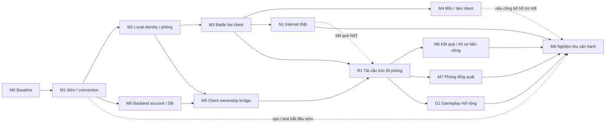

# Kế hoạch server giả lập KR 00967

Nguồn chuẩn của project `boom-kr-server`; bản nhập từ plan đã được dsh1/dsh2 review tại `1eee46d`.

## Bảng điều hành

**Mỗi phiên chỉ cần đọc mục này.** Phần còn lại của file là tham chiếu (đích, milestone Rust, acceptance), tra theo anchor
khi cần; gate K0–K7 và nhánh RE cũ nằm ở [PLAN_ARCHIVE](PLAN_ARCHIVE.md).
Các dòng ở đây được **ghi đè**, không nối thêm; lịch sử checkpoint ở manifest, PROTOCOL và [HISTORY](HISTORY.md).
Codex cập nhật bảng trạng thái và danh sách việc khi xong một bước hoặc đổi blocker. Claude cập nhật đích và thứ tự
theo quyết định của chủ dự án. Cập nhật gần nhất: **12/11, CP272 / AUD088**.

**Đích giai đoạn 1** ([chi tiết](#delivery-target)): dịch vụ nội bộ bền vững, người chơi qua Internet thật, 50 người
đồng thời và tối thiểu 8 phòng, chế độ thường trên sáu map ladder với item của các map đó. Dài hạn: gameplay đầy đủ.

| Mốc | Trạng thái | Còn lại |
|---|---|---|
| M0–M3 nền tảng, phòng cố định, trận hai người | Đạt trong phạm vi đã ghi | Không |
| M4 bốn và tám người | Đạt phần đội cố định và Manner | Free 1v7 là giới hạn đã biết, không retry |
| M5 tài khoản | Account → phòng → trận → kết quả đã chạy native (CP258) | Hồ sơ tổng quát cho mọi account; lỗi hàng đợi DB khi đang native |
| [N1](#rust-n1) Internet thật | **Đạt phạm vi một phía tới được** (CP264 ghi nhận CP261 + owner, [kết luận](#rust-n1-result)) | N1b âm; thiết kế CP267 đã chốt, relay implementation/native còn thiếu |
| [R1](#rust-r1) lõi phòng | R1a–R1g đã merge; source/TCP refactor đạt | Relay opt-in và native hồi quy/acceptance riêng |
| M7 phòng tổng quát | Chưa bắt đầu | Toàn bộ; cần R1 |
| [G1](#rust-g1) sáu map ladder và item | Chưa bắt đầu; có [kiểm kê](CONTENT.md) | Phép thử đổi map, rồi từng map và nhóm item |
| M6 lưu kết quả, thưởng 0 | Chưa bắt đầu | Toàn bộ; cần R1 |
| M8 vận hành | CI đã có (PR #334, #340) | Kiểm tải/budgets, giám sát, backup/restore cho 50 người/8 phòng |

**Thứ tự việc:**

1. **[RUST-N1R relay opt-in](#rust-relay)** sau R1f/R1g đã merge. Source relay thử nghiệm ở nhánh riêng chưa nối
   serving; tiếp integration và native acceptance riêng. N1b đã dùng đủ hai lượt, không retry baseline.
2. Native hồi quy cuối R1: mỗi profile 2,4,8 và account một lượt; relay cần bằng chứng riêng hai NAT/UDP/stale/reset/EOF.
3. Phép thử đổi map sang Village10 (`local/research/claude/codex-prompt-map-probe.md`), tối đa hai lượt.
4. M7, rồi G1 song song M6, rồi M8.

**Blocker và việc tồn:**

- Direct UDP âm ở hai NAT đổi cổng; thiết kế CP267 đã tách việc R1f khỏi relay opt-in. Chưa có relay trong serving/native proof; N1b không retry. PR345 đã merge. CP267–268 đã merge sau exact-head/history/CI; record CP267 giữ nguyên.
- R1e serving vẫn fixed-room cũ; cấu hình/tạo/chọn nhiều phòng tổng quát và occupancy thuộc M7, không suy đã có từ container/unit.
- `local/` (bằng chứng thô và fixture) chưa có backup ngoài máy này.

**Quy ước:**

- Trước khi merge PR, `gh pr checks <số>` phải đạt. CI đỏ thì sửa, không merge.
- Không thêm dòng trạng thái theo checkpoint vào đầu file này hay vào mục thứ tự cũ; ghi đè bảng trên. README chỉ giữ
  mốc mới nhất, mốc cũ chuyển sang [HISTORY](HISTORY.md).
- Lát cắt mới không thêm cờ theo sức chứa, alias theo identity hay nhánh `capacity() == N` vào lõi phòng.

<!-- dashboard-end -->

### Mục tiêu, baseline và phạm vi

Yêu cầu chủ dự án 26/10/2026: dùng kiến thức RE VN `VBNB_116` để dựng server giả lập cho
**chính `CA.exe` KR `00967`**. Đây là project độc lập `boom-kr-server`; không dùng scope, gate,
registry hoặc tỷ lệ tiến độ V1 của bản viết lại `boom-rs` làm điều kiện của repo này.

Baseline lịch sử **`KR-00967-EMU-1`**: K0–K7 đạt trong từng acceptance; K6c WAN giả lập ghi
**Internet thật chưa kiểm** tại mốc nghiệm thu đó, full game nằm ngoài scope demo. Đích Rust hiện hành ở
[giai đoạn 1](#delivery-target); Internet thật đã có kết luận riêng [N1/N1b](#rust-n1-result).
Các mốc nguồn được phân biệt rõ:

- **Tài liệu tham chiếu lịch sử:** `boom-rs@dae5e1c717ad31b9e8d32a9b20a76d65942807eb`.
- **Plan KRE trước khi tách, đã review:** `boom-rs@1eee46d0ecf5c7f4eeedeadd7e258ef1cd64bf43`.
- **Snapshot khởi tạo repo mới:** `boom-kr-server@a19c8f68af68b01844c92a7870aa2a22eebf5f5f`;
  các sửa sau migration nằm trong lịch sử của chính repo này.
- **Nguồn RE:** `boom-re@9ac2075bbec0c16217741aaedea968cf685e39a9` và
  `boomkr-re@88e11ed30764c753a00f4f23a2f33dafadc4c890`.

Hash client và ma trận tái sử dụng:
[LEGACY_KR_PROTOCOL](PROTOCOL.md).

Đích đầu: bản copy client KR → bootstrap offline → đăng nhập identity cục bộ → một kênh/sảnh →
tạo/vào phòng → ready/start → Battle thường hai client → kết quả → về phòng → trận thứ hai.
Một map thật của KR, ưu tiên Village00 sau khi xác nhận loader/mode cho phép; nhân vật cơ bản theo
ID/Attr KR. Không áp index Village01, roster, drop override hoặc policy ready của V1 Rust lên client gốc.
Mở rộng bốn client chỉ sau khi hai client ổn. Shop, economy, guild, mode phụ và kết nối Nexon thật
để sau. Không dùng client Rust thay bằng chứng nghiệm thu `CA.exe`.

**Quyết định kỹ thuật:** ưu tiên chứng minh tương thích bằng service nhỏ và state machine theo
client; chưa ghép `boom-core` vào đường trận. VN có P2P và client tự tính một phần gameplay;
KR đã có consumer nổ/trap ở client nhưng chưa có bản đồ authority đầy đủ. Một server mới chạy được
với client Rust không chứng minh có thể điều khiển client KR bằng snapshot/command của ADR 0009.

### Đích bàn giao giai đoạn 1 cho công ty — chốt 11/11

Nguồn: [chỉ đạo chủ dự án](evidence/owner-directives/delivery-target.json). Mục này chỉ chốt **đích và đường cắt
phạm vi**; không đóng gate hay milestone nào. Trạng thái từng milestone vẫn ở các mục bên dưới.

**Định hướng dài hạn vẫn là gameplay đầy đủ của game gốc.** Phạm vi dưới đây là giai đoạn 1, được chọn vì giới hạn
thời gian và tài nguyên; các phần chưa làm thuộc giai đoạn sau chứ không bị loại bỏ.

| Câu hỏi | Quyết định của chủ dự án |
|---|---|
| Mức bàn giao | **Dịch vụ nội bộ bền vững** (hàng giữa trong [bảng ba mức](#rust-service-exit-criteria)) |
| Người chơi | Kết nối qua **Internet thật**, khoảng 10–50 người đồng thời, vài phòng cùng lúc |
| Gameplay giai đoạn 1 | Chế độ thường, **nhiều map chọn lọc và các item phổ biến**, kim/cứu, chọn nhân vật, chọn đội |
| Gameplay dài hạn | Đầy đủ như game gốc, làm tiếp sau giai đoạn 1 khi có thời gian và tài nguyên |
| Hạn chót | Không có hạn cứng; theo dõi bằng milestone và cỡ việc tương đối |

**Trong đích giai đoạn 1:** tài khoản thật cho mọi người chơi (không chỉ hai profile cố định), nhiều phòng độc lập trên một kênh,
lưu hồ sơ và kết quả trận, công cụ admin có audit, backup đã thử restore, người chơi sau NAT gia đình hoặc CGNAT.
Mục tiêu tải dùng để nghiệm thu: **50 người chơi đồng thời, tối thiểu 8 phòng độc lập**, một instance Linux.

**Giai đoạn sau (không là dependency của giai đoạn 1):** cửa hàng, tiền tệ, cấp độ/EXP, inventory mua bán, mode phụ,
boss, mission, event, guild, chat/bạn bè, toàn bộ map và item còn lại, nhiều kênh. HA và tiêu chí của mức
"phát hành rộng hơn" chỉ mở khi công ty quyết định phát hành ra ngoài.

**Ràng buộc thiết kế từ định hướng dài hạn:** giai đoạn 1 không được chặn đường mở rộng. Luật phòng, map, item và
mode phải là dữ liệu hoặc chính sách thêm được, không hardcode giả định "chỉ chế độ thường". Schema DB giữ chỗ cho
inventory/ledger đã thiết kế trong [kiến trúc](RUST_SERVICE_ARCHITECTURE.md). Đây là lý do [RUST-R1](#rust-r1) đi
trước các mốc tính năng.

#### Việc còn lại để đạt đích giai đoạn 1

Cỡ việc là **tương đối** (S nhỏ, M vừa, L lớn), không phải cam kết ngày. "Rủi ro RE" là mức phụ thuộc vào phép đo
trên client KR chưa có; rủi ro cao nghĩa là cỡ việc có thể tăng.

| Thứ tự | Mốc | Còn lại để đạt đích | Cỡ | Rủi ro RE |
|---|---|---|---|---|
| Theo dashboard | RUST-M5 | Fixed2 account/basic đã đạt; còn hồ sơ tổng quát và native DB-queue fault. R1c/R1f đã merge source/TCP | M | Vừa: phép chiếu hồ sơ 291 |
| Theo dashboard | [N1/N1R](#rust-n1-result) | N1 đạt một phía tới được; N1b âm và hết hai lượt. Thiết kế relay đã chốt; còn integration/native N1R | L | Cao: relay native |
| Theo dashboard | [RUST-R1](#rust-r1) | R1a–g đã merge; còn native hồi quy cuối 2/4/8/account | M | Thấp: hồi quy; relay có acceptance riêng |
| 4 | RUST-M7 phòng tổng quát | Danh sách phòng động, tạo/vào/rời, lỗi phòng đầy, chọn nhân vật, chọn đội bằng thao tác trong phòng | L | Cao |
| 5 | [RUST-G1](#rust-g1) gameplay mở rộng | Kim/cứu trên Rust, thêm map, thêm nhóm item phổ biến; terrain/item cho phòng 4 và 8 người | L | Cao: mỗi nhóm item cần consumer và ca runtime riêng |
| 5 | RUST-M6 thu hẹp | Lưu kết quả trận và hồ sơ (nhân vật đã chọn) bền vững, thưởng bằng 0. Ledger tiền tệ và inventory để giai đoạn sau, giữ chỗ trong schema | S–M | Thấp |
| 6 | RUST-M8 vận hành | Nâng trần kết nối, cấu hình, giám sát, admin, backup/restore, kiểm tải 50 người/8 phòng, đóng gói | M–L | Thấp |

RUST-M4 đã đủ cho đích ở phần đội hình cố định 2/4/8 và Manner; Free 1v7 còn kẹt ở lỗi khởi động client chưa rõ
nguyên nhân và đã được chốt là giới hạn đã biết của giai đoạn 1. Thứ tự 5 có hai mốc chạy song song vì không phụ thuộc nhau.

Vì sao thứ tự này: N1 đi sớm vì nếu cần relay thì cách trao đổi địa chỉ peer (packet 153) và kiến trúc mạng đổi theo.
R1 đi trước M7, G1 và M6 vì cả ba đều sửa lõi phòng; làm R1 sau thì phải viết lại phần đã xây trên giả định phòng cố định.

#### Hệ quả từ code sau R1g

- R1g cho cấu hình 1–1024 transport và 1–256 entry allowlist, độc lập số profile. Defaults cũ giữ nguyên;
  khoảng 200 transport cho 50 người vẫn cần headroom và kiểm tải M8, không được suy từ test admission.
- Đường account dùng session-owned PlayerId; IP chỉ là restriction, diagnostic vẫn có legacy IP index.
  Hồ sơ tổng quát và native shared-NAT chưa được suy từ source/TCP R1f.
- `LegacyDirectPlan` dùng endpoint channel hiện hành với cổng99. N1b đã chứng minh sai cổng sau NAT ở cả hai phía
  trong recipe đã đo; relay opt-in có acceptance riêng, chưa phục hồi tự động NAT discovery.

#### Quyết định đã chốt 11/11

Nguồn: [chỉ đạo chủ dự án](evidence/owner-directives/phase1-scope-decisions.json). Ba quyết định này chỉ chốt phạm vi,
không đóng gate hay milestone nào.

1. **Map và item cho G1.** Sáu map trong `LadderMapGroup` của client: **Camp08, Factory07, Forest07, Village10,
   Tomb12, Patrit14**. Cả sáu không có script. Nhóm item của G1 lấy từ bảng item của chính sáu map này trong
   [kiểm kê](CONTENT.md): phần đã đo (Bomb, Fire, Roller, MaxPower, kim) cộng phần chưa đo (keo, phi tiêu, máy quét,
   cú, bẫy, lò xo và các item còn lại trong bảng). Map và item khác thuộc giai đoạn sau.
2. **RUST-M4 Free 1v7.** Là giới hạn đã biết của bản bàn giao giai đoạn 1, không chặn đích. Không retry; chỉ mở lại
   khi có quan sát mới về lỗi khởi động client. Trạng thái M4 vẫn do checkpoint/audit ghi theo quy trình.
3. **Kết quả trận (M6).** Lưu lịch sử trận bền vững, thưởng bằng 0; kim dùng số lượt cố định mỗi vòng theo policy
   hiện tại. Điểm, bảng xếp hạng, tiền tệ và inventory thuộc giai đoạn sau.

[Bảng gate tại CP212 đã chuyển sang lịch sử](HISTORY.md#tiến-độ-hiện-hành-theo-bằng-chứng);
hiện trạng ở [Bảng điều hành](#dashboard), acceptance K0–K7 ở [PLAN_ARCHIVE](PLAN_ARCHIVE.md).

### Thứ tự công việc hiện hành

Theo [Bảng điều hành](#dashboard), nguồn duy nhất giữ thứ tự và blocker. Milestone/acceptance ở
[mục Rust](#rust-service-milestones); thứ tự cũ chuyển nguyên văn sang [HISTORY](HISTORY.md#plan-order-before-topic-refactor).

### Milestone Rust: dependency, đầu ra và nghiệm thu

Các ID dưới giữ milestone design và acceptance; trạng thái từng milestone ở bảng, implementation đã được owner mở.
M0/M1 đạt scope hẹp không suy thành fullservice hoặc mọi milestone đã đạt. Không mở hàng loạt issue trùng;
implementation issue chỉ tách khi bắt đầu milestone, gắn existingfeature/KRE/contract/evidence và baseline.
Owner/selfcheck Codex, independentreviewwaived; PR/exacthead vẫn bắt buộc.

| Milestone / giá trị bàn giao | Dependency thật và việc độc lập |
|---|---|
| RUST-M0 Baseline/reproducibility | Đạt scopeCP231: exactPython784a0d8/archive/server-tools/47fixturepins/CP181recipe/rollback; támWIP loại khỏi baseline. Không standaloneclientbundle |
| RUST-M1 Foundation + wire/connection chạy native | Đạt scopeCP231: Rustmode2/selector3/pinnedhello-WCP/nativeerror1→ordinaryretry→error1/seqreset;5wire+14TCPcases. Chưa login thành công/sảnh/fullcodec; M2 tiếp, M5backend độc lập |
| RUST-M2 Bootstrap→local login/identity→sảnh→fixedroom | CP235đạt scoped:2actualfixedroom/ownslots/hostBack-rejoin/Ready/barrier/clock-spawn+healthyBsessionEOF;negative/profileguard có phương pháp và giới hạn. Khôngaccountauth/generalroom/Battle. Diagnosticidentity không fullauth, tiếp contract đã biết |
| RUST-M3 Hai client native→Battlebasic→result/reset/trận2 | CP242 scopedaccepted: CP237–241 movement/bom/terrain/life/oppositeoutcomes/activehostEOF + native itemreset/contest/exactoldUDP-currentpositive/Start3/queue controls. Không fullgame; M5backendworker/idleTTL/rate CP243–244 đã có; M4 tiếp. M2; account/DB backend không cần đợi M3. GiữUDP trực tiếp, không authoritativeengine rewrite |
| RUST-M4 Bốn rồi tám/đội hình cố định theo contract | CP245 four startup/loading và CP246 four-ownerbom/knownstats/16native159158 đã có, M4partial; CP247fourlife/three170/clear21completion và CP248nativeopposite2v2/rank4-reset-Start3 đã có; CP249scopedguest-hostEOF/unrankedreturn-threeRoom đã có; CP250eightbaselineManner4v4/mesh-statbom8/life-rankreset đã có; CP252native9bridge1KR+8synthetic đã có; Free2nativeoutcomes/selector0persist vẫn startupblocked cảactual32control. M4OPEN/M5bridgeindependentnext. M3; baselinefourmain trước eight; dùng CP213teamdelta sau PR Python delivery riêng, không chờ mọi item/mission |
| RUST-M5 Account/profile/DB và sessionownership | CP236 backend SQLite/Argon2id/identity-profile/session/auditCLI và CP243 boundedworker/handoff/compensation đã có; CP244 thêm idleTTL/rate/schema2; CP253 admission library/worker-time UTC/7ca6DB3bodyreplay đã có; CP254 có native2account positive trên fixedzero-profile/private launcher; native negatives/lifecycle/accountroom-game còn thiếu, chưa fullM5. Backend có thể đi trước M3/M4; binding client phụ thuộc M2 + measuredKRauthbridge. Không khôi phục phiên tài khoản/khôi phục trậnmặcđịnh |
| RUST-M6 Inventory/progression/result-reward durability | Backend M5, actualmatchinput M3; KRwireprojection/effect cần từngconsumer. Không cần full8/mọiitem để làm ledger |
| RUST-M7 General lobby/rooms/selection và userflows cần cho nội bộ | M2 + M5ownership, M3lifecycle; M4 chỉ cần nếu mở8capacity. RE roomlist/member/character/team/equip theo phép đo, không mọi mode |
| RUST-M8 Hardening/admin/backup/restore/package và nghiệm thu service | M1–3/M5–7 cho internalservice; M4 nếu quảng bá4/8 theo scope. Ops/tests phát triển từM1, không chờ cuối mới thêm |
| RUST-N1 Internet thật giữa hai NAT khác nhau | Cần M3 (trận hai client). Độc lập với M5–M8; kết quả là đầu vào của R1 (bước R1f) và M8 |
| RUST-R1 Tái cấu trúc lõi phòng, không thêm tính năng | Cần lát cắt account → phòng → trận của M5 đã merge (cùng file). Phải xong trước M7, G1 và M6 |
| RUST-G1 Gameplay mở rộng: kim/cứu, map, nhóm item phổ biến | Cần R1. Song song được với M6/M7; mỗi map và nhóm item cần phép đo KR riêng |

**RUST-M0 — đóng băng một baseline phục vụ rollback.**
Phạm vi: Pythonmerged/copy4b/47fixture2basic hoặc67filefourbundle đãnative, config/hash policy/recipe/hash raw,
không dùng bảnWIP8teams như code đãmerge. Input CP180/181 codec, CP186–189 basic, CP190/198 package,
CP203–207fourhardening và CP212gate decisions; [limits](PROTOCOL.md#authority).
Implementation khi mở: fixturemanifestloader trong kr-service, runtime/backendselector trong harness qua config
đóng băng **trước** run; không viết packetgrammar mới. RE: không có nếu artifacts đủ; thiếu một input thì lấy từ
existingseal, không regenerateoracle. Acceptance: original/copy/profile/hash source kiểm đầy đủ, backend hiện tại
reproducible command và cleanup tài nguyên thuộc run, source/WIP/failedruns tách rõ. Không phải chạy lặp lại mọi gate cho bước docs.
Rollback: chọn exactPythonbundle/fixture/copy ở thư mục riêng; không mutate prefix/source của run đang chạy.
Chuyển M1 khi provenance/permissions/pins đầy đủ; unknown coldreliability/fullassetprofile không là scopeclaim.

**RUST-M1 — lát cắt đầu tiên nên viết.**
Module: kr-wire primitive/typedfields/crypt-CRC/frame/seq; kr-service config/listener/connection/stage tối thiểu,
boundedread/write/timeout và logbuild/connection. Input KR-B002/B003/CP057/180/181, fixtureunknownheader giữ opaque,
mode0hello và mode2/3 đúng scope; Python vẫn phục vụ mọi tính năng còn lại, harness vẫn nguồn input native.
Implementation: toolchainlock/CI Linuxfmt-clippy-test; bytesexact encode/decode với **retained independent native**
vectors, arbitrarysplit/coalescing/partialEOF/invalidlength/CRC/seqwrap boundary theo boundsđãbiết; không build
toàn codec mode chưa khôi phục. RE chỉ khi actual Rust trace lệch oracle hiện có; giới hạn vào field/caller đó.
Acceptance: synthetic/kernelTCPnegative khôngpanics/unboundedallocation, theo connection/directionseq/reset độc lập;
clientKRcopyWine thật nhận hello/validresult1, cùng processretry/newloginconnection/reset theo CP181 vớiRust
listeners và sealedcursor native/CRC/sockettrace, không TCPacceptonly. Trong lát cắt đầu được dừng ở native
login-error/retry, chưa cần DB/sảnh hoàn chỉnh. No badCRCsuccess/sai stage mutation.
Rollback: route toànrun sangPython saucleanup, khônghot-swap connection. Chuyển M2 khi oracle/parity/đường native
và failurelog đủ; mode/headerunknown không suy toàn bộ codec, vẫn failclosed ngoài profile.

**RUST-M2 — đường xuyên bootstrap→localidentity→sảnh→fixedroom.**
Module KRpacketadapters/bootstrap/login/channel/lobby/room; legacy stage/ports/caches/encoding theo CP186/187/198.
Implementation: chuyển bootstrapreplies/typedredirect/137-291/profile-cache/room81-86-87-106-110/Ready và
loading từ pinnedprofile thành builders nhỏ, fieldopaque giữprovenance. Không nhét dịch vụ hoàn chỉnh trongfixtureblob;
không đổi packetheader đồng thời với token/account design. Python giữ servingBattle và RE/reference; native fullrun
chọn một backend từ đầu, không chia giữa active connection khi chưa có handoffcontract.
RE: cold/missing/warm/profileversion/error đã biết dùng lại; chỉ nếu dynamicidentity/listroom fields chặn mới trace.
Acceptance: actualABWine tên/ID/ownslot khác, sảnh/room/spawn đúngprofile; sai socket/stage/version/identity
negative rõ; hostBack→survivorclear/chief→rejoin/Ready, oneunloadedclient không cho GO sớm. Verifybytes/seq/
cursor native/actor và screenshotsbổsung. No xác thực đầy đủ/passwordsignup/multichannel/multiroomclaim.
Rollback: fullPythonprofile, không trộn transportsRust/Python trong mộtlease. Chuyển M3 sau native2actualbarrier.

**RUST-M3 — Battle hai client và hai trận liên tiếp.**
Module round/policies bomb, claims, basictterrain, life-result, scheduler/fences/peerendpoints; input main
CP188/189/155/171–174 và authoritymatrix. Scope một ExVillage01/basicBomb-Fluid-Roller/current291/profile/copy,
UDP trực tiếp, haiownerbom/contest/56→1/result/room/reset/Start3; kim/cứu optional port riêng sau basic, không tự kèm
mọiitem. Fuse6/drop/rank/reportguards giữD revision, không quyền quyết định thế giới gamerewrite.
Implementation: allocator/reservation/159158/124165/142gatedterrain/keys/tickets/witness-result/175180; no
duplicatecommit/latejob, queueentrytag epoch+recipient. RE: chỉ discrepancy currentcell/life/report đang chặn;
nguồn kim/cứu có sẵn thì chuyển riêng rồi nativepair/depleted/reset, không rediscoverconsumer.
Acceptance: actualKRABRust A↔B peerprogress/PCAPwireSHA→nativeAPI/key/apply; actual118 cảhai→sameIDentity/
explode; mộtwinner/effect mỗiclaimindex, 3basichiệu ứng natives/reset, two normal outcomes/Ready2/Start3.
Selectedmalformed/duplicate/stale/wrongslot/key/deadowner/không cấp ID/state và **exact UDP cũ ởvòngmới + currentpositive**;
lateTCP/sendqueue/EOF/bomchờ đi đúnggeneration. HostEOF peer vềphòng/IDclear/chief/fencepastdue; no deadlock.
NegativekernelTCP và native lifecycle tách nguồn; không spoof packet chứng minh originalauthority.
Rollback: before-runPython pin, restart affectedround không cấp thưởng. Chuyển M4 khi native proof + negatives scoped đủ;
auth/collisionallmaps/low8wrap chưa đo giữ debt, không tuyên bố toàn bộ game.

**RUST-M4 — bốn rồi tám và nhóm đội hình cố định.**
Module sessionbindings/roomcapacity/Readybarrier/roster/peer/ranklist, per-role measuredstats; input
CP202–211 mainfour/eight và CP213teamcontracts/PythonPR322 đã giao riêng. Không mặc định eightclient
acceptance cho K6c/K7 lịch sử. Implementation: loại hardcodeAB thành boundedroster trong model, four2v2 trước
eight; identity vẫn diagnosticnếu M5bridgechưa xong. FixedFree4v4/1v7 và balancedManner4v4, rejectunbalanced.
RE: interactiveC2Steamchange chỉ nếu sản phẩm cần userclickchọnđội; fixedpreset của operator không thay proof đó.
Acceptance: Rust4actualcùng process/opposite2v2/reset/Start3/hostguestEOF-survivors; rồi8actual32TCP/ownslots/
56directedremoteprogress/eightdistinctcap-power/8ownerbom/oppositerank8/reset. Free1v7/Manner4v4 haioutcomes/
selector86-87-180persist; Manner1v7 nativecheck7/no104 theo exactcopyhash/profile, synthetic104guard riêng.
Ninthjoinrejectkhông cấp ID/state cần actualadmissionbridge/consumer; unknownsourceIPnegative khôngnative9fullroom.
Guestthiếu ACK load/lateACK/deadowner/disconnect/backpressure không làmpartialbroadcast→grant. Four/eight native
results không chứng minh items/kim/cứu4/8. Rollback package/profile percapacity, fenceemptyroom trước thay;
chuyển milestone khi từng capacity advertised đủ; không chờ modesphụ.

**RUST-M5 — account/profileDB và ownership; có thể tiến hành độc lập gameplay.**
CP236 đã có [backend](PROTOCOL.md#rust-account-backend)/[CLI](../rust/README.md#account-admin-cli) dùng SQLite thật;
[CP243](PROTOCOL.md#rust-account-worker) có boundedworker/handoff và [CP244](PROTOCOL.md#rust-account-idle-rate) có idleTTL/rate/schema2; CP254 thêm fixed2native account lobby/private launcher, CP255 thêm ba native negative/lifecycle; CP258 đã có freshlogin/replay/account-owned fixedroom-basic end-to-end scope2knownprofiles và lifecycle; generalprofile/nativeDBqueuefault/affectedclientrecovery còn giới hạn nên **không đóng M5**. Production restore thuộc M8, không là dependency M5. Không bắt M3/M4 đợi phần đó.
Module application/accounts/profiles/session/store/sqlite/migrations/adminCLI; architecture định schema/invariants.
Backendimplementation: Argon2id/PHC/CSPRNG/hash-atrest/sessionTTL-revoke/oneactive; account→player→wireidentity,
lease nhiềustage/sockets thay rolearrival/sourceIP, nameencoding/bounds, schema/version/conflict/startupvalidation.
Backendtests realSQLite concurrentlogin/duplicateuser/hashquota/dummyverify/entropyfailure/expiry-clockrollback/
ban-reset-revoke/freshserver/DBbusy-diskfull. Python vẫn diagnosticRE, không là oracleauth backend.
RE riêng **bắt buộc** trước KRbinding: exact credential/token localroute, request→verification→identity/projection,
crosssocketlink/retry/sai account/replay/expired/revoked/unknownprincipal. Không coi auth137success/name291
là ownership. Tối thiểu hai testaccounts hai client native, accountA không được claimplayerB qua channelswap.
Acceptancebackend có thể đạt trước M3/M4; acceptanceclient chỉ khi ca native dương tính/negative/expiry và freshlogin
trênRust cósource. Nếu không có bridge xác thực an toàn khảthi thì clientaccountgateblocked, vẫn deliverCLI backend/tests.
Không tự thêm màn login/register vàoKR hoặc bypassprovider thànhauthproof. Rollback diagnosticisolatedteststore,
không downgrade schema/deleteusers; không fallback successful unauthenticated khiDB/authlỗi.

**RUST-M6 — inventory/progression/result-reward đúng một lần.**
Module itemdefinitions/inventory/equipment/profile/matchresults/ledger/outbox; scope basicnhóm đã biết/explicit
nonredeemablepolicy trước, shop/premium/randommonetizedreward đểsau. DependencybackendM5 và roundresultM3;
full8khôngđiềukiện. Implementation: resultID từserverroundnonce, grantunique/matchplayerpolicy/transaction,
balances-quantityrevision/checks, reservation/refundconsumables/expiry, durablepending/outbox/reconcile.
Idempotency key không đổi theo policy version: pin policy vào match/kết quả, unique(match,player,rewardslot);
replay sau đổi công thức phải không cấp lại thưởng. Durable-success chỉ sau DB commit/outbox.
RE: KRprofileXP/character/equip/inventory-count/use-result/rewarddisplay actualconsumer+negative; wikiEXPtable
chỉ rule/productreference, không tựportoffset/ID hoặc chọn servergốcformula. AccountDB đã có không suy clientUI dùng.
Acceptance: DB thật concurrentduplicatefinalize/replayedreport/spendnegative/twoplayerswrongowner/race,
crashbeforecommit/aftercommit-beforepacket/restart-retry/outboxdup khôngdoublegrant/doubledebit; matchedledger
vàinventory saurestore. NativeRust thực dùngitem/quantityconsume→effect→peer/reset, kếtquả cập nhật đúngprofile
sau freshlogin; dữliệuwireunknown disabled thay vìfakeACK. Persistedresult và economyaward tách low-trustreport.
Rollback disable awarding/spend và giữledger/pendingaudit, không rollbacknativeoutcome thànhreaward.
Chuyển khi durabletruth/nativeprojection reconcile; không chờ toànitem/mode.

**RUST-M7 — luồng service cho nhiều người dùng thực.**
Module lobby/roomregistry/membership/sessionauthorization/character-equipprojection; phụ thuộc M2/M5, lifecycleM3.
Implementation: tạo/vào/rời đúngroom, listupdate/removal, capacity/mapguard/hosttransfer/Ready/reset; fixedteam
support trước interactive nếuchưaRE. Không mộtroomfixture cho mọiuser nhưVNhubdemo. Chọn ít nhất hai phòng
độc lập/mộtchannel trước khi gọi dịchvụnhiềuphòng; IDs/domainstate khôngarrayA..H hardcode.
RE: dynamicmultirowroomlist/create/join/error-full/ownership/kick/selectedcharacter/teamclick đúngKR00967;
khôngdùngVN89layout. Hidden/password/private/spectator giữoutscope cho tới producttask.
Acceptance: native trên Rusthairoom độc lập/roomAlist-Bupdates, cùng accountkhôngsameplayer2slots, wrongroomcommand/
outsiderhost/reset-oldmembership rejected và observednativecleanup. Sessionrevoke/DBfailure không phóng
slotma/crosstalk/UDP cũkey hiện tạireuse; accountlogout/relogin làfreshsession trừresumeđãđo.
Rollback cấulạisingle-roominternalprofile/disableunprovedactions, khôngxoapersistentprofile.

**RUST-M8 — vận hành nội bộ, admin và readiness phát hành.**
Module telemetry/config/health/admin/storebackup/deployrunbook; làm xuyên từM1. Scope một Linuxinstance,
projectaccounts/onechannel/measuredmaps/modes, explicit UDP trực tiếp/NATsettings. Implementation configschema/
secretspermission/redactedlogs/build-boot-session-room-round-matchIDs/metrics/healthreadiness, authrate/
boundedIO/deadlines/gracefulshutdown, adminban-unban/reset/revoke/reconcile/audit, migrator/snapshotbackup.
RE chỉ targetedwire/lifecycle/securityexposure chặn acceptance; không quét toànclient vì còn backlog.
Acceptance: fmt/clippy/tests/oracle/native E2E/packagefailbeforelisten/relocation; corruption/futureDBschema/
wrongconfig failclearly. **Backup đã restore** vào freshpath, ledger/integrity/accountprofiles/nativefreshlogin
và newmatch đúng; rehearsal binaryupgrade→badconfig/DBerror→compatible rollback; RPO/RTO ghiđothực.
Actualpeer không đọc/load/rate/ghi một phần/slowDB/diskfull/SIGTERM-SIGKILL kiểm isolation/fence/không cấp thưởng/cleanup tài nguyên thuộc run.
4actualRusttwoopposite2v2/reset/Start3 dướiUDP40±5ms/loss5%/TCPbaseline và freshserver cùng DBidentity; topology/
MTU/reorder/bandwidthcấu hìnhthực côngkhai, K6cWANgiảlập scope táidùng; N1/N1b đã có kết luận riêng tại [kết quả mạng](#rust-n1-result).
Loadacceptance dùng workloadtarget chốt trướcbenchmark (connections/rooms/Hz/p95latency/queue/RAM), không
gán targetproduction từ8Wine/GDB. Không hứa HA hoặc chốngmọicheat khi movementP2P/reportauthoritycònhạn.
Rollback drain/stopadmission/fenceuncommittedround, compatiblebinary+testedDBrestore; không silentgrantloss.

### Mốc bổ sung từ đích bàn giao 11/11

Ba mốc dưới sinh ra từ [đích giai đoạn 1](#delivery-target). Chúng không đổi acceptance của M0–M8 đã ghi ở trên.

**RUST-N1 — Internet thật giữa hai NAT khác nhau, đã có kết luận theo phạm vi bên dưới.**
Đoạn acceptance sau giữ thiết kế phép đo ban đầu; hotspot 4G không tự chứng minh phân loại CGNAT.
Mục đích: biết sớm UDP trực tiếp giữa client có dùng được cho người chơi thật hay cần học cổng sau NAT, hole punching
hoặc relay. K6c/K7 đã nghiệm thu bằng WAN giả lập giữ nguyên; N1 là gate của đích bàn giao, không sửa lại gate cũ.
Topology tối thiểu: server trên VPS có IP public; client A ra bằng mạng di động (CGNAT thật); client B ra bằng một IP
public khác (tunnel qua VPS, server trong netns riêng và SNAT để server thấy B bằng IP public). Giữ allowlist outbound
của client theo AGENTS.
Phép đo: chạy recipe hai client hai vòng đã có; bắt PCAP ở cả hai đầu; so **cổng UDP client tự báo trong packet 99**
với **cổng nguồn thật** của gói UDP sau NAT; ghi chiều nào thông, chiều nào không, và client có trả lời về địa chỉ nguồn
quan sát được hay chỉ gửi tới địa chỉ server báo trong 153.
Acceptance: kết luận có bằng chứng cho một trong ba nhánh — (a) trực tiếp dùng được như hiện tại; (b) cần server học
endpoint thật (đầu vào cho R1f); (c) cần relay, khi đó mở mốc thiết kế relay riêng trước M7. Một ca hai người chơi
chung một NAT cũng phải được ghi nhận: baseline lúc mở N1 còn binding theo IP. R1f sau đó đã tách account identity
theo session/PlayerId ở mức source/TCP; native shared-NAT vẫn cần nghiệm thu riêng.
Ngoài phạm vi: mọi loại NAT, IPv6, nhiều ISP. Một nhà mạng di động và một IP public là đủ cho quyết định kiến trúc.

**Kết luận N1 — chốt 12/11.** Nguồn: [bằng chứng CP261](evidence/rust-service/internet-observation.json) và
[xác nhận của chủ dự án](evidence/owner-directives/n1-uplink-and-result.json). Chủ dự án xác nhận uplink của máy chạy
client trong đợt đo là **hotspot điện thoại 4G**; đây là câu trả lời cho câu hỏi uplink mà CP261 để mở.
Kết quả: hai client KR thật qua đường Internet đã đo chạy trọn account → phòng → hai kết quả đối nghịch → reset →
trận tiếp. Cổng UDP client A tự báo ở packet 99 **khác** cổng thật sau NAT, nhưng client B **trả lời về địa chỉ nguồn nó
quan sát được**, nên UDP vẫn thông hai chiều. **N1 đạt trong phạm vi: ít nhất một phía tới được theo địa chỉ server báo**
(ở đây phía B đi qua NAT do ta kiểm soát). CP264 đã đối chiếu lại1124 pin CP261 và ghi nhận đóng phạm vi này; [quyết định/evidence](evidence/rust-service/n1-acceptance.json).

Khoảng trống khi chốt N1 ban đầu là **cả hai phía sau NAT đổi cổng**. CP266 bên dưới đã đo ca đó; kết quả âm
không mở rộng phạm vi N1 đã đạt.

**N1b — hai phía đều sau NAT đổi cổng.** Giữ nguyên topology N1, đổi NAT phía B sang đổi cổng nguồn ngẫu nhiên và bỏ
ánh xạ cổng tĩnh, để B giống một người chơi sau NAT gia đình. Chạy recipe hai client, tối đa hai lượt native, bắt PCAP
hai đầu. Kết luận cần có: (a) vẫn thông, ghi rõ nhờ cơ chế nào; (b) không thông nhưng client có gửi UDP tới một địa chỉ
mà server học được, khi đó R1f cho server học endpoint thật; (c) không thông và không có đường học, khi đó mở mốc thiết
kế relay trước R1f. Ca hai người chung một NAT không thuộc N1b; nó được sửa ở R1f.

**Kết quả N1b — CP266:** đã dùng đúng hai lượt native trên binary baseline CP261, giữ riêng raw/hash/cleanup.
Cả hai đi hết account/phòng → hai kết quả/reset → Start3, nhưng các cửa sổ native UDP không có ingress/helper ở cả hai
phía. Lượt2 cho phép quan sát gói ở lớp cloud, vẫn không có ánh xạ DNAT public, đã thấy **cả hai cổng nguồn sau NAT
khác packet99**. Native gửi tới cổng153, không có UDP tới service trong capture để học endpoint.
[Contract/đối chiếu](PROTOCOL.md#rust-n1b-dual-nat), [evidence](evidence/rust-service/n1b-dual-nat.json).
Kết luận theo nhánh **(c) cho đúng recipe đã đo**: cần relay/endpoint riêng; thiết kế CP267 đã giao, R1f đã merge. Không retry N1b,
không coi relay đã triển khai hoặc không thể có traversal ở mọi nhánh client. TCP kết quả không chứng minh đồng bộ UDP.
[Thiết kế đã chốt](RUST_SERVICE_ARCHITECTURE.md#relay-endpoint-design) tách endpoint khỏi session identity và giữ direct legacy.
Implementation relay chỉ được nghiệm thu tương thích sau native chứng minh
send→relay capture→peer ingress/key/helper/apply, hai chiều/hai vòng/reset/old packet/EOF; ngoài phạm vi đo CP266.
K6c/K7/N1 acceptance cũ không đổi; shared-IP identity đã sửa source/TCP ở R1f, không tự chứng minh native UDP hai NAT.

**RUST-N1R — relay opt-in theo thiết kế CP267, chưa implementation.** [Quyết định/module/lifecycle](RUST_SERVICE_ARCHITECTURE.md#relay-endpoint-design),
[unknown/phép đo](RESEARCH.md#gap-relay-endpoint). Thiết kế trước R1f đã xong phạm vi docs; chưa UDP acceptance.
Dependency thật: session/membership ownership R1f, trần tài nguyên R1g. Giữ Python/harness RE, direct legacy và
source/binary cũ làm đối chứng. Không phụ thuộc M7/G1/M6 hoặc full RE.

- Implementation: typed route/endpoint plan, reserve/commit socket trước publish153, reverse-edge forwarding nguyên
  payload, bounded queue/rate/TTL, tuple pinning, invalidation/reset/revoke/EOF. Key/port exhaustion và quarantine phải
  có chính sách kiểm được; không sửa behavior legacy như thể chỉ refactor.
- Kiểm source/unit/TCP: cùng IP nhiều session không chọn nhầm profile; route hai phòng/vòng không lẫn recipient,
  late reservation/callback/timer, queue full/nonreader/partialsend, missing/late tuple, tuple lạ/rebind, duplicate,
  close/reset/revoke/shutdown. Byte profile legacy2/4/8/account khớp baseline đã seal; differential không là native proof.
- Native fixed2/Wine qua hai NAT đổi cổng: getter99/153, payloadSHA native-send→relay ingress→reverse socket egress→
  peer ingress/key/helper/currentactor apply, hai chiều/cửa sổ input riêng; hai kết quả/reset/Start3. Exact old datagram
  ở vòng mới phải có đối chứng current positive; kiểm disconnect/lease invalidation không forward tới membership mới.
  Cấu hình topology/NAT/impairment thực, build/copy/hash, raw/frozen/cleanup lưu đúng privacy. Không suy từ logserver/TCP.
- Lát cắt fixed2 không đủ relay4/8 hoặc tải50/8room: mở rộng theo cùng thuật toán sau proof fixed2, kiểm resource/mesh
  và shared-IP isolation phù hợp; M8 vẫn cần tải đích, backup/restore, restart/port reuse có đối chứng.
- Rollback: tắt policy opt-in trước Start, dùng binary/config baseline đã nghiệm thu; không đổi route giữa vòng hoặc
  mang observed tuple sang instance mới. Chỉ tiếp acceptance khi native joins/currentprogress và negative guards đủ.
  SameIP UDP spoofing, unknown types, portreuse/restart và trần key còn là giới hạn công khai, không tự đóng vì thiết kế.

**RUST-R1 — tái cấu trúc lõi phòng: R1a–R1g đã merge, nghiệm thu native cuối còn mở.**
Không đổi byte trên wire của profile legacy 2/4/8/account. Nguồn/test đã giao không tự chứng minh native của binary mới.

| Bước đã merge | Cơ chế hiện có | Giới hạn / nguồn chuẩn |
|---|---|---|
| R1a–R1b | `RoomRules` normalize cấu hình thành Result/Departure/Bomb/Life/TeamPolicy | [Policy](protocol/rust-boundary.md#rust-r1b-policies); JSON compatibility còn cờ cũ |
| R1c | `PlayerId` độc lập slot; `FirstVacant` opt-in, template106 chung | [Slot/profile](protocol/room-membership.md#rust-r1c-player-slots); chưa hồ sơ account tổng quát |
| R1d | Header KR chuẩn, parser/builder theo opcode trong `kr-wire::kr00967` | [Wire](protocol/rust-boundary.md#rust-r1d-wire-builders); một số body vẫn cần template đã pin |
| R1e | Registry có typed RoomKey, listing và recipient queues độc lập | [Registry](protocol/room-membership.md#rust-r1e-registry); serving vẫn chọn phòng cố định, nhiều phòng thuộc M7 |
| R1f | Account profile theo session-owned PlayerId, endpoint theo channel hiện hành; IP chỉ restriction | [Binding](protocol/room-membership.md#rust-r1f-session-binding); native shared-NAT và relay còn thiếu |
| R1g | Budget transport/allowlist cấu hình độc lập profile; PR348 đã merge | [Admission](protocol/rust-boundary.md#rust-r1g-admission); 65 socket không phải tải 50 người KR |

Acceptance cuối R1: toàn bộ bộ TCP hiện có đạt và **một lượt native hồi quy cho mỗi profile 2, 4, 8 người và đường
account**, không thêm claim mới. Relay có acceptance riêng ở [N1R](#rust-relay), không suy từ hồi quy direct legacy.
R1a/R1b/R1d giữ hành vi; các policy opt-in mới của R1c/e/f/g giữ byte profile cũ. Không thêm cờ theo sức chứa,
alias theo identity hoặc nhánh `capacity() == N`. Rollback từng lát cắt; Python RE/reference giữ nguyên.

**RUST-G1 — gameplay mở rộng cho giai đoạn 1.**
Phạm vi: (1) kim và cứu trên Rust theo contract đã đo ở Python; (2) terrain và item nền cho phòng 4 và 8 người, hiện
bị từ chối ở cấu hình; (3) sáu map ladder đã chốt 11/11 (Camp08, Factory07, Forest07, Village10, Tomb12, Patrit14)
và các item trong bảng item của chúng, xem [quyết định](#delivery-target). Mỗi map cần đúng dữ liệu và consumer của nó; mỗi nhóm item cần consumer cùng một ca dùng, một ca
không đủ điều kiện, hết hạn/tiêu thụ, peer thấy đúng và reset — theo đúng yêu cầu đã ghi ở
[kiến trúc](RUST_SERVICE_ARCHITECTURE.md). Luật đặt trong `RoomRules` và dữ liệu map/item, không thêm nhánh theo sức chứa.
Đầu vào để chọn danh sách: [kiểm kê nội dung](CONTENT.md) sinh từ pack (map theo họ, item được map dùng, script).
Kiểm kê là dữ liệu tĩnh; cột "server phải làm gì" điền dần bằng ca chạy thử, mỗi họ map hoặc nhóm item một ca.
Acceptance: native trên Rust cho từng map/nhóm item được công bố, hai vòng liên tiếp, có ca âm tính. Phần chưa đo thì
tắt, không gửi ACK giả. Toàn bộ map/item/mode còn lại thuộc giai đoạn sau theo định hướng dài hạn.

### Khi nào đủ demo, dịch vụ nội bộ và phát hành rộng hơn?

| Mức bàn giao | Điều kiện đủ, chưa đạt chỉ từ Pythongate/build |
|---|---|
| Rust demo nội bộ tương thích | M0–3 nativeactual2/twocycles/reset/Start3/basic+negative/lifecycle trênRust, package/limits. Identitydiagnostic phải ghi rõ; M4 nếu quảng bá4/8; không tựgọixác thực đầy đủ/toàn bộ game |
| Dịch vụ nội bộ bền vững | Thêm M5clientbridge có kiểm quyền sở hữu, M6durableprofiles/inventory/resultreward trongphạm vi đã chọn, M7roomflow, M8restore/admin/rate/lỗi DB/monitoring/rollback; native4 nếu quảng bá bốnngười. Explicitproductpolicy/unsupportedactionsdisabled; audit/reconcile |
| Phát hành rộng hơn | Tất cả internalcriteria và kiểm bảo mật/credential bridge/threat model có bằng chứng, giữ owner review waiver, độ tin cậy của report/abuse-validation theo phạm vi công bố, measuredcapacity/soak/SLO/alert/oncall/retention/upgrade-drain/recoverydrill, delivery/provisioning hỗ trợ người dùng. Không khẳng định mạngInternet thực/ISP/CGNAT hoặc mọiNAT nếuchưakiểm; khi quảng bá endpointInternetthực thì đo riêng trênendpointkiểmsoát, không sửa lại K6cWAN/K7đãđạt thànhdependencyngầm |

Chat/social/friends/whisper ưu tiên sau basic/accountstability; roomchat cầnrate/moderation/wireconsumer.
Shop/economymởrộng sauledger/inventory vàproductpolicy; guild/mission/boss/revival/event/modesphụ sau đó
theo nhu cầu, không làblocker bảnchơicơbản. Không hứa ngày/phầntrăm/sốcheckpointcòn lại: authbridge/roomdynamic/
inventoryprojection/authorityvalidation làunknown effort; ước lượng chỉ sau số liệu lát cắt đầu, nêuassumptions.

### Issue hiện hành và backlog theo nguồn chuẩn

Bảng này chỉ phân công/thứtự; acceptance/PR/bằngchứng ởissue. [Catalog](COVERAGE.md) dẫn featureID→issue,
[reconciliation cóngày](evidence/issue-reconciliation/README.md) giữ lýdođóng/thaythế, khônglàplan thứhai.

| Thứ tự/scope | Issue | Trạng thái/phần còn thiếu |
|---|---|---|
| RE được giữ làm đầu vào | [#14/KRE-005b](https://github.com/aquaplatinumberlitz/boom-kr-server/issues/14) | K5 basic/K6a/K6b giả lập đã đạt trong scope. CP193–196 NAT/UDP delay-loss/EOF có nguồn; CP197incoming opt-in có controls; CP207native4freshrestart/UDPimpairment đã kiểm; K6c WAN giả lập/K7 đạt CP212; CP211 native8relocatedbundle/two4v4 đã merge PR283. CP213 positivevariants copy4b và negativeManner1v7 copy8d đã đo; source CP213 được giao riêng theo provenance team-code-delivery, không sửa raw cũ. Không còn taskactiveemptyretry; tiếp Rustmilestones theo chỉ đạo mới; audit theo nhóm tính năng. N1 đã đạt phạm vi riêng, N1b âm; fullauth/authority/general variants backlog ngoài gate. |
| Control theo trigger/gate | [#1/KRE-001](https://github.com/aquaplatinumberlitz/boom-kr-server/issues/1), [#2/KRE-002](https://github.com/aquaplatinumberlitz/boom-kr-server/issues/2) | CP178 K0 originalWindowscontrol/ownership đã đủ, #1 đã đóng qua PR250; #2 giữ widerWCP/launcherconfig; K1 R2 đã đạt CP179, không lặp cold3. |
| Codec backlog/identity hiện hành | [#3/KRE-003](https://github.com/aquaplatinumberlitz/boom-kr-server/issues/3), [#9/KRE-005a](https://github.com/aquaplatinumberlitz/boom-kr-server/issues/9) | Fullcodec/livebounds vàintermittentmainstartupcause cònthiếu; khônglặpprimitive/auxiliarylocale. |

### Tra theo chức năng

[Cây/coverage/dependency sinh từ catalog](COVERAGE.md) thay bản đồ lặp theo checkpoint tại đây.
Catalog chỉ dẫn về contract/câu hỏi/evidence; không giữ một thứ tự công việc khác.
Lịch sử từng checkpoint bất biến ở [manifest](evidence/checkpoints/manifest.json).

### Mục lịch sử đã chuyển sang PLAN_ARCHIVE

Nhánh RE trước chỉ đạo Rust, định nghĩa và nghiệm thu gate K0–K7, phương pháp mở nhánh, kiến trúc Python đề xuất và
danh mục task lịch sử nằm ở [PLAN_ARCHIVE.md](PLAN_ARCHIVE.md). Các anchor dưới đây giữ lại để link cũ (catalog,
evidence bất biến) vẫn hợp lệ; không thêm nội dung vào mục này.

- [Đối chiếu K7 hardening/demo — đánh giá lại CP212](PLAN_ARCHIVE.md#k7-evidence-review)
- [Nghiệm thu K5 basic local và phần thiếu K6a — CP188](PLAN_ARCHIVE.md#basic-acceptance-review)
- [Nghiệm thu K5 basic local và phần thiếu K6a — CP188](PLAN_ARCHIVE.md#k5-acceptance)
- [Dependency và gate](PLAN_ARCHIVE.md#gates)
- [Nghiệm thu K0 và bước tĩnh K2a tại CP178](PLAN_ARCHIVE.md#k0-k2a-acceptance)
- [Nghiệm thu K1 recipe offline R2 tại CP179](PLAN_ARCHIVE.md#k1-acceptance)
- [Nghiệm thu K2 codec/hello profile offline tại CP181](PLAN_ARCHIVE.md#k2-acceptance)
- [Nghiệm thu K3 profile local tại CP186](PLAN_ARCHIVE.md#k3-evidence-review)
- [Nghiệm thu K3 profile local tại CP186](PLAN_ARCHIVE.md#k3-acceptance)
- [Nghiệm thu K4 phòng/load/start local tại CP187](PLAN_ARCHIVE.md#k4-evidence-review)
- [Nghiệm thu K4 phòng/load/start local tại CP187](PLAN_ARCHIVE.md#k4-acceptance)
- [K6a hai client cùng host — đạt scope basic local tại CP189](PLAN_ARCHIVE.md#k6a-acceptance)
- [K6b LAN giả lập — đạt tại CP191 theo điều kiện môi trường mới](PLAN_ARCHIVE.md#k6b-acceptance)
- [K6c WAN giả lập — đạt tại CP212; Internet thật chưa kiểm](PLAN_ARCHIVE.md#k6c-acceptance)
