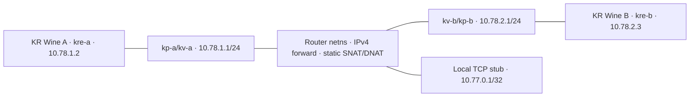

# KR 00967 — contract tương thích client gốc

Revision kr-legacy-contract-r1; cập nhật08/11/2026 JST (CP213; AUD062 periodic qua212; audit kế216).
**Contract có bằng chứng từng phần; phạm vi nghiệm thu codec/hello ở [PLAN](PLAN.md#k2-acceptance)**.
Lộ trình và thứ tự task chỉ giữ ở [REWRITE_PLAN — KRE](PLAN.md).
Đây là contract của repo server KR. ADR0009 của bản viết lại là nguồn lịch sử để so sánh;
vị trí tài liệu nguồn ghi trong [REFERENCES](REFERENCES.md), không phải giao thức dùng cho client KR gốc.
Giới hạn trong mục mang CP ID là phạm vi tại thời điểm đo đó; bổ sung mới ghi ở mục kế tiếp,
không sửa raw/checkpoint cũ. Câu hỏi còn mở và phép kiểm tiếp giữ ở [RESEARCH](RESEARCH.md#q-023).

<a id="rust-port-boundary"></a>
### Ranh giới contract khi chuyển Rust — design CP213

[Thiết kế/ma trận readiness](RUST_SERVICE_ARCHITECTURE.md), [thứ tự/acceptance duy nhất](PLAN.md#rust-service-milestones),
[unknown/RE tối thiểu](RESEARCH.md#rust-service-gaps), [provenance](evidence/rust-service/README.md).
Đây là kế hoạch, **chưa có implementation/nativeRust**. Contract KR giữ ở các mục bên dưới, không sao chép
opcode/layout thành spec Rust riêng. Chọn policy đã nghiệm thu có revision, không đổi authority trong port.
Gate Python scoped K0–K7 không chứng minh mọi feature/catalog/fullgame hoặc accountauth/inventory/reward.
AccountDB/backendadmin/transaction là design công ty; adapter credential/session/projection cần bằng chứng KR.
Không nhập wireInputCommand/Snapshot/authoritativeengine của boom-rs hoặc opcodeVN. Python RE/reference
vẫn giữ; parityPython↔Rust/encoder tựsinh không oracle độc lập, nativeend-to-endRust là acceptance riêng.
Wine/LANgiảlập/K6cWANgiảlập giữ quyết địnhowner; Internet thật chưa kiểm, khôngdependencyngầm.

<a id="eight-team-variants"></a>
### Tám actualclient: Free 1–7 và Manner 4–4 qua hai kết quả/reset — CP213

Bổ sung delivery11/11: [source Python byte-identical/kiểm](evidence/eight-player/team-code-delivery.json) được giao riêng; không đổi kết quả/copy/hash CP213 và không chứng minh Rust variants.

[Raw/recipe/hash](evidence/eight-player/README.md#cp213), [câu hỏi/phép thử](RESEARCH.md#gap-lobby-identity-followup),
[thứ tự duy nhất](PLAN.md#current-order). `kr_runtime/confirmed` trong profile/copy dưới; team/rank/fuse policy `design`.

| Câu hỏi / nguồn tái sử dụng | Delta / kết quả KR mới |
|---|---|
| CP147 capacity8/Free4v4-1v7; CP162 actualselector81→86/87/180; CP163 Mannerbalancedguard8negative; CP2102118life/rank/reset | Không giải mã lại codec/175/rows/map/teamguard. Fixed operatorlayout4v4/1v7 theo instance, allowManner cần measured echo policy; không port VN89 hoặc mutate module-global roster |
| Cùng8actualFree1–7 | Copy4b/32TCP/8prefix-display-IP-netns/directbridge/ExVillage01/Free0. Vòng1 AactualSpace/selftrapdeath→B–H thắng; vòng2 B–HactualSpace/trapdeath→A thắng. Full8life-before175/7peer170/rank1751082-inner1072/1803/room/7Ready2–3/Start3.4344gameplayjoins/125modejoins/128copiedgetters/358.900s/2126raw/892pins/cleanup0 |
| Cùng8actualManner4–4 | Copy4b/current8/fixedalternatingteams/selector1; hai opposite4v4 outcomes/reset/Start3.4357gameplayjoins/124modejoins/128copiedgetters/369.936s/2102raw/929pins/cleanup0. Không suy Free→Manner chỉ từ caption hoặc serviceconfig |
| Modepersistence qua cả8view | Mỗi view có3native123F9C0setter: initial DB2A50(create86) hoặc8179BA(join87), haiE64A7B(return180), đúng0/1. Actualwirehash/typedfield/callchronology và3actualStartreturns0 độc lập. R1counts/rule80budget hết lúcjoin2..5; không gọi earlybalance_reject là final8rejection. R2filterfull8 trước budget, nativeFree8/2teams/selector0 đã thấy |
| Servicecontrols | TeamProfile instance riêng; rank/outcome chỉtwofixedfamilies, Mannerunbalanced104 reject trước roundID/key/allocation.713Free1v7/775Manner4v4/180Manner1v7 actualTCP controls (application C2S tổng hợp),366unit.13bundle+5preset tests; packaged8battle giữfixed4v4/khôngoverrideManner. Không coi synthetic104 lànativeclick |
| Startupcontrols/negative | Original4b FreeR1D và Manner1v7R1E/R2F đều preBattleSIGABRT96E300 family, raw giữpartial. R2Factual96A480inputsize0/cap15, parser96A4EB→throw96E2D0 expectedvalue; khớp cacheCP073201, không locale/teamfailure. Nguồn emptyHTTP/upstream còn unknown; guardempty-onlycandidate8d7194 có control riêng, không tự áp kết quả lên4b |

Protectedlife đọc native runtime;128getter/run dùng copied52A350/Unicorn tách riêng. OS Space/gameevents/currentkey,
drainedbombs/freshsurvivor21/settle8/rank/reset kiểm cùng-run; không ghép hai run thành một trận. Tutorial/ảnh rank chỉ
bổ sung, không screenshot-onlyproof. Legacy controller early_completion label nói4v4 ở cả Free1v7; raw giữ nguyên,
verifier mới đối chiếu đúng per-slotteam/death/rankvector, không dùng label làm oracle.

**Giới hạn:** operator fixedroster, chưa native interactiveC2Steamchange/generalteamfamilies/native9/fullroomauth;
full8items/terrain/kim/cứu/ability/raylength chưa tíchhợp. Fuse6/report-derivedlife/rank/zeroeconomy/settle8 là emulator
design, không servergốc/worldauthority. Manner1–7 nativeguard đã có CP163(mộtactual/tám tổnghợp); các8actualcopy4b
negative chưa tớiStart nên vẫn partial. Alternatecopy8d có8nativecount8/selector1/balancebranch/return7/no104,
1543checks/140.441s/755raw/508pins/cleanup0; emptyguardkhônghit nên không causalstartupfix hoặc runtimeemptybranchcoverage.
Code source/copy4bpositive giữ riêng, không giảm tiêu chí hoặc biến alternatecopy thành unmodifiedclientproof.
K6c WAN giả lập/K7 đã nghiệm thu CP212; Internet thật chưa kiểm, không dependency các gate đã đạt.

<a id="emulated-wan-acceptance"></a>
### K6c WAN giả lập — phạm vi mạng được nghiệm thu tại CP212

[Owner directive](evidence/owner-directives/emulated-wan.json), [acceptance K6c](PLAN.md#k6c-acceptance),
[đánh giá lại K7](PLAN.md#k7-evidence-review), [evidence/hash](evidence/peer-endpoints/README.md#cp212).
**Internet thật chưa kiểm**. `design` cho môi trường/policy; `kr_runtime/confirmed` cho hành vi trong
các run đã seal CP192–196/203–207. Không đổi contract wire, binary, DB, record complete hoặc raw cũ.



Topology trên là CP195 (CP196 dùng cùng recipe, port99 thực riêng mỗi run): ba netns root-router/A/B,
hai veth/subnet, mỗi KR có prefix/display/wineserver/CA PID riêng. Routes chỉ tới subnet peer và stub;
root không external/default route/NIC. Một host/kernel, không giả hai ISP/máy vật lý. Không TCP/UDP proxy.

| Thuộc tính thực cấu hình / quan sát | Phạm vi và giới hạn |
|---|---|
| Mapping UDP | CP195 A→B SNAT `10.78.2.1:30001`, B→A `10.78.1.1:30002`; DNAT tới port99 thực `10.78.1.2:9813` / `10.78.2.3:9963`. Payload153 khai báo mapped tuple; actual API/PCAP/currentkey/apply khớp. Port đích thay theo run, không hardcode9813/9963 làm luật client |
| Filtering | SNAT chỉ source/destination IP pair+UDP; DNAT giới hạn ingress interface/source IP/destination IP/UDP dport. Rule chain policy ACCEPT trong netns cô lập; không dynamic pinhole/Internet firewall model. Một peer destination, không đủ phân loại endpoint-independent/dependent/cone/symmetric theo RFC; chữ “symmetric SNAT” trong scaffold cũ chỉ hai chiều, không chứng minh NAT type |
| Delay/jitter/loss | Egress kv-a và kv-b: prio bands3/priomap all0; protocol17→1:3/netem delay40ms±5ms, randomloss5%, correlation0, seed194, limit1000, ecnfalse/gap0. Mỗi chiều UDP đi qua queue phía nhận; TCP baseline. Cài trước launch, không đổi giữa run; native counters0→631/493packets và43/37drops |
| Reordering/bandwidth | Không cấu hình `reorder`, rate/TBF/HTB hoặc bandwidth cap. Jitter có thể ảnh hưởng thứ tự; không có phép đo xác nhận/bao phủ reordering riêng hoặc băng thông Internet |
| MTU | Không có lệnh override/sweep MTU; router veth kv-a/kv-b ghi nhận1500, lo65536 trong raw ip-j-addr. Không chứng minh PMTU/fragmentation/MTU thấp |
| Latency control | Socket baseline64/64, drop1000/3, loss-delay58/64; RTTmedian0.036→80.544ms là control riêng. Không native ping/wirelatency promise dưới GDB hoặc attribution từng packet loss |
| Lifecycle/native | CP195 cùng2actual→2normalBwin/trap-dead trước175/result-room/Ready2/Start3/reset/4peerwindows; CP196R2 pendinghostEOF→nativeAclear-chief-room/fencepastdue4s riêng. Không ghép EOF thành run hai trận; R1 observerfailure/history giữ nguyên |

Nguồn đã đối chiếu: CP192 routed controls; CP193 private153 negative/mapped153+DNAT positive;
CP194 two cycles; CP195 qdisc/native/PCAP; CP196 bounded EOF; CP203–207 package/hardening/health/freshserver.
Không mở lại codec/consumer/stat/queue đã phục hồi hoặc port VN opcode/layout. Hai native proof và getter
Unicorn tách biệt. Raw và kết luận “chưa Internet/K6c/K7” tại CP cũ vẫn là lịch sử đúng thời điểm;
CP212 mới nghiệm thu môi trường WAN giả lập và đánh giá K7. Full Internet/ISP/CGNAT/mọi topology,
NAT discovery/relay gốc/fullUDP/accountresume ngoài proof, không dependency gate đã đạt.

## 1. Định danh và nguồn chuẩn

Đọc/đo mới trên các target sau; đường dẫn cũ trong notebook tra bằng `/home/admin/boom/README.md`.

| Artifact | Đường dẫn hiện tại | SHA-256 đo 26/10 |
|---|---|---|
| KR gốc | `/home/admin/boom/clients/kr-00967/CA.exe` | `a52545c14b1fea423de655c3163d6360b628d61c1cd472b46fdbc8a9ffe15f4e` |
| KR patcher | `/home/admin/boom/clients/kr-00967/NewPatcher.exe` | `b59e4dce9ad23c439a7632ce04ecb2eed3481585bd2454100b05c9d7527f5c02` |
| VN gốc 116 | `/home/admin/boom/clients/vn-116/ca.exe` | `bce8644d4e783d1354ab4fc880e1ab9a4ab3325327028f37d99e5439e25f4bbd` |
| VN đã dùng RE/runtime | `/home/admin/boom/repos/boom-re/wine/Boom/ca_fixed_patched.exe` | `bc875ba5765cc112e924f46e75d0ace112904c7801126e46bc0abb1c9cb576b1` |

VN gốc và VN patched là **hai artifact khác nhau**; phương pháp/claim runtime có patch provenance.
Một file `.i64` có cùng tên chưa chứng minh input, image layout và các address khớp. Dump memory
phải ghi base/region; VA trong dump không tự chuyển thành offset file packed gốc.

Nguồn đọc ở lượt lập contract: `boom-re/docs/{protocol,oc_d-login,lobby,oc_e-game}.md`,
`boom-re/tools/{boomproto,fakeserver,verify_emu}.py`, `boom-re/server/src/{proto,session,packets,hub}.rs`;
`boomkr-re/docs/kr.md` §1, §7–§33 và `vn-vs-kr.md` §4. Đây là nguồn tham chiếu local,
không dùng các phần trăm ước lượng reuse/rewrite của notebook làm bằng chứng tương thích.
Kiến thức được nhập vào docs hiện hành:
[VN server reference](REFERENCES.md),
[VN battle runtime](REFERENCES.md),
[VN protocol](REFERENCES.md),
[KR flame/chain](REFERENCES.md),
[KR trap timer](REFERENCES.md),
[KR ghost/position](REFERENCES.md).

## 2. Ma trận tái sử dụng VN → KR

Mức `confirmed` dưới đây chỉ áp dụng nguồn/build/phạm vi ghi trong hàng, không tự xác nhận KR wire.

| Lớp | Điều đã có | Cách áp dụng / phần KR còn thiếu |
|---|---|---|
| Debug/input/IAT | VN có recipe GDB proxy, input dispatch/gate trace và đối chiếu IAT theo ABI | CP012 có command login; CP016 có callback/dialog/request Tạo phòng theo [contract](#room-create). Recipe, provenance và giới hạn tại [evidence reuse](evidence/vn-reuse/README.md). Không copy địa chỉ hoặc tự đổi GetAsyncKeyState. |
| Pack/map/sprite/ODT | Reader dùng được cho pack KR; inventory 13 pack/51.467 entry; có khác biệt header map và numeric ID | Dùng lại tool và dữ liệu KR. Điều này không xác nhận version, frame hoặc opcode mạng. |
| Framing/primitive | VN `CClientSocket` `A68850`, recv/process `A662E0`, send `A663E0`; encode/decode/CRC đã có kiểm binary | Dùng làm mẫu tìm class/call graph và mẫu fixture. Patch bootstrap có profile riêng [đã kiểm](evidence/bootstrap-wire/README.md); KR có [profile WCP hẹp](#wcp) và native capture/field checks tới104/121 theo [contract start](#start-reply); full codec/reset/bounds còn mở. |
| Crypto/seq | VN XOR `0x53351D9C`/step `0x63CAACE3`, CRC8/32, base/seq/delta, opcode substitution | KR profile mode2/selector3 đã có oracle native và reset tại CP006/057/181; xem [codec](#login-retry-codec). VN chỉ là mỏ neo, không chứng nhận mode/header khác. |
| Hello/version | VN server-first hello, rồi đổi mode; version 116 và packet bootstrap có thứ tự | Patch socket KR: mode0/selector0, BE16 version967, response local được chấp nhận theo [evidence](evidence/bootstrap-wire/README.md). Consumer WCP, initial0/0 và transition2/3 có bằng chứng theo [contract WCP](#wcp); profile codec/hello/reset được nghiệm thu CP181; widercodec vẫn giới hạn, không gộp socket. |
| Login/identity | VN có pipeline login-result/network-info và variant China khác layout | CP058 có shape auth; CP183/184 đã nối identity291 tới panel và integration A. [Contract](#own-profile-integration); fullaccountauthority/cachematrix/vanilla vẫn giới hạn. |
| Cache/redirect/channel | VN cần tag blob; dữ liệu inner LE khác outer wire, cache path khởi tạo theo stage | Kiểm contract KR từ reader/consumer. Giữ test cold/warm cache; không copy blob VN hay replay flag “dùng cache” khi file không tồn tại. |
| Lobby/room/start | VN có request/reply, slot flags, map tự gửi lúc vào phòng, loading/clock nhiều pha | Dùng để xây checklist ca biên. KR có stage11 và17/241 theo [contract sảnh](#channel-lobby); [request81/response86](#room-create) đã đưa copy tới CPrepareStage và UI phòng chờ; [player/ownslot/controls](#room-player) đã đo trên copy, [map metadata/start104](#room-map) và [start121/scene nhân vật](#start-reply), [clock/input](#round-go), [nổ/HELP/về phòng](#bomb-cycle) đã đo; bảng kết quả chọn đã có [CP023](#round-result), hai client movement/bom đã đo ở [CP027](#peer-duo), join/Ready và chu kỳ pair ở [CP028](#duo-room-round); authority/reset đầy đủ còn thiếu. |
| Bomb/item/trap/result | VN `111→152→151`; `553`, pickup `117→158`; `120` subtype; kết quả `168→173` có runtime nguồn cũ | Chỉ mỏ neo VN. KR phải nối send/receive tới object/state tương ứng trước khi implement. Fuse/drop/cap policy emulator không phải luật server gốc. |
| Peer/movement | VN C→S92 trao IP/UDP port; S→C146 có peer table; runtime hai máy di chuyển đồng bộ qua UDP | Không giả định KR dùng cùng packet/MTUDP version hoặc không đổi peer contract. TCP-only demo không hoàn tất multiplayer khi peer chưa đồng bộ. |
| Kiến trúc/harness | VN có hub/session/round generation, golden Python↔Rust, control 1–2 client | Dùng pattern và bài học, không coi golden hai implementation cùng logic là oracle KR; không copy legacy server vào crates của rewrite. |
| Luật trận chung | Nhiều claim VN confirmed dùng được theo ADR 0002/0013 | Dùng để thiết kế/kiểm hành vi. Luật tương đương không chứng minh binary layout, field widths và wire numbering tương đương. |

<a id="trusted-wiki-reuse"></a>
### Wiki KR được chủ dự án tin cậy: áp dụng cho luật, đối chiếu theo build

Nguồn [REFERENCES](REFERENCES.md#owner-trusted-namu-wiki), [hash/locator](evidence/namu-wiki/metadata.json).
Đây là **reference do chủ dự án chấp nhận**, không gán thành `kr_runtime`. Khi dùng trong emulator,
rule có thể là `design/emu_choice` dựa trên nguồn này; claim `kr_static/kr_runtime` vẫn cần nguồn build.

| Nhóm | Kiến thức dùng lại | Phần KR00967 chỉ cần kiểm còn thiếu |
|---|---|---|
| Battle cơ bản | Bomb +1 count; Fluid +1 range; Roller +1 speed; Ultra tới max range; Red Devil tới max speed **và đẩy bom** | ItemAttr/consumer/ID, đơn vị và cap theo char đang dùng; không RE lại ý nghĩa item |
| Trapped/cứu/kim | Đồng đội cứu, địch diệt; Ctrl dùng kim khi trapped, oxy kéo dài thời gian | Reuse các probeKR đã có; chỉ kiểm variant/ordering/consume/peer còn chặn demo; wiki không giải simultaneoustick |
| Đội/mode | Free cho lệch đội; Manner cân bằng mọi đội, ví dụ2–2/2–2–2/3–3/4–4 | ReuseCP162/163; selector/opcode/nativevalidation không copy từ tên hoặc wiki |
| Stat nhân vật | Có basic/maximum; Bazzi tham chiếu count1→6/range1→7/speed5→9 | Ánh xạ BomberAttr/build/charID và đơn vị; khác currentpolicy phải ghi khác biệt, không áp số mù |
| Map/mode phụ | Danh mục theme/mission/Revival và luật thắng/thua được mô tả | Chỉ chọn scope khi PLAN mở; geometry/spawn/assets/nativepresence/ID vẫn đối chiếuKR |

Nguồn PC đang dùng; BnB M/mobile để riêng. Trang sửa2026 có thể khác00967, bản dịch lore/char chỉ
một phần; giữ Hàn gốc và ngày sửa để xử lý mâu thuẫn. Giá trị luật tham chiếu giúp bỏ RE ngữ nghĩa
lặp lại, không tự đóng gate hoặc giải blocker K3 cache/version. Thứ tự tiếp duy nhất ở PLAN.

## 3. Mỏ neo KR có sẵn và giới hạn

| Locator | Nguồn / trạng thái | Có thể dùng để tìm | Không kết luận từ mỏ neo |
|---|---|---|---|
| `NewPatcher!sub_4118E0`, xref literal `files.nfo2` tại `0x411AF0`, `0x411D1D` | `kr_static` / `confirmed` cho consumer đọc tĩnh, [evidence](evidence/bootstrap/README.md) | Caller/config manifest/download và nhánh lỗi bootstrap | Không phải handler game; chưa nối tới quyết định thành công của `CA!ProcessPatch` |
| `0x00B7A760`, sender packet **167** | `kr_static` / `confirmed`, R-200…R-202 | Lần ngược packet builder/primitive writer từ CGOGameBomber | Không tự gán semantics/layout VN120 hoặc S→C tương ứng |
| `0x00E67E70→0x00E84460`, packet **184 C→S** | `kr_static` / `confirmed` trong phạm vi status serialize | Writer, context/slot và status report | Không gọi đây là S→C trap event hoặc coi client report là quyết định server |
| Packet **183 S→C**, `CGOGhost→B334C0` | `kr_static` / `confirmed`, R-138 | Reader/dispatch/context, setter đơn vị ô 40px | Chưa chứng minh đây là movement sync của bomber sống; C→S148/149 chỉ candidate |
| `0x00E9C520` / `0x00E9CDC0`, message **27** | `kr_static` / `confirmed` theo R-139…R-141 | Tính vùng nổ/chain và đường gọi từ network event | Message27 là nội bộ; wire158/kind0 được bổ sung riêng ở [CP022](#bomb-cycle), chưa full chain/authority |
| `0x01196A70` | `kr_static`, xem [ItemAttr](REFERENCES.md) | Loader ItemAttr; pickup/layout đã có [contract KR riêng](#item-pickup) | Không suy weight thành %, hoặc mặc định drop placement do client chọn. `E9E660` là nhánh kind0 bom, không phải receiver pickup |

Các số opcode này là các mảnh đã có, không phải registry hoàn chỉnh. Tìm được writer từ 167/184
có thể mở được primitive codec trước K1; vẫn cần traffic thật để qua K2.

## 4. Record bắt buộc cho mỗi packet

Registry khóa theo `(build, direction, connection_role, stage, opcode)`; không gộp packet cùng số
khác chiều/state. Mỗi entry phải ghi:

- Artifact SHA, VA/RVA của caller/builder/handler/consumer, evidence ID và phạm vi static/runtime.
- Header/checksum/crypto mode; endian outer và nested blob; seq/key trước/sau packet.
- Field order, offset/cursor, width/count/optional guard/encoding và bounds; unknown giữ nguyên tên trung tính.
- State cần trước khi nhận, side effect, reply/ack/broadcast, redirect socket và thời hạn chờ.
- Mẫu raw→decoded→state có nguồn độc lập; hash capture, run config/patch/cache, trailing bytes và giới hạn.
- Nhãn `kr_static`/`kr_runtime`/`vn_static`/`vn_runtime`/`emu_choice`/`design` và trạng thái
  `confirmed`/`candidate`/`unknown`/`design`. Chưa biết giá trị thì không điền default như fact.

Golden codec cần oracle hàm KR thật hoặc capture, bao phủ size qua ranh giới dword, chuỗi cp949/Unicode
theo consumer, blob raw/nén, checksum sai, seq rollover/reconnect, partial/coalesced frame. Parser server
phải từ chối length/count vượt giới hạn trước allocation. Không fuzz client gốc bằng packet chưa có bounds.

### Helper K2a biệt lập (lịch sử); oracle/stream phục hồi sau đó

[Emulation writer helpers](evidence/primitives/README.md) đã xác nhận plainBE16 `14A5B90`,
XORBE16 `14A5C90` (`0xA569`) và byteXOR `14A5C80` (`0x5A`) trong image unpack có hash đã khóa.
Các helper đạt hết miền input nhỏ và kiểm byte guard/return. Đây là snapshot helper banđầu;
[WCP/profile0/0→2/3](#wcp), [actualframe/stream/CRC/seq/resetmodel CP057](#codec-stream-boundaries)
và capturednativeframes phía sau có mức chứng minh riêng. Không hiểu giới hạn helper là thiếu toànbộ
framinghiệnnay; fullmodes/prefix/live reconnect/bounds vẫn mở. GateK2profile đã đạtCP181 theo PLAN, không toàngrammar.
Review receiver ownership cũng sửa được cách gọi send guard: `13ADD10` dùng receiver từ `545E30`,
packet nằm trên stack, nên không truy nhầm setter `packet+3C` để tìm socket/framer.

<a id="bootstrap-recipe-scope"></a>
### Phạm vi recipe bootstrap đã đối chiếu — CP179

`kr_runtime/confirmed` trong **recipe offline R2**: ba run lịch sử cùng exe7b3b435…/harnessa1e7abe…/
Wine10.0/reply75be47…/hostmap/listeners, mỗi process/game/prefix riêng, `init_peb` PID01a0/01ac/0174
gắn hai nativeconnect loopback cùng thứ tự endpoint với listener. Reply15byte chỉ trên socket1;
socket2 có attempt sau reply trong10s đầu từngrun, zeroC2S. Native nonblocking status `c00000a3`
không là connect đồng bộ thành công; Wine timestamp và Python monotonic không tự đồng nhất clock.
Observation15/10/10s giữ nguyên; từ templateprefix đã init, không ba Wineinstall hoặc coldallcache.

`kr_static/confirmed` về bytes: R2 và e9 hiện dùng khớp vùng VA1234000..1239000 và14ED000..14F0000
(end exclusive, base400000/RVA=VA−base). R1→R2 vùng đầu chỉ khác5byte NGinit omission12358E7;
framer/fields vùng sau không đổi. R1 nativeProcessPatchreturn1 và silent/badguard vẫn là control
riêng; không gán chúng thành3coldstarts. E9 dài thêm1024byte, khác644byte/85range trong phần chung,
có thêm patch import/state/NMCO/heap/overlay/identity; equal-region không chứng minh whole-program
tương đương, quan hệ nhân quả từngpatch hoặc cold3e9. Candidate import names giữ candidate.

Nguồn reuse: [Wine R2 và CP179](evidence/wine-r2/README.md#cp179), [bootstrap controls](evidence/bootstrap-wire/README.md),
[e9/CP020](evidence/start-reply/README.md), [CP014](evidence/login-runtime/README.md), [CP015](evidence/postwait/README.md).
Không cần RE lại primitive/opcode/VNlayout hoặc chạy lại cold3R2/gameplay. `design/confirmed` về
quyết định nghiệm thu dự án chỉ ở [PLAN](PLAN.md#k1-acceptance); full K2/live/reset/auth/cache vẫn mở.
Windows nguyên bản CP178 có ownership/control; không có bootstrap pass hoặc exactPCcause mới.

<a id="wcp"></a>
### WCP trên kết nối sau ProcessPatch

Nguồn chuẩn cho contract hẹp này; raw/recipe/run/review snapshot ở [evidence WCP](evidence/wcp/README.md).
Target modO base400000 SHA a08950c833d3acab8281049def7b3dc96b221f107eeda01da3a548e34b91dce5;
runtime ban đầu trên copy Wine R2 SHA7b3b435b5d8e110185359107376b736615ceabe9452cea8154d02c8628f44c29;
các copy chẩn đoán CP006–012 có SHA/patch riêng trong manifest, không tương đương R2 nguyên recipe.
Trạng thái review của tổng hợp ở [CP001](evidence/checkpoints/manifest.json); confirmed nói về loại/phạm vi phép đo, không tự nói đã qua gate.

| Claim | Nguồn/phương pháp | Trạng thái và giới hạn |
|---|---|---|
| Socket115B840 qua13AED40;13AD6F0 đặt initial mode/selector0/0 từ1A7C684/688,response14ED440,poll13AD820 | kr_static;asm/call chain | confirmed route; không suy cả game có cùng codec |
| Mode0/selector0:prefix1+BE16 length+payload; guard u8 phải0,tiếp2×u16,u32,string cóu16 byte-length,u8 flag | kr_static+emulation14EF300/13AEFE0 | confirmed nhánh flag khác1; ý nghĩa2×u16 chưa biết, không áp version967 của ProcessPatch lên WCP |
| Nhánh flag khác1 áp mode2/selector3 qua globals1A7C694/698;u32 chuyển tới socket virtual24 | kr_static;native oracle u32=0 | confirmed thứ tự gọi; vai trò seed candidate. Oracle+40/+44/+48=[2,3,0];+48=0 chưa chứng minh lưu seed (input và nền đều0);không phải measurement fields live |
| Poll/consumer chấp nhận fixture ở socket hai | kr_runtime;debugger13AD782EAX1 và13AD79CEAX1 | confirmed đúng run debug trước CP006; chưa full hello/codec nghiệm thu; C→S mới xem CP006 |
| Sau consumer:WSAAsyncSelect(socket,hWnd,msg400,mask21) thành công | kr_static+kr_runtime Wine trace | confirmed notification READ/CLOSE; không chứng minh toàn client chỉ chờ server |
| Caller run thực:1255AC0→1255A30→1234E70→1231BD0;literal ConnectToMultiServerSingleTime | kr_static đối chiếu backtrace runtime | confirmed route; vai trò multi-server candidate,login/world chưa xác nhận |
| Sau connect 1254D50 trả error từ global 1A3398C; 1234E70 gọi 12364A0 nếu khác0 | kr_static + kr_runtime Wine R2, CP004 | Trong run R2 error1/msg1958 có sẵn khi debug bắt đầu và sau consumer; dừng tại 12364A0, chưa quan sát guard12349E0. Giá trị dump không chứng minh lỗi vanilla. |
| Trong run copy thử với hai u32 error bằng0, quan sát 1232385 và early exit qua 1258150 | kr_runtime + kr_static CP004 | Thử nghiệm riêng; code ghi error9/msg0x9a1, launcher khởi động, tiếp đó UD2; không đạt login. Nhánh guard12349E0 chưa quan sát tới. |

CP006, review theo [manifest](evidence/checkpoints/manifest.json): trên copy reset error và
`multiserveridx:0`, debug/plain run mỗi run nhận 66 byte C→S trên socket thứ hai, SHA và recipe ở
[evidence](evidence/wcp-sequence/README.md). `1238530` tạo packet type0 và gửi qua `1164D50`;
consumer tiếp theo chờ opcode13. Tám response tổng hợp opcode `13,2,12,21,1,43,62,719`
đã được consumer Wine xử lý đủ để guard `12349E0` trả1 trong một run debug; một số payload rỗng
là `emu_choice`, không chứng minh tài nguyên/server gốc. Mode2/3 với header36 byte, XOR và CRC8
được kiểm hẹp bằng native oracle cùng negative checksum/partial và runtime; không suy full codec,
reconnect hay K2. Import NMCO identity chưa bind trên copy CP006; thử nghiệm tiếp
CP007–009 ở [evidence identity](evidence/nmco-identity/README.md), còn blocker/kiểm hiện hành
ở [Q-023](RESEARCH.md#q-023). Tại CP006 chưa có login/gameplay; các mốc sau có phạm vi riêng bên dưới.

CP007 dùng identity `1` và screen name rỗng như **emu_choice**, không bổ sung contract wire hay
chứng minh identity server gốc. Các run chỉ chứng minh phạm vi đường chạy trên copy đã sửa;
ngữ nghĩa login và nội dung khởi tạo vẫn unknown.

CP010 có log tạo packet type15 sau marker khởi tạo trên copy; capture stub vẫn chỉ có 66 byte
C→S trước đó. Chưa có wire/layout hoặc vai trò packet15 được khôi phục từ quan sát này.
CP011 vẽ UI login nhưng hai phép input chưa tạo thêm C→S; điều này chưa bổ sung contract auth.

CP012 (`kr_runtime/confirmed`, copy có patch): command UI1002 và luồng tự động trước click đều
được tách bằng breakpoint/timeline. Resolver login yêu cầu `dream-login-ca.nexon.com`, thấy port3838/3848;
NSS riêng ánh xạ về loopback cho kết nối thứ ba. Trên run cấp cùng fixture hello cho ordinal3,
đã đo `13AD782`/`13AD79C` trả1 sau guard. Trước reset global, tổng C→S chỉ66 byte của connection2. Hai run reset global1A966FC trong bộ nhớ
thu thêm4 frame×69 byte C→S15 trên connection3. Native parser14EF300 replay bốn capture với
seq40,43,46,49 khớp CRC/payload; CRC-sai và partial bị từ chối. Header37+payload31+CRC1 đúng cho
bốn mẫu mode2/selector3 đang thử; synthetic receiver tắt prefix check, không phải server C→S.
Semantics auth/keepalive và field payload chưa xác nhận.
CP013 bổ sung đường **S→C** bằng static dispatcher KR: `10FCBE0` ánh xạ4→`10FEDA0` (result0→`10FD540`)
và15→`1100590`; hai handler nối `stage+2C04` tới wait state`+F4` qua`C47260/C472A0`, tick`C472E0`
hoàn tất1→3. [Bằng chứng đối chiếu VN](evidence/vn-reuse/README.md) giữ bytes, guard và giới hạn.
Tại CP013 chưa có runtime S→C4/15 hoặc C→S auth KR; CP014 bổ sung ở [contract login](#login-auth).
Full success schema vẫn thiếu; CP014 có thử S→C15 bên dưới. Không gộp S→C15 này với
bốn C→S15 đã capture ở CP012. Đây không phải toàn bộ endpoint/port,
full codec hoặc proof auth/reconnect K2.
Call/capture và giới hạn tại [evidence handler](evidence/ui-handler/README.md);
Contract username/password, token thật và mode/seq tổng quát vẫn unknown.

<a id="login-auth"></a>
### Login auth trên copy — CP014

Nguồn raw/recipe/hash và các control/failure: [evidence login](evidence/login-runtime/README.md).
Các facts dưới là `kr_runtime/confirmed` hoặc `kr_static/confirmed` trong phạm vi copy đã khóa,
không phải đăng nhập Nexon thật hoặc K2/K3 đã pass.

- Luồng tự động `11010F0` đọc config `token_1/token_2`; tĩnh chọn count0/1/2 theo chuỗi rỗng.
  Runtime `token_1:offline-probe` đi tới `13B07F0` với1; cùng copy không token có0.
  `1255C90` chỉ gọi builder khi count1..2. Tại CP014 chỉ token_1/count1; [CP214](#auth-token-request) đã đo cả count2 trên copy4b.
- `1255DC1→13ADE40` yêu cầu getter `13AD5B0==-1`, socket ready và count1/2; gọi base ctor
  `14EAD00` với opcode1. Capture connection3 có **C→S1/80 byte**, kế **C→S60/58 byte**, rồi C→S15.
  Native parser `14EF300` replay7 frame với seq40+3n, khớp CRC/payload; CRC-sai/partial từ chối.
  Hai u8 đầu payload auth được native reader đọc4 và1. Full schema/biến thể auth còn unknown.
- Chiều nhận của login socket: tại `14EF300`, hello có mode0/selector0/seq40; phản hồi kế có
  mode2/selector3/**seq43**. Fixture S→C4 result1 dùng43 vào `10FCBE0→10FEDA0`, guard
  `stage+2FD8=1`, decode1 rồi nhánh lỗi đặt dialog result1. Đây là thử nghiệm từ chối login.
  Fixture sai giả định seq40 trước đó vẫn qua dispatch nhưng decode2; CRC của mẫu1byte không
  đủ chứng minh plaintext/seq. Không dùng seq chiều gửi thay chiều nhận.
- Prefix S→C4 result0 có thứ tự đã đo: **outer u8 result, u8, u16, u8 playerCount, u64**.
  Native replay đọc0/0/1/1/0; runtime vào handler result0 và đọc khớp prefix/count local1.
  Tại CP014 body theo từng player/đuôi chưa đủ. [CP058](#auth-profile) đã sửa chuỗi và lấp
  nhánh count1/feature đang chạy tới callback errors0; chưa full auth semantics/variants hoặc S→C15.
  CP020 mở prefix tới trường ID local, xem [contract](#start-reply); không đóng full auth.
- Prefix13byte cố ý thiếu body vẫn dẫn tới C→S9/46byte. Cấp tiếp fixture S→C15 với seq46,
  blob reader chứa host loopback, ba u16=0, mode0 và tailu16=0: đã vào `1100590` và đo wait
  **0→2→1→3**, setter result3 từ`C4704E`, modal trả3. Không suy getter bounds hoặc schema hợp lệ
  từ việc client tiếp tục với dữ liệu thiếu. Các giá trị loopback/zero là `emu_choice`.
- Sau modal, slot`16EA598` trap ở`13BFD44`, arguments hwnd/msg403/1/0. Copy bind thử
  `PostMessageA` (`emu_choice/candidate`; `SendMessageA` còn alternative) cho attempt trả1 và tới
  xử lý message tiếp `1259C65→125AF18→13BFF43→13C2052`. Run này dừng ở trap`2265828`,
  slot`16EA8FC`, call`13CA429`/return`13CA42F`; đó là blocker CP014, được tiếp nối ở CP015 bên dưới.
  Đây là return của luồng chẩn đoán, không phải login hợp lệ, vào kênh/sảnh hoặc gate K3.

Recipe mới bind Toolhelp process/thread và các API window trên copy, giữ global1A966FC reset0 trong
bộ nhớ như CP012. Các API phục hồi là `emu_choice/candidate`; `GetWindowTextA` còn alternative ABI
`GetClassNameA` chưa loại trừ. Token là giá trị giả local. Không ép modal/state thành success;
không suy các patch/import/API này là tương đương vanilla hoặc là nguyên nhân duy nhất.

<a id="auth-token-request"></a>
### Token local trong C→S1 — CP214

Nguồn [ba run/recipe/hash và sửa oracle](evidence/login-runtime/README.md#cp214),
[metadata](evidence/login-runtime/token-request.json); KR00967/originalSHA trong metadata, offlinecopy4b/Wine10.0.
Nguồn cũ dùng lại: CP014 builder/count/guard, CP058 reply và CP181 codec/retry; VNlogin chỉ tham chiếu,
không chuyển username/password/opcode/layout. IDA unavailable không làm mất cache/provenance.

**`kr_runtime/confirmed`, chỉ nhánh config token giả đã đo:** `13B07F0` nhận1/2,
`13ADE40` lặp đúng count; `105D050=0`, `122AE50=1`, writer `14EC040` nhận chuỗi13byte/key11223344.
Hai token_1 cùng độ dài A/B cho frame80/body42, hai token cho frame95/body57, seq40 ở socket thứ ba.
Body bắt đầu hai typed u8=4,count; mỗi record tại offset2 rồi17 gồm typed u16=13 +13byte biến đổi.
Thêm token2 thêm15byte; suffix25byte bắt đầu17/count1 hoặc32/count2 giống nhau giữa ba run.
Không có username/password plaintext được xác nhận; các nhánh provider khác không đi qua trong ba run.

**`kr_static/confirmed`, emulation tách runtime:** copied sender ctor14EAD00/vtable17B0B7C,
`14EC040→14EC060→14ED340`, synthetic buffer/mode2 đã cho đủ15byte khớp bốn record capture.
Đây là biến đổi định dạng, không chứng minh cơ chế xác thực an toàn. Copied receiver14EF300/mode2-selector3/seq40
replay ba frame actual: return0/CRC khớp/body khớp; CRC-flip return7/error10/consumed0, partial return2/consumed0.
Prefixcheckoff và allocator synthetic theo recipe cũ; không phải backend thật kiểm credentials.

**Giới hạn:** input13byte/ASCII, một nhánh local config/copy đã sửa; chưa length16+ hoặc token2-only,
chưa giải nghĩa suffix hay các flag mở rộng. Không gửi authsuccess, không kiểm expiry/revocation/swappedchannel
và không chứng minh account→player/sessionownership. Tại CP214 request6/name+tail chưa được nối với token; [CP216](#auth-channel-echo) phục hồi layout/field36echo, chưa tokenownership.
Contract dùng trực tiếp để parse một nhánh có bounds; thiết kế backend auth/Argon2id/session vẫn là `design`.
Phép thử tiếp ở [RUST-Q1](RESEARCH.md#rust-service-gaps); không sửa/đóng gate demo hoặc fullauth từ kết quả này.

<a id="auth-token-bounds"></a>
### Ranh giới chuỗi token và token2-only — CP215

[Hai run/recipe/hash](evidence/login-runtime/README.md#cp215), [metadata](evidence/login-runtime/token-bounds.json);
reuse CP214 writer/framer và cache11010F0 của CP014, không mở hàm mới hoặc port VNlogin.
`kr_runtime/confirmed` trên cùng offlinecopy4b/Wine10.0/localstub: một run hai input15/16byte cho count2,
writer14EC040 nhận MSVC size15/cap15 rồi size16/cap31. Actual C→S1 seq40 **frame100/body62**;
typedprefix4,2; record17byte ở offset2 và18byte ở offset19, suffix25byte bắt đầu37 và giống CP214.
Cả hai record khớp đầy đủ copied-native sender độc lập. Không có auth-success reply.

Run chỉ khai token_2 dài16byte: native settercount0, không gọi builder13ADE40, không writer token;
connection3 có bốn C→S15/CRC hợp lệ, không C→S1 hoặc60 trong cửa sổ42s.
Điều này khớp cache tĩnh11010F0: token_1 rỗng → count0; chỉ token_1 →1; cảhai →2.
Không tự gom token_2-only thành một record thứ nhất; đây chỉ đường tự động config đã đo, không mọi luồng UI/provider.

`kr_static/confirmed`/emulation riêng:13 vector helper tại độ dài0,1,3,4,7,8,13,15,16,17,31,32,64
trả recordlength=n+2/cursor và typedlength đúng; không thay crypto helper bằng encoderPython.
Actualframe100 replaynative return0/bodyCRCkhớp; CRCflip return7/error10/consumed0, partial return2/consumed0.
Vector0/64 không là proof runtime nhận token rỗng/64 hoặc maxinput.

**Phạm vi mới:** actualtoken ASCII13/15/16, configcount0/1/2 theo những tổ hợp đã đo.
Fulltokenbounds/encoding/provider/password/suffixsemantics/credentialverify/expiry/revoke/accountownership vẫn unknown.
Không thay công thức backendauth bằng obfuscation này; bước tiếp ở [RUST-Q1](RESEARCH.md#rust-service-gaps).

<a id="auth-channel-echo"></a>
### Producer C→S6 và echo từ reply đăng nhập — CP216

[Run/control/raw/hash](evidence/login-runtime/README.md#cp216), [metadata](evidence/login-runtime/channel-echo.json).
Reuse CP015redirect, CP058name/56fieldrecipe, CP181Profile47, CP184–186nameguard và CP214–215token;
cache CP014 đã có edge13AE944/95A/969, nay nối với nativecapture. Không dùng S→C6handler11004A0 làm producer.

**`kr_static/confirmed`, runtime chỉ count1/optional-string-off:** producer13AE740 gọi ctor6 tại13AE944,
serializer4CD040 qua14EC6E0, send13ADD10 tại13AE969. Serializer cho count1..2; body có
`u8 count,u8 opaque`, mỗi record `str_u16,u32 id,u32 aux,u64 opaque,u8 flag`;
đuôi chung `u8,u8,u32,u32,bool,u32`, và optionalstring dưới4CD450.
Tên/ID từ13B0A00/13B09C0, aux từ13B0D10; getter/setter13B0D10/13B0D30 dùng cùng box
`context+148h+0Ch*index`. U64 được caller11018DB lấy từ13C0EC0/localwrapper; chưa nối nguồn đó
với reply server hoặc gọi là sessionkey. Staticallowcount2 không phải runtimecount2 acceptance.

**`kr_runtime/confirmed` trên Winecopy4b/localfixture:** baseline và one-fieldcontrol đều tạo C2S6
seq40/frame81/body43, prefix1/255, tênKRLocal/ID1. Với tên7byte, aux chiếm body15..18;
suffix32byte cũ được phân thành17byte của record và15byte chung, không là blob hay8u32.
Chỉ đổi **S2C4 field36/u32/body93..96** từ0 sang marker trong fixture auth137 và cập nhậtCRC.
Native reader10FE043 → setter13B0D30/index0 → getter tại13AE834 → serializer4CD040 →
writer4CD111/C2S6 cùng marker, đúng thứ tự thời gian; bodyC2S6 chỉ đổi4byte15..18.
Đây là **echo field36 qua cache**; ý nghĩa gốc, TTL hoặc việc dùng như credential/ticket chưa biết.

**`kr_static/confirmed`/emulation riêng:** hai actualframe/native14EF300 +26 logicalreader/string checks
đến cursor43/errors0, haiCRC-flip return7/error10/consumed0 và hai partial return2/consumed0.
Prefixcheckoff/allocator synthetic theo recipe cũ; không xác thực tài khoản.

**Giới hạn:** S2C4successfixture là dữ liệu servergiả lập đã đo parser, không phải kiểm token/password.
Client count1/ASCII7name/currentcopy; count2/optionalstring/provider/encoding rộng chưa runtime.
Một field32bit echo không tự chứng minh quyền sở hữu session hoặc an toàn xác thực. Admission/lease/expiry/revoke/
rate limits là `design`, cần nativepositive/negative riêng trước tích hợp; chưa có Rust implementation.

<a id="auth-admission-prototype"></a>
### Adapter admission cục bộ — CP217

[Hai run/raw/hash](evidence/login-runtime/README.md#cp217), [metadata](evidence/login-runtime/admission-prototype.json).
Dùng lại CP214–216token/field36/layout6, result1 CP014 và Profile47 CP181; sourcehash/raw giữ riêng.
Native14ED340/token-key11223344 khớp **hàmcrypt hiện có** trên13copied-nativevectors+6capturedrecords,
không viết cryptor hoặc dựng golden mới làm oracle.

**`emu_choice/design` — prototype riêng trong local, chưa tích hợp server/Rust:** một account giả,
đối chiếu tokenC2S1 → cấp pendinglease10s mộtlần qua field36 → check C2S6ID/name/echo/sourceIP.
Token công khai cố định chỉ là input RE. Echo32bit là correlator của nhánh legacy, không credential đủmạnh.
Rate4 lần/peer/30s, max32peer,1024ticket budget không reuse trong process rồi failclosed là lựa chọn thử nghiệm.
Không DB/password/registration/Argon2id/accountAPI/sessionexpiry/persistentrestartfence hoặc productionauth.

**`kr_runtime/confirmed` trong Winecopy4b/namespace loopback:** inputtoken32byte đi qua writer native
(heapcapacity≥32), C2S1seq40/frame99/body61; suffix25byte giống CP214.
Input đúng: nativeauthresult0 → field36reader/setter/getter/serializer vàactualC2S6echo khớp lease cục bộ;
adapter nhận kênh, native840470entrymarkers vàactualC2S67 tiếp theo có nguồn. Entrycount không là số packet.
Input sai cùng32byte/cùngsource/profile: nativeauthresult1 từ reply lỗi CP014, không C2S6/67 và khônglease
trong45s. Run không force nativeauthstate hoặc functioncall. Serverevents là policy evidence; nativewriter/
actualframes/result và bước tiếp của client được đối chiếu riêng, không dùng logserver đơn lẻ.

**Policy emulator, không nativeacceptance:**24 kiểm với actualretainedframes và negativefieldmutations
cho expiry/revoke/replay/identity-name/source/oneowner/rate/collision/staleEOF. TạiCP217 chưa nativeexpired/revokedlease; [CP218](#auth-lease-eof-blocker) đã thử nhưng clientEOFfault,
chưa negativeacceptance; tạiCP217 chưa replay kernelTCP. [CP220](#auth-tcp-ownership) bổ sung adapterTCPdesign,
haiaccountKR thật/swappedchannel vẫn thiếu. Pendinglease expiry khác sessionexpiry.
**Giới hạn:** frontend32chars không entropy/securityproof; chưa fullauth/DB/accountresume/matchrestore hoặc gate mới.
Phép thử kế ở [RUST-Q1](RESEARCH.md#rust-service-gaps); M0–M1 không phụ thuộc fullauthRE.

<a id="auth-lease-eof-blocker"></a>
### Lease expired/revoked: từ chối được, lifecycle client lỗi — CP218

[Hai run/raw/hash](evidence/login-runtime/README.md#cp218), [metadata](evidence/login-runtime/lease-controls.json).
Reuse nguyên adapter/profile/copy/token32/GDB của CP217, chỉ derivedpolicy trigger: pendingTTL1ns hoặc
revoke ngay sau issue/trước gửi authreply. Đây là **`emu_choice/design` test**, không luật TTL/revoke servergốc.

**`kr_runtime/confirmed` phần quan sát:** cảhai nativeauthresult0, actualC2S6/field36echo đúng ticket đã cấp;
adapter từ chối ở pha claim, không tạo session, không gửi channel17 và không cóactual67 trong run.
Nativecontext/capture và policyevents táchnguồn; không suy từ serverlog/alive hoặc harnessexit0.
**Cảhai client SIGSEGV tại17C7F4C, stack122EA12←12541E0 sau EOF khoảng12s.**
Run kết thúc sớm khoảng40.6–40.8s wall, sau đó ownedcleanup0; không phải45s khỏe mạnh.
Vì vậy negative/lifecycle acceptance của admission **chưa đạt**, dù policydeny đã quan sát.

**`kr_static/confirmed` chỉ locator:** return122EA12 có directcall1257360; entry hàm đó nhảy2052077
vào vùng protected, không đọc linearbytes saujump thành semantics. Fault17C7F4C nằm tại field+0C
của RTTIrecord17C7F40, typenameATL CWin32Heap. Shape/name không chứng minh heap/ABI/SDK/Wine
là rootcause; chưa biết nguồn callback/target lỗi. Copy vàmodO khớp vùng đọc.

**Bước tiếp tại CP218 (đã có control/dispatch bổ sung ở [CP219](#auth-eof-dispatch)):** đối chiếu cache CP015channel17-timeout/CP180fatalCRC-EOF/currentcopyEOF,
rồi passive trace đúng callback/args tại1257360 và targetdata trước lỗi, hoặc matchedEOF control.
Chỉ thử gracefulerrorreply/binding/patchcopy khi có locator vàcontrol, không đoán opcode VN hoặc vá theo tên RTTI.
CP217valid/badtoken proof giữ scope riêng; không fullauth/sessionexpiry/restartfence/DB/Rust/gate mới.

<a id="auth-eof-dispatch"></a>
### EOF trước channel17: control và nguồn target gọi lỗi — CP219

[Bốn run/recipe/hash](evidence/login-runtime/README.md#cp219), [metadata](evidence/login-runtime/eof-controls.json).
Tái dùng CP218 adapter/Profile47/copy/token và cache CP015 timeout/CP180 EOF; không viết cryptor,
đổi source trong run hoặc mở đồ thị SDK. Chỉ local control và probe thụ động trên bản copy offline.

**`kr_runtime/confirmed`:** lease 10s được claim hợp lệ rồi intentional close trước17 vẫn fault;
C2S6 của control này trùng byte với ca expired CP218. Baseline auth field36=0, không admission policy,
cũng actualauth0/actual6echo0 rồi intentional close và cùng fault17C7F4C. Vì vậy expiry/revoke và
nonzero field36 **không cần thiết để tái hiện** trong các recipe đã đo. Zero control đổi adapter/authport;
không coi mọi wire/input trùng hoặc kết luận nguyên nhân duy nhất là EOF. Bốn run/188raw đều seal,
source frozen/cleanup0; khoảng39–40s kết thúc sớm, **native lifecycle vẫn FAIL**.

**Nguồn dispatch đã đo:** stack thô tại fault có top return12578AF, trong khi backtrace bỏ qua frame này.
Ba snapshot sau native send6 xác nhận `this` → vtable16ECAA8 → slot+50=17C7F40 → local `[ebp-60]`
→ `call [ebp-60]` tại12578AC. FaultEIP17C7F4C nằm12byte trong vùng target; không gọi EIP là target đầu.
Native bytes tại callsite khớp modO và copy. Runtime vtable96byte khớp copy; RTTI của actual`this` là
`CObject`, khác tên `CWin32Heap` ở RTTI target. Đây là chuỗi lấy operand/gọi lỗi, **chưa biết vì sao
receiver này được chọn**, lifetime sai hay callback nào đáng ra phải nhận. Không vá vtable/RTTI theo tên.

Các callback snapshot cũ ở122E9FA/FF/122EA0D đều **trước auth reply**, không chứng minh target trước lỗi.
Probe1257360 không hit sau send6 trong hai run mới dù marker send6 có; entry có protectedjump, không
suy đường nội bộ từ linear protected bytes. Context tĩnh trước12578AC chỉ candidate cho getter13AEBE0;
cần xác nhận native receiver selection trước khi giải nghĩa. [Câu hỏi/phép thử](RESEARCH.md#rust-service-gaps),
[thứ tự duy nhất](PLAN.md#current-order). CP217–218 complete giữ nguyên; PR290 đã mergef9f48d2.
Không nâng gate, fullauth hoặc production/Rust; Internet thật chưa kiểm giữ backlog riêng.

<a id="auth-tcp-ownership"></a>
### Ownership qua kernel TCP; receiver EOF còn blocked — CP220

[Recipe/run/hash](evidence/login-runtime/README.md#cp220), [metadata](evidence/login-runtime/transport-controls.json).

**`emu_choice/design`, integration bằng socket Linux thật:** giữ nguyên private adapter/policy CP217,
Profile47 và frame native đã lưu. Driver tổng hợp chạy trong user/net namespace chỉ có loopback,
không chạy client KR. Cấp fixed public ticket đúng echo trong captured6 để replay nguyên frame qua TCP;
duplicate6 và request67 sau duplicate chỉ sửa sequence bằng encoder đã có, không coi encoder là oracle.
R2 đo được: duplicate6 trên kênh đã nhận không thu hồi owner; replay nguyên captured6 qua kết nối mới
bị EOF, không thay/xóa owner; owner gốc vẫn nhận reply67 thực qua TCP; owner EOF xóa active/session/
connection maps. Đây là kiểm transport adapter, **không native client khỏe mạnh sau từ chối**.
Stale EOF của một phiên từng được nhận sau freshlogin mới chưa được đo; không ghép với policy24 cũ.

R1 dừng tại assertion do **driver** đọc typed u32 như raw little-endian; R2 dùng `codec.read_fields`
hiện có. Giữ nguyên run/source R1, không đổi contract hoặc gọi đây là lỗi KR. Hai run kernel TCP/
8 raw đã seal; R2 có22 scoped checks, không fullauth/security/entropy/restartfence proof.

**`kr_static/confirmed` prefix getter và `kr_runtime/confirmed` phần đã quan sát:** getter13AEBE0
đọc `context+0x48`, nhưng bốn return đã bắt là null ở caller khác; nhánh store125783B không hit trước
fault trong run. Không gán null getter là crash receiver. Watch local12D434 chỉ có armed marker,
không write snapshot/stat; Wine kết thúc với privileged instruction17C7F4C, GDB sau đó không còn
register. Phép watch **inconclusive**, không chứng minh không ghi hoặc remote watch được hỗ trợ.
Hai run native/94 raw seal/cleanup0, lifecycle vẫn FAIL. Tìm bounded write-encoding trong vùng cache
chỉ thấy candidate125783B đã biết; không phải proof thiếu write hoặc semantics protected VM.

**Điểm dừng nhánh receiver:** chưa có observable chọn receiver đủ để sửa, không lặp broad getter/
hardwarewatch hoặc mở protected VM/SDK graph. Giữ [chuỗi dispatch CP219](#auth-eof-dispatch) và blocker;
chỉ mở lại khi có cạnh/recipe lỗi native đã đo mới. [Phép RE độc lập](RESEARCH.md#rust-service-gaps),
[thứ tự](PLAN.md#current-order). CP219 đã merge PR291/09435d9. Không production/Rust integration,
không đóng #14/#285/gate; audit AUD064 qua220, kếCP224. Internet thật chưa kiểm.

<a id="auth-two-account"></a>
### Hai identity qua native riêng; wrong-binding TCP riêng — CP221

[Run/recipe/hash](evidence/login-runtime/README.md#cp221), [metadata](evidence/login-runtime/two-account.json).
Tái dùng CP214 tokenA/B, CP216 layout6, Profile47 auth_A/B và own_profile typedID/name. Adapter RE mới
trong local chọn account bằng token rồi dùng đúng auth_role/claim_role; bản CP217 giữ nguyên.
Không thêm packet grammar, cryptor hoặc sửa client/production/Rust. Echo/TTL/rate vẫn policy design.

**`kr_runtime/confirmed`:** hai run Wine riêng trên cùng copy4b; mỗi run có service mới chứa hai dummyaccount.
A: ID1/KRLocal; B: ID2/KRGuest. Cảhai token32 qua writer native, authresult0 → typedID/name/C2S6 echo
khớp field36 reader/setter/getter/serializer → actual67 sau admission. Native17 entry marker có nguồn,
không coi số entry là số packet. Hai run/119raw/sourcefrozen/cleanup0; không fault17C7F4C trong cửa sổ đo.
Đây là **hai positive riêng**, chưa hai client KR đồng thời hoặc swap/healthydenial/accountresume.

**`emu_choice/design`, socket Linux thật/driver tổng hợp:** hai source loopback riêng, A đang có owner4,
B có pendinglease; wrongID/name với ticketB hoặc correctBfields từ sourceA bị policy từ chối/EOF nhưng
không tiêu leaseB/xóa ownerA. B sau đó vẫn được nhận bằng captured6 đúng; cảhai owner nhận reply67.
Aidentity6 trên kênh B đã bind không remap owner; B EOF giữ A mở, A EOF cuối xóa session maps.
Fixed public ticket/re-encoded negative/sequence là test controls; không native wrongclaim-health/securityproof.
R1 hai ca dừng tại assertion driver coi map channel lịch sử là map active; service giữ closed events.
R2 kiểm active/session và actualopenA/closedB, không đổi behavior server. R1 source/raw giữ nguyên;
hai R2 mỗi34 scoped checks qua. Bốn TCP run/20raw/sourcefrozen/cleanup0.

Tổng139raw mới; không nâng gate/đóng epic. [EOF receiver blocker](#auth-tcp-ownership) vẫn mở,
healthydenial/twoactualconcurrent/swap/sessionexpiry/restartfence/DB/fullauth chưa đủ bằng chứng.
[Unknown/phép thử](RESEARCH.md#rust-service-gaps), [thứ tự](PLAN.md#current-order). CP220 complete/AUD064
không sửa; giao CP220–221 cùng PR292, kiểm lại exacthead mới; audit kếCP224. Internet thật chưa kiểm.

<a id="auth-two-actual"></a>
### Hai KR cùng service: identity/session riêng và duplicate account — CP222

[Recipe/run/hash](evidence/login-runtime/README.md#cp222), [metadata](evidence/login-runtime/two-actual.json).
Reuse CP197/200 direct virtualTCP/ownedstartup, CP221 account/token/layout6/nativeprobes; không mở SDK/VM.
Controller mới chỉ hai client, token argv riêng, không chờ tạo phòng/mở4guest. A/B prefix/display/netns và
CA/wineserver riêng; bridge root10.77.0.1, A.2/B.3, không route ra ngoài/TCP proxy/NAT/UDPimpairment.
Profile copy bỏ đúng `replacement_slot` do API admission_ips không hỗ trợ kết hợp này;47fixture wire/pin
không đổi, profile nguồn giữ nguyên. Không gameplay/room/replacement acceptance.

**Correction phạm vi suffix:** R1 hai token đúng nhưng CP217 policy hash nguyên suffix25 nên từ chối
`unsupported_login_suffix`; R2 diagnostic giữ denial và đo native writer/cursor. Cached builder13AE3BD
và native args/cursor xác nhận25byte = block16 + u32 + u32 + u8; cursor36→52→56→60 ở token32.
Cả A/B block16 khác nhau/biến đổi giữa run, semantics còn unknown; u32 đầu0, u32 kế có bytes IPv4 nguồn
đã quan sát, u8 cuối0. Full capture khớp `_encode_bytes(block16)+pack_fields([u32,u32,u8])` có sẵn.
Đây là layout/quan sát, không credential/deviceidentity/ý nghĩa server gốc. Suffix trùng ở CP214–221
chỉ trong các run đó; record cũ bất biến. R1/R2 failed admission giữ raw/limits, không gọi chúng success.

**`emu_choice/design` parser profile mới:** chỉ count1/token32/body61; opaque16 giữ metadata/hash,
không dùng authenticate; nhánh0/sourceIPv4/0 được kiểm bounds rồi normalize cho private policy cũ.
Token verify/account/oneuselease/owner vẫn riêng; IP client chỉ consistency với peer server quan sát,
không trở thành bằng chứng chủ account.10 policychecks gồm malformed/count/flags/IP/tokenfail tách nativeproof.
Không sửa CP217/221 code cũ; source/config/input frozen từng run.

**`kr_runtime/confirmed` R3:** hai actualKR Wine cùng service, tám TCP từ hai IP/stage1..4; native writer32/
auth0/field36chain/C2S6 đúng ID1-KRLocal và ID2-KRGuest/echo rồi actual67 mỗi bên. Hai CA/hai wineserver/
hai netns, PCAP TCP/directendpoint/sequence và hai sessionowner ở snapshot **trước cleanup** nối được;
cảhai giữ qua8s+ sau khi đủ nativeproof. Cleanup mới xóa sessions; không đọc snapshot cuối thành noowner.
R3=40.781146896s/100raw. Không suy TCPaccept/alive/serverlog thành nativeprogress.

**R4 duplicate-account control:** giữ service/policy/topology, chỉ tokenB đổi sang publictokenA.
A native0/6/67 vẫn là owner; B native1 từ reply lỗi1 đã đo CP014/217, không channel6/67 trong cửa sổ đo;
không session thứ hai, hai client không fault trong hold8s+. R4=40.251220213s/99raw/cleanup0.
Đây là loginnegative hẹp, **không** channelEOF healthydenial/45snegative/generalretry/expiry/revoke.

Tổng498raw bốn run đã hash/seal/cleanup; không fullauth/sessionexpiry/restartfence/DB/API/Rust/gate mới.
Hai account positive chưa đảo account giữa endpoint, chưa native wrong-channel swap. [Unknown](RESEARCH.md#rust-service-gaps),
[thứ tự](PLAN.md#current-order). CP220–221 đã merge PR292/f5caefb; AUD064qua220/kế224.
EOF receiver blocker giữ nguyên; Internet thật chưa kiểm.

<a id="auth-session-lifecycle"></a>
### Account đổi endpoint; lỗi sau17 và ranh giới retry — CP223

[Bảy run/raw/hash](evidence/login-runtime/README.md#cp223), [metadata](evidence/login-runtime/session-lifecycle.json).
Không lặp CP222 positive/duplicate hoặc EOF trước17. Phép đo tiếp từ nguồn/caller cụ thể; không SDK/VMgraph.

**`kr_runtime/confirmed` endpoint permutation:** cùng privatepolicy/profile, chỉ đảo token hợp lệ giữa
hai endpoint. Source.2 nhận accountB/ID2-KRGuest trước; source.3 nhận accountA/ID1-KRLocal sau;
nativeauth0/typed6/echo/actual67/hai session/PCAP/8s+hold nối được. Identity theo verifiedaccount ở hai
mapping đã đo, không theo fixedIP-label hay thứ tự nhận. Đây là validaccountremap, **không** rejected
wrong-channel-swap/securityproof. Run đã seal sauCP222, giờ giao batch này; không sửa recordCP222.

**Termination test `emu_choice/design`:** đóng Bchannel sau khi cảhai actual67 và chờ5s, release đúng
Bsession, Aowner giữ. Không gọi đây là luật TTL/revoke gốc hoặc implementation sessionexpiry.
Sau17, B có UI connectionlost/errorcode10 và mở connect mới tới10.77.0.1:3848; không SIGSEGV trong
cửa sổ20/30s hai ca đầu. Không suy “healthy/recovered” từ alive/FIN/UI: nativefreshlogin chưa qua.
Khác EOF trước17 bị17C7F4C tạiCP218–220; blocker đó giữ nguyên, không tổng quát hóa qua mọi pha.

**Prototype admission còn thiếu lifecycle:** ca đầu chặn Bconnect mới bởi budget4/source. Derivedpolicy
reset counterB sau oldsession release thì còn guard ordinal>8 `replacement_not_ready` chặn; guard cũ giữ
bất biến. Adapter riêng cho đúng Bcycle2 (A/unknownsource vẫn fenced, trần12) nhận connection9 nhưng
không C2S byte/auth0 lần2/6/67 mới. Không retag theo port hoặc giả token/accountresume thành công.
Các failedretry run giữ raw; one-timecounter/guard và optional ordinarydialogReturn đều là testpolicy/input.

**Probe cuối khoanh điểm dừng:** copiedIATconnect16EA778/recv16EA744/AsyncSelect16EA740 được quan sát
thụ động. NativeB newconnect caller14F489A←13AEEE5←13AD6C5←1255C0B←1255A69←125BE47;
recv cùng socket trả15byte đúng bootstrap fixture. Framer14EF300 mode0/selector0 consume15/ret0,
sequence40→43/available0; sau đó AsyncSelect message400/mask21. Đây là bytes/framer success, chưa
consumer/validation success: không secondauth/C2S6/67/newsession. Tiếp đúng hello consumer13AEFE0/
validationresult theo caller/cache, không lặp socketaccept/recv hoặc mở graph protected/SDK.

**Corrections giữ provenance:** ảnh `screen-10` R1 được đọc nhầm là sauEOF nhưng timestamp trước close;
ảnh cuối có modal. Report đầu bị pin làm input R2 giữ nguyên, thêm correction, raw không sửa.
Thao tác dự kiến create trong R2 bị errorUI chặn; không send81, không roomacceptance hoặc causalityclaim.
Probe connect đầu đặt watchrecv từ lần5 nhưng breakpoint start sau2bootstrap nên newconnect là lần3;
thiếu snapshot không là no-read. Probe mới chọn actualendpoint và giữ đầy đủ cả hai report.

Tổng1108raw/bảy run/sourcefrozen/ownedcleanup; nativeendpoint-remap positive tách retry **FAIL**.
Chưa genericfreshlogin/accountresume/sessionexpiry/revocation/restartfence/DB/API/Rust/fullauth/gate mới.
[Unknown](RESEARCH.md#rust-service-gaps), [thứ tự](PLAN.md#current-order); CP222 mergePR293/4bcabd8,
AUD064qua220/audit kếCP224. Internet thật chưa kiểm.

<a id="auth-retry-validation"></a>
### Retry qua hello/validation nhưng fatal trước token builder — CP224

[Ba run/raw/hash](evidence/login-runtime/README.md#cp224), [metadata](evidence/login-runtime/retry-validation.json).
Tái dùng privatepair/profile/policy/inputCP223, chỉ thêm observer thụ động; không đổi source giữa run.

**`kr_runtime/confirmed`:** sau controlledBclose, run exactsite ghi13AD79C (return13AEFE0),
1255C73 (return13AD6F0),1255A69 (return1255AC0),125BE47 (return1255A30) đềuEAX1,
managerphase2/socket mới. Vì thế điểm chặn nằm **sau** hello/validation đã đo, không phải framer hay
consumer hello chưa thành công. CP223 chỉ biết bytes/framer; đây là refinement mới, không sửa record cũ.
R1 quan sát new3848, R2 new3838 theo actualevent/endpoint; không ép stage theo port hoặc coi boolean
`post_reconnect` là bằng chứng: Ainitial cũng dùng3848. Join theo B/closed_ns và nativecallsite.

Cảba chưa có token count setter/builder sau close trong giới hạn probe, không C2S chunk ở newconnection9,
không secondauth/6/67/newsession; sau validation khoảng6s, nativeGDB dừngSIGABRT rồi sau detach Wine báo
unhandledillegalinstruction02260DF8/ProgramError. Không suy rootcause từ popupLoginError2000:0,
threadstack hoặc địa chỉ protectedcode. A giữ owner/openTCP, không đo gameplayprogress.

**Correction `design/confirmed` chất lượng quan sát:** log `connect-path-r2` đã pinCP223 cũng có
SIGABRT/illegalinstruction; report cũ bỏ sót vì harness chỉ nhận SIGSEGV và bỏ qua Bfailure sauclose.
CP223 vẫn ghi retryFAIL/chưahealthy, nhưng failure phải ghi rõ fatal; raw/seal/record không sửa.
Observer R1 dùng FinishBreakpoint ngayentry trướcprologue, returnlabel bị lệch một caller;
không lấy các label/result đó làm oracle. RunR2 đặt breakpoint đúng bốn returnsite ở trên, không ép return
hoặc gọi hàm native. Giữ cả hai report và correction. Harness tương lai phải nhận mọi fatalstop,
không dùng processalive/khôngSIGSEGV làm healthpass; không cần chạy lại để chứng minh fatal đã có.

462raw/ba run đã hash/sourcefreeze/ownedcleanup; fullretry **FAIL**. Chưa genericfreshlogin/accountresume,
sessionexpiry/revoke/restartfence/DB/API/fullauth/Rust hoặc gate mới. Tiếp [câu hỏi](RESEARCH.md#rust-service-gaps)
theo [PLAN](PLAN.md#current-order); không lặp hello/codec/EOF/permutation hoặc mở graphSDK/VM.

**Continuation đo riêng:** fallback Capstone read-only ba range ngắn125BE47/125BEBD/125BF8C, cùng bytes
copiedPE/modelmodO đã pin; không fullfunction/decompile. REA/IDA request timeout450s, export0record,
tiến trình phân tích do run tạo đã cleanup, targethash không đổi; không trình fallback như REAevidence.
Run3 nativeEAX1→125BEBD→1255F80→return125BEC9; localEBP-28=11 nên đi125BF8C là epilogue/ret,
không đi nhánh local==1, không kẹt trong handoff. Ý nghĩa/nguồn discriminator11 **unknown**; không gọi
nó là token count/stage/error cause. Chỉ nguồn biến/caller là câu hỏi tiếp, không quét calleesSDK/VM.
Cảba run vẫn fatal/không auth6-67 mới. CP223 mergePR294/51bbf41; AUD065qua224/kế228. Internet thật chưa kiểm.

<a id="auth-fresh-process"></a>
### Fresh login bằng process mới sau session cũ — CP225

[Recipe/raw/hash](evidence/login-runtime/README.md#cp225), [metadata](evidence/login-runtime/fresh-process.json).
Không sửa sameprocessfatalCP224; tách rõ freshserver/freshlogin/sameprocessreconnect/accountresume/matchrestore.

**`kr_runtime/confirmed` nguồn discriminator:** native125BD10 errorlocal10→getter12562C0 trên cùngobject
trả11 tại125BDE0→storeEBP-28=11 tại125BDE3→setter12562F0(request1)→return125BDF5.
Đây là prior-value snapshot trước connect/validation, không token count/framer state. Setterrequest không
là readback1. Staticgetter đọc wrapperobject+14, chưa giải wrapperencoding; họ selector đã nối stage11/
CLobbyStage ở nguồn cũ nhưng không gán nó làm nguyên nhân fatal hoặc chứng minh fix bằng forcedstate.
Các logCP223 retry-ack/connect/connect-r2 đều có fatal; ba EOF/budget đầu không có literalmarker trong
boundedscan, không suy khỏe từ không tìm thấy. Giữ mọi record/raw cũ.

**Freshprocess test `emu_choice/design`:** sau initialABnative0/67 và controlledBclose, controller chờ3s,
kiểm oldB chưa tiêu transportcycle2, cleanup đúng Bprefix/oldPID rồi mở winedbg/CA mới cùngcopy/prefix/token.
Aprocess/netns/owner giữ nguyên; không nativefunctioncall/resetstate. Service/privatepolicy/profile47pins/
credential/lease/ticketseen giữ nguyên, Bcycle2/12transportcap đã khai designCP223. Không luật logout/TTL gốc.

**Dương tính:** newB PID650 khácold309, A159 giữ; nativeauth0, ID2/KRGuest/field36chain→typedC2S6echo
đúng lease mới→actual67, channel12/session mới khácold8, oldsession đã bỏ, Achannel6/session không đổi.
Hai client/two wineserver/twoendpointnetns/directbridge/noexternalroute/PCAP joins/8s+hold đã kiểm.
ẢnhBfresh cuối là sảnh KR. Không suy nativegameplayprogress của A từ owner/openTCP/PID.

**Âm tính riêng:** initialB vẫn token đúng, **chỉ** tokenBfresh đổi thành32 ký tự sai. Nativewriter/frame
khớp input32; service credentialsdeny→native result1, không channel17/C2S6/67 hoặc Blease/session trong45s+;
A giữ owner/PID/openTCP. Ảnh KRlogin có credential-errornotice, không WineProgramError; fatalmarkerA/Bfresh
không có trong boundedhold. Đây là knownresult1negative của freshlogin, không healthyEOFdenial/swap/securityproof.

3relatedruns595raw/frozenpreflight/ownedcleanup: getterorigin154, freshpositive181, negative260.
Chưa fullauth/securefrontend/accountDB/sessionexpiry/revoke/restartfence/automaticresume/matchrestore/Rust/gate.
[PLAN](PLAN.md#current-order) chuyển khoảng trống phòng tổng quát cho M2; không tiếp quét SDK/VM hoặc
lặp failedretry khi thiếu input/observable mới. CP224mergePR295/928f2fb; AUD065qua224/kế228. Internet thật chưa kiểm.

<a id="channel-lobby"></a>
### Từ auth tới UI sảnh trên copy — CP015

`kr_static/confirmed` cho reader/dispatcher đã đọc và `kr_runtime/confirmed` cho run ghi rõ ở
[evidence](evidence/postwait/README.md). Các giá trị fixture là `emu_choice`, không phải dữ liệu
server gốc; vẫn kế thừa result0-prefix thiếu body và các patch CP006–014.

- Slot`16EA8FC` khớp cụm export `nmco3!NMCOGetFriendList`, ABI cdecl3. Copy bind hàm thật trả0,
  wrapper trả0 và client tiếp tục. Slot`16EA8C4` khớp `NMCOLogout`, được bind sau trap cleanup;
  chưa có probe return xác nhận riêng Logout. Mapping export theo base ưu tiên/cụm IAT là
  candidate về nguyên bản; descriptor/function đã gọi trên copy là fact runtime.
- Feature `795920` chọn `1107B00`, không phải nhánh yêu cầu stage10. Đã đo init`D665F0` AL1
  và special-success; không gọi đây là init thất bại. Predicate`10FA3A0(a,b)` đúng khi
  `a==2 || (a==1 && b==1)`. Hai getter`13B27C0/13B2810` đọc box tại context`+4C0/+4D8` theo slot.
  Run control có a/b=0/0, pending; global`1A31F30=0`, chưa chứng minh stale global là nguyên nhân.
- **S→C62**, subtype u8=1, playerSlot u8, status u8: base dispatcher`D68C90`→`D88280`→setter`13B27E0`.
  Fixture slot0/status2 với seq49 cập nhật a=2; predicate đổi1, client tự gửi C→S40 rồi **C→S5/47byte**.
  Native reader request5 đọc `[u8=10,u32=FFFFFFFF,u32=0]`. Ý nghĩa lịch sử của hai status còn unknown.
- **S→C7** qua`1101EA0` yêu cầu pending`stage+3748==1`; nhánh result1 tiêu
  `u8 result,u8 kind,u32 index,u32 ip,u16 port` và optional string/vf4C dưới guard`4CD450`.
  Fixture seq52/kind10/index0/loopback/3858 mở **socket4**, hello riêng và **C→S6/74byte**.
  Không mang seq socket3 sang socket4; C→S socket4 replay bắt đầu40+3n, nhận S→C17 seq43 sau hello.
- **S→C17**: `D6E230→D82020→840320→840470`. Serializer KR có
  `8×u16 SYSTEMTIME,u32,9×u8,u8 count,count×(u32,u32),7×u8`; nhánh count0 dài37byte
  đã kiểm bằng native serializer và runtime. Giá trị thời gian/zero là design; count>0/bounds chưa kiểm.
  Run vào request stage11; RTTI `CLobbyStage`, vtable`1766A2C+CC→DA1F30`.
- **S→C241**: base`D6E6B0` đọc blob inner `(u8,u16,u32,u8 count,count×u8)`,
  sau blob còn `u32,u32,u8,u32`. Fixture seq46/count0/zero chạy handler thật; `DA1F30` sau xử lý
  opcode241 gọi`DA5F90`, đặt lobby`+6738=1` và đóng notice`+61F8` nếu active`+61F4`.
  Đã đo ready trước0→sau1 và UI sảnh hết hộp chờ tại CP015. Nhãn result tại`DA5FF1`
  cần đọc đúng callsite/register: probe raw_stack4=16 của CP034 không phải result1; không dùng nó làm proof return.

Không gán request715 thành ACK kết nối: handler715/716 có literal BigBattle; stack polling ở
`DA824D`. Hộp chờ kênh thực là `CNoticeDlgWithoutButton`, getter ready`DA1510`, nguồn tạo`12D4C70`.
Tại CP015, hai click Tạo phòng chưa có request77 hoặc proof hit control; CP016 bên dưới nối callback/request81. `CTimerNoticeDlg`
cuối run nối về `125C63D`/`mainDisconnected` khi kết thúc probe, không phải lỗi tạo phòng đã xác nhận.
Đây là bằng chứng UI/receive path trên copy; profile/tên còn trống, chưa xác nhận auth đầy đủ, room,
gameplay, cold/warm cache hoặc gate K2/K3.

<a id="room-create"></a>
### Tạo phòng: input, danh sách kênh và request — CP016

Nguồn `kr_runtime/confirmed` trong các run nêu tại [evidence](evidence/room-input/README.md),
`kr_static/confirmed` cho reader/dispatcher/native oracle. Cùng copy SHA`660447c293ce92270cb9b5815331bca976e8f156366e1fe50b217b6c12e60ce3`;
không thêm patch binary hoặc ép ready/index/level. Fixture và bounds là `emu_choice/design`.

- Click client-relative286,81 tới WndProc`1259C00→125C250→1504563`, scale1; button RTTI
  `CCtrlButton`, nhả chuột ở`1509525` gọi`810230`, interface`CLobbyRoomUIWnd+FC`, vtable`17152D4`.
  Command getter`14FEBDF`/member`+100` đọc **2011**; không dùng ID nội bộ/primary vtable thay callback.
  Command2011→`813060`; control có `+4EC74=0,+4EC70=0` và trả ngay.
- **S→C91**, u16 count=0 (seq49 ở channel socket sau17/241), UI dispatcher`810AC0`→`8150F0`:
  handler tự đặt`+4EC74=1`. Nhánh count>0 đọc blob, mỗi entry u16/u32 rồi object consumer;
  tại CP016 mới xác nhận count0. CP028 bổ sung một row không rỗng ở [contract join](#duo-room-round); các variant khác vẫn mở.
- Sau91, callback qua guard rồi kiểm level`1220360`; control chưa có bảng kênh chọn index−1,
  getter`13A2E10` tính`context+E4*index+84`, gây fault`52A219` trên secure-box ngoài hàng.
  Chưa quy lỗi này cho profile hoặc input; snapshot xác nhận index−1 trong run này.
- **S→C14**, base dispatcher`D68C90`→`D69208`→`13A2FD0`→cache`13A1DE0`.
  Nhánh outer u8=1 đọc blob; raw blob là `[18,u32LE length,storageSelector=0,innerFields]`.
  Byte selector nằm **bên trong** phần length. Thiếu selector đã gây reader length0/count26276;
  frame/CRC/first-field pass không xác nhận blob/schema. Nhánh selector1 là compressed, chưa kiểm.
  Inner có u16LE count, mỗi row theo`13A20D0`: string(u32LE byte-length),u32LE,
  7×u8,2×u16LE,4×u8,2×u32LE. Chỉ count1/name rỗng/kind10 đã thử; semantics/bounds còn thiếu.
  Native blob reader xác nhận count1/33byte inner. CP034 nối trường u32 cuối tới
  loại sảnh khi quay về tại [room lifecycle](#room-leave); các field còn lại giữ giới hạn CP016. Runtime copy bảng qua`13A28F0`,
  lookup`13A2C10` cập nhật selected0; getters min/max trả0/65535, check level trả1.
- Client tự mở `CCreateDlgRenew` (vtable`1752274`, modal caller`DB2170`). Click xác nhận
  client-relative343,479 làm modal trả3 →`DB3550→DB35E0`, builder`DB3617` chọn **opcode81**.
  Capture `create-confirm` socket4 có **C→S81/107byte**, seq88 trong chuỗi run này.
  Writer`840350`; parser KR + hai string getter +12u32 +4u8 tiêu hết payload69byte:
  string1 bytes`bec6b9abb3aa20bfc0bcbcbfe4` (cp949 UI title), string2 rỗng;
  u32 `[0,1,5,8191,0,0,0,FFFFFFFF,0,0,0,0]`; u8 `[0,0,0,0]`.
  Chưa gán tên/nghĩa mọi field từ số mặc định; password/title variants chưa kiểm.

Request77 từng được dùng làm mục tiêu tìm kiếm, **không phải opcode của đường tạo phòng đã đo**.
Tại **CP016**, chưa gửi response hoặc thấy room stage; kết quả lịch sử ở
[evidence input](evidence/room-input/README.md). S→C81 locator base `D6A3BC→5D9E60` có guard,
không phải pairing đã xác nhận. CP017 xác định đường đang hoạt động dưới đây.

**CP017 — `kr_runtime/confirmed` trong phạm vi copy**, [raw/control/oracle](evidence/room-reply/README.md).
CNormalLobbyStrategy vtable`17675D0`, virtual+2C=`DB29A0`; listener+8 là interface CLobbyStage+61E8,
vtable`1766D84` (chỉ5 method). S→C86 đi từ room UI dispatcher`810AC0→810B9C→815740`:
outer u8 result0 → `815797` → holder+128/getter`79E9C0` → strategy virtual+2C.

| Payload offset | Getter / giá trị đã đo | Phạm vi |
|---|---|---|
| 0 | u8 result=0 | Đọc ở815740 trước body strategy; chỉ success fixture đã runtime. |
| 1 | u16 room=1 | DB29B6, setter123FA30; giá trị1 là emu_choice. |
| 3 | u32=0 | DB29C7; tên/nghĩa trường chưa xác nhận. |
| 7,8,9 | 3×u8=0 | DB29D7/DB29EA/DB29FD; giữ tên trung tính. |
| 10 | bool=false, virtual+38 | DB2A10; native bool reader giải XOR byte rồi chuẩn hóa0/1, byte lưu false là5A. |

Fixture49byte/payload11 ở socket kênh4, incoming seq55 sau17/241/91/14 (43/46/49/52).
Stub chỉ gửi sau **C→S81 thực tế**, không gọi strategy hoặc setter stage từ debugger.
Native parser và mọi getter tiêu hết11byte, CRC-sai/partial bị từ chối; runtime cursor11/payload11
và lỗi0 đã đo riêng. `DB2AAC→12562F0(12)` rồi init`DC1AB0`, RTTI CPrepareStage/vtable`1767A80`.
Ba run với fixture86 thấy chuyển12; hai run probe init xác nhận class; ảnh có tám ô, chọn nhân vật/đội,
nút Sẵn sàng, **ô người chơi và map vẫn trống**. Chưa xác nhận slot/host/ready hoạt động, gameplay,
full auth/profile, cold/warm/reconnect, vanilla hoặc gate K3/K4.

S→C92 là nhánh khác: `DA2185` cần feature`7A0180` và region`1220480`; run reply92 đo1/0,
không tới `DABD40`/strategy hoặc12. Đây là negative trong cấu hình đã đo; không suy92 vô dụng mọi region.
CApp pending registry77..85 thực tế NULL tại request81, không dùng pending82 làm đường ACK đã có.

Sau chuyển12 client gửi **C→S585/42byte**, builder`11E1820`, một u32 từ context+7C
(native capture=0 trong ba run). Stack init`DC4AB1→11E1820→1164D50→13ADD10` đã quan sát;
semantics/version/catalog chưa xác nhận. Receiver CPrepareStage`DC51F0` có fallback`D5F5A0`;
static opcode106 → virtual+2B4=`D62750` → constructor`AE4000` → `AE3360` và `AE3950`.
Tại **CP017**, đây là locator **kr_static/confirmed**, player schema/hiệu ứng vẫn candidate, chưa gửi106/107.
CP018 dưới đây thử106 sau585; không xác nhận585 chỉ dùng để xin roster hoặc là pairing server gốc. Không gán map/user layout từ VN hay đoán opcode theo độ lệch.
Profile/auth-prefix và các giới hạn CP015/016 tiếp tục giữ mở.

<a id="room-list-lifecycle"></a>
### Nhiều row, cập nhật91 và xóa90 — CP226

[Recipe/raw/hash](evidence/room-list/README.md), [metadata](evidence/room-list/lifecycle.json).
Reuse CP016/028/161 row/header/blob/title/featureguards; VNlobby88/78 chỉ phương pháp, không portopcode/layout.
Private2accountservice/profile chỉ đổi roomlistA/B và bỏ single-rowtitlemode;45fixturepins khác giữ nguyên.
Rows/timing/listing là `emu_choice/design`; dưới đây là `kr_runtime/confirmed` consumer/input của client KR.

**Hai row:** session1/roomID101/RoomAlpha và session2/roomID202/RoomBeta, giữ22bytestail đã đo;
outer91u16count2+serializeduncompressedblob. Cảhai native8150F0/D9D720 inner81/81,
outer93/93/errors0, UI2cardsS02/S03 WAITING1/4. Doubleclick thường Arow1/Brow2 tự phát C2S82 typed
`[session,roomID,0,1,5]`=`[1,101,0,1,5]`/`[2,202,0,1,5]`. Adapter chỉ ghi82, **không gửi87**;
chưa nativejoin/membership/registry hoặc semantics mọi field/tail.

**91 cập nhật, không full replacement trong profile đã đo:** gửi count1/session2/ID303/RoomGamma ở
seq55 rồi count0/seq58. Native count2→1→0, inner81/41, outer93/53/2/errors0. Cảhai UI vẫn giữ Alpha,
đổi Beta→Gamma và count0 vẫn giữ hai card; actual82 A1/101, B2/303. Count0 không phải clear-all ở trạng thái
này; không tổng quát mọi feature/mode. Mỗi connection phải tiếp đúng sequence sau fixedsetup46/49/52.

**Correction giữ failure:** ca update đầu dùng `send()` default73 trong adapter vốn gửi fixedsetup nhưng
chưa set nextseq. Hai client đóng TCP/GDBremote sau frame, không consumerupdate/empty/click; run185raw
được giữ. Bản mới chỉ initialize missingnext55, giữbody/profile/input, đo được55/58 và native/UI/wire trên.
Không khẳng định nativeCRCreturn hoặc rootcause chỉ từ code/EOF. Remoteconnectionclosed trong cleanup bình
thường không là lỗi runtime; observer strict phải phân biệt mốc completion/cleanup, fatalmarker vẫn kiểm.

**90 đường xóa có ID guard:** jumptable810C80 map opcode90→810B78→8152C0, không phải92.
Outer `u16 count1,u16 count2`; blob1 nếucount1>0, blob2 nếucount2>0. Nhánh đo **count1=0,count2=1**,
blob2uncompressed có `u8tag0,u16LEsession,u32LEroomID` (7byte); outer21byte. Native lookup8117E0,
validobject D9D5D0 và object+5C==roomID mới vào815570→D9DE80(clearwrapper+38); cuối813B60refresh.
WrongID999/session2 gửi cảhai: nativeinner7/7/outer21/21/errors0, không matchingclearbranch, A vẫn chọn
row2/ID202. MatchingID202/session2 chỉ gửiB: branch hit vớirowobject thật, cardBeta mất/Alpha còn;
Bclickrow1→82/ID101. UIA2cards/B1card và nativeframes/PCAP đối chứng. Đây là guard của listcard,
**không** xác nhận server chống stalejoin/epoch/reuse hoặc membership authority.

Firststream90 (calleeD9DC10), secondstreamtag1 (D9D9A0), count>1/bounds/unknownsession/full/password/
mode/region khác chưa đo. Không coi clearedwrapper là xóa object/row khỏi mọi store; chỉ cardeffect đã kiểm.
4relatedruns545raw/sourcefreeze/ownedcleanup, gồm seq73failure; không clientpatch/nativefunctioncall/
SDK-VMgraph/Rust/production/gate. [Câu hỏi](RESEARCH.md#rust-service-gaps), [thứ tự](PLAN.md#current-order)
tiếp selected82→87session/context/title; CP225mergePR296/3bd1cdd, AUD065qua224/kế228. Internet thật chưa kiểm.

<a id="room-join-projection"></a>
### Chọn row → reply87 → context phòng; generic join error — CP227

[Recipe/raw/hash](evidence/room-list/README.md#cp227), [metadata](evidence/room-list/join-projection.json).
Source-first CP028817820/8169C0/known87 + CP226two-rowlist; không RE lại codec, không gọi hàm native.

**`kr_runtime/confirmed` projection dương tính:** A82(session1,ID101) nhận87(result0,slot0,session1,0,0,0),
B82(session2,ID202) nhận87(result0,slot1,session2,0,0,0). Native8117E0 lookup row khác0, rồi123FA30
đặt session,123FB70 lấy roomID từ row+5C,12409E0 đặt title lấy từ row: A1/101/RoomAlpha, B2/202/RoomBeta.
8179F3 ghi7/7/errors0, UI headerS02/S03 và đúng tên. Client phát585; adapter **không trả585**,
roster/UI ô player còn trống. Đây là context projection, không hai phòng hoạt động/membership/registry isolation.
Hai process có thể cùng virtual address cho context; không suy chúng cùng object.

**Phân biệt policy và lỗi native:** fixturebackend tuyên bố session2 hiện mang ID303 nhưng client còn row202
là `emu_choice/design` để thử reject trước membership. Native table8177E4: result1→816A62/resource
`WrongPassword`17158DC; result2→816B2C/resource `CantJoinRoom`17158EC. Mẫu result1 ban đầu đọc1/1/errors0,
UI nói sai mật khẩu nên **không phù hợp làm mã staleID**; giữ ca/report/input gốc và correction, không giả đây là
luật server gốc hoặc password đã hỗ trợ. Result2 là generic “không thể vào phòng”, không khẳng định lý do gốc.

**Route generic2 đã đo:** Bactual82/ID202 bị privatepolicy trả87/onebyte2 seq55; native error branch/handlerend
đọc1/1/errors0, UI thông báo không thể vào phòng; không setter session/title hoặc585 trước khi chấp nhận.
Ordinary Return đóng notice,91seq58 cập nhật row2/ID303/RoomGamma (53/53/errors0), ordinary center-card
click phát82(2,303,0,1,5),87success seq61 đi lookup/setters/7/7/errors0 tới session2/ID303/RoomGamma;
actual585 xuất hiện sau đó. Avalid101 tiếp projection riêng; cùng auth connection/session không bị đóng để retry.
Đây là client error/refresh/retry trên cùng channel, khác automaticloginresume bị fatal ởCP224.

**Correction input:** hai ca retry đầu click lại cùng edge730,170 không có callback2501/8132B0/new82,
không được tính recovery. Observer mới xác nhận callback đầu đi pending0/list1/vectorcount2/row202/
eligibility1/predicate1/send811AD0,87entry812070 đặt pending0; không có proof guard chặn retry.
Recipe ordinarymoveout300,450/.25s rồi click card-center600,150/150msdoubleclick có callback lần2/row303,
không widgetinvoke/forcedcallback/guardwrite. Nguyên nhân edgeclick không nhận callback vẫn unknown;
không gọi đây là sửa protocol hoặc lỗi logic client. Code1 inputcontrol giữ riêng trước ca code2 cuối.

5relatedruns802raw/sourcefreeze/ownedcleanup, gồm no-retry225raw+observer155raw failures và hai correction
control. Giữ mọi raw/source/report/checkpoint/audit cũ. Chưa reply585/roster/ownslot/currentroommembership/
roomstateisolation/Ready/start/UDP/registry/DB/fullauth/Rust/gate. [PLAN](PLAN.md#current-order) tiếp roster
riêng từng room bằng consumer đã biết; không lặp list/context/error2/input controls. CP226mergePR297/ccab4cc,
AUD065qua224/kếCP228. Internet thật chưa kiểm.

<a id="room-local-roster"></a>
### Roster riêng của hai room context — CP228

[Recipe/raw/hash](evidence/room-list/README.md#cp228), [metadata](evidence/room-list/local-roster.json).
Source-first dùng CP020/026/199/200 và CP227; reuse merged `four_player_profile.player_body/slot_body/own_body`,
không dùng tám source WIP. Không có thân hàm native mới hoặc runtime mới ngoài run đã seal dưới đây.

**`emu_choice/design` input:** private adapter để cả hai reply87 slot0, A session1/ID101/RoomAlpha và
B session2/ID202/RoomBeta. Sau actual585 mới kiểm admission session và active owner tương ứng identity1/2,
rồi trả **chỉ own106/110/291 tới cùng connection** (seq58/61/64; body204/6/128). Mỗi phòng một member/chief,
team0. Các opcode sau projection khác chỉ record/ignore; không trả global map/peer/Ready/start/Battle.
Generated body là input thử; không là oracle độc lập hoặc luật server gốc.

**`kr_runtime/confirmed`:** cả hai client parse106 slot0/identity riêng; full204/204,110 full6/6,
291 producer128/128, errors0. Native13B1577 self-ID candidate khớp incoming1/2;124001C tìm local identity
index0;123FF10 setter nhận slot0. UI A RoomAlpha chỉ KRLocal ở ô đầu/chief; B RoomBeta chỉ KRGuest ở ô đầu/chief,
bảy ô khác trống. Giữ8.864759497s sau native roster; PCAP/two actual/two endpoints/authowners đã đối chiếu.
Không generated/routed member frame của phòng kia trong ca này; đây chưa là chứng minh mọi packet isolation.

**Correction marker:** probe raw kind `own_slot` tạiDC5925 ghi EAX1. Cache DC5890.asm:41 xác định
DC5920 gọi1241090 rồi DC5925 testEAX; đây là predicate return1, **không phải slotindex1**. Giữ label/raw/source;
slot0 được chứng minh bằng setter123FF10/106slot0/UI, còn own-match-index0 là index localidentity.
291 producer/name KRLocal/KRGuest đã đo; personal-render sau291 chưa đo vì client đã ở Prepare.
Map caption ExVillage01 từ cache, không là nghiệm thu map mới.

Một run50.735937193s/129raw/exit0,377 frozen pins, ownedcleanup0. Private fixed recipient guard chưa là
registry/membership lifecycle/sessionmove/general room security; production ProbeService vẫn globalroom.
Chưa Ready/start/UDP/gameplay/DB/fullauth/Rust/gate. [PLAN](PLAN.md#current-order) chuyển atomic membership
theo room tuple/generation/account owner và native leave/rejoin controls, không thêm fixedprojection-only runs.
AUD066 quaCP228/kếCP232; record/audit cũ giữ nguyên. Internet thật chưa kiểm.

<a id="room-membership-registry"></a>
### Registry private, Back/rejoin và chuyển phòng — CP229

[Recipe/raw/hash](evidence/room-list/README.md#cp229), [metadata](evidence/room-list/membership-registry.json).
Source-first đối chiếu CP034/035/107 và CP226–228; merged four-profile builders/consumer106/110/291 giữ nguyên.
`boomkr-re@88e11ed/kr-data.md553–559` là oldVN UI hint/Bjoin chưa xác nhận; `boom-re@9ac2075/lobby.md603–615`
chỉ mẫu kiểm ghost/chief/per-room routing, không port opcode. Không thân hàm native mới/patch/SDK/VM graph.

**`emu_choice/design` registry:** một event-loop owner, không await trong mutation; room key `(session,roomID,
internal generation)` và member handle thêm identity/account-session/connection/slot/monotonic visit.
Join kiểm current owner/room trước cấp slot; duplicate cùng member idempotent, wrongowner/stale/full không mutation.
Leave/cleanup so exact handle, old cleanup không xóa visit mới. Trước delivery kiểm lại owner/current room/visit.
Public(session,ID) đã remove không reuse trong process vì native82 chưa có measured generation; tombstone không
là durable restart fence. 19 model scenarios (owner/full/duplicate/stale/ABA/cleanup) và7 move scenarios chỉ kiểm
policy, không originalserver law hoặc native compatibility. Atomic ở state transition event-loop, không DB/send transaction.

**`kr_runtime/confirmed` run R2:** hai actual native auth/session giữ; AAlpha1/ID101/slot0chief và BBeta2/ID202/
slot0chief. OrdinaryBBack113,581→actual86empty, registry bỏ đúng member B;1s sau private241/91 refresh normalLobby.
Ordinary center-card82Beta→87slot0/session2→585→106/110/291 đúng ID2/KRGuest/slot0/chief; visit mới khác visit cũ,
Acontext/roster1 giữ. Native87full7,106full204,110full6,291producer128/errors0; UI/PCAP/same8TCP/two authowners,
8s+hold. Old queued recipient handle kiểm false, không wire send — đây là policy observable, không native stale injection.

**`kr_runtime/confirmed` run R3:** sau initial hai room như trên, BBack→normalLobby rồi actual82(session1,ID101),
87slot1/session1→native context101/Alpha/ownslotsetter1→585. B nhận own106ID2/slot1/state0 (khách),110/291,
peer106ID1/slot0/state2 (chủ); A nhận thêm106ID2/slot1/state0, Aownslot0/chief giữ. Hai ảnh đều Alpha,
KRLocal ô đầu/chủ, KRGuest ô hai/khách; B có Ready, A có Start nhưng không bấm hoặc nghiệm thu Ready/start.
Native mọi106full204/110full6/291producer128/87full7/errors0; registry Alpha2members, Beta0, hai account sessions/channels giữ,
8s+hold. Capacity8 là policy, chỉ hai actual được đo; không native8/fullroom proof.

**Giới hạn/correction:** decoded actual585 ở cả hai run là4byte/u32zero, không observed room/epoch.
Captured internal member handle chặn queued reply cũ; bytes585 cũ giống request mới sau rejoin chưa thể phân loại stale.
Không thêm epoch vào wire hoặc tuyên bố replay protection tổng quát. Raw markerDC5925/predicate1 vẫn không là slotindex;
291 producer/name không personal-render. R3 controller kế thừa text “Aunchanged”: Acontext/account/channel giữ,
**roster A có thêm B**, không unchanged roster. Cards vẫn fixture occupancy1/4, không phản ánh Beta rỗng của registry.

R1 lỗi import repository trước service-ready/chưa mở client:0.20888104s/7raw/exit1; giữ source/raw/cleanup,
R2 sửa setup import trên bản riêng sau seal. R2+R3=336raw, cả batch343raw frozen/sealed/ownedcleanup0.
PCAP direct-parser fallback kiểm271+262record/14+16dynamicframe theo stream; REA TShark provider thiếu capability,
không có successful REA capture Evidence/không sửa toolconfig. Chưa production integration/general shared-leave/
EOF fanout/promotion/occupancy/roomquota/Ready/start/UDP/DB/fullauth/Rust/gate. [PLAN](PLAN.md#current-order)
tiếp shared-membership cleanup bằng107/110 đã biết, không lặp join/projection. AUD066qua228/kế232. Internet thật chưa kiểm.

<a id="room-shared-cleanup"></a>
### Cleanup membership trong registry private — CP230

[Recipe/raw/hash](evidence/room-list/README.md#cp230), [metadata](evidence/room-list/shared-cleanup.json).
Reuse [107/110/normalLobby CP034](#room-leave), [rejoin/promotion CP035](#room-rejoin) và
[CP229 private registry](#room-membership-registry); không thân hàm native mới hoặc protocol redesign.

**`emu_choice/design` routing:** chụp current member handles trước leave/connection cleanup, detach exact handle
rồi chỉ gửi107/110 tới peer cùng room key/generation còn current/activeowner/đã roster. Body107 giữ slot/identity
người rời;110 dùng slot người sống và chief theo minslot còn lại. Notify không mutate membership, old captured
peer đã move/owner replacement không nhận;9policy scenarios kiểm adapter thật với fake send và accountC ở room khác.
AccountC chỉ model, không thirdnative/no-allpacket-isolation claim. Đây là policy bầu chủ, không luật server gốc.

**`kr_runtime/confirmed` ba ca riêng**, hai KR/Wine/copy4b/direct virtual LAN, cùng source/profile/probe đã frozen:
initial AAlpha/Bbeta rồi B chuyển Alpha theo CP229; sau đó chọn một trigger bằng config trước run.

| Trigger | Bằng chứng native và lifecycle |
|---|---|
| Guest B ordinaryBack | Actual86 lần2/bodyempty→107 tớiA(slot1,ID2,0), native ID2→0/UI ô B trống; A chiefgetter1 saucleanup, B241/91 về normalLobby, hai authowners/channels giữ |
| Guest B ownedprefix EOF | Bkill riêng/wire không thêm86 sau initialroommove, channelEOF/releaseBsession;107 tớiA/ID2→0/UIclear, Aowner giữ và khỏe8s+. Không claim Bhealthy hoặc UIBack |
| Host A ordinaryBack | ActualA86/bodyempty→107 tớiB(slot0,ID1,0), native ID1→0;110 cho Bslot1/state2/nativefull6/errors0, UI chiefbadge/Start và slotA trống; A241/91 về normalLobby, haiowners/channels giữ |

107 ở mỗi ca có **base6/6/errors0 → rewind0 → UI reread1/6**, intentional hai pass; so slot ID trước/sau đúng
người rời trong cùng remove-handler interval. Một107 cho survivor, không107 cho leaver. PCAP exact dynamicframe/
sequence/order và native/UI đối chiếu;20/18/20frame,302/274/304capture records;8s+hold sau nativecleanup.
Không bấm Ready/Start hoặc suy Startbutton thành Battle acceptance; dynamiccardoccupancy vẫn fixture1/4.

**Giới hạn observer:** host run getter1240D5E có14initial1+6guest0, hết budget20 trước promotion. **Không có
postpromotion getter sample**;110full6/state2 và UIchief/Start là evidence riêng. First verifier đòi sample đó
đã fail, giữ source và measurement-correction; host-specific verifier ghi unobserved và kiểm evidence khác,
không rewrite raw hoặc claim getter1. Guest cleanup hai ca có actual survivor getter1 sau107 riêng.

**Correction controller:** EOF R1 dừng khi tìm cửa sổ B đã chủ động kill;166raw/exit1/partial, không đạt8s hold.
Seal/cleanup trước khi tạo R2 chỉ bỏ windowlookup sau expectedEOF, giữ survivor health checks/adapter/profile/probe.
R2EOF187raw đạt. GuestBack189 + HostBack189 + EOF187 =565positive raw; cùng failure166 =731raw frozen/sealed/
ownedcleanup0. Chưa productionintegration/send-failure/backpressure/thirdnativeotherroom/generalroomquota/
restartfence/Ready/start/UDP/DB/fullauth/Rust/gate. [PLAN](PLAN.md#current-order) tiếp module policy/reference và
seam theo session→membership→recipient, không thêm broad RE/phép lặp đã giải. AUD066qua228/kế232. Internet thật chưa kiểm.

<a id="room-player"></a>
### Player, own-slot và controls phòng (CP018)

Nguồn **kr_static/kr_runtime confirmed trong phạm vi copy**; lựa chọn field/API **emu_choice/candidate**.
Recipe/control/correction/hash tại [evidence](evidence/room-player/README.md). VN docs về
CSetPlayerOnPreparePacket, profile tên, ID match và unlock controls giúp chọn probe; **không copy wire**:
VN103/106/337 dùng3byte state, KR đo106/110/585 và4byte state. Chưa nghiệm thu K3/K4.

**S→C106**, sau stage12: `DC51F0→D5F5A0→vf2B4/D62750→AE4000`.
RTTI xác nhận CSetPlayerOnPreparePacket/vt173CB4C, secondary+5C/vt173CB5C;
base CSetPlayerPacket/AE3360 và accessory CSlotAccessoryPacket/AE3950.
Fixture242byte, payload204; incoming seq58 sau create86 seq55, chỉ gửi sau C→S585 thực tế.
Chọn slot0, ID1 hoặc0, tên ASCII `KRLocal`, state raw4byte `02 01 00 00`.
Đây là lựa chọn thử, chưa gán byte thứ2 thành character1 theo layout VN.

| Offset payload mẫu | Reader/data | Kết quả trong scope |
|---|---|---|
| 0..11 | u8 slot,u32 ID,3u8,u32 | Base+8=slot,+C=ID; semantic ba u8/u32 giữ trung tính. |
| 12..15 | DecodeBuf4 | AE3474/virtual+58 đọc4, không dùng VN3. |
| 16..134 | blob `[18,u32LE length,rawSelector0,inner109]` | D2D310 đọc stringLE đầu `KRLocal`; native/runtime cursor109/109. |
| 135..158 | 3u8,string,string,blob rỗng | String outer dùng reader khác blob; blob thứ hai được đọc nhưng region52/82 đều0 nên không deserialize nhánh vùng. |
| 159..175 | u8 count0,4u32=0 | Feature70/11F/34 trên build; native/runtime base cursor176. |
| 176..203 | accessory headeru16, countA/Bu8=0,sentinelFF,u8=0,u32 count0,u8 countC0,2u32,boolfalse,u32,u16,stringrỗng | AE3950 đi đúng branch native và runtime, cursor204/204/error54=error58=0. Count lớn/optional variants chưa kiểm. |

Profile109 là layout KR theo D2D310, không đệm256byte từ VN: stringLE; widths
`u8,u8,u32,u8,u32,u16,4u32,u8,u32,stringLE,5u16,6u32,u8,5u32,stringLE,u8`.
Tên dài7byte, strings sau rỗng, scalar0; 5u32 optional phụ thuộc feature11F. Feature7A0130=false,
48D8D0=true cho string bổ sung; các wrapper/gate và limits chi tiết trong raw ledger.
Oracle native giữ input readers/control-flow nhưng mô hình hóa alloc/object setters/storage và
selected-region10; **runtime** xác nhận cursors/region0 riêng, không lấy mô hình làm proof nguyên object.

Trong recipe CP018, ID1 hiển thị nhân vật/tên/nhãn chủ phòng sau khi sửa import pointer-check, nhưng local user list
thực tế có count1/ID0. `13B1540` so incoming1→−1, `123FF70` không đặt own flag;
`DC5925` đo own_slot0. Gửi incoming0 theo giá trị vừa đo → lookup0/own_slot1;
client tự gửi thêm96/266, không ép own flag hoặc sửa danh sách ID từ debugger.
Đây là workaround dữ liệu của recipe auth chưa đủ, **không phải ID hợp lệ/stable của server gốc**.
NMCO code1 kế thừa không được đồng nhất với local login user-ID0.
CP020 cấp ID1 qua auth và chỉ ra giới hạn start của ID0 tại [contract start](#start-reply).

**S→C110**, `DC51F0→DC52D6→DC6700`: u8 slot,DecodeBuf4,u8; mẫu payload6/wire44,
seq61, state giống106/tail0, gửi sau106 khoảng2s để quan sát branch. Native getter và runtime
đọc6/6/errors0; slot của mình/state không đổi đưa pending+6224 từ1 về0, gọi vf+2F4/DDF330(1).
Ảnh cho nút Bắt đầu và nút map sáng. **111 là handler khác (DC6AF0)**; giả thuyết111 cũ bị bác bỏ
bằng jump table, primitive-only oracle không chứng minh dispatcher. Không khẳng định ready/team/character
roundtrip hoặc tương đương server gốc từ một mẫu110.

Hai generated import traps trong copy đã gặp thực tế và bind trên copy mới:
16EA2B4→kernel32!IsBadReadPtr (pointer,size60; return0 trong run),
16EA6A8→user32!GetKeyState (VK_MENU12, mask8000; return0 khi không giữ Alt).
Có byte before/after, control và rollback; **tên API gốc vẫn candidate** vì IsBadWritePtr/
GetAsyncKeyState có thể trùng signature. SIGILL tại22624DC/22645D8 là trap dựng khi rebuild,
không phải bằng chứng nhánh anti-tamper gốc. Copy mới chỉ thêm import, giữ nguyên handler/state code.

Click nút Bắt đầu với một player tới modal thông báo số người quá ít; chưa capture request start.
Map trống. Capture sau own match có C→S96/44byte và266/50byte; native getter thử lần lượt
u16/u32=[0,0] và3u32=[0,0,0] tiêu6/12byte, **schema/semantics cần nối writer**, chưa gọi là map request confirmed.
Run `room-guest` thêm KRGuest slot1/ID2/state ready nhưng cùng team8, click tới modal không đủ đội.
Run `teams-retry` dùng state self=`02 00 00 00`, guest=`24 00 00 00`,110 self cùng state;
bits5..9 của lowword đổi team8→0/1 theo consumer`D628E0`. UI đổi đỏ/vàng, đủ hai player/đội để
click tới thông báo **map hiện tại cho tối đa0 người tham gia**. Đây là bằng chứng runtime hẹp cho
team0/1 và nhánh start tại CP018, chưa ready roundtrip ở checkpoint đó. CP028 bổ sung [Ready95→110](#duo-room-round).
Một lần trước đó (`room-teams`) wineboot timeout35s trước client, không tính là phép đo game;
retry prefix mới giữ nguyên copy/fixture/harness.
Tại CP018, Handler117/DC70D0 mới là locator tĩnh và chưa có map/load/Battle.
CP019 bên dưới nối table/ack/filter; CP027–028 có hai client thật. Auth/profile/cache hoàn chỉnh vẫn thiếu.

<a id="room-map"></a>
### Map metadata, filter và request start (CP019)

**kr_static/kr_runtime confirmed trong phạm vi diagnostic copy**; fields/default/scheduling là
**emu_choice**, không phải capture server gốc. [Evidence](evidence/room-map/README.md) khóa control,
recipe/hash và lỗi phép đo. Copy CP018 SHA94ee93… không thêm patch. VN chỉ dẫn tách config/table/ack,
không copy VN231/234/113, row128 hoặc index954. KR đo238/241/117, row120 và local playmap stride52.

- **C→S96**: writer`DDED40`, opcode60hex, u16 local-playmap code từ`E01930(index)`,u32 dynamic-index;
  gửi qua`13ADD60`, success đặt pending+6224=1 và disable controls. Không thấy ở probe13ADD10 không
  phủ nhận capture; CP018 width-candidate nay nối writer KR. Chưa kiểm đầy đủ select/reply roundtrip.
- **S→C117**: `DC70D0`, resultu16=0,u16 localcode,u32 dynamicindex. Native đầy8byte; runtime cùng cursor8/errors0,
  setter`DFF9F0` kiểm bounds dynamic-count. Ack0/0 khi count0 vẫn không cấp dữ liệu map; count1 mới có row.
- **S→C241**: `D6E6B0`, blob raw-selector0 với inner8byte `{u8,u16,u32,u8 count0}`, rồi
  `u32 dynamicCRC,u32 stageCRC,u8,u32`. Native full blob/tail tiêu31byte payload; dynamicCRC vào
  manager+0C qua`DFE850`. Mẫu mới sửa raw-selector/blob theo bài học CP016; UI-ready side effect các run
  CP015–018 là lịch sử đã quan sát, không dùng chúng làm proof full blob cũ đúng schema.
- **S→C238**: base`D68C90→D69278→DFE9A0→DFEB10`, outer blob. Inner u16LE count, rows:
  `u32,u8,stringLE,stringLE,2u8,stringLE,stringLE,2u8,u32,3u8,u16,u8,u32`.
  Row memory120byte; u16 tại+68 là local-playmap code (`E01930`), không phải VN+112.
  Native frame/blob, checksum và mọi row getter tiêu67byte của mẫu count1/strings ngắn;
  runtime parserCRC khớp/count1/return1/innercursor67=67. Count lớn/compression của238/bounds chưa kiểm.

`14EA760` trả stored-checksum; native blob giữ `405E70` và xác nhận **Adler32 seed0 trên inner67byte ở selector0**:
control`66DE09B4`, enabled`66ED09B5`. Giả thuyết tính cả tag ban đầu bị bác bỏ (`80D60A10` khácnative).
Allocator/free tổng hợp, checksum/reader không bị thay return. Config dùng checksum native tương ứng.
CP059 xác định checksum tổng quát nằm trên storage selector+representation **trước** inflate; selector0
zero-prefix/seed0 cho cùng giá trị như inner, không suy checksum ấy áp nguyên sang selector1.
Mẫu raw blob bên trong outer là `[18,u32LE length,selector0,inner]`; checksum này không tính tag/header.

Config mới thử đọc cache1090row/CRC`C5B1B1C1`, khácexpected nên từ chối rồi gửi528.
Sau wire238/count1, bảng dynamic-count lên1 qua`DFEF20`; cache ghi lại khi reload vẫn có checksum khác
trong cửa sổ đo. Đây là snapshot CP019; [CP059](#dynamic-cache-representation) đã giải lệch representation
cho cache này. Fullcache/reconnect vẫn mở, không suy cold/warm toàn client đã qua.
Raw snapshot/cache hash ở evidence; không coi cache kế thừa là server-origin oracle.

`CPlayMapInfoList` runtime có1151 record/stride52, snapshot tại init12. Index0 là **Antarctic01**,
capacity lấy record+24hex qua`EDC890`=4; ví dụ Camp01 index178, khác index VN104.
Fixture row hiển thị chữ **Village01 là emu_choice**, code0 vẫn trỏ Antarctic01; chưa có proof load
Village01/geometry hoặc preview map. Không dùng nhãn UI để gán map index/build.

**Map filter/start:** mẫu đầu row+5D=0 (inner offset52), ack/table có capacity4 nhưng start-check
`DCAD80` đo players2/teams2/capacity4, gọi `E00540→E06F80(mode0)→E061A0` trả0;
notice `CantDecideMap` từ`DCC032`. Predicate`E02C00` đọc row+5D, nhánh`E0622E` đòi khác0.
Mẫu enabled chỉ đổi inner52=1 và checksum/config tương ứng: runtime đọc row5D=1,
default-predicate1, các filter tiếp đi qua, selectable1; click check tại`DE03F3` trả0.
Không sửa roomtype/mode, ép filter return hoặc count/capacity trong debugger. Chỉ count1/mode0/
roomtype0/row field này đã đo; không khẳng định ý nghĩa tổng quát của byte+5D.

**C→S104**, actual click→`DE0310` builder`DE0463`→`13ADD60` return`DE0574`:
run `map-enabled`, socket4/frame28, seq124, wire109/payload71, send1/pending3. Client vẫn ở stage12;
chưa gửi response start hoặc quan sát loading/Battle. Parser KR/native CRC và mọi outer field
đọc hết71byte: compressed blob outer51byte (storage-selector1, native inflate ra inner265byte),
`u32 selected-dynamic=0,u16 localcode=0,u32 current-dynamic=0,u8=0,u8=2,u32=0`.
Map fields nối writer`E006F0`; context265byte từ`1264220` và u8/u32 còn giữ semantics giới hạn.
Native inflate/checksum giữ nguyên, allocator mô hình arena1MiB/mỗi request≤64KiB;
không gán inner context thành roster/spawn/seed đủ contract. Width/cursor đúng chưa đủ reply/load.

Trạng thái tại CP019 dừng sau104. Receiver/scene đã được bổ sung ở [CP020](#start-reply);
bước tiếp hiện hành chỉ giữ ở [RESEARCH](RESEARCH.md#q-023). Không copy start501 của VN.
K2/K3/K4 và full identity/auth/user/cache/vanilla/multiplayer vẫn mở.

<a id="battle-eight-roster"></a>
### Capacity Battle, 8 slot và điều kiện chia đội — CP147/163

**CP147 lịch sử (`kr_runtime/confirmed`, một copy Wine với roster tổng hợp/selector0):**
`ExVillage01`/code278 nhận đủ slot0–7; Start đếm8 người/2 đội/capacity8. Hai ca
4–4 và1–7 với guest Ready đều trả Start-check0 và phát **C→S104 thực tế**. Ca9 người
trên cùng map đếm9/capacity8, trả5, không phát104. Đây là kiểm roster/Start phía client,
**chưa có8 client thật, start reply/loading/Battle8 người hoặc admission room-full của server**.
[Recipe, control thất bại, raw/hash và giới hạn](evidence/eight-player/README.md).

Tái dùng CP019: dump runtime `CPlayMapInfoList`1151×52, SHA`49727b4d…`, getter`EDC890`
đọc record+24hex; code278 capacity8. Dump cũng có record capacity12/24: không biến giới hạn
của map đang kiểm thành giới hạn mọi mode/toàn client. VN `oc_a-room.md`/`lobby.md` chỉ
dẫn cách xét roster/Ready; field ledger106/110 và opcode104 của phép thử đều lấy từ KR.

**CP147: `kr_static/confirmed` + emulation có mô hình**, tại đó chưa có runtime của Tiêu chuẩn:
`DCAD80` duyệt16 slot ở nhánh này, đếm người và số nhóm khác rỗng; `DCB0DD` so số người
với capacity. Đường capacity thông thường tới`DCB0F2` trả5 khi vượt; các nhánh ngoại lệ
mode ở sau vẫn giữ giới hạn chưa kiểm. `123FA10` đọc manager+9C; nếu giá trị bằng1,
`DCB12C–DCB191` đòi mỗi nhóm có số người bằng thương nguyên players/teams, sai trả7.
14 ca emulation giữ native getter/phép chia/so sánh, mô hình singleton và truy cập bảng đếm:
4–4 và2–2–2–2 qua;1–7,3–5,3–4 bị chặn khi selector1. Selector0 bỏ kiểm cân bằng này;
hai ca runtime4–4/1–7 đều quan sát selector0 tại caller`DCB138`.

| Mô tả đối chiếu | Mức chứng minh và phần chưa có |
|---|---|
| Tự do cho đội lệch1–7; Tiêu chuẩn/Manner đòi các đội bằng nhau | CP147 selector0 runtime4–4/1–7; [CP162](#current-team-mode) nối actual UI/81/ACK/reset0/1; CP163 dưới kiểm selector1 actual8 slot4–4/negative1–7. Phạm vi normalBattle/copy, không enum mọi mode/server8. |
| Battle: nhốt, đồng đội cứu, địch diệt; kim tự thoát | Dùng lại [contact/cứu](#collision-rescue), [kim](#needle-selfescape), [hai kết quả/reset](#rescue-two-results); không đo lại và không suy luật thắng tổng quát từ policy stub. |
| Nhiệm vụ4 người, quái/boss; Hồi sinh tái xuất hiện ngẫu nhiên và đối thủ được điểm | Tham khảo lịch sử/chủ dự án; **hành vi KR00967 chưa kiểm trong nhánh này**, không nhập luật respawn/score vào Battle thường hoặc mở quét mode trước mục tiêu chơi. |

Control đầu đặt guest flags2 thay vì flags4 đã thấy native check3/notice chưa Ready;
giữ nguyên raw. Ba run sửa input là run riêng, không ép return/count/đội từ debugger.
Các cảnh báo capacity lúc table/117 chưa tới được giữ riêng với kết quả click sau init.
Copy `94ee93dc…` dùng lại CP018/019, **khác copy `e9bb4766…` của CP146**; không cộng các run
thành integration/gate. Tại CP147 service chỉ có A/B/C/slot cố định; [CP208](#eight-session-preview) bổ sung adapter8 và tám actual clock. Đây không nâng kết quả lịch sử CP147 thành integration.
Nguồn câu hỏi và phép đo tiếp ở [RESEARCH](RESEARCH.md#gap-roster-ready-host), thứ tự ở [PLAN](PLAN.md#current-order).

**Bổ sung CP163 — `kr_runtime/confirmed`, cùng giới hạn một client/roster tổng hợp:**
[Recipe/raw/hash](evidence/eight-player/README.md#cp163). Reuse nguyên CP147 Ready flags4/106/profile,
map278/capacity8/guard/getter/loopback recipe; chỉ echo selector1 từ **actual81** vào known86 offset7
đã nối CP162. Hai copy/prefix/run riêng, không set manager/count/đội/guard return từ debugger.
4–4: actual click→Start-check0/request104/send1/pending3. 1–7: actual click→7/không104;
getter `123FA10` tại caller`DCB138` đều1, nhánh reject`DCB185` thấy8players/2teams; ảnh notice
nêu số người các đội phải bằng nhau. Mỗi run đọc đủ8 callback196/196/errors0, map/count/capacity đúng.
Actual81→sent86 hash nối/native12 framer/string/primitive/CRCpartial cases và44 raw/native joins;
không dùng encoder tự sinh làm oracle. Copy94ee93dc khác productioncopye9bb4766, không ghép thành
integration8 người. Không121/loading/Battle8/UDPmesh/8client thật/room-full service; CP147 ninth5 và
selector0 controls giữ nguyên, không đo lại hoặc biến capacity8 của map thành giới hạn mọi mode.


<a id="start-reply"></a>
### Phản hồi start và init CGameStage — CP020

Nguồn **kr_static/kr_runtime confirmed trong phạm vi copy/nhánh đã đo**;
[recipe/control/native/hash/correction](evidence/start-reply/README.md).
Baseline CP019/PR27; các giá trị ID/seed/time/slot và lịch gửi là **emu_choice**, không phải server gốc.
VN normal-start117/auto501 và mô tả load chỉ dùng định hướng; dispatcher KR tự xác nhận
`DC51F0→DC5366→DC7F30` cho **S→C121**, không đoán opcode từ độ lệch VN.
KR120→DC7DE0 là nhánh status/error u8, không phải success body đã thử.

**121, nhánh outer profile-list flag0:** outer u8=0, blob raw-selector0. Inner của mẫu roomtype0:
raw SYSTEMTIME16byte, u32 seed, u16 localmapcode, stringLE mapname, u32 dynamicindex,
u8 roomtype,u8,u8 slotCount,3u8,i8 itemCount(count0); mỗi slot:
`u8 slot,u8 visibility,u8 spawn,u16 position,u8 team,u8,u8 feature138bool,i8 partner,4u32,u8 optionalFlag0`.
Runtime đo hai row26byte, inner100/100. Spawn setter`1241850` ghi slot+7C;
position setter`1241250` ghi slot+60, getter`1241290`. Đây là điểm khác VN/u8 position.
Tên map được so với CPlayMapInfoList qua`DC8470`, dynamic-index được kiểm`E00240`;
mẫu dùng đúng Antarctic01/code0/index0. Chưa có proof geometry/load từ hai check này.

Outer sau blob (các guard đang chạy trên copy): u8 optionalBlobFlag0,u8 time120,
i8 eventStage−1,u8,u16 count0,blob inner rỗng,2u8. Native và runtime đều tiêu
**129/129byte/errors0** với mẫu cuối (wire167); flag/profile/count/region khác chưa kiểm.
Bốn byte u32 dư của mẫu đầu không được callback đọc: giữ lịch sử cursor103/107 ở mẫu guest-only,
không dùng native gọi getter tự chọn để xác nhận schema callback. Mẫu cuối bỏ phần dư theo runtime.
Mẫu đầu cũng đặt nhầm thứ tự/nhãn spawn/position; runtime slot1 position256 đã bác bỏ,
control sửa layout đo position1. Các raw cũ giữ nguyên và đánh dấu candidate bị thay thế.

**Slot validation** `DD6190`: getter`1240370` đọc record+0C (ID), getter`1241290` đọc position.
Trong run, manager+A4=26, vòng partner/validation ở121 đã kiểm slot0..23.
ID!=0 đi nhánh active, position−1 bị loại; ID0 đi nhánh empty, position>=0 đòi thêm flag
`1243200` (vector+ B0/stride24hex) khác0. Slot0 của recipe cũ có ID0/position0/flag0 nên trả0,
client tự về stage11. Đây là giới hạn ID0 workaround CP018, không phải lỗi map checksum.
Bỏ slot0 khỏi row list giữ position−1 cho qua để cô lập downstream; run guest-only không chứng minh
own-player tham gia hoặc gameplay. Sau đó đã kiểm riêng identity khác0 bên dưới.

**Nối ID từ auth bằng input:** mở rộng prefix S→C4 cũ13byte thêm
`u32,u32,u16,u16,u32 ID`, rồi4byte số0 được recipe cũ **định dùng** làm chuỗi rỗng vàu8, tổng34byte.
[CP058](#auth-profile) xác nhận4byte đó **không** là chuỗi rỗng hợp lệ: reader cần u16length,
set err54 tại cursor29; proof setterID trước lỗi vẫn giữ, không dùng prefix này làm successbody sạch. Cạnh`10FD8AA→10FD906→13B09E0`
ghi context local-user+140/index0. Native đọc đúng bounded prefix; runtime đo setter ID1,
KR106 playerID1→lookup0/ownflag1; không sửa local-list/ownflag trong debugger.
Full body auth/profile/tail vẫn thiếu: chỉ chứng minh nguồn và lifecycle ID trong recipe local này,
không xác nhận login đầy đủ hoặc dùng ID1 làm policy server gốc.

Mẫu start121 hai player (ID1/ID2), position0/1, spawn0/1 qua kiểm slot rồi gọi
`12562F0(13)` từ`DC937B`. Object init đo tại`E572D9`, vtable`176A470`, RTTI
`.?AVCGameStage@@`. Sau init client gửi **C→S99/61byte**; ý nghĩa99/load ACK chưa xác nhận.
Stage/class identity và init entry riêng chưa chứng minh geometry/Battle. Các run tiếp `start121-social`
và `start121-lean` có ảnh thực tế: **scene map băng, HUD roster/timer02:00; probe gọn có hai nhân vật,
local có mũi tên, guest labelKRGuest**. Đây là proof đã dựng scene/nhân vật trong phạm vi hình ảnh;
chưa đo input/di chuyển, clock chạy, spawn tọa độ hợp lệ bằng getter, bom hoặc chu kỳ trận.
Code0/keyAntarctic01 được so tên thành công; exact geometry variant/asset path chưa trace.
Không suy playable hoặc qua K4/K5 từ ảnh này.

Copy CP018 SHA94ee93… dừng ở generated-import trap22646D4/caller125A54B.
Bản copy tiếp bind16EA6CC→user32!GetMenuItemCount candidate, vòng xóa menu có API
win32u!NtUserGetSystemMenu/NtUserDeleteMenu đã bind từ trước; runtime count9, init đi tiếp.
Sau đó trap22657A8/caller13CA2F9 là slot16EA8BC, cluster preferred-export và ABI5cdecl
khớp nmco3!NMCOChangeMyInfo candidate. Các binding là **emu_choice/candidate**, không ép return;
source copy/patch byte/hash/rollback nằm tại evidence. Runtime bind export NMCO trả0 và client tiếp
C→S15; run social có **GDB tự crash** sau đó (host backtrace, không phải client signal được định vị).
Run lean cùng copy/fixture lặp lại init/ảnh hai nhân vật, không log signal; stub teardown cuối run có
CALog disconnect/error10, không dùng làm kết luận timeout steady-state. Không sửa DLL/client nguồn.

Tại CP020, bước tiếp là99/round/clock/input. CP021 bổ sung bên dưới; bước hiện hành ở [RESEARCH](RESEARCH.md);
identity/cache/full auth/codec/multiplayer và gates còn mở.

<a id="round-go"></a>
### Phase, clock map và input — CP021

**kr_static/kr_runtime confirmed trong phạm vi diagnostic copy**;
fixture/default/timing là **emu_choice**. [Evidence](evidence/round-go/README.md) khóa run/hash,
negative, native ledger và ảnh. Không thêm patch client so với copy stage-social CP020 SHAe9bb47…;
code của bốn vùng đang đọc đã so byte bằng nhau với static copy660447….
VN189/190/191 và ví dụ thời gian chỉ hướng dẫn; dispatcher KR tự nối196/197/198, không suy opcodeoffset.

**C→S99**, writer`E7F2A0`, actual stack`E7F4DD→E59587→E57F33→E57C11` tới`13ADD10`;
guard once stage+6410. Constructoropcode63hex, writes2u32,u16,u32 rồi hai local-user entries:
entry có user ghiu16 position +3u8 từ actor; entry ngoài localcount ghiu32 FFFFFFFF.
Capture61byte/payload23 trên socket4/seq136 của `round-control`: native getter sequence
`u32,u32,u16,u32,u16,3u8,u32` đọc `[2130706433,0,9867,682740161,0,1,1,5,FFFFFFFF]`.
Hai u32/u16 đầu lấy context`D97010→13E1470/13E14A0`, giống endpoint; chưa đủ hợp đồng peer/loaded ACK.
Không dùng absence ở13ADD60 của CP020 để phủ nhận capture99.

**S→C197**, dispatcher`E5D3A0→E5D79B→E751F0`: u32,u8,2u32,u8 flag;
mẫu flag1 dài14byte được đọc14/14/errors0, flag1 lấy hai actor local cho vector nội bộ.
Handler gọi`E78620(2)`, pause clock stage+6B34, đặt2timefields+64D4/+64D8 rồi nhân1000.
Giá trị12345/kind0/time120/timeB0 hoặc30/flag1 là lựa chọn thử, không gán semantics mọi field.
Flag0 cần thêm count/list; nhánh đó chưa runtime.

**S→C196/mode0**, `E5D741→E73760`: u8 mode,u32 vào stage+63E0,u16 mapcode;
mẫu7byte/cursor7/errors0. Nhánhmode0 kiểm phase+6C44==2, gọi`E75A50→E78620(3)` và
`E0DF10` bỏ pause trên clock stage+6B34. Chưa kiểm mode1/2/4/load barrier/variants.
Hai run chỉ197/196 dù tới phase3/unpause vẫn cho timer00:00; không coi state này đủ clock gameplay.
Probe getter tần suất cao trong time30-control không log CLOCK_SAMPLE; absence đó không chứng minh clock đứng.

**S→C198**, `E5D7AD→E74410`:3u32,u8, mẫu13byte đọc13/13/errors0.
Không nhân1000 như197: mẫu gameTime0,limit120000,timeB30000,flag0 là emu_choice.
Handler đặt+64AC=1, timefields, gọi`E13490→E0DC60` khởi tạo clock ở play-map+1DF088;
runtime đo origin khác0/game_time0/running1. Đây là clock khác pointer stage+6B34 vừa unpause.
Sau197seq76,196seq79,198seq82 trên channel socket, ảnh timer01:56→01:50→01:47;
không ép phase, timer hoặc API return từ debugger.

`begin198-input` focus cửa sổ và thử Right/Left/Space. Ảnh trước/sau cho local actor đổi vị trí
sau Left, guest giữ vị trí; run tiếp Up/Space/Right/Space lặp lại clock và local đổi vị trí theo input.
Đây là **input/di chuyển local trên một client**; chưa tọa độ getter/collision/peer sync hoặc authority matrix đầy đủ.
Space có outgoing118/60byte được capture cùng các127/132/190. Các opcode phụ chưa có semantics đầy đủ.
StaticB7A760 dựng167/u16actor,u16constant6 là mỏ neo khác, chưa có runtime hit, không phải bomb request đã xác nhận.

**C→S118**, actual enqueue`13ADCC0←E2E373`, writer`E2DF80` tạo opcode76hex qua`1164D10`
và gọi`1164D80`. Probe13ADD10/13ADD60 không bắt118; actual Winsock send qua IAT16EA78C
bắt60byte ở stack`14F50AE←14EF29B←E2D654←E2D163←E7D2DB←E7C4F3`.
`13ADC90` gọi virtual flush; stack flush không phải stack tạo record ban đầu.
Base payload22: `u32,u8,u8,u32,7u8,u32,u8` từ record+08,+00, owner argument,+0C,
+10,+14,+30,+34,+38,+3C,+18,+1C,+40. Native getter đọc đủ
`[12345,0,0,0,100,1,1,0,0,0,1,1,0]` của capture frame46/seq178.
Flag record+40 &3 khác0 còn3u8,u16,u32 từ+20,+24,+28,+2C,+44; nhánh này chưa runtime.
Không gán field+10=100 thành tọa độ tile chỉ từ nhãn parser VN.

**S→C159**, dispatcher`E5D51D→E5E8F0`, mẫu branch context0/slot0/flag0 đọc39/39/errors0.
Thứ tự mẫu:2u8,u16,3u32,3u8,u32,u8,2u16,u8,u64,2u8.
Context được so với play-map; slot được kiểm trước`E14600`.
Run `reply159-rerun` có entity return61BDD300 khác0, nhưng ảnh sau Space và timer01:40/01:37
chưa cho thấy bom riêng biệt. Entity return khác0 không chứng minh đã đặt bom lên map.
Tại CP021, ID1/zeros/first-record serial0 là emu_choice; CP024 bổ sung echo bên dưới.
General schema, nhiều bom/ID và nhánh flag/type khác0 vẫn mở.
Cặp159/retry chồng thời gian sau daemon recovery nên chỉ exploratory, không dùng làm independent repeat.
Run riêng `explode158` sau khi cả hai kết thúc xác nhận full39, entity có vt16FC0CC/
RTTI `.?AVCGOGameBomb@@`; sau Space rồi Right, ảnh cho thấy bom nước tại vị trí vừa rời.
Đây là proof **bom hiện trên map trong một ca local**, chưa đầy đủ serial/ID/duplicate/authority lifecycle.

**S→C158**, dispatcher`E5D565→E5F450`: u8 count, mỗi entryu16 ID,u8 kind.
Mẫu count1/id1/kind1/seq88/payload4 được đọc4/4/errors0,`E14360` tìm lại **cùng pointer bom**
và tới`E9C520` qua nhánhkind1. Ảnh timer01:32/01:20 vẫn còn bom; không có proof blast/block/trap.
Entry calc không tự chứng minh nổ hoặc xóa bom. Static kind0 còn đọc **2u32,u8**, khác mẫu VN151;
nhánhkind0 chưa runtime. ID1/kind1 và delay2.5s sau159 là lựa chọn test, không phải fuse/authority gốc.


Tại CP021, bước tiếp là guard/state/clock calc và về phòng; CP022 bên dưới bổ sung kết quả.
Bước hiện hành chỉ ở [RESEARCH](RESEARCH.md).
Chưa hoàn thành một trận, chưa multiplayer/fullauth/cache/vanilla hoặc qua K2–K5.

<a id="bomb-cycle"></a>
### Bom nổ, HELP và trở về phòng — CP022

**kr_static/kr_runtime confirmed theo copy offline**; fixture/time/policy là **emu_choice**.
[Evidence](evidence/bomb-calc/README.md) khóa năm run tuần tự, code/native/ảnh/hash và correction;
copy stage-social SHAe9bb47… không thêm patch. Sáu vùng code/table so byte với static copy660447….
Đây bổ sung CP021: kết luận “chưa thấy nổ/về phòng” ở các run trước là lịch sử, không phải trạng thái hiện tại.

**158/kind1 và calc:** `calc-guard` thấyE9C520 ở stack đặt trước159 (`AF10E5→AEF528`) và
sau158/kind1 (`E5F5CF`). Kind getter1, các getter tọa độ100/1/power1, cell khác0 và qua spread;
không phải guard đầu loại request. Không gọi hàm tính này là detonation; vị trí100 không tự xác nhận tile hợp lệ.

**158/kind0:** u8 count1,u16 ID1,u8 kind0, **2u32,u8**; mẫu2/FFFFFFFF/FF,
seq88/payload13 đọc13/13/errors0. `E14360→E9E660` nhận đúng pointer bom đã được159 cấp ID1.
Nhánh này xây tập sự kiện rồi gọi cleanup virtual; burst runtime có nước ở ô bom, `HELP!`/local trong
bong bóng, bom biến mất và vật cản lân cận thay đổi. Run stay có local biến mất/roster đổi sau đó;
đây là quan sát hình ảnh, chưa full contract death/outcome/peer hoặc toàn authority phá block.
Các input thêm/delay2.5s là test choice, chưa fuse gốc hay đầy đủ nhánh kind/type.

Lịch sử CP022 chỉ đọc prefix10byte của127 sau blast; writer/tail lúc đó chưa phục hồi.
CP023 đã mở hết hai envelope và nối writer trap/death tại [contract dưới](#round-result).
Không chuyển enum VN11/13 hoặc tự gán vị trí4039 thành spawn hợp lệ; các127/167 khác vẫn cần kiểm riêng.
Report142 được nối tiếp trong [CP032](#hidden-items), không dùng giới hạn CP022 làm current unknown.

**180/branch thường:** dispatcher`E5D62B`, CGameStagevt176A470+2D8→`E64950`.
`1220550` còn có branch khác quaE72490, chưa kiểm. Mẫu branch thường đọc **bool (u8), u8, u8**:
virtual38→`14EB1F0` thực gọi getter3C và tiêu thụ một byte; rồi trường thứ hai (CP022 gọi status, [CP162](#current-team-mode) nối selector) và listflag.
Chọn0/0/0, seq91/payload3: `result180-full` đọc3/3/error54=0/error58=0,
`E652D8→12562F0(12)` và UI phòng có KRLocal/KRGuest/nút Bắt đầu vẽ lại.
Listflag0 bỏ list variant; ở CP022, reset flags/position đi qua handler nhưng chưa kiểm start trận kế.

Mẫu đầu2byte có framing và hai getter pass nhưng callback báo54=1, vẫn gọi stage12;
giữ làm short-body control, không gọi full valid result. Việc trở về phòng không tự chứng minh parse đúng.
Trong run CP022, stub phát180 sau158 đúng15s theo test policy. CP023 bên dưới thay trigger bằng
reported-event19 và thêm bảng kết quả175. Serial/dynamic echo, authority đầy đủ, hai client,
full auth/cache/vanilla và gate K2–K5 vẫn mở. Bước tiếp duy nhất ở [RESEARCH](RESEARCH.md).

<a id="round-result"></a>
### Event trap/death và bảng kết quả — CP023

**kr_static/kr_runtime confirmed trong phạm vi copy offline**; outcome/rank/timing của stub là
**emu_choice/design**, không phục hồi server gốc. [Evidence](evidence/round-repeat/README.md) khóa
run/native/code/ảnh/hash và các probe thất bại. Copy không thêm patch; chín vùng code so byte giữa
static copy, runtime copy và modO **memory-layout** tại RVA, không remap modO như PE disk image.

**C→S127:** writer chung `B53010` tạo opcode127; runtime trap tại`B78373` đẩy subtype17,
death tại`E6EFDF` đẩy19, cùng actor và virtual21C trỏB53010. Call`1164D50→13ADD10`
có return site`B7839F` (trap) và`E6F008` (death), đã bắt stack runtime.
Prefix chung **14byte**, gồm u8 subtype,u8 getter actor+584/v28,u16`B335C0`,u16`B335E0`,
u32`12580B0`,u32 actor/v35C. Tại CP023, getter slot/tick/field cuối còn giới hạn semantics; nguồn tick đã nối ở [CP055](#pickup-tick);
không tự gán4039 thành vị trí map hợp lệ hoặc12580B0 thành milliseconds.
Sau prefix,`14EC120` nối buffer serialized có length và checksum; native`14EB410` giải đủ:

| Capture event127-direct | Prefix | Inner sau giải buffer | Cursor outer |
|---|---|---|---|
| frame49/seq187, trap17 |17,0,40,4039,1445,5 |8byte=`0200000000000000` |32/32 |
| frame53/seq199, death19 |19,0,40,4039,1654,0 |5byte=`ffffffff00` |29/29 |

Native framer/primitive/blob và Adler32(seed0) độc lập đều khớp. Inner tương ứng2u32 vàu32/u8;
chưa đặt tên tất cả field. Tại CP023 chưa kiểm duplicate/stale/peer; [CP063](#report127-freshness) bổ sung admission policy hẹp, chưa authority/correction tổng quát.
Đây thay phần prefix10/candidate của CP022 bằng envelope đầy đủ và cạnh writer thực;
không biến báo cáo client thành death được server xác thực.

**S→C175:** dispatcher`E5D686→E5F610`, compressed/serialized buffer→manager stage+6C24.
Header`E3EB20→E4ACB0→E4BA00→E4AE00` tiêu16rawbyte;
record`E3EB40→E4ACE0→E4BA20→E4AEF0` duyệt16slot/stride1B0.
Trong variant đã đo: header offset9=FF (signed−1 ởstate+5EA8) tắt phần feature60F8D0 thêm7byte/row;
flag0 là1byte, flag1 record131byte. Không áp131cho mọi header/feature branch.
Mẫu292rawbyte: header16 +2row131 +14empty; cursor native16→147→278→292,
runtime inner292/292 và outer302/302/error54=0/error58=0.
Chọn local rank2 tại raw21, guest rank1 tại raw152; ảnh client có **LOSE KRLocal / PERFECT KRGuest**.
Rank/stat/EXP/lucci zero và guest tổng hợp là lựa chọn thử, chưa hợp đồng economy hay kết quả trận thật.
Mẫu175306byte ban đầu sai row placement là navigation failure, chưa gửi cho client.

**Policy thử theo báo cáo:** ở các run repeat2, stub xác minh checksum của captured127/subtype19,
đợi1s rồi phát175,5s sau phát180/full3. Seq175=91,180=94; counter tiếp tục trên cùng channel.
Đây thay fixed15s của CP022; chỉ chọn local-loss/guest-win để kiểm consumer/UI, chưa arbitration
hoặc authority validation. Callback180 vẫn3/3/errors0 rồi UI phòng.

**Start lại:** run repeat2/repeat2-hold bấm Start sau return không tớiDE0310.
Run repeat2-refresh gửi lại own-slot110/seq97; lần bấm sau tớiDE0310 nhưng`DCAD80` trả3,
không gửi104. Nhánh`DCB744..DCB81C` kiểm group bits2..4 của state người chơi bằng1;
180 đã clear các bit này bằngFFE3. Run`repeat2-ready` thêm110/slot1/state24 ởseq100,
sau own110/seq97: start-check0, click tự phát104 lần hai,121/seq103 đọc129/129, stage13/scene mới.
197/196/198 seq106/109/112 đọc đủ14/7/13byte và phase3;159/seq115 có pointer bom mới,
158/kind0/seq118 có HELP,127/19→175/seq121 có LOSE/PERFECT rồi180/seq124→UI phòng lần hai.
Hai vòng trên cùng channel4, không reconnect/reset wire counter và không ép104/stage từ debugger.
Ảnh second-after-space,screen30/31/33 tương ứng scene/input,HELP,bảng kết quả,phòng.
Đây là hai vòng thử một client/guest tổng hợp, chưa hai client hoặc nghiệm thu toàn K5/K6.

Trong run CP023, hai capture118 đều base22/serial candidate0, tọa độ bytes100/1→100/3;
reply159 lúc đó vẫn dùng mẫu100/1/id1; echo/spawn được kiểm tiếp tại [CP024](#bomb-position). Request104 lần hai wire461 thay vì109; framing/CRC có kiểm,
body tăng chưa giải thích. Delay kind0→reported19 khoảng6.5s/0.9s khác nhau chưa giải thích;
không dùng thành công lặp UI để tuyên bố spatial/timer reset chính xác hoặc authority đã khôi phục.
Guard log state trong probe là pointer wrapper, không phải raw flag word; điều kiện bit ở trên
đến từ code tĩnh và input110 được consumer chấp nhận, không từ cách printf đó.

<a id="bomb-position"></a>
### Echo bom, nguồn spawn và map cụ thể — CP024

**kr_static/kr_runtime confirmed trong phạm vi copy offline**, encoder/profile/policy còn là
**emu_choice/design**. [Evidence](evidence/bomb-position/README.md) khóa năm run tuần tự,
10actual118,56native getter trên snapshot, control/ảnh/hash. Copy SHAe9bb47… không thêm patch;
13vùng code khớp static copy660447… và modO memory-layout a08950….

**Lịch sử CP024, chỉ bom đầu/serial0:** stub lúc đó chuyển field3/u32 của118 vào field2/u16
của159, giữ field3/u32 của159=0. Vì chỉ đo serial0, cả hai field đều0; đây là candidate chưa phân biệt
được serial. **CP025 bác cách ghép tổng quát này** bằng bom thứ hai/serial28, sửa ở
[contract serial](#bomb-serial); raw/checkpoint CP024 giữ nguyên. Hai byte hàng/cột vẫn được kiểm
độc lập. Byte thứ ba từng gán power candidate bị CP031 bác bằng Fire; xem [mapping power](#item-effects).
Các tọa độ/spawn/profile dưới đây giữ phạm vi CP024.

**Tọa độ đã đo:** getter`B335C0/B335E0` đọc secure wrapper actor+4C/+58 qua`57A870→52A350`.
Snapshot gồm wrapper và vùng data trỏ tới; checksum được giải thủ công rồi gọi native52A350 độc lập.
Info159+18/+24 giữ hai field A/B của bộ ba vừa nêu; snapshot bom trả từE5ECA8 có các cặp sau:

| Profile/run |118 A/B |159 A/B động |Bom getter+4C/+58 |
|---|---|---|---|
| Antarctic/position-dynamic vòng1 |100/1 |100/1 |40/4039 |
| Antarctic/position-dynamic vòng2 |100/3 |100/3 |120/4039 |
| Village00 hai vòng |11/11 |11/11 |440/479 |
| ExVillage01 hai vòng |3/3 |3/3 |120/159 |

Các mẫu khớp`x=40*B,y=40*A+39`; A/B tương ứng hàng/cột trong phạm vi này.
Không áp công thức/thẩm định va chạm cho mọi mode từ bốn mẫu. AI interface`1775F08/CGOAIBattleBomber`
trả ởE14600 khác base actor; dump4C/+58 của interface đầu là sai, checksum fail và bị loại rõ.
Không suy địa chỉ pointer mới hoặc được tái dùng là reset state đầy đủ.

**Nguồn spawn đã nối:** `E57D76→12418A0` lấy index từ slot+7C đã được121 đặt0/1;
`CGameStage/v2D0→E59F30→E5A290→E0F6C0` đưa vector index tới`EAF910`.
Hàm này lấy point8byte từ mapinfo+368, ngoài khoảng trả0/0; runtime thấy slot0/1 hợp lệ,
slot2..15 index−1. `E0F770→vf/B3D170` khởi tạo **actual actor** tạiE0F970/E0F973:

| KR code/name |Point spawn0/1 từ map |Actor pixel0/1 sau init |
|---|---|---|
|0/Antarctic01 |(6,100)/(4,100) |(240,4039)/(160,4039) |
|1101/Village00 |(13,11)/(1,11) |(520,479)/(40,479) |
|278/ExVillage01 |(3,3)/(3,9) |(120,159)/(120,399) |

Như vậy100 có nguồn từ bảng map **trước actor init**, không tự chứng minh garbage/reset hỏng.
Snapshot local-playmap CP019 có fields15/101 cho Antarctic và15/13 cho hai map mới;
nhãn width/height và bounds toàn consumer còn giới hạn, không dùng4039 riêng để kết luận spawn sai.
VN §5a-7 chỉ gợi ý đường index→point→actor; index/name/layout KR được đo riêng.

**Profile map đồng bộ:** đổi238row/name/localcode và Adler32 inner→241,117ack,
121name/code và196code ở cả hai vòng; không chỉ đổi chữ UI. Village00/ExVillage01 có ảnh geometry,
spawn riêng,118/159,HELP,175 và180→UI phòng;121 lần lượt127/129byte,errors0.
Village00 có object giữa map giống UFO/boss: chưa chốt semantics Battle thường từ tên/ảnh.
Hai map mới đều báo19 khoảng6.46–6.49s sau kind0 ở hai vòng; Antarctic vòng hai vẫn khoảng0.9s.
Đây là số đo theo context, chưa chứng minh nhân quả hoặc mọi timer/reset đã đúng.
K5/K6, collision/item/chain/authority và peer vẫn mở; bước tiếp ở [RESEARCH](RESEARCH.md#q-023).

<a id="bomb-serial"></a>
### Nhiều bom, serial và ID — CP025

**kr_static/kr_runtime confirmed trong phạm vi copy offline**, [evidence](evidence/bomb-serial/README.md).
Bốn run108s tuần tự trên cùng copy SHAe9bb47…; không patch thêm. Request118 thực có serial0,28,56,
không phải giả định số tăng từng bom. Chưa giải cách sinh/rollover serial hoặc mọi optional flag.

Với118/base22/flag0, widths13field vẫn `[4,1,1,4,1,1,1,1,1,1,1,4,1]`.
159/base39 có widths17field `[1,1,2,4,4,4,1,1,1,4,1,2,2,1,8,1,1]` (index từ0):

| Nguồn thực118 | Đích159 | Giới hạn |
|---|---|---|
|field2/u8 owner |field1/u8 |owner0 trong các run này |
|field3/u32, record+0C |**field3/u32**, payload+4 |serial ghép local pool, đo0/28/56; không ép u16 |
|field4/5/u8 |field6/7/u8, payload+16/+17 |hàng/cột đã đo; không gộp field6 của118 thành power |
|**field10/u8, record+18** |**field8/u8**, payload+18 |Correction CP031 bằng Fire1→2; [bằng chứng](#item-effects). CP025 dùng field6=1 nên chưa phân biệt hai field |
|ID do stub cấp |field11/u16, payload+24 |chọn1/2/3; allocator/round generation/collision còn design |
|không suy từ118 serial |field2/u16, payload+2 |aux unknown, giữ0 trong ca sửa; không gọi field này serial |

`E5E989→65A320` đưa serial u32 vào info+00; `E5EAD1` đưa ID vào info+0C.
`E14600` đưa aux u16 vào info+B0, gọi `CGOAIBattleBomber/vf50→AEF700`.
Hai nhánh pool so `B37FC0(this+118→B3BB20)` với getter info+00 tại **AEF7AB/AEF814**;
run có probe mới đi nhánh AEF7AB, không phải AEF814. Match dẫn tới`B37880(ID)`;
aux+B0 đi`B38350` lưu secure+10C. Getter`B38370` đọc aux, không được dùng nó thay serial.

Control đặt serial28 vào aux u16 nhưng serial u32=0: callback vẫn39/39/errors0,
**E5ECA8 trả0**, không bind bom2; ảnh bom local prediction không chứng minh159 đã nhận/ghép đúng.
Ca sửa chỉ hai field này có ba118→159 trả entity, bind ID1..3 và ba158/kind0→cleanup.
Cùng pointer được tái dùng, ID/serial và nhánh thực thi mới là bằng chứng phân biệt vòng đời.
Fuse4s, ID, field159 còn lại và158args2/−1/FF là **emu_choice**, không phải luật server gốc.
Các run CP025 bỏ policy tự gửi175/180 để tập trung cùng vòng; không dùng chúng chứng minh kết quả trận.

**Control lặp/cũ ở tầng semantic**, mã hóa lại cùng payload bằng seq S→C mới liên tục (+3):

- 159 lặp sau0.5s: ba bản gốc trả entity/bind1..3; ba bản lặp trả0, đọc39/39/errors0.
- 158 lặp sau cleanup0.5s: lookup vẫn thấy ID, nhưng không vào E9E660/kind0 lần hai;
  tổng ba enter/cleanup cho sáu callback13/13/errors0. Không nói lookup0 hoặc crash-free là đủ idempotency.
- 159/158 của bom cũ gửi sau khi ID kế đã bind: hai159 cũ trả0;
  hai158 cũ đọc đủ nhưng không tới E1449C/E9E660; ba158 gốc vẫn enter/cleanup đúng ID1..3.
  Chỉ xác nhận đường đã đo; không chứng minh mọi race, stale round, ID reuse/wrap hoặc chain/item an toàn.

<a id="kr-peer-entry"></a>
### Request99 và bảng peer KR153 — CP025–027

[Evidence CP026](evidence/peer153/README.md). **kr_runtime confirmed hẹp trên copy Wine**,
không thêm patch vào SHAe9bb47…; native decoder trên modO/a08950… và code11vùng khớp ba artifact.
CP025 chỉ xác định153 tĩnh; CP026 đã dispatch153→E5E6D0→E825D0 trong bốn run tuần tự.

**Request99 (CP025):** `E7F301→13E1470→13DE7C0` lấy tối đa hai IPv4 qua hostname/hostlookup;
`E7F33C→13E14A0→14E5670` lấy u16networkbase+24. Bind9751/9345 khớp99 trong hai runCP025;
còn có socket bind khác, không gán cả hai cho movement. Trong namespace IP=127.0.0.1/0.

**Body153 đã đo**, index từ0, typed field dùng obfuscation theo codec KR; relay/header values ngoài
đích ghi vẫn là `emu_choice`. Không dùng suffix trần hoặc schema VN146 thay fullKR153:

| Phần | Decoder/giới hạn |
|---|---|
| Stream đầu | `E88790→vf5C/14EB410→14EB430`: u32obf stored length, rồi blob obf theo chunk4/2/1. Raw sau decode=`18` +u32LE length +compression0 +data. Ca đo: raw7byte=`18020000000000`; data=u8count0. Outer tổng11byte. `E8A340→E8A3F0` đọc count rồi count×u8 vào vector stage+6404. Chỉ count0/compression0 đã kiểm. |
| u32 đầu | Đưa vào `E13490`; chọn0, quan sát clock origin khởi tạo lại. Semantics game time candidate; chưa thử nonzero. |
| u32 thứ hai | Gán stage+63E0; CP026 chọn12345, CP047 đổi12346 vòng2 và kiểm byte khóa trong [movement handler](#udp-generation). Chưa đủ toàn UDP session/identity contract. |
| 2×u32, u8 | Stage+64D4/+64D8 nhân1000; chọn180/180 giây và flag0→secure+647C. Header kết thúc cursor28. |
| Relay u32IP/u16port/u8flag | Chọn0/0/0. Static IPnonzero quahtonl→13E1140→14E57B0; chưa kiểm relay runtime/endian. Không áp kết luận endian peer cho relay. |
| 26slot | Mỗi slot u8on. On≠0 đọc3×(u32IP,u16port); array3×8byte→13E1190 khi1243330(slot) đủ điều kiện. Ca đo slots0/1 có profile, localID1/guestID2. |

Payload61 (mọi slot tắt),79 (guest1 bật),97 (local0+guest1 bật) đều tới cuốiE83E53 với cursor=payload,
error54/error58=0. Stream cursor11, header28; không có read packet khác giữa header và relay trên
đường đã đo. Chưa kiểm mọi mode, vector khác rỗng, optional state hoặc handler ở stage khác.

**Slot bật/tắt có side effect**, không chỉ khai báo địa chỉ. ĐoạnE83A35/E83A89 gọi12400D0 với slot
tắt đang có profile. Hai run local0off không phát118 sau input; ca local0on/ba endpoint0 giữ guest
endpoint như cũ phát ba118, ghép159/158 nhưCP025. Ảnh alloff hiệnComputer0/1; không khái quát
đây là toàn semantics leave/disconnect hoặc nguyên nhân duy nhất của mọi input guard.

**Peer endpoint và UDP đã đo:** guestslot1→13E1190(localID1,slotID2)→14E57B0; ca cả hai bật có
HostCreate trả pointer khác0. `14E7370` lưu IP/port; sender`14E61F0` gọi **htonl tại14E63A8**,
htons tại14E63BC rồi sendtoIAT16EA798 tại14E63D9. Vì vậy **peer IPv4 typed u32=0x7f000001**
cho127.0.0.1, port14001 hostu16. Control0x0100007f tạo sockaddr1.0.0.127, hooksendto có hit nhưng
sink không nhận; bản sửa chỉ IP tạo sockaddr127.0.0.1, sendto trả byte count và sink có raw/hash thật.
`13E14C0` ghi envelope trước sendto; chưa gọi các datagram này là movement/handshake đã giải mã.

Bốn recipe **CP026** gửi153 sau198 để kiểm consumer; clock origin được khởi tạo lại. SinkCP026
không phải clientB. **CP027 đã kiểm153 thay198 và hai client thật** bên dưới; không dùng recipeCP026
làm chuỗi production. Relay/NAT, codec/key/slot đầy đủ, consistency/reset và K6 vẫn mở.

KR532 cũng tớiE825D0 quaE5E820 nhưng guard703A80 trên ba artifact trảAL0; giữ giới hạnCP025,
không thử532. VN §5a-6 và helper blob giúp định hướng; KRstream/153/26slot/endian được kiểm riêng.
[Bước tiếp](RESEARCH.md#q-023).

<a id="peer-duo"></a>
### Hai client thật: movement và bom — CP027

**kr_runtime confirmed trong phạm vi harness Wine**, [recipe/control/hash](evidence/peer-duo/README.md).
Không patch thêm. CopyA/B cùngSHAe9bb47…; prefix, wineserver, display và game-dir riêng, cùng một
namespace chỉlo/no outbound/files-only NSS. Codex solo/tự kiểm, review độc lập waived; chưa qua K6a.

**Chuỗi khởi tạo đã kiểm hẹp:** 197/seq76→196/79→**153/82 thay198**; kế tiếp S→C85+3n liên tục
trên từng socket. Control một client đọc97/97/errors0, clock origin một lần, ba118/159/158 và133UDP
vào sink. Ba run hai client cũng có một clock origin mỗi phía và không dispatch198. Không suy mọi
variant/stage/reset tương đương hoặc header timeout đã là cấu hình production.

**Identity và roster:** A nhậnID1, B nhậnID2 qua auth prefix34byte, không sửa identity/ownflag từ GDB.
A slot0/KRLocal, B slot1/KRGuest; B nhận106 của chính mình trước ởseq58,110slot1/61 rồi106A/64.
Cả hai nhận cùng map ExVillage01/code278 và121 đã đo. **Trong CP027**, A click tạo/start; B dùngcreate86
và server push121 sau map/profile tạistage12. **Chưa chứng minh join/ready chuẩn hoặc phòng chung
production tại CP027**. CP028 đã nối [join/Ready thực](#duo-room-round); full auth/profile/cache vẫn thiếu, không gán cấpIDlocal thành login Nexon thành công.

**Trao endpoint thực:** stub chờ cả hai99 trước khi phát197/196/153. Trong153, cả slot0/1 bật;
slot của máy mình có ba endpoint0 chẩn đoán; slot bên kia dùng `(7f000001,u16port từ99),(0,0),(0,0)`.
`13E1190` đăng ký đúng localID/remoteID và slot đối diện,14E57B0 trảptr; sendto/recvfrom thật hai chiều.
Các cặp cổng9858/9720,9218/9564,9237/9351 khớp actual99/source sockaddr ở ba run.

**Movement:** run`duo-first` điều khiển A rồi B bằng bàn phím trên display riêng. Ảnh B sau inputA
cho thấy KRLocal rời spawn/đổi vị trí; ảnh A sau inputB cho thấy KRGuest rời spawn/đổi vị trí.
Có recvfrom tại13DE717 ở cả hai phía, không dùng log stub hoặc hai actor trên một client thay bằng chứng.
180 sample UDP API memory được trích từ30 successfulrecvfrom đầu/client/run;173gói17byte và7gói5byte,
được kiểm checksum bằng native14A5860 với seed0, n−1byte. Chỉ trích đúng nbyte dù GDBdump17;
đây là API capture có hash, không phải pcap/full grammar. `13E1820→vf24/13E14C0` là wrapper gửi đã nối;
chưa phục hồi đủ codec movement/reliability/handshake/relay hoặc cơ chế kiểm vị trí phía nhận.

**Bom hai phía:** hai run`duo-bombs`/`duo-confirm` có bốn request118 thực, owner/serial lần lượt
`(0,0),(0,28),(1,1),(1,29)`. Không mặc định serial bắt đầu0 hoặc dùng chung giữa hai owner.
Stub tại CP027 echo serial u32/owner/hàng/cột và field6=1 sang159, cấp **ID chung1–4**.
Field6 khi đó còn là power candidate; CP031 đã sửa nguồn power thành field10 sau Fire, xem
[contract serial](#bomb-serial) và [correction](#item-effects). Các bom CP027 đều power1, chưa phân biệt hai field.
broadcast159 rồi158/kind0 tới cả hai socket bằng seq riêng. Mỗi phía đọc4×39/39 và4×13/13/errors0,
trả4entity khác0, lookup IDs1/2/3/4 và4kind0/cleanup. Ảnh B có bomA, ảnh A có bomB.
Allocator thử và fuse4s/args/fieldzero là **emu_choice/design**, không phải luật server gốc hoặc
proof mọi duplicate/stale/race/chain/item/trap. Chỉ đặt lần lượt, chưa stress đồng thời/hai round.

`duo-bombs` bị timeout chụp ảnh cuối: runerror được giữ, metadata sender/fixture và callbacks đã có;
không gọi toàn run đó pass. `duo-confirm` sửa recorder lưu metadata trước cleanup, ảnh lỗi ghi riêng,
và thêm ảnh trễ sau Space/trigger158: run hoàn tất không lỗi, cùng4bom trên cả hai phía.
Tên ảnh`blast-N` chỉ thời điểm trigger snapshot sau emit158; callback GDB mới chứng minh thực thi,
không suy ảnh luôn bắt đúng frame nước nổ. Control/runtime cũ giữ nguyên hash.

**Giới hạn tại CP027:** chưa hai trận đầy đủ, đồng thuận trap/death/result/item, join/ready chuẩn,
reset/disconnect, LAN hoặc Internet. Authority matrix dưới đây còn phần validator/broadcast/peer-editable
chưa đủ. Bước tiếp chỉ giữ ở [RESEARCH](RESEARCH.md#q-023); không tự đóng K4/K5/K6 từ mốc này.

<a id="duo-room-round"></a>
### Join, Ready và chu kỳ hai client — CP028

**kr_static/kr_runtime confirmed hẹp trên copy Wine**, [recipe/control/hash](evidence/duo-room-round/README.md).
Không patch thêm vào copy SHAe9bb47…; hai client/prefix/display/game-dir riêng, chung namespace chỉlo.
Fixture/room/profile/Ready ACK/rank/timing là **emu_choice/design**, không phải policy server gốc.
VN `boom-re@9ac2075/server/src/packets.rs:228–273` hướng dẫn pattern count/blob/session/roomID;
KR dispatcher/schema/gates được kiểm riêng, không đổi opcode VN theo offset rồi coi tương thích.

**Room list91 không rỗng:** `810AC0→810B66→8150F0` đọc u16 count; count>0 mở stream,
mỗi row đọc u16LE session/u32LE roomID rồi`D9D720`. Row mẫu38byte:

```text
u16LE session, u32LE roomID, u32LE name_len, name_bytes
u8, u8, u8, u16LE, u8, u8, u8, u8, u32LE
9×u8 zero theo các guard/tail bên dưới
```

Tên`KRRoom`, session0/1, roomID1; các trường sau tên chọn`0,0,0,0,1,0,4,0,0`.
Pattern player-count1/capacity4/password0/playing0 có UI/card tương ứng; semantics mọi field khác
vẫn candidate/unknown. Tail đi`13704B0` (mandatoryu8,703AD0=false nên bỏ một byte,
A32020=true thêm một byte), D9DFD0=true/u8,A31FE0=true/bool,hai bool bắt buộc,
7FA4A0=true/u8,một u8 bắt buộc rồi`D9DEA0` count0. Không khái quát cho feature/mode khác.
Outer=`u16obf count1 + serializedblob(compression0 + row)`; full payload50.
Control thiếu byte cuối vẫn vẽ card và outer49/49/errors0, nhưng **inner37/37/error1**.
Ca sửa **inner38/38/error0**, doubleclick card tự phát request82; UI/outer pass không thay inner check.

**C→S82/join:** actual body11byte; native widths`[2,4,2,1,2]` trả`[session,1,0,1,5]`,
session0 hoặc1 khớp row. Trường u16zero sau roomID có thể là chuỗi password rỗng nhưng chưa nối
writer/nonempty; hai field cuối cũng chưa đặt tên. Không áp toàn contract VN78 lên KR82.
**S→C87/result0:** `810BAE→8169C0→strategy/v34 DB2B70` đọc u8slot,
`123FF10(slot)→12562F0(12)`; sau đó`817820` đọc u16session,2u8,bool khi`1220520()==0`.
Fixture7byte=`u8result0,u8slot,u16session,u8zero,u8zero,bool0`, runtime **7/7/errors0**.
Roomlookup`8117E0(session)` và setters`123FA30/123FB30/123FB70/12409E0` nối context/title.
B dùng slot1/ID2; các run sau ghi **session1 ở cả A(create86) và B(join87)**. Pair đầu giữ
sessionB0/A1 làm diagnostic control, không dùng nó chứng minh context phòng chung đã nhất quán.
Tại CP028, full room authority và password/error/leave/host variants chưa kiểm.
CP034–035 bổ sung [leave, chuyển chủ](#room-leave) và [rejoin/Start sau chuyển chủ](#room-rejoin)
trong phạm vi đã nêu; authority và các variant còn lại vẫn mở.

**C→S95/Ready thật:** B ban đầu state20/unready; click nút Ready tự tới`DDE760` rồi
`DDEAB7→1164C10(95)`, context`1264220→14EC120`, u8desired qua`14EBC50` vàu32tail
qua`14EBD90`, send`13ADD60`; success đặt pending4. Body đầu60byte gồm serializedbuffer
stored51byte +u8desired1 +u32tail0. Native framer/blob/checksum/getters đọc đủ; inner context chưa
được gán toàn semantics. Ở run cuối, body sau trận322byte, native decode context265→2845byte; không áp cố định60 cho mọi95 hoặc coi growth là lỗi reset đã biết.
Stub sau CRC hợp lệ broadcast110/slot1/state24/tail0, client tự clear pending và A click tự gửi104;
không ép state/ready/104 từ GDB. Bits2..4=1 là ready group; bit khác giữ theo profile đã đo.
ACK/policy này là lựa chọn emulator, chưa thử unready0/error/duplicate/race.

**Chuỗi pair vòng đầu:** A81→86, B82→87, B95→110 cả hai, A104→121 cả hai;
197/196/153 chỉ sau actual99 của cả hai. Seq dynamic riêng mỗi receiver bắt đầu73+3n;
Ready11073,12176,19779,19682,15385; bom/result tiếp tục counter, không chèn198.
Run`duo-join-ready` có4bom/4entity/4kind0 mỗi phía; session control nêu trên giữ nguyên raw.
Các run session1 dùng một bom A/stay, actual127/sub17/19 dẫn policy175→180 tới cả hai,
callback175outer302/302/inner292/292 và1803/3/errors0, cả hai chuyển stage12/UI phòng.
Đây kiểm consumer/chu kỳ local với outcome Alose/Bwin được chọn, chưa đồng thuận hoặc validation
trap/death phía peer. Run cuối`duo-round-restart` có **hai lần actual104 củaA,95 củaB,99/121/153/clock/bom/175/180
mỗi phía, cùng tám connection**; Aport9339/B9256 giữ qua hai99. Seq12176/109,
15385/118,17594/127,18097/130; toàn S→C73..136 bước3 có159/158/110 chen đúng counter.
Hai bomA serial0/0, stub cấp chungID1/2 qua hai stage. B không đặt bom trong runhai vòng này;
không ghép bomB của CP027/firstpair thành proof mọi event đều đã lặp hai vòng.
Ảnh cả hai cho cùng LOSEKRLocal/PERFECTKRGuest (highlight ownID), rồi UI phòng sau180lần hai.
Đây là **hai chu kỳ thử pair**, chưa fullmatch, reset không rò state, item/pickup hoặc gate K6a.
Bấm sau return cần retry hữu hạn:3clicksA→2request104,3clicksB→2request95. Hai run trước chỉ
đạt một vòng hoặc Ready lần hai; nguyên nhân click đầu bị bỏ vẫn unknown (focus/timing/state).
Không suy quan hệ nhân quả từ recipe thay nhiều yếu tố hoặc gọi retry là protocol fix.

<a id="peer-events"></a>
### Đồng bộ trap/death qua KR170 — CP029

**kr_static/kr_runtime confirmed trong phạm vi copy Wine**, [control/recipe/hash](evidence/peer-events/README.md).
Giữ SHA runtimee9bb47…/static660447…/modOa08950…, không patch thêm. Cùng namespace chỉlo,
files-only NSS, lease và hai prefix/display/game-dir riêng. Đây là broadcast policy thử của emulator;
chưa phục hồi validator hoặc toàn authority server gốc.

**Điểm lệch đã đo:** `control-targeted` không gửi170. Cả hai có bom/kind0 và actorA/slot0 đạt
state56, khớp ảnh bong bóng và reported127/sub17. Sau actual127/sub19, localAstate1 nhưng actorA
trênB vẫn56 **ngay trước callback175** ở cả hai vòng. Getterstate là`B3F4D0→B33250→57A870`,
secure actor+28; wrapper/data được chụp và gọi native52A350 độc lập, không suy state từ lời stub.
Không suy trap56 trênB chỉ do UDP hoặc chỉ do physics: hai đường cùng tồn tại, chưa có phép loại riêng.
State1/56 là tương quan với hành vi/ảnh trong profile này, chưa enum chung mọi class/mode.

**Receiver đã nối:** dispatcher`E5D3A0`, byte table`E5DE9C`/jump table`E5DDC4` đưa
**S→C170→E5D5B6→E85B60**. C→S127 là report khác; không có handler127 riêng trong bảng
CGameStage này, chưa loại fallback strategy. Không chuyển tiếp nguyên127 hoặc áp subtype VN nguyên xi.
Header170 gồm **u8subtype,u8slot,u16x,u16y**, x/y sign-extend khi truyền consumer.

| Subtype170 đã đo | Body sau header6 | Consumer/giới hạn |
|---|---|---|
|17 |u32aux; tổng10byte |`E85D1B→E86780`, lookupactor`E12C40`, guard`B40D60` đọc secure+5A0; nếu0 thì vf74(tọa độ),vf144 rồi`E72C10(slot,aux)`. Không đồng nhất vf144 với hàm setter: nhánh có thêm tác động, proof là snapshot state thực.|
|19 |serializedblob; tổng21byte ở ca này |`E85DE2→E86910`, `1403D00/1403E90` đọc u32 +u8count +entries. Ca đo inner5=`FFFFFFFF00`, không entries. vf74; vf1D8=`F73950→1243330(slot)` gate cho vf110/B41150,`E72A50` và`13E13D0`; cuối`E72B80`. Chưa variant inner khác hoặc mọi gate.|

**Chuyển report đã kiểm hẹp:** nhận actual127, kiểm CRC theo seq/socket, lấy6byte đầu (sub/slot/x/y).
Với17, giải serializedblob sau prefix14, inner8 gồm2u32LE; lấy **u32 thứ hai** làmaux170.
Cùng giá trị đi`E72C10` từ localwriter`B783B7`; ý nghĩa tên field còn unknown. Với19, giữ serializedtail
sau prefix14, bỏ haiu32 timestamp/field cuối của prefixC2S; mã hóa lại thành170 theo seq receiver.
Chỉ gửi client đối diện, không phản xạ lại origin. Clock/identity/seq/ID shared giữ theo chuỗi CP028.
Không coi client report là sự kiện đã được server xác thực; auth/slot/generation/duplicate/stale còn cần validator.

**Can thiệp thực:** `forward170` có hai vòng cùng pair. TrênB,170/17 đưa actorA từ0 sang56,
10/10/errors0;170/19 đưa56→1,21/21/errors0. `E86A03` thấy vf1D8=1,
cạnh`E86A17` sau vf110 và`E72B80` được quan sát; state1 đã có trước175, không lấy bảng rank
làm proofdeath. ActorBslot1 không bị đổi sang1 trong handler này. Cả hai vẫn175/180 đọc đủ và về phòng.
Run`alternating` kiểm A→B vòng1 và B→A vòng2: A đọc170/17,19 cho slot1/x120/y399,
state actorB đạt56→1, actorA vẫn0 tại mốc đó. Bom owner0/serial0 rồi owner1/serial1 có IDchung1/2.
Run 240s chạm hạn sau death vòng2, chỉ một175/180; giữ ca partial, không gọi hai vòng hoàn tất.
`alternating-long` giữ cùng protocol/recipe, thời gian đo320s: đủ hai175/180 đọc302/3byte và UI phòng
mỗi phía, cùng8connections. Cả hai chiều actor tương ứng đã state1 trước175; vòng2 rankA1/B2 được
stub chọn theo B reported19, ảnh cả hai có PERFECT KRLocal/LOSE KRGuest. Trên A ở vòng2,
actor A có state0 sau170/17 nhưng state20 sau170/19, rồi0 trước175; actor B có state1 sau170/19.
Không khẳng định actor còn lại luôn0 hoặc bất biến trong lúc xử lý; cần control riêng để gán nguyên nhân
cho biến đổi state của actor A. Đây là kiểm consumer/policy thử, không chứng minh ranking/economy
server gốc hoặc tổng quát không rò state.
Không suy broadcast này đủ mọi trận/mode hoặc cả trap đồng bộ chỉ qua một transport.

**Gate peer có side effect riêng:**`13E13D0` chỉ ghi network+170+EC×slot=1 trong code đã đọc;
`13E1400` ghi0 và cập nhật time. Không tự gọi đó là disconnect/đóng socket hoặc toàn lifecycle removal.
Vì170/19 có nhánh này, phép kiểm reset/peer vòng kế là bắt buộc; chưa tự đóng gate từ parse/callback.

**Giới hạn probe và corrections:** hai run đầu không có118 sau Space dù đã scene/clock;
probeB33270 và đặc biệt B41150/bt4 rất dày. B41150 còn chạy từE7CC16 trong tick thường,
nhãn cũ`ACTOR_DEATH_V110` trong raw **không chứng minh death**. Run gọn chỉ probe cạnhE86A17
trong170 và snapshot tại mốc; có một retry Space0.8s nếu chưa118. Giữ ca chưa đạt mục tiêu,
không khẳng định nguyên nhân input chỉ từ recipe thay nhiều yếu tố. Native emulation giữ framer/
handler/blob/vector nhưng model world/actor/guard/endpoints; runtime state/ảnh là nguồn kiểm riêng.

<a id="item-pickup"></a>
### Item trên nền và xác nhận nhặt — CP030

**kr_static/kr_runtime confirmed trong phạm vi copy Wine**; [recipe/control/hash](evidence/item-pickup/README.md).
Giữ cùng binary chẩn đoán SHAe9bb47… và profile ExVillage01/278, hai identity/slot riêng, không patch thêm.
VN hướng dẫn cách thử layout trước start và report→confirm; opcode, index32bit và reader KR dưới đây
được phục hồi riêng. Không áp VN553/117/158 hoặc index16bit sang KR.

**Layout trước load:** prepare dispatcher `DC51F0→DC5378`, **S→C582**, đọc serialized blob rồi
`D824D0`. Guard `5725B0` thực trả1; `11ED590` đọc từng record. Inner sau giải blob gồm:

```text
u16LE n1; n1 × {u32LE index, u8 row, u8 column, u32LE kind}
u16LE n2; n2 × cùng record
u16LE n3; n3 × cùng record
```

Tại CP030 chỉ list1 là item trên nền đã quan sát; list2/3 đều rỗng trong các run đó.
CP032 kiểm tiếp [list2 giấu trong gạch](#hidden-items); list3 vẫn chưa có ca nonempty.
Mẫu hai item tiêu26byte inner/36byte payload; mẫu một item tiêu16/26byte, errors0 cả hai.
Framer/blob/getters và record reader native kiểm độc lập; runtime guard/list install/map render là
nguồn riêng. Tag raw0 trong recipe đã được reader chấp nhận, không phải capture server gốc.
Item record dùng hàng/cột, khác point spawn map có quy ước riêng; không chuyển nhãn tọa độ giữa hai kiểu.
Kind0 vẽ Bomb, kind1 vẽ Fire ở profile này; icon không chứng minh đã cộng số bom/tầm nổ.

**Request/confirm:** actual **C→S124** từ `E2E390` (stack thực `E2E5EC`) có19byte:

```text
u8 ctx, u8 slot, u8 row, u8 column, u32 index, u16 kind, u32 t, u32 k, bool flag
```

Đây là typed outer fields qua primitive KR, không phải raw LE của inner blob. Writer lấy record+0,
slot từ argument, record+0C/+10/+08/+14/+1C/+20/+24 tương ứng. Nguồn `t` đã phục hồi ở
[CP055](#pickup-tick); `k` có [guard hẹp CP049](#pickup-round-key), không là auth. Ca CP030 ctx0, flag0, k12345 do profile peer đã cấp.
Native replay actual frame theo seq/socket xác nhận CRC, độ dài và giá trị; không dựng request từ encoder.

**S→C165**: `E5D570→E63260(packet,0)`, payload12byte:

```text
u8 ok, u8 ctx, u8 slot, u8 row, u8 column, u32 index, u16 kind, bool flag
```

`E2C660` xóa pending theo ctx/index trước kiểm ok/context. Native reject/context-mismatch chỉ kiểm
header/nhánh từ chối với cache/world model; positive effect lấy từ runtime. `ok!=0` và context khớp
mới đi tiếp lookup actor theo slot; interface actor+588 gọi `F73D30`, sau đó tìm item, kiểm tọa độ/kind
trước phần xử lý tiếp. Cạnh tĩnh `F73D30→B52840→E14DA0` tại CP030 mới là mỏ neo; CP031 đã nối
và đo [stat Bomb/Fire cùng giới hạn](#item-effects).
Không gửi nguyên124 làm reply: thêm ok, bỏ haiu32 t/k, mã hóa lại165 theo seq của từng receiver.

**Control và can thiệp:** `near-control` có A gửi124/index17/row4/col3/kind0 nhưng không165;
item hiện lại sau khi rời ô. `pickup-ack` giữ input/placement A đó; B được đặt Fire tại ô hàng8/cột3
thay vị trí gần gạch ở control. Cả B rồi A gửi124 thật; mỗi xác nhận165 phát tới cả hai, đọc12/12/errors0,
context0 khớp, đúng actor/item/tọa độ/kind; pending local được xóa và ảnh cuối không còn hai item.
Đây là can thiệp có đối chứng cho A; B đổi placement nên không tuyên bố một biến duy nhất cho cả run.

**Một ca tranh index:** `pickup-race` đặt Bomb/index19 ở hàng6/cột3, input Down(A)/Up(B) đồng thời.
Cả hai gửi124 cho cùng index trước ACK; stub giữ request đến trước, chờ2s rồi chỉ phát một positive165
slot0/index19 tới A/B. Request B ghi bị từ chối do đã giữ index. Cả hai có một callback165 đầy đủ,
cùng slot thắng, xóa pending của chính mình và không còn item ở ảnh cuối. Đã kiểm một ca/two requests;
chưa đảo thứ tự winner, duplicate replay, stale/round generation, stat chỉ cộng một lần hoặc mọi race.

| Vai trò cho hành vi đã dùng | Bằng chứng/giới hạn |
|---|---|
| Creator | Stub chọn layout/index/kind; client tự phát124 khi chạm item. Không phục hồi thuật toán drop server gốc. |
| Simulator | Client dựng item, giữ pending và xử lý165/interface. Tại CP030 chưa đo stat/cap; kết quả Bomb/Fire mới ở [CP031](#item-effects). |
| Validator | Harness kiểm CRC, slot theo origin và allowlist index/tọa độ/kind; giữ một index cho request đầu. Đây là design hẹp, thiếu kiểm room/round/generation/timing đầy đủ. |
| Broadcaster | Stub mã hóa165 riêng từng socket và gửi cả origin lẫn peer; hai consumer đã quan sát. |
| Peer-editable state | Report124 chỉ được chấp nhận theo slot gắn socket trong harness. Toàn grammar/quyền UDP và chống sửa state ngoài đường này còn unknown. |

Placement/first-arrival/delay2s là **emu_choice/design**, không luật server gốc. Stat và duplicate sau
xóa được kiểm tiếp hẹp ở [CP031](#item-effects); item ẩn/phá block/drop, variants, malformed/stale/
reset/disconnect và full auth/cache/codec còn mở. Không ghép riêng mốc này với CP029 thành nghiệm thu
full match/K5/K6a hoặc LAN/Internet.

<a id="item-effects"></a>
### Bomb/Fire: stat, giới hạn và nguồn power — CP031

**kr_runtime/kr_static confirmed trong phạm vi diagnostic copy Wine**;
[control/native/snapshot/hash và audit](evidence/item-effects/README.md). CP030 mới kiểm layout/pickup;
CP031 theo cạnh đang chạy, không thay binary hoặc ép stat bằng debugger.

**Đường thực thi:**165→`F73D30→B52840→E14DA0→1190A40`; custom-effect getter trả0,
đi `1192700`. Group1 chọn `11927AE`, gọi `1191840` bốn effect number. Bomb/kind0 có effect1,
Fire/kind1 có effect2; ba số còn lại là0 ở hai loại này. Receiver runtime là actor+58C,
vtable17760BC. Effect1→v4/B47180→context actor+4A0/vA4/**AF06F0**;
effect2→v8/B47210→cùng context/vA0/**AF0690**. Không lấy interface+588 của165 làm receiver stat.

| Stat secure của actor | Offset wrapper | Phạm vi đã đo |
|---|---|---|
| Capacity hiện tại / max |+4A4 / +50C |Slot0 ban đầu1/10, sau Bomb2/10; slot1 giữ2/7 |
| Fire/power hiện tại / max |+4BC / +524 |Slot1 ban đầu1/9, sau Fire2/9; slot0 giữ1/7 |

Hai client chụp cùng giá trị trước/sau từng165 và lúc clock bắt đầu; checksum giải độc lập rồi gọi
native `529C60→52A350` trên wrapper/data đã capture. Chỉ profile hai slot hiện tại; chưa nối tên
asset/character tới mọi base/max. Đây là phạm vi CP031; Roller/MaxPower được bổ sung tại
[CP045](#item-families), reset stat hẹp ở [CP032](#hidden-items). Shoe và toàn reset vẫn chưa đo.

**Phép tăng/kẹp native:** AF06F0 dùng context+4/+6C; AF0690 dùng+1C/+84.
`636620` đọc secure current rồi cộng1/ghi bằng52A860; sau đó so signed current với max.
Nếu vượt, `54B610` chép max về current và trả0; trong giới hạn trả1. Mười ca emulation chạy code
increment/getter/setter/clamp/RNG thật với context/box storage tổng hợp, gồm tại max và current>max.
Counters/callback định kỳ của instrumentation được khởi tạo0; chưa mô phỏng rollover các counters.
Đây là **emulation** của nhánh kẹp; runtime mới kiểm pickup dưới max, chưa ca nhặt dư tại max.

**Control hành vi:** cùng layout hai item và ba lần bấm Space xen Right cho mỗi slot, fuse thử30s
để mọi input kết thúc trước158 đầu. Không165: A có một118, B có hai; có165: A có hai, B vẫn hai.
Mọi bom có actual118/native replay và159 trả entity ở cả hai. Không lấy việc thiếu request thứ ba
riêng lẻ làm proof trần; snapshot stat và nhánh kẹp là các bằng chứng riêng. Tại B, field10 của118
tăng1→2 sau Fire. Không suy hai actor có cùng capacity ban đầu từ cùng recipe.

**165 gửi lặp:** sau mỗi positive165 khoảng1s, gửi lại cùng payload bằng seq receiver mới liên tục.
Cả hai vẫn đọc12/12/errors0 nhưng stat không tăng lần hai; mỗi loại chỉ đi increment một lần.
`E14DA0` tra item trước effect; trong nhánh item không còn, trả sớm. Ca đo giới hạn hai index đã bị
xóa trong cùng round, không chứng minh mọi stale/round-generation/reuse index đều an toàn.

**Correction power118→159:** mapping cũ dùng field6 của118 như power chỉ vì cả field6 vàfield10
đều1 trước pickup. Fire phân biệt: field6 vẫn1, **field10/u8 tại payload+16, nguồn record+18**, lên2.
Writer `E2E1D1` serialize record+18; không dùng record+30 (nguồn field6) thay nó.
Harness `capacity-power` đổi nguồn **118.field10→159.field8/u8 tại payload+18**;
owner/serial/hàng/cột/ID giữ cách ghép đã kiểm. Native đọc packet độc lập, và `E9C58C` trên cả hai
client đọc power2 cho bom B tại6/3,6/4; bom A tại3/3,3/4 giữ1. Trước correction chỉ có proof wire
đang lấy nhầm field, chưa probe calc của peer để gán toàn bộ ảnh hưởng runtime cũ.
Raw/checkpoint/harness CP024–030 và các run mapping cũ giữ nguyên làm lịch sử/control; không sửa hash cũ.

Emulator vẫn chọn placement/index, fuse30s, broadcast, timing/duplicate và outcome. Nhánh tăng stat
và clamp là code client đã chạy, không tự phục hồi authority server gốc. Item ẩn/phá block/reveal,
runtime nhặt tại max, speed, validator/disconnect/full auth/cache/codec còn mở;
reset stat/item được kiểm tiếp hẹp ở [CP032](#hidden-items), chưa toàn lifecycle round;
**chưa full match/K5/K6a/LAN/Internet**.

<a id="item-families"></a>
### Nhóm item và kiến thức tái sử dụng — CP045

Đối chiếu theo câu hỏi Battle cơ bản; bảng dưới không là kiểm kê mọi cơ chế trong client.
Nguồn/hash/locator và bốn câu hỏi tái sử dụng tại [evidence](evidence/item-families/README.md).
ItemAttr KR335/VN269 đã parse từ CP037:269 tên chung,267 hàng giống group/field160/five-tail/weight;
hai hàng khác là KR247/VN213 `ItemCpGold`, KR248/VN214 `ItemCpPocket`. Cùng field không chứng minh
cùng hiệu ứng. `boom-re-l10n/decomp/item_kinds.json` là cùng bảng VN269, ba số−1 khác biểu diễn
unsignedFFFFFFFF; không coi là ba cơ chế mới hoặc một nguồn runtime độc lập.

`boom-rs` R169–185 bổ sung **VN static/runtime confirmed** cho Roller: selector3, tăng1/kẹp max,
base/max/current, movement amount và đường cong đo trên actor cụ thể. Dùng lại kiến thức và cách kiểm;
offset/ID/consumer/wire KR vẫn phải đối chiếu. `oc_e-game.md:454` ghi unknown cũ; dòng463 đã có
Bomb/Fire runtime, evidence R169–185 mới hơn đã có Roller. Không đọc unknown lịch sử thành hiện trạng.
`archive/KNOWLEDGE.md` và bundle là bản đồ nguồn; câu tóm tắt33px/s/cấp hoặc fuse2,5s không thay
giới hạn capture gốc. `boom-rs` wire/authority/scope V1 là design khác project này.

| Nhóm / ví dụ KR↔VN | Đã biết từ VN | KR static/emulation | KR runtime / phần còn thiếu cho demo dùng nhóm đó |
|---|---|---|---|
| Stat tích lũy, group1: Bomb0/Fire1/Roller2 |Bomb/Fire effect và nhiều bom; R169–185 Roller+1 logical point/kẹp max/reset/consumer theo fixture VN |1192700/group1 gọi1191840 cho **bốn** selector đầu; fifth-tail không phải selector thứ5. Effect1→vf4,2→vf8,3→vf14; CP031 increment/clamp; Roller B48350 current iface+5C/max+50 |Bomb/Fire đã [đo stat/peer](#item-effects), [reset hẹp](#hidden-items). CP045 Roller5→6/max7 cả hai view, đầu vòng2 về5 rồi nhặt lên6; không chuyển rate VN thành px/s KR. Không tiêu hao kiểu Ctrl; item nền bị xóa sau165. |
| Ability/debuff cùng group1: Shoe3/Punch4/MaxPower5, Hollow6, Skeleton7/8, MoonWalk9, Superman10, GreenDevil11 |Tên/selector và render đã có; tránh suy Shoe là tăng speed, Roller mới là nhánh tăng point đã đo |Selector4/5/6 dùng các virtual khác ở1191840; không RE lại124/165 cho từng bản ghi |CP045 MaxPower1→7/max7 và118/159power7, reset đầu vòng2 về1. Ném/đá, immunity, thời hạn/debuff/mode cần consumer/case riêng trước dùng. Tên/icon hoặc số0 trong table không chứng minh vô hạn. |
| Mount/biến hình group2: Airship40↔34/Owl41↔35/Turtle42↔36… |Table và tên/variant có sẵn |Group2 là nhánh khác11928A2; không áp increment group1 |Chưa runtime KR trong đợt này; exclude khỏi fixture Battle tối thiểu theo policy thử, không gọi client không hỗ trợ. |
| Dùng chủ động group23: Needle145↔117 và12 hàng KR cùng group |Kim Ctrl sau trap, dùng cạn; R169–185 không là bằng chứng kim |1190C20 amount>0 rồi nhánhgroup23/vf1C; variant cùng group là ứng viên tái dùng đường |[Kim145](#needle-selfescape)/[lần hai](#needle-repeat): pickup124/165→Ctrl×1→actual127/1 rồi0(kind145), peer170/1 đưa56→26; cạn không thoát lần hai. Inventory validator, multi-charge/variant/round-reset toàn túi chưa đo. |
| Chủ động khác: Dart143↔115(g21), Oxygen144↔116(g22), Potion147↔119(g25), Spring148↔120(g26), Drill149↔121(g27), RemoteBomb150↔122(g28) |Table và đường Ctrl/nhận xét cũ; không runtime từng loại |Group/field160 chỉ phân loại dữ liệu; không gọi field160 luôn là số lần dùng |Điều kiện, effect, tiêu hao/report0/confirm, peer và reset chưa được kiểm theo từng nhóm; dùng Needle làm phương pháp, không copy kết quả. |
| Có thời hạn/variant: Shield151↔123(g29,raw2000/1000), Sensor152↔124(g30,raw30000/5000), SJNeedle161↔133(g46) |Shield được ghi2000ms là locator/hypothesis; SJ/needle variants khác group |Raw tail giống không đủ xác nhận đơn vị, duration hoặc cùng nhánh145; cần consumer timer/group |Chưa runtime KR duration/expiration/consume/peer/reset; không gán max/giây từ tên/field. |
| Mode/event/reward: HPNeedle17(g1/effect27), GoldFlag19(effect99), Lucci67↔50(g99), HCHint300↔266(g1000), RPG… |Catalog cũ cho phép tránh nhầm HPNeedle17 với Needle145 |Cùng tên “Needle” không cùng group/effect; R153 loader/group table khác biệt với effectconsumer |Không đưa vào ca Battle cơ bản hiện hành; mode guard/serverreward/variants còn unknown, không RE mọi row trước K6a. |

Nhóm pickup dùng đường [582/124/165](#item-pickup) đã đo; đối chiếu KR indexu32, không dùng VN indexu16.
Confirm broadcast có CRC/cursor đúng chưa đủ chứng minh effect; đo securefield/native consumer/peer và
đầu vòng kế. Placement/drop/first-arrival/fuse của stub là `emu_choice/design`, weight không là phần trăm.
Nguồn R150 cũ gọi E9E660 là item path đã bị [CP030 sửa](#item-pickup): đó là bom kind0;
R153 loader/table vẫn dùng được, không lặp tìm pickup/stat từ nhánh nổ.

**Delta KR runtime CP045, hai run riêng `roller-rounds`/`maxpower-rounds`:** mỗi run hai client thật,
hai Start/clock trên cùng8connections/IDs1,2/slots0,1/session1. Mỗi vòng một item nền index17/hàng4/
cột3, A Down tới actual124, ItemClaims/current165 phát cả hai, không chèn gói cũ hoặc sửa state.
Sau nhặt A Space thật, bom nổ→A17/19→170 peerstate1 trước175/180/phòng hai vòng. Placement,
catalog/fuse6s/rank/first-arrival là policy emulator, không luật server gốc.

- Roller2: actual165full12 →1191840 effect3/0/0/0, receiver actor+58C/vt17760BC →B48350.
  Secure **actor+5E8/current5→6**, **+5DC/max7→7** trên cả A/B; capacity/Fire/max và stat slot1
  được chụp giữ nguyên. Native B48350 dùng636620 tăng1 rồi so current với max, vượt thì54B610 chép max;
  năm ca emulation giữ machinecode tăng/kẹp, chỉ model local gateAD5BA0=false. Runtime tại max chưa đo.
  Cặp field/consumer tương ứng VN R173 nhưng không copy offset658/64C hay định lượng px/s từ VN.
- MaxPower5: effect6/0/0/0 →vfC/B472A0. Secure **actor+4BC/power1→7** và **+524/max7→7**
  cả hai; capacity/movement được chụp giữ nguyên. Actual118.field10=7,159.field8=7 ở hai vòng;
  không suy capacity/speed cũng lên max hoặc mọi feature branch từ tên MaxPower.
- Clock vòng2 reset current Roller về5 và power về1 trước pickup mới; sau nhặt lặp cùng delta.
  Hai run có hai175outer302/inner292 và180full3 mỗi client. Đây là reset của field đã đo, không
  toàn túi/entity/UDP hoặc kiểm mọi item. Không có input Ctrl/127sub0 trong hai ca này; chưa đo TTL/
  expiration trong cùng vòng. Không gán “vĩnh viễn” từ việc giữ qua các mốc hoặc table tail0.

<a id="hidden-items"></a>
### Gạch, item ẩn và khởi tạo lại vòng — CP032

**kr_static/kr_runtime confirmed trên diagnostic copy Wine**, không patch thêm hoặc ép stat/state.
[Recipe, controls, native, snapshot và hash](evidence/hidden-items/README.md).
VN chỉ hướng dẫn thử list2 trước start và theo dõi report vỡ gạch; schema/consumer KR được kiểm riêng.

**List2 của582:** sau giải blob có counts `[0,2,0]`, hai record
`index27/row2/col3/kind0` và `index28/row3/col2/kind1`;26byte inner được đọc đủ.
`D824D0→1245700` lưu list2 ở context+3E8; getter `1245780` được gọi từ `EA46E2`, rồi
`EA46F8→EB56E0` duyệt list2 trước list1. Với hai ô trên ExVillage01/code278, lookup đầu
`E9FCF0` trả tile, hai lookup thay thế trả0. `B9C8D0` qua guard `11902B0`, ghi kind vào
tile+B0 và index vào tile+AC. Cả A/B đo đúng tọa độ/index/kind, vtable1747724;
RTTI static khớp `CGOTileFixedBox`. Không suy mọi loại block/map đều chấp nhận list2.

**Control và reveal:** cùng input A đặt bom3/3 rồi rời ô, quay lại hai ô gạch; B giữ ở spawn.
Control không phát158: bom/gạch còn nguyên, không124/142/165 hoặc hit hàm tăng stat đã probe trong cửa sổ đo.
Ca có158/kind0 sau fuse thử6s: hai gạch biến mất và hai item hiện trên cả hai view;
A thực gửi124/index27 rồi28, stub xác nhận165 tới cả hai. Snapshot secure/native xác nhận
capacity và Fire của slot0 lần lượt1→2 ở cả hai; các max và stat slot1 đã đo giữ nguyên.
Không cần chuyển tiếp report142 để hai view reveal trong recipe này; chưa có phép tắt UDP riêng.

**Đường phá/reveal có mục tiêu:** `CGOTileFixedBox/B9CEC0` có nhánh giảm secure durability,
ẩn tile và lấy object nền `E9F360`; `118FBF0(index)`/`B8CC50(kind)` kiểm trước cạnh
`B9D0B4→B8B5B0(game,index,kind,...)`. Runtime đo hai destination vtable1746A4C/RTTI `CGOItem`;
pointer từng index khớp đúng item tìm thấy sau đó trong165 ở cả hai client.
Không dùng entry `E9DFC0` của đường đặt item nền làm proof reveal: probe entry đó không hit trong ca list2.

**C→S142**, writer `E72720`, construct tại `E727FF`, serialize `E7281B/28/35/41`:
`u8 row,u8 column,u8 selectedSlot,u32 aux`;7byte payload, khác VN135/u16 đuôi.
Hai client đều report cùng ô2/3 và3/2 nhưng selectedSlot lần lượt0/1, không phải luôn bomb owner0.
Hàm chọn slot bằng guard/local-slot registry; aux được caller `B9D11C` truyền−1 trong ca này.
Native framer/getters kiểm actual frame theo seq/socket; chưa generalize aux hoặc validator/server reply.

**Vòng kế:** run `hidden-rounds` có hai121/clock/layout trên cùng tám connection; hai tile/index
được gắn lại, cùng hai124/165 mỗi vòng. Snapshot đầu vòng2 ở cả hai đã trở lại capacity1/Fire1
cho slot0; sau nhặt lại lên2/2. Serial bomA lặp0/28 ở mỗi vòng, ID stub chọn1–4;
power request/broadcast là1 trước Fire,2 sau Fire. Đây là reset của các field/đối tượng đã đo,
không phải chứng minh toàn entity/timer/peer/seq không rò.
Run này chỉ có175/180 vòng1: harness kế thừa policy chờ B reported19 vòng2 trong khi input điều khiển A;
actual A17/19 vòng2 vẫn capture. Run sửa policy phải được đối chiếu riêng, không gọi ca này hai vòng hoàn tất.
`hidden-rounds-fixed` chỉ đổi điều kiện origin của policy thành A/A: hai reported17/19 của A dẫn tới
170 gửi B,175/180 mỗi client hai lần, cùng tám connection/seq liên tục và ảnh kết quả/phòng vòng2.
Hai lần layout/reveal/nhặt, stat reset và serial0/28/power1→2 vẫn khớp. Không coi sửa policy stub
là sửa bug client hoặc chứng minh mọi reset/validator đã đạt.

Placement/index/fuse6s, giữ một ACK/index/round, broadcast, rank và timing vẫn **emu_choice/design**.
Chưa phục hồi thuật toán random drop/server authority; list3, block variants, chain/rescue, runtime tại max/
speed, stale/generation/disconnect/full auth/cache/codec và K5/K6a/LAN/Internet còn mở.

<a id="bomb-chain"></a>
### Nổ dây chuyền hai bom — CP033

**kr_runtime/kr_static confirmed hẹp trên diagnostic copy Wine**, không patch thêm;
[controls/recipe/native/hash](evidence/bomb-chain/README.md). Dùng profile ExVillage01/278,
layout582 ba list rỗng để không có hiệu ứng item, mapping power118.field10→159.field8 đã sửa.

**Can thiệp:** B có capacity2/power1 trong profile, đặt hai bom actual118 owner1/serial1,29.
Bom đầu tại hàng9/cột3; control bom sau hàng7/cột3, ca liền kề hàng8/cột3.
Stub cấp ID1/2 tới cả A/B nhưng chỉ phát một158/kind0/ID1 sau fuse thử6s, không timer riêng cho ID2.
Control cách hai ô: chỉ bom đầu bị xử lý, bom2 vẫn hiện ở cả hai ảnh cuối.
Ca liền kề: cả hai bom được xử lý trong cùng158, ảnh hai phía không còn bom tại hai ô đó.

**Cạnh runtime:** `E145E2→E9E660` chỉ gọi một lần cho root ID1. Trong `E9ECB0`, root được
chọn và đưa vào output, candidate bom2 có selected0 ở nhánh đầu; không dùng riêng flag này để
phủ nhận chain. Nhánh mở rộng thực ghi trạng thái bom2 qua `B32390(0)` từ return `EBE21A`
trong helper `EBE180`, rồi nối bom đó vào danh sách. `B32390` ghi secure field+1C và reset+70/+7C;
không gán hàm này chỉ là visibility hoặc đồng nhất với toàn lifecycle removal.
`EB8000` tới cạnh `EB80E3` cho cả hai pointer bom trong ca liền kề, chỉ root trong control.
Pointer được ghép với hai entity do159 trả, không suy từ cùng hình nước nổ hoặc số entry kind0.
Các nhãn row/col trong raw probe từ getter B37D10/B37D30 đảo so với actual118; report chuẩn hóa theo
actual118: hàng9/8 hoặc9/7, cột3. Không dùng nhãn printf làm nguồn quy ước tọa độ.

**Replay sau chain:** gửi lại158/ID1 sau khoảng1s và158/ID2 sau2s, seq receiver mới liên tục.
Mỗi client đọc ba callback13/13/errors0; lookup vẫn có pointer ID1/2 nhưng không gọi lại E9E660,
không xử lý blast thêm hoặc lặp cạnh ghi trạng thái đã probe. Đây là kiểm hẹp sau chain trong cùng
round, không chứng minh stale generation/ID reuse/wrap, ba bom hoặc nhiều owner.

Creator/timer/broadcast ID1 là policy emulator; client tự mở rộng chain trong ca này, không cần
server phát riêng ID2. Không phục hồi thuật toán authority/validator server gốc hoặc loại trừ ảnh hưởng
UDP riêng. Chain qua tường/block, nhiều owner/ba bom/race, collision/rescue/reset/disconnect và
full auth/cache/codec còn mở; **chưa full match/K5/K6a/LAN/Internet**.

<a id="room-leave"></a>
### Rời phòng, chủ mới và chọn loại sảnh — CP034

**kr_runtime/kr_static confirmed trong phạm vi diagnostic Wine copy**;
[10 run, recipe, control và hash](evidence/room-leave/README.md). VN `docs/lobby.md` §0/§18
chỉ dẫn kiểm ghost slot/chief bit và ba biến thể sảnh; wire KR được kiểm riêng.
Không thêm patch binary hay ép stage/game state bằng debugger.

**Rời bằng UI:** click Back client-relative113,581 đi qua
`DDA160→12562F0(previousStage11)` (return`DDA32C`) rồi`1256100` tạo **C→S86**, body rỗng,
wire38byte, gửi qua`1164D50→13ADD10`. Seq theo socket`40+3n`, không cố định một giá trị.
Escape control không tạo86. Control Back không reply giữ ghost B trên A và leaver ở loading.
`123F820(1)` trên đường gửi reset room context; không gọi routine này đơn giản là pending setter.

**Xóa slot:** **S→C107** = `u8 slot,u32 id,u8 flag`, payload6/wire44.
`D5F5A0→vf2BC/DC62D0→D603A0` đọc đủ6/6/errors0;
`12400D0` so incoming ID với record rồi xóa ID về0. Manager+A8 chứa rows stride318hex,
ID tại row+C. Guest rời gửi107(slot1,id2,flag0) cho A; host rời gửi107(slot0,id1,flag0) cho B.
Runtime và ảnh cùng xác nhận ô người rời bị xóa. DC62D0 **rewind** packet tại DC6327
(cursor6→0) rồi đọc lại slot cho UI; cursor cuối1/6 là intentional second pass, không phải base parser đọc thiếu.
Không gửi107 cho leaver trong ca tự rời; nhánh tự bị đuổi/modal BannedByLeader/ChiefBanned/BannedBySuper chưa kiểm.

**Chuyển chủ:** sau A rời, stub gửi110 cho B: slot1, DecodeBuf4=`22 00 00 00`, tail0.
State B trước đó20hex; bit1 được đặt. Getter`1240CF0→1240D5E` của actual B đổi0→1,
slot A ID1→0, UI B có nút Start. Đây là promotion được client chấp nhận; chọn người còn lại làm chủ
là **design** của stub. Tại CP034 chưa đo click Start; CP035 bổ sung [rejoin/Start](#room-rejoin). Mọi luật bầu chủ server gốc còn thiếu.

**Ngắt guest:** kill wineserver thuộc riêng prefix B trong namespace; channel B quan sát EOF,
stub sau đó phát107(slot1,id2,0) cho A. A xóa record ID2→0/ô B; capture không có86.
Chỉ ca idle room; chưa host abrupt disconnect, active-match recovery, reconnect hoặc cleanup mọi peer/timer. CP035 đo rejoin cùng socket riêng dưới đây.

**Điểm chặn quay về sảnh:** controls `guest-return`/`host-return` vẫn loading sau refresh241/91.
Ca `guest-route` đo trực tiếp hai frame seq73/76 được framer chấp nhận: `115BA99` return0, `125DD40` app+F0
trỏ vtable1716740/**CLobbySquareStage**, vfCC=82A530; vì vậy không vào CLobbyStage/DA1F30.
Không suy CRC lỗi hoặc thiếu reply88 từ ảnh loading/không có log handler sảnh.

Factory`125D497` mặc định loại1; khi `13AD5B0` trả index−1/−2 thì không đọc bảng.
Khi index0, getter`13A1CB0` đọc secure value tại manager+D4+E4×index.
Reader`13A1FB0` đặt rowbase manager+14+E4×index; do đó field là **row+C0, u32LE cuối
bản ghi channel14** (reader`13A21DD→13A2250`), getter dùng byte thấp.
`125D4E5`: loại0 tạo Square; loại1 tạo **CLobbyStage**/vt1766A2C/vfCC=DA1F30.
Loại2 có nhánh riêng, chưa đo. Lần vào đầu dùng default1 lúc index−1 không bảo đảm lần quay về chọn cùng loại.

Ca sửa chỉ u32 cuối0→1 trong channel14, giữ các field cũ: guest/host ở hai run riêng
đều đo getter1→factory1→normal ctor→framer0→handler241/91; ảnh leaver hiện sảnh, hết loading.
Refresh gửi sau actual86 khoảng1s. Đây là recipe tương thích đã đo; chưa chứng minh 241/91 là tối thiểu
hoặc bắt buộc trong mọi cache path. Initial candidate đổi u8 thứ ba không đổi getter0;
rowbase+8 từng đoán sai được sửa thành+14, giữ nguyên run thất bại. Full-row emulation thiếu context
bị lỗi, không tính là proof; native blob oracle và runtime getter/factory là các bằng chứng riêng.

Creator/policy của107/110/normal-lobby fixture và thời gian refresh là **emu_choice/design**.
Không phục hồi authority server gốc hoặc đóng K4/K5/K6a; rejoin/start sau promotion được bổ sung ở CP035, còn disconnect trong trận,
collision/rescue/generation/toàn reset/full auth/cache/codec/LAN/Internet vẫn mở.
[Bước tiếp duy nhất](RESEARCH.md#q-023).

<a id="room-rejoin"></a>

CurrentManner/title idlepromotion/rejoin vàlateStart3: [currentmodecontract](#current-mode-host-rejoin),
[two-cycle/Start3scope](#current-mode-promoted-start3). Các run cũ dưới đây giữ build/recipe/lịch sử riêng.

### Rejoin và Start sau chuyển chủ — CP035

**kr_runtime/confirmed trong phạm vi copy/profile**, [hai run và hash](evidence/room-rejoin/README.md).
Không thêm binary patch/ép state; dùng lại channel14 loại1 và các contract [leave](#room-leave),
[join/Ready](#duo-room-round), [start](#start-reply)/[peer](#peer-duo). Fixture/policy là **emu_choice/design**.

- `guest-rejoin`: B Back→86→sảnh, click lại row phòng→actual82 lần hai; S→C87/seq79
  đọc7/7/errors0, client tự gửi585. Refresh own106/seq82, own110/85, peer106/88,
  table238/91 và117/94 đưa B về phòng với hai profile; A đã xóa slot B nhận lại106.
  Roster/ID1,2/slot0,1/session1 và channel sockets giữ nguyên; không reconnect/auth lại.
- `promoted-rejoin`: A rời, B nhận107 xóa A và110/state22 thành chủ; A về sảnh rồi
  actual82→87(slot0/session1)→585. Cấp lại106/110 cho A với state0 (khách/team0),
  profile B state22 (chủ/team1), đồng thời gửi lại profile A cho B.
  A own-match1, local-chief getter0; B local-chief1. A click Ready→actual95→110/state4
  cho cả hai; B click Start→**actual104 từ B**, không dựa giả định chủ luôn slot0.
- Stub trả121 cho cả hai từ request đó: runtime **129/129/errors0**, stage13, actual99
  mỗi phía,197/196/153 rồi **clock một lần mỗi client**. Ảnh sau clock có hai actor đúng
  own-marker; không dùng UI/clock riêng lẻ thay chuỗi input/request/reader/init này.

Dynamic S2C seq tiếp tục trên từng socket, không reset/replay template cũ nguyên wire.
Thời gian refresh/giữ ID/slot/session, trạng thái0/4/22 và cách chọn chủ là policy emulator được
client chấp nhận trong ca này; chưa allocator/ID reuse/đổi slot/password/full variant/reconnect.
Ca guest control chỉ tới phòng; ca chủ mới chỉ chứng minh rejoin→Ready→Start→clock, không phải
full match/hai trận hoặc mọi peer/entity/timer reset. Host EOF/disconnect trong trận/collision/rescue/
stale-generation/full auth/cache/codec/K5/K6a/LAN/Internet còn mở.
[Bước tiếp](RESEARCH.md#q-023).

<a id="collision-rescue"></a>
### Va chạm enemy, rescue và report21 — CP036

**kr_runtime/kr_static confirmed hẹp trên diagnostic copy Wine**,
[7 run/control/native/hash/audit](evidence/collision-rescue/README.md). Không patch thêm/ép game state.
VN `oc_e-game.md` §cứu đồng đội/chọc vỡ hướng dẫn ca chạm và no-touch; KR report/receiver/field
được kiểm riêng, không áp số subtype VN12/13. Rank175/return180 bị tắt trong cả nhóm này.

**Bố trí:** ExVillage01/code278, A/B cùng spawn index0 → actual actor point(3,3) ở cả hai;
position0/1 vẫn riêng. B Down0,8s ra khỏi bom, A Space, stub từ actual118 phát159 và158/kind0
ID1/fuse6s; B Up0,8s sau report17 hoặc đứng yên ở control. Actor+4C/+58 được kiểm bằng snapshot
secure/checksum/native52A350; các giá trị pixel không suy từ nhãn ảnh.

**Enemy touch:** A/B team0/1. `enemy-first` có A17→19 cách **2,322s**;
`enemy-no-touch` cùng placement/Down/Space nhưng không Up có **6,180s**. A19 có trước lúc
Up kết thúc ở ca chạm; ảnh và trace xác nhận chuỗi, chưa nội suy mọi collision/timer/mode hoặc
loại UDP riêng. Không coi thời gian này là fuse/timeout server gốc.

**Một đội là control không đạt rescue:** `friendly-first` đổi team B trong121 nhưng roster hai actor
chỉ còn team0: report21 đã bắt đầu trước17 khoảng11,174s; chỉ có17, không18/19 trong cửa sổ đo.
UI hai phía không cùng trạng thái. Không dùng ca này để phủ nhận rescue hoặc chứng minh timeout bất tử.

**Thêm đối lập tổng hợp:** `friendly-three`/`rescue-forward`/`rescue-kept` thêm profile slot2/ID3/team1
và row121 thứ ba; **vẫn chỉ hai client thật A/B**. A/B team0, C spawn2/position2.
121 đọc155/155/errors0, native inner126/outer155. Hai ca đầu peer153 tắt slot2 khiến profileID3→0,
actor trở thành Computer3; giữ làm giới hạn/control. `rescue-kept` bật slot2/ba endpoint0 để giữ
profile, không clearID3; C không có socket/client người chơi thứ ba, không nghiệm thu ba client.
Cách bố trí này cho phép đo rescue trong ca cụ thể, không chứng minh toàn roster/authority của C.

**C→S127/sub18:** A actualwriter `E6F060→E6F0D1` gọi common`B53010` với subtype18,
serialize qua1403A00/1403A40 rồi`14EC120`. Payload **28byte** = commonprefix14 +serializedblob:
raw `18 05 00 00 00 00 01 00 00 00`, inner4byte=`01 00 00 00` trong các ca đã đo.
Native framer/getters/blob/checksum giữ code thật, allocation tổng hợp. Giá trị inner1 đi từ
argument`E6F060+10`; quan hệ với rescuer slot1 là **candidate**, chưa đổi rescuer/aux hoặc width ngoài0..255.
Tại commonwriter, state A vẫn56; sau local vf148 tại`E6F10A`, snapshot là26.
Không gọi snapshot trước serialize là state đã giải thoát.

**S→C170/sub18:** prefix `u8sub,u8slot,u16x,u16y`, thêm **u8aux**; tổng7byte.
`E85D71→E85D9B→E86820(slot,x,y,0,aux)`; vf1D8, vf74, vf148 rồiE71840/E72CA0.
Stub lấy prefix6 actual127/sub18, giải inneru32=1 rồi encode thànhu8=1, chỉ gửi B với seq mới.
Trong `rescue-forward`/`rescue-kept`, entry slot0/x120/y159/arg4=0/aux1, reader **7/7/errors0**;
B actorA trước56 → sauvf148/end26, A local sauvf14826. Control`friendly-three` không forward18
để B actorA vẫn56 đến ảnh cuối trong khi A đã thoát. `rescue-kept` còn thử A Right sau4s;
ảnh B cũng thấy A rời ô. Đây là đồng bộ giải thoát trong scope này, không validator/toàn authority.

**Report21 chưa giải hết:** actual127/sub21 chỉ commonprefix14, không blob; writer
`E6F370→E6F4CE` đẩy21, sendE6F4E3. Ở enemy no-touch, B bắt đầu21 khoảng0,381s sau A19;
ca một đội bắt đầu trước17. Static170/sub21→E85E92/E86CA0 đọc đúng prefix6 và gọi coordinate/v148
cùng các gate. Ca `enemy-ack21` phản xạ own-only170/21 lần đầu: runtime đọc6/6/errors0,
nhưng vẫn có49report21 sau reply. Vì vậy **không gọi đây là ACK đủ để chấm dứt report hoặc kết thúc trận**.
Semantics/validator/thuật toán result của21 còn unknown; cần theo nhánh đang chạy trước tích hợp result.

Nhãn `EVENT127_WRITER subtype` ở run enemy-first đọc nhầm pointer$esp+4;
report thực được giải từ capture, các ca sau dùng$esp+8. ReadE6F430 mở giữa instruction bị loại,
reread từ entryE6F370. State26/56 chỉ trong actor/profile này; không enum chung mọi mode.
Creator/layout/spawn/team/C tổng hợp/fuse/broadcast/translation là **emu_choice/design**;
chưa rescue đảo chiều/aux khác/enemy3actor/no-touch3actor/duplicate/stale/generation/result/disconnect/
toàn reset/full auth/cache/codec/vanilla/LAN/Internet/K5/K6a.
[Bước tiếp](RESEARCH.md#q-023).

<a id="needle-selfescape"></a>
### Kim tự thoát và đồng bộ peer — CP037

**kr_runtime/kr_static confirmed hẹp trên diagnostic copy Wine**,
[recipe, control và hash](evidence/needle-contact/README.md). Không thêm patch hoặc ép state actor.
VN `boom-re/docs/oc_e-game.md` mục dùng vật phẩm Ctrl hướng phép thử nhặt→bị nhốt→Ctrl và
pattern report1 rồi0; ID/opcode/receiver được kiểm riêng trên KR.

**Kim KR:** bảng `KR_ItemAttr.bin` có `Item/ItemNiddle` kind**145**, offset11664, group23,
field160=1. VN cùng tên kind117; `ItemHPNeedle` kind17/group1 là hàng khác.
Parser đọc335 hàng KR/269 hàng VN, chỉ subset kim được runtime xác nhận, không khái quát toàn schema.
Fixture582 list1 chọn index41/hàng4/cột3/kind145; actual124 trả đúng index/kind,
165 hai phía đưa kim vào ô Ctrl×01 trên A. Placement/drop và ACK là **emu_choice**, không luật drop gốc.

**Local tự thoát:** `needle-fixed` và `needle-forward` có A actual17→Ctrl→**127/sub1** body14
(commonprefix, không blob) rồi **127/sub0** body22. Sub0 thêm
`u8=1,u16kind=145,u8=0,u32=0` sau commonprefix14. Nativeframer/getters/checksum đọc đủ;
không chỉ dựa encoder của stub. Writer subtype1 `B53010`, caller**E70EF1**, trong**E70E90**;
sub0 caller**AEE818**. E70E90 gửi1 trước vf148: state A tại writer vẫn56,
**E70F15 sau vf148 là26**, khớp state tại writer0. Không có19 trong cửa sổ hai ca này.
Ảnh cho thấy thoát bong bóng/ô kim trống; A tiếp tục Right và B thấy vị trí mới.

**Peer:** switch170/sub1 tại**E85DA6** gọi
**E86820(slot,x,y,1,-1)**, chỉ đọc prefix6=`u8sub,u8slot,u16x,u16y`.
`needle-forward` lấy đúng prefix6 từ CRC-checked actual127/1, gửi B với seq mới;
entry arg4=1/auxFFFFFFFF, reader**6/6/errors0**, B actorA trước56→sau vf14826→end26.
Local A sau vf14826. `needle-fixed` không forward1: A đã thoát nhưng B vẫn giữ actorA56/ảnh bubble.
Native dispatcher controls giữ E85B60/E86820, chỉ model world/actor/effect endpoints;
không dùng chúng thay bằng chứng actor runtime.

`needle-first` là **collector thất bại**: handler124 cũ trùng allowlist gây KeyError41/đóng socket;
không phải bằng chứng client không hỗ trợ kim. Raw lỗi giữ nguyên; `needle-fixed` loại handler trùng.
Tại CP037, Ctrl lần hai trong `needle-forward` khi đã thoát/ô trống không phát thêm1/0, nhưng chưa thử
**bị nhốt lần hai khi hết kim**, duplicate/stale/server inventory authority hoặc Ctrl cạnh tranh
với rescue/enemy touch. Không gửi170/sub0 đoán để suy inventory peer đã đồng bộ đầy đủ.

State26/56 chỉ trong profile này; timing/fixture/fuse/translation là lựa chọn emulator.
Hai client thật, không full match/K5/K6a/LAN/Internet hoặc vanilla Windows.
[Bước tiếp duy nhất](RESEARCH.md#q-023).

<a id="needle-repeat"></a>
#### Bị nhốt lần hai khi hết kim — CP038

**kr_runtime confirmed hẹp**, [run/recipe/hash](evidence/needle-repeat/README.md).
`repeat-ctrl` giữ cùng hai client/socket/identity và một Start/clock, một pickup145/165, hai bom A
ở cùng ô hàng6/cột3. Report A đúng thứ tự **17→1→0→17→19**; không phải hai trận.
Lần đầu Ctrl đưa local/peer56→26 như CP037. Sau đó chờ hơn8s, đặt bom lần hai;
ảnh ô Ctrl đã trống. Ctrl sau trap lần hai1,455s không có thêm report1/0 hoặc entry E70E90;
ảnh sau Ctrl vẫn bubble, A19 sau trap6,150s. Cả hai client kết thúc actorA state1;
170/17 đọc10/10,170/19 đọc21/21/errors0. Không suy inputreturn0 chứng minh mọi input đã được xử lý.

Native **1190C20** từ callsite B4D999 có guard1190C59: argument amount≤0 trả0 trước effect;
nhánh group23 tại1190FCC gọi interface vf1C. Sáu ca native kiểm kind/amount với itemtable/group/
interface model. **Chưa đọc amount argument của chính lần Ctrl rỗng**, không đặt tên field inventory
hoặc dùng emulation thay quan sát hết kim. Timing/fuse là stub choice; một ca không phục hồi mọi
mode/timeout hoặc server inventory validator. Duplicate/stale/multi-charge và Ctrl cạnh tranh touch còn mở.

<a id="contact-precedence"></a>
### Tranh chấp cứu/diệt: ba client thật và nhánh chọn — CP037

**kr_runtime confirmed hẹp; quy tắc dừng ở chạm hợp lệ đầu kiểm bằng kr_static/emulation**,
[run/recipe/hash](evidence/needle-contact/README.md). Ba client A/B/C có authID1/2/3,
ownslot0/1/2, prefix/wineserver/display/game-dir riêng; A/B team0, C team1, cùng spawn index0
point(3,3), position0/1/2 riêng. C là client thật với actual82→87slot2→95, không actor tổng hợp CP036.
Ba phía đọc121**155/155/errors0**, actual99 và clock một lần, 153 giữ profileC/peer endpoint thực.
Tên C vẫn trùng KRGuest; identity được kiểm bằng ID/slot/trace. Đây là ca RE ba client, chưa gate K7.

**Phân biệt input với chạm:** `race-first` bấm B Up/C Left lệch khoảng0,289ms, nhưng tại A deathentry
B(120,239), C(150,159), A(120,159). A17→19 sau3,100s; C gần hơn, không phải bằng chứng cùng chạm.
`race-Bfirst` cho C input trễ0,7s: tại tick428 có cờ cứu1/diệt0, rescuer slot1,
B(120,187), C(160,159), A(120,159); gọi E6F060 rồi actual18. Hai ca không có outcome ngược
trong cửa sổ đo; kết quả không khái quát cho mọi độ trễ/mode/packet ordering.

**Nhánh đang chạy:** backtrace nối update**E7C7B0→E6E440**. Đường trapped duyệt danh sách
actor đủ điều kiện; khi tìm thấy chạm hợp lệ, **E6EE3F nhảy thẳng E6EE66, dừng vòng quét**.
**1269B20** kiểm diện tích giao ≥400 và candidate vf1F0 hoặc bằng nhóm getter**60A3D0**
(wrapper actor+9C). Return1 đặt cờ cứu ở E6EDFA; return0 đặt cờ diệt ở E6EE18.
Getter runtime của A/B/C là0/0/1, khớp team121 trong profile này; vf1F0/special mode còn giới hạn.

**Cùng đủ điều kiện trong một lượt quét:** bốn ca native collection/predicate
**E6EAB3–E6EE66 +1269B20**, với cả B/C ở vùng giao hợp lệ, cho B trước→cứu, C trước→diệt;
đổi thứ tự danh sách đổi kết quả. Self actor bị bỏ qua; actor hợp lệ thứ hai không được xét.
Actorlist/order/positions/group/gates/rectangle math/profiling là model trong emulation;
không dùng nó chứng minh runtime cùng chạm hoặc thứ tự danh sách mọi mode.
`race-order` trace bốn lượt sau17, tick372–375: thứ tự slot**0→1→2** (A→B→C) trong ca này.
Tick389 A(120,159),B(120,275),C(120,159); predicate C trả0, cờ diệt1/cứu0/deathslot2 rồi report19. B vẫn xa, không phải cả hai cùng chạm.
`race-aligned-limited` tick426 vẫn chỉ B đủ điều kiện, cờ cứu1/diệt0; getter0/0/1 và tọa độ kiểm riêng.
Tại CP037 chưa bắt được cả B/C cùng đủ điều kiện trong một lần quét trên client thật, chưa đảo slot/team;
thứ tự trên không được nâng thành luật ưu tiên slot cố định mọi mode.

Tại nhánh cuối **E6EEA7**, cờ diệt khác0 gọi stage vf2DC; nếu diệt0/cứu khác0 mới gọi vf2E0.
Runtime xác nhận **vf2DC=E6EF50** (report19), **vf2E0=E6F060** (report18).
Sáu ca native final branch có ca hai cờ cùng bật chọn diệt, nhưng **đây là input tổng hợp;
chưa chứng minh trạng thái hai cờ cùng bật có thể đạt được trên trapped path thông thường**.
Không dùng kết quả đó làm luật “cùng chạm thì chết”: vòng quét đã thoát ở chạm hợp lệ đầu.
18 ca native predicate kiểm threshold/nhóm/vf1F0, không thay full world/authority.

Nhận định nháp CP037 “gom hết va chạm rồi diệt luôn thắng” đã bị bác bỏ trước khi checkpoint
complete; [AUD012](evidence/checkpoints/audits/AUD012.json) giữ correction/nguồn/giới hạn.
Checkpoint/raw trước đó không bị viết lại. Trạng thái runtime còn thiếu và thứ tự kiểm tiếp chỉ giữ
ở [RESEARCH](RESEARCH.md#q-023); recipe/số đo ở [evidence](evidence/needle-contact/README.md).
Không suy luật server gốc/validator, kết quả175, full match/K5/K6a/LAN/Internet từ các nhánh trên.

<a id="contact-inversion"></a>
#### Đối chứng đổi team slot1/2 — CP038

**kr_runtime confirmed hẹp**, [recipe/control/hash](evidence/needle-repeat/README.md).
`swapped-fixed` giữ IDs1/2/3 và slots0/1/2, đổi team A0/B1/C0 trong106/110/121;
getter runtime khớp0/1/0. Ba phía Start155/155/errors0 và clock một lần.
B/C cùng được input Down rồi Up, không xem cùng phím là cùng đủ điều kiện va chạm.
Trace bốn lượt đầu sau17 vẫn slot0→1→2; tick405 predicate của B trả0,
flags diệt1/cứu0/deathslot1, gọi E6EF50 rồi actual19. CP037 Bteam0 đã có rescue từ slot1;
**không hardcode slot1 luôn cứu**. Movement profile ca này cũng khác CP037 nên không dùng
hai run để khẳng định mọi khác biệt chỉ do team hoặc quy tắc luôn ưu tiên slot nhỏ nhất.

Lượt trước `swapped-symmetric` dừng trước Start do fixture Aguest106 sai seq58 thay64;
không có kết luận va chạm. Native framer key64 kiểm oldfixture→7/CRC, retime64→0;
body giữ nguyên. Sửa harness/fixture mới, không sửa raw lỗi/nguồn client.
Ca runtime cả hai cùng đủ điều kiện và các thứ tự khác vẫn unknown. Đây là kiểm bổ sung cho
độ khớp client gốc; ưu tiên tiếp result/disconnect/reset ở [RESEARCH](RESEARCH.md#q-023).

<a id="round-finish"></a>
### Trap/death nhất quán → kết quả → vòng kế và host EOF — CP039

**kr_runtime/kr_static confirmed hẹp trên copy Wine**, [recipe/control/hash](evidence/round-finish/README.md).
`finish-first` giữ8connection/cùngIDs1/2/slots0/1/session1; actual95 củaB/104củaA,121full129/129,
99/197/196/153/clock hai lần. Vòng1 một145pickup, hai bom A:17→1→0→17→19;
vòng2 phát582list rỗng, một bom A:17→19. Không có1/0 vòng2. Không thêm patch/ép state.

**Kết quả đã gắn state peer:** trước175, actorA local/remote đều1 ở cả hai vòng, khác control
CP028/029 chưaforward170. Stub chọn outcome Alose/Bwin và chỉ phát175 sauactual19vàB21;
175outer302/302/inner292/292/errors0,1803/3/errors0, cả hai vềstage12/phòng.
Sau room110 refresh, click95/104 thực khởi động vòng2. Ảnh hai lần cùngLOSEKRLocal/PERFECTKRGuest;
ownhighlight theoID. Outcome/delay/fuse/roster/ACK là emulatorchoice, chưa server arbitration gốc.

**Report21 hẹp:** mỗi vòng7actualB21 trước175, không có21 sau175 tới hết run;
last21→175 là0,801s/0,630s,175→180 là5,077s/5,080s. Runtime writer E6F370 và callback rank
được trace; không chỉ log stub. ActualB127/sub34 xuất hiện khoảng0,448s/0,446s sau175,
callerB51CCD; semantics **unknown**, không đặt tên ACK. Chuỗi175/180 không thay toàn validator21.

**Reset đã đo:** clock vòng1/2 có state/coordinates(+28/+4C/+58), stat(+4A4/+50C/+4BC/+524)
khớp riêng từng actor/client; ownstate24/remote15 lúc clock và spawn(120,159) trongprofile này.
Ba actual118/159/158 liên tục; UDPport từ99 giữ nguyên qua hai vòng, wireseq riêng liên tục không reset.
Sự khớp các field/port không chứng minh mọi entity/timer/peerqueue/generation đã reset.
Aownavatar ở phòng là silhouette trắng nhưng BthấyAđỏ; cosmetic/profile/animationcause cònunknown,
không gọi mọi cache/profileđúng. Scene/gameactor/input vòng2 và statepeer được kiểm riêng.

**Host EOF:** `host-EOF-control` kill wineserver chỉprefixA sauclock; channelAEOF thật,
Bchannel vẫn mở và inputRight đổi vị trí/ảnh, actorA còn hiện; không tự result/return trongcửa sổđo.
Không cósynthetic107/175/180/19 ởcontrol. EOFkhông đồng nghĩa death được client tự xử lý.
`host-EOF-policy` giữ đối chứng riêng: EOF đúng Achannel→chờ12s→175choB→5s→180choB→
107xóaA/110promoteB ởphòng. B175full302/inner292,180full3,107base6 rồi wrapperrewind/final1,
slot0ID1→0, localchiefB→1/nútStart. 107chỉ gửi sau vềCPrepareStage; không giả định107vào trận đã xử lý.
ActorA trênB state0 trước/sau175 vàtrước180, không cóactual17/19; **forfeitpolicykhông giảlậpcái chết**.
Ảnh cuốiBởphòngmộtmình/chủmới; chưaStart/rejoin hoặc cảhai disconnect. Đây là **emu_choice/design**,
không serverauthoritygốc. [Bước tiếp](RESEARCH.md#q-023).

Chưa toàn reset/validator/generation/disconnectvariants/rejoin/fullauth/cache/codec/vanilla/
LAN/Internet hoặc K5/K6a. Đây là ca hai vòng thử có kết quả/statepeer nhất quán hẹp,
không tự đổi thành nghiệm thu toàn trận đầy đủ.

<a id="abort-rejoin"></a>
### Sau host EOF: client mới vào slot trống, chủ mới Start — CP040

**kr_runtime/confirmed hẹp trên diagnostic copy Wine**;
[recipe, các lượt chưa đạt, control và hash](evidence/abort-rejoin/README.md).
Không thêm patch hoặc ép game state. Kế thừa [forfeit/return](#round-finish),
[107/110](#room-leave), [Join/Ready](#duo-room-round) và [Start sau promotion](#room-rejoin).
Các mô tả “chưa đo sau abort” ở CP039 là giới hạn tại checkpoint đó; kết quả bổ sung dưới đây
không mở rộng chúng thành reconnect/full match.

`replacement-retry` bắt đầu A/B, IDs1/2, slots0/1, session1. Sau actual A channel EOF,
stub chọn Alose/Bwin →175 cho B →180 →107 xóa slot0/ID1 →110 đưa B slot1 thành chủ.
Chỉ sau cleanup mới khởi động **client C mới**, auth prefix cấp ID3, own slot0 qua87;
runtime `13B09E0`, `123FF10`, `8179F3` xác nhận ID3/slot0/87 đọc7/7/errors0.
106 own-match1 và profile B chief được cấp cho C; B nhận106 slot0/ID3.
C gửi82/585/95 thật;110 Ready slot0/state4 phát cho B/C.
Tên hiển thị C vẫn KRLocal theo fixture; phải dùng ID/slot/socket để phân biệt với A.

**Start từ chủ mới:** lần bấm đầu chưa có104; sau một lần bấm lại có **actual104 từ B**.
B và C đều đọc121 **129/129/errors0**, init stage13, actual99,197/196/153 rồi clock.
B giữ channel socket và UDP port qua hai lần Start; C dùng socket/port riêng.
153 vòng mới chỉ dành B/C, remote endpoint lấy từ actual99 của peer tương ứng;
không phát tiếp cho A đã EOF. S2C seq B liên tục73…121, không reset khi thay peer;
C bắt đầu stream riêng. Input C Down/B Right sau153 và ảnh trước/sau cho thấy hai view
đều thấy cả hai di chuyển. Không phục hồi toàn UDP grammar/key/reliability chỉ từ ca này.

`replacement-first` lỗi collector `NameError recordroot` trước TCP, không là lỗi client/protocol.
`replacement-fixed` đã C Ready/B chief nhưng một lần bấm chưa có104 tới hết320s;
giữ nguyên như lượt chưa đạt Start. Run mới có retry giới hạn, không giả request104 hoặc sửa
state để đi tiếp. **Nguyên nhân khác biệt lần bấm đầu vẫn unknown**: chưa quy cho focus/timing/guard.
Ảnh ngay sau gửi cleanup có thể còn roster trước callback; dùng trace clear/chief và ảnh trễ để đối chiếu.

**Guest EOF trong trận, đo riêng:** `guest-EOF-control` chỉ kill prefix B, có actual B channel EOF;
A channel vẫn mở, input Right đổi vị trí, B vẫn hiện và không có175/180/107 tự động trong cửa sổ đo.
`guest-EOF-policy` chỉ sau EOF đúng B chọn Awin/Blose →175 cho A →180 →107(slot1,ID2,0)
rồi110 host A. A đọc175 outer302/302, inner292/292/errors0 và1803/3/errors0, về stage12;
107 base6/6 rồi wrapper rewind/final1, record ID2→0. Chief A vẫn1, ảnh trễ chỉ còn A trong phòng.
Actor B trên A vẫn state0 trước/sau175 và trước180, không có actual17/19;
đây là policy bỏ cuộc, không giả deathreport. Chưa thử A Start sau ca guest EOF hoặc cả hai mất kết nối.
Các tên metadata/screenshot kế thừa `host_disconnect`/`B-after-EOF-input` không xác định vai trò;
run này ghi role B bị kill và role A được input/quan sát.

Policy forfeit, identity3, tái dùng slot0/session1, profile, timing và fixture là **emu_choice/design**
được client chấp nhận trong ca này. C không phải A reconnect/resume; chưa full auth/cache,
ID allocator hoặc cleanup mọi entity/timer/queue/generation. Run dừng ở clock/movement trận mới,
chưa bom/death/result của B/C. **Chưa nghiệm thu full match/K5/K6a/LAN/Internet**.
[Bước tiếp duy nhất](RESEARCH.md#q-023).

<a id="round-generation"></a>
### Payload nổ cũ qua vòng mới và tái dùng ID — CP041

**kr_runtime/kr_static confirmed hẹp trên diagnostic copy Wine**;
[controls, recipe, native checks và hash](evidence/round-generation/README.md).
Không thêm patch/ép state. Hai client A/B, cùng8connections/IDs1,2/slots0,1/session1,
hai actual95/104/121/99/clock; mỗi vòng layout582 rỗng, một bom A rồi17→19,
170 đưa peer vềstate1 trước175/180/về phòng. Fuse6s và outcome Alose/Bwin là **emu_choice**.

**Phép thử phân biệt tầng:** giữ payload158 của bom vòng1, mã hóa lại bằng **seq S2C hiện tại**
cho từng receiver ở vòng2. Đây là replay semantic có CRC/seq hợp lệ, không raw packet replay
và không bằng chứng vượt kiểm seq/crypto. Gửi một lần trước bom mới và một lần sau khi159 mới
đã cấp entity/ID, trước timer6s hiện tại. Các158 đều đọc13/13/errors0 qua native và runtime.
Variant đã dùng là `u8 count=1,u16 ID,u8 kind=0,u32=2,u32=FFFFFFFF,u8=FF`;
không có field round riêng trong variant này. Không khái quát mọi optional flag/mode/transport.

| Ca | Runtime vòng2 ở cả A/B |
|---|---|
| `unique-control`: cấp ID1 rồi2 | Hai158 cũ/ID1 không tới lookup-return E1449C hoặc kind0; timer hiện tại/ID2 mới tới entity159 vòng2 và nổ. A17 sau mốc record server6,738s. |
| `reused-ID`: cấp ID1 rồi1 | Trước159 mới,158 cũ không tới lookup-return/kind0. Sau bind ID1 mới,158 cũ lookup đúng **entity159 vòng2**, đi E9E660/cleanup; A17 sau mốc record server3,644s, trước timer hiện tại6,109s. Timer đó sau cùng vẫn lookup entity nhưng không nổ lần hai. |
| `guarded-reuse`: ID1 rồi1, fence job local | Giữ control158 trước bind như trên; job cũ sau bind bị loại với `stale_round`, không phát packet. Timer hiện tại6,067s mới vào kind0 của entity vòng2; A17 sau mốc record server6,651s. Hai vòng vẫn có statepeer1 trước175 và180/phòng. |

Các khoảng trên lấy từ `created_ns` của record server sau phát159, không phải timestamp breakpoint bind.
Không dùng pointer lặp, ảnh bom prediction hoặc việc đọc packet đủ làm bằng chứng nổ.
159 trả entity khác0 cả hai; B37880 bind được probe ở đường local A, remote B kiểm bằng
entity159→lookup ID→kind0 cùng pointer. Trace từng158 ghép theo thứ tự TCP/seq riêng của receiver.
Ảnh tức thời sau gửi có thể trước effect; callback và ảnh trễ được đối chiếu riêng.
Trước bind không có kind0 chỉ trả lời ca đã đo, không chứng minh toàn heap/entity/timer đã xóa.

**Cạnh tĩnh giải thích:** E5F450 đọc ID/kind/args rồi E5F5CA→E14360.
E143A2/E143C3 tìm ID trong context hiện tại; không có record phù hợp thì trả sớm trước E1449C.
Probe E1449C sau lời gọi nhận pointer; E144E9→B323D0 kiểm trạng thái hiện tại trước nhánh kind0 tại
E145DD→E9E660. Nhánh state giải thích ứng viên cho duplicate không nổ thêm;
chưa phục hồi đầy đủ mọi getter/collection/optional context hoặc luật generation server gốc.

**Design server:** [RoundFence](../server/round_fence.py) giữ ticket theo instance owner phòng,
generation và lần cấp ID; job chỉ consume một lần, `begin/finish` vô hiệu hóa job vòng cũ.
Caller giữ ticket gốc và serialize kiểm/phát packet cùng owner/lock. Không thêm field vào wire KR.
Trong lượt guarded, control packet trước bind cố ý bypass fence để đo consumer; job cũ sau bind
mới là phép kiểm fence. Không gọi đây là chặn mọi đường gửi trong harness.
Module chỉ chặn job local chưa gửi; không thay allocator/quarantine, deadline, chain cleanup,
validator C2S, gói đã gửi hoặc UDP. Kiểm unit và lượt runtime có fence được ghi ở evidence;
không coi log policy tự nó là proof consumer client.

State/coordinates/stat tại clock hai vòng, serialA0 và UDPport giữ nguyên đã kiểm hẹp;
không đồng nghĩa toàn reset/validator/stale-safe. Item index/165 qua vòng mới, pending159 tới trễ,
ID wrap, abort/cancel timer và peerqueue/UDP generation còn mở.
**Chưa nghiệm thu full match/K5/K6a/LAN/Internet**. [Bước tiếp](RESEARCH.md#q-023).

<a id="item-generation"></a>
### Xác nhận item cũ khi tái dùng index qua vòng — CP042

**kr_runtime/kr_static confirmed hẹp trên diagnostic copy Wine**;
[recipe/control/hash](evidence/item-generation/README.md). Không thêm patch hoặc ép actor/stat.
Theo [item165](#item-pickup)/[stat Bomb](#item-effects), đặt một Bomb/kind0 tại hàng4/cột3
mỗi vòng, index17 vòng1; vòng2 đổi18 hoặc giữ17. Hai client A/B giữ8connections/IDs1,2/slots0,1,
hai actual95/104/121/99/clock. Mỗi vòng một bom A rồi17/19,170 đồng bộ peerstate1 trước175/180/phòng.
Placement/index/outcome/fuse6s là **emu_choice/design**.

Sau clock vòng2, trước input/actual124 mới, stub mã hóa lại payload165 xác nhận vòng1 bằng seq
hiện tại của từng receiver. Payload12byte là `ok1,ctx0,slot0,row4,col3,index17,kind0,flag0`.
Đây là semantic replay từ stub, không replay nguyên frame vượt CRC/seq và không request client giả.

| Ca | Quan sát ở cả hai client |
|---|---|
| `unique-index`: vòng2 index18 |165 cũ đọc12/12/errors0, item17 lookup0, capacityA giữ1→1, không increment. Sau A Down có actual124/index18;165 hiện tại làm capacity1→2. |
| `reused-index`: vòng2 index17 |165 cũ tìm item17 hiện tại, chạy effect/increment, capacityA1→2 trước input nhặt. Toàn capture không có124 vòng2; chỉ có124 vòng1. |
| `guarded-fixed`: vòng2 index17, claim policy local |Ticket xác nhận cũ bị loại `stale_round`, không phát165. Sau input có actual124/index17,165 hiện tại đọc12/12 và capacityA1→2 cả hai; hai vòng vẫn kết quả/về phòng. |

Stat là secure actor+4A4 trước/sau từng callback, checksum và native52A350 kiểm độc lập;
max/power/capacityB đã đo giữ nguyên. Clock vòng2 reset capacityA về1 trước replay.
Không dùng riêng full cursor, icon biến mất hoặc log stub làm bằng chứng cộng stat.

**Cạnh đã kiểm:** E63260 đọc packet, E63331→E2C660 thử xóa pending theo ctx/index,
sau đó mới kiểm ok/context và actor. Với variant đã đo, việc không có124 mới không chặn effect
khi item hiện tại khớp. Interface→F73D30/B52840/E14DA0 tìm item bằng index; E636D9 kiểm pointer,
E63712…E6374F kiểm hàng/cột và E637F9 qua nhánh match. Probe effect có thể xảy ra trước nhãn
FOUND/MATCHED của outer handler do interface gọi lồng; không dùng thứ tự tên probe thay call graph.
Chưa suy mọi variant đều bỏ qua pending hoặc mọi tọa độ/flag/kind sẽ được chấp nhận.
Lượt `guarded-index` trước bản fixed lỗi collector `claimed_items` trước165, không phải client/protocol
từ chối; giữ raw và harness lỗi như lịch sử tại evidence, không gộp thành ca runtime thành công.

**Policy emulator:** [ItemClaims](../server/item_claims.py) kiểm catalog hiện tại cùng slot gắn socket,
context/index/hàng/cột/kind, giữ một winner và ticket xác nhận local gắn owner/generation.
`begin/finish` vô hiệu hóa ticket cũ; `consume` chỉ một lần dưới owner/lock trước phát165.
Đây là design cho job/xác nhận local chưa gửi, không field epoch phục hồi từ wire.
Request124 cũ trùng toàn bộ catalog hiện tại vẫn không thể được module phân biệt chỉ bằng các field đó;
distance/tick/session/actor-state, pending159, timer abort và UDP/peerqueue còn cần kiểm riêng.
Không gọi module này là toàn validator hoặc nghiệm thu K5/K6a/LAN/Internet.
[Bước tiếp](RESEARCH.md#q-023).

<a id="late-bomb-confirm"></a>
### 159 cũ tới khi serial local được dùng lại — CP043

**kr_runtime/kr_static confirmed hẹp trên diagnostic copy Wine**;
[recipe/control/hash](evidence/late-bomb-confirm/README.md). Không thêm patch/ép state.
Giữ ca hai client/8connections/IDs1,2/slots0,1/session1, hai Start/clock và layout582 rỗng,
mỗi vòng một actual118 của A có owner0/serial0. ID hiện tại do stub cấp1 vòng1,2 vòng2;
fuse6s/outcome/delay là **emu_choice/design**.

`no-old159` nhận159 hiện tại mỗi vòng, full39/39/errors0, A bindID1/2;158 cùng ID lookup đúng
entity159 và nổ cả hai. Hai actual17/19, peerstate1 trước175, hai175/180/phòng.
`old159-first` chỉ thêm payload159 vòng1, mã hóa lại seq hiện tại, sau actual118 vòng2 và ngay
trước159 hiện tại trên từng TCP stream. Cả hai159 vòng2 đọc39/39/errors0; không lỗi CRC/seq/parser.

| Receiver | 159 cũ ID1/serial0 | 159 hiện tại ID2/serial0 | Timer158 hiện tại ID2 |
|---|---|---|---|
| A, owner/local prediction |Compare localserial0/incoming0, bind ID1 vào entity dự đoán vòng2 |24 compare samples localserialFFFFFFFF/incoming0, entity return0, không bindID2 |Đọc đủ13 nhưng không tới lookup-return/kind0 |
| B, remote |Trả entity khác0 |Trả entity thứ hai khác0, khác pointer của159 cũ |Lookup ID2 đúng entity hiện tại, kind0/cleanup |

Vòng2 không có actualA17/19, không175/180 tiếp; ảnh cuối cả hai còn scene trận.
Ảnh B ngay sau timer có bubble cho A trong khi A không có; ảnh muộn có thể đổi animation/state,
chưa snapshot secure tại mốc đó nên không gán enum trap/death kéo dài cho remote từ ảnh.
Đây là ca **mất đồng bộ có chủ ý**, không hai trận hoàn tất. Không bịa deathreport hoặc sửa bind để ép kết quả.
ID tăng1→2 đã tránh old158 trong CP041 nhưng không đủ chống old159 khi serial local trùng.

**Giải thích tĩnh có mục tiêu:** handler159 E5E8F0 đưa serialu32 vào info+00/ID vào info+0C.
AEF700 localpool duyệt actor bomb, AEF7AB so getter B37FC0 với65A340(info+00);
nhánh khớp có đường AEF8DC→B37880 bindID. Runtime đo nhánh AEF7AB trên A như bảng;
không suy AEF814 hoặc mọi mode/pool cùng hành vi. Giá trịFFFFFFFF là getter sample trên các
candidate được xét sau159 cũ, chưa gán nghĩa cho toàn pending table hoặc phục hồi mọi reset guard.
Remote B đi đường khác; không bắt buộc B37880 phải hit để công nhận entity/lookup runtime.

`fenced-old159` giữ oldjob từ vòng1 nhưng kiểm ticket gốc ở generation2, nhận `stale_round`
và không phát159 cũ.159 hiện tại/ID2 trả entity/bind đúng A,158/ID2 kind0 trên cả hai;
hai actual17/19, peerstate1 trước175 và hai175/180/phòng như control. Đây là runtime áp dụng
policy local sẵn có, không sửa client hoặc phục hồi epoch native.

Áp dụng [RoundFence](../server/round_fence.py) cho việc phát159 chưa gửi cần giữ ticket gốc từ
request/round ban đầu và kiểm `rejection()` dưới owner/lock ngay trước send. Không tạo ticket mới
từ ID/serial đang active để “hợp thức hóa” job cũ. Fence là policy local, không field epoch wire;
kiểm lifetime trước159 không tự chặn duplicate159 trong cùng generation hoặc packet đã phát/UDP.
Generation/ID wrap/abort timer và fullvalidator vẫn có scope riêng.
**Chưa fullmatch/K5/K6a/LAN/Internet**. [Bước tiếp](RESEARCH.md#q-023).

<a id="abort-timer"></a>
### Timer bom còn chờ khi host EOF — CP044

**kr_runtime confirmed trong phạm vi diagnostic copy Wine**;
[control, recipe và hash](evidence/abort-timer/README.md). Không thêm patch hoặc ép actor/state.
Kế thừa [forfeit/return/promotion](#round-finish) và [client thay thế](#abort-rejoin).
Fuse, forfeit, identity/slot và thời gian gửi là **emu_choice/design**, không luật server gốc.

Hai ca `uncancelled-room`/`fenced-room` bắt đầu A/B IDs1/2, slots0/1, cùng namespace chỉlo.
B bấm Space → actual118 owner1/serial1, stub159 cấp ID1 cả hai; mỗi consumer đọc39/39 và trả entity.
Sau đó kill riêng wineserver prefix A; channel A có EOF thực. Caller gọi `RoundFence.finish()`
ngay khi quan sát EOF, trước175. Policy chọn Alose/Bwin,175→180→107 xóa A→110 chủ B như CP039.
Không có actual17/19 hoặc deathreport tổng hợp trong vòng abort này.

Timer cũ đến hạn40s sau record bom, khi B đã trở về phòng:

| Ca | Quyết định local và client |
|---|---|
| `uncancelled-room` |Cố ý bỏ qua ticket đã đóng, gửi một158/ID1 chỉ tới B. Framer nhận seq106, app125DD40 đọc current stage vtable1767A80/CPrepareStage, có PREPARE_RECV158; không vào E5F450/kind0. |
| `fenced-room` |Giữ ticket gốc; `rejection()` trả `round_closed`, `consume()` trảfalse, không gửi158. B vẫn đọc175outer302/inner292 và180full3, xóa slot0 ID1→0, chiefB1 và ở phòng cuối run. |

Control158 có native framer/getters/CRC/partial check; không có callback game nên **không gọi nó
là runtime game-reader13/13 hoặc bom đã nổ**. Không đo crash hay đổi state do gói muộn này.
Hình ngay sau send có thể trước callback; trace stage/consumer và ảnh trễ giữ vai trò riêng.
Ca control vẫn gọi finish nhưng cố ý bỏ qua kết quả tại deadline; đây là đối chứng đường gửi,
không bằng chứng module fence không hủy được job.

`finish()` phải nằm trong cùng owner/lock với kiểm ticket/phát packet; không chờ tới bảng rank mới
hủy vòng đã abort. Timer giữ ticket ban đầu, không lấy ticket hiện tại từ wireID khi chạy.
Module không tự phát hiện EOF hoặc quản lý roster/deadline; caller chịu trách nhiệm.
Job vẫn nằm trong scheduler tới deadline trong harness; fence ngăn phát packet, không xóa entry scheduler.

**Vòng mới với C:** `fenced-replacement` giữ oldtimer drop/round_closed trước Start mới;
A ID1 đã EOF/xóa slot0, C mới authID3/ownslot0 qua87full7. C actual82/95, B chủ actual104
cho B/C đọc121full129, actual99/197/196/153/clock/movement. B giữ channel cũ; C có bốn socket,
prefix và UDPport riêng. Không gọi đây là A reconnect/resume.

Sau input C Down/B Right rồi C Down/B Space, có actual118 mới từ B/owner1/serial1, stub cấp ID2
ở generation2. Timer6s hiện tại consume thành công,159full39/entity và158full13/lookupID2/kind0/
cleanup khớp cùng entity trên cả B/C. Local B bindID2; remote C kiểm entity→lookup, không đòi localbind.
B actual17/19 được chuyển170/17,19 cho C, đọc10/21byte/errors0; secure actorB state1 cả hai
**trước175**. Policy chờ C21 rồi chọn slot0win/slot1lose;175outer302/inner292 và180full3 cả hai,
ảnh C highlight KRLocal/PERFECT, B highlight KRGuest/LOSE; hai view về phòng.
Refresh110 giữ B chủ/state22, C khách/state0. Rank/outcome/forfeit vẫn do stub chọn.

Counter GDB của C chỉ1 vì đây là Start đầu của process C; đó là generation2 của phòng,
không thiếu Start hoặc reset counter của B. Các broadcast mới chỉ B/C, không gửi A đã EOF.
CP040 chỉ tới movement; đây là run mới mở rộng tới bom/death/result/return, không sửa lịch sử CP040.
Không suy đã giải fullvalidator/UDPqueue, gói đã gửi, reconnect cùng account hoặc mọi disconnect.
**Chưa fullmatch/K5/K6a/LAN/Internet**. [Bước tiếp](RESEARCH.md#q-023).

<a id="udp-generation"></a>
### UDP qua vòng mới: queue, drain và consumer game — CP045

**kr_runtime/kr_static confirmed hẹp** trên cùng diagnostic copy, không thêm patch/ép actor.
[Nguồn đã đối chiếu, recipe/hash và các ca chưa đạt](evidence/udp-generation/README.md).
Tái dùng CP027 endpoint/actual99→153/nativeCRC và CP039–044 lifecycle; VN92/146 chỉ hướng peer
exchange/P2P, chưa có proof stale UDP. `boom-rs` ADR0009 là wire mới, không áp epoch của nó vào KR.

`ingress-rounds` giữ hai client/hai Start/clock/result/return trên cùng8connections; breakpoint sau
recvfrom, trước indirectcall **13DE7AA** ghi24datagram/client/round, tổng96sample.
Receiver vtable17A2BB0, callback thật **13DE880** cả hai vòng; receiver cùng pointer trong mỗi client
không chứng minh mọi state/queue giữ nguyên hoặc đã reset. Đây là actualAPIcapture, không pcap toàn luồng.

**Đường native có mục tiêu:**13DE880 lookup peer theo IP/u16port, thiếu thì thử14E57B0; kiểm fragment
length bằng14A58A0 và CRC14A5860(seed0 trên toàn frame) bằng0 rồi gọi **14E7340**.
Wrapper cộng peer+140 và truyền argument đầu **hằng0** vào **14E8280**.
Nhánh buffer kiểm pointer/length1..255, giữ lock, ghi length4byte +payload vào buffer+80,
cập nhật count+2080; guard argument đầu chỉ so khi khác0. Không gọi argument này là round hoặc
wireseq chỉ vì method có phép so; wrapper constant0 không proof toàn UDP không epoch.

**Drain:**14E8480 đọc record đầu, copy tối đa outputcapacity, dịch phần còn lại và cập nhật count;
directcall14E5742 nằm trong vòng duyệt peer, return14E5747.14E83A0 có clear count0 theo static;
chưa thấy runtime caller của clear ở roundboundary, không coi đã chứng minh reset từ body đó.

Proxy thử chỉ đổi endpoint153 sang hai socket loopback sở hữu bởi harness; forward nguyên datagram
đến UDPport thực từ99, dùng sourceport đúng endpoint của origin đã khai báo. Đây là policy thí nghiệm,
không productionrelay/NAT. `proxy-control` có159/entity/158kind0 nhưng A không17/19 hoặc result,
giữ làm ca chưa đạt vòng2. `centered-control` lỗi GDB `Invalid type combination in equality test`
tại14E85B7 do conveniencevar drain chưa khởi tạo; không lỗi wire/client. `centered-fixed` khởi tạo
vars và bỏ ADown trước Space để giữ ởspawn: hai bom/trap/death/statepeer1 trước175, hai175/180/phòng.
Không khẳng định nhân quả của partialrun chỉ từ thay input/probe; giữ tất cả raw.

Queueappend/drain đã quan sát trong control: payload15byte tăng count0→19, draincopy15 rồi count0;
payload3byte tăng0→7. Mẫu có nhiều record thì count khác0, không ép luôn0→19.
Admission/drain không tương đương actor đã áp dụng.

**Gói cũ nguyên vẹn:** `stale-round2` lấy actual B→A datagram17byte vòng1, replay một lần sau153
cả hai phía vòng2/trước input mới, cùng advertised sourceport. Wire SHA
`bbd38001fff30521da221b5c67a5b2389e3d95abab160cb85e376d9a063f4058`, inner15byte
`010100003b000132c8009f0000004b`; không có gói forward bình thường vòng2 cùng wirehash.
Round2/sample10: queue61FE6E00 count26→45, drain cùng payload/count57→38. Đây là bằng chứng
runtime gói cũ đã được nhận và lấy khỏi queue, không chỉ sendlog.

**Consumer game:** stack-return thật14E5747 và backtrace giới hạn dẫn tới13E0E3F trong13E0E00.
Prefix tĩnh đọc selector; selector1 đọc slot0..25. Gate từE8E960 điều khiển nhánh đọc4byte/
so với securefield tại context+18D4+slot×C: compare13E0F96, windowdrop13E0FB6,
store13E0FD7. Chưa đặt tên field là tick/key/epoch chỉ vì có phép so. Body clear chưa chứng minh
roundboundary; prefix consumer chưa phải toàn parser/downstream.

`stale-game-guard` chỉ tới vòng1/A17, không19/vòng2/replay; giữ partial, instrumentation overhead
là giả thuyết. Run kế `stale-game-lite` chỉ bật probe game từ Start2, tắt sau64 message/client:
actual old B→A wire SHA `dc261c4b21730298f962a78cc6cbe26fe64c2034c3828bd2feb6d9f7e8715246`,
inner `010100003b00013ac8009f00000048`, không trùng normalforward vòng2. Round2/sample6:
queue5C303B80 count19→38, drain45→26, gameconsumer nhận đúng inner15byte,
**slot1/gate0, return13**; không vào compare/windowdrop/store branch đã đặt probe.
Đó là giá trị return quan sát được, chưa chứng minh toàn13byte output hoặc actor nhận/apply.
Run này vẫn có hai17/19/statepeer1 trước175 và hai175/180/phòng; outcome/fuse là policy stub.

Tại CP045 chưa suy gói cũ sửa actor từ ảnh spawn/tutorial, queue hoặc return13. CP046 kiểm tiếp
downstream và actor dưới đây; round identity/grammar đầy đủ vẫn mở. Không tự đóng validator/reset/K6a.

**CP046 — output và actor, kr_static/kr_runtime confirmed hẹp:**
[Nguồn đối chiếu, recipe, control/lỗi probe và hash](evidence/udp-actor/README.md).
Không RE lại endpoint/CRC/queue: dùng CP045, cache sender13E14C0 và VN P2P làm phương pháp;
nguồn cũ không chứng minh guard KR. Không thêm patch/ép state; cùng diagnostic copy Wine.

- `E8E960` tại build này trả AL0 vô điều kiện; 13byte machinecode khớp static/runtimeA/runtimeB/modO.
  Gate0 của CP045 có lời giải tĩnh, không còn cần tìm input bật nó. Không suy toàn wire không epoch.
- Tail13E0E00 dưới gate0 chép payload từ buffer+2 về đầu, trả length−2. Runtime caller thật125934B;
  output13byte khớp inner15byte đã bỏ selector/slot. `125937E→14EF010` là khởi tạo packet stream,
  không phải callback gameplay. Bước này chưa đổi field actor trong ca đã đo.
- Pump ngoài tại **1257B61** gọi virtual+B4, runtime target **125DEF0**, receiver vt17927FC;
  wrapper này chuyển tới receiver+F0/vfF4. Tại CP046 target vfF4 sâu hơn chưa được đo; CP047 bổ sung bên dưới.
  Nhánh130BC00 trong caller trung gian không hit ở control, không gọi nó là handler actor.
- `pump-stale`, vòng2/sample6: exact old B→A datagram17byte vòng1, wire SHA
  `2bee9f8cf7d5f12d3cbec10921e8d1c4e66ac1a10c1bf320b0b772417d9f0f9d`, không trùng normalforwardR2.
  Inner15byte `010100003b00015cc8009f00000043` → output/packet stream/callback13byte
  `00003b00015cc8009f00000043`. Cùng callback, cùng pointer actor slot1: secure **+4C/x120→200**,
  **+58/y159→159**, **+28/state15→0**; checksum và getter native52A350 xác nhận trước/sau.
  Cursor packet0→13. Đây là actor thực sự đổi field trong lúc xử lý oldpayload, vượt bằng chứng queue.
- Normalforward vòng2/sample8 kế tiếp làm **x200→120**, y159/state0 giữ nguyên. Return callback
  old=1/current=0 nhưng cả hai đổi tọa độ; không gọi0 là reject hoặc1 là accept từ quan sát này.
  Không gán tên tick/key/epoch cho field payload chỉ vì trông giống counter.

Control `pump-control` không replay, cùng24-sample probe/input (harness chỉ khác mode), có8callback
normalB đã match actualforward trước input vòng2: x120/y159 giữ nguyên trước/sau. Control có hai
bom/17/19/statepeer/result/return. Oldrun có hai Start/bom nhưng vòng2 chỉ17, không19/result; không
quy việc thiếu19 chỉ do replay và không ghép hai run thành ca fullmatch.
Getter oracle kiểm value/checksum native, mô hình riêng counter5000/55-read để bỏ periodic callback/
rekey/storage trong emulation; không đổi counter/state của client runtime. [Giới hạn phép kiểm](evidence/udp-actor/README.md).
Giới hạn: một oldpacket/cùng endpoint/profile; chưa toàn peer grammar, freshness validator, loại gói
cũ theo generation hoặc giải pháp production. [Phép thử kế](RESEARCH.md#q-023).

**CP047 — handler, byte khóa và bộ lọc ngắn, kr_static/kr_runtime confirmed hẹp:**
[Nguồn/cache đã tái dùng, recipe/hash và các mức kiểm](evidence/udp-freshness/README.md).
Runtime125DF30 xác định vfF4 thật **E66680/vt176A470** trên cả hai client. Cache CP025 đã có body,
không quét lại client. Chỉ nhánh selector0/length13 đang dùng cho ca movement được phục hồi ở đây;
E66680 còn các nhánh khác, không lấy một nhánh làm toàn grammar.

| Phần payload13byte | Đọc/consumer đã đối chiếu |
|---|---|
| u16 selector | Nhánh0, tổng packetlength phải13. |
| u8 khóa | So tạiE667BE với `low8(stage+63E0) XOR low8(profileID(slot))`, profile getter1240370 đã có ở CP020. Không là xác thực hoặc u32 epoch đầy đủ. |
| u8 context | So với E150F0 trên context lấy từE703E0; chưa gán tên/đơn vị. |
| body8byte | byte0 chọn slot; byte2–3/4–5 là signed16 x/y ở call B4E6F0; byte6 đi vào state argument. Byte1/7 chưa giải nghĩa. |
| u8 cuối | So với byte tại stage+63EC+slot, rồi lưu trước apply; chưa gọi là clock/tick/time. |

CacheE83900 cho thấy init153 đặt24byte từ+63EC thànhFF; không suy đủ bounds26slot từ peerlist26.
Ở E66868–E66892, nếu incoming>stored thì store/apply; nếu incoming≤stored nhưng stored−incoming≥10
vẫn store/apply. Chỉ đoạn lùi0..9 bị nhánh E66884 bỏ. Vì vậy byte này không tự chống packet vòng cũ.
Mười ca emulation chạy đúng code compare/jump với context tổng hợp (biên9/10/wrap), tách với runtime.

- `handler-stale`: giữ khóa12345/cùng endpoint, exactold callback vẫn đổi x120→200; handler target
  E66680 được quan sát. Hai Start/bom/17/19/statepeer/result/return, không phải nghiệm thu toàn trận.
- `key-rotate`: **chỉ u32 thứ hai trong153 đổi12345→12346 ở vòng2**, cả hai client cùng khóa;
  endpoint và oldUDPbytes/CRC giữ nguyên. Decoder native153 đọc97/97/errors0, khóa đúng từng vòng.
  Exactold B→A wire SHA `12f19edc8462717b528f36ece3a4d5606bd4b128c78aeb3551628c44547b8291`
  vẫn qua endpoint/CRC/queue/drain/consumer/packetstream/E66680, round2/sample4 đọc đủ13byte;
  key wire59/expected56. Không tới tailcompare/B4E6F0; cùng actor giữ state15/x120/y159 trước/sau.
  Normalpacket key56 khớp và tới apply; có hai bom/17/19/statepeer/result/return. Đây là native guard
  cho packet đã đo, không suy sendlog hoặc return callback thành accept/reject.
- `rotate-old`:153 đổi cả hai proxyport vòng2 nhưng khóa vẫn12345; giữ socket cũ, replay trực tiếp
  tới client từ cổng B cũ60880, không đi qua bộ lọc generation của proxy. Native resolve peer khác0;
  exactold round2/sample4 key59 khớp, tail incoming69/stored86 (lùi17) vẫn store/apply,
  actor x120→200/y159 giữ nguyên. Có hai result/return. **Đổi endpoint riêng lẻ không chặn ca này.**
- `rotate-new`: oldpayload từ cổng mới47725 vẫn vào E66680; round2/sample4 key59 khớp,
  incoming70/stored86 (lùi16) store/apply, x120→200/y159 giữ nguyên. Hai result/return.
  Cả hai ca đổi cổng đều kiểm native endpoint/queue/actor, không dùng log proxy làm oracle.

Sáu ca emulation byte-key/XOR/compare gồm khóa12345 và12601 (`+256`) cho cùng byte kiểm;
không nâng sáu ca thành runtime wrap/security. Bộ cấp [UdpRoundKeys](../server/udp_round_keys.py)
là `design/emu_choice`: cấp một u32 mỗi acceptedStart, cùng khóa cho mọi member, không lặp low8
trong một lifetime, báo lỗi sau256 lần; caller giữ instance qua finish/abort và quản lifetime/roster.
Unit test không là runtime tích hợp module; các harness trên chọn12345/12346 trực tiếp. Roster/ID thay,
key reuse, packet type khác, giả mạo và peer lifetime mới vẫn cần xử lý riêng; không gọi khóa này là auth.

### Giới hạn và correction WCP lịch sử

Fixture opaque/zero/empty và prefix69 là emu_choice đã được consumer chấp nhận trong phép thử,
không phải byte server gốc. Nhánh flag1,codec frame mode2/selector3 ở phạm vi fixture CP006 có kiểm hẹp; seq/reconnect, semantics đầy đủ và
message400 handler vẫn unknown.

Correction CP001: WCP r1 raw mô tả sai mapping fields và suy caller1255350. Giữ raw nguyên:
đúng là socket+40=mode2,+44=selector3,+48=0 theo oracle; route run này là1255AC0.
1234E70 return1 chỉ cho biết1254D50()==0 ở lần đọc đó,có thể cả khi1255A30 trả0;không dùng
return1 của wrapper này thay proof consumer WCP.1255350 là đường tĩnh khác,chưa quan sát trong run này.
Absence WCP timeout không phải runtime proof;
dùng breakpoint đã nêu. Câu hỏi/thí nghiệm mới chỉ giữ ở [RESEARCH](RESEARCH.md#q-023).

## 5. Authority và profile emulator

Record cho từng hành vi: ai tạo sự kiện, ai mô phỏng, ai chấp nhận/loại, ai broadcast, state nào peer
có thể sửa. VN đã cho thấy client tự di chuyển, nổ lan, vỡ gạch, trap/death và rescue; server emu cấp
ID bom/timer nổ/xác nhận pickup, peer mang movement. KR có bằng chứng client consumer nhưng chưa đủ
để chốt toàn authority. Gắn `unknown` phần chưa đọc, không dùng “server authoritative” làm mặc định wire.

Profile `kr-emu-dev` dự kiến tách khỏi `v1-dev.toml`: build/map/roster/packet-profile, timer/policy và
provenance từng giá trị. Drop Bomb/Fire/Roller do Rust V1 chọn, fuse2,5s của emulator VN, timeout15/10/5s
và host-ready của V1 đều là quyết định riêng; không tự chuyển thành KR native behavior. Server chỉ
enforce điều client có thể biểu đạt/nhận được, validation shadow giữ log discrepancy trước khi cưỡng chế.

Client gốc tự vẽ và phát âm thanh. Tái sử dụng ODT/assets giúp đối chiếu scene/actor/map, không yêu cầu
viết lại UI để hoàn thành nhánh tương thích. Những patch bootstrap/AC nếu cần chạy offline phải được
liệt kê và phân biệt với nguyên bản trong mọi demo.

<a id="authority"></a>
### Authority matrix hiện hành và gate review

Bảng này dẫn nguồn bằng chứng từng phần; chưa phải toàn contract server gốc. Mỗi hàng khi
triển khai phải bổ sung riêng **creator, simulator, validator, broadcaster, peer-editable state**, với
locator/trace và trạng thái từng ô; những vai trò không nêu dưới đây hiện `unknown` cho KR.

| Hành vi | Bằng chứng theo scope đang dùng | Giới hạn/kiểm còn thiếu theo scope sử dụng |
|---|---|---|
| Movement | [CP188 currentAB291](#current-basic-cycles-291); [CP176 A↔C hai key](#a-c-basic-cycles); [CP159/160 production](#exported-preset-runtime):4nativepeerwindows/actualapply/target/currentprogress, nohold165/activeUDPprobe; [CP070](#current-udp-causality) giữcontrol riêng | [Bốn-view CP200](#four-session-native) đã có currentprogress12chiều; fullschema/auth/reliability và NAT discovery còn unknown; [NAT tĩnh/UDP delay-loss](#udp-netem-cycles) có scope riêng, không fullgrammar trước mọi demo hẹp |
| Bomb place/ID | [CP188 currentB/A/A](#current-basic-cycles-291); [CP176 C/A owners](#a-c-basic-cycles); [CP160](#exported-preset-runtime) actual118/nativeID1/A/power2,ID2/B/power1/full159158/195flagreset; [CP156](#direct-host-eof-acceptance) pendinghostEOF/fence scope riêng | Boundedrole/key/serial/quota/geometry làpolicy; actorlocation/fullauth/allpool/races unknown |
| Explode/chain | CP033 một owner; CP064 [power1/cách hai ô](#mixed-owner-chain), CP071 [power2 ngoài tầm/feedback chưa118](#mixed-owner-power) giữ partial lịch sử; CP081 [power2/distance2 mixed-owner](#mixed-input), CP084 [ba bom fork hai vòng](#three-bomb-chain); CP094 [optional pinned terrain](#terrain-policy), CP095 [actualbox/laterfreshpair](#opposite-box-control) có native callback/195flag proof | [CP096adjacent1cell](#adjacent-owner-control) và [CP122 chain sâu](#recursive-chain) đã đo trong ca hẹp; [CP133 shared cellstate/query](#shared-cell-state) và [CP134 hai shared cycles](#shared-cascade-cycles) đã giải ca cố định; FIFO/firstbombstop/immutable tổng quát/race và authority server gốc chưa đủ |
| Block destroy/item reveal | [CP176 A/C reveal/reset](#a-c-basic-cycles); [CP172](#hidden-cell-admission-current) optional basic export/terrain-cell142 guard; hai native cycles/reveal27/28/3effects/reset/Start3 | Chỉ bounded terrain policy; không recovered142key/auth/distance/originaldrop/generalmap. Không terrain giữ weak anycurrent158 scope cũ |
| Item placement/pickup | [CP159/160](#production-baseline) productionimmediate165/1or2actualclaims/oneeffect/nativewinnerpower/reset; [CP155](#direct-oldudp-contest-eof) hold2sactualcontenders là control riêng | Full124distance/auth/generation/inventory/max/speedTTL/activevariants chưa đủ; delay2s không còn trongproductionbaseline |
| Trap/death | [CP188 currentAB](#current-basic-cycles-291); [CP176 A/C56→1/other0](#a-c-basic-cycles); [CP159/160](#exported-preset-runtime) strict56→1/other0beforerank2views/2epochs; [CP157natural](#current-host-ui-exit)/[CP158controlledoverwrite](#current-trap-udp-counter) giữ causal limits | Snapshot khôngglobalsametick; samekeycounterheuristic cho controlledremoteoverwrite; naturalCP157cause unknown, nofullvalidator |
| Result/reset | [CP188 current2outcomes/Start3](#current-basic-cycles-291); [CP176 A/C2normal/Ready2](#a-c-basic-cycles); [CP171](#basic-preset-start3) optional basic export hai outcomes/reset/Ready rồi normal BStart3/native12199/clock/render; CP168 floor riêng | Không trận ba outcome; allinventory/timer/seq/peer/resetvariants/originalarbitration và gate còn mở |
| Room lifecycle | [CP175 Cslot1](#a-survivor-admission)/[CP176 ACreset](#a-c-basic-cycles); [CP161 title](#current-room-title), [CP162 mode/return](#current-team-mode) có2normalcycles/Ready; [CP165 currentpreset](#input-batch-gating) guestBack/rejoin/2outcomes/Ready/Start3 đã đo; CP164partial giữ lịch sử. CP155–157 EOF/UI controls giữ profile riêng | [CP168](#current-mode-promoted-start3) currentmodeBhost2cycles/Ready/BStart3 đãđo; R1/R2partial vàoldwhiteframe giữriêng. Accountresume/halfclose/loss/generalreplace chưa đủ; không lấy oldprofileexit làm currentmode proof |
| Peer lifecycle | [CP159/160](#exported-preset-runtime)actual99/153/currentdirectIPs/ports; [CP155oldUDP](#direct-oldudp-contest-eof)/[CP158samekeycounter](#current-trap-udp-counter) controls riêng | Key/counterbyte khôngauth/universalfreshness; [LANgiảlập](#emulated-lan-acceptance)/[NATtĩnh](#nat-two-cycles) đã đo; low8wrap/reliability/fullgrammar/relay/NATdiscovery/Internet unknown |

Trong **optional profile hiện hành**, bảng dưới ghi vai trò emulator, không gán cho server gốc.
Giới hạn và phép đo nằm ở link contract; không dùng mỗi vai trò này làm gate acceptance.

| Cơ chế/profile | Creator | Simulator | Validator của service | Broadcaster | Peer-editable state / giới hạn |
|---|---|---|---|---|---|
| [Hidden basic582/142/124165](#hidden-cell-admission-current) | Emulator catalog/list2 gắn existingFixedBox; native158/reveal rồi142/124 | NativeBox/item165/effect và bounded terrain model | 124key/serial/consumed;142slot/cell/aux và với terrain: currentgeneration/clearedcell/committedblast/fullroster before report; no-terrain giữ anycurrent158 | Service165 tới channel của roster theo claim | Identical old142 sau legitimate currentclear vẫn có thể nhận; fullauth/distance/freshness/originalserverauthority unknown. Reset và duplicate idempotence có scope CP172 |
| [Place159](#terrain-policy) | Native Space tạo118 | Native159 tạo/bind entity ở cả view | Role/key/serial/quota + knownvariant/power/floor/nonoverlap theo profile | Service cấp ID/phát159 | Client gửi cell/power; chưa xác thực actorlocation/distance/fullauth, không tự coi field là tin cậy |
| [Explode158/terrain](#terrain-policy) | Timer6s của profile là emu_choice | Native158/process/chain/mapflags; service dùng bounded terrain model | Model/profile pin/kinds/power≤2/currentgeneration; semantic modelchoices có giới hạn | Service phát158 rồi commit world/release | Peer movement có thể ảnh hưởng contact/report; report142 không làm worldoracle. Original server validator/order vẫnunknown |
| [Trap/death/result](#result-freshness-guard) | Native local simulation tạo127/subtype | Native170/175/180 nhận effect/UI | Guard key/slot/reportstate/selectedsame-oldbody; optional result freshness/drain/21 sau17 và opposite-peer170 theo [CP102](#drained-result-local-clear)/[CP103](#peer21-ending-order); firstseen/forgedforward/location vẫn thiếu | Service170/result/return theo policy | Report/body do client gửi; acceptedreport không là authoritative world proof. [Limits](#tcp-guard-cycles) và RESEARCH giữ mở |
| [Peer endpoint/directUDP](#virtual-peer) | Native99 báoIP0/UDPport; configđo chọnIP153 | NativeWinsock/lookup/handler/actor; actualCA+wineserverNS kiểmđộc lập | Currenttuple/key/slot trongcađãđo; no fullIPauth/NAT law | Stub153traobảng; nativeUDPđi direct | IP0khớpNIC/source trongvirtualcase; IP1opaque; [CP141 cấu hình tường minh](#service-address-config) thay measurement shim; operator policy, không là NAT discovery/auth; [mapping tĩnh](#nat-two-cycles) đã kiểm riêng. Hai basic cycles không là movement gate |
| [Four2v2 CP202–204](#four-transport-bounds) | NativeSpace/127, operatorprofile/ID/team, timer/rank theo design | Native159158/170/175180; khônginferiorfunctioncall | Currentrole/key/slot/serial/capacity/reporthistory/deadguard và transportbudgets làdesign; no originalauth/distance | Bom/rank/180 tới4; report170 tới3peer, partialfailure fence/khôngsemanticcommit | Cell/status/power/report do client gửi; không authenticatedworld. Native4twooutcomes/reset/Start3 không suy4item/terrain/kim/cứu hoặc3survivorEOFcleanup (bổ sung riêng[CP205](#four-member-abort-room)) |
| [Channel endpoint](#service-channel-endpoint) | NativeC2S5 yêu cầu redirect | KR1101EA0 nhận7 rồi nativeconnect | Service kiểm operatorIPv4/port và variant7 hẹp; không quyết định account/channel authority gốc | Service giữ raw mặc định hoặc thay typedIP/port | IP/port do operator đặt; không tin init99/identity client; rootTCPguardproxy còn riêng trong CP148 |

Gate K5/K6 cần kiểm matrix và đối chứng của hành vi thực sự dùng; từ28/10 Codex tự kiểm theo miễn review của chủ dự án. Có thể giữ unknown về
server gốc thất lạc nếu policy emulator được chọn `design`, client chấp nhận và ca consistency đạt;
không thể để unknown về đường đồng bộ cần thiết rồi tuyên bố multiplayer đã nghiệm thu.

<a id="probe-service"></a>
## Service fixture và phạm vi tích hợp — CP048

Nguồn/recipe/actual trace/native checks ở [evidence service](evidence/probe-service/README.md).
`server/probe_service.py` là tiến trình TCP riêng; `probe_codec.py` chỉ hỗ trợ profile mode2/selector3
đã đo, header37 byte và typed reader. Header37 tính cả byte prefix; mô tả header36 lịch sử WCP
không được dùng để bỏ byte prefix. `probe_room.py` serialize owner, gọi UdpRoundKeys một lần/Start,
RoundFence cho159/158 và ItemClaims cho124→165; cùng khóa153 cho hai peer. Đây là implementation
`emu_choice/design`, không phục hồi thêm field wire hoặc luật server gốc.

Auth/roster/map/rank dùng fixture có SHA; snapshot CP048 dùng identity A/B theo thứ tự bốn connection mỗi vai.
CP051 mở đường [A/B→B/C hẹp](#service-replacement), không đổi thành auth/membership tổng quát.
Bootstrap/hello/auth/redirect có state riêng theo connection nhưng chưa schema tổng quát/cache/
reconnect đầy đủ. Kết quả/fuse/drop và forfeit vẫn là policy. Harness chỉ còn Wine/input/measurement/
UDP proxy; không sở hữu TCP state hay timer gameplay. Chi tiết run và prooflevel giữ ở evidence.

Các ca tích hợp CP048 chỉ áp dụng copy chẩn đoán Wine và stable IDs1/2/slots0/1. Không tự chứng minh
Windows nguyên bản, LAN/Internet, full124validator, toàn reset/grammar/auth hoặc K5/K6a.
Contract cơ chế vẫn ở các anchor tương ứng, không đổi chúng thành claim full match từ log service.


**Quan sát tích hợp CP048 (`kr_runtime/confirmed`, giới hạn theo run):** `integrated-r2` có hai
actual124/kind2, hai bom/17/19/170, hai175/180 mỗi client trên cùng8connection; exact-old UDP vòng1
đến E66680 ở vòng2, byte59≠56, secure actor giữ nguyên; normalpacket key56 tới apply.
`integrated-r3` kiểm thêm165full12 và Roller5→6/max7 cả hai view, clock vòng2 về5; run này chỉ một
124/118/result/return, input vòng2 không tạo request tương ứng trong cửa sổ đo. Không ghép thành
một run có hai165 paired-secure hoặc suy nguyên nhân thiếu request. Recipe/hash/native/raw ở evidence.

Trong actual124 của r2, `k`=12345 ở vòng1,12346 ở vòng2 tương ứng u32 thứ hai153 đã cấp;
đây là quan sát trên hai vòng/keys đó, không chứng minh toàn semantics hoặc validator server gốc.
Tại snapshot CP048, service parse `t/k` nhưng chưa kiểm chúng; CP049 bổ sung [guard k](#pickup-round-key). Replay124 trùng catalog vẫn là khoảng
trống có thể đo; không tự nói allocator UDP đã giải C2S stale124. Kiểm codec mới so **typed prefix của
97 actual/native-checked frame**, ngoài354roundtrip cũ; native framer/blob/CRC có proof riêng.


**Khoảng trống service được thực thi sau refactor:** body actual124/native-checked của r2 vòng1
được đưa vào `receive_channel` sau begin/finish/begin (catalog17 giữ, key12346). ItemClaims chấp
nhận body cũ `k12345` và phát positive165; current124/k12346 kế tiếp bị từ chối do claim đã tiêu.
Control chỉ current124 được chấp nhận. Đây là `design/confirmed` về code service, **không** runtime
client KR hoặc validator server gốc; [recipe/hash](evidence/probe-service/README.md) giữ phân biệt.
Tại CP048 chưa thêm guard; CP049 bổ sung bên dưới, không gọi toàn stale124 đã giải. Phép đo tiếp ở [RESEARCH](RESEARCH.md#gap-floor-pickup).


<a id="pickup-round-key"></a>
### Guard124 theo khóa đã cấp — CP049

[Schema124/165 và consumer](#item-pickup) giữ nguyên. [Recipe/raw/hash/controls](evidence/stale124/README.md)
tái dùng CP030/042/047/048 và nguồn VN, không phục hồi lại receiver hoặc đổi layout/opcode theo VN.

`probe_service.receive_channel` kiểm **u32 k (field7)** bằng khóa đang cấp ở u32 thứ hai153 **trước
ItemClaims.claim/consume**. Khác khóa: ghi `round_key_mismatch`, không phát165/không chiếm claim.
Khớp khóa: tiếp origin/context/catalog/first-winner/one-consume hiện có. So sánh cảu32 là lựa chọn
`design`, không sao chép quy tắc low8 của [movement](#udp-generation) hoặc gọi k là auth.

**kr_runtime/confirmed hẹp trên Wine copy:** control service CP048 nhận lại body actual124 vòng1
(k12345) qua dispatcher ở vòng2/key12346 rồi phát165 trước input mới; native secure Roller5→6
cả A/B, không actual124 vòng2. Service có guard loại body cũ; sau input **actual TCP124/k12346**
vẫn phát165, callback12/12/errors0 và Roller5→6 cả hai. Clock vòng2 về5; hai run đều có hai
bom/17/19/peerstate1 trước175/180/phòng. Điều này chứng minh consequence của dispatch/165 và guard
hẹp; body chèn bypass C2S transport, **chưa kiểm TCP admission của replay**. Không giả nó là request
mới do native writer phát. Hai proxy setup dừng trước phép đo được giữ riêng, nguyên nhân unknown.

Không còn coi “service chưa kiểm k” là trạng thái hiện hành. [Nguồn t](#pickup-tick) đã giải ở CP055;
policy dùng t, distance/actorstate, request giả đã
đổi k hiện tại, mode/variant, key lifetime/roster/otherUDP và fullvalidator vẫn mở. Equality không xác
thực sender; fuse/drop/rank/auth/profile còn fixture. Không gate K5/K6a/LAN/Internet mới đóng.


<a id="service-eof"></a>
### Service EOF và loading chờ đủ99 — CP050

[Recipe/raw/hash/nguồn reuse/native checks](evidence/service-eof/README.md). Wire107/110/175/180
vẫn theo [room leave](#room-leave), [forfeit](#round-finish), [pending timer](#abort-timer);
không phục hồi lại receiver hoặc chuyển opcode VN. `close_connection` idempotent, đánh dấu đóng/
unregister rồi loại connection khỏi peers/setup; channel EOF lúc active gọi finish ngay trong owner,
đặt abort và giữ ticket timer gốc. Tới deadline ticket bị loại `round_closed`, không phát158.

Policy fixture cho hai người:12s sau EOF chọn rank survivor thắng,5s sau180,3s sau107 xóa slot
người rời và110 cho survivor; B được promote nếu A rời, A giữ host nếu B rời. Đây là
`design/emu_choice`, không death/event19 hoặc thuật toán server gốc. Kết quả đã chọn trước EOF
không bị thay bằng một chuỗi rank mới. Profile34fixture tại CP050 yêu cầu rankAwin/Blose và promoteB có SHA;
profile32 cũ phải export mới, không sửa lịch sử. Send failure/idle-EOF/roster race chưa kiểm runtime.

**kr_runtime/confirmed hẹp:** hai run riêng host/guest EOF khi actual bomB còn chờ6s; mỗi survivor
175full302/inner292,180full3 rồi107base6/rewind/final1, ID người rời về0; chiefB0→1 hoặc chiefAgiữ1.
Không postEOF senddead/158 hay actual/synthetic17/19; secure actor trước rank không state1.
Đây là forfeit/cleanup đã kiểm trong service, không trận đã chơi xong hoặc account reconnect.
UI helper bấm tiếp nút một người tạo modal cuối; snapshot sau cleanup và native getter giữ phạm vi.

**Giữ99:** wrapper giữ dispatch frameTCP99 thật củaB10,002s; A đã init99. Service không phát
197/196/153 trong khoảng đó; sau release phát đúng phase, cả hai có clock native và actualinput/
bom/result/return vòng1. Run185s có Start2/clock2 nhưng chỉ một result/return; không hai trận.
Đây là kiểm policy đã chờ đủ99 với can thiệp có log; không networkloss/native-server loadpolicy,
timeout/latejoin/loadfail hoặc toàn gate K4. Giới hạn ở [evidence](evidence/service-eof/README.md).

Tại snapshot CP050, service chỉ hai identity/cap8/StartA; CP051 tích hợp
[C mới/roster-ID mới và B Start](#service-replacement). Giữ giới hạn CP050 như lịch sử.
Fullvalidator/auth/cache/codec/vanilla/K5/K6a/LAN/Internet giữ mở. Câu hỏi ở [RESEARCH](RESEARCH.md#gap-disconnect-replacement).


<a id="service-replacement"></a>
### Client mới thay slot sau EOF trên service độc lập — CP051

[Recipe, nguồn reuse, raw/hash và hai run](evidence/service-replacement/README.md). Tái dùng
[roster/rejoin](#room-rejoin), [B/C sau abort](#abort-timer), [EOF](#service-eof), không phục hồi
lại layout hoặc áp opcode/ID VN. Policy `design`: bốn connection/vai theo thứ tự A→B→C, tối đa12;
C chỉ được nhận khi channelA đã đóng, B còn sống/chủ và vòng cũ đã refresh. IDs1/2/3 tách với
slot0/1/0: C là identity mới, không A reconnect/account resume. Profile41fixture thêm bảy alias C
đã đo từ CP035/040/044; profile34 cũ thiếu alias thì fail trước listen.

C Join82→87/session1, own106/ID3 và push106 sang B bằng sequence B đang tiếp tục; C có sequence
riêng. Nonhost C Ready95→110/slot0, host hiện hành B104 chỉ được Start khi hai peer live đã setup,
guest ready và vòng trước refresh. Begin một lần/Start, key12346 cho B/C qua153 từ actual99;
A đóng không còn trong roster hoặc destination. Timer bom vòng cũ giữ ticket gốc và bị loại
`round_closed`, không158. Broadcast170/17,19 và điều kiện report21 dùng peer hiện tại; rank theo
slot chết (B/slot1 thua), refresh giữ Bchief và C unready. Đây là policy fixture, không auth,
arbitration/rank/host election của server gốc hoặc bộ membership tổng quát.

**kr_runtime/confirmed hẹp:** `replacement-lite` có actual C Join/Ready, native localID3/ownmatch,
B104, B/C121 đọc129/129/errors0 và clock; actual B118/key12346/serial1→ID2/159/158 tới B/C,
B17/19→C170 và C21. Secure actorB state1 ở cả B/C trước175;175full302/inner292 rồi180full3
và phòng/chiefB1/C0. Một forfeit A + một vòng B/C đã chơi, không hai trận đủ gate.
`replacement-first` chỉ tới Start/clock và C pickup, không B118 hoặc result; không ghép run.
Giảm probe79–84 ở ca lite,85–101 tự bật lại khi Start; chưa có đối chứng xác định nguyên nhân
input thiếu hoặc overhead/tutorial. Chưa chạy recipe tắt toàn UDP hoặc retry muộn đã chuẩn bị.

Fullvalidator/t/distance/actorstate/forged-current-key, roster/key lifetime/UDP grammar, account
reconnect/cache/fullcodec, timeout/loadfail/sendfailure/idleEOF/reset variants và K5/K6a/LAN/Internet
còn mở. Phép kiểm còn thiếu ở [RESEARCH](RESEARCH.md#gap-disconnect-replacement); thứ tự chỉ ở PLAN.


<a id="setup-eof"></a>
### Guest rời lúc setup trước map/Start — CP052

[Control/raw/hash/nguồn reuse](evidence/setup-eof/README.md); schema/consumer107/110 vẫn ở
[room leave](#room-leave), không thêm field wire hoặc phục hồi lại receiver. Policy `design`:
Join/create được chấp nhận (`create_response_sent`) xác lập membership độc lập với tiến độ nhận map.
Khi channel đóng trong phòng chưa active, cleanup theo marker đó; socket lobby/chưa Join không bị
coi là member. Đường active/đã có result vẫn theo [EOF CP050](#service-eof). Closed event bị bỏ khỏi
setup/peers; close lặp không gửi lại, host104 không Start với peer đã đóng. Ba regression kiểm thêm
before-own106/lobby-only/duplicate/tick, là kiểm code policy, không tự là runtime KR.

**kr_runtime/confirmed hẹp:** hai run cùng recipe, B actual82/own106 rồi prefixB đóng trước slot/map;
A đã setup và có B trong roster. `setup-baseline` không107, native A chưa clear, ảnh sauEOF còn B.
`setup-fixed` phát một107(slot1,id2,0) và110 cho A; native107 base6/6/errors0, rewind0/final1/6,
ID2→0 một lần, chiefA giữ1 và ảnh ô B biến mất. Không native Start121/clock hoặc175/180 ở cả hai;
không197/196/153 giả, không tiếp setup tới B đóng. UI attempt Start chỉ là input thử, không actual104.
Đây là dọn membership trước trận, không forfeit/death hoặc trận hoàn chỉnh. GDB dùng probe noUDP
đã sửa autoenable CP051; không suy điều đó ảnh hưởng gameplay từ ca không có trận.

Phạm vi còn thiếu rõ: host rời khi survivor B chưa map. `host-setup-gap.json` chạy code với
socketpair/fake sender thấy cleanup không recipient và tick sau vẫn chọn alias guest_B; đây là gap
`design/confirmed`, **chưa native runtime KR**. Không coi việc sửa guest đã giải mọi setup race,
preannounced fixture/general membership, sendfailure/timeout/loadfail/account reconnect/fullcodec/
fullvalidator/reset hoặc gate. Phép kiểm tối thiểu ở [RESEARCH](RESEARCH.md#gap-disconnect-replacement).


<a id="host-setup"></a>
### Host EOF khi survivor chưa map — CP053

[Control/fix/recipe/hash](evidence/host-setup/README.md), tái dùng [107/110](#room-leave) và
[guest setup EOF](#setup-eof). CP052 bench nay có runtime đúng boundary, không tìm lại consumer.
Policy `design`: chọn host mới từ live channel đã Join/create, độc lập với map progress. Member chưa
map nhận pending departure riêng; sau slot/guest/table/map ban đầu mới gửi107/110 qua sequence động.
Nhờ thứ tự này fixture guest cũ không ghi đè cleanup hoặc đảo sequence61/64/67/70→73/76. Recipient
đóng thì bỏ pending, tick không gửi tới closedpeer; người ở lobby/chưa Join không được bầu chủ.

**kr_runtime/confirmed hẹp:** A đã map, B actual82/own106 rồi AEOF trước Bslot/map. Control giữ ôA,
chiefB0, không107; bấm nút B phát Ready95/110 (không phải Start). Fixed chờ Bmap rồi một107(slot0,
id1,0)/seq73 và110/seq76: native base6/rewind/final1/errors0, ID1→0 và chiefB0→1; UI chỉ B/Start.
Hai run chưa121/clock/175/180, không phase197/196/153 hoặc gửi tới A đã đóng. Run đầu bị ngắt trước
B được giữ incomplete, không là protocol failure/control. Không thêm patch binary/force state.

Đây là cleanup trước trận, không account reconnect hoặc general membership/host election gốc.
C mới sau ca này vẫn bị admission đòi round.refresh dù chưa có vòng nào: gap code cần kiểm kế tiếp,
không coi B có nút Start là service đã nhận C/Start hoặc đã chơi được. Full auth/validator/cache/
codec/reset/timeout/sendfailure và K5/K6a/LAN/Internet giữ mở; [phép đo](RESEARCH.md#gap-disconnect-replacement).


<a id="prestart-replacement"></a>
### C mới vào trước vòng đầu sau setup EOF — CP054

[Control/fix/source/raw/hash](evidence/prestart-replacement/README.md); dùng lại [CP053 cleanup](#host-setup)
và [CP051 C/B Start](#service-replacement), không thêm wire/schema hoặc port ID VN. Policy `design`:
post-round refresh path giữ; trước vòng1 chỉ nhận C khi Achannel đóng, B live/mapped/currenthost,
không pending departure, room idle và service đã gửi xong107/110 cho A (`departures_sent`). Marker
là hoàn tất send của service, không ACK/native consume. Reject accept ghi reason/peer/ordinal/time,
không assign identity/bootstrap; cap12 giữ. Không mở admission cho active round/lobby/pending setup.

**kr_runtime/confirmed hẹp:** control `prestart-denied` sau B clear/chief vẫn từ chối actual TCP
ordinal9 `replacement_not_ready`; C chưa được auth/ID3, không round. Fixed cùng binary/profile/recipe
có12connection; native C ID3/slot0/ownmatch, actual82/95 và B104. B/C121full129/clock, generation1/
key12345, actual B118→ID1/159/158→B17/19→C170/C21; secure Bstate1 cả hai trước175,175full302/
inner292→180full3/phòng. Không A-B round/bom/forfeit trước đó, không packet tới A sauEOF. Một vòng
B/C đã chơi, không hai trận đủ gate. Auth/roster/rank/fuse vẫn fixture/policy; C3 không A1resume.

Native replay144packet/6vector153/210secure snapshots, source/heap/counter limits ở evidence.
Adapter153 ban đầu giả mọi channel có dynamic_s2c; A chưa vào round không có list nên KeyError,
đã sửa vắnglist→empty và rerun oracle, không sửa raw/giả pass. Ba policy regression cho
idle-before-first/setup/cleanup/active và first-key/roster/deny transport. Fullvalidator/t/actorstate/
distance/auth/cache/codec/membership/reset/vanilla/K5/K6a/LAN/Internet giữ mở; thứ tự chỉ ở PLAN.

<a id="pickup-tick"></a>
### Nguồn và lifetime của t trong124 — CP055

**kr_static/kr_runtime confirmed trong scope Wine copy**, [recipe/hash/giới hạn](evidence/pickup-time/README.md).
Tái dùng VN time/session producer làm hướng truy nguồn và cached KR writer, không chuyển địa chỉ/đơn vị VN.
`t` là **bộ đếm cập nhật logic riêng của CMainSystem**, chốt khi tạo pending record; không là đồng hồ
server hoặc số mili giây tính từ đầu trận. Physical timebase/đơn vị của nguồn thời gian vẫn unknown.

Native `E2C450` gọi `E2F2D0→60FDE0(global19D9920)→12580B0(+100)→123DD10(+10)→65A340→65A5D0`;
protected member **CMainSystem+110**. RTTI cùng hash runtime: vtable179234C, COL18076F4,
type descriptor19D089C, `.?AVCMainSystem@@`. `12580B0` đã có trong cache bootstrap cũ; CP055 nối nó
với124. Getter khi globalnull trả0. Constructor `E36F20` ghi u32t vào record+1C, k vào+20;
writer `E2E390/E2E583` đọc lại; actual TCP124 giữ cùng giá trị. Temporary stack record được copy vào
vector heap, không đòi pointer giống nhau. Gọi collision lặp không nhất thiết tạo thêm record.

Setter stack runtime phân biệt tăng thực (`D54743←123DCAB←1256B3B`) với periodic getter rekey
(`65A734`, giữ giá trị). Native `123DC20`: unsigned delta chia30, số bước xử lý kẹp15,
flag timer+20 có thể kẹp1; counter timer+10 cộng số bước đã xử lý, reference timer+4 tiến30×quotient
**chưa kẹp**.17 ca emulation kiểm arithmetic/wrap với time source/protected storage/callback model;
không chứng minh full scheduler hoặc30ms/33Hz. Counter/rekey globals chỉ được model/reset trong
emulation, không sửa runtime. Pointer timebase vào Wine kernelbase chưa khớp exact export.

| Run (hai vòng liên tiếp) | actual A124 t/k vòng1 | vòng2 |
|---|---|---|
| clock-trace |2215/12345|4365/12346|
| clock-late (input đầu4→12s) |2558/12345|4698/12346|

Trong từng run/role, cùng CMainSystem tiếp tục qua Start vòng2; A/B có counter khác nhau tại
Start/clock tương ứng. Chỉ chứng minh lifetime qua hai vòng trong cùng process, chưa logout/reconnect
hoặc mọi reset.45 snapshot native getter,7 constructor cases,4 chuỗi init→record→writer→TCP;
context của snapshot là tag **trước đó**, không đếm tag context lặp thành writer mới.

Service chỉ log `client_tick` cùng request; không thêm ngưỡng thời gian/tự nhận auth hay chống replay.
Hai run dùng source CP054 lưu `runtime-source/` **trước** thay đổi logging; dispatcher bench với
bốn actual frame kiểm code mới, broadcast sockets stubbed, không gọi bench là runtime mới.
[Guard k](#pickup-round-key) giữ nguyên. Original-server validator/time policy, distance/actorstate,
forged-current-key và TCP replay admission còn mở; bước kiểm ở [RESEARCH](RESEARCH.md#gap-floor-pickup).

<a id="pickup-report-state"></a>
### Guard124 theo report nhốt/chết của fixture — CP056

[Recipe/hash/control/giới hạn](evidence/pickup-state/README.md); nguồn `kr_runtime/confirmed` cho
consequence trên Wine copy, **`design`** cho policy service. Tái dùng124/165,17/19→170, securestate/
Roller và [t/key](#pickup-tick); không RE lại login/item IDs/clock hoặc mang layout VN sang KR.

**Native tĩnh có mục tiêu:** caller `B77300` (subobject actor+584) tìm floor item tại ô actor rồi
kiểm `B49FE0` (protected actor+618) trước `B7B440→E2C450`. `B7B440` entry `B323D0` đọc **item+1C**,
`B8C970` kiểm item properties; vf390 trên vtable actor1775B40 là `55FE90` trảtrue.
Không gọi các guard này là enum sống/chết của actor. Runtime alive có +618=0; chưa nối field này với
nhốt/chết hoặc toàn eligibility upstream. `B40F30` tại mainvf108(-1) xét các khoảng27..30/39..42;
chưa chứng minh toàn update/state rule. Static bytes8body chính khớp runtimecopy; cạnh vf108 bổ sung
được pin riêng. Candidate khác EE5A30/1124C40 không mở rộng thành contract mọi class/mode.

**Control `state-control2`:** giữ item17/Roller ở4,3; thêm spare18/19 ở8,7/8,8, ngoài đường input/bom.
ActualA124 nhặt17→165→Roller5→6. Sau **actual127/17**, securestateA56: chèn request từ body CP055
nhưng **đổi index/hàng/cột và k hiện tại**, giữ t2215, tại production dispatcher. Service CP055 nhận
index18/phát165; native callback12/12/errors0 và Roller6→7 **cả A/B**, lặp cả hai vòng.
Sau actual19/state1, index19 cũng được nhận/phát165; Roller đã max7 nên7→7, **không** có proof tăng stat
ở actor chết. Không coi đây là gói mới do native writer phát hoặc replay qua TCP; request chèn cách xa
actor cũng chưa tách riêng distance khỏi eligibility. Chỉ chứng minh service dựa key/catalog vẫn nhận nó.

**Policy mới:** sau report17 hợp lệ trong layout fixture hoặc19 từ slot khớp connection, service ghi
`pickup_ineligible` cùng generation/report SHA/sequence. Sau [guard k](#pickup-round-key), trước claim/
consume,124 từ connection đó bị `actor_report_ineligible`, không165/không chiếm item. Marker không phụ
thuộc có peer để forward; Start kế xóa nó. Đây là report-derived/conservative fixture policy, không
state authority/auth hoặc full original validator. Fixture Roller hiện chưa hỗ trợ rescue/self-escape;
không áp marker chỉ xóa ở Start sang service kim/cứu mà chưa nối report1/18 và kiểm transition.

**`state-guard`:** cùng bốn injected frame/SHA/keys12345/12346, cả bốn bị loại; không callback165 cho
spare18/19. Input vòng1 không tạo actual124 (nguyên nhân chưa gán cho guard); vòng2 có **actualTCP124**
index17/key12346, native165 full12 và Roller5→6 cả A/B, chứng minh reset marker trong scope này.
Hai run đều2Start/clock/175outer302/180full3, stateA1 trước175 cả hai view. Không hai trận nghiệm thu.

Wrapper measurementv1 bị outer127 ghi đè provenance label của injection; final verifier nối **exact
injection SHA/fields/trigger**,2 actual124 ở control/1 ở fixed vòng2; raw không sửa. V1 source đã archive;
v2 chỉ sửa setdefault label, chưa runtime.5regression + actual-capture dispatcher bench kiểm peer còn
claim được item bị A từ chối, keyguard trước actor và Start/reset. Không dùng số test đóng gate.
Distance/auth/transport/malformed/stale127 hoặc report giả, rescue/self-escape/general eligibility vẫn mở.

<a id="codec-stream-boundaries"></a>
### Codec incremental trên actual frame — CP057

**kr_static/confirmed qua emulation**, [source/hash/recipe/model](evidence/codec-boundaries/README.md).
Tái dùng cached `14EF300`/RVA10EF300 và oracle CP012–056, rawmodO base400000; không thêm decompile
hoặc chạy malformed input trên client Wine. VN chỉ hướng cách kiểm socket/seq/retain, không port header.
Actual A channel capture CP056 `state-guard`, hai frame liên tiếp đầu6/67, seq40/43, frame đầu74byte.

- 76 scenario native: chia frame đầu ở mọi vị trí0..74 và coalesce cả hai. Partial trả2, giữ nguyên
 bytes/seq; đủ frame trả0, tăng3. Coalesced native memmove giữ **đúng byte frame thứ hai**, call tiếp
 seq43→46. Payload native khớp decoded body của actual frames; không dùng encoder roundtrip làm oracle.
- 75 scenario `ProbeService.receive`/socketpair: cùng actual bytes qua chia/coalesce; mỗi logical
 connection riêng40→43→46, buffer hết, dispatch recorder nhận đúng frame/body. Đây là OS socketpair
 bench với handler recorder, **không** mới Wine runtime/fragmented liveTCP/auth integration.
- 14 boundary case native hoàn tất: CRC sai hoặc seq sai trả7, không consume/tăng seq; partial length
 giữ buffer/seq. Cap native được **cấp tường minh trong model**, exact framesize pass/onebelow trả5;
 chưa phục hồi cấu hình cap thật. 64KiB của service là `design`, kiểm length trước chờ/allocate body.
 Native có case headerlength lớn trả2/7 trong model nên không sao chép nguyên giới hạn/overflow sang server.
- HeaderlengthFFFFFFFF dừng tại allocation guard của oracle cũ (>1000hex buffer); **unknown** phần native
 sau đó. Không chạy lại bằng cấp allocation lớn, không gọi đây client crash hoặc kết quả full bounds.
- 4 fixture đổi sequence/reencrypt từ actual plaintext được native decoder kiểm u32+3 wrap ở FFFFFFFE/
 FFFFFFFF/0/3; đó là fixture biến đổi, không nativewriter capture.1 scenario synthetic fresh→warm replay→
 fresh reset: cùng frame40 pass→CRC7 ở seq43→pass sau reset socket40; chưa live logout/reconnect/cache.

Service pop tách frame rồi frame_body kiểmCRC; native lỗiCRC giữ buffer. Production run policy đóng
connection lỗi đó (connection khác giữ riêng), không là native resync/recovery. Không đổi code codec/service
ở CP057. Prefix guard socket+AC vẫn tắt trong model như oracle trước; mode khác, nguyên bảnWindows,
full reset/reconnect/header-auth và string/blob boundary theo consumer còn mở, **K2 chưa nghiệm thu**.

<a id="live-codec-stream"></a>
### Codec trên socket Wine thật: split, coalesced và CRC — CP180

**`kr_runtime/confirmed` trên copy e9bb476…**, một client, Wine10.0, namespace chỉlo/noIPv4routes/
NSSfiles-only, game/prefix/cache kế thừa; không Windowsvanilla hoặc coldallcache. Tái dùng CP057
nativeframer/methodology VN, CP058auth137 và current47fixture serviceprofile; chỉ đổi write scheduling
trong subclass đo. Production server/codec không đổi. [Recipe/raw/hash/audit](evidence/live-codec-stream/README.md).

| Phép kiểm | Native observation / giới hạn |
|---|---|
| Auth175byte gửi13 rồi162 sau0,6s | `14EF300`: thực nhận13, ret2, available13/seq43 giữ; nhận đủ175 ret0/available0/seq46/op4/payload137; callback`10FD540..10FED80` cursor137/137/error54=0/error58=0. Có50pollpartial, không50case độc lập. |
| Netinfo+flags ghép110byte | Native15 tiêu thụ69, còn41, seq46→49; native62 tiêu thụ41, còn0, seq49→52. Đây là buffer thật/callback, không suy từ số write. |
| Ready+roomlist+channellist ghép191byte | Native241→91→14, available191→122→82→0, seq46→49→52→55. Kết quả ở copy/fixtures đã đo; không toàn opcodegrammar. |
| Control authCRC chỉ lật1bit cuối | Native ret7/packet+58=10, available175 và seq43 không đổi; không thấy authcallback hoặc TCP thứ4 trong run42s. CALog có `GetPacket Err=7`, CrcGen234/CrcPosted235 và C2S59; ý nghĩa59 ngoài path này chưa khôi phục. Không suy native tựresync hoặc cơ chế disconnect từ riêng ret7. |
| Redirect sang channel socket | Actualordinal3/4 có hai hello0/0: seq40→43 rồi mode2/selector3; channel17 bắt đầuseq43. Objectaddress có thể tái dùng, không là cùng TCPconnection. Chứng minh reset trên redirectpath, không retry sau lỗi/accountresume hoặc freshprocessreconnect. |
| Cấu hình socket thật | Các socket đo có prefixguard`+AC=0`, maxsize`+6C=1048576`. Đây là giá trị quan sát, không proof enforcement cap/overflow/FFFFFFFF hoặc prefixguard bật. Header37 gồm prefix1; CALog HeaderSize36 là phần còn lại. |

Locator base400000: framerVA14EF300/RVA10EF300; authbegin10FD540/end10FED80. Native GDB probes
đọc entry/return; giữ diagnosticglobalreset1A966FC=0 từ recipe cũ. Không épreturn/callinferiorfunction/
dispatch hoặc thêm binarypatch. Logger ghi fixed packetoffset cả mode0: các **packetfield ở mode0
không có nghĩa** do layoutkhác; chỉ dùng socketmode/seq/buffer/ret tại đó. Raw không sửa để xóa dữ liệu này.
Mode2typed packet/cursor đủ trong phạm vi trên; UI sảnh được nhìn nhưng chưa proof displayidentity/K3.
Các run67,719462273s/48,911328033s gồm setup/cleanup; observationnominal60s/42s. Hai run không overlap,
service stopped/errors0/probeerrors0/sourcepins unchanged và prefix-ownedcleanup có hash.

`design` cho fixtureidentity/token/emptylists và scheduling; không authauthority servergốc.
FullK2 vẫn mở về retry/reconnect sau lỗi, prefix/mode/bounds chưa đo; [RESEARCH](RESEARCH.md#gap-socket-codec)
giữ phép kiểm, [PLAN](PLAN.md#current-order) giữ duy nhất thứ tự. Không lặp76modelsplit hoặc ACgames.

<a id="codec-fatal-close-followup"></a>
### Đường đóng thông báo lỗi codec — controls CP181

`kr_runtime/confirmed` trong `k2-retry-reset-r1/close-route-r2`, copye9/Wine cùng CRCnegative:
sau thao tác đóng notice đã đo entry`1503DFD` với stackreturn`1254CED`, rồi `11044A7` trảEAX1/
global1A966FC=1; entrycleanup`1259EC0` cũng global1/caller125CA9F, sau đó SIGILL2260DF8 với
return1259F11. Không thấy callbackcommand1002 hoặc TCP thứ4 trong run này. Tái dùng locator/modal
CP012 và trapreport/cleanupCP010: slot16EA064 có tên **candidate** `dwk.dll!UninstallDWK`.
Đây là sequence observed trên copy, không tênAPI original đã được resolve hoặc mọiCRC đều cùngroute.

Thao tác đóng notice ở run này không chứng minh retry login; không sửa globalvề0/stubcleanup để
tự gọi reconnectthànhcông. `retry-r1` có cleanuptrap nhưng ít probe hơn giữ riêng; `close-route-r1`
hardwarewatchpoint làm WineDbg internalcrash14001D25A, không kết luận client từ ca đó. R2 bỏ HWwatchpoint
và dùng functionbreakpoints; source/config freeze, không newbinarypatch/forcedfunctionreturn.
Raw/hash/failedmeasurement ở [metadata đợt đang đo](evidence/live-codec-stream/retry-in-progress.json),
[câu hỏi tiếp](RESEARCH.md#gap-codec-retry-followup), thứ tự duy nhất PLAN. Chưa K2retry/accountresume/gate.

<a id="login-retry-codec"></a>
### Login rejection hợp lệ và codec reset khi retry — CP181

**`kr_runtime/confirmed` cho copye9/Wine, một client**. Tái dùng exact fixture CP014
`login-error1-key43.bin`39byte/SHA9aeae7b7937ad0c54d968297c48fffb4d506087f7826b2e9fdde35d84ed3ac19,
native result1 đã đo; không dựng lại layout/opcode từ VN. [Run/controls/hash](evidence/live-codec-stream/README.md#cp181).

| Route/phép đo | Native observation / phạm vi |
|---|---|
| Firstlogin rejection | `14EF300` consume39/ret0, seq43→46/payload1; `10FEDF1` result1/global0; `11044A7` waitreturn1/global0. Khác fatalCRCcontrol đóngnotice/global1/cleanup, không suy mọi lỗilogin tương đương. |
| Actual UIretry | Đóngnotice rồi confirm: `10FC540` command1002/caller1509531 → `1101E20` → `11049C0` caller1101D1A. Một actualCA LinuxPID và GDBinferior/WinePID01C4 xuyên suốt, không launchCA thứhai/callfunction épstate. |
| Newlogin TCP4 | Nativehello0/0seq40→43, rồi mode2/selector3; nativewriter C2S1/60 resetseq40/43. Ở control r1 stub coi ordinal4làchannel nên không trảauth. Adapter r2 map4làloginA, giữ body175 từ profile: result0, nativeauth137/137/errors54=0/58=0, modalreturn3/global0. |
| Redirect TCP5 | Nativehello0/0seq40→43 lầnthứ3 trongcùngprocess; channel17seq43→46 rồi241/91/14 tiếp46/49/52→55, bufferhết. Đây là codec/sessiontransport retry, không server xácthực cùngaccount hoặc persistenceidentity đã khôi phục. |

Lab adapter retag4/5 là **`design`**, chỉ sau actualr1 chứng minh4 gửi1/60, dùng nguyên47fixtureprofile;
không sửa productionservice/codec, không épreturn/global saufatal hoặc patchDWK. Prefix/cache kế thừa,
bootstrapglobalreset1A966FC=0 giữ recipe cũ, không originalWindows/coldcacheall. Native0/0packetfieldlogger
khác layout nên chỉ dùng socketstate/mode/seq/buffer; mode2nativepacket/cursor có scope trên.
Harnessturnày WINEDEBUGkhôngbậtwinsock: không có per-connectAPIdump. Attribution dựa initCA/
GDBinferior/actualLinuxPID duy nhất, exclusiveclientnamespace, nativeframeorder và servicebytes;
analyzer đầu đòiAPItrace không có đã sửa phạmvi, không bịa API hoặc gọi đóclientfailure.

CP010cleanup/CP012modal+UI/CP014result1, CP057modelboundary và CP180actualstream được tái dùng;
không chạy lại76split/primitive/gameplay. Raw lỗiHWwatchpoint, control stubmisclassification và
fatalsequence giữ riêng. Unknownfullgrammar/modes/prefix/headerauthority/FFFFFFFFallocation/
cache/accountresume không tự thànhconfirmed; [nghiệm thu K2profile](PLAN.md#k2-acceptance) là quyếtđịnh
thủ công riêng. Tại CP181 K3 còn ở RESEARCH; CP186 đã nghiệm thu localprofile, thứ tự hiện hành ở PLAN.

<a id="rust-foundation"></a>
### Rust foundation và native login-error/retry — CP231

[Code/cách chạy](../rust/README.md), [recipe/raw/hash](evidence/rust-service/README.md#cp231),
[metadata](evidence/rust-service/foundation.json). Owner09/11 đã mở implementation; CP213planning-only là lịch sử.
Rust reimplement measured [codec/retry CP181](#login-retry-codec), không import server VN hoặc boom-rs.

**Implementation/policy `design`:** cùng repo hai crate `kr-wire`/`kr-service`, Rust1.99.0/lockfile/Linux.
Wire mode2/selector3/header37 opaque, unsignedtypedfields/crypt/CRC8, seq40+3n riêng mỗi receive connection;
decode lỗi không advance. Buffer/frame tối đa64KiB là diagnosticbound, không maximumKR. Hello15/WCPsecond317/
error1frame39 pin size/SHA trước bind; error opcode4/payload1/seq43 được Rust encode exact với native-testedfixture.
Diagnostic mapping hai transport đầu là WCP, các login sau trả result1; **không authentication/accountownership**.
Ancillary60/body20 và15/body31 sau rejection có trong CP181; Rust ignore không reply/budget64, không gán nghĩa.
Unknownstage/duplicate1/CRC/length lỗi failclosed. Chưa mode/header/prefix grammar tổng quát.

Tokio owned listener tasks/connection receiver, semaphore≤64, acceptqueue32/logqueue256/buffer64KiB,
readidle/write/log/shutdown deadlines; không spawn per-packet timer tasks hoặc unbounded sendqueue.
M1 chỉ ghi response nhỏ trực tiếp có writetimeout, chưa đo generalbackpressure/SLO; chưa cần actor-room/writerqueue
cho gameplay. Structuredlog có build/version/boot/connection/stageevent/seq/size/hashpinnedreply, không rawtoken/
credential/authbodydigest. Hashwrong/invalidconfig/bindconflict fail before readiness; SIGTERM/SIGINT drain/close.

**Kiểm khác loại, không thay nhau:**5wiretests dùng2capturedC2S6/544 và plaintext nativeemulation CP057 cố định,
every split/coalesce/CRC/incompleteEOF/bounds/unsigned examples; maxframe/wrap là designregression tự tạo,
không nativeKR oracle mới.14kernelTCP/process cases dùng capturedC2S1 làm input: split/exactreply, ancillary
keepopen, badCRC/no reply, oversize/headerbound, partialEOF/idledeadline, duplicate/coalescedstageclose,
quota/freshconnectionreset/SIGTERM/rebind/hashfail/bindconflict. Python codec chỉ đối chứng; đồng ý không proofcontract.

**`kr_runtime/confirmed` finalR3:** copye9/Wine10.0/inheritedglobalreset/privateuser-net-mount-PID/lo-only/nooutbound.
Cùng CA LinuxPID144 qua firstlogin→ordinary close-notice+confirm(command1002)→newlogin. Hai nativehello
mode0/selector0 seq40→43/15consumed; hai frame4/result1 mode2/selector3 seq43→46/payload1/ret0,
handler10FEDF1 ghi result1/global0 hai lần. PCAP108record/toànselectedstreams: exacthello/WCPsecond/error1,
typed actualC2S và Rustseq/op/len khớp, login connections3/4 đều resetC2Sseq40; giữ9.517034768s sau result2,
ảnh cuối normal credential-error notice. Mode0packetobject offsets trong retainedprobe sai layout, chỉ dùngsocketstate.
Hai lần đều từ chối login; **chưa authsuccess/channel/lobby/room/Battle/accountresume** trên Rust.

**Failure/correction bảo toàn:** R1 senterror nhưng đóngsocket ngayactual60/body20→native không có result1,
NoticeDisconnected10/global1/cleanup/SIGILL;53raw/FAIL, không gọi đã đọc lỗi. R2 giữ ancillary theoCP181,
native2result1/UIretry có nhưngcapturelo thu unrelatedlocaltraffic chạm12000record,63raw/partialcapture, không đủtracejoin.
R3 chỉ lọc capture theo portKR, cùng Rustbinary/inputprofile,54raw/complete. Tổng3run170raw/frozen/seal/ownedcleanup0.
R3 cuối raw có Targetdisconnected/framerentry và GDBinternal-error khi teardown; finalcontrollerobservations launcher
alive/CA-PID/UI giữ trước ownedWinecleanup; không healthydebugger-aftercleanup claim. Retainfirststrictverifierfailure/
scopedverifier/observerreview; không sửa raw. Servicebinary finalbuild SHA giữ đúng native-testedbinary.

**M0/M1 acceptance thủ công đạt scope trên**, không đổi K0–K7/fullgame/fullservice. M0archive exactPython784a0d8/
server-tools/privateCP181adapter/47fixturepins giữ rollback, támsourceWIP byte-exact/excluded; không clientbundle phát hành.
Tokio/serdeJSON/SHA-256 dependencies có lý do tương ứng I/O-config/log-inputpins, lockfile/toolchain đã kiểm.
[PLAN](PLAN.md#current-order) tiếp M2localidentity→sảnh→fixedroom bằng contract đã có; Python serving/RE/reference giữ,
chỉ RE discrepancy chặn port. Quota/rate/fairness/DB/UDP/load/SLO/internet/production chưa nghiệm thu. Audit kếCP232.
**Internet thật chưa kiểm**.

<a id="rust-local-lobby"></a>
### Rust diagnostic identity → channel → sảnh → profile291 — CP232

[Code/cách chạy](../rust/README.md), [raw/hash](evidence/rust-service/README.md#cp232),
[metadata](evidence/rust-service/local-lobby.json). Đây là **M2partial**, không fullM2 hoặc fullauthentication.
Reuse CP058 auth137, CP183/184291 producer/render, CP185/186 channel/sảnh và CP231 foundation;
Python `own_profile`/`probe_service`/47fixturepins giữ reference, không RE nativefunction mới/portserverVN.

**`design` implementation:** opt-in `diagnostic_local_lobby`, mutually exclusive với error-only M1profile.
Typed Flow stage Login→Info→Redirect→LoginDone và Channel→Ready→Lobby; kiểm shape trước advance,
wrongstage/duplicate không advance. Fixed identity1/KRLocal/name/ID trong C2S6 là diagnostic binding,
login input chỉ shape/tokenlength branch known, **không xác thực credential/provider/account**.
Hai WCPtransports đầu/transport3login/4channel là lab recipe single-client, chưa dùng cho2actual hoặc production.

Pin raw/header/body/seq của auth4/43, netinfo15/46, flags62/49, redirect7/52, channel17/43,
ready241/46, list91/49, channel14/52;291body128 từ measuredzero-profile builder, opaqueheader từplayer106.
Rust load/check every size/SHA/CRC/opcode/bodylength trước bind, mỗi connection S2Cseq43+3n riêng;
không replay nguyên frame khi seq đổi hoặc diễn giải field unknown. Ancillary knownshapes ignore có budget256,
không silentlygrant unknown request. Runtime chỉ response nhỏ/bounded foundation M1 giữ; chưa genericwriterqueue/load.

**`kr_runtime/confirmed` hai build location:** stagingR2 và rootbinaryR3 đều actualKR/e9copy/Wine10.0,
privateuser-net-mount-PID/lo-only/noIPv4route/files-onlyNSS/inheritedglobalreset, không patch mới/callfunction.
Native auth result0/global0, reader137/137/errors0; actual9→netinfo/flags,5→redirect, newchannel6→17,
actual67→241/91/14/291. Own291 producer128/128/errors0, storednameKRLocal, personalrenderguard1/matchingwidget
và UI normalLobby KRLocal/level0/EXP0/sixemptycards. FinalR3 PCAP160record/9exactS2Creplies và mọiactualC2S
seq/op/len khớp Rustlog, hold9.362070214s sau nativeprofile/render. Không suy socketalive hoặc login-result thànhfullauth.
Rootbinary SHA`6d758286c51025a05acf25b4b4d3ff2ebc4ca119dc8471e74c8af58f03f7dde6` là bản final đã chạy;
staging buildpath khác cho hash khác, giữ pin riêng, không gán stagingbinarySHA cho rootbuild.

**Control/correction:** R1hardcoded netinfoopcode18 trong validator nhưng fixtureKRpin là15 (đã có trongsourcefirst).
Fail beforelisten/service-ready/chưa launchclient;0.22990233s/6raw, không clientfailure/REblocker. NewR2 sửa đúng
declaration theo knownbytes, không fixture/opcodeguess;38raw positive. R3rootbinary47raw positive; tổng3run91raw/
frozen/seal/ownedcleanup0.7Rusttests (5wireoracle/designregression +2state/identitynegatives) và14kernelTCP M1
regression pass; nativeproof riêng. Inputversioncopies/raw/control preserved, no source/config change trongrun.

M2 còn hai actual identities/fixedroom/ownslot/host/Ready/loadingbarrier/Back-rejoin và negative lifecycle trênRust;
chưa Battle/UDP/DB/accountownership/fullauth/roomregistry/fullservice/production. [PLAN](PLAN.md#current-order)
tiếp explicitdiagnostic bindings trước2actual, không mở authSDK/generalroom/broadRE. Pythonserving/RE/reference
và8WIP giữ; CP231PR302mergedbc55356, AUD067periodicqua232/kế236. Internet thật chưa kiểm.

<a id="rust-two-lobby"></a>
### Rust hai diagnostic identity với binding theo request/endpoint/stage — CP233

[Code/run](../rust/README.md), [raw/hash](evidence/rust-service/README.md#cp233),
[metadata](evidence/rust-service/two-lobby.json). M2partial nối tiếp [CP232](#rust-local-lobby), chưa phòng hoặc fullauth.
Tái dùng CP058 authA/B, CP183291, CP186channel/sảnh, CP006WCPtype0/body28 và correctionCP103WCPportbiếnđổi;
Python `own_profile`/`channel_redirect_frame` giữ reference. Không RE thêm hàm/SDK/clientpatch.

**`design` policy:** opt-in `diagnostic_two_lobby`, mutuallyexclusive với M1 và singlelobby. Config bind/allowlist chỉ
loopback/RFC1918; hai actor pin ID1/KRLocal và ID2/KRGuest, nguồnIP khác nhau. Bootstrap15 gửi trước; socket rỗng
đóng không claimidentity. Request đầu phải frameCRC/seq40 hợp lệ: type0/body28→WCP317 opaque trên candidateports;
1→login chỉ đúng loginport;6→channel chỉ đúng channelport. Không còn global/per-actor acceptordinal để chọn identity
hoặc stage. WCPbody chưa genericparser, một validrequest/actor/process là labbound; profile cũ giữ scope lịch sử.

Login/Channel dùng typedFlow CP232 với ID/name theoactor. Registry giữ generation, một login/channel reservation;
redirect grant10s chỉ sau gửi7 thành công; channel chỉ bind sau C2S6 khớpID/tên rồi consumegrant. Sai identity chưa
consumegrant; channelboundEOF/duplicatepacketclose thu hồi session, loginEOF sau redirect giữgrant tớiTTL.
LeaseDrop đối chiếu generation/connection để không xóa owner mới. Các quy tắc này là localdesign, **IP không xác
thực account/credential**; không password/provider/sessionsecurity/DB/resume. Flow vẫn boundedtimeouts/ancillarybudget.

**`kr_runtime/confirmed`:** sameRustservice, hai actuale9copy/Wine10 trên hai netns/veth + bridge10.77.0.1,
A10.77.0.2/B10.77.0.3, ba networknamespace khác nhau/2CA/2wineserver/no default routes/files-onlyNSS.
Hai nativeauth137/137/result0/global0/errors0, C2S6 tự echo ID1/KRLocal và ID2/KRGuest; actual67 tới241/empty91/14/291.
Mỗi producer291128/128/errors0 lưu đúngtên, personalrenderguard1/matchingwidget; UI screen14 cảhai đúngtên.
PCAP162record: támtuplestreams hoàn chỉnh/18exactS2Creplies/allC2Sseq-op-len khớpRustlog; WCPtype0 thật đã dùng3838,
không nhầm với login1 cũng3838. Hold8.710398283s sau cảhaiprofile/render, rootbinarySHA
`bdf0c70d5a5366fd40d6e071e2f87f7660ab05881799880a6343b28148362d8e` không đổi sau finalbuild.

**Failure/correction:** R1portonlyWCP3848 giảđịnh sai: nativeWCP0/body28 tới3838 và bịroutelogin;193raw/FAIL giữ.
Seal/cleanup trước sửa. R2classifyfirstrequest theo contract đã có,98rawpositive; tổng291raw frozen/sealed/cleanup0.
UI review banđầu chọn screen9 bằngstringorder/Bstartupblack, sau sửa chọn numericlatest14/cảhaiLobby; raw giữ nguyên.
10Rusttests +16kernelTCPbindingnegatives +14M1regression đạt; syntheticinputs không independentnativeoracle.
REA packetinspection không có TSharkproviderconfigured; ordinary retainedstdlibparser kiểm selectedunfragmentedIPv4TCP
coverage/overlap/seq/CRC/bytejoins, không gán là REAEvidence. Native observer/PCAP/UI có nguồn riêng.

**Còn thiếu:** fixedroom/ownslot/host/Ready/loadingbarrier/Back-rejoin và native lifecyclephòng trênRust;
chưa Battle/UDP/DB/accountauthentication/generalroom/fullM2/fullservice/production. K0–K7 cũ giữ đúngscope.
[PLAN](PLAN.md#current-order) tiếp portfixedroom, không thêm broadRE; Pythonserving/reference và8WIP byteexact.
CP232PR303merge5b3ef81, AUD067qua232/audit kếCP236. **Internet thật chưa kiểm**.

<a id="rust-fixed-room"></a>
### Rust fixedroom → host Back/rejoin/Ready → loading barrier/spawn — CP234

[Code/recipe](../rust/README.md), [raw/hash](evidence/rust-service/README.md#cp234),
[metadata](evidence/rust-service/fixed-room.json). KRE-074/#285, tiếp [CP233](#rust-two-lobby); **M2 chưa đóng**.
Reuse CP016–020/028/034/035/161 room/cache/map/start/Ready, CP229/230visit/cleanup và currentPython
`room_title`/`room_team_mode`/`four_player_profile`/`probe_service`. Không hàm native/SDK/clientpatch mới.

**`design` implementation:** opt-in `fixed_room` trong twoactorprofile; `room::Room` serializes owner/slot/host/
Ready/setup/visit/round, `room_io` adapter pin fixtures, `room_wire` sửa đúng measuredID/slot/state/selector/title/
endpointfields. ID1slot0/ID2slot1, một phòng/session1/room1; title echo bounded1..32/control-free opaqueCP949carrier,
không Unicode normalization hoặc fullCP949validation; selector0/1 theoactual81/86/87. Listcardoccupancy/capacityfield
vẫnfixture, không chứng minhquota8/dynamiccount/generalroom/password. Các header/bodyunknown giữopaque.

`Room` clone/validate trước commit. Reserve queueentry cho mọi recipient trước publishstate/batches; queue8/recipient,
pendingtimer16/socket, replyseq riêng43+3n. Timer/batch chứa exactmembership(connection,visit), optionalround vàpeer
subject; kiểm lại trước gửi, project106/110 theo host/Ready hiện hành để scheduledstatecũ không hồi sinh peer/host.
KhôngatomicTCPbroadcast: partialwrite/sendfailure vẫn phải cleanup recipient; queuereservationtest khôngthaynative.
Own585→106,110 sau2s, peer106 sau3s (rosterpairde-dup), table238/map117 sau4s. Reuse fixture timing, không originaltiming.
Native96/body6,266/body12 và Armed190/empty chỉ observed/no reply;127/body1..4096 sauArmed chỉ observe, khôngack/
forward/grant/gameplayeffect. Không imlặngcoiBattle đãport. SourceIPoperator còn là diagnosticbinding, khôngaccountauth.

HostBack86empty→remove107(slot,ID,0)/survivor110 giữteam/chief và1s241/91 refresh; samechannelrejoin82 choA slot0guest
khiBslot1host. Start104 chỉ currenthost/two members/setup/guestReady, rosterroundsnapshot;99/body23/currentmembership/
UDPport!=0 đủcảhai mới197,1s196,2s153 có IPoperator và actual99ports/currentroundkey. **Visit/round chỉ fence internalwork**:
raw585zero và99 chưa có measuredvisit/roundtoken, khôngclaim nhậnra mọi ACK cũ trênwire. Roundabort/timeout/recovery
chưa đầyđủ; không phát cancel/result giả. Channel/logincandidateports khai rõ: R1actualCRCvalidlogin1/body42 dùng3848,
profile `login_candidate_ports` bổ sung theo measuredcandidate endpoints; no acceptorder/authenticationassumption.

**`kr_runtime/confirmed` R5:** hai actuale9copy/Wine10/2CA/2wineserver/3netns/vethbridge/noexternalroute/files-onlyNSS.
Auth137/291 đúng tên; ordinarycreate81(titleCP949“초보자 환영!”,selector1)→86, B91/82→87, native106204/204/errors0
trêncảhai với ID1slot0/ID2slot1, ownslotsetter0/1;1106/6/errors0. HostAordinaryBack→Bnative107ID1→0/chiefgetter1,
UIA vềsảnh/BStartbadge; A82rejoin→ownslot0guest/peerroster, A95Ready110, B104Start→121129/129/errors0.
NativeB99producer được observer giữ **3.363547654s**, A99 đã tới; controller/PCAP không197 hoặcclock khi thiếuB.
Releasefiletheodeclaredrecipe→actualB99 rồi197cảhai/196/153, nativeclock/spawnslot0/1, UIhaiActor/đúngownarrow/ExVillage01,
giữ8.278646918s. PCAP334record/allacceptedtuples/56exactS2Creplies/allacceptedC2Sseq-op-len, capturepartial/overlap
checks không báo thiếu. RootbinarySHA`554fa5b318ab58bfa93bd27933674d8ab73cd739fe586cb89d6515105766a04b` đúngfinalbuild.
Chưa đo movement/bom/terrain/life/result/reset trênRust; thấyspawn không là BattleM3.

**Failures/corrections giữ nguyên:** R1strictlogin3838 bỏ sótactualA3848→23rawFAIL; R2ASCIIonlytitle + OSinputkhôngđổi
customdialog→27rawFAIL; R3create/106đãđọc nhưng chưa port96/266→25rawFAIL; R4positivephòng/clock nhưng190empty làm
channelđóng, controllerthiếucheckchannelvàBheldmarkerJSONspaces→fallback20s release→37rawFAILhealthyhold. R5fixknown
ancillary/parserhealthcheck→40rawpositive scope trên. Tổng5run152raw frozen/seal/cleanup0/exactinputversionsretained.
StrictallclosureEOF verifier củaR5 fail giữ: sauearlycompletion8.279hold, ownedWinecleanupAEOF→roundIdle→Bfinal12714
bịreject; clientFIN tới sauearly0.216/0.273s, khôngđóng trướchold. Scopedverifier chứngminh đườngtrướcownedcleanup;
**không healthyactive-peerabort hoặc gracefulpostholdteardownclaim**. Không sửa raw/controllerreturn0 thànhsemanticproof.

14Rusttests(5wire+3Flow+2binding+3room+1queue),8syntheticroomTCPcase và16binding/14M1regression riêngnativeproof.
Một lầnroomTCPcleanup timeout (SIGTERM5s/killwait2s) giữraw/log, chưa rõrootcause; ba repeat cùngbinaryđạt, khônggọiđãfix.
[PLAN](PLAN.md#current-order) cònchốtversion/negative+activepeerEOF/late-reportcleanup trướcfullM2, audit kếCP236.
Pythonserving/RE/reference/8WIP byteexact, CP233PR304mergeb10952f; K0–K7 cũkhôngđổi. **Internet thật chưa kiểm**.

<a id="rust-m2-acceptance"></a>
### Rust M2: nghiệm thu đường hai identity/phòng/loading và survivor sau EOF — CP235

[Checklist](evidence/rust-service/m2-acceptance.json), [raw/hash](evidence/rust-service/README.md#cp235),
[code](../rust/README.md). M2 được nghiệm thu phạm vi diagnostic KR00967/Wine/một phòng/hai actor;
KRE-074/#285 vẫn mở cho dịch vụ Rust, K0–K7 cũ giữ nguyên phạm vi. [CP234](#rust-fixed-room) giữ các failure
và kết luận lịch sử; thay đổi mới giải khoảng trống late-report survivor, không sửa record/run cũ.

**`design`:** khi member rời ở Loading/Armed, model lưu roster chính xác `(identity,connection,visit)` của vòng
vừa hủy, chuyển Idle và clear Ready. Chỉ survivor còn current và thuộc roster đó được observe/drop thêm tối đa64
request99/127/190 có shape đã khai. Không gửi ACK/effect/forward/GO/result; member mới không kế thừa allowance,
Start mới xóa record aborted. Log ghi `dropped_after_abort`; quá budget hoặc sai membership vẫn bị từ chối.
Đây là policy chống đóng nhầm survivor do report đang tới, không là original authority hoặc replay protection
cho raw99/585 không có measured round/visit token. [CP234 queue/subject fences](#rust-fixed-room) giữ nguyên.

Trước bind, `load_config` chỉ nhận bootstrap15/WCP317 có SHA của profile KR00967 đã chạy native và kiểm toàn bộ
fixture pin/schema/opcode/identity. Sáu ca config sai, kể cả profile khác tự cập nhật hash, phải fail trước listen.
**Guard này là design/operator config**, không khẳng định đã gửi native wrong-version error hoặc đo UI của client
build khác. Các negative CRC/shape/duplicate/socket/stage/identity dùng kernelTCP/model; positive compatibility
vẫn dựa trên KR thật, không lấy encoder hoặc Python↔Rust agreement làm oracle.

**`kr_runtime/confirmed` run EOF:** cùng e9copy/Wine10/virtualLAN/2CA/2wineserver/3netns/no default route;
đường CP234 phòng/Back/rejoin/Ready/121129/barrier giữ đúng. B99 hold3.360600112s, chỉ đủ hai actual99 mới có
197/196/153 và clock/spawn. Recipe dừng riêng Wine prefix A sau clock; B giữ cùng PID/startticks/channel,
107 đọc đủ/native ID1→0; chín native127 sau EOF khớp chín actual report được drop, không phát GO hay gameplay
reply mới. B UI vẫn KRGuest, không error modal, timer1:56→1:48 và giữ8.230957675s sau hành động EOF.
PCAP345record/56exactS2Creplies/alltuplestreams/C2Sseq-op-len khớp; B FIN sau completion, A FIN sau declaredkill.
44raw frozen/seal/cleanup0/exactinputretention. Binary đã chạy/finalbuild cùng SHA
`ab06ae3f8d00e7baa3146ff503f3d11086df5e31819208025dcf53ca1c18992e`.

**Giới hạn quan trọng:** roster/sidebar xóa A nhưng sprite đỏ của A còn trên map. Chỉ nghiệm thu healthy B
session/roster/clock/report cleanup, chưa fullscene actor deletion/forfeit/result/return hoặc game disconnect.
A bị dừng chủ động nên không claim A healthy. IP/name/ID vẫn diagnostic, chưa accountauth/DB/generalroom/capacity8.
Một TCPshutdown timeout ở CP234 không có đủ PID evidence để xác định rootcause; ba repeat cùng binary cũ,
12race trên baseline CP234 và12race trên bản mới đạt. Giữ anomaly và instrumentation PID/thread/wchan ở M7;
không coi không tái hiện là đã sửa hoặc đạt productionSLO.

**Đối chiếu M2 thủ công:** checklist10criteria dẫn từng bằng chứng và loại kiểm: nativebootstrap/name/slots/
room/Back/chief/rejoin/Ready/loading/spawn; kernelTCP negatives; prelisten profileguard; queue/modelfences;
nativeBsurvivor; rollback/Python/WIP/freeze và operationalbounds trong scope. 15Rusttests,6profileguards,
12shutdownraces,8roomTCP,16binding,14M1regression đạt. Các phần chưa đo ở trên được nêu trong acceptance,
không đổi tiêu chí thành fullgame/fullservice hoặc đóng epic. [PLAN](PLAN.md#current-order) chuyển M3 theo
contract đã có, bước đầu native UDP/movement hai chiều; RE chỉ discrepancy chặn port. Audit kếCP236.
**Internet thật chưa kiểm**; K6c WAN giả lập giữ đúng quyết định chủ dự án.

<a id="auth-profile"></a>
### Success/profile count1 đã đọc sạch trên copy — CP058

**kr_runtime/confirmed** cho callback/requests trong môi trường đo, **design** cho values fixture;
[recipe/control/hash/audit](evidence/auth-profile/README.md), [chỉ mục56field](evidence/auth-profile/field-shape.json).
Không đăng nhập server thật hoặc phục hồi authority/token/account verification. Tái dùng VNoc_d-login
thứ tự consumer, **KR106 put_str đã kiểm**, CP020 IDprefix, CP057 framer; không chuyển31field/layout VN.

**Sửa kết luận cũ:** CP02034byte gán đúng ID1 trước `10FD90B→13B09E0`, nhưng tên đầu tiên tại
`10FD8CE→packet.vf4C` **không** đọc sạch. `14EB9E0→vf70/14EBA90` đọc **u16 length + encoded bytes**.
Recipe cũ dùng u32zero (`96CA5395`) tại cursor29; native đọc thành length33A3hex, vượt payload34,
đặt packet+54=1 và không tiến cursor. Getteru8 kế đọc head204 từ byte96. Native replay oldA/B/C và
live A/B xác nhận; ID/ownmatch/các scene cũ vẫn là quan sát đúng, không biến chúng thành fullauth proof.
Empty string đúng là2byte typedu16zero; prefix qua name/head là **32+length(name)**, không34 cố định.

**Đường count1/feature đã đo:** outer resultu8=0 trước `10FD540`;53lần đọc trực tiếp gồm header và
một player, chỉ mục trỏ callsite/type/meaning đã có. Ordinal9u32 là local ID;10string là tên,11u8head;
12/13strings thứ hai/ba còn unknown semantics. Các field khác giữ tên trung tính; dùng0/empty là design,
không default wire gốc. Sau53fields còn consumer phụ: `10FEC8A→12F6A60→1386790` đọc countu32 tại125,
conditional AE25E0 đọc countu32 tại129; `53E230` đọc countu32 tại133 (offset với tên7byte trong ca này).
Ba count0 chỉ kiểm nhánh rỗng, chưa nonzeroentries/featureoff/playerCount2 hoặc profile thật.

| Run fixture / mỗi phía A/B | Callback cursor/payload | err54/58 | Giới hạn |
|---|---|---|---|
| auth-short (CP020 prefix) |34/34|1/0| Lỗi bắt đầu ở string/cursor29, cursor cuối bằng size không là parse thành công. |
| auth-full (sửa chuỗi+53fields) |125/125|1/0| Getter trực tiếp sạch nhưng thiếu consumer phụ, không gọi fullbody. |
| auth-tail (thêm2count) |133/133|1/0| Còn thiếu count53E230. |
| auth-final |137/137|0/0|53directfields+3count rỗng, hai role/count1/featureprofile hiện hành. |

Trace final có59getter entries vì3boolwrapper gọi lạiu8 bên trong; đó là **56field logic**, không59field
độc lập. A/B đều ID1/2, sau đó **actual C→S6/81byte** có tên KRLocal/KRGuest; nativeframer/CRC và
native string reader tại offset2 xác nhận. Chỉ chọn offset trong emulation để kiểm string, không fullop6schema.
Run180s có2Start/clock nhưng chỉ1rank/return, không hai trận đầy đủ hoặc K6a. Các run dùng shared game-dir/
cache đã có; fresh Wine prefix không là coldcache. Không thêm patch/force ID/state trong run.

Exporter41fixture nay chọn authA/B-final (137byte payload), authC-final (135byte/tên5byte) thay malformed
prefix; byte xuất khớp exact profile đã chạy. Tại CP058 **C mới chỉ native reader/emulation**; [CP060](#current-profile-c) đã đo runtimeC với
fixture mới. Không tự migrate profile JSON đã export; chúng giữ hash/path cũ cho reproducibility.
Service/codec không đổi. Fullmeaning/profilevalues/cache/cold-warm/missing/reconnect/token_2/allregions/
Windowsvanilla/authauthority/K2/K3/K5/K6a/LAN/Internet còn mở. AUD018 audit ngay lỗi string, cadence kếCP060.

<a id="local-name-model"></a>
### Local ID/name và guard panel sảnh — CP182

`kr_static/confirmed` cho tám body đã so byte với e9, `kr_runtime/confirmed` cho hai copy Wine:
setter`13B09E0` ghi ID theo slot tại manager+140h+4×index; `13B0A60` nhận tên, slotwrapper16byte
ở manager+18h+10h×index. Getter`13B0A00` chọn index0/1, gọi`1293080`: helper giải từng ký tự,
free/reallocate plaintextcache khi đọc, trảcharpointer; ngoài0/1 dùng fallback. Đây là scope code,
không accountauthority hoặc mọi encoding. VA/RVA theo base400000; metadata hash ở
[evidence đợt đang đo](evidence/lobby-identity/in-progress.json).

Runtime sau auth: slot0 ID1, setter nhận7byteASCII`KRLocal`. Tại returnPC **13B0A4D** trước epilogue,
bảy observation thuộc sáu caller đều trả đúngbytesKRLocal, IDslot0=1/slot1=0. Actualrequest6 của cảhai
run byte-identical81byte/SHA`2cfebd3ad9a4935bb144090c4244c67ec9200ca54d4a9da71ecef00004a8bdf4`;
reuse nativeKRframer/stringreader tại offset2 đọcKRLocal/errors0. Không giả tên bị mất trong auth.
`identity-r1` dùng GDBFinishBreakpoint cólowEAX/stackdata nên giữcandidate/excluded khỏi kết luận
getternames; `identity-r2` dùng exactreturnPC và helperbody để loại nhiễu phép đo, không sửa raw.

Consumer đã đối chiếu: `1229DA0` dùng tên làm keyDenyWhisper; `13D41E0` tạo request544 chứa tên;
`13AE740` dùng tên/ID trong connectionrecord. Chúng không chứng minh own-panel sảnh đã render; consumer panel được nối ở đoạn CP182 bên dưới.
Candidategetterxref`DA8A70` có nhánh Tournament và không được quan sát trong run; không suy UIđích
chỉ từ vùngaddress. Hai lượt đầu/8body chưa xác định consumer own-panel; nhánh UI runtime tiếp dưới đây, không mở mọi186xref.
VN loginreference xác nhận phương phápprimaryname→op6/settings/whisper; str2shop/str3unknown
không được chuyển thành nickname KR. Không đổi field/packet tùy đoán. UIidentity/cachematrix/K3
vẫn mở; [câu hỏi tiếp](RESEARCH.md#gap-lobby-identity-followup), PLAN giữ thứ tự duy nhất.

**Consumer panel đã nối bằng runtime CP182.** VN `lobby.md` (mục danh sách người chơi trái)
phân biệt store danh sách với auth manager, nhưng hai ô cấp/kinh nghiệm bản thân vẫn chưa kiểm ở VN.
Dùng lại cách phân biệt data-source, không chuyển opcode/ID/layout. KR RTTI/static xác định
`CLobbySquareLeftSideUI`; run `panel-r1` chỉ thấy `CLobbyRoomUIWnd` constructor, không thấy các
callback Square đã chọn trong60s. Quan sát âm có giới hạn, không chứng minh class vắng mặt.
`panel-r2` tại ready`DA5F90` xác nhận widget **`CLobbyStage+5E5D8 = CUserListUIWnd`**, vtable172B748.

Static byte-equal với copye9: virtual`901390` gọi **`9022D0`** để vẽ record bản thân; lookup
`7FA5D0→global19DB454`, `D2FE90(store,index)=store+6404h+220h×index` (544byte/record).
Tại`902312` có record thì đọc getter529C60 trên **record+1FCh**; tại`902329`, giá trị0 đi nhánh
`90232D→902A32`, bỏ phần vẽ tên/cấp/exp. Nhánh khác đọc std::string ở record+4 để vẽ tên,
không gọi auth getter13B0A00. Ý nghĩa tổng quát của field+1FC chưa đặt tên hoặc xem là accountID.

`panel-r4`, sau ready: hai hit từcaller9013BE tại902329 có đúng widget stage+5E5D8,
selected0, recordkhác0, **decodedguard=0**. Hai dump544byte có std::string record+4
size0/cap15. Đường auth/getter đúngKRLocal và recordpanel rỗng là hai nguồn dữ liệu riêng;
tại CP182 chưa biết producer; [CP183](#own-profile-291) bên dưới đã nối S→C291, không sửa record/raw cũ.
Probe string gặp lỗi đọc0byte trong GDB; raw SSO size/cap xác nhận rỗng, không coi là clienterror.
`D7A260` tĩnh là consumer đổi level có so tên auth rồi truy record này; chưa xác định producer
profile tổng quát hoặc opcode/contract để gửi bổ sung.

Controls giữ nguyên: `panel-r3` đặt probe trướcready dừng C++exception/SIGABRT trướcDA5F90,
channel chỉ gửi6; harness exit0 chỉ là cleanup. `panel-r4` hoãn probe tớiready có observation trên;
không suy installationtiming là nguyên nhân/fix. PrivateDB load inputhashNone có log riêng;
freshcopy analysis được dùng, không sửa DB/binary nguồn. Decompiler badSP/None chỉ là gợi ý,
assembly và16body-bytecomparison giữ phạm vi. [Recipe/run/hash](evidence/lobby-identity/README.md).
Tại CP182 K3 vẫn mở; CP186 nghiệm thu localprofile sau cold-route/version/identity controls, bước tiếp duy nhất ở PLAN.

<a id="own-profile-291"></a>
### Profile bản thân ở sảnh: S→C291 → CUserMap → panel — CP183

**`kr_static/confirmed` và `kr_runtime/confirmed` trong copye9/Wine/offline**;
[recipe/run/hash](evidence/lobby-identity/README.md#cp183). Tái dùng VNUserMap/list-vs-ownpanel để
chọn vùngstore; opcode291/record544/layout/consumer dưới đây đọc từ **KR**, không chuyển từ VN.

Dispatcher`D68C90` case291/callsiteD68ED8→`D73BB0`→`D2FEB0` cập nhật store global19DB454.
D2FEB0 duyệt sốslotlocal từ13B07C0; với từngslot đọc u8active. active0 bỏ phần còn lại của slot;
active!=0 đọc blob, reset record tạistore+6404h+220h×slot rồi virtual+8 deserialize qua`D30BF0→AE6330`.
AE6330 có cùng thứ tựfieldreader với profile109KR đã đo CP018/D2D310; reuse **inner109 nguyên bytes**,
SHA`a208ec5e86cf01ca513c1330708ebc5ac16f8966a2cf6e6ee11f95b6a90ed065`, không copylayoutmemory.
D30BF0 sau đọc profile đi qua renderhelper và ghi1 vào boxguardrecord+1FC; đây là **cờ đã nạp
trong consumer này**, không accountID. Recordtên std::string+4.

Với active slot, sau blob còn u32→record+208box (consumerexp), u8→record+214box;
feature106 (`6CF9C0`) thêm3u8→13E4C40/70/A0. Feature48 (`7A0180`) chỉ cập nhật state từ record,
không thêm bytewire ở consumer này. Những numericsemantic ngoài consumer giữ unknown;
profile/scalars0 là lựa chọnemulator. Các nhánhfeature khác/multilocal/count2/encodingnonASCII chưa đo.

| Phép thử trong cùng run `producer-r1` | Native/store/UI |
|---|---|
| Trướcinject | actualownwidget stage+5E5D8, renderguard0 vàtênrỗng |
| Control291seq55/u8active0 | payload1/cursor1/error54=error58=0; recordname vẫnrỗng |
| Positive291seq58/u8active1/blob109/u32/u8/3u8 | payload128/cursor128/error54=error58=0; record544byte cóKRLocal |
| Render saubpositive | Haihit902329/caller9013BE guard1, đúngwidget/nameKRLocal; ảnhscreen19 hiệnKRLocal/Lv.0/00.0% |

Actualinput qua socketchannel, không gọi gamefunction hoặc viết record/guard bằng debugger. Native
consumer/cursor/rawrecord/ảnh là bằng chứng độc lập, không lấy codecroundtrip làmoracle. Control→positive
chứng minh route input này đủ điền record/vẽ tên trên profile được đo; không chứng minh servergốc
phải dùng schedule2giây, producerkhác vắngmặt hoặc mọi field là0. Run60s, cleanup/hash/inputfreezeđủ.

Labservice chỉ gửi thêm hai frame sau bộready241/room91/channel14, productionservice/47fixtures
không đổi. **Chưa nối create/map sau khi thêm291**: các fixtureinitseq55..70 và dynamic73 phải được
đối chiếu lại khi integration, không chènraw rồi tái dùng sequence. K3/cachematrix/wrongstage/version/
identityauthority/Windows/LAN/Internet/K6a vẫn mở. Bước tiếp duy nhất [PLAN](PLAN.md#current-order).

<a id="own-profile-integration"></a>
### Opt-in identity291 và sequence sảnh → phòng/map — CP184

`design/emu_choice` cho policy service, `kr_runtime/confirmed` cho hai run A được ghi rõ trong
[evidence](evidence/lobby-identity/README.md#cp184). `--own-profile-291` của exporter thêm
`own_profile={mode:native_291}`; không đổi pin47 fixture hoặc mặc định của preset cũ.
`server/own_profile.py` chỉ hỗ trợ auth một local player, ID/name role A1/KRLocal, B2/KRGuest,
C3/KRNew và inner profile zero-valued đã đo. Unsupported identity/shape/profile bị từ chối trước listen.

Helper lấy blob từ player106 đã pin, giữ98byte tail profile đã đo, thay riêng stringLE tên bằng
field name auth đã kiểm CP058 (ID ở body25, u16 string ở29). C room fixture cũ là KRLocal dù authC
là KRNew; sao chép mù blob sẽ sai tên. Model xác nhận A/B payload128 và C126; **runtime mới A**.
Đây là binding identity cục bộ theo fixture, không auth server Nexon hay xác thực account gốc.

Opt-in dùng bộ đếm `s2c_next_seq`/send/send_setup đã có từ channel17seq43, ready46/list49/channel14seq52,
own291seq55, create86seq58/player106seq61/slot110seq64/guest106seq67/table238seq70/map117seq73,
next76 cho dynamic. Không thêm tracker sequence song song; reentry dùng tiếp counter hiện tại.
Default-off giữ nguyên bytes/schedule cũ, có regression. Parser guard/log sai stage/socket là design;
model kiểm receive/dispatch với bytes hợp lệ, không suy law hoặc runtime negative KR.

`integrated-A-r1` đã native name/ownrender rồi OS click-create/confirm tới room/map.
Sau cleanup/hash mới thêm guard/log, giữ source phiên bản r1 trong local; `integrated-A-r2`
đo lại đúng code có guard, cùng route/native framer ret0/sequence43…73 và producer291128/128/error0.
Framer exit cursor0 là **trước dispatch body**, không chứng nhận fullbody của mọi packet;
291 có probe consumer riêng. Ảnh trước create hiện KRLocal; ảnh cuối room hiện ID/name/map.
Guest trong ảnh là fixture tổng hợp, không client B thật. Hai run80s, inheritedcache, không game/start/rejoin.

290 server tests/7 exporter tests và392 quan hệ raw/source/native kiểm scope này; không đóng gate.
Các lỗi gọi test sai module/importpath được giữ, discovery đúng đã pass. Probe tái dùng đổi prefix
producer sang K3_FRAMER do global note, kind vẫn phân biệt; raw không sửa. [Checklist K3](PLAN.md#k3-evidence-review)
giữ phần thiếu cache/version/channel/negative, không mở lại item/mode/race ngoài gate.

<a id="own-profile-result-compare"></a>
### Own291 mở đường result-name compare và sửa import trên copy — CP187

**kr_static/kr_runtime confirmed trong scope copy**, [recipe/control/hash](evidence/lobby-identity/README.md#cp187).
R1 currentAB/e9 đi sạch291/panel/hostBack/rejoin/load/first175302/302 rồi cảhai SIGSEGV/kernelbase,
stack`D2F64A→E5FC07`. Đây là partialrun210.898s/exit0/854raw/frozen168/cleanup0; exit0 không resultpass.
Tái dùng CP183`D2F440`: ownrecord+1FC loadedguard1 mới cho phép compare tại`D2F644`(hai pointer strings).
Fullcaller`E5F610` đọc thêm có mục tiêu; rankfixture không được sửa. Oldguard0 từng bỏ qua nhánh này.

RebuiltIAT`16EA1CC` bị bind trực tiếp **CompareStringA(6args)**, trong khi originaldumpedthunk
`67B00AD` dựnglocale400/flags40000001/len-1 trước gọiCompareStringA, rồi chuyểnreturn1/2/3→-1/0/1,
callee-cleans8. Export gốc `kernel32!lstrcmpiA/7774EAA0` có cùng argument/returnrelation trong oracle;
APIreturn0 đều dừng tại SEHhelper chưa bao phủ. Resolver cũ `wine-imports-r4.json` ghi stackdelta−40 và
candidate endpoint, **không proof directABI**. Lỗi kiểu này tương tự bài học lstrcpyA16EA160, không quét toàn IAT.

**emu_choice:** `tools/patch_wine_compare.py` chỉ nhận privatecopySHAe9bb… và tạo file mới
SHA`4b781fbcea21e0f6294c729b63be86ab2953d60ad83b0d0c9219359f826107ed`, đổi hint/name tại
fileoffset31857478 từCompareStringA sanglstrcmpiA; `.image`31838208byte giữ nguyên,14byte khác ở `.repair`.
Không sửa guard/result/name/gamelogic, không overwritecopye9/source. Tool tái tạo đúngSHA và từchối
input khác/alreadycorrected/outputngoàilocal/outputđãcó; rollback dùng lại filee9. Không sửa recipeR1/R2 lịch sử.

R2 cùng profile/server/inputrecipe, thêm passivecompareprobes: actualstringsKRLocal/KRGuest hợp lệ,
nativecomparisonreturn0/±1 đúngsign và sp+8. Qua175/180 một lần trên cảhai rồi Start2; không lặp SIGSEGV.
Đây là control runtime cho ABIcorrection, không chứng minhmọiAPIfailure/locale hoặc originalWindows.

<a id="current-basic-contest-reset"></a>
### Basic hiện hành: tranh Roller, baseline từng vai và hai kết quả/reset — CP189

**kr_runtime/confirmed trên copy Wine4b781f…/privatevirtualhosts; authority policy vẫn design.**
[Recipe/hash/partials](evidence/peer-endpoints/README.md#cp189), [K6a acceptance](PLAN.md#k6a-acceptance).
Tái dùng CP155/159160 nativeclaim/oneeffect/immediate165, CP188 basic/profile/peer/life/reset và CP175
navigation; không thân hàm native mới, không port VN opcode/layout hoặc RE lại ItemAttr/wiki.

Focused `k6-current-basic-contest-r1` là production service, không hold165/replay. Hai OSkeys tiến vào
Roller17/kind2/row4col3; actual124 từ cả B và A/cùng key12345, B thắng, A bị consumedreject; một165
full12/errors0 mỗi view. Native secure getter xác nhận **B speed4→5, A giữ5**, capacity/fire không đổi.
Analyzer ban đầu giả cảhai baseline5 đã FAIL; source/log giữ nguyên, đối chiếu snapshot CP188 cũng
có A5/B4 rồi sửa đúng baseline từng vai, không sửa raw/game/profile để pass. Đây là stat của fixture
hiện hành, không suy speed gốc mọi char hoặc law/wiki khác. Focusedrun không kết quả/reset/EOF.

`k6-current-contest-reset-r1` giữ partial: hai claim/Awins/Bconsumed nhưng20 nhịp Breturn chỉ đạt
375 khi đích399/tolerance12, chưa bom/kết quả. Nativefeedback vẫn dịch chuyển, không suy stall/keybug.
R2 thêm normalBDown.5 trên hành lang đã biết trước finefeedback20pulse/.045/tol12; không tăng bounds
hoặc gọi gamefunction/writeactor. Helper giữ variant neutral6s cho labelcontest-returnsetup đã có CP159,
global3s không đổi; phân biệt với mô tả sơ bộ3s trong source-first củar1.

R2 cùng source/profile/copy47pins/291/nameguard/immediate165, hai epoch/keys12345→12346. Mỗi vòng
hai OSkeys có1hoặc2actual124 và mộtwinner/confirm/view, native +1speed đúng vai, nativebaseline A5/B4
trước pickup vòng2; không fixedwinner hoặc fairnessclaim. Sau B về y399/A159, normalASpace/power1
cho actual159/158/IDs1,2 rồi A17→19/B21, hai view loser56→1/other0 trước175; đủ175302/1803/errors0,
roomrefresh/Ready95/BStart2 và Ready2. Bốn peerwindows/two keys và nativegetters cùng-run có report riêng.
R1 A thắng (hai claim), R2 B thắng (một claim): chứng minh reset A6→5 trước vòng2; không Start3
sau B thắng nên B5→4 sau thắng còn chưa đo runtime, giữ giới hạn variant.
Không hidden27/28pickup/fullthreeeffects hoặc Bbomb/EOF/oldUDPinjection trongrun này; những proof đó
ở [CP188](#current-basic-cycles-291)/CP155, không ghép thành cùng một run.

Codex đối chiếu tiêu chí/authority: **K6a đạt scope hai actualclient cùnghost/offline/basic đã pin**,
[quyết định/giới hạn](evidence/peer-endpoints/k6a-acceptance.json). K6bLAN/K6cInternet/K7, bốn/tám actualclient,
fullauth/fullcodec/allmaps/items/generalreset/142freshness/distance/originalauthority còn mở. GateK6
trong catalog vẫn open cho các môi trường ngoài K6a; script không tự xác nhận semantics hoặc acceptance.

<a id="current-basic-cycles-291"></a>
### Basic hiện hành sau291/importABI: hai outcomes/reset, peer và EOF — CP188

**kr_runtime/confirmed trong copyWine4b781f…/privatevirtualhosts; inputcontroller/fuse/drop/forfeit là design.**
[Recipe/run/hash/partials](evidence/peer-endpoints/README.md#cp188), [K5 scope](PLAN.md#k5-acceptance).
Tái dùng CP1712cycles, CP1734peerwindows/Bowner, CP174EOF, CP175entrycolumn, CP187own291/copyABI;
không thân hàm native mới, không chuyển opcode/layout VN/wiki. Profile47fixture/policy đúng basicexport
đã đo, chỉ optinown291/nameguard; client.image nguyên byte, importcorrection giữ nguyên.

`k5-neutral-keyup-r2`:413.403716917s/1450raw/frozen167/exit0; hai normaloutcomes/reset/Ready2 rồi normal
BStart3, native121/99/clock cảhai, quan sát clock3≥9.1409s, không thirdbomb/outcome. A nhặt17/27/28,
nativebaeffects/195seed/stat/key reset; một165/view/index/epoch.16neutralwindows R1 đủ3freshstable và
OSkeyup0; **R2coarse route đã nhặt item nên không chạy exact R2-hidden-row cũ**. Không suy oldstuckkey
rootcause/fix. R1 trước đó bị gián đoạn ở wineboot−15/preclient/zeroTCP, recovery12raw/frozen167/cleanup;
không coi preclient interruption là gameplay negative hoặc quy nguyên nhân reboot/SIGTERM.

`k6-current-peer-cycles-r1`:453.875873934s/1486raw/frozen167/exit0; currentABnative291/names128/128/errors0/
renderguard1, hai full175302/1803/errors0 mỗi client, Ready2 rồi Start3. Bốn finiteRight windows A→B/B→A
qua2keys có actualUDP/uniqueingress/nativeapply/targetchange/currentprogress và getter model432checks.
Mỗi vòng B,A,A Space thật tạo3bom/IDs1..6/powers1,1,2, matchednative15939/15813/sameentity/195flags;
hidden27/28 từ actualblock/reports142 và floor17 có ba nativeeffect/statbaseline reset. Hai view loser56→1/
other0 trước175 trong cả2epoch; snapshots không global-sametick. Nativecapturedfield/getteremulation và
servicepolicy tách nguồn. Không intentionalEOF/oldUDP/contenders trong positive run này.

`k6-current-host-eof-r1`:374.766890422s/1158raw/frozen167/exit1, một normalending rồi
**alignmiss:R2-A-hidden-row**.20neutralattempts đều OSkeyup0/3freshstable, A vẫn x80/y399 khi targety159;
chưa tới intentionalfault. CP175 đã có entrycolumn120 trước upwardfallback, nhưng recipeCP174 bị dùng
lại thiếu bước đó. Đây là inputroute gap có nguồn, không chứng minh lỗi physics/transport/keyrelease.
R2 chỉ thêm đúng boundedentrycolumn CP175 trước hidden-row, giữ20attempt/.045/tol12/3s/30sload và
source/config/copy/fixtures;465.448559303s/1492raw/frozen167/exit1. Entrycolumn120→upwardfallback đã
qua, hai normaloutcomes/reset/Ready2/Start3 và pendingID7 được đo; **ownershipimagepath cũ bị FileNotFound
trước kill**, nên không intentionalEOF. First-two verifier kiểm riêng phần đã quan sát, giữ error/exit1.

`k6-current-host-eof-short-r2` rút gọn chỉ phép EOF: initialroom/hostBack/rejoin/firstload/clock→BSpace→
ownedBkill trước6sfuse; survivingAforfeit175180 rồi107slot1/id2clear/110chief1/room. Pendingjob bị
round_closed, không158 qua due+4s; B đã dừng không chứng minh nhậnforfeit. Short-r1 trước đó KeyError game_dir trước fault được giữ riêng. Short-r2 lấy ownership image từ
exactargs.game_dir siblingB/args.exe, đối chiếu SHA/mapping và giữ mọi PID/ns/prefix/startticks/cmd guard.
Run này **không có normaloutcome/two-reset/Start2**; hai normalcycles đến từ positive run riêng và R2
trước patherror, không ghép chúng thành một run.
Không Start4/UIBack/accountresume/generalEOF; forfeit của control không phải trận bình thường.

Tại CP188 Codex rà [authority](#authority) và nghiệm thu K5basic; currentbasiccontest khi đó còn thiếu.
[CP189](#current-basic-contest-reset) bổ sung ca mới và K6a scope, không sửa kết quả run CP188.
OldCP155 exactoldUDP/controlledcontest và CP159production immediate165 giữ scope/codeprofile riêng,
không giả là newlymeasured hoặc same-run với currentbasic. Fullauth/distance/142freshness/originaldrop/
resetvariants/allmaps/fullcodec/vanillaWindows/physicalLAN/Internet/4–8actualclient vẫn unknown/backlog.

<a id="current-291-room-integration"></a>
### Current hai client291/nameguard: phòng/load/start và giới hạn — CP187

[Nghiệm thu K4](PLAN.md#k4-acceptance), [nguồn/hash](evidence/lobby-identity/README.md#cp187).
R2 Winecopy4b781f… trên privatevirtualhosts có actualAB/8sockets, nativeproducer291 mỗirole128/128/errors0
và renderguard1/tênKRLocal/KRGuest. Request6 guard cuối nhận đúngname; mọi S2Crecipient seq43+3n liên tục.
Profile47fixture và policies đúngCP171 ngoại trừ optinown_profile; replay/hash/consumer cũ dùng lại.
Actualcreate81/Ajoin82B/hostA86→nativeB107ID1clear/chief1→A82rejoin/A95/B104; roster/map/phòngboth
khớp ảnh. Hai lần native121129/129 và clockboth, key12345/12346, loadingbarrier30scomplete6.079/6.790s
sau actual99both. First175302/302→nativecompare→1803/3→roomrefresh/Ready95→Start104/clock2.

**R2 vẫn partial:**308.016s/exit1/1120raw/frozen166/cleanup0; controller `alignnotstable:R2-A-hidden-row`,
targety159 nhưng retained stable samples299→281, rồi thiếu3neutralreads trongdeadline3s. Không nativecrash/
serviceerror hoặc frame175180failure; round2abortEOF khi cleanup giữ log. Chưa quy rootcause input/key/
physics/probe, chưa secondoutcome hoặc currentStart3. Không dùng verifier2cycles/Start3 cũ để ép pass:
chỉ verifierK4scopedroom/compare và sourcecriteria; fullcycle verifier được chuẩn bị nhưng không chạy/count.
OldCP1712outcomes/Start3 giữ là historicalproof, không backfillrun này. Tại CP187 K5/K6a mở; [CP188](#current-basic-cycles-291) có current2outcomes mới và nghiệm thu K5scope, K6a vẫn mở.

<a id="channel-cold-route"></a>
### Cold cache route kênh và tên hàng — CP186

**kr_runtime confirmed** trên một A/Winecopy e9/offline; [recipe/hash](evidence/lobby-identity/README.md#cp186).
Tái dùng CP016/034 channelblob/row/factory và CP059/185 SSI/CRC/528, không thân hàm native mới.
Trước `channel-cold-r1`, cả `channel2_000.ssd`, `fxdynmapinfo.ssd`, `fxstagemap.ssd` vắng trên copy
(stage-map đã vắng từ batch trước). Loader`14EA7C0` đọc channel0 hai lần, dynamic0 và stage0;
actual6→17/241/91/14/291, panelKRLocal, actual528→238/58 và native ghi dynamic76byte SHA6a4745… .
Native ghi channel54byte SHA`4c7204159c08ee70ffc18fed7f8ffc47099a5f8ab648b6fa05035a6f8939621a`.
Warm cùng copy nhận channel1 hai lần/dynamic1, stage0, không528 và không238; finalnameguard nhận actual6.
Năm SSI string/filter/fxmg/spcc giữ bytehash giống client nguồn; đây là cold **cache route**, không coldmọiasset/cache.
Ready241 đọc đúng sau blob14byte: cacheCRCdynamic`804314B9`, stageCRC0, u8=0, u32=0; không lấy8byte cuối
làm haiCRC vì lệch boundary. Stage-map không được khôi phục và chỉ có scope CRC0.

**emu_choice:** candidate channel14 đổi duy nhất string rỗng thành ASCII`KRLocal-0`, giữ rowtail/kind/index.
Cached body`13A20D0`/`13A1FB0` khớp từng byte trên e9. Native`13A21E7` trả1/name9byte đúng và
`13A2099` trả rows1 trong warmrun, sau phase lobbyready/fresh14. Không lặp full-row oracle lỗi CP034;
đây là object thật trong runtime. Không chứng minh tên caption đã vẽ hoặc warm cache đã phục hồi row
trước14; UI header vẫn không được gán là channelname. Gate baseline một sảnh normal dùng chứng cứ
selected0/level1 CP016 và kind1→normalfactory/UI CP034, không caption đa kênh.

<a id="k3-version-identity-controls"></a>
### Version lỗi và ràng buộc identity local — CP186

[Nghiệm thu K3/scope](PLAN.md#k3-acceptance), [nguồn/raw/hash](evidence/lobby-identity/README.md#cp186).
**kr_runtime confirmed cho bootstrap ProcessPatch**, không là versionfield auth hoặc u16 WCP:

| Input/run | Quan sát và giới hạn |
|---|---|
| invalid-r1 | CLI chỉ file65535 nhưng actual serviceprofile vẫn fixture967; nativeguard1/equalbranch/return1. Control không tới client, không tính negative. |
| invalid-r2 | Profile riêng thực sự pin65535: `1236A02` remote65535/guard0, caller`1234875` return0; UI ErrCannotLogin, chỉ bootstrapconnection. |
| mismatch-r1 | Version966 qua guard1, `1236A5E` compare0, `1236AC8` PreparePatchreturn1. Hiện NGMPatch Process Error(967:1); chưa quan sát ProcessPatchreturn trước cleanup. Không suy crash hoặc login thành công. |
| mismatch-r2/r3 | Một OSACK trên Error modal; r2 nativeReturn0 nhưng xdotoolrc1 được giữ là tool ambiguity. R3 focus/keydown/keyup đều0, native`1234875` return0 nằm giữa timestamps input; sau đó ErrCannotLogin(5:1754). WindowPID129 và process list cùng run. Không suy ý nghĩa error5/1754 hoặc updater thành công. |

Chỉ thay BE16version reply+6; guard/opaque/emptystring/tail giữ. Cached ProcessPatch callsites tái dùng,
không ép branch/return hay gọi gamefunction. GDB script inherited có thể in phase sau remoteclose;
nhãn đó **không** là proof native bootstrapguard, chỉ dùng version-PC events thực sự đã hit.

**emu_choice/design** cho profile `own_profile.mode=native_291`: CP058/060 actualrequest6 có u16string
tại body+2, A/B43byte và C41byte. Guard chỉ kiểm boundedshape và tên tương ứng role đã pin, cùng
binding auth ID/name fail-fast CP184. Hai byte đầu và tail32byte còn opaque; không gọi đây là
account/token verification. Wrongname/shape logged/rejected trước17, không set identity/ready/seqmarker.
Profile default-off giữ nguyên. 294 servertests và8case AF_UNIX vào public`receive` dùng frame nativeframer
chấp nhận độc lập, wrongname string cũng được reader native đọc đúng; positivesA/B/C gửi17/43, next46.
Các input sai được dựng từ capture, không phải nativeclient tự gửi wrongcredential. RuntimeA warm
chứng minh guard cuối nhận actualKRLocal và vẫn tới sảnh/own291. Đây là snapshot CP186; actualAB291 đã đo [CP187](#current-291-room-integration), C291 còn unknown.

K3 nghiệm thu localprofile theo quyết định thủ công, **không** fullauth, mọiversion/updater,
Windowsnguyênbản hoặc fullmatch. Widermapping/cache/caption giữ question theo trigger trong RESEARCH.

<a id="lobby-cache-route"></a>
### Cache trước sảnh và service request528 — CP185

**kr_runtime confirmed cho recipe A/offline/Wine copy e9**, [run/hash/recipe](evidence/cache-boundary/README.md#cp185).
Tái sử dụng CP059 parser/representation/CRC/payload và CP184 own291/counter; không đọc thân hàm native mới.
Loader`14EA7C0` từ debugger attach ghi15 cặp entry/return: chuỗi/static, channel2_000,
dynamic-map và stage-map; đây không là inventory mọi Win32file/API/cachefamily.

| Đối chứng | Quan sát native và giới hạn |
|---|---|
| Giữ cache | Dynamic-map và stage-map fileload1; auth→sảnh→own291, không528. |
| Bỏ đúng hai file trên copy, service CP184 | Cả hai fileload0; actual528/seq67/body0/CRCđúng; panelKRLocal vẫn hiện. Không238 và không tái tạo file trong65s. Đây là thiếu sót service, không bằng chứng client cần cache để hiện sảnh. |
| Cùng copy còn thiếu, service CP185 | Actual528→238/seq58 từ pinned compressed table; native handler`DFE9A0`→writer`DFEA58` trả1, tạo dynamiccache76byte SHA`6a4745c6010378a50ab4bf34827bbe122d7eb270c78051391cd21bd7378b1053`. |
| Warm sau run ghi file | Native`DFE8D0→DFE98D` trả1; không528, không238 được service gửi, panelKRLocal hiện. Stage-map vẫn vắng; các cache channel/static giữ. |

**emu_choice/design:** chỉ profile opt-in native291 bật đường528rỗng→table238 sau ready_response_sent.
Payload reuse chính representation CP059, dùng `send`/`s2c_next_seq` hiện có: own291/55→cache238/58→next61.
Warm giữ next58 vì không request. Sai login socket, trước ready hoặc body không hỗ trợ bị log/reject;
profile default-off giữ hành vi cũ. Không thêm server law/account authority hoặc tự gán ý nghĩa request có body.
292 model tests kiểm sequence sau replycache→create, rejection và default-off; native file/write/warm mới là oracle cache.

`count` trong probe mới là raw manager+14, **không sốrow**, như lưu ý CP059. `fxstagemap.ssd` vắng ở đây
chỉ dưới stageCRC0 của ready241; chưa chứng minh handler/request cho stageCRC khác0. Không toànclientcold,
corruptcache, nativeB/C, phòng/Battle trong batch này, versionerror hoặc K3gate. Giữ [checklist](PLAN.md#k3-evidence-review).

<a id="dynamic-cache-representation"></a>
### Cache dynamic-map và checksum representation — CP059

**kr_runtime/kr_static confirmed trong scope một named-cache**, [source/recipe/hash](evidence/cache-boundary/README.md).
Tái dùng CP019/DFE850/DFE8D0/DFEB10 và VN cache-method, giữ auth mới CP058. A/B dùng **hai game-dir
reflink riêng**; chỉ xóa `fxdynmapinfo.ssd` trên bản thử, các cache khác giữ lại. Không gọi fresh prefix
hoặc missing một file là cold toàn client; không sửa source binary/DB/pack/cache nguồn.

Nguồn lệch đã giải: `14EA7C0` kiểm SSI file-header checksum rồi `14EAB40→14E9560` nạp blob.
`14E9560` lưu `405E70(seed0, storageSelector+encodedRepresentation)` **trước** copy/inflate.
Selector0 =0+inner; với seed0 prefixzero không đổi checksum. Selector1 =1+u32LE uncompressedSize+zlib;
checksum **không** là Adler của plaintext sau inflate. Nativeblob oracle và cache/runtime xác nhận.

Ở profile ExVillage01/278,69byte inner của wire238 và cache **giống từng byte**; khác representation:
raw-wire checksum `8F400A8B`, compressed SSD `804314B9`. Cache76byte/SHA6a4745… có outerSSIchecksum
riêng `97201510`; không lẫn outerfile-integrity với checksum mà config241 quảng bá. Cả haiCRC là field
metadata, không auth/sessionkey. Không hardcode chúng thành hằng mọi map/profile.

| Run / mỗi role A/B | Namedfile/load | Sau config241 | Kết quả wire/cache |
|---|---|---|---|
| cache-present (raw241/238) |file có, actual804314B9≠expected8F400A8B, loader0|actual C→S528 rỗng|raw238 parsecount1; ghi compressedfile76byte.|
| cache-missing (cùng rawprofile) |file bị xóa, fileload0/loader0|actual528|raw238 ghi lại cùng file.|
| compressed-missing |file bị xóa, expected804314B9|actual528|selector1/238 nativeinflate69/CRCkhớp; ghi file76byte.|
| compressed-warm (freshprefix/file giữ) |fileload1/CRC804314B9 khớp; parse69/69/return1|**không528**|cache được chấp nhận trước238 tới; service vẫn gửi238 vô điều kiện sau đó.|

C→S528 tại các ca fallback là actual frame38byte/bodyrỗng/seq67 được nativeframer/CRC kiểm. Warm không
có request528 ở cả hai; không dùng chỉ processalive/TCPaccept để suy cache thành công. Rawtag
`CP59_CACHE_LOAD_END count` đọc manager+14 là **raw pointer chưa định nghĩa**, không là sốrow;
count1 lấy từ nativeu16/parser local ở DFEB8C. `CP59_CACHE_WRITE_BEGIN` tại DFE9A0 là handler238/update;
return14EA940=1 cộng snapshot file mới là proofghi. Warm thêm read-only parserexitprobe, không force return.

Fix servicefixture: gửi **exact compressed blob mà client đã ghi**, quảng bá checksum của representation
đó ở241; native238inflate69/241CRC/cursor/errors kiểm độc lập. Exporter đổi **ready/table**,39alias khác
kể cả auth giữ nguyên;41frames trùng profile đã đo. Không sửa codec/service hoặc cache fileformat/client.
Các file ghi rồi mở lại có cùng SHA; metadata/recipe dùng hash, không publish cache/assets/binary.

Bốn run đều authA/B137/errors0 nhưng gameplay/lifecycle còn partial, không chứng minh2trận hoặc K6a.
Fullprofile/cachefamily/cacheversion/corrupt/delete/reconnect/Windowsvanilla vẫn mở. Cauth mới tại
CP059 chỉ native, [CP060](#current-profile-c) đã đo integrationC; không đo lại CRC/cachefile này.

<a id="current-profile-c"></a>
### Integration C với profile auth/cache mới — CP060

**kr_runtime/confirmed trong Winecopy**, [recipe/raw/hash/giới hạn](evidence/current-profile-c/README.md).
Dùng profile41 do exporter CP059 tạo, không thêm packet/schema/patch/servicecode. Tái dùng CP054
AEOFtrướcround1→Bcleanup→C3/ownmatch/JoinReady/BStart, không làm controlEOF mới hoặc gọi C là Aresume.
A/B riênggame-dir CP059, C reflinkcopy riêng; cache hiện hữu được nhận, không cold/missingcacheC proof.

Trong cùng run12actualconnections: A/B auth137/137, C **135/135/errors54=0/errors58=0**, ID3 qua
native setter. ActualC6/79byte có **KRNew** (A/B6/81byte KRLocal/KRGuest), nativeframer/CRC/stringgetter
xác nhận. C106/ownmatch1/slot0, actual82/95, Bactual104. C/B namedcache loader1/cursor69/không528;
đó là localprofile/parser/cachepath, không credential/serverauthority/accountverification.

Chỉ một generation1/key12345, rosterB(ID2/slot1)/C(ID3/slot0); B118→globalbombID1→159/158,
B17/19→C170/C21. Secure actorBstate1 trên cả B/C **trước175**, actorC không bị gán chết từ rank.
175callback302/errors0,180callback3/errors0, roomrefresh Bchief/Cguest. A đã đóng trước round đầu,
không có A/Bround/bomb/forfeit trước đó. Đây là **một vòng B/C**, chưa hai trận nghiệm thu/K5/K6a/LAN.

Run có một serviceerror Bchannel `Connection reset by peer` ở đoạn cuối: timestamp sau175/180/
refresh/final-roomcapture, <1s trướccontrollerend; C EOF ngay trước. Giữ raw/error, không gọi run error-free,
không suy đây là gameplaydisconnect hoặc đã nghiệm thu reset recovery. Không sửa error để làm checkpass.
759nativeframer cases,135packet/6native153/210secure snapshots và1865relations chỉ kiểm bằng chứng hẹp.
No newstaticbody; originalsourcehash giữ. Theo PLAN tiếp hai vòng A/B với **currentprofile** trong cùngrun;
AUD019periodicCP060, cadence kếCP064. Gate/auth/cache/validator/reset tổng quát vẫn mở.

<a id="current-pair-round"></a>
### Hai chu kỳ A/B trên currentprofile — CP061

**kr_runtime/confirmed hẹp trên Winecopy**, [recipe/raw/hash/phép kiểm](evidence/current-pair-round/README.md).
Tái dùng two-cyclepath CP048/055/056 và profile41 CP058–060; không newnativebody/patch/servicecode.
Cùng8connections/IDs1,2/slots0,1, actualStart/Ready/99/121/153/clock hai lần; keys12345→12346.
Mỗi vòng **actualA124→165 cả hai**, secureRollerA5→6, vòng2reset5 trước nhặt mới;
Bcurrent4 giữ. Mỗi vòng A118, service cấp ID1→2,159/158→A17/19→B170/B21; stateA1 ở cả hai
trước175, Bkhôngstate1,175302/1803/errors0/phòng/refresh hai lần. Reportmarker17/19 vòng1 không chặn
actualpickup vòng2; claim/catalog/key/stat được reset hẹp, không toànentity/queue/transport/reset proof.

Hai nativeview cùng tọa độ tại clock và trước175: đầu vòng cả haiactor(120,159); sau input,
A=(120,289) vòng1/(120,279) vòng2, B=(200,159) cả hai, khớp ở A/B.
Đây là đồng thuận **sampled movement hai actor trong run**, không fullgrammar/pxs/correction/UDPcausality.
AuthA/B137/errors0/namedcacheaccepted/no528 giữ; sau chỉnh UI delay12s input2round không forcefunction.
Không dùng processalive/encoder tựsinh hoặc2rank để nâng fullmatch/K6a/LAN/Internet.

Tại CP061 chưa có currentservice hai người cùng tranh index/đảo winner; [CP062](#current-pickup-race)
đã đo scope này với delivery165 giữ2s. Duplicate theo actual transport/fullfairness vẫn mở;
CP030 oldharness giữ provenance riêng, thứ tự hiện hành chỉ ở PLAN.

<a id="current-pickup-race"></a>
### Tranh index thật trên serializedservice — CP062

**kr_runtime/confirmed hẹp**, [recipe/hash/giới hạn](evidence/current-pickup-race/README.md).
Tái dùng CP030race, CP061profile41/floor17/Roller/overlapspawn/currentkey và ItemClaims; không newwire/
nativebody/patch/servicecode. NormalUI A/B cùngDown0.30s qua barrier, không mintreport bằng encoder.
Wrapperlocal chỉ giữ **delivery165 trong2s**, productionclaim/consume/key/reportguard/winnerlogic nguyên.
Đây là canthiệp đo để cả hai nativewriter có thời gian gửi, không latency/arbitrationpolicy servergốc.

Cùng8connections/2cycles: mỗi vòng **hai actualTCP124** index17/hàng4/cột3/kind2/currentkey,
loser đến trước165delivery khoảng1.92s/v1 và1.96s/v2. Production first-arrivalclaim thắng:

| Vòng/key | Request tới trước / sau | Native165 cùngslot trênA/B | SecureRoller trước→sau ở cả2view |
|---|---|---|---|
|1/12345|A / B|một165/receiver,slot0|A5→6, B4→4|
|2/12346|B / A|một165/receiver,slot1|A5→5, B4→5|

Không có165cho requestloser; cùngpayload positive165 gửi origin/peer một lần, callback12/errors0.
Winner đảo tự nhiên theo actualarrival, không forcewinner. Clockv2/statbefore165 trởbaseline A5/B4;
claim reusedindex17 còn nhận được trước khi reserve/consume mới. Hai bom/stateA1/peerstate trước175,
2rank/return/room; không auth/fullvalidator/whole reset hoặc K6a/LAN/Internet từ sốcallback.

Production claim được consume **trước** queue165; wrapper flush sau2s chỉ nếu room/generation hiện hành,
discard khácvòng nhưng ca discard chưa runtime riêng. Không thay firstarrival bằng công bằng/thờiđiểm
va chạm tuyệt đối; normalUIbarrier không chứng minh physics cùngtick. CP030oldharness và CP062current
service là hai scope có liên kết, không nâng mọi duplicate/stale/transport/mode biến thể. Khoảng trống report127 của CP062 được tiếp ở [CP063](#report127-freshness); thứ tự hiện hành chỉ ở [PLAN](PLAN.md#current-order).

<a id="report127-freshness"></a>
### Admission report127 theo kết nối — CP063

[Recipe/hash/control](evidence/report127-freshness/README.md), [giới hạn còn mở](RESEARCH.md#gap-contact-state).
Tái dùng [writer/prefix14](#round-result), [CMainSystem logicalcounter](#pickup-tick), nativeframer/
state/stat và currentprofile; không thêm thân hàm native hoặc patch. Đối chiếu64 report active ở
CP061–062: tick không giảm trên từng kết nối qua hai Start, có **cùngtick/khácbody/tọa độ**.
Native getter kiểm prefix14 cả các report này và subtype34 ngoài active; không giải toàn tail39/34.
Field u32 tại offset6 là tick; field cuối actor/v35C **không** là k124. Không áp milliseconds hay clock chung hai peer.

**Đối chứng runtime:** wrapper giữ nguyên exact frame/body17/19/21 do client thật gửi ở vòng1 rồi
replay tại dispatcher sau actual39 của cùng role ở vòng2. Baseline nhận cả ba; old17/19 đặt marker
vòng2/phát170. Trước175 vòng2 native view A đọc actorA state0, viewB đọc state1; không có actualbom/
actual19 vòng2. Duplicate19 cùng vòng cũng thay deathreport/phát170 lần nữa. Đây là can thiệp một
nhóm replay, chưa cô lập đóng góp từng subtype; không khẳng định old21 là nguyên nhân của rank.
**Dispatcher replay bỏ qua socket/framer/sequence admission**, không chứng minh actual TCP replay lọt.
Run đầu clientB dừng login local trước phép thử giữ riêng, không tính là đối chứng thành công.

**Policy mới là design của emulator**, không phục hồi server gốc: sau prefix/slot và supported trap
validation, giữ `report127_cursor` riêng trên channel connection, không xóa ở Start. Với tick cũ,
`delta=(tick−last)&FFFFFFFF`; delta>=80000000 bị loại, gồm half-range mơ hồ. Delta0 cho body khác
đi tiếp; đúng bodySHA đã nhận ở tick hiện tại bị loại, kể cả wire sequence khác. Tick tiến thì thay
nhóm bodySHA. Không lấy124t đã chốt ở pending record hoặc tick peer khác làm watermark.
Report bị loại vẫn log lý do, không sửa marker/death, không phát170 và không được dùng làm21 hoàn tất vòng.

Run guard cùng recipe: **3 old replay +6 exact duplicate bị loại**, tất cả report actual trong active
được nhận; hai actual124/165/Roller5→6/reset, hai bom/17/19→170/21, nativeAstate1 cảhai view trước175,
hai kết quả/return/roomrefresh. Không suy toàn reset/K5/K6a từ hai chu kỳ này.
Clock wrap/half-range và freshconnection chỉ regression policy, không runtime wrap/reconnect proof.
Guard không nhận biết old report lần đầu khi thiếu anchor, payload sửa/tick tăng giả, actor/distance/auth,
reset counter cùng socket hoặc khoảng cách>=nửa miềnu32. Originalvalidator/đơn vị thời gian/transport
replay admission còn unknown; không dùng reportguard như authority state. Bước tiếp ở [PLAN](PLAN.md#current-order).

<a id="mixed-owner-chain"></a>
### Hai owner: control khoảng cách và blocker liền kề — CP064

**kr_runtime/confirmed hẹp cho control**, liền kề khác owner vẫn **unknown**;
[recipe/raw/hash/blocker](evidence/mixed-owner-chain/README.md). Tái dùng CP033 EBE180/B32390/EB80E3/
ID mapping, currentprofile/guard127 và VN phương pháp nối ID/tầm lúc đặt; không thêm thân hàm native/
patch hoặc đổi productionservice. Hai timer6s gửi158 riêng ID1/2 là policy emulator, không thời hạn gốc.

Ba run `spaced-live`, `adjacent-live`, `adjacent-short` đều có actual118 A0 tại(3,3), B1 tại(3,5),
power1, serial0 riêng từng owner, service cấpID1/2. Giữ Right0.8/0.4/0.2s đều ra ô5 trong fullprobe;
**tên run và thời gian giữ phím không chứng minh liền kề**. Native159/getter kiểm owner/ID/cell.
Ở cảhai view, root158/ID1 chỉ state0/processID1; ID2 chỉ state0/process trong callback timer riêng.
Mỗi158 đọc13/13/errors0. Đây là control hai bom khác owner ngoài tầm1, không chain proof.

Pointer/ID remote nối bằng native159 BEGIN→ENTITY→END và exactwire/order/nativefields; local
IDsetter chỉ dùng khi đã hit, không giả nó chạy cho mọi entity remote. Nhãn row/col EB80E3 kế thừa
quy ước getter cũ và đảo so actual118; tọa độ chuẩn lấy actual118. Không sửa raw để đổi nhãn.

Run `adjacent-slim` giữ input0.2s và giảm read-only trace chỉ159/158/state/process, nhưng B báo
`nmcogame.dll SetLocaleAndRegion Error(2000:0)`, channel đóng saurequest6, chưa Battle/bom/replay.
Không quy lỗi cho slimprobe hoặc timing khi chưa có control nhân quả. Giả thuyết fullprobe làm
nhiễu keyup chỉ candidate; không hiệu chỉnh px/s/clock từ wallhold. Preparation đầu thiếuGDBfile
cũng được giữ riêng là lỗi trước Wine, không clientruntimefailure.

Ba ca chỉ một lượt bom, không hai trận/reset/fullmatch/K6a/LAN/authority gốc. CP033 chain một owner
vẫn nguồn hợp lệ; mixed-owner liền kề/ba bom/vật cản/list3 còn mở. Tránh lặp vô hạn input trên overlap
profile: CP065 đã [tích hợp distinct spawn](#distinct-spawn). Chỉ mở lại mixed-owner chain khi bố trí
native đủ điều kiện hoặc probe ổn định hơn; thứ tự hiện hành chỉ ở [PLAN](PLAN.md#current-order).

<a id="distinct-spawn"></a>
### Spawn riêng trên profile service hiện hành — CP065

**kr_runtime/confirmed hẹp trên copy Wine**, [recipe/native/hash](evidence/distinct-spawn/README.md).
Tái dùng [CP024 index→map point→actor](#bomb-position) và exactfixture ExVillage01/code278, không
RE lại loader hoặc đổi point map. VN §5a-7 giúp checklist init một lần/per-slot index, không opcode/
layout/offset VN. Profile overlap trước đây là lựa chọn phục vụ contact/race, không vắng cơ chế spawn riêng.

Body121 knownfixture riêng và overlap đều129byte; khác một byte typed ở bodyoffset86, native inner
ledger **slot1 spawn tại offset76:0→1**. Slot0 giữ0; seed/map/room/roster/position/outertail không đổi.
Native frame/blob/getter tiêu inner100/outer129/errors0. Profile41 chỉ aliasstart đổi,40alias còn lại
khớp byte; không thêm schema hoặc derive spawn từ tên/mapindex VN. Hai fixture/checkpoint cũ giữ hash.

Run currentproductionservice/guard127, không replaywrapper:8connections/IDs1,2/slots0,1, haiStart/
clock/keys12345→12346. Nativeinit point A(3,3)/B(3,9); clock cảhai nativeview A(120,159),B(120,399)
ở **cả hai vòng**. Sau normalUI cảhai view cùng sampledcoordinate từng actor trước175; không fullUDP
schema/correction/transportcausality/pxs. HaiA124/165/Roller5→6/reset5, A118IDs1→2/159158/A17/19→
B170/B21, nativeAstate1bothbefore175, hai175/180/roomrefresh. Auth/cache/currentkey/reportguard giữ.
Không gộp CP062overlaprace thành tranhitem distinctspawn cùngrun; không fullmatch/K4/K6a/LAN/Internet.

Exporter mặc định **distinct** dùng exactCP024`exvillage121.bin`; `--spawn-layout overlap` giữ
`collision-r1/overlap121.bin` cho RE. Metadata`spawn_layout` là design khai báo fixture, không fieldwire.
Không tự migrate profileJSON cũ: export path mới rồi dùng hash. Đã đo A/B với distinct; default này
chưa là B/C/accountresume/roster tổng quát hoặc chọn spawn ngẫu nhiên theo seed. Sourcebinary/pack/DB giữ.

Giới hạn còn ở [RESEARCH](RESEARCH.md#gap-map-spawn-loading); thứ tự chỉ ở [PLAN](PLAN.md#current-order).

<a id="distinct-spawn-race"></a>
### Tranh item thật giữa hai spawn riêng — CP066

**kr_runtime/confirmed hẹp**, [recipe/raw/hash](evidence/distinct-spawn-race/README.md).
Tái dùng CP030 midpoint/Down-Up1s, CP062 claim/deliveryhold/nativeeffect, CP065 currentprofile/
mapspawn0/1. Không thêm body native/patch/productionservicecode. Chỉ datafixture582 và catalog
row4→6, giữ index17/col3/kind2; native11ED590 kiểm fullinner16/1floorrecord/2list rỗng, không dropalgorithm.

NormalUI ADown/BUp1s qua barrier, không mintrequest; wrapper giữ outgoingpositive1652s nhưCP062,
productionclaim/consume/currentkey/reportguard không đổi. Cùngrun8connections,2Start/clock và native
spawn/reset A120159/B120399 cảhai view, hai key12345→12346. Mỗi vòng có **hai actualTCP124** cùng
index17/row6/col3/kind2/currentkey trước delivery165. Firstarrival claim thắng một lần, loser không165;
secureRoller chỉwinner+1 cảhai view, vòng2reset baseline A5/B4 trước nhặt mới. Winner/order cụ thể ở
bảng evidence, không force đảo winner hoặc gọi đồng bộphím là cùng physicstick/fairnessservergốc.

Sau165, normalUIBRight/Aspace cho hai bom/17/19→B170/B21/stateA1bothbefore175/hairesult/return/room.
Đây là same-run integration của ca tranhitem/distinctspawn/two-cycle đã đo, không đủ fullmovement/
transportcausality/actorauth/distancevalidator/fullreset/K6a/LAN/Internet. Delay2s là canthiệp đo;
không suy productionlatency hoặc TCP replay admission. Wrapperdiscardqueued165khácgeneration chưa
runtime riêng, policytiming/fuse/rank/placement/authfixture vẫn design.

Tại CP066, C→S118 admission còn thiếu; [CP067](#c2s118-admission) đã đo control/fix, không coi
oldS→C159/158 hoặc k124 là proofrequest auth. Thứ tự hiện hành chỉ ở PLAN.

<a id="c2s118-admission"></a>
### Admission request đặt bom118 — CP067

[Recipe/native/control/hash](evidence/c2s118-admission/README.md); **kr_runtime/confirmed** cho
consequence trên copy, **design** cho guard. Tái dùng CP021/025 cachedwriter/fullu32serial/poolmatch,
CP065/066 profile/captures; không dùng oldS2C159/158 như C2Sadmissionproof hoặc thêm body native.
E2DF80/E2E03D lấy firstu32 từrecord+8, E2E0B3 serialu32 từ+0C;2vùng khớp4artifact. Actualrecord/
TCP snapshot giữ firstfield12345→12346 khớp key153 hiện hành quaStart, serial0 lặp. Constructor/key
source/serialgenerationwrap/authority chưa phục hồi; field0bằngkey không đồng nghĩa authentication.

**Control:** exactactual118duplicate vòng1 và oldbody sau current39vòng2 tại dispatcher khiến service
cấp extraID2/3 và timer. NativeA159 trả0 cho hai extra (không pending), B tạo cả hai remoteentity;
oldID3 còn vào kind0 khi timer158 tới ởB, không ởA. Đây là consequence cụ thể, không chỉ logallocate.
DuplicateID2 đã có entity nhưng callback158 khôngkind0lặp; chưa tách chain/samecell ở nhánh này.
Replay bypasssocket/framer/seqadmission; không actualTCP replayproof. Baseline chỉpartialround2.

**Policy caller:** sau layoutflag0/boundowner, log `bomb_requests`; so fullu32field0 với currentroomkey
trước reserve/ID/timer. Giữ mapserial→priorID/bodySHA riêng boundconnection/round, xóa ởStart.
Same serial/body bịduplicate; same serial/bodykhác bịconflict; không resend159 vì nativepending đã dùng.
Không áp serialmonotonic hoặc so tick127/124. Không thay RoundFence: oldtimer vẫn giữ ticketgốc.

Guardrun cùngprofile/3injection:loại2duplicate +1oldkey trướcID/jobs/159; haiactual118serial0quaStart
đượcID1/2, nativeentity cảhai, hai bom/state/result/return/refresh/errors0.64regression gồmfullkey+256/
newseqsamebody/conflict/perowner/roundreset/nonmonotonic/hardlimits; wrapnumeric chỉpolicytest,
không runtimeallocator/serialwrapproof. Chưa cap/geometry/actorstate/fullvalidator/auth/forgednewserial/
firstfieldconstructor/fullreset/K6a/LAN. Khoảng trống currenthiddenitems của CP067 đã được đo ở
[CP068](#current-hidden-items); thứ tự hiện hành chỉ ở [PLAN](PLAN.md#current-order).

<a id="current-hidden-items"></a>
### Item ẩn trong currentservice — CP068

[Recipe/hash/partial/retry/audit](evidence/current-hidden-items/README.md). **kr_runtime/confirmed**
cho integration Winecopy, **design** cho catalog/reportgate. Tái dùng CP032exact582/counts0/2/0/
FixedBox/revealconsumer/142/124165/nativeeffects/knownUI; không thêm thân hàm native/patch hoặc RE lại
receiver/IDs/clock. Currentprofile giữ distinctspawn/cleanauth/cache/key+serial/reportguards.

`hidden_items` là catalog optional riêng với floor`items`, merged vào Room claimcatalog; duplicateindex
fail.124 kiểmcurrentkey rồi hiddeneligibility trướcclaim;142 có7byte đã phục hồi, kiểmboundselectedslot,
auxFFFFFFFF và knowncell. Sau ít nhấtmộtcurrent158 đã gửi, report mởindex tươngứng, duplicateidempotent,
Startreset. Không forward142, không servercollision/replayauth; old/forged142saucurrent158 vẫn ngoài
policy, currentblast bất kỳ không chứng minh ô báo đãphá. Floorprofilekhônghidden giữbehavior.

Run đầu2cyclesreveal/result chỉ1pickup27vòng2, khôngfulleffects. Retry normalUIroute có haiactual27/28
mỗi vòng,142 từhairole trướcpickup. Nativebothviews FixedBox(tile,index,kind)→revealcommit CGOItem→
165lookupsamepointer; capacity/FireA1/1→2/1→2/2, reset1/1vòng2;4actual118/159158/power1→2/serial0,28,
Astate1bothbefore175/hairesult/return/refresh/errors0. Không dùng cursor/ảnh hoặc runpartial thayproof.
Nativeframer/blob/11ED590/gettermodel tách khỏi runtime; counts0/2/0/inner26 kiểm, chưa mọilist2/mode.

Exporter `--item-layout hidden` giữ exactCP032fixture27/28 vàcatalog;defaultfloor giữ,41alias chỉfloor
khác. Đây là deterministicfixtureplacement, không thuật toán drop gốc, không tựmigrate profilecũ.
72serverregressions kiểmguardnegative/reset/forgerylimit; actualcapturebench khôngruntime mới.
Chưafullvalidator/reset/auth/K5/K6a/LAN/Internet. Nghiệm thu profile dùnghànhvi nào vẫn theo PLAN/gates.

<a id="basic-battle"></a>
### Một profile floorRoller + hiddenBomb/Fire — CP069

[Recipe/hash/native](evidence/basic-battle/README.md), **kr_runtime/confirmed hẹp** cho integration,
**design** cho placement/rank/fuse/reportguards. Tái dùng CP065floor17/Roller và CP068hidden27/28/
142/reveal/capFire, không mở consumer/thân hàm native mới hoặc sửa service/binary.
582counts1/2/0/inner36 ghép exact3record đãbiết; nativeblob/11ED590/fullcursor/CRCpartial kiểm trước run.

Một run8connections/2cycles/distinctspawn, actual12417→27→28 mỗivòng/currentkey. Nativebothviews
A(capacity,Fire,Roller)1/1/5→1/1/6→2/1/6→2/2/6, reset1/1/5 trước lần2; B giữ. HaiFixedBox mỗi vòng
stored→revealCGOItem→165lookup samepointer;142 hairole trướchiddenpickup.4actual118/IDs1..4/serial0,28/
power1→2, Astate1bothbefore175/haikếtquả/return/refresh/errors0. Same-runthreeeffects, không gộprun cũ.

Exporter `--item-layout battle` chọn knowncombinedfixture/catalog;floor/hidden/defaultfloor giữ;
profileJSONcũ khôngtựmigrate. Đây là basicdiagnosticBattle profile, không toànitem/dropalgorithm/
fullmovementauthority/chainvariants/fullvalidator/reset/K5/K6a/LANInternet. Originalbinary/DB giữ.
Phép kiểm tiếp [PLAN](PLAN.md#current-order) tách nativepositionagreement với UDPtransportcausality;
không cần quét toàngrammar trước đúng observable còn thiếu.

<a id="current-udp-causality"></a>
### UDP và vị trí hai chiều: can thiệp trên service hiện hành — CP070

**kr_runtime/confirmed hẹp trên Wine diagnostic copy**, [recipe/raw/hash](evidence/current-udp-causality/README.md).
Tái dùng actual99→153, native wrapper/getter và cached1256B3B; không sửa service, client, key hoặc
payload. Trong namespace private chỉ loopback, input hook drop chính xác cặp cổng UDP thực, hai
hướng đo tuần tự; counter dương và restore/delete được ghi. Profile CP065 distinct/floor, một round.

A→B bị drop34gói/1518byte: ownA(120,159)→(120,279), viewB của A giữ(120,159).
B→A bị drop37gói/1665byte: ownB(120,399)→(172,399), viewA của B giữ(120,399).
Sau restore, trước input mới, remote đã thấy vị trí cuối cut; sau input mới hai view khớp A(120,339),
B(200,399). Các mẫu là native state/coordinates đọc bằng secure getter, không kết luận từ ảnh hoặc
absence callback. Runtime đã tách paired-position agreement với phụ thuộc UDP trong cấu hình này.

Counter bao gồm toàn luồng UDP khớp rule, không định danh mỗi packet movement. Restore trước input
mới chưa phân biệt periodic send/retransmit/queue; hostclock không là clienttimebase/same-tick proof.
Run v2 counter dương nhưng thiếu paired phases giữ partial, v3 tăng sampling mới đủ phép kiểm.
Lỗi assert metadata của run đầu xảy ra trước nft, không quy cho client. Service/profile/guards giữ;
không bom/result/reset/2cycles ở phép này, không full UDP grammar/reliability/NAT/auth/fallback/LAN/
Internet/vanilla/K5/K6a. [OldUDP/key](#udp-generation) giữ nguồn CP045–047 riêng.

<a id="mixed-owner-power"></a>
### Mixed-owner/power2: control ngoài tầm và blocker UI — CP071

[Raw/recipe/hash](evidence/mixed-owner-power/README.md). **kr_runtime/confirmed hẹp**: currentservice/
CP065distinctspawn, floorFire17row6col3 nhận actual124/165 và Fire+4BC1→2 cảhai view. Run đầu actual
A118(3,3)/power2 và B118(6,5)/power1, owner0/1, IDs1/2; native root158 chỉ xử lýID1, ID2 tới timer riêng.
Đây là control ngoài tầm dự định, không chứng minh chain/radius2 hoặc phủ nhận chain khác owner.

CP070 next-step kỳ vọng Up1 đưa B tới hàng3 đã bị actualhàng6 sửa; không suy hold→cell hoặc pickup
row6 là điểm dừng. Retry read-only cached1256B3B/manualchecksum/native52A350 feedback cho normalUI
Up đưa B tới(120,159), cùng A trước Space, nhưng không request118 trong4s. Controller dừng bounded
failure; không native159/158/bom trong retry, không quy cause cho debugger/client/input. Hash/raw/lỗi
được giữ; không thử lại recipe thiếu điều kiện mới. Không thêm body/patch/service hoặc force state.

**Unknown:** hai owner trong tầm/adjacent1cell/ba bom/vật cản/reset/fullvalidator/authority/K5/K6a/
fullmatch/LANInternet/vanilla. [CP033](#bomb-chain) sameowner và [CP064](#mixed-owner-chain) control
power1 vẫn hợp lệ; historicalcontrols không cùngrun power-only intervention. Bước tiếp ở PLAN là
EOF sauStart trướcclock, không nâng gate từ Fire/feedback/encoder/probe pass.

<a id="preclock-eof"></a>
### EOF sauStart, trước clock — CP072

[Raw/recipe/failures/audit](evidence/preclock-eof/README.md), **kr_runtime/confirmed hẹp** cho forfeit/
return trướcclock, **unknown** cho native slotcleanup. Production service/profile41/guards giữ;
wrapper giữ actualB99 tại dispatch≤30s, discard sau actualchannelEOF. A99 đã nhận, hai native121
full129 nhưng chưa197/196/153/clock. BEOF tronghold, A175full302/180full3/stage12; không bom/death.

107/110 được phát nhưng chưa có native107/IDclear trước stopservice-refresh+3s; AECONNRESET xảy ra
sau controlledstop, giữ rawerror. Không suy gửi107 là xóa slot; không quy thiếu trace cho engine/
debugger. Observerretry chờnativecleanup≤30s lại bị NMCO startupabort trướcStart, không đo EOF.
Cả firstB/thirdA UI SetLocaleAndRegion2000:0/SIGABRT giữ, cùng loại CP064; causeunknown.

Forfeit/rank/timing/dispatchhold là **design**, không death/originalserver. Không thêm body/patch/
servicefix/force state; không gameplay/2cycles/fullreset/hostEOFvariant/accountresume/timeout/loadfail/
K4/K5/K6a/fullmatch/LANInternet/vanilla. Next actualblocker: NMCO locale caller/input/result,
không lặp input/proxy hoặc reopen175/180receiver đã đo. Sau startup ổn mới hoàn tất native107.

<a id="launcher-error-attribution"></a>
### Attribution popup launcher và lỗi main — CP073

[Recipe/argv/ASLR/control/hash](evidence/nmco-locale-stability/README.md). **kr_runtime/confirmed hẹp**:
standaloneCALauncher, cả emptyargv lẫn2CAargs, không gameTCP: nmcogame nativeexportRVA1D140/actualbase
7A540000 nhận1,0/validation1/internalinit0/errors2000:0, hiển thị đúng popup. Provider/launcher là bytes
KRnguồn/privatecopies, không patchedstub. InvalidID/code1000 và missingexport3000 là nhánh tĩnh khác.

Mainnegative actualTCPclose sau6/trước17 khiến CreateProcessA gọiCALauncher.exe/emptycmd/flags20,
return1258231, rồi mainSIGSEGV17C7F4C. Không khẳng định đây là cause của historicalSIGABRT96A.
HaiA-only+duo/currentprofileactual67 positive, targetlocale/HTTP/fallback probes không hit trongwindow.
96A155→96A480 là HTTPJSON `contentsUrl`, không tự nhận là locale caller từstack. ExactUIstring thuộc
auxiliaryCALauncher, oldprocesssnapshot cũng cóprocessriêng. **Unknown:** gốc startupinterrupt/
HTTPfatal/history và providerinitinternals; popup đồng thời không chứng minh causalroot của main.

Preferredbaseprobe lỗiASLR và genericargvclaim sai giữraw/correction; actualbaseMZ/exportbytes và
emptyargvcontrol đã đo riêng. Không locale/client/provider/servicefix/force success, không stability/
fullauth/K5/K6a/fullmatch/LANInternet/vanilla proof. Bước kế tiếp preclocknative107 observer với
fallback/errorstate diagnostics; không bypassauxiliary locale để giả mainổnđịnh.

<a id="preclock-cleanup"></a>
### Native107 và UI sau preclockEOF — CP074

[Raw/recipe/native/image/hash](evidence/preclock-cleanup/README.md), **kr_runtime/confirmed hẹp** trên
currentWinecopy/profile41/service giữ nguyên. Reuse CP072actualB99hold/realEOF/175180, CP034Back/
107slotclear/chief vàCP073attributionprobes; không nativebody/patch/forcing/providerfix.
Hai run: accepted121129/actualA99/B99held→realBEOF/discard, không197196153/clock/death/bom.
A175full302→180full3/stage12→107base6/rewind0/final1/errors0; slot1ID2→0,110full6/chief1afterclear.

Firstnativeobserver10,485s sau servicesendcleanup có đủtrace nhưng ảnhđen. Followupfocus/chờ4/8/12s
renderphòng mộtKRLocal/ôBtrống/nútStart; blackframe trước không là failedcleanup/hangproof, chưa tách
focus vs wait causality. NormalBack113581→actual86empty/seq205/nativeframer0 và UIsảnh; servicechưa
explicit86 membership reset/recreate handler, không fulljoin/profile/cache/list/rejoinproof.
Serviceerrors0/khôngnativefallback/errorstate tronghai window; không suy sửa được lỗistartuphistorical.

Forfeit/timing/hold là **design**, không servergốc/death. CP072missingnativecleanup được đo bổ sung,
không viết lại history hoặc suy causalroot oldreset/blackframe. Chưa accountresume/hostvariant/
timeout/loadfail/wholemembership/fullreset/gameplay/2cycles/K4/K5/K6a/fullmatch/LANInternet/vanilla.
Bước tại CP074 (lịch sử) là selected TCP guard admission; CP075 bên dưới bổ sung kết quả. Thứ tự hiện hành chỉ ở [PLAN](PLAN.md#current-order).

<a id="current-tcp-replay"></a>
### Body cũ/trùng qua TCP channel thực — CP075

[Run/recipe/provenance/hash và kiểm planned-partial](evidence/current-tcp-replay/README.md),
**kr_runtime/confirmed hẹp**, productionservice/currentauthcache/basicprofile giữ nguyên.
Channelproxy forward S2C byteforbyte, trước injection C2S nguyênframe; sau capture mã hóa lại body
nguyên bằng sequence upstream mới và resequence actualframes. Front nativewriter và proxyreplay có
nguồn riêng; upstream TCPchunk join exact archivedframes. Không gọi replay là nativewriter mới.

12replay (8samebody/4oldbody) của118/124/127sub17,19 đều log admission/reject đúng guard:
118 duplicate_bomb_serial/bomb_round_key_mismatch,124 claim_not_current_or_already_consumed/
round_key_mismatch,127 duplicate_report_body/report_tick_not_forward. Oldbody gửi sau actualA39
vòng2, không sửa key/tick. Không thêm ID/job/165/170 từ replay. Bốn bomactualID1..4, năm pickupactual
R1Roller/Bomb vàR2Roller/Bomb/Fire, delta native cảhai view và baselineR2; R2 actual17/19→peerstateA1.

**Phạm vi tích hợp partial:** haiStart/clock, R1result/return/refresh, R2effect/deathstate; controller
hết360s trướcR2rank (4,549s saudeath, policyrank≥8s). Không đủ hai chu kỳ kết quả/reset cùngrun.
Verifier planned giữ failure, bounded verifier ghi scope riêng. Không hiddenpointerjoin mới vì thiếu
probe, không baeffects mỗi vòng. CP049/063/067 dispatchercontrols lịch sử không tự biến thànhTCPproof.
Chưa toàn127/21/34/forgedcurrentkey/freshserial/actorauth/distance/cap/fullvalidator/fullcodec/vanilla/
fullmatch/K5/K6a/LANInternet. Không causalfix lỗi proxy cũ; reuseauth/cache là điều kiện mới, không isolate.

<a id="back86-membership"></a>
### Back86 và tạo lại phòng sau BEOF — CP076

[Control/failed-fix/fix/raw/hash và recipe](evidence/back86-membership/README.md), **kr_runtime/confirmed
hẹp** trên copy Wine/currentprofile. Reuse CP034/035 wire/stage/sequence và CP074 preclockcleanup;
VN lobby/session chỉ cho phương pháp, không opcode/layout. Không nativebody/patch/forcing mới.

Control service cũ: Back86empty→CLobbyStage/UI nhưng Create không81. Chỉ thêm knownrefresh241/91
ở wrapper tạo được actual81 lần2; oldcreate_response_sent chặn reply86, không585. Bản sửa tách
membership khỏi channel: chỉ A một mình sau BEOF và resultrefresh, lưu marker cũ/giữ TCPidentity/
sequence/roundallocator/jobs, refresh241/91 sau1s, nhận new81→dynamic86→actual585→106/110/238/117.
Fixed-v2 dừng14s trướcmap/ảnhđen là partial; followup cùngservice chờnative map+render12s.
Native86 đọc11byte,106 own-match1,117 map; ảnh phòng mộtKRLocal/Start/map, không B106 sau recreate.

**Implementation/design:** leave variants ngoài scope log reject/không đổi membership. Không tái tạo
keyallocator hoặc reset seq khi Back. Setup reentry dùng seq tiếp tục, bỏ fixture B đã ngắt. Bản sửa
đầu TypeError do create metadataNone; giữ run failure/controllererror/service.log. Export mới chỉ thêm
sequence gốc create55/player_A58/map70 đã có nativecontract; mọi fixture bytes/hash giữ nguyên.
Preflight bảy dynamicaliases trước leave; profile cũ thiếu sequence bị từ chối trước mutation.

Control/refresh-only/finalobserved khôngerror; firstfix TypeError và fixed-v2 partial/ECONNRESET saucontrollerstop giữriêng, không ghép thành proof ổn định mọi variant.
Native81 title có cả inline15 và heap16; getter/allocator model bounded đọc đúng cursor, không tự nâng
thành heap/runtime proof. Chưa guestleave/hostleavecònpeer/activeleave/rejoinpeer/accountresume/
password/capacity/fullmembership/fullreset/fullauth/fullcodec/vanilla/K4/K5/K6a/fullmatch/LANInternet.

<a id="guest-back-rejoin"></a>
### Guest Back/rejoin cùng channel với host còn phòng — CP077

[Control/fix/native/UI/raw/hash](evidence/guest-back-rejoin/README.md), **kr_runtime/confirmed hẹp**.
Tái dùng CP034/035 guestleave/rejoin và CP076 currentseq/preflight; không nativebody mới/patch/forcing.
Controlwrapper chỉ refresh241/91, actualB86→82lần2 nhưng service giữoldmember/rejectvariant: AghostB/
no107, Bno87/585. Fixed production idleBleave khi Ahost/mapped: archiveBmarkers/giữTCPidentityseq,
107/110 cho A, Brefresh241/91; actual82→87full7/slot1/session1→585, AgetsB106 và BgetsA106/map.
NativeAID2→0/chief1 rồi profileB lại; nativeBown-match1/map. Hai liveTCPchannelordinal4/8/IDs1,2/
slots0,1 giữ, dynamicseq tiếp tục, không accountreconnect. Export chỉ khai báo knownseq metadata của
roomlist_B/join/player_B/guest_A/guest_B;41rawfixtures unchanged, preflight trước mutation.

ActualB95/StartA104 sau rejoin→121129/errors0/99/197196153/clock1 cảhai, rosterA-B/key12345 đầu.
Đây là **mộtStart/clock**, không trận/result/return hoặc hai vòng. Membership/chief/timing/fixture là
**design** được client chấp nhận trong ca hẹp; nativehandler/slot/profile/UI có evidence riêng.
Chưa hostleavecònpeer/activeleave/accountresume/generalroom/fullauth/fullcodec/fullvalidator/
fullreset/vanilla/K4/K5/K6a/fullmatch/LANInternet. Bước tại CP077 (lịch sử) là Battle cùng run sau rejoin; CP078 bổ sung kết quả. Thứ tự hiện hành chỉ ở [PLAN](PLAN.md#current-order).

<a id="rejoin-battle-cycles"></a>
### Battle sau guest rejoin: một vòng confirmed, hai vòng partial — CP078

[Raw/control/observer/helpercorrection/hash](evidence/rejoin-battle-cycles/README.md),
**kr_runtime/confirmed hẹp** cho firstR1, acceptancehai vòng **unknown/partial**. ReuseCP077rejoin và
CP069basicUIroute, productionservice/profile giữ; không nativebody/patch/forcing/semanticreplay mới.
Firstsame-runBBack/82/87/585/roster→Ready95/Start104/clock→actual17Roller/27Bomb+2bomID1,2/power1,
paired165/statbothviews→17/19/B170/stateA1trước175full302→180full3/refresh. NoFire28/hiddenpointerjoin.
Saurefresh actualA585seq346/B585seq304(u32body0), oldplayer_response_sent khiếnservicekhông106mới;
khôngactualB95/A104, chưa chứng minh thiếu106 làcause. NativeownchiefA1/B0/110error0 đã thấy.

Followup intendedfocus/renderReady2 chưa được đo: controllerobserver100s từJoin dừng1,5065s sau
actual99cảhai, trướcminimum1971961532s, khôngnativeclock; noerror/EOF saucontrolledstop. Không gọi
là153bịreject/clientfailure. RawUIhelperB-labeledDISPLAY0image thực tếAhost (Winebootenvpicked),
loại khỏiBproof; giữfailedhelper/setup/correction. Không suy request từOSclick hoặc ownership từpath.
Plannedtwo-cycleassertfail giữ, boundedfirstpass không thay. Nativeframer/getter/heap làmodels, callback/
state thực cónguồn riêng. Chưa hairesultreturn/fullreset/fullmatch/K5/K6a/vanilla/LANInternet/auth/
codec/validator/hostlivepeer/activeleave/accountresume. Target tại CP078 (lịch sử) là 585/Ready; CP079 bổ sung counterexample. Thứ tự chỉ ở [PLAN](PLAN.md#current-order). Service/rank policy không sửa trong CP078.

<a id="return585-ready"></a>
### 585 sau return và Ready2 — CP079

[Counterexample/cache/native/rawinterruption/hash](evidence/return585-ready/README.md).
**kr_runtime/confirmed hẹp:** CP069 hai vòng cóactualB95/A104 dùkhông106mới sau585. Thiếu106
khôngnecessarycause trongmeasuredprofile; không thêmwrapper106/persistentfix chỉvìCP078 có585.
CP078Readyclick trướcactual585 khácCP069, timingcause vẫncandidate. ReuseknownReadyguardcached.

Run mới chỉlog/native snapshottrướcgiánđoạn: oneR1/rejoin/effects/resultreturn, nativeReadyentryđầu
pending0/local1/count1/host0/build1; sau180enablearg1/pending0,ảnhBReadyUI đúngprofile nhưngkhông
Readyentry2/noactualB95/A104. Đây làcandidateblocker trướccallback, chưa làReadyguardrejectproof.
Toolshellsessionexit143 trước ghi originalrun.json, causeunknown; finalactionreturncode/roleenv/phase/
isolationPIDmanifestunknown. Niêmphongraw/service-statelast riêng, khôngdựngrun.jsongốc hoặc gọi
laststate.errors[] làfinalerrorfree. Sourcecode/profile/fixture/binarygiữ, nofunctionforcing/replay/newpatch.

Counterexample cóhash/finalrun gốc; tracegiánđoạn cóscope riêng, không nângnativeproof/model/gate.
[PLAN](PLAN.md#current-order) đoWndProc/inputfilter/button→Ready vớiprogressmetadata lưu ngay,
khôngặp550s/vòng2chờvôhạn/đổireplythiếubằngchứng. Fullmatch/2cycles/currentreset/gates/LAN/
Internet/vanilla/fullauth/codec/validator/membershipvariant giữmở.


<a id="ready-input"></a>
### Input Ready/Start sau return và hai chu kỳ sau rejoin — CP080

[Source-first/control/run/hash/correction](evidence/ready-input/README.md),
**kr_runtime/confirmed hẹp** trên modified Wine copy/current profile. CP016 cung cấp input path,
CP028 lịch sử retry, CP069/079 counterexample không cần106 mới; VN chỉ checklist, không numeric port.

So cùng run: click Ready đầu qua WndProc1259C00/filter→button1509376 command3500,
mouse-up state1→release1509629/delegate1→callbackDD3940→DDE760→actual95. Click sau return
cũng nhận down/up đúng tọa độ, enabled1/gateA8=1/style21, filter không consume; nhưng delegate3
chen trước up và state0, không callback. Đây là boundary trước Ready guard, không pending/local/
count/host/throttle từ chối hoặc thiếu reply106 đã chứng minh.

Watch A/B **+148/+14C**: down instruction1509711 đặt state1 (watch post-PC150971B);
message nội bộ **0x464** tới button, instruction1509438 chép saved+14C=0 về state+148
(post-PC150943E), trước mouse-up. Stack1504E2E→150475D nối đúng helper1504D0A. Helper tĩnh
có đổi control giữ ở manager+24, gửi old465/new464 khi khác, rồi lưu handle mới; không gán
ý nghĩa Win32 cho các message nội bộ hoặc suy nguyên nhân Windows vanilla. Một thân helper mới,
range0x300 khớp static/runtime/modO; consumer/writer còn lại tái dùng cache.

Control **ordinary OS UI/design**: đưa pointer ra500,450 rồi vào605,526/chờ0,5s mỗi bước trước
nhấn1s. 464 xảy ra trước down; watch state1→release0, không restore chen giữa. Cả BReady/AStart
sau return đi callback ngay và actual95/104 một lần, không retry/new106/service/profile/client patch
hoặc native forcing. Watch-run trước có B retry95 nhưng AStart đầu vẫn mất và chỉ một vòng;
không ghép run đó thành hai vòng. Không gọi UI recipe là sửa contract server hoặc universal timing fix.

**Cùng-run integration confirmed hẹp:** guest Back/rejoin rồi hai native121/clock/175/180/refresh
ở cảhai view, tám TCP/IDs1,2/slots0,1/sequence tiếp tục, key12345→12346. Mỗi vòng actual124
Roller17/Bomb27/Fire28, native165 delta hai phía và baseline vòng2; actual118 ID1..4/power1,2,1,2,
159/158 tương ứng, stateA1 trước175. Hidden-pointer join không đo mới. Native framer/getter/heap
models chỉ corroborate bytes/fields, khác native callbacks/runtime. Policy rank/drop/fuse/host là design.

Old-storage watch sau Start2/stage13 có hai stack-unwind truncations mỗi role ở post-PC152590D;
raw/failure giữ, parser/checker tách đúng warning khỏi probe evaluation error. Không suy free/destructor
hoặc UI state từ địa chỉ sau lifetime; phép đo kế phải tháo watch lúc rời UI. Native trace vẫn đủ hai
chu kỳ; planned assertion/stat không bỏ. Chưa fullmatch/K5/K6a/vanilla/LAN/Internet/full auth/codec/
validator/authority/reset/general membership; [PLAN](PLAN.md#current-order) chuyển khoảng trống bom
khác owner, không tiếp nhánh106 hoặc lặp Ready cause.


<a id="mixed-input"></a>
### Hai owner trong tầm và root callback chain — CP081

[Reuse/raw/control/hash](evidence/mixed-input/README.md), **kr_runtime/confirmed hẹp** trên current
modified Wine/profile CP071, production không đổi. CP027/064/071/VN cung cấp pipeline/checklist,
không numerical port. Source-first sửa bước tiếp CP080: CP071 live đã có B118; feedback thiếu Aroot
sau đưa B lên, trước BSpace. Giữ failure/causeunknown; không gọi B không đặt được bom tổng quát.

Run mới cùng normal input/Space0,15s/Fire profile, lean known read-only probes và durable action
facts: A124 Fire17/6,3→165, nativeA+4BC1→2 cảhai view; Bposition nativeY≤159. Actual118 Aowner0
(3,3)/power2/ID1, Bowner1(3,5)/power1/ID2. Native key down/up→writerE2DF80/callerE2D608/enqueue118
cảhai; không thêm retry/hold, patch/stateforcing/reply hoặc RE lại body. Không isolate nguyên nhân
historicalmissingAroot vì instrumentation/recording khác, không suy debugger/focus/guard đã sửa.

Native159 cursor39/errors0/pointer join theo actual wire owner/ID ở từng view. Trong root158 ID1,
cảhai view processID1 vàID2, secondary state0 qua callerEBE21A; chỉ rootkind0. Callback158 ID2 riêng
sau đó lookupID2 nhưng khôngkind0/process lại, cursor13/errors0. Đây là mixed-owner chain trong tầm2
trên geometry đã đo, không chỉ hai server timer. Reuse CP064 samegeometry/power1 root-only là control
lịch sử với khác biệt profile/timing, không phải same-run can thiệp chỉ power.

Chưa adjacent1cell/ba bom/vật cản/toànchain/authority/reset/two-owner hai chu kỳ/fullmatch/K5/K6a/
vanilla/LANInternet. Models framer/heap/getter chỉ corroborate bytes; policy fuse/drop/rank là design.
Run tại CP081 dừng sau hai bomdeadline+4s, không result/return. Bước ghép route hai chu kỳ đã
được [CP082](#mixed-cycles) đo; việc hiện tại chỉ ở [PLAN](PLAN.md#current-order).


<a id="mixed-cycles"></a>
### Hai owner/chain qua hai kết quả và reset — CP082

[Recipe/raw/correction/hash](evidence/mixed-cycles/README.md), **kr_runtime/confirmed hẹp** trên
modified Wine copy/current local service. Reuse CP080 rejoin/hoverpreparedReadyStart và CP081
Fire/feedback/actualpair/chain/ID joins; VN chỉ lifecycle/checklist. Profile measurement ghép metadata
membership CP077/080 và rawFirefloor CP071/081, không hiddenitems; rawschema/servicepolicy giữ.

Final aligned run: guestBack/rejoin rồi hai native121/clock/175/180/refresh cảhai view; cùng8TCP/
IDs1,2/slots0,1, key12345→12346. Mỗi vòng actualA124Fire17/6,3→165, native+4BC1→2 và baseline1
vòng2; actual118 A(3,3)power2/B(3,5)power1, globalIDs1,2 rồi3,4. Native159 cursor39/owner/ID/
power/pointer joins; root158 mỗi vòng processroot+secondary/state0 callerEBE21A, ownlater158 của
secondary khôngkind0/process lại. Mỗi158 cursor13/errors0, Astate1 trước175 ởcảhai view.
Pointer join yêu cầu cùng round/native159entity trước event, không lấy địa chỉpool là ID suốt lifetime.

**Controls và correction giữ riêng:** run đầu có chain nhưng cảhai17/19/no21, policy fixture đợi
other21 sau death nên chưa rank trong boundedwindow; Codex dừngSIGINT130/originalfinally, plannedfail.
Run escape sau có hai resultreset nhưng Aactual(4,3)/B(3,5) diagonal, không chain; strictverifierfail
giữ, sửa kết luận sơ bộ dựa intendedroute. Final thêm fresh nativeA feedbackY≤159 cho rootrow,
ngoài BUpY≤159/BDownY≥239. Tất cả là normalOSkeys/release theo read-only samples/known52A350,
không arbitraryholdincrease/forcing/nativefunctioncall/new106. Targetcoordinates không thay actual
request/state/callback; final chỉ confirmed sau kiểm. Historical CP071missingArootcause vẫnunknown.

Ca một survivor ở final có actualA17/19/peerreport21, nativeAstate1 trước175→180/reset theo policy
hiện tại. Không coi policy đó là luật server gốc hoặc có tie support. Bước cảhai chết tại CP082 đã
được [CP083](#all-dead-result) đo theo policy có tên/giới hạn; việc hiện tại chỉ ở [PLAN](PLAN.md#current-order). Chưa fullmatch/K5/K6a/
vanilla/LANInternet/fullauth/codec/validator/authority/toànreset/generalmembership/ba bom/vật cản/
allchain. Models nativeframer/getter/heap chỉ corroborate bytes/fields, khác nativecallbacks/runtime.


<a id="all-dead-result"></a>
### Kết quả cả hai bị loại, rank2/2 — CP083

[Recipe/nguồn/raw/hash](evidence/all-dead-result/README.md), **kr_runtime/confirmed hẹp** trên
current modified Wine/local service. CP082 đã đo cảhai actual17/19/no21, policy chờ other21 không
ra rank trong boundedrun. Tái dùng KR CP023/039 raw175/180, header16/row131 và lossrank2/native
consumers; VN oc_e-game/result chỉ gợi checklist all-dead/result/reset, không cung cấp enum/layout KR.

Candidate raw292 chỉ đổi byte152 của rank175-v2 từ rank1→2; row0 đã rank2, không invent drawenum.
Native header E3EB20 +16 rawrecord E4ACE0 (allocator/sidelist modeled) đọc đủ292, rankstorage+8 ở
hai record đều2; nativeframer/actualtyped175 full302 corroborate bytes. Emulation không proof UI/
manager runtime. Gói175 gửi bằng seq hiện hành mỗi receiver, raw/hash pin riêng; không copy opcode VN.

**Policy design:** chỉ đúng hai live mapped A/B, mỗi vai có accepted subtype19/death_event cùng
round/role/slot hiện tại; chờ8s sau death cuối rồi finish/all-dead rank2/2. Trong lúc chờ không dùng
stray21 để chọn winner theo death đầu. Alias optional `rank_all_dead`; profile cũ thiếu alias ghi
`all_dead_result_unsupported` một lần và giữ pending, không tự suy winner. Return5s/refresh3s và
single-survivor cần actualother21 giữ như trước. Duplicate death không dời grace; begin vòng mới
xóa marker; đây vẫn là report-based fixture policy, chưa authority/actor/distance validator đầy đủ.
Exporter chỉ pin path/size/hash/seq91, kiểm basic175 trước output; không tự chứng nhận semantic.

Final `postparse` run sau guest Back/rejoin: hai keys12345→12346, IDs1..4, actualA3,3/power2 và
B3,5/power1, mỗi vòng Fire1→2/baseline1, root158 xử lý cảroot+secondary/ownlater khôngduplicate ở
hai view. Cảhai actual17/19 accepted; state+28=1 của cảhai actor trước175 trong mỗi view, không
actual21 sau deathcuối→rank. Native175 full302/180full3/roomrefresh hai lần. Trước native180 mỗi
view đọc manager row0/1 type1/rank2; UI mỗi vòng/cảhai client hiện **LOSE!!** hai hàng; cuối room
có KRLocal/KRGuest. Đây là representation “cùng bị loại”, không kết luận nguyên bản có tieenum.

**Probe limitation giữ rõ:** first `all-dead` run đủ lifecycle nhưng strictplanned fail vì không có
marker E3EDBE sau postparse. Repeat chuyển read-only probe tới callback branchjoin E5F7F8 và
trước existing180; chỉ mẫu **before180** xuất hiện, branchjoin cũng không có mẫu. Không suy hai
địa chỉ đó đã chạy, không gọi đây là trace đúng nhánh postparse. Native storage trước180 + actual
blob/UI là proof dương hiện có; nguyên nhân khônghit hai probe vẫnunknown, chỉ trace khi chặn
integration cần thiết. First failure/raw giữ, không hạ assertion hoặc tự tạo trace để pass.

Chưa fullmatch/K5/K6a/vanilla/LANInternet/fullauth/codec/validator/authority/toànreset/generalmembership/
ba bom/vật cản/allchain. Thứ tự duy nhất ở [PLAN](PLAN.md#current-order), câu hỏi ở
[RESEARCH](RESEARCH.md#gap-result-return); CP082 single-survivor và CP083 all-dead không cộng thành gate.


<a id="three-bomb-chain"></a>
### Ba bom A/B/A trong root callback qua hai vòng — CP084

[Recipe/nguồn/hash/audit](evidence/three-bomb-chain/README.md), **kr_runtime/confirmed hẹp** trên
currentmodifiedWine/local. Reuse CP033/081–083 callback/state/ID/input/result và CP042/069 Bomb/
Firefloor/native582/securestats; VN/map/legacyserver chỉ checklist, không port opcode/offset/FIFO.
Không thêm nativebody/binarypatch/productioncode. Lựa chọn vật cản chưa đủ actualmap/control:
list2 của582 chỉ gắn item vào FixedBox hiện có, không phải lệnh tạo tường. Chọn ca ba bom tối thiểu.

Measurementprofile ghép hai knownfloor records16/4,3/kind0 và17/6,3/kind1; nativeframer/blob/
11ED590 đọc26inner/counts2,0,0 với CRC/partialcontrols. Emulation chưa proof liveinstall/effect.
Actual124 A nhặt cảhai mỗi vòng;165nativecapacity+4A4 vàFire+4BC lần lượt1→2/1→2 ở cảhai view,
clockvòng2 baseline1/1. BRight trướcUp tránh đi lại qua rootrow; thirdA Down/release trên fresh
nativeY≥179 rồiSpace; target/hold không thay actualrequestgeometry.

Cùng run sau guestBack/rejoin: keys12345→12346, IDs1,2,3 rồi4,5,6, owners0,1,0 mỗi vòng.
Actual118 Aroot(3,3)/power2, B(3,5)/power1; A thứhai **(5,3) vòng1, (4,3) vòng2**, power2.
Không gọi hai hình học giống hệt hoặc suy tọa độ ô từ một hostsample. Mỗi view native159 đủ39/
errors0 cho cảba trước root158. Trong rootcallback ID1 hoặc4: kind0 chỉroot, process cảba; hai
secondary state0 callerEBE21A. Hai ownlater158 đọc13/errors0, lookupđúngID nhưng khôngkind0/
process lặp. Đây là fork từ root theo hai hướng, chưa chuỗi sâu kiểu root→secondary→third ngoài
rootrange hoặc mixedowneradjacent/vật cản/allchain.

Cảhai actual17/19/state1 trước175, all-dead policyCP083/latestdeath8s, native175full302/180full3,
manager trước180 rank2/2, UI haiLOSE/cảhai view/hai vòng và finalroomrefresh. Originalrun normalexit0/
no controller/service/probe errors. Scopephân biệt raw/nativecallbacks với model/getter/oracles;
fixture/drop/fuse/outcome vẫn design, không fullmatch/K5/K6a/vanilla/LANInternet/fullauth/codec/
validator/authority/toànreset. [PLAN](PLAN.md#current-order) tiếp gap guardTCP + hairesultreset.


<a id="tcp-guard-cycles"></a>
### Selected TCP guards cùng hai chu kỳ native — CP085

[Recipe/negative/raw/hash](evidence/tcp-guard-cycles/README.md), **kr_runtime/confirmed hẹp** trên
modifiedWine/local/currentprofile. Reuse CP075proxy exactsource/front-upstreamseq/bodyjoin và
CP080–084 normalinput/BombFire/threebomb/state/all-dead/resultreset. VNprotocol/session chỉ checklist;
không RE lại codec/schema/chain hoặc đổi outcome/timing để pass. CP075 run cũ vẫn partial tại mốc đó.

Final `cleanup-fixed`: A nativefront158 frame→upstream170 (12replay), B146→146; sequence40+3n
riêng mỗi stream, S2C nguyên byte. **8same+4oldbody** đã capture118/124/12717,19, chỉ mã hóa lại outer
currentseq; không phải nativewriter phát frame mới hoặc gói cũ vượt crypto. Oldbody được gửi sau
actualA127/sub39 vòng2. Same118 bị `duplicate_bomb_serial`, old118 `bomb_round_key_mismatch` trước
ID/job; same124 `claim_not_current_or_already_consumed`, old124 `round_key_mismatch` không165;
same127 `duplicate_report_body`, old127 `report_tick_not_forward` khôngforward170. Originbody/
front/upstreamSHA/currentseq/serviceentry được join exactTCPstream, nativeframer/typedfields riêng.

Cùng run sau guestBack/rejoin vẫn hai actualBombFirepickups/vòng, capacity/Fire1→2 mỗi view/reset1/1,
6actual118/159/158 ID1..6, rootA3,3/B3,5/Athird4or5,3/powers2,1,2. Native rootcallback process3,
ownlater khôngduplicate; actualaccepted17/19/cảhai state1 trước175, rank2/2 storage trước180/UIhaiLOSE,
121/clock/175full302/180full3/roomrefresh hai lần/key12345→12346. Sáudeadline/bốnitemconsume/
hairesult; mỗi recipient chỉ bốn165 và bốn170 phát từ actualacceptedreports. Probe hiện tại không có
native170 entrycounter: noextra170 là **emitted-side**, runtime statepeer trước175 và typed170model
kiểm riêng, không giả callbackcount. Encoder/proxy/heap/getteroracles không thay native proof.

**Lỗi teardown và fix có phạm vi:** first `tcp-cycles` có hairesultreset nhưng strict noerror fail:
`Broken pipe` dưới ordinal4 khi AEOF→cleanup gửi107/110 cho peer đang đóng. Errorrow khôngtimestamp,
AEOF timestamp sau earlycompletion là boundary theo source, không trace socket target trực tiếp.
Production `deliver_departure` bắt riêng BrokenPipe/Reset/Aborted/Timeout khi gửi107/110, ghi
`send_failures` có recipient/connection/op/errno/time/sent_prefix rồi close recipient idempotently.
Chỉ metadata gói đã sendall thành công giữ lại; không nuốt lỗi file/codec, không tuyên bố peer đã parse
một partialsend. Các đường send/broadcast khác chưa có recovery/backpressure tổng quát.

91servertests gồm real socketpair hai remoteclose trước readEOF và controlledreset sau107/110failure,
kiểm đúngrecipient/successprefix/no unsentmetadata/no swallowENOSPC. Repeat actualruntime giữ
profile/proxy/teardownorder/outcome/delay, serviceerrors[] và send_failures[]: **khônghit nhánh mới**,
không dùng repeat làm causalproof lỗi đã tái hiện/sửa runtime. Firstfailure giữ nguyên, modelproof
và runtimeintegration tách rõ. Không tự mở lại chỉ để tìm một cleanup race không chặn lượt hiện tại.

Khép bounded acceptance CP075 cho selectedvariants trong run mới, không viết lại partial/manifest075.
Chưa cap/distance/auth/freshserial/currentkeyforgery/toàn127/codec/authority/vanilla/LANInternet/
fullmatch/K5/K6a/fullreset. Tại CP085 bước tiếp là capacity/serial; CP086–088 đã đo, [PLAN](PLAN.md#current-order) giữ việc hiện hành.


<a id="capacity-fresh-serial"></a>
### Native third-Space control và serial-only divergence — CP086

[Recipe/nguồn/raw/hash](evidence/capacity-admission/README.md), **kr_runtime/confirmed hẹp** trên
currentmodifiedWine/local. Reuse CP025serial/pool, CP031/042 Bombcapacity và CP084–085 normalroute/
knownfloor/nativefields/chain/results; VNoc_e-game có hai bom sauBomb, VNemulator111 handler chỉ
allocate/broadcast/timer, không tự mang capvalidator. Không tìm lại itemconsumer hoặc copy VNoffset.

Hai control `native-cap`/`capacity-watch`: actualBomb/Fire124165→Acurrent2/power2 (native securegetter);
clockbaseA1/max10, B2/max7, không giả B1. ActualA/B/A118 serial0/1/28, ba159 trướcfirst158, ownerA
có hai bom. ADown/release theo freshY≥239, nhưng actualSpace snapshot cóYcao hơn target; không
suy hold→cell. NativeSpace down/up được ghi với capacity2, vị trí khác trước và trướcfirstblast,
khôngwriterE2DF80/118 thứba củaA trong boundedwindow. Đây **không là serverreject hoặc causalcapguard**.
Sau nổ Bactual17/19, Aactual21, nativeAstate0/Bstate1 trước175/180/room: một survivorcycle mỗi run,
khác parentall-dead; không cố giữ policyoutcome cũ. Watch trên wrapperactor+4A4+8 chỉ arm thirdnative
keydown→keyup/max12reads, disarm ngay: **0reads**. Cached529C60→52A350 có đọc+8; không chứng minh
nativekhôngdùng cachedcapacity/pool/earlierguard, nguyên nhân chưa biết, không lặp unchangedwatch.

`fresh-serial`: sau cùng control, trướcfirstblast, localTCPproxy lấy **actualA118 serial28**, chỉ sửa
field3/u32→56 (giá trị serial đã quan sát CP025); khóa12345 và mọi field khác/cell giữ nguyên. Outer
seq upstream được mã hóa lại, S2C không đổi. Đây là **modified captured body**, không nativeplacement,
không gói cũ qua cryptoguard hoặc input trên ô mới; A đã ở vị trí khác nên không isolate cap vsdistance.
Service chỉ kiểm key/serial và cấpID4/deadlinejob/159 cho cảhai. Field generic `source_bomb.actual118`
trong logservice không làm mutation thành nativewriter; front/upstream/originSHA/phân loại proxy pin riêng.

Hai nativeviews đọc đủ15939/15813/errors0. ID4 `GEN159_ENTITY` A trả**0**, B trảnonzero; root158ID1
processIDs**1,2,3** ởA nhưng**1,2,3,4** ởB. Later own158 khôngprocesslặp; A không cóID4lookupreturn,
B cólookup. Không dùng timer/serviceaccept hoặc ảnh bom chồng để kết luận entity thànhcông/cause.
Đây là **divergence có trigger concrete**, chưa nativepoollimit/receiverguard giải đầyđủ. Ba run đều
có originalfinalrecords/khôngcontroller-serviceprobeerrors, nhưng roundreturn không xóa finding lệch.

**Tình trạng implementation:** CP086 chỉ đo, chưa thêm guard cap/cell/distance/freshserial. Cácpositive
CP084/085 giữ đúng normal/selectedreplay scope, không bị nâng thành fullvalidator. Tại CP086 bước tiếp là profile-scoped reservationguard trướcID/job (CP087 đã triển khai); source stat/max và acceptedBomb effect đã có, release
secondary sớm trong nativechain vẫnunknown phía service, phải ghi design/conservativewindow khi chọn.
Chưa fullmatch/K5/K6a/fullauth/fullcodec/fullvalidator/authority/vanilla/LANInternet/allreset.


<a id="capacity-reservations"></a>
### Optional profile capacity/reservation guard — CP087

[Recipe/nguồn/model/runtime](evidence/capacity-reservations/README.md). **Implementation là design**,
compatibility **kr_runtime/confirmed hẹp** trên currentmodifiedWine/A-B/profile. Reuse CP086 exact
serial-onlyproxy/currentbody/negativeA0-Bentity và CP031/042/086 securecapacity/max/acceptedBomb;
VNsession111alloc khôngcapguard chỉ là reference tránh port thiếuvalidator. Không newnativebody/patch.

Optional metadata `bomb_capacity` là map role→`{initial,maximum}`; profile đo khai A1/max10, B2/max7.
A/B bắt buộc nếu khai, C chỉ khi có source/profile riêng; số nguyên1≤initial≤maximum≤255 là bounds
cấu hình, không law max255. Absentfield giữ behavior cũ **không bảo vệ cap**; không tựmigrate/profile
raw. Unsupportedconfiguredroster bị từ chối Start trướckey/generationadvance, không gán statC từA.
AcceptedStart reset trackedcapacity về initial; currentcatalog Bomb/kind0 đã claim+consume và phát165
mới increment+1/clamp, duplicate/stalekey/noncatalog khôngincrement. Không lấy stat từ requestpower
hoặc suy effect từ tên/icon; tracking là policy server, native165effect kiểm riêng.

Sau existingkey/serialdedupe, **trước ID/fence/job/159**, đếm jobs owner hiện hành/cùnggeneration/
fencevalid chưaretire. Count≥trackedcapacity → `bomb_capacity_reserved`, logcapacity/reservedIDs,
không reserve serial/ID/job/packet. Jobretire/finish/Startfence loại reservations theo lifetime đã có;
không tin clientreport để release. Ownerserialize vẫngiữ, profilekhôngkhai báo không đổi duplicate/
oldkeyreason. Đây là reservationbudget, chưa recoverednativepool hoặc toàncapacity/distance/auth.

Runtime `guarded` mộtvòng lặp sameCP086variant: serial56 bị loại vớiAcurrent2/reserved1,3; native159/
root158 cảhai có3entity/IDs, khôngID4, result175/180/room. `guarded-cycles` đo thêm **state reset mới**:
A tracked/nativecapacity1→2/B2 ởmỗi vòng, Fire1→2 vàbaseline1; keys12345/12346, actualA/B/AIDs1..3/
4..6. Proxy mỗi vòng giữ capturedfields/currentkey/cell, chỉ chọn field3+28 (design displacement,
không nativegeneratorlaw). Hai bản bị loại trướcID/job/159; reservations1,3 rồi4,6, khôngstaleR1/count
leak. Hai view đủ6nonzero159full39/6full15813; rootprocess3IDs/mỗi vòng, ownlater khôngduplicate;
121/clock/175full302/180full3/roomrefresh hai lần. Native field/getter, emittedbody/seq/model và policy
counter tách rõ; không suy noerrors thành fullmatch.

**Giới hạn còn hoạt động:** nativechain đã state0/processsecondary trước ownserverdeadline; điều đó
chưa chứng minh toàn bộ pool đã trả slot. Guard giữ reservation tới jobretire; CP088 đã đo một normal native replacement bị từ chối trong cửa sổ này. Tại CP087 chưa đo/sửa
release sớm, chưa đóng capacity/chainauthority hoặc mọi newserial/cell/distance/auth/character/mode.
98tests kiểm incrementonce/clamp/currentkey/serial/owner/jobretire/reset/fence/unsupportedroster/config;
resetactual hai vòng không là mọiEOF/errorvariant. Profile mới chưa có API tựtrích statbase từnative.
Phép đo cửa sổ đã có ở CP088 bên dưới; [PLAN](PLAN.md#current-order) giữ việc hiện hành. AUD026 qua CP088, audit kế CP092.


<a id="early-chain-reservation-window"></a>
### Normal replacement sau early chain bị quota giữ chỗ — CP088

[Recipe/hash và nguồn tái dùng](evidence/early-chain-window/README.md).
**kr_runtime/confirmed hẹp** trên current modified Wine copy/profile A-B. Giữ production CP087,
capacity A2/B2, fuse6s; chỉ trì hoãn input thirdA2s và dùng normal Space/Right/Space sau root callback
đã hoàn tất cả hai view. Không proxy mutation, ép state hoặc gọi hàm native.

Actual A/B/A118 tạo ID1/2/3; root158 ID1 process cả ba trong mỗi view, secondary3 state0 caller
`EBE21A`, ownlater158 không process lặp. Sau root observation, A phát118 serial56 ô(9,3), được
ID4/159 nonzero ở cả hai view, quota reserved[3]/capacity2. A phát118 serial84 ô(9,5), bị
`bomb_capacity_reserved` trước ID5 với reserved[3,4]/capacity2. Request này đến **1,91992808s**
trước own158/jobretire của ID3. Native writer/frontframe/request timestamps nối riêng, không dùng
input completion thay thời điểm phát; request thứ hai không phải mutant CP086.

Điều đã xác nhận: guard design CP087 chặn normal native request trong cửa sổ chain sớm; native
emission chứng minh đường input/request chạy được ở context này. **Không** tự chứng minh toàn pool
đã trả slot, original server phải accept mọi request đó hoặc native allocation của ID5 (chưa có159).
ID4 được process riêng; hai view đủ4nonzero159/full39 và4full158/13/errors0, một survivor result/
return/room cycle, không controller/service/probe errors. Không là hai vòng/fullmatch hoặc gate.

Tại CP088 chưa sửa code/release policy; CP089 bên dưới bổ sung policy giới hạn. Không release theo report hoặc khoảng cách Manhattan đơn thuần:
geometry/map blocker và chuỗi secondary phải có nguồn/giới hạn trước khi chọn design.
[PLAN](PLAN.md#current-order) giữ thứ tự; [gap](RESEARCH.md#gap-bomb-lifetime) giữ phép kiểm.
AUD026 sửa wording CP087 “đã giải phóng secondary” thành state0/processsecondary, chưa toàn pool;
raw/manifestCP087 giữ bất biến. Review waived/tự kiểm, chưa independent approval.


<a id="chain-capacity-release"></a>
### Release reservation trên đường clear trực tiếp của fixture — CP089

[Recipe/raw/hash/control/partial](evidence/chain-capacity-release/README.md).
**Implementation: design**, không recovered server/pool law. **Compatibility: kr_runtime/confirmed hẹp**
trên modified Wine/current A-B profile. Tái dùng CP033/081/084/088 root-chain/159/118 và VN pool
reference; old KR static R139–141 có blocker theo class/hướng, không cho dùng khoảng cách đơn thuần.
Đọc bổ sung E9F220 (step/bounds/class/direction) và EB9710 (cell/ray state); bytes match static/runtime
copy và modO, không patch/call native. Body/cache/provenance ở evidence, không native whole-map oracle.

Optional `capacity_chain` yêu cầu `bomb_capacity`, pins `fixtures.map/start` SHA256 với actual profile
frames, `clear_cells` (cặp row/column duy nhất) và `maximum_power`. Config bounds0..255 cho cell,
1..255 cho power là design bounds, không native map size/max law. Absent metadata giữ CP087 behavior.
Profile đo chỉ khai (3,3)/(3,4)/(3,5)/(4,3)/(5,3), maximum_power2, đúng các đường direct đã có native
chain evidence; pin117/121 không tự chứng minh map state tổng quát. Không tự export/migrate profile cũ.

Sau **broadcast158 root thành công**, xét current-generation/fence-valid/unreleased pending jobs.
Root ở clear cell, power trong bound mới mở bốn tia; cell ngoài whitelist dừng. Chỉ secondary đầu
trên từng tia, một bomb không chồng/đủ power bound được bỏ reservation. Không recursive hoặc đoán
vùng vuông/moving/overlap/tile mới. Root khác owner vẫn có thể release secondary đúng current owner;
count quota vẫn tách owner. Không tin client report hoặc report-time để release.

Marker `capacity_release` có rootID/generation/time/source design. **Jobs, ticket và deadline6s giữ**,
secondary vẫn nhận own158 như trước; không dùng marker để consume fence hoặc tạo158 mới. Quota bỏ
jobs đã marker. Ownlater callback của secondary đã marker không mở lại release lên bom mới (tránh
chain giả từ job cũ). Finish/Start fence và capacity reset giữ; stale-generation root không release
current bomb. Unknown paths/power/ambiguous overlap vẫn giữ reservation, có thể còn conservative.

Runtime final có hai vòng: mỗi vòng actual A/B/A/A/A118 nhận5IDs, root process3 đầu cảhai view;
hai normal replacements trên hai ô khác nhau đến sau bothview root complete và trước ownsecondary
retirement, cảhai159 nonzero/full39, new bombs process đúng một lần, oldsecondary ownlater không
process lặp. Tổng10native159/10full158/13 mỗi view, 121/clock/175full302/180full3/roomrefresh hai lần,
keys12345/12346; native stats/getter và policy state reset kiểm riêng. Native E9F220 admits corridor
steps trong root callbacks; không suy đã đo mọi wall/class. Không controller/service/probe errors.

Các run trước giữ nguyên: thirdA(6,3) ngoài power2 chỉ native rootprocess1,2/policy chỉ releaseB2;
run hai vòng đầu chỉ8requests, run safe9requests, không đủ scoped acceptance dù có resultreset.
Trong run safe, Space thứ hai ởX195/Y399 trước native159END của replacement đầu; A17 đến muộn hơn.
Đây là **ordering**, chưa causal proof ACK/pool/movement guard. Final dùng Right theo fresh nativeX
feedback thay fixed.25s, không ép state, không tự gán nguyên nhân missing118 từ run trước.

105server models (7 ca mới) kiểm geometry/unknown gap/first-hit/overlap/profile pins/current owner/
fence/reset/preblast rejection và oldsecondary không release bom mới. Model không là native law;
first-hit là policy conservative. Phạm vi ngoài clear-cells/fullmap/dynamic terrain/recursive chain/
fullpool/cell-distance-auth/fullvalidator/fullcodec/authority/allreset/vanilla/LANInternet/fullmatch/
K5/K6a còn mở. [PLAN](PLAN.md#current-order) giữ việc tiếp, AUD026/periodicCP092.


<a id="current-map-chain-state"></a>
### ExVillage01 static grid và native box-stop/clear state — CP090

[Recipe/source/hash và negativecontrol](evidence/current-map-chain/README.md).
**kr_static/confirmed data**, **kr_runtime/confirmed hẹp** trên currentmodifiedWine/profile. Reuse KR
header80 (VN76), packindex key từdwordđầu/entryCRC, ObjectTable/TileInfo72 từnguồn cũ; không port VN
ID/offset/opcode hoặc profile collision Village00 thành mọi map. Extract đúng FxMap/Map/ExVillage01,
fx/ObjectTable vàTileInfo tại local; sourcepack/binary/DB không sửa, chưa mở rộng serverpolicyCP089.

Map payload SHA `aeb57ffdb27a1405bd2ae3d29f229174ae5d584fc84eaf4e87884fe8518f86a4`,1814bytes,
version1000/15columns×13rows,8spawn từoffset80, grid148..1708/exclusive,195cell×2i32. Targetmap dùng
11IDtile/object; numeric index của ObjectTable đúngKR. Raw TileInfo Data72 wordđầu: Ground0,
House1, Box2 trong subset này, lấy từ actualdata và classreference, không từ tên/icon.

| Nhóm dữ liệu targetmap | IDs KR | Mức/giới hạn |
|---|---|---|
| Nền |1938/1941/1942/1943/1947|staticDataword0; không tự là mọi flame-direction rule|
| House |1955/1956/1957|staticDataword1; native instance/classflag/direction chưa quan sát|
| Box |1932/1933/1934|staticDataword2;9cell native stop dưới đây, không mọiclass2/allmaps|

Read4smallhelpers byte-match static/runtimecopies/modO: E9F9B0 query có bounds/mapcontainer/type3/10/
active filter vàdynamiccast; E90A80 đọc `[object+AC]→+2C`; EA1230 tra map+1D24, EA0B10 tra map+1D54.
StaticDataword2 **không** đồng nhất với E90A80flag2 hoặc container membership. No newfunctioncall/
stateforcing; debugger chỉ đọc nativecalls đã chạy, không dùng guessed rawfield layout.

Runtime `tiles-gated`: rootA(3,3)/power2,B(3,5)/power1,lateA(5,3)/power2 vàtwo replacements(9,3)/(9,5).
Mỗi view có29 `EB9710` cellreturns:20 `(state1,return1)` trên actualstaticobj−1/EA0B10=0;
9 `(state2,return0)` nối preceding actual `EA0B10=1` callerEB975C và staticBox1932/3/4 tại
(3,2),(2,3),(2,5),(3,6),(5,2),(9,2),(10,3),(9,6),(10,5). Callbackindex1 hoặc4 giữ join riêng.
Ở các ca có preceding ray-step, **E9F220 accepted1 vẫn dẫn tới box-stop**: nhánh điều phối sau đó
mới gọi EB9710; không được lấy step1 làm toànraypass hoặc suy tia xuyênbox. Cellbox là điểm dừng,
không chứng minh flamevisual/damage/fullclass behavior từ return0 này.

Cả80E9F9B0queries/view đều **null**, EA1230 đều0, khônghit các explicitstopbranches E9F220 trongrun.
Đây là absence có boundary, không bác nhà/staticblocker; boxes nằm ở đường/set khác. Không có
nonnull objectcontext để nối TileInfo72→runtime template/flag. Tại CP090 house/directional flags/other sets và mutable terrain sauboxbreak chưa đo;
CP091 đã đo house/settransition, CP092 đo finiteflags/reset. Context/direction template khác vẫnunknown.

5actual118/159nonzero/full39 và5full15813/errors0, rootprocess1,2,3/newroot4,5/ownlaternoduplicate,
121clock175full302/180full3/roomrefresh một lần. 156targetrelations và secure/getter emulation kiểmriêng;
không two-cycle acceptance mới, CP089two-cyclepositive giữ scope cũ. Firstungated358,644s cóclock/key
nhưng no124/118/158; ảnhblack/faint, không đo được stop. Newprobe group chỉ bật158entry→END cho
repeat200,292s; overhead chỉcandidatecause, không coi firstnegative làruntimecollisionproof.

Chưa releaseexpansion/fullmap/recursive/moving/wholepool/validator/auth/codec/authority/allreset/
vanilla/LANInternet/fullmatch/K5/K6a. [PLAN](PLAN.md#current-order) giữ việc tiếp; AUD026/nextCP092.


<a id="house-after-box"></a>
### Native house stop và mutable box flag — CP091

[Recipe/hash/oldsource reuse](evidence/house-after-box/README.md), **kr_runtime/confirmed hẹp** trên
currentmodifiedWine/A-B/ExVillage01. Production CP089 không đổi; dùng lại CP090 map/data/helper/probe,
không thêm nativebody/patch/callfunction hoặc ép map. Thử normalUp saufirstroot, Space, Downescape.
Actual root mới là **(2,3)/serial56/ID4**, vượt target3,3 do input/feedback; giữactual118 làm nguồn,
không sửa nhãn cho khớp dự định. ID4/159 nonzero cảhai view trên ô từng cóBox1933/rawclass2.

Trong firstroot158/index1, ô(2,3) có actualEA0B10=1 callerEB975C/EB9710state2/return0; **sau xử lý
ngaytrong cùngcallback** EA0B10=0 callerEB9BBB. Firstnative142 mỗi view báo(2,3) trước newplacement,
service log `unknown_hidden_cell` vì ngoàihiddencatalog; đó không phải nativebox khôngbịphá vàkhông
được dùng report này làm worldstateoracle. CP090raw đã có transition1→0 này, CP091 chỉ nêu rõ nguồn cũ.
Không có EB9710state1 của **ownrootcell2,3** trong callback4; không bịa marker đó để gọi mutablepass.

Newroot158/index4 cóstepE9F220 accepted1 tới(1,3), actualEA0B10=1 callerEB975C→EB9710state2/return0
cảhai view. Staticcell làHouse1956/rawclass1: **cùng stop path bao gồm observedbox vàobservedhouse**,
không suy container1D54 chỉclass2 hoặc classword==E90A80flag. Cả61E9F9B0queries/view vẫnnull,
EA1230zero/noexplicitE9F220stopbranches; không có context/template/directionflag instancejoin.
Đường house vừa đo đã được giải qua nativeflag, nhánh template khác chưa đo nhưng không chặn bước này.

32targetrelations;4actual118/159/full39/errors0,rootprocess1,2,3/newroot4/laternoduplicate,
4full15813/121clock175302/1803/roomrefresh một lần, khôngcontroller/service/probeerrors. Model/parser
và securegetter tách với runtime; không mới two-cycle/fullmatchgate. Verifier đầu đoánstate1owncell
bịStopIteration; correctedactualsamecallbackset0/caller/lineorder giữraw/strictactualhouse/new159.

Tại CP091 bước tiếp là storage/snapshot (CP092 đã đo bên dưới); [PLAN](PLAN.md#current-order) giữ việc hiện hành để phục vụ
terrain/release ngoài whitelist. Chưa mapwide/otherclasses/recursive/moving/reportfreshness/auth/
fullvalidator/fullcodec/authority/allreset/vanilla/LANInternet/fullmatch/K5/K6a; AUD026/nextCP092.


<a id="map-flags-snapshot"></a>
### Native map+1D54 flags và hai vòng reset — CP092

[Recipe/correction/hash/audit](evidence/map-flags/README.md). **kr_static/confirmed storage hẹp**,
**kr_runtime/confirmed finite snapshot** trên currentmodifiedWine/ExVillage01/A-B. Production CP089
không đổi. Reuse map195cells/TileInfo/classdata CP090 và CP091 house/settransition; protectedgetter/
checksum đã có, không RE lại cipher/codec. ED1350 trả `*(container)+12*index` (không boundscheck trong
helper này). EA0B10 dùng map+1D54→ED1350→57A870→52A350; mỗi slot12byte là protectedwrapper.

Clockreceiver E13490 **là container khác CPlayMap**; E13290 đọc field+1DF06C để lấy actualmap.
First44snapshots trên wrongreceiver đềuchecksumfail/partial, originalrun vẫn hai nativecycles;
không gọi đây là flag/resetfailure hoặc lấy fallback guessedpointer. Newrun dùngsource-backedfield,
actual15×13/checksum/value0or1 rồi chụp195slots. Nativequery receiver/index và observedwrapperbind
khớpmap/array+12*index; clockmap không suy từ process hoặc tên asset. Không gọi hàm game/mutate state.

Final `fixed`: **44snapshots** = mỗi view22 (clock vàbefore/after5native158 mỗi vòng),195flags/mốc.
149seedones =126staticBox +23House,46obj−1clear trên **đúng map này**; toàn195values giống staticobj
presence tại cảhai clock. Sau root1/6 giảm149→144 (5Box), sau newroot4/9 giảm144→140 (4Box), later
ownsecondary callbacks không đổi thêm. Vòng1 thirdA(5,3) nên box(5,2) đổi; vòng2 thirdA(4,3) nênbox
(4,2) đổi, giữactual118geometry; các boxdeltakhác khớpcảhai view. House flags giữ1, clear không đổi.
Startvòng2 khôi phục **toàn195seedvalues**, không chỉ vài ô; không là mọiresetvariant/map/gamemode.

Snapshotraw pinpointer/wrapper/cipherdata/phase/begin-end_ns/sourceSHA; lấybuffer finite hiện hành,
không biết containercapacity/allocationlength chỉ từ ED1350. Các query chạy trong callback được kiểm
thuộc tập giá trị snapshotbefore/after, **không** tạo timestamp giả như đồngthờiquerry. Actual75queries/
55wrapperbinds mỗi view: bindcoveragepartial vì GDBfeedbackignore dùngmutable `$bpnum` nay làprobe
thêm cuối. Giữ marker thiếu, chỉ join observedbind→nextquery; không đổi raw để ép1:1. Địa chỉ toàn195
được kiểm bằng copiednativeED1350 model riêng, không giả mọi nativebind đều đãquan sát.

800targetrelations; copied52A350 **8668getterchecks** vàED1350 **8580addresschecks** (44×197/195)
là emulation trên runtimebytes, counter/rekeymodelreset không làm thayclientWine. 1152actorsecure
checks riêng. Hai nativecycles10actual118/159nonzero/full39,10full15813/errors0,121clock175302/1803/
roomrefresh hai lần, khôngcontroller/service/probeerrors; no wholematch/K5/K6a proof. Partial first
vàmetadata/marker verifierfailures giữ đầyđủ ởevidence, không sửa checkpoint trước.

**Tại CP092 chưa có implementation terrain mới**; [CP094](#terrain-policy) đã tích hợp optionalprofile có giới hạn. Mapflag là nativequeryinput thực tế trong cađo, chưa servergốc
worldauthority hoặc luật mọi class/template/direction. Servertracking phải explicitdesign/profilepin,
model so actualdeltas/chainorder trước tích hợp, không nhận142 nhưepoch/auth/worldoracle.
[PLAN](PLAN.md#current-order) giữ thứ tự, AUD027qua092/nextCP096. Genericmap/moving/recursive/fullpool/
cell-distance-auth/fullvalidator/fullcodec/authority/allreset/vanilla/LANInternet/fullmatch/K5/K6a mở.


<a id="terrain-shadow"></a>
### Offline terrain candidate so native oracles đã lưu — CP093

[Source/reuse/hash và phép so](evidence/terrain-shadow/README.md). **design/candidate**, kiểm bằng
**emulation/offline model**, không native runtime mới/productionintegration/recoveredserverlaw.
[tools/terrain_shadow.py](../tools/terrain_shadow.py) độc lập vớiservice/legacy, không socket hoặc report.
Reuse CP090targetmap/TileInfo IDs, CP090–092nativecallbacks/queryendpoint và44snapshotsCP092 làm
**expectedoutputs độc lập**; không dùng model tự sinhexpected đểxácnhậnbehavior.

Model khai profilewidth/height/grid kinds0floor/1solid/2box/mapSHA256/power≤2. Externalcomparison
kiểmactualmapbytes SHA, rawgrid/classes/sourcehashpins; class khôngkhai báo fail rõ. mapSHA trong
class là metadata, không tự đọcfile/chứngthựcmap. Place nhận Bomb(id,owner,row,column,power), rejects
unknown/outside/overlap/solid/currentseenID trước mutation; chỉowner0/1/current simplegeometry.
Không model auth/capacity/distance hoặcmọi118variants; adapteractualfieldcheck boundedknownvalues.

Khi root hiện hànhblast, bốn tia tới range/power, immutableterrain **trong cả cascade**, gặp soliddừng,
boxdừng+ghiđểclear sau; firstoccupiedbomb dừng tia+queuechain. FIFO/directionorder/firstbombstop và
terrainimmutable là **model choices**, chưa universalnativeorderlaw/sharedblocker/chainvariants.
ProcessedIDs loại pending; latercallback ID đãprocess no-op, Start resetseed/pending/seenIDs. Không
suy mọi placement/chain đều đúng từcase đãmatch, không mở serverterrain tracking ởCP này.

Phépso432relations/38nativecallbacks từ CP0905callbacks×2view, CP0914×2, CP09210×2; rootdata từ
actualaccepted118/159 geometry, expectedprocessedIDs từnativepointer/callbackjoins. Tất cảactual159
phải nonzero/full39. NativeEA0B10query trongcallback được soendpointsetbefore/after, không fake
exacttime. CP092actual195before+195afterflags/callback vàboxdelta/resetseed khớp; CP091newroot2,3
trênoldboxclear→house1,3stop cũng khớp. Cùngraw có sẵn, khôngnewWine/nativeRE cho phầnđãgiải.
4testconstraints kiểm atomicreject/unknownprofile, boxstoptrongcascade→laterblastqua, solidhold,
oldcallback không đụngnewbomb/reset; tests không lànative oracle.

**Tại CP093 chưa tích hợp service**; [CP094](#terrain-policy) đã đo optionalpinnedterrain/guards với input
ngoài CP089clearcells. Việc hiện hành chỉ ở [PLAN](PLAN.md#current-order); modelmatcholdraw không thay runtime production.
Genericclass/map/direction/moving/overlapvariants/recursiveorder/sharedblockers/fullvalidator/auth/
codec/authority/fullreset/vanilla/LANInternet/fullmatch/K5/K6a mở. AUD027/nextCP096.


<a id="terrain-policy"></a>
### Optional pinned terrain/capacity policy và native integration — CP094

[Recipe/source/hash/partial](evidence/terrain-policy/README.md). **Implementation: design**,
**compatibility:kr_runtime/confirmed hẹp** currentmodifiedWine/A-B/ExVillage01/power1..2. Purekernel
CP093 chuyển về [server/terrain_model.py](../server/terrain_model.py), toolterrain_shadow giữfacade/API;
body chỉđổidocstring và432oldnativecomparisons vẫnpass. Khônglegacycodecopy hoặc newnativebody.

Optional `bomb_terrain` yêu cầu capacityprofile **chỉA/B**, excludes `capacity_chain`. Khai width15,
height13,195kinds0floor/1solid/2box, maxpower1..2; `seed_sha256` kiểmbytes(kinds), `fixtures.map/start`
SHA khớprawactualframes. `map_sha256` là sourceprovenancemetadata đãkiểmactualpack tạiprep, **không**
signature/assetattestation hayserviceđọcpack. Absentmetadata giữCP089/defaultbehavior; oldprofile không
migrate. Invalidconfig failbeforeselector; Startresetworld/seed/pendingseenIDs vàtrackedcapacity.

Currentkey/serialduplicate giữlýdocũ; known118variant `[field1,6,7,8,9,11,12]=[0,1,0,0,0,1,0]`,
ownerboundslot/currentpower1..2/insidefloor/nooverlap mớiqua. Reject `bomb_terrain_variant` hoặc
`bomb_terrain_placement` **trướcID/job/serialreservation**, rồicurrentownerquota nhưCP087. Khôngcheck
nativeactorlocation/auth/distance/tấtcảcharacter/mode. Previewworldplace trêncopy, commitpendingterrain
chỉ sau successful159 broadcast; partialsendvẫnraise, existingID/serial trước159 khôngrollback.

Rootdeadline: previewcascade/currentterrain theoacceptedgeometry trêncopy trước158, chỉcommitflags/
processedpending/capacity_release sau broadcast158thànhcông. `terrain_blast` logsource/design/generation/
processed/cleared/before-after195flags/commit_ns. Secondaryprocessed được bỏquota, **giữjob/ticket/
own158deadline**; modelpendingkhôngcònsecondary nên ownlater khôngghostchainnewbomb. Fencestalejobs
khôngchạmworldvòngmới; currentFinish/Startreset giữ. Failed158 khôngcommitterrain/release, nhưngjob/
fence đãretire/consume trướcbroadcast theoarchitecturecũ; chưa whole-service transaction/recovery.
Không142reportworldoracle: blockreport ngoàiexistinghiddencatalog vẫn logreject, worldupdate từpolicyroot.

113server tests (8ca policy mới) cùng4kernelconstraints, atomicreject/profilepins/owner/quota/currentkey/
duplicate/cell/overlap/power/oldsecondary/newround/reset/failed159and158commitboundaries; sourceclock
fixturefirstfailure giữriêng. FirstnewWine12entities nhưng controllerindex==ID bịsai saujobfence vàR1
extra118 sausecondarydeadline, **partial**. Repeatlean giữproduction/profile/input/delay/fuse6, bỏknown
highfrequencytile/rayprobes, nối actualGEN_LOOKUPwireID→callbackindex→END. Không sửaraw đểmakepass.

Finaltwo-cycle `lean`: mỗi vòng7actualnative118/159, IDs1..7/8..14, keys12345/6. Rootnormal3,3→B3,5/
A4,3; lowerpair(9,3)/(9,5) cáchinput2s. Lowerroot4/11 chain5/12 **ngoàioldclearcells**;
AthoátUp/freshfeedback vàactualextras serial112/140 được nhận budget[] rồi[6]/[13], request thứhai
trướcsecondaryown158 **1,631533938s/1,400993019s**, bothviewactualwriters/159nonzero/full39.
ExtraR1cells(3,5),(3,3),R2(3,5),(3,2) theoactual118; oldbox3,2đãclear nênplacementnhận.

14nativeentities nhưng **12full15813callbacks/view**, không14lầnnổ: root6 process6,7; root13 chỉ13
(vìactual14ở3,2 ngoài tầm2 từ3,5). Ownjobs7/14 bị `round_closed`, no158/terraincommit; ID14 chưa
nativeprocess trướcreturndisposal, khôngbịtôthànhsuccess. Serverpredictedsets vàall195before/afterflags/
boxdeltas khớp52nativephase snapshots; seed/reset cảhai vòng, native121clock175302/1803/roomrefresh2,
no controller/service/probeerrors. 136relations/10244copiedgetters/10140addresschecks/1182actorsecure;
model/helperemulation/native/runtime/sourceboundary tách riêng. Chưa allreset/wholematch/gate.

Scopedmodelchoicesimmutablecascade/firstbombstop/FIFO/directrays stillcandidate beyondmeasuredinputs.
[CP095](#opposite-box-control) bổ sung actualboxgiữa2bomb/laterfreshpaircontrol cho khoảng này;
ca đo đó không chứng minh toàn bộ modelorder. Việc hiện hành chỉ ở [PLAN](PLAN.md#current-order). Genericmap/template/direction/moving/recursiveorder/auth/codec/
fullvalidator/authority/vanilla/LANInternet/fullmatch/K5/K6a cònmở; AUD027/nextCP096.


<a id="opposite-box-control"></a>
### Hai bom đối diện thùng thật — CP095

Nguồn [recipe/hash](evidence/opposite-box-control/README.md), scope **kr_runtime/confirmed hẹp**:
copy Wine đã sửa/cùng profile A–B/ExVillage01/local stub. Source binary/pack/DB giữ nguyên.
Tái dùng map grid/hash và getter/consumer/callback CP090–094; bảng 121 và spawn CP024/065;
KR flame-chain cũ cùng VN lifecycle/report làm reference cơ chế. Không chuyển số opcode, offset,
ID hay layout VN sang KR. New fixture chỉ đổi slot1 spawn-index ở inner offset76 từ1 sang4;
index4 trong map là `(x11,y3)`. Native frame/blob/typed-reader model trả0, inner100/outer129;
actual clock ở cả hai view: A X120/Y159 và B X440/Y159. Model fixture và runtime tách riêng.

Run `blocked`: B đặt `(3,9)` power1 phá đường qua Box `(3,8)`; input thường đưa B tới `(3,7)`.
A đã nhận Fire, đặt root `(3,5)` power2; giữa hai bom là actual Box `(3,6)`. Actual118/159 IDs1..4:
B1 `(3,9)`, A2 `(3,5)`, B3 `(3,7)`, A4 `(3,5)`. Cả bốn native159 trả pointer khác0/full39
ở mỗi view. B3 đã có entity trước callback A2; callback A2 chỉ process2, không3, và snapshot195flags
trước/sau cho Box3,6 `1→0` ở cả hai view. B3 sau đó process riêng trong callback own158/full13.
Service dự đoán processed/195flags khớp ba callback đã gửi; đây là kiểm tương thích, không là luật server gốc.

Run đầu **partial**: `oppositeboxmovementtargetmiss:A-later-escape`, chưa callback A4 trước cleanup.
A4 đặt trước own158 của B3 chỉ0,724395057s trong khi fuse service6s; không thể dùng A4 để chứng minh
chain chính B3. Fuse6s là emu_choice. Verifier kế hoạch ban đầu fail được giữ; verifier bounded chỉ
xác nhận phần trên, không sửa raw/lỗi controller thành success. Repeat tách riêng chờ B3 owncallback,
rồi đặt A4 trước B5 mới trên hai ô cũ để kiểm đường đã thông.

Hai repeat trung gian `freshpair`/`aligned` đều partial trước cặp chính vì B không tới ô cần đặt.
Mẫu mới sau nhả phím chưa đủ chứng minh đã dừng: lần aligned đọc Y163 rồi bước Left thấy Y187/X360.
Run `stable` yêu cầu ba mẫu tọa độ mới giống nhau sau thời gian neutral250ms, pulse OS45ms để căn ô;
đây là điều kiện controller, không là contract tick/độ trễ game. B được đưa tới ô mới trước khi bắt đầu
fuse A4. Actual118 vẫn là điều kiện hình học, không dùng tọa độ feedback thay request.

Run `stable` hoàn tất194,715s, không controller/service/probeerrors. Actual IDs1B `(3,9)` /2A `(3,5)` /
3B `(3,7)` /4A `(3,5)` /5B `(3,7)`, power1/2/1/2/1. Mỗi view năm159pointerkhác0/full39;
root2 chỉ process2, Box3,6 flag1→0, B3 sau đó process dưới owncallback3. B3 đã process trong owncallback trước khi đặt
cặp mới; B5 được nhận trước deadline A4 **4,753103927s**. Callback A4 process4,5 ở cả hai view,
Box3,6 đãclear trước callback4. Bốn native158/full13/view; own158 của5 không quan sát trước dừng phép đo,
không gọi năm entity là năm callback hoặc chứng minh mọi disposal/reset. 18snapshot195flags (9/view)
và processedsets của bốn rootdeadline khớp service CP094 không đổi. Verifier runtime49relations,
3546copiednativegetters/3510addresschecks là mức emulation riêng; thêm6isolation/source/profilechecks.
Phép đo kết thúc chủ động, không xác nhận result/fullcycle/gate.

Ca hẹp này không chứng minh immutable terrain cho mọi recursive cascade, FIFO, shared blocker,
first-bomb-stop tổng quát, direction/template/moving bomb hoặc genericmap. Auth/distance/fullvalidator/
fullreset/fullmatch/K5/K6a/Windows nguyên bản/LAN/Internet vẫn mở.


<a id="adjacent-owner-control"></a>
### Hai owner sát một ô trên ô thùng đã phá — CP096

[Recipe/reuse/hash/audit](evidence/adjacent-owner-control/README.md). **kr_runtime/confirmed hẹp**,
currentmodifiedWine/ExVillage01/A-B/localstub, production CP094 không đổi. Tái dùng14sources và toàn
CP095profile/spawn4/nativeclear/stable-neutral input/getter/framer; chỉ target B của cặp cuối đổi từ
X280/column7 sang X240/column6. Không nativebody/patch/gamecall/force/packDBsource edit. Bảng121/
codec/map đã giải không được tính là RE mới.

Setup native1B `(3,9)`, 2A `(3,5)`/power2 và3B `(3,7)`/power1 giữ đối chứng blocked và clearBox3,6;
B3 process owncallback trước cặp mới. New actual118: A4 `(3,5)` owner0/power2, B5 **`(3,6)`** owner1/
power1, cách1ô. Sourcegrid ô3,6 là object1932/rawclass2 ban đầu; snapshot trước callback4 flag0,
không suy floor từ tên/icon. Cảhai view: native159 của5 full39/nonzero hoàn tất **trước** callback4,
latest same-round binding pointer khớp nativeprocess5. Setter state0 của5 caller`EBE21A` trước process;
callback root4 process `[4,5]`. B5 đến trước rootdeadline theo timestamp service, không dùng hold làm tick.

Run196,679s; năm native118/159/view, bốn158/full13/errors0/view, không controller/service/probeerrors.
195before/afterflags/processedsets cả bốn callback khớp service; 18snapshots/3546copiednativegetters/
3510addresschecks; verifier49relations +10adjacentbinding/geometrychecks +6source/isolationchecks.
Các mức runtime/getter-emulation/hash/test tách riêng. Own158 của5 chưa quan sát trước chủ động dừng;
không là fullresult/reset, firstbombstop/FIFO universal hoặc server gốc authority.

[AUD028](evidence/checkpoints/audits/AUD028.json) sửa stale CP095PR, authority-index/roleboundary,
CP092/093historical “chưa tích hợp” và catalog implementationchain `unknown→partial` theo optionalpolicy
đã có; không nâng gate. [PLAN](PLAN.md#current-order) ghép currentterrain/selectedTCPguards/hai chu kỳ
cùng run tiếp. Fullauth/codec/fullvalidator/location/distance/genericmap/recursive/sharedblocker/moving/
allreset/Windowsvanilla/LANInternet/fullmatch/K5/K6a vẫn mở; periodic sauCP100.


<a id="terrain-tcp-guard-cycles"></a>
### Terrain và TCP replay guards cùng hai chu kỳ — CP097

[Recipe, nguồn tái dùng và hash](evidence/terrain-tcp-guard-cycles/README.md).
**kr_runtime/confirmed trong scope copy Wine/A-B/ExVillage01/localstub**; production/profile CP094
không đổi. Reuse CP094route/terrain/native195flags, CP085proxy/frame/body/seq joins và CP096neutral
input. VN lifecycle/report-confirm giúp định hướng; VN session probe cấp khóa cố định12345 nên không
chứng minh KR generation. Không copy opcode/layout/key VN, không thêm nativebody hoặc sửa pack/DB.

Run đầu `cycles` có hai nativecycles/14entities/12callbacks/view/52flagsnaps nhưng proxy A-only
không capture17/19 do report nhốt/chết thực sự từ B: chỉ7replay, target còn thiếu. `peer` đổi selector
proxy sang **A118/124, B127/sub17,19**, giữ body đã capture và chỉ resequence outer C2S như recipe cũ;
đã thấy bốn samebody nhưng controller lỗi Left sau Up overshoot, chỉ6entities vòng1. Raw/failures giữ.
Run `stable` tái dùng ba mẫu neutral giống nhau/pulse45ms để căn A hàng3 trước extras; lowerpair
inputgap2→3s, fuse vẫn6s. Điều kiện geometry/timing/guard không đổi để làm pass.

Run cuối306,328s có12replay thực qua TCP: mỗi vòng một samebody cho118/124/17/19, cộng bốn body
vòng1 gửi lại ở vòng2 sau actual39 của chính role. Nativefront/clientseq và upstream/serverseq/SHA/
bodyorigin/typedfields được nối riêng; proxy-emitted replay không là native writer emission. Rejects:
118same=`duplicate_bomb_serial`, old=`bomb_round_key_mismatch`;124same=`claim_not_current_or_already_consumed`,
old=`round_key_mismatch`;127same=`duplicate_report_body`, old=`report_tick_not_forward`.
Không replay nào thêm ID/broadcast165/forward170. Accepted124/118/127 đều nối actualnativefront.
A nhận bốn165 (Bomb/Fire hai vòng), nativecapacity/Fire1→2, Start2 trở về1/1 ở cảhai view.
ReportB17/19 được nhận và phát170 tớiA; tổng170 chỉ bằng bốn acceptedremote reports. Probe không có
native170entrycounter, nên không suy từng callback170 đã được quan sát từ count hay logservice.

14acceptednative118/159 nonzero/full39 ở mỗi view; **11native158/full13/view**, không12 hay14:
jobs7/13/14 bị `round_closed` trước deadline, không158/terraincommit; cảba chưa nativeprocess trước
roomdispose. Actualextra7/14 ở `(3,2)`, xa3ô so vớiroot6/13 `(3,5)`, không tự gắn expectedchain.
48snapshot195flags/processedsets khớp service;9.456copiednativegetters/9.360arraychecks là emulation
riêng. Verifier12callback dự kiến fail được giữ; correction nối đúng actualbroadcast158→nativecallbacks
và exactunsent/fencereasons, không tạo callback giả hoặc sửa raw. Hai121/clock/175302/1803/refresh;
trước175 cảhai view có Astate0/Bstate1, rankstorage rowtypes1/1 và ranks1/2 trước return ở cảhai vòng.
Đó là scope observed/profile, không suy enum/authority server gốc hoặc mọi reset.

128terrainrelations,219transportjoins,43nativeeffect/storagechecks,12sourcechecks; các tập không độc lập.
Stable metadata preparation bị FileNotFoundError ở bước chép reuse JSON **sau khi controller/GDB/profile/
prefix đã tạo**; shell tiếp chạy. Metadata được ghi lại sau launch và nói rõ boundary, không giả preseal;
originalfinal harnessSHA/policy_source/profile pins khớp file hiện hành. Fullmatch/K5/K6a/fullauth/codec/
location/distance/forgedfreshbody/fullvalidator/genericterrain/allreset/vanilla/LANInternet vẫn mở.
[PLAN](PLAN.md#current-order) tiếp finite native movementapply hai chiều trong currentrun; không dùng
pairedsamples hoặc counter tổng thay packet→callback→actor proof. AUD028/nextCP100.


<a id="current-peer-targets"></a>
### Native UDP áp tọa độ đích trên currentservice — CP098

[Nguồn/recipe/hash/corrections](evidence/current-peer-targets/README.md).
Snapshot CP098; gap R2 và nhánh distance lớn được bổ sung ở [CP106](#current-movement-cycles), không sửa raw cũ.
**kr_runtime/confirmed hẹp** currentmodifiedWine/AB/ExVillage01/localstub/packet13selector0. Reuse
CP027/045–047E66680/key/body/52A350, CP070transport, CP097profile/proxy/two-cycle và CP096neutralinput.
Không quét grammar; finite internalbreakpoints chỉ bật trong OSinputwindows, tối đa64entry/96ingress
mỗi phase. NativeAPI13DE7AA capture17byte; payload `[3:-1]` khớp exactnativepacket13 tạiE66680;
keycompareE667BE/slot/actorpointer và applyE668AD→B4E6F0→E668B2 được nối cùng nativecall.

Run `apply`305,509s có hai currentcycles nhưng assertion “current4C/58 bằng packetargs ngay sau apply”
bị runtime bác bỏ: state đổi ngay trong một số call, tọa độ tiến dần trong các callback sau. Đây không
là packet không apply. CP046oldpayloadstate0/delta80snap không thành luật tức thời cho ordinarymovement.
R1hai chiều có changedstate/nativebody/uniqueingressjoin; R2-A-Down thiếu transition đầu nên ghi partial.

RE tĩnh có mục tiêu đọc thêm B4E6F0 VA`B4E6F0`/RVA`74E6F0`; bytes0x510 khớp static/runtimecopy/modO.
`B4E9E5…EA04` ghi argsx/y vào protected actor`+7BC/+7C8` qua55FD30; 529C60 wrapper gọi52A350.
`B4EA14` so `abs(x−currentX)+abs(y−currentY)` với `10×property` đọc từcontrolleractor+584/virtual38.
Nhánh lớn gọiactorvirtual+74với x/y, semantics/runtime branch lớn chưa đo trong đợt này; nhánh nhỏ có
state/direction/`+7EC` checks. Không gọi property làspeed/ms, không đặt thời gian hay luật interpolation.

Run `target`302,534s đọc thêm protected7BC/7C8/7EC và actualcomparison; 281relations,168copiednative
securegetters,20actualingressnativeCRC checks. R1B→A có xarg140/current120, delta20<threshold40,
`+7BC:120→140` trong call, `+4C` giữ120; R1A→B có yarg229/current224,delta5<threshold50,
`+7C8:179→229`, `+58` giữ224. Đây là nativearg/branch/targetstorage proof trên cùng actor, không
chỉ pairedpositions. Có8nonzeroerrorbelowthreshold examples; zero observedlarge/snapbranch.
Currentcoords tiến dần ở callback sau; nguyên lý/timeconstant/correctiontoànmotion vẫn chưa đủ.
R2B→A có changedtarget; R2A→B chỉ settledtarget/currentsample, không changedtarget/progress proof.

Cùng run vẫn14native159/11native158/view/48native195flags/processkhớpservice,12same-oldTCPguards
được từ chối/noextraID165170, hai175/180/refresh. R2secondextra sauownsecondarydeadline0,769238847s:
CP094earlyadmission inheritedassertion fail được giữ; peerquestion không dùng run này chứng minh
hai extras đều trước deadline. CP097earlyadmission positive giữ nguồn riêng. Jobs7/13/14round_closed/
no158/noterraincommit. Không chuyển những callback bịfence thành nativeprocess.

**Blocker quan sát:** R1pre175 AviewA state56 tại(80,159), BviewA state0 cùngtọađộ; Bactorstate1 cảhai.
R2Astate0/Bstate1/cùngtọađộ. `RANK175_BEGIN` cũ không có monotonicns, mỗi view chụp khi chính nó nhận175,
không phải snapshots cùngtick. **Correction AUD029/CP099:** activeguardservice không logA17, nhưng raw nativefront thực cóA17 sau
first175send1,596361ms; báo cáo cũ lọcservice_entry đã bỏ frame không activeadmission.
[Audit](evidence/checkpoints/audits/AUD029.json). B17/19/current+replays đủ. Managerstorage
rowtypes1/1rank1/2 trướcreturn cảhai vòng/view. VerifierAstate0 fail được giữ; items/storagepass chỉ
chứng minh BombFire/reset/Bdeath/storage, không consistencyA. Chưa gán persistentdesync, rank sai,
report bị mất hay nguyên nhân cho observer. Bước tại CP098 (lịch sử) là nativeAtrap/report/
servicefinish/rank/175entry chronology; thứ tự hiện hành chỉ ở [PLAN](PLAN.md#current-order); không dùng patch hoặc policy đổi để làm state nhất quán giả.

Earlierapply preparation metadata pin-update failedaftercodecompiled/shelllaunch; sourceboundary ghi
postlaunch. Targetrepeat code/profile/GDB/prefix/role/sourcepins đã chuẩn bị/kiểm trướclaunch. Không
binarypackDBsource/statewrite/gamecall. Fullauth/codec/location/distance/authority/fullvalidator/allreset/
UDPgrammar/reliability/NAT/vanilla/LANInternet/fullmatch/K5/K6a vẫn mở; AUD028/nextCP100.


<a id="trap-report-rank-order"></a>
### Kết quả dựa trên report21 cũ và A17 đến sau rank — CP099

[Recipe/oldsourcehash/corrections](evidence/trap-report-rank-order/README.md),
[serious audit AUD029](evidence/checkpoints/audits/AUD029.json).
**kr_runtime/confirmed hẹp cho frame/timing; design/currentservice implementation cho finishpolicy.**
Không production/profile/clientpackDB change trong CP099. Reuse14sources CP023B53010/trapB78373/
deathE6EFDF, CP029170/state28/B33270, CP056reportguard, CP085actualTCP, CP098raw và VNconcept.

**Correction nghiêm trọng của CP098:** đoạn “noA17front” sai vì reportanalysis lọc `service_entry` khácnull.
Đây là activeadmissionlog, không đầy đủ nativefront. Raw `target/proxy-A-126-client.bin` vàupstream cùngbody
thật có127/sub17 `[17,0,80,159,4483,5]`, blob8byte`0200000000000000`, nativeframer/typedreader đủ32.
ExactnativefrontSHA/body/outerseq và reencodedupstream khớp retainedcapture. Report tới proxyfront
sau first175send **1,596361ms**, sau `rank.monotonic_ns` **2,417852ms**, khôngactiveadmissionlog.
Service nhận127 chỉ khi `room.active`; saufinish report không vào receive_event/forward170. Không
lấy missingadmissionlog thành khôngnativewriter/phátframe. CP098completedmanifest/raw bất biến;
CP099delta và canonical sửa lại, không viết lại thí nghiệm cũ.

OldR1root6broadcast158 trước ranktick319,9274ms (ownA/receiver timestamp); latestrecipient158 trước
ranktick319,84042ms. LastacceptedA21 trước latestsuccessful158 **105,479175ms**; policy hiện hành chỉ
đòi bất kỳ other21 sau B19 +8s. Nó không đòi21sau latestblast hoặc invalidatecandidate khi mới trap.
Do đó source và raw xác định trigger dùng report cũ qua event thayworld; chưa originalserveroutcomelaw.
Room.finish nằm sau ticknow và trước first175send, là một **bracket**, không gán exactfinishtimestamp.
NativeA56/175entry của oldCP098 vẫn thiếu hosttimestamp, chưa thứ tự nativewriter/175 hoặc persistent
state divergence. Không kết luận rankenum sai hoặc causalobservereffect chỉ từ source/lateframe.

Newread-onlychronology đặt timestamp ởB33270/B332B0(state+28)/postwrite, B53010sub17/19/21,
queue/direct/throttle127, knowntrap/deathreturn, native170/175/180entry. First`trace` probe gán nhầm
E5E8F0(159)là180 rồi tắt sau bom đầu: **partialobserver**, không suy report/175absence. `fixed` sửa180
đúngE64950; `control` thêmOSalignsecondary3,3/gap1s, `gated` bỏhighfrequency probes trướcextra6 để giảm
observeroverheadcandidate. Không runtimegamecall/statewrite/injectreport/đổirankpolicy. Clock→180
nativechronology capture được nhưng ba run đúng **không tái hiện A56**: A0R1/A12R2cảhai view tại175.
Negativecontrol không bác oldlateA17 hoặc chứng minh overhead là nguyênnhân. `gated` còn BadFDerror
connection8 khi cleanup, giữqualitypartial, không nói serviceerrorfree.

Không cộng các check thành cấp chứng minh: fixed3167/control3449/gated507chronorelationships và
2178/2364/390copiednativeactorgetters riêng. Các run có native2resultreset/currententities/195flags
nhưng chưa repeatpositiveoldA56chain. Moduleimportanalysisfirstfail và wrongsiteobserver được giữ;
chỉ evidence/claims đo được nhận. AUD029manualcanonical→rawoldframes sửaabsence/sourcefilter, periodic
CP100 khôngreset. Bước optionalresultfreshnessguard/regression/nativecontrol tại thời điểm CP099 đã
được thực hiện ở [CP100](#result-freshness-guard); [PLAN](PLAN.md#current-order) giữ bước hiện hành,
không arbitraryquietdelay hoặc gán law gốc. Fullidentity/auth/codec/authority/allreset/vanilla/LANInternet/
fullmatch/K5/K6a vẫn chưa nghiệmthu.

<a id="result-freshness-guard"></a>
### Guard kết quả tùy chọn sau blast — CP100

[Recipe/hash và reuse](evidence/result-freshness/README.md); câu hỏi/phép đo tiếp ở
[RESEARCH](RESEARCH.md#gap-result-return), thứ tự duy nhất tại [PLAN](PLAN.md#current-order).
**design/implementation** cho policy; **kr_runtime/confirmed hẹp** cho native control trên copy.
Không thay luật server gốc bằng suy luận từ report21 hoặc test tự sinh.

Profile khai báo `result_freshness: {"mode": "post_blast_untrapped"}`; vắng field giữ behavior cũ,
khác schema báo lỗi trước selector/runtime. Sau mỗi broadcast158 hoàn tất thành công, service lưu
`result_last_blast` với generation/ID/latest recipient-send timestamp. Lỗi/partialsend không commit
mốc mới; job cũ bị fence không làm đổi vòng mới. Start thay round/clear eligibility17/19; cursor127
qua Start vẫn giữ contract trước. Cả own158 của secondary dù native có thể no-op cũng invalidate21:
đây là lựa chọn bảo thủ, không native law hay quiettimer mới.

Candidate21 phải là report đã admission, đúng currentmember/currentgeneration, sau death và
**sau** latestsuccessful158; timestamp bằng không đủ. Candidate đã accepted17/19 trong generation
không được coi là survivor. Duplicate/stale rejected không tạo transition eligibility. Delay8s từ death
và rankalias cũ giữ nguyên. Cảhai accepteddead dùng optionalrank2/2 fixture CP083/latestdeath;
thiếu alias thì explicitpending, không gán falsewinner. Profile này **không có reset eligibility khi
cứu/kim**; chưa áp guard ngầm cho mode/harness có rescue/selfescape.

127 tới khi vòng không active được ghi `inactive_reports` (role/generation/seq/time/frame/bodySHA/
body/prefix14 nếu đủ). Đây là envelope **chưa admission**, không cursoradvance/forward170/lifestate/
outcome. Prefix ngắn vẫn giữ metadata; không lấy nó làm packet đã semanticvalidate. Khắc phục gap
observability CP099, không biến log này thành authentic/authoritative report.

**Kiểm mô hình:** 124server tests/4terrain kernel tests pass. Script dùng exact retained CP098
B19/A21/root118/lateA17 bodies+seq và timestamps: legacy chốt175 tại oldranktick, guard vẫnactive và
admit actualoldA17. Đây là mô hình service tối thiểu (emptyterrain/newID1, collapsed recipientsendtime),
không native recurrence hoặc mô phỏng đủ thế giới CP098. Reuse source tránh tìm lại writer/codec/rank.

**Native control cùng run:** 341,282s, hai actual121/clock/175/180/refresh mỗi view; 14native159entities,
10successful158 callbacks/view, 44snapshots195flags/process/reset khớp boundedterrain model. Jobs
6/7/13/14 bị `round_closed`, không158/terraincommit, không bịa14callbacks hay mọi entity đãprocess.
12selectedTCPsame-oldreplays bị reject/noextraID165170. Bốn BombFire pickups/delta/reset, rankstorage
1/2 trước180 đều có nguồn riêng. NativeAstate0R1/12R2 vàB1 cảhai view ở175; không A56recurrence.
Candidate21 tới sau last158 lần lượt2934,963410ms/639,368130ms; 2inactive native127/sub34 khớp exactfront/
upstream, không activeadmission. Ba cửa sổ old21→new158 đều **trước** deathdelay8s: run này chứng minh
compatibility, không chứng minh guard đã cứu đúng oldrace bằng native. Exactoldtrace được kiểm model riêng.

Giới hạn: guard chỉ xét blast đã gửi, không guarantee không còn pendingbomb trước175; futurebombs
có thể bị fence khi finish. NativeA56/writer→rank exactoldchain chưa tái hiện; negativecontrol không
bác oldlateA17. Report/life authority, forgedforward/location/fullauth/codec/allreset/rescuevariants/
vanilla/fullmatch/K5/K6a/LANInternet vẫn mở. AUD030quaCP100/nextCP104. BadFD cleanup là trigger độc lập,
không gán olderrno9 cho một stack nếu chưa có trace.

<a id="selector-closed-readiness"></a>
### Key selector còn sau cleanup đóng recipient — CP101

[Recipe/hash](evidence/selector-closed-readiness/README.md), **design/currentservice implementation**,
không là hành vi binary KR/server gốc. Tái dùng CP085departure-send-failure và CP099gatederrno9;
không tìm lại packet/lifeenum hoặc port asyncio/session VN thành Pythonselector.

Real Linux socketpair A/B đều remoteclose → actualselector trả cùng batch [A,B]. Xử lý AEOF trước
kích hoạtcleanup gửi107 tớiB, EPIPE được CP085 ghi đúngrecipientB rồi closeB. KeyB đã nằm trongbatch
vẫn được dispatch; `receive(B)` trước sửa gọi recv trên fd−1 → **errno9**. Đảo thứ tự tương tự vớiA.
Đây là đường lỗi xác nhận trong service model; oldCP099gated chỉ có errorstring/ordinal8, **chưa đủ
stack để gán chắc cùng đường**. CP100native errorfree cũng không bác hoặc tái hiện olderror.

`receive` nay trả ngay nếu event đã có `closed` do serializedowner đóng; không gọi recv/advancecursor/
parse/report/outcome. Không bắt/nuốtEBADF chung: descriptor bị đóng ngoài lifecycle mà event chưa
marked vẫn raise OSError. Cleanup/attribution/idempotency/successprefix và lỗi fileENOSPC giữ nguyên.

129server tests pass, gồm 5ca mới: actualcachedbatch hai thứ tự; repeatedclosedread no mutation;
AEOF cùng Blivebytes vẫn đọc đúng; unmarkedbadfd vẫn lỗi; actualrunloop dispatch/save/finally không
spuriouserrorrow. Pre-fix2tests fail trực tiếp tại recv/errno9, source/reproduction giữlocal/hash.
Không chạy Wine lại: nhánh thay đổi chỉ already-closedno-op, live path có positivecontrol; native
controlCP100 là baseline lịch sử riêng, không giả newnativecausalfix/fullmatch/gate.

Giới hạn: chưa generalbackpressure/sendpartialrecovery/EOFvariant/accountresume/authority/fullreset/
vanilla/LANInternet/K5/K6a; bước integration tiếp chỉ ở PLAN. AUD030qua100/next104.

<a id="drained-result-local-clear"></a>
### Drain job hiện hành và transition local trước report21 — CP102

[Recipe/hash/failures](evidence/drained-result-local-clear/README.md); gap/phép đo ở
[RESEARCH](RESEARCH.md#gap-contact-state), thứ tự tại [PLAN](PLAN.md#current-order).
**design** cho optionalfinishpolicy; **kr_runtime/confirmed hẹp** cho nativepath/timing/state.
Không coi report21 là authenticatedalive hoặc luật winner gốc.

**Reuse và trigger:** CP100jobs6/7/13/14 đã có nonzero native159entity cảhai view, chưa observedprocess,
creation+6s earliestdeadline sau175 khoảng0,679–4,900s. Deadline thật được schedule saucreated_ns,
nên đây là bound, không exactduetime. Chưa sampled nativebombstate tại175. Exact retainedCP100body/
seq/time service model phân biệt nondrainedfinish vàdrainedwait hai vòng; emptyterrain/noquota/newIDs/
collapsedrecipienttime là model, không fullworldreplay. VNsession finish<=1team là policy reference,
không luật chờbom; không nhập VNopcode/enum/timer.

**Mode mới:** `result_freshness: {"mode":"post_blast_untrapped_drained"}` là thử nghiệm độc lập.
Trước survivordecision phải hết currentgeneration/unfenced jobs; capacityrelease sau chain không
retire ownsecondarytimer. Mỗi successful158 lại invalidateold21 theo CP100; không quiettimer/fuse mới.
All-dead vẫn dùng CP083latestdeath/knownrank2fixture riêng, không bắt buộc drain vì không còn survivor.
Absentfield và modeCP100 giữbehavior; Start/fence/currentmember/failedsendboundaries giữ nguyên.

**Blocker đã đo trong bản thử đầu:** 7bom/7successfulnative158 nhưng permanent17exclusion giữ vòng
mở dù A phát265accepted21 sau17, noA19/no175180. ActualAstate56→26 trước21; không report1/0/18,
chỉ Bomb/Fire đã nhặt, không ép state/gamecall. Không gọi run491s/0errors này là fulltargetpass.

**Nativepath định vị đúng câu hỏi:** reuse CP036cached `E6F370` cho thấyinterface+98gate ởE6F48F,
callactorvf148 tạiE6F4AA rồiwriter21E6F4DD. Targetedread-onlyrun đo gate1, actualcallee**B43320**,
args **(0,0,-1)**, cùngactor pre56/post26 tạiE6F4AD, rồiactualwriter21state26→nativefront→serviceadmission.
12mechanicaljoins/18copiednative52A350fields; hai static/runtimePE/modOrange bytes matched, B43320
range180 riêngpinVA/RVA/SHA, không đoán toànfunction. Đây là localtransition đo được, không semantics
mọi21/character/mode hoặc nguyênnhân relay/desync. Không dùng own-onlyACK21CP036 làm peerproof.

Trong mode drained, resultcandidate21 được phép sau **accepted17 mới nhất** và latestsuccessful158;
**accepted19currentgeneration vẫn loại vĩnh viễn** kể cả sau đó có17/21. Không xóa pickup_ineligible:
quyền nhặt/rescue/kim/inventory không tự mở từ report21. ModeCP100 vẫn permanent17/19exclusion.
Timestamp added vào marker chỉ provenance; fullreportauth/location/firstseen vẫnunknown.141tests gồm
pendingfuturejobs/oldfence/reset/failedsend/chainreleased-ownjob/fresh21post17/laterblast/restale/
death19→17→21/missingall-deadalias và legacy. Guarddeathhistory cuối thêm saulaunch; live source pin
và finalsource khác biệt được ghi `postlaunch-hardening.json`; variant đó chỉ model, không giả đãnative.

**Currentrepeat 348,660s:** hai native121/clock/175/180/refresh mỗi view,14native159entities và14actual158
callbacks/view,60snapshots195flags/process/seedreset khớpterrain; nofencedunsentjobs.8same+4oldTCPbody
replays reject/noextraID165170; actualA17 mỗi vòng tạo2remote170 thêm choB, không copy expectedB-only
CP100. Có6mature21/future-jobwindows khideathdelay8s đã đủ; newmode vẫn chưa rank, chờ đủjobs rồi
fresh21. Native clearpath56→26/gate1/B43320(0,0,-1) trước21 lặp cảhai vòng.

**Blocker chưa giải:** pre175 AviewA=26, BviewA=56, cùngXY80,159 trong cảhai vòng; Bstate1 ở cảhai view.
Perviewnative175timestamps riêng, không gánsameglobaltick/persistentuniversaldesync. Servicehiệnchỉ
forward17/19 nên accepted21localclear chưa cópeer17021; cần đo actualreceiverE86CA0/gate/vf148/prepost
vàreaderfull trước175. Không nâng hai cycles/rankstorage thành trậnđồngbộ/fullmatch/K5/K6a.

Giữ inputfailure B118absence và startupreset104 trướcC2S6/clock, controlledstop/repeat raw/limits riêng.
StableBcolumn200 bằngOSfeedback là inputcontrol, không gánfocus/time nguyênnhân hoặc serverfix.
No sourcebinary/pack/DBchange; currentmodifiedWine/AB/ExVillage01/localstub. Originalauthority/
auth/codec/fullvalidator/allreset/vanilla/LANInternet vàfullmatch/gates còn mở; AUD030qua100/next104.

<a id="peer21-ending-order"></a>
### Peer170/21, native17 mới sau result và proxy identity — CP103

[Recipe/hash/failedchecks](evidence/peer21-ending-order/README.md), câu hỏi ở
[RESEARCH](RESEARCH.md#gap-contact-state), thứ tự ở [PLAN](PLAN.md#current-order).
**design** cho optionaltranslation/harness; **kr_runtime/confirmed hẹp** cho dispatch/gates/state/timing.
Không dùng scalar26/56 hoặc report21 riêng lẻ làm authoritativealive/winner/serverlaw.

**Optional drained translation:** sau admission/currentcursor,21 mới hơn current17 và latestsuccessful158,
đúngeventcurrentmember/active/chưaaccepted19 → service gửi **đúngbody[:6]** như170/sub21 tới oppositepeer.
Khôngselfecho, chỉ một successfulforward cho mỗi trap-frameSHA/generation; accepted17 mới tạoepoch mới,
Startcleartransitionmarker nhưng cursor127 giữ. Rejectedduplicate/stale/no17/closed/nopeer không gửi;
failedsend không commitmarker, không recoverytransaction tổng quát. Không xóa pickup_ineligible hoặc
accepteddeathhistory. ModeCP100/absentfield khôngđổi.149server tests+3proxyidentitytests+4kernel pass.

**Native receiver đã đo:** cachedCP036E85E92→E86CA0/prefix6, consumerarg/returnE85EA8; actual170/21
reader6/6/errors0 ở B cảhai vòng. R1 `E86CF3` gate1, `E86D0E` vf148=**B43320(0,0,-1)**, cùngactor
pre56/post26 tạiE86D11, callbackend trước B175entry. R2 gate0/actorAđã0, nhánhvf148 không chạy và
endstate vẫn0. Đây là **một clear thực + một gate-skip thực**, không bịa hai clears hoặc suy nohook
thành mấtpacket. Exactactual12721front/upstreamSHA/bodyprefix6/emitted170/nativeargs/cursors đượcjoin.

**Result boundary chưa đồng nhất:** cùngrun2native121/clock/175/180/refresh,14native159entities/
14actual158callbacks/view/60snapshots195flags/process/reset,0controller-serviceerrors. Trướcown175,
AviewA56; BviewA26 ởR1 và0 ởR2, cùngXY80,159; Bstate1 cảhai view. Perviewtimestamps khác nhau, không
làsimultaneousglobaltick. Fulltargetsame-stateassertion fail giữ; scopedreceiverbranches pass riêng.

Timelinepositive mới ởcảhai vòng: nativewriter21 state26 → actualaccepted21 → ranktick/first175send →
**nativeAstate56 mới** → nativewriter17/B78373→B53010→direct → actual17front/`inactive_reports` → own175entry.
Front17 sau first175send **108,344208ms /95,888487ms**, nhưng trước nativeA175entry. Exactnative17
prefix32/retainedframer/cursor/hash khớp, khôngactiveadmission/forward170/outcomechange. State56 mới
xuất hiện **sau send175** trong run này: không gán cho old17queuedtrướcfinish hoặc claim chỉ thêm
freshness/drain đủ ổnđịnh physics tới lúc175. Room.finish vẫn bracket tick→firstsend, không exactns.

Blocker tiếp là **endingphase/recipient/lifecycle**: cần đối chiếu native175→actorchanges/report34→180,
knownE6F370 stage+6220 và E86CA0 gates trước đổipolicy. Có thể state+28 đang animation/phase khác,
chưa kết luận persistentdesync/rankwrong hoặc ownACK21 làfix. Không arbitraryquietdelay/fusechange/
forcedstate/forwardlateclosedreport. NguồnCP036own-onlyACK21 không dừngperiodicreports vẫn giữ phạmvi.

**Harness correction có source:** WCP socket cũng có thể dùng3858. Proxycũ đếmconnection A/B theo
vị trí, nên WCP-A2 ở firstrunCP103 hoặcWCP-B2 ở failedCP102stable chiếmrolechannel; actualchannelB
thứba làm`IndexError` rồi upstream8reset104. Exactproxyupstreamtuple→serviceglobalordinal/replyordinal
vàlaunchertrace xác nhận; không phải kết luận codec/clientfault từstring104. CP102successrepeat được
kiểmtupleA4/B4đúng nênkhôngbác positivecũ. Không giả mọi lịch sử đã audittoànbộ.

`tools/probe_channel_identity.py` tìm đúng currentliveupstreamtuple/listenerport trong **hostfixture
metadata**, chưaauthenticatedidentity. WCP/nonchannel đi rawbytebridge, không tiêu rolechannel hoặc
mode2framer/replay.3tests+realTCPbench4connectionsWCP-A2→A4→WCP-B2→B4, exactretained66byteWCPecho
và2channelframes pass; newnativefixedrun chỉA4/B4 trênproxy, **không** giả đã hitWCPbranchnative.
AUD031manualcanonical→selectedfailed/successraw sửa startupunknown/roleassumption, giữCP102raw/manifest;
periodicCP104 khôngreset. Fullauth/codec/authority/allreset/vanilla/fullmatch/K5/K6a/LANInternet còn mở.

<a id="ending34-state-boundary"></a>
### Handler175 tự chuyển state và report34 trước lần ghi — CP104

[Recipe/hash/reuse](evidence/ending34-state-boundary/README.md), gap ở
[RESEARCH](RESEARCH.md#gap-result-return), thứ tự duy nhất ở [PLAN](PLAN.md#current-order).
**kr_runtime/confirmed hẹp** và **kr_static/confirmed cho boundedmatchedranges**. Không production/
profile/newpacketpolicy change; không gánstate3 là universalalive/victory hoặc report34 làauthorityACK.

Source-first15refs currentCP103raw/CP023175/CP036E6F370/CP083result/VNconcept/KRdata. Existingraw2cycles
CP103: A34front khoảng129,092/139,416ms sauown175entry, Astate3/Bstate1cảhai view tại180. Chưa cóexact
writer34/caller, nên chỉ thêm B53010sub34/backtrace vàstackstate3/26sau175 trongobserver đã có; không
lặpwholecodec/contact/kim hoặc dùngown-onlyACKnegative thànhpositive. Onecycleboundedstop sauactual
175/180/returned585/refresh cảhai, không giảtwo-cycle/fullmatch.

**Nativepath đã đo đúng:** ownA175entry state56 → nativecallactorvf148 trong175 tạireturn**E603E6**,
callee path **B43320/B43427** → state26. Sau đó175callactorvf13C tại**E6049F** → **B74060/B7409A →
B42880/B428F9** → statewriterB51CF4/B33270 đặt3. B cũngqua cùng175callpath đặt3 từ26. NativeB sauđó
có3→0→56→3 ngắn, setters56/3 cóstack **B4EAA6←E668B2←125DF33**, là cạnh UDPapplyđã biết; exactpacket/
argstate/time củawindow này còn thiếu, không gọi ngayoldUDP hoặcnewgenerationfailure.

**Report34 không nằm sau completedstate3:** trongpathtrên A gọi B53010 subtype**34** tạireturn
**B51CCD**, snapshot cònstate26; rồinativeframeđiTCP, sauđóB51CEF gọi B33270 vàghi3 tạipostB51CF4.
Matchedstaticrange **B51CB0** cópush22/callvf21C/send1164D50 **trước** callB33270, khớpruntimeorder.
Body chỉcommonprefix14: **[34,0,80,159,4800,6]** trongrun, khôngblob; timestamp4800làcounterđãbiết,
fieldcuối6chưagánmeaning. Exactactualnativefront/upstream SHA/seq/framer/typedcursor14/errors0 khớp.
Serviceđãclosed nên chỉinactiveenvelope, khôngadmission/forward170/outcomechange. B khôngphátown34
trongboundedpathnày; khôngsuymọi remote sẽ khôngcó34.

**Quan sátboundary:** A175entry56→26→34writerstate26→3; B175entry26→3→0→56→3; trướcnative180
cảhaiA3/B1. Direct175→state3stack vàstaticB42880setprotected+5A0=1/callvf204(state3,aux922) làsource,
nhưng tênphase/gatefull vẫnunknown. B74060cònbranchcallD1CD10 vớimessage1A8; không gán tênhiệuứng.
Report/before/after lànhữngphasekhácnhau: CP102/103same-state-atown175entryassertion **khôngđủ**
làmstandardtoànending hoặcpersistentdesync/rankwrong. Strictfail lịch sử vẫnđúngnumericboundary,
khôngxóa/bịa pass; CP104bổsungprovedhandlerconvergence/unknowntransientUDP. #166/gate vẫnopen.
Không cần thêmownorigin21ACK đểđạtconvergenceởrunđãđo; chưathửownACKcontrol/lawrecipientmọi mode.

Run225,299s,1actual121/clock/175/180/returned585 mỗi view/7current158jobs,0controller-serviceerrors.
27mechanicalendingjoins/60copiednative52A350fields,282typedpacketvalid/badCRC/partialcases làemulation
riêng; sourcebinary/pack/DBgiữnguyên. Static4boundedruntime-ledrangesE60371/B74060/B42880/B51CB0
matchedstatic/runtimePE/modO;base400000/RVA=VA−400000. Firstinterior-byte decodes/firstlinearretmislabel
đượcgiữ/correct, khôngdùnglàwholefunction/exitproof. No newgamecalls/stateforcing/fuse/quietdelay.

Proxyfixedtrongrun còn bridgebootstrap **ordinal1/WCP-A-1** trên3858: exact15bytehello/nguyênbyte,
không C2S/channelframer; actualA4/B4vẫnroleđúng. Đây lànativebranch1proofhẹp, khôngđánhđồngbench
WCP2/66byte vớinewrun. AUD032manualcanonical→raw/CP101–104/source/auditcadence qua104, next108.
Fullidentity/auth/codec/authority/fullvalidator/allreset/endingUDPvariants/vanilla/fullmatch/K5/K6a/
LANInternet vẫnchưa nghiệmthu; nexttargetedpost175UDPstateapply ở PLAN.

<a id="ending-udp-state-apply"></a>
### UDP state đi qua native175 trong cùng ending — CP105

[Recipe/hash/partialwindow](evidence/ending-udp-state-apply/README.md); câu hỏi ở
[RESEARCH](RESEARCH.md#gap-peer-movement), thứtựở[PLAN](PLAN.md#current-order).
**kr_runtime/confirmed hẹp**, no production/profile/policy change. Reuse CP098API13/key/slot/applyargs/
securefields, CP104native175→3/34beforewrite; khôngportVNnumber hoặcREcodecs/wholeclientlạilần.

**Window đầu sau175** bắt21nativeapply ởB, stateargs0/56/3 qua actualvf204 target**F73610**, args
`(state,0x203F)`; nativeactorA3→0→56→3 vàprotected+5A0=1 giữ. Packet0/56 cóconsumerbuffer13/nativeargs/
setterproof nhưng matchingAPIkhôngởwindow175→180; strictAPIjoinfail đượcgiữ, khônggọiđóoldround.
State3 cóingressmatch; Aview khôngcapturematchingpacket13apply, khôngsuykhôngUDP.

**Window mở sớm** từ native158callbackindex6 (hai callback cuối của7job fixture) tới180, khôngresetcap/
phase tại175.20Bnativeapplysau175 có API17byte/contentmatch duy nhất trongfinitecapture→buffer13
selector0→nativekeywire56=expected56/slot0→B4E6F0 argsstatebyte10/x80/y164→B4EAA3vf204/F73610→after.
Có2statechanges:

| Packetstate | API so với B175entry | API→consumerbegin | Nativeactor+28/setter |
|---|---|---|---|
|56|trước122,629161ms|350,064088ms|3→56,sau175;vf204args(56,203F)|
|3|sau396,801990ms|3,508373ms|56→3;vf204args(3,203F)|

ExactAPIwireSHA/payloadSHA/port/actor/prepost/cursor13 đượcpin. API sourceport9951 khớp actualA99/
B153remoteendpoint, fullroundkey12345 vàexpectednativebyte56 cóscope riêng, khônggánbyteđó==low8fullkey/
authentication. Queuecrossing175đượcchứngminh bằngAPI trước/consumer sau; chưa timestampnetworksend
hayservergốc, chưapacketpreviousround/Startleak/wholequeueorder hoặcuniquepacketnonce.

Protected**+5A0đã1** trước/sau selectedsetters, nên nó khôngngăn **đườngapplyđãđo này**. Cached
B4EA77..B4EAA6 so currentstatev64 vớiarg1 rồi vf204(arg1,203F) khi khác, sauđó+7EC=1; khôngcósource
cho universalendingfreeze ngaytừ+5A0. Không tự václient/blockUDP hoặcthêmpolicyserverdựavàođó.
Bộ64entry/96APIcap giữ; A8/12APIđãđo theo run nhưngkhôngmatching13applywindow, ghiunknown thaynoUDP.

Hai runlàhai **one-cycle** riêng, khôngghép thành nghiệmthu2trận: đầu226,441s (129boundedchecks/
336copiednativefields, API0/56gap), preroll267,466s (140checks/308copiedfields/20exactapplies,
2changes56/3). Prerollkhôngtáihiệnstate0change nênkhôngbịaingress0proof. Cảhaiactual175180/returned585/
refresh,7current158,0errors,cảhaiA3/B1before180. Report34prefixY164 ởprerollkhớpnativewritersnapshot,
175entryAđã26khôngcầnupon17556clear; inheritedCP104XY159/clearassumption failures giữ/táchnewverifier.
285typedpacketmodelcasespreroll và282firstrun làemulationriêng; source/copy/pack/DBkhôngđổi.

Khép exactendingarg/queuegaptrongscope này; CP103entry175numericmismatch khônglàpersistentending
failure. Khôngđóng#166/K5/K6a từhai onecycle hoặcsameendingfield. Bước tại CP105 là currenttwo-cycle
movementtransitionpartial củaCP098; [CP106](#current-movement-cycles) đã bổ sung, thứ tự chỉ ởPLAN.
Fullidentity/auth/codec/authority/fullvalidator/allreset/vanilla/LANInternet/fullmatch còn mở;
AUD032qua104/next108. No ownACK/newquietdelay/fuse/stateforcing/gamecall/UDPcut trongCP105.


<a id="current-movement-cycles"></a>
### Movement/terrain/ending trong cùng hai vòng hiện hành — CP106

[Recipe/hash/phép kiểm](evidence/current-movement-cycles/README.md); gap và phép đo tiếp ở
[RESEARCH](RESEARCH.md#gap-peer-movement), thứ tự chỉ ở [PLAN](PLAN.md#current-order).
**kr_runtime/confirmed hẹp**: modified Wine copy A/B, ExVillage01, local stub/current drained profile.
Reuse CP098 API13/key/getter/B4E6F0/B4EA14, CP103 fixed-role proxy/route, CP104–105 đúng ending phase.
Không đọc thân hàm mới, đổi production/profile/timer/packet hoặc ép state. VN chỉ tái dùng khái niệm
P2P/tách session-membership, không port opcode/layout/offset.

Observer host ghi ack sau sáu breakpoint thực đã bật; controller đợi ack và mẫu live mới ở cảhai view
trước pulse OS0,25s. Window giữ thêm tối đa3s sau input. Ack không là gói game hoặc đồng bộ gametick.

| Pha | Native apply ở recipient | Unique API join | Target đổi sau input | Current XY qua callback |
|---|---:|---:|---:|---|
| R1 A-Down→B |5|5|2| (120,159)→(120,214)→(120,284)→(120,274) |
| R1 B-Right→A |6|6|2| (120,399)→(200,399) |
| R2 A-Down→B |4|4|2| (120,159)→(120,204)→(120,344)→(120,284) |
| R2 B-Right→A |7|7|2| (120,399)→(200,399) |

Mỗi target-change có captured API17byte, payload13/keycompare/slot/args, cùng actor trước/sau và
protected+7BC/+7C8 bằng args. Đây bổ sung gap R2A của CP098; không suy nguyên nhân gap cũ do observer.
Có3 nonzero-error dưới threshold mà currentXY chưa đổi ngay và3 lần distance≥threshold currentXY
bằng args sau call: 44/40, **40/40**, 60/50. Cached static comparison phù hợp; chưa đo riêng callee
virtual74 hay toàn luật/timeconstant interpolation. Các sample không đơn điệu, không suy đường
đi/tốc độ chỉ từ hold hoặc các điểm thưa. Getter/CRC emulation và input timestamp giữ nguồn riêng.

Cùng run hai Start/clock/result175/return180/585/refresh:14actual118/159entities, **14actual158/view**,
60native map snapshots×195 flags khớp service prediction/process/boxdelta/reset seed; không job chưa
phát158 trong run này. Bốn Bomb/Fire pickups/stat1→2/baselineStart2; 8same/4old TCP replays bị loại,
không thêm ID/165/170. Đây là integration của bounded policy, không nguyên tắc server gốc.

Hai selected21 thực từ A được gửi prefix6 đến B; native reader6/errors0, gate1/calleeB43320(0,0,-1)
và56→26 cảhai vòng. CP103 có một gate-skip; distribution đó không áp cố định cho mọi run.
Entry175 vẫn có inequality; **ở native180 từng view**, A3/B1 và tọa độ khớp cảhai vòng
(R1 A80,159/B200,159; R2 A80,169/B200,159). Không simultaneous-globaltick/allfields proof hoặc luật
universal enum/winner. Phép kiểm này bổ sung qualification #166 theo correction CP104–105,
không sửa những assertionfail/raw lịch sử hoặc dùng same-entry175 làm toàn-ending criterion.

557 movement relations/360copied getters/44actualCRC checks;152integration/247transport/39item/
60drained/33peerhandler/59ending relations; emulation11.820mapgetters/11.700arrayaddresses riêng.
Analysis KeyError do nhầm path substitution được giữ và sửa bằng script riêng, không sửa raw/native.
CP106 đã merge PR173 tại `f67a160`; CP107/PR175 merge `ac6562e` bổ sung [current hostBack](#host-normal-back).
Bước host Back nêu tại CP106 là lịch sử; thứ tự hiện hành chỉ ởPLAN. Fullauth/codec/location/validator/
authority/general membership/allreset/vanilla/fullmatch/K5/K6a/LANInternet vẫn mở; cadence ởmanifest.


<a id="host-normal-back"></a>
### Host Back/chuyển chủ/rejoin trên service hiện hành — CP107

[Recipe/hash/control/fix](evidence/host-normal-back/README.md), [gap](RESEARCH.md#gap-room-membership),
[thứ tự](PLAN.md#current-order). **kr_runtime/confirmed hẹp** copyWine/AB/local/ExVillage01;
implementation/promotion/refresh/authfixture là **design**, không luật server gốc.

Contract native đã có ở [CP034](#room-leave)/[CP035](#room-rejoin), đợt này không REthân hàm mới.
Currentservice control thực nhậnA86empty/wire38/seq139 nhưng reject unsupportedvariant;15s trước
controllercompletion không phát107, BkhôngxóaA. Teardown sau đó có EOF→107 sau completion183,815997ms,
không gán cho Back. Run startupSIGABRT đầu chưa tớiBack giữ riêng, không chứngminh lỗi doobserver.

Opt-in `host_back_rejoin: {"mode":"idle_A_to_B"}` và exporter `--host-back-rejoin` pin5fixtureCP035:
join_A87slot0/session1, player_A_guest106/state0, slot_A_guest110/state0, guest_B_chief106/state22,
ready_A110/state4. Defaultlegacy/profile42 cũ không đổi; currentopt-in47fixture. Preflight metadata/
sequence trước membershipmutation; chỉAhostidle/Bmappedlive vàrejoinđúng sameBconnection, không
activeleave/accountresume/generalroom. Giữchannel/ID1,2/slot0,1/seq/roomowner/keyallocator/jobhistory.

Fixedrun: actualA86→B107(slot0,id1,0), nativebase6/errors0→rewind0→UIrereadcursor1; slotID1→0,
localchiefB1. Arefresh241/roomlist_B91 vào normalLobby; Aactual82→87full7→585/own106ownmatch1/
chief0, B nhận lạiA106guest0. A95/110ready4 vàB104→121129/129/errors0 mỗi view→actual99→153→
clock một lần cảhai. CurrentS2Cseq liên tục; không gửi107 cho leaver hoặc coi B vẫn guest theo slot1.
Ảnh đã xem phù hợpAReady/BStart vàmaphaiactor, không thay actualrequest/readerproof.

42boundedruntimejoins/72typednativepacketmodelcases và perroleframernegatives,157servertests gồm8new/
exporter2tests. Return-refresh dùngguestAalias khiđãpromotedrejoin được modeltest; CP107 dừngclock,
chưa nativepostresult/reset/bom/item/haiBattlecycles trên vai tròBhost. CP106hai vòngAhost giữ scope
riêng, không ghép thành nghiệmthu saupromotion. Same-stage/globaltime/wholeauthority không suy thêm.
Bước kế chỉđo gap gameplay/reset này theoPLAN; auditCP108. Fullauth/codec/validator/authority/
activeleave/accountresume/generalroom/allreset/vanilla/fullmatch/K5/K6a/LANInternet vẫn mở.


<a id="promoted-battle-cycles"></a>
### Battle sau Bpromotion: partial tại input-control — CP108

[Recipe/hash/strictfail/boundedproof](evidence/promoted-battle-cycles/README.md),
[gap](RESEARCH.md#gap-room-membership), [thứ tự](PLAN.md#current-order).
**kr_runtime/confirmed hẹp** R1 trên modifiedWine/AB/ExVillage01/local/CP107opt-inprofile47;
**unknown** haiBattlecycles/ending/reset saupromotion. Hai partialruns khôngghép thành hai trận.

Reuse CP106currentAPI/key/target/route/terrain/guard và CP107A86/B107/chief1/A82/guest0/ReadyA95/
StartB104. Khôngnewnativebody/codecRE hoặcđảoactororigin theo chủ; production/profile/fuse/IDslot/
geometry/items khôngđổi. r1controller3sneutralBstability timeout trước118; r2chỉmởneutralbound6s,
vẫn3equalfreshsamples, quaBcolumnalignment. Khôngkhẳngđịnh thaywindowlàcausalfix củađợtr1.

Mỗirun R1có uniqueAPI→packet13/key/args→targetchange/currentXYprogress cảhai chiều, haiBombFire
pickup/native165callback12/errors0. r1/R1:223relations/144copiedgetters/18CRC; r2/R1:337/216/27.
r2statBomb/Fire1→2 cảhai view có8copiednativegetterjoins, chưa secondStartbaseline/reset.

r2 actual118/159IDs1..3/ownerA,B,A/cells(3,3),(3,5),(4,3), native159full39/3entity/view. Hai service158
được phát ID1/2; **nativeA first158 begin/end=1/0, B=0/0** khi controllerstop, khônghai callback hoàn tất.
Before158flagsA đãđọc nhưng khôngafter; full-completion chainverifierfail giữ. Ba195flagsnapshots/
591copiedgetters/585arrayaddresses chỉclockA/B vàAbefore158, không chứngminhterraincommit/resetmatch.

Capacityphase bắtđầu1796500329337866ns; cachedsample9,306s trướcstart khôngfresh. Hai freshsample
Astate23/Y294 lúc1796501086073221 vàY339 lúc1796502153465798; targetY≥389 chưađạt khirelease/
controllerbound~3,049s. FirstA158 đangcallback cuốiwindow; không175180/report17/19/bằngchứngAtrap.
Khônggán hỏnghostrole/transport/observer từtimeout. Bound6s/freshfeedback/handlerboundary là phép thử
kế theoPLAN, khôngsửathời gian nổ/policy hoặc ép actor đạt target.

48boundedchecks chỉpartial/controlscope; strict4phase/two-cycle remainsfailed. Oldemptyround_history
assumptionfail đượcgiữ: controllerarchivepartialroundonexitkhôngphảicompletedresult. Scopedverifier
kiểmkhôngrank/return, không xoáraw. Source/profilesealed/checks/hash riêng, 157server tests reuse.
AUD033manualperiodic qua108/kế112 sửa stale navigation/PRstatus, không đổi scientifichistory.
Snapshot CP108: CP107/PR175 đãmerge; CP108 khi đó partial/chờPR/task176open. Hiện CP108/PR177 đãmerge và CP109 dưới đây giải phạm vi hai native cycles; không sửa raw/record CP108. Fullauth/codec/validator/authority/general
membership/fullreset/vanilla/fullmatch/K5/K6a/LANInternet vẫn mở.


<a id="promoted-outcome"></a>
### Hai nativeoutcome/reset sau host đổi vai — CP109

[Recipe/hash/phases/giới hạn](evidence/promoted-outcome/README.md); [gap](RESEARCH.md#gap-result-return),
[thứ tự/issue](PLAN.md#current-order). **kr_runtime/confirmed hẹp** modifiedWine/AB/local/ExVillage01/
CP107profile47/sameTCP/Bhost/Aguest, production/timer/profile/binarypackDB không đổi.

CP108capacity3sboundkhôngđủ: runmớiY294→339→399 tại3,130s/release3,179s, firstA158đãcomplete;
khôngsuy mọioldfailure cócausenàychỉtừrepeat. Upbound4→8 choR1nativeY119 sau4,245s, R1endingreturn.
R2runpartial bắtactualA17/native56→53/freshY302→258; aliveescapeY199 khôngđạt trong8s.
Reuse CP036actual17trap/report19 vàCP083existingoutcomepolicy; controllercuối **nhảUp khiacceptedfreshA17
sauinputstart/cùnground**, khôngtiếphaiSpacephụ, chờnativeoutcome. Không épstate/report/fuse/coordinate.

Finalrun382,456695112s cùnghai175180/585/refresh/actualReadyA95/StartB104/hostB/IDs1,2/slots0,1:
R1IDs1..7/R2IDs8..12, **12actual159entities/12complete158 mỗi view**,52map snapshots×195flags/process/
boxdelta/seedreset khớp. BốnBombFire165/stat1→2/secondStartbaseline1, 8same/4oldTCPbody11812412717,19
bịloại/khôngID165170thêm; proxywriteremissionkhácactualfront. FourUDPphases uniqueAPI/key/args/
targetchange/currentprogress. 500peer/132integration/232transport/25membershiprelations,324copied
peergetters/40CRC/10244mapgetters/10140addressmodelchecks riêng, khôngcộngthànhproofnghĩa.

Cảhai outcome là **post_blast_untrapped_drained**, cóB19/A21; all-deadaliasprofileđãcó nhưngkhônghit.
KhônggọiA17làAdeath hoặc2extrasđãđặt. **Native180selectedstate/XY** hai view khớpA3/B1:
R1A80,164/B200,159, R2A200,317/B200,159. Nativepostreturn110Bchief22/Aguest0/ReadyA/BStart2cycles
đãkiểm; perview175entrykhôngphảiglobaltick/equalitycriterion. ID/host/policy lựa chọnemulator.

#176narrowacceptancehai nativecycles cóbằngchứng; review/PRdelivery theo [reconciliation](evidence/issue-reconciliation/README.md),
khôngđónggate. Ảnh R1returnedroom đãthấyReady/Start; finalsecondreturn haiảnhđen nên render/input
responsive vẫn **unknown**. Khônggọilàhanghoặcfullmatch; kếreuseCP074focus/wait/owner/nativePrepare/
Readywriter theoPLAN. Fullauth/codec/authority/fullvalidator/generalroom/allreset/Windowsvanilla/
K5/K6a/LANInternet/fullmatch vẫn mở. Giữ cả4rawrun/startup/partialfailures; sourcefirstreuse/typedprefix/
missinganalysisartifactcorrections ghiởevidence, khôngsửa scientificraw/historicalcheckpoint.


<a id="return2-visual"></a>
### Render/Ready sau return2 trên Bhost — CP110

**kr_runtime/confirmed hẹp**: [recipe/raw/hash và giới hạn](evidence/promoted-outcome/README.md#cp110).
Reuse CP074 focus/wait/windowPID và CP080 Readywriter/hover, CP109sameprofile47/knownroute;
không nativebody/codec mới, không port numeric VN. Baseline PR179/merge8f3ea2f, review waived.

Run457,296629636s/SHA `b289d1d10257302ae73c06571b054e414303bf9d541d1922af044c874e76bc11`:
hai native121/clock/175/180/view, Aguest/Bchief/sameTCP/12entities. **Sau return2** stage12 gọi→
PrepareInitDC1AB0→EnableDDF330(arg1,pending0)→hai110DC6ADC/role đủ6/6/errors0.
Ảnhunfocused0đen; mốc4 và12s đãhiện phòng cảhai trướcthao tác focus mới. Window16777217ở
DISPLAY0/1 trỏ actualgamePID136/489/gameA/B, không phải cửa sổ launcher. Không tách nguyênnhân
focus trước đó/thời gian; không suy ảnhđenCP109 là enginehang hoặc đãsửa lỗi runtime.

Sau mốc focus/wait, normalCP080hover AReady→DDE760(currentPrepare/pending0)→DDEAB7→actualC2S95
**seq868**, body425bytes giữopaque/hash theo currentnativefront/upstream; cảhai native110 đọc6/6
sau95 và UIhiện ready. Không mặcđịnh95emptybody: assertionempty củascriptphântích đầu đãfail,
được giữ cùngscriptcũ; mới chỉ xác nhận exactopaque425/bodySHA/currentseq, chưa thêm layout95.
Không Start trận3, không biến95/110 thành fullauthority hoặcnghiệmthu gate.

Hai runpartial trước giữriêng:225,616s Up8s chỉcachedsample, final158 hoàn tất trướcbound0,643s;
204,173s capacity6s cũng chỉcachedsample. Run3 giữprofile/service/fuse; thêm read-onlykey/frame/
end158E5F5FD tạicửa sổ feedbackA vàboundcapacity/Up12s. 611edgeevents/key439/frame167/end1585,
không forcefield/gamecall. Đây là điều kiện quan sát khác, không causalfix/motionlaw/đổi tốc độ.

**Giới hạn tích hợp:** strict4phase kếthừa fail `currentpositionprogressacrosslatercallbacks R1-A-Down`;
CP110 không thaythế CP109run4phase proof, không gọi cảrunCP110 là mọiintegrationpass. Nativefield
getters/framer/typedpacket/flagreader chỉ emulation khácUI/native95. 4.686scopedchecks gồm4.640raw
size/SHA vàjoins, không ngữ nghĩa/gateoracle. RESEARCH/PLAN giữ gapreceiver/samplemuộn; fullauth/
codec/validator/authority/allreset/vanilla/K5/K6a/fullmatch/LANInternet còn mở.


<a id="receiver-prepost"></a>
### Receiver pre/post giải missing-progress của CP110 — CP111

**kr_runtime/confirmed hẹp từ raw đã có**, đối chiếu nguồn trướcphân tích: CP098/106knownAPI/key/
B4E6F0/B4EA14/getter52A350, CP110actualpeerB/framewindow/freshsamples. Không runtime mới/nativebody/
codepolicy mới; [metadata/hash](evidence/promoted-outcome/README.md#cp111), [gap](RESEARCH.md#gap-peer-movement).

Oldstrict chỉappend **before XY** từngapply. R1A-Down→B có4callbacks, trước cảbốnY159; callbackcuối
trong chínhraw đổi currentY159→219/target219, distance60/threshold50 (snapbranch), sauđó
freshrecipientpostinputY219→294. Vìkhôngcó callback kếtiếp trongwindow, thốngkê before-only vẫnchỉ159.
Đây giải thích **assertion thiếu before-state khác**, không phải nativekhôngdịchchuyển. Khôngquota64hit,
không cầnchạyY389/Ready/observerlại hoặc suy chínhobserver lànguyênnhân lịch sử.

Phépkiểm mới giữuniqueAPI17→packet13/key/slot/args/actor/prepost/target/distancebranch vàfreshpostinput
ởcảhai view; chỉ đổi câu hỏi thành currentprogress **trong hoặc giữa actualapplies**.
4pha: R1A-DownB4apply/1targetchange/Y159→219; R2A-DownB6/1/Y159→219;
R1B-RightA6/2/X120→164→200; R2B-RightA6/2/X120→168→200.
556relations/360copiednativegetters/49actualCRC; fullprepost securewords/data pinned.

Tách branchcoverage: runnày có4distance≥threshold snap, **0nonzero-error-below-thresholddeferred**.
OldCP106 cócảhai branch vẫn giữriêng; oldstrict/CP110failure và firstnewanalysis mandatorydeferred
failure giữ nguyên. Newscopedproof không báo oldstrictpass hay chứngminh toàninterpolationlaw.
CùngrawCP110cóUI/native95/110 vàcurrentcoordinate4pha theođịnhnghĩa mới, khônglấytoạđộ từảnh hoặc
hai runriêng. Vẫn khôngfullvalidator/auth/authority/allreset/vanilla/K5/K6a/fullmatch/LANInternet.


<a id="death-envelope-admission"></a>
### Envelope report17/19 trước admission — CP112

[Recipe/hash/control/runtime](evidence/firstseen-admission/README.md). Tái dùng CP023fullblob,
CP063connectioncursor, CP062claim/actualrace, CP067key/serial, CP075/085TCP và CP110capture;
VN chỉ report/confirm pattern, không portnumeric. **kr_static/emulation** native14EB410 đối chứng cấu trúc;
**design/implementation** guard thuộc emulator, không xác thực chết hoặc server gốc.

C→S127 subtype19 variant đãđo có commonprefix14 +typedu32N=11 +raw11 obfuscated4/4/2/1;
raw=`18 06 00 00 00 00` +inner5byte. Đã có inner `0000000000` và`ffffffff00`, không đặt nghĩa enum.
Subtype17 giữN14/header`18 09 00 00 00 00`/inner8. Helper `supported_event_blob` kiểm exactbody29/32,
N/header trước logacceptedreport/cursor/marker/death/forward; inner tiếp tục opaque. Gói19 hợp lệ
được forward nguyên tail trong170 sauprefix6,17 giữ translationu32 từraw+10.

Baseline nhận prefix-only/truncated/lengthsai và setdeath/phát170. NativeframeCRC vẫn hợp vì góiđộtbiến
đãencode lại, nhưng nativeblobreader readerror54=1. Native extra1 đọc29/30/lỗi0; service exactbodyguard
là policyvariant hỗtrợ, không native-rejectionclaim. Compressed/otherenvelope variant chưa kiểm.
Error mới đi theo service exceptionclose/abort, không silence-drop trong trận hoặc synthesize death.
Unit/directdispatcher có thể tiếp sauexception chỉ làmodel, không mô tả lifecycle socket thật.

**kr_runtime/confirmed hẹp** đối chứngcopyWine/sourceguard mới: run438,200581995s/SHA399d12f6…,
profile47/ExVillage01/Bchief/Aguest/sameTCP. 4actual17/2actual19/12entity+12complete158/view,
2native121clock175180/2outcomesreset, postreturn2actualA95seq823→native110cảhai/errors0/UIready.
Guard malformed chỉ kiểm offline; khôngclaimnativeclientđãphátmalformed. 33oldcaptures qua guard,
161server tests/34matrixjoins/4socketcases/5nativeblobcases riêng, không cộng thànhauthorityproof.

**Phần chưa có:** validfirstseen19 vẫn setdeath mà không trustedlocation/life-state;124 dùng boundslot/
context/exactcatalog/currentkey/oneconsume vàreported-ineligible, khôngactorposition/inventoryauth.
Đó là giới hạn lịch sử CP112: CP113–121 đã tích hợp kim/rescue, marker được clear khi commit0/18.
[CP124](#death-lifecycle-policy) thêm optional19 currenttrap prerequisite; default vẫn nhận firstseen
hợp envelope. Không tự clear marker bằng21 hoặc gọi reported17 là trustedlife/location. Fullauth/
codec/authority/gates/LANInternet vẫn mở; việc tiếp chỉ ở PLAN.


<a id="needle-service"></a>
### Kim145 trong current service: credit và report-pair opt-in — CP113

[Metadata/raw/control/hash](evidence/needle-service/README.md); [gap](RESEARCH.md#gap-needle).
**design/implementation** trênmodeltrước, **kr_runtime/confirmed hẹp** sau currentcopyrun; không
servergốc/inventoryauth. CP037038nguồnnative táidùng trực tiếp, khôngnativebody/codec mới hoặc portVN117.

Profile có `needle_escape: {"mode":"needle_145_report_pair"}` mới bật. Chỉ đúngmột catalogkind145
(kểcảhiddenlist), Start đòihai live mappedA/B. Khôngoption giữdefault, không tựbật theo tênitem.
Accepted124 đúngcurrentclaim/key/catalog/boundmember, hai165sendxong mớicredit1 cho boundconnection/
currentgeneration. Dedupeclaim cũ ngăncreditlặp. Credit không làaccountinventory hoặc locationvalidation.

Actual1 chỉcommonprefix14; actual0 đúng22 với typedtail widths1/2/1/4=`1,145,0,0`.
Sau freshnessread-only, admission đòicurrenttrap17/noaccepted19/credit1 và đúngliveboundmember.
1 chỉstagecandidate cógeneration/trapSHA/report1SHA/seq/prefix6/tick; khôngconsume hoặcforward.
0 phảikhớpcandidate trap/slot/XY/logicaltick; haioldcontrolsCP037038cùngtick nhưng rulepairing là
designvariant, khôngguaranteemọi mode. Actor_field5→6 không đòikhớp. Service gửi170/sub1 exactprefix6
của1tớipeer, rồi mớicommitcursor0/credit1→0/clear17/pending. No170/sub0 guessed.

Thiếukim/sai_shape/cặp/tick/XY/crossconnection/dead khôngforward/unblock/consume hoặcthaycursor.
Accepted17/19mới hủypending; accepted19history khôngbị17sauđóche. Start/acceptedleave/EOF xóastate
kim của member (survivor trongroundabort khôngadmitkhiinactive); connectionreportcursor giữCP063.
Sendfailure chưa consume/clear/cursorcommit, nhưngrealserviceexception vẫnclose/abort; directmodelretry
không lànetworkrecoveryproof. Rescue18 vàreport21 không tựclearinventory/pickupmarker.

Runtime199,834777498s/SHA6074f0ea… trêncopyWine/profile47+CP037needlefloor/index41/AB/BchiefAguest:
actual124/165→17→1→0/tick3220/slot0XY120309, report1frontseq274/service280 vàreport0front277/service283
khácnhauvìTCPproxy replay; only170/sub1Bseq112/full6. A local56→26/Bpeer56→26/reader6/6/lỗi0;
actualnative afterRightA/B XY200309, ôkimtrống vàsecondCtrlkhông1/0 mới. Ledger source/design logs1credit/
1consume, defaultoff/onactualoldpairmodels36joins/175server tests. Nativegetters162+12/typed108models
khácactualcallbacks. Noresult/secondStart/depletedsecondtrap trênnewservice trongrun này.

Giới hạn lịch sử CP113: run này chưa có Start2/depleted. Phần đó được đo tiếp ở
[CP114](#needle-round-reset), rescue A/aux1 ở[CP115](#rescue-service); multi-charge vẫn unknown.
Fullinventory/forgedfirstseen/location/authority/auth/fullmatch/K5/K6a/vanilla/LANInternet vẫn mở.


<a id="needle-round-reset"></a>
### Kim cạn và freshcredit sau Start2 trên current service — CP114

**kr_runtime/confirmed hẹp**, [metadata/raw/hash](evidence/needle-service/README.md#cp114).
Không code/profile/fuse/client/probe mới: giữ CP113option và floor145, reuse CP038depletedcontrol/
CP110BhostreturnedReadyAStartB. Chỉ normalOSinput thêmSpace/emptyCtrl và knownStart2.

Run339,135766083s/SHA9356d26d11f03676d1ccdc388ccb06f317f2d0b4c9d381c2a3e82893616825db:
R1actual124145→17→1→0/credit1→0/peer1701/nativeA,B56→26. SauRight/Space thứhai A nhận17,
Ctrlrỗng không1/0 mới, rồi **actual19** trước chosenrank175/return180/585/110/fullnativeerrors0.
Khôngsuytimer/gamephysics law từkhoảngchờCtrl hoặc giả19do service tạo.

CùngTCP/IDslot/Bchief/Aguest, actualAReady95/BStart104→R2native121129/clock/currentkey12346.
Old124bodykey12345 replay bịloại trướccredit/165. Fresh124index41/kind145/key12346 đượcclaim/lạihai165;
A nativeCtrl×1, report17→1→0 mới/cặpđúngXYtick, ledgercredit1→0 lần2 vàpeer1701/nativeA,B56→26.
Duplicate124hai vòng khôngcredit thêm. Native4lầnescape-after26/hairole×hairound, localpairsource/nativegetters
/cursor/hashvàảnh tách ledger; modelStartclear không tựlàoracleclient.

Chỉ **một result/return hoàn tất**, R2 dừngactive sauescape. HaiStart/hai lần dùngkim khác hai trậnđãkếtthúc;
không nâng K5/K6a/fullmatch/resetmọibiếnthể. Baactualbomb/3complete158/view; reportsequenceR1
17,1,0,17,19 và R2 17,1,0. 2.082joins gồm1.977rawhash, copiednativefields408/typed264models riêng.
Nguồn CP113oneescape giữnguyên; oldCP038depletedvà CP114currentreset khácscope rõ.

Bước kế tại thời điểm CP114 là rescue18/profile; đã được giải trong scope fixed A/aux1 ở
[CP115](#rescue-service), chiều B/aux0 ở[CP116](#rescue-reverse). Thứ tự hiện hành chỉ ở PLAN.


<a id="rescue-service"></a>
### Rescue18 opt-in trên current service — CP115

[Wire/consumer CP036](#collision-rescue) được tái dùng;
[metadata, source/hash, recipe và kiểm](evidence/rescue-service/README.md).
**kr_runtime/confirmed hẹp**: hai copy Wine thật A/B; fixed roster A/B team0/sharedspawn0 và
actor đối địch tổng hợp slot2/ID3/team1. Không đại diện ba client hoặc roster/team tổng quát.

`rescue_contact: {"mode":"friendly_AB_synthetic2_aux1"}` là **design/emu_choice**, mặc định tắt.
Hash body của sáu fixture start121/playerB/guestA/slotB/readyB/synthetic106 phải khớp control CP036;
không kết hợp host Back/promotion, initial key12345. Service gửi synthetic106 khi cả A/B đã map,
trước Ready/Start;153 khai báo0/1/2, slot2 ba endpoint0. Start yêu cầu live A/B, chiefA và marker106
đã gửi; đây là supported-profile policy, không full membership/authentication.

Admission18 kiểm freshness cùng connection trước side effect; chỉ targetA/slot0 với đúng28byte,
blob10/header `180500000000`/inneru32=1. Phải có current accepted17, không accepted19 trên hai member,
peerB không có current marker mắc bóng/chết. Chưa kiểm contact distance hoặc xác thực rescuer;
aux1 chỉ là biến thể đã đo, không truncate u32 bất kỳ thànhu8. Các guard này là lựa chọn emulator.

Gửi một170/18 prefix6 của report18 +u8(1) tới B. Chỉ sau send thành công mới commit cursor,
bỏ đúng trap marker và needle pending nếu có; **không tiêu credit145**. Rejection không đổi cursor/trap.
Start reset trap theo lifecycle hiện có; chưa có runtime kết quả/Start2 sau cứu ở nhánh này.

Run162,695s: actual A17 seq193 → A18 seq199; TCP front/upstream nguyên byte, không chèn report.
Native A56→26 tại local callback; B `E86820(slot0,120,159,0,1)`56→26, full7/7/errors0;
ảnh sau normalRight cho thấy A di chuyển trên hai view. Một run trước chưa phát104 khi106 bị đặt
sauStart đã được dừng có cleanup/seal, giữ lịch sử; không suy riêng timing106 là toàn nguyên nhân.
188 tests tại CP115; [PR185](https://github.com/aquaplatinumberlitz/boom-kr-server/pull/185) đã merge `80e4d48`, review waived.
Giới hạn chiều ngược/aux0 của CP115 được đo tiếp ở[CP116](#rescue-reverse); aux2/full authority/gates giữ mở.

Native copied-model tái dùng CP037 xác nhận getter ởE6ED03 trả1/2 được giữ quaframe−6C→−70 và
E6EF10 đẩy vàoarg3/vf2E0(E6F060). List/gate/profile getter được mô hình hóa; **runtime aux2 unknown**,
quan hệ authenticated rescuer chưa chứng minh. Không chuyển opcode/offset VN sang KR.


<a id="rescue-reverse"></a>
### Cứu chiều B mắc bóng / A chạm — CP116

Tái dùng [fixed-profile rescue service](#rescue-service),
[control/positive/raw/hash](evidence/rescue-service/README.md#cp116). **kr_runtime/confirmed hẹp**:
đổi vai thao tác normalOS, A Down/ B Space/ A Up/ B Right; không đổi client/profile/team121/153/probe.
Control trên service CP115 cho actual B17→B18 với **inneru32=0**, local E6F060(arg2=1,aux=0)
56→26/E6F10A; A-only guard từ chối, không170. Ảnh cửa sổ A vẫn HELP trong khi B đã thoát/đi sang phải.
Không suy trạng thái peer vĩnh viễn56 hoặc mọi đường UDP từ ảnh.

Service mở đúng target B/slot1 và aux0 tới peerA, giữ legacy tên option
`friendly_AB_synthetic2_aux1` để profile CP115 tiếp tục dùng được. Bản này hỗ trợ hai cặp đã đo:
A/aux1 hoặc B/aux0. Envelope vẫn28/blob10/header180500000000, aux phải đúng slot của member đối diện;
không nhận aux2 hoặc tùy ý truncateu32. Freshness/matching17/no19/peer-eligible/send-success-commit
và không tiêu credit145 giữ nguyên. Đây là design policy cho fixed roster, không xác thực contact/identity.

Positive sau thay đổi: actual B17→18/aux0, một170/18 tới A;
E86820(slot1,120,159,0,0) trước56→E86892 sau26/full1707/7/errors0. B local56→26,
ảnh sau normalBRight cho thấy B thoát/di chuyển trên cả hai view. 190 tests tại CP116; [PR186](https://github.com/aquaplatinumberlitz/boom-kr-server/pull/186) đã merge `f33f3b8`.
Cả hai run chỉ một vòng đang active; chưa result/Start2 sau cứu, generalmembership/aux2/fullauthority,
vanilla/fullmatch/K5/K6a/LAN/Internet. Audit định kỳ AUD036 quaCP116, kếCP120.


<a id="rescue-return-start-guard"></a>
### Sau cứu: result/return có, Start2 bị room guard3 — CP117

**kr_runtime/confirmed hẹp**, [recipe, control, raw/hash](evidence/rescue-service/README.md#cp117).
Giữ CP116 service/profile/client/fuse; fixedfriendlyAB + synthetic2, B cứu/di chuyển rồi normalASpace/
BSpace tại chỗ. ActualA/B17→19, existing `all_live_AB_accepted_dead_rank2` chọn175/180; native175/180
và hai phòng trở lại được quan sát. Đây là **emu_choice**, không originaltie/teamrule hoặc “mọi actor chết”:
slot2 đối địch tổng hợp vẫn không là client thứ ba.

Nhóm run phân biệt rõ: r1 dùngReady6s từservicerefresh chưa95; r2 timedBLeft cho actualbomb(3,2)/power1,
chỉB19, chưaresult nên không kiểmReady; r3 đổi sanghaiSpace→cảhai19/result/room, dùng cảhai
actualreturned585/focus12s→**B95 thật**, mộtStartA không104. r4 giữrecipe và tốiđa3Startclick vẫnkhông104.
Raw/ảnh/logpartial giữ nguyên; không đổi outcome/fuse hoặc tạo report/state để qua.

Run có breakpoint chỉ đọc tại site Start đã cache: lần đầu `DE0310` pending0, predicate12201A0/12202A0
đều trả1, `DCAD80` trả0, tớiDE0463build104. Sau return/ReadyB, actualStarthandler vẫn vào,
pending0/predicate1,1 nhưng **DCAD80 trả3** →switch tạiDE0422 chọnDE0434/error, khôngbuild104.
Đây định danh nhánh runtime thực, không quy lỗi cho thiếufocus, socket hay actorC bằng suy đoán.

RE tĩnh có mục tiêu từ cùngmodOa08950 cho thấy hai site trả3 tạiDCB7DA/DCB7FD trong vòngslot0..15;
đường đọc packedstate qua1240A50, group `(word>>2)&7`, helper703A90 và1240D70. Chưa quan sát
slot/state/helper nào gây nhánh nên **nguyên nhân cụ thể unknown**. Không gán code3 thành “C chưaReady”.
Site/nativebody cólocator/hash trong evidence; không sửa DB/sourcebinary. Phép đo kế đọc đúng
slot/state/return3site, rồi mới chọn refresh roster/policy cần thiết.

CP117 chưaStart2/freshrescue/reset saucứu; chỉ mộtresult/room/actualReadyB và nativeblocker,
không fullmatch/K5/K6a/vanilla/LANInternet. 190tests CP116 reuse do service khôngđổi. CP117/PR187 đã merge `c2ca94d`;
AUD036 qua116/kế120. ChuỗiCP114kimStart2 giữ scope riêng, không dùng lấp bằng chứng rescue.


<a id="rescue-start-slot"></a>
### Slot gây guard3 sau return — run lưu trước migration CP118

**kr_runtime/confirmed hẹp**, [metadata/hash](evidence/rescue-service/README.md#start-slot).
Run `rescue-start-slot-r2` dùng probe chỉ đọc trong actualStartentry→switch, khắc phục observerquota
cũ hết trước câu hỏi. InitialStart loopslot1/slot2 đều group1. ReturnedStart slot1 group1, **slot2 group0**,
703A90return1,1240D70return0, actualPC**DCB7DA**→DCAD80return3/error trước104.
Raw packedword phần cao cònopaque; chỉ group `(word>>2)&7` đã đọc, không gọi toànword là enum.

Slot2 là actor đối địch tổng hợp, không có client thật phát Ready. Phép thử kế là bounded diagnostic
roster refresh110/slot2/state0x24 saureturn từ layout đã có, có control/native guard0/actual104/
Start2freshrescue mới xác nhận fix. **Chưa chạy fix**, không suy law server gốc hoặc ghi Start2 đã qua.
Raw/hash/cleanup được lưu xong trước đợt migration; source/profile không đổi giữa run. CP118 chính là
refactor kho checkpoint; recordCP117/failedobserverraw giữ nguyên, gate/auditcounter không reset.


<a id="rescue-slot-refresh"></a>
### Diagnostic slot2 ready refresh mở lại Start2 — CP119

[Metadata/control/hash](evidence/rescue-service/README.md#cp119). **design/emu_choice**: chỉ khi
`rescue_contact` đã bật với fixed-profile, sau return gửi thêm110/slot2/state0x24/tail0 tới hai peer,
ngoài110host/guest hiện có. Đây là ready của actor tổng hợp, không giả clientC hoặc actualC95.
Defaultoff không thêmgói. Không sửa stateclient/binary, không đổi profile/fuse/outcome.

**kr_runtime/confirmed hẹp**: controlCP118slot2group0/DCB7DAguard3 so với run này slot2group1,
roomguard0/build104 và actualA104 sauB95, R2native121155/clock/haipeer153key12345→12346.
Mộtresult/return hoàn tất rồiStart2, không hai trậnhoànchỉnh/gate. 191server tests qua.

**Phần chưa đạt giữ rõ:** R2B17→19, không18 trong bound dù có normalAUp; runexit1/
`current rescue integration not observed before bound`, serviceerrors0. Không gọi freshrescue/reset
đãgiải từ việc quaStart. ẢnhR2A/B sauchạm cònHELP và vịtríA khác nhau, cần đối chiếu nativecurrentXY/
input/peerapply, khôngsuy tọađộ hoặc nguyênnhân từảnh. Bước kế theo PLAN, không nới guard báo chết/
consume/report đểche lỗi. Scope2realWineAB+synthetic2; auth/authority/fullmatch/LANInternet chưađạt.


<a id="rescue-round2-feedback"></a>
### Fresh rescue sau result/return/Start2 — CP120

**kr_runtime/confirmed hẹp**, [raw/control/hash](evidence/rescue-service/README.md#cp120).
Giữ CP119 service/profile/fuse/client; đổi normalR2input sang read-only feedback/release và finite
peerapplywindow; bỏ probe Start đã giải. Mộtattempt dựngprefixB quá35s, noBattle/146raw giữnguyên;
retryprefixcopybaseline/Winebootstartup60s, không đổi deadline gameplay/guard/outcome.

Run300,388426598s: R1B17→18/aux0, sau normalASpace/BSpace actualA/B17→19, chosen175/180/
room; actualB95seq262/A104seq304, R2native121155/clock/153key12346 (R1key12345), cùngconnections.
FreshR2B17seq322→18seq331/aux0, một170A/full7/7/errors0, B local56→26 vàApeer56→26 lần hai.
KhôngacceptedR2death19 trước rescue, marker/death reset cho phépadmission theo service. Đây chỉ
**mộtchosenresult/return hoàn tất + R2activeescape**, không hai trận hoàn chỉnh/toànreset/K5/K6a.

**Feedback/peer giới hạn:** parkA nhảDown khi sampleY304 vượt target279; mẫu đầu lúcUpY399,
trong4s chỉ thấy399→339, **không đạt target159**. Saukeyup, actualB18 vẫn xuất hiện khi nativeBworld
snapshotA(120,189), Btrap(120,159). Không suy ngưỡngchạm30 hoặc feedbacktarget gâyrescue.
PeerBwindow nhận64packet/quota, keywire59=expected59, cótargetchange/modelprepost, khôngđủ toàn
trajectory. Observerpark khôngready/khôngsamples, touchquotaexhausted; không gọi đầy đủ mọi peer.

CP119controlR2B17→19/no18 giữ nguyên; runmới khácOSrelease/probe/sourceboot nên chưa định danh
causalfix hoặc loại trừ UDP/input/timing/state. Capturedsecurefield/1002getter+621snapshotcheck là
copied-native emulation riêng, không runtime thứba. Sourcebinary/DB/pack không đổi.
Phép thử kế của CP120 đã có kết quả [CP121](#rescue-two-results); giới hạn feedback/causal ở trên vẫn giữ. Fullauthority/vanilla/LANInternet/gates giữ mở.


<a id="rescue-two-results"></a>
### Hai vòng cứu → kết quả → về phòng và ReadyB lần hai — CP121

**kr_runtime/confirmed trong scope**, [recipe/hash](evidence/rescue-service/README.md#cp121).
Run357,734178034s/exit0/error0, giữ nguyên CP119 service/profile/fuse/client và các probe hữu hạn
của CP120. Delta chỉ normal A Space/B Space sau R2 escape và recipe return/Ready đã biết;
không phát hộ report18/19/118 hoặc ép actor/outcome. Hai epoch key12345/12346, native121 đủ155,
clock/153 mới; mỗi epoch actual B17→18/aux0, một peer170A đủ7/7/lỗi0, native B local/A peer56→26.
Sau mỗi escape mới có actual A/B17→19; service chọn `all_live_AB_accepted_dead_rank2`, cả hai đọc
175/180, về phòng. Sau return2, **actual B95 seq439**, frame proxy/client/server cùng SHA,
không104/Start3. Ảnh hai view đã vẽ phòng và nhãn ready; ảnh không là oracle tọa độ.

Đây là **hai chu kỳ rescue/result/return có bằng chứng cùng run** với hai client Wine sửa bản copy,
đội cố định + đối thủ tổng hợp slot2. Result/rank và roster là `emu_choice`, không luật server gốc.
771 captured actor getter checks,312 native packet cases và12 peer153 cases là emulation trên code
copy riêng; không thay thế runtime semantics. Giới hạn feedback/peer quota và CP119 negative ở
[CP120](#rescue-round2-feedback) giữ nguyên, không kết luận causal fix/contact threshold/fullmovement.
General reset/inventory/authority/auth/vanilla/LAN/Internet và K5/K6a vẫn mở; không ghép thành fullmatch.
Bước kế duy nhất ở [PLAN](PLAN.md#current-order).


<a id="recursive-chain"></a>
### Chain sâu ngoài tia bom gốc và so candidate terrain — CP122

**kr_runtime/confirmed hẹp**, [nguồn/recipe/hash](evidence/three-bomb-chain/README.md#cp122).
Tái dùng CP033/084 native ID/setter/process/typed packets, CP094–096 terrain195flags và known
Bomb/Firefloor. VN chỉ hỗ trợ khái niệm/item checklist; KR opcode/field/power/cell đã đo riêng.
CP084 vẫn là fork lịch sử. Không nativebody mới, không production/binary/pack/DB/fuse change.

Run179,891290309s/exit0/error0, một epoch key12345, hai copy Wine đối địch/distinct spawn. Actual118
ownersA/B/A, IDs1/2/3, cells/power **(3,3,p2)/(3,5,p1)/(4,5,p2)**; native159 ba entity đủ39 trước
root158 trên từng view. Third khác cả hàng và cột root, ngoài tia root, nhưng kề Bsecondary.
Trong callback root158/ID1: chỉ một kind0 root, native process **1→2→3**, setter secondary2/3
state0/callerEBE21A. Later own158/ID2/3 lookup đúng ID, đủ13/lỗi0, không kind0/setter/process lặp.
Không dùng riêng số lần kind0 hoặc model tự sinh để suy chain. Rawprintf row/col cũ đảo; cell chuẩn
lấy actual118, pointer ghép native159 cùng epoch/trước callback.

Cả hai view có195flags clock/before/after từng158; root chỉ clear **(2,3),(2,5),(3,2),(3,6),(4,6)**,
khớp toàn195 phần tử với `TerrainShadow` trên pinned profile; later own callbacks không đổi flags.
Model process/release/terrain là `emu_choice/design`; native agreement này chỉ mở rộng scope đã đo,
không chứng minh FIFO/immutable/first-bomb-stop/sharedblocker/moving/universal map hoặc server gốc.
Normal A Down(targetY169) rồi Right(targetX190), actual118 là oracle cell; không teleport/forged118.

929 joins gồm774raw SHA,438 actor getter/150 packet/6 peer153 cases;14 flag snapshots có2758
native getter và2730 array-address checks là copied-native emulation riêng. Run dừng sau owncallback
bound, **không claim result/return/vòng2**, fullmatch/K5/K6a/LAN/Internet. Bước kế chỉ ở PLAN.


<a id="recursive-chain-cycles"></a>
### Chain sâu cùng survivor/result/reset hai epoch — CP123

**kr_runtime/confirmed hẹp**, [raw/recipe/control/hash](evidence/three-bomb-chain/README.md#cp123).
Correction nguồn: **CP106 đã có currentterrain survivorA/B19/A21/native ranks1,2/result/reset2**;
CP122 PLAN/RESEARCH mô tả gap survivor hiện hành quá rộng. Phần mới ở đây chỉ deepthird ngoài tia
root được ghép cùng lifecycle hai epoch, không claim firstsurvivor hay sửa CP106/122 complete.

Run đầu300,247027271s có hai result/return nhưng R1third(4,5), **R2third(5,5)**: root4 chỉ process4,5,
bom6 nổ riêng; strict deepgeometry vòng2 fail giữ nguyên. Fresh Down sample189 trướckeyup nhưng lúc
Right có214→239; không gọi sample/target/hold là actualcell hoặc causalproof cho mọi input.
Retry300,138278672s/exit0/error0 chỉ thay firstthirdDown bằng normal pulse0,10s đã biết CP094;
Rightfeedback/laterADownescape299/profile/currentproduction/fuse6 không đổi. Actual118 hai vòng đều
**(3,3,p2)/(3,5,p1)/(4,5,p2)** ownersA/B/A, IDs1..3 rồi4..6, keys12345/12346. Mỗi view mỗi epoch
ba native159 đủ39 trướcroot158; process1→2→3 hoặc4→5→6 trongrootcallback, secondarycallerEBE21A,
laterown2/3/5/6 đọc13/lỗi0/no-op. All195flags/callback/clockseed reset khớp candidate cùng run.

ActualB17/19 và actualA21 sau death/latestown158, drained rank chọnA1/B2; native175 đủ302 và ở180
manager hai view ranks1/2 cả hai vòng,180 đủ3/roomrefresh/ảnh finalroom. **Start121 đủ129/129**
với hai realactors, không155 của synthetic3roster CP121. Verifier đầu dùng nhầm155 fail; bản sửa
riêng chỉ scope129, giữ script/logfail/raw/geometry/result assertions; không hạ tiêu chí native đọc đủ.

1453joins/1238raw,882 actor getter/348packet/12peer153;28flag snapshots có5516getter/5460arraychecks
là copied-native emulation riêng. Scope modifiedWine/currentpinnedmap/power1–2/normalinput/chosendrain
outcome; không chứng minh universalchain/wholemovement/auth/lifeauthority/fullmatch/K5/K6a/LAN/Internet.
AUD038 bổ sung sửa nguồn/gap ngay, không reset cadenceCP124. Bước tiếp chỉ ở PLAN.


<a id="death-lifecycle-policy"></a>
### Corpus17→escape→fresh17→19 và admission19 opt-in — CP124

[Recipe/raw/source/hash](evidence/life-admission/README.md), **kr_runtime confirmed cho corpus/
run trong scope; emu_choice/design cho guard**, không server gốc hoặc full lifeauthority.
Tái dùng CP112 blob/cursor, CP113–121 kim/rescue/reset và CP122–123 directTCP/nativeframer.
12 run đã seal cho64 actualreport:33trap17/20death19/11escape0 hoặc18;14death nối proxyfront,
6death nối directsocketchunks, tất cả có frame/seq/bodySHA/typednativeparser đã lưu. 6127checks;
không RE lại writer/codec/nativebody. Cả20death có17 còn mở theo role/epoch bookkeeping;6death sau
escape đều có17 mới. Corpus chọn lọc không phủ mọi mode/deathcause, không coi marker là worldoracle.

`death_lifecycle: {"mode":"current_trap"}` opt-in trên profile. Với19 hợp envelope/freshness,
trước cursor/needle state/marker/death/forward: đòi connection là current bound mapped live member,
không accepted19 cùnggeneration, marker17 cùnggeneration. Reject ghi reason riêng nhưng không
poisoncursor, forward hoặc mutate actor/inventory. Accepted19 ghi `source:design/generation/trap_sha256`
rồi giữ đường cũ. Không option giữdefault cũ. Một forged17 rồi19 vẫn có thể qua; không location,
distance/timer/auth/genericmode oracle. Existing17/19 sendfailure vẫn exceptionclose/abort, cursor/
marker có thể đã commit trước send; option này không thêm whole-service transaction.

Replay full captured124/127 vào recordingdispatchmodel defaultoff vsopt-in:2229checks,20accepted19/
forwardpayload/rejection khớp. 202server tests gồm11new test firstseenhightick/nocursorpoison/current17/
escape0/18/fresh17/reset/member/accepteddeathhistory/malformed/sendfailure/default/config. Model tách Wine.

Runtime control270,594767466s có R1rescue/fresh17/death2/hashlinks/result/return/Start2; R2park5s
nativeY159→224 chưa279, lỗi controller trước Bbomb/trap/death.1566raw/1651joins giữ, không guardcausality.
Retry355,750586207s/exit0/error0 giữ guard/profile/client/fuse/probes, chỉ parkwindow5→9s/target279
không đổi: haiB17→18/aux0/full1707/nativeboth56→26, sauđó mỗi epoch freshA/B17→19/4guardtraplinks,
chosenrank2/175180/return2/actualReadyB, noStart3.2246basejoins/2130raw+89guardjoins;726actorgetter/
312packet/12peer153 là copied-native emulation riêng. Park đạt299; Up4s399→334→269→194 **chưa159**,
actual18 sau đó; peerquota/fulltrajectory/contactthreshold/causalfix vẫn giới hạn như CP120.
Hai realWineAB/fixedteam/syntheticopponent2/chosentwooutcomes; không fullmatch/K5/K6a/LAN/Internet.
AUD039 định kỳ qua124/kế128; sourcebinary/pack/DB và completeCP001123 không sửa. Bước kế ở PLAN.


<a id="normal-battle-exit"></a>
### Normal guest Battle exit202→86, lobby và survivor return — CP125

**kr_runtime/kr_static confirmed trong scope; emulatorpolicy design**, [raw/recipe/hash](evidence/battle-exit/README.md).
Source-first CP034 idleBack/CP044activeEOF/CP107idlehostBack/VNmembership concepts chỉ phần tái dùng;
không gọi chúng là proof normalBattleexit. Hai realWineAB/Ahost/Bguest/ExVillage01/currentterrain,
không đặt bom. Nút 나가기 client-relative715,578, không có confirmmodal trong hai ca đo.

Control182,674759821s: Bactual202seq202/payload22, sau đó86seq205/bodyempty, native13→11 qua
callerE724F0; service86reject`round_not_returned`. Bviewlobbyempty, A vẫnBattle/no175180 trong30s.
AEOF do cleanup **247,169634ms sau controllercompletion**, không gán cho click. Source/capture giữ.

Targetedstatic2newbodies **E72490/E84FF0** byte-match static/runtimeA/B/modO. E72490 gọiE84FF0,
123F820(1), normal12562F0(11)→1256100, không chờ reply202. E84FF0 guardstage+6E08, constructor
1164C10(op202), u8stage+6C58/u8min(getter13B07C0,2), mỗi record5u32/14EBD90, send1164D50.
Ca đo [0,1,0,0,0,0,0]/22byte; nghĩa cácu32 opaque. RawfirstsliceE72380 mởgiữainstruction không
được dùng; alignedfullbody/code-match giữ riêng. Không newnativebody khác hoặc sửa sourceDB/binary.
**202 khôngexitexclusive:** retainedCP106/121/123 có12example normalending; fixedA gửi202 từE60F5F
trước180, Bexit sendstackE724A1/E85241. Không dùng202mộtmình như leave request/death/authority.

`battle_exit: {"mode":"guest_B_202_86"}` opt-in/defaultoff. Chỉ Ahost/Bguest/currentbound/mapped/
live2real/unbombed, exclude syntheticrescueprofile. Stage valid202variant22/context0/count1/fiveopaqueu32,
không reply/finish/death. Subsequent86empty seqforward cùnggeneration mới releaseBmembership giữTCP,
finishfence/abort reasonnormal_Battle_exit. Validate reentryfixtures trước mutate; reject default/unsupported
không đổi member/fence. Chosenforfeit12s/rankA1B2→1805s→postreturn1071103s và B24191sau1s tái dùng
policy cũ, không luật Nexon hoặc body202đủ chứng minh chết. Không send107prepare-only lúcAstillBattle.

Fixed228,339129183s/exit0/error0: B202seq205→86seq208 được nhận, native11/24191/room91đủ50;
A175đủ302/native manager ranks1,2→180đủ3/stage12→107arrival/110đủ6, ảnh room chỉA/chief và Bởsảnh
córoomrowWAITING. KhôngEOF trướcboundcompletion, khôngactual/synthetic17/19; identity/channel khôngđóng.
Runtime107basecursor/IDfield không probe riêng ở đây; copiednative6byteparser+Preparearrival/UIslotempty
khác mức chứng minh đó. 929joins/820raw+84nativepacketcases; control877joins/790raw+69nativecases.
211server tests gồm9new regression; noBomb/role/context/count/reset/pair/duplicate/default/preflight.
Chưa rejoin/Start2 sauexit/activehost/postbomb/deadexit/generalroom/auth/fullmatch/K5/K6a/LANInternet.
Bước kế duy nhất PLAN; AUD039qua124/kế128, completehistory/raw cũ không sửa.


<a id="battle-exit-rejoin"></a>
### Same-channel rejoin/Ready/Start2 sau normal B Battle exit — CP126

**kr_runtime/confirmed hẹp**, [recipe/hash](evidence/battle-exit/README.md#cp126).
Giữ CP125 service/profile/client/probes/fuse, chỉ thêm normalBdoubleclickroom sauAactual180/cleanup và
B24191→rejoin117+8s→ReadyB→AStart. Không mint82/95/104 hoặc reconnectaccount. Run243,779083202s/
exit0/error0: actualB202→86/currentoption/forfeitA175180/room, cùng8TCP connections/ID1,2/slot0,1.
Saucleanup: B82seq268→585seq283→95seq301, A104seq250 (seq từng socket, không so số giữa hai vai).
Bnative87 đủ7 lần3/ownslot1, actualmemberrecreateSHA khớp82, native121 đủ129 cảhai lần/key12345→
12346/actual99/peer153/clocks hai view; ảnh R2active. Chỉ mộtchosenresult/return trướcStart2.

1379joins/1095raw,135nativepacket/12peer153 copied-native cases riêng. Verifierđầu gomframes theo
roleA/B rồi đòi chronologicalorder nên fail; bản riêng sort theo capturemonotonic_ns, giữ nguyên
assertion/raw/failedscript. Actual82 tới127,662ms trướcOSdoubleclickend, trong actionwindow, không
làinputminted. Không dùng arrivalorder thay globalgametick. 211servertestsCP125 reuse/sourceunchanged.
Chưa Battle2completedresult/exitafterBomb/hostexit/deadexit/earlyjoinbarrier/accountresume/genericreset/
auth/fullmatch/K5/K6a/vanilla/LANInternet. Bước kế chỉ PLAN; AUD039/kế128.


<a id="battle-exit-pending-bomb"></a>
### Một bom B đang chờ khi normal guest exit — CP127

**kr_runtime/confirmed hẹp; emu_choice/design cho timer/forfeit/scope**, [metadata/hash](evidence/battle-exit/README.md#cp127).
Reuse CP044 EOF fence, CP12520286/CP126rejoin và actual118/159/158/currentfuse6; không nativebody mới.
CP044 là EOF, không thay proof triggernormalUI. Control201,095886510s: actualBSpace→118/159đủ39 hai
view, B20286 trước158 **4,617702294s**, policyunbombed từchối202`unsupported_battle_exit_after_bomb`/
86`round_not_returned`; timer vẫn158/Afullgame13/Bstage11khônggame158. NoEOFtrướccompletion.
Control971joins/880raw giữ nguyên; không gọi Bstage11 receipt là full158reader hoặc crash proof.

Mode mới `battle_exit: {"mode":"guest_B_pending_202_86"}` giữ caunbombed và thêm **đúng1current
Bownedticket cònpending**, chưa158/timerreject, khôngaccepted17/19tronggeneration. Kiểm scope tại202
vàlại86, sauđó dùng đườngmembershiprelease/finishfence/abort/knownforfeit-lobby củaCP125.
Job không bị xóa ngay: tới deadline gặp`round_closed`, không158/no terraincommit. Cũ`guest_B_202_86`
vàdefaultoff khôngđổi. Multiple/Aowner/alreadyblast/trapped/dead/host/syntheticvariant vẫnunsupported.
Khôngcancel158đãsend, không đặt thêmwireepoch hoặc gán native/originalserverauthority cho localfence.

Fixed203,696107317s/exit0/serviceerrors0: mộtactualB118/159 trước20286/admit→timer`round_closed`/
không158 ởwire hoặc nativegame hai view, Aforfeit175302/ranks1,2/1803/prepare107arrival1106,
B24191/full50/lobby; no17/19 vànoEOFtrướccompletion. 1009joins/891raw/93copiednativepacket cases;
215server tests gồm4newticket/no158drop/race/multiple/nonowner/trap/defaultconfig. Model tách runtime.
B202fiveu32 lần này `[16066,0,0,0,1]`, khácunbombedzeros; vẫnopaque, không gán thời gian/bombcount.
Verifierkếthừa sozero sai giữfailure; bản riêng so đúng decodedcapture vớiservice/nativefields, không
đổi body/scope/criteria. Lần chạy bản mới thiếuPYTHONPATHcũng giữlog; runnerenvsửa, rawkhôngđổi.
Chưa postbombexit/rejoinStart2/hostexit/afterblast/multiple/deadexit/generalreset/auth/fullmatch/gates.
Bước kế chỉ PLAN, AUD039/kếCP128; sourcebinary/DB/pack/oldcomplete/raw bất biến.


<a id="postbomb-exit-rejoin"></a>
### Pending B bomb/normal exit/rejoin/Start2 cùng run — CP128

**kr_runtime/confirmed trong scope copy Wine; policy vẫn emu_choice/design**, [metadata/hash](evidence/battle-exit/README.md#cp128).
Tái dùng nguyên service/profile pending-mode CP127 và recipe rejoin CP126; không thêm native function,
opcode hoặc sửa binary. Trong242,080503262s/exit0/errors0, actual B118/native159 đủ39 hai view →
normal B202/86/admit → finishfence/oldjob `round_closed`/no158/no terraincommit → A175302/1803/
postreturn cleanup và B241/91 → normal B82seq274/585seq289/95seq307 → A104seq250.
Seq chỉ so trên cùng socket; cùng8TCP connections/ID1,2/slot0,1, key12345→12346, hai native121 đủ129,
actual99/153 và hai clock trên mỗi client. `battle_exit202` đã được xóa trước Start2.

1385joins/1091raw,144copied-native packet và12peer153 cases tách khỏi runtime. Job bom R1 được giữ
tới deadline rồi reject; toàn capture không158, chỉ một native159/view trong R1. Ảnh R2 vẽ hai actor/
clock và không còn bom B tại ô9,3; **không probe native bomb pool/transport queue**, nên không kết luận
toàn bộ entity/UDP reset đã sạch. Giữ source/profile/fuse6 tới cleanup, không mint request/call/kill.
Chỉ một chosen forfeit/result/return rồi R2active, không hai completed matches/accountresume/fullmatch/
K5/K6a/vanilla/LANInternet. Host/dead/multiple/alreadyblast/earlyjoin/generalreset/authority vẫn thiếu.
Phạm vi lịch sử CP126/127 giữ nguyên; gap postbombexit+rejoin trong scope này đã giải ở CP128.
Bước tiếp chỉ PLAN; AUD040 qua128/kế132, review độc lập waived, gate giữ mở.


<a id="host-battle-exit"></a>
### Host A normal Battle exit/B promotion/Arejoin/Start2 — CP129

**kr_runtime/confirmed hẹp; emu_choice/design cho admission/result/cleanup**, [recipe/hash](evidence/battle-exit/README.md#cp129).
Tái dùng CP125 E72490/E84FF0/20286, CP107 idlehost promotion/guestA fixtures và CP126–128 normalrejoin;
không thêm thân hàm native hoặc port số VN. Control199,685678163s: actual host A202seq190/22byte →
86seq193/empty/native11/E724F0, currentguestmode reject202membership/86round_not_returned; B không175/
180 trong45s, A sảnh trống/B còn Battle, noEOF trước completion. Có hai subtype39 tự phát, semantics
chưa gán; không gọi control là không có report. 202 vẫn không phải gói chỉ riêng quit: B gửi từ ending.

Opt-in `battle_exit: {"mode":"host_A_202_86"}` yêu cầu known `host_back_rejoin.mode=idle_A_to_B`/
5fixture guestA và preflight trước release. Chỉ Ahost/currentmappedlive2realAB/noBomb/noaccepted17,19;
202 context0/count1/fiveu32 opaque →86empty/forwardseq/samegeneration, kiểm lại scope tại86.
Release Amembership, giữ TCP, finishfence/abortA; reuse chosenforfeit Bwin175 sau12s/180 sau5s/
postreturn107+110chief sau3s, không gửi107 khi B còn Battle, không giả19 hoặc thêm202reply.
A nhận241/91(roomlistB) sau1s. Promotion tại cleanup sau Breturn; earlyAjoin trước Bchief bị reject,
sau cleanup reuse known CP10782/585/guestA95/B104. Oldguest/default giữ nguyên; mode mới chỉAhost,
không mode gộp mọi leave, hostpending/dead/multiple/synthetic/authority đều ngoài scope.

Fixed205,688539272s/noerror: actualA20286/admit/native11/A24191/full50/sảnh KRoomWAITING;
B175302/ranks2,1/1803/stage12/post107 slot0/id1→0, basecursor6/rewind0/UIreread1 khônglỗi,
nativechief1/full1106, UIphòng chỉB. NoEOF trướccompletion/noBomb/no17,18,19. Source/profile thêm
namedmode+5knownfixtures và readonly107/chiefprobes, nêu rõ nhiều thay đổi, không single-variableclaim.

Rejoin256,568428149s cùngsource/profile/probes: Aexit/B175180/107clear-chief → actualA82/585/95/B104,
cùng8TCP, ID1,2/slot0,1/key12345→12346, native121129/clocks2 mỗi view/actual99/153; marker202reset.
A87full7/ownmatch1/chief0, R2hostB. Tổng3run2936raw/3263joins, 288copied-native packet+12peer153
cases riêng, 220servertests/5new. Chỉ mộtforfeit rồiR2active, chưa2completedresults/fullmatch/K5/K6a/
Windowsvanilla/LANInternet/accountresume. Không đo UDPqueue/nativepool reset trong cácrun này.
Verifierfailures giảđịnh noeventreports và statehost_role khôngtồn tại được giữ; sửa riêng theo no17/18/19
và nativechief/currentR2host, không sửa raw hoặc bịa semantics39. Bước tiếp chỉPLAN, audit kếCP132.


<a id="udp-membership-lifetime"></a>
### Exact old UDP sau host remove107/rejoin — CP130

**kr_runtime/confirmed hẹp**, [metadata/hash/recipe](evidence/udp-generation/README.md#cp130).
Reuse CP045queue/drain, CP047–048key branch, CP070direct endpoints, CP105API→consumer/securegetters
và CP129 hostexit/rejoin/currentservice. Không nativebody mới, không payload/CRC/key/state rewrite.
Raw IPv4/UDP transport chỉ loopback/owned endpoints trong private namespace, preflight synthetic;
native ingress/hash sau đó mới chứng minh client nhận. Source/profile/client/fuse giữ nguyên tới cleanup.

R3 actual R1A→B17byte `10010000003800006178009f0018000475`, SHA256
`cfca3fda346c8878609c87b8173b8c3ad7329e471781da06a10da59037e93bf1`;
replay nguyên payload từ actualR1A99 tới actualB99, kiểm port với archived`previous_membership.init99`.
Sau Bnative107clear ID1→0/chief1/Prepare, trướcArejoin: exacthash ingress13DE7AA/endpoint13DE949peer≠0,
inner15 vào14E8280queue/+19byte,14E8480drain/−19byte; **không exact E66680 consumer trong cửa sổ**.
Không suy queue đượcclear khi release membership hoặc endpoint đãbịhủy từ chỉ IDclear.

Sau Arejoin/Ready/BStart2/key12346, cùnghash lại ingress→endpoint→queue/drain→E66680entry/
E667BEcompare wire**56**/expected**59** → **E667C2key-drop**, khôngE668ADapply cho exactpayload.
Gói R2current cùng phase vẫn có13apply, phase positive sau đó31apply/fullcursor13; R1positive29apply.
Đây là mỏ neo gate key ở consumer, không identity/auth/wholeepoch: low8 reuse256/mode/roster-ID khác/
source endpoint mới và toànUDPgrammar chưa đủ. R1Right có thểbịblockởx120, không gán displacement
cho mọi callback; positive là native currentpacket apply/fullread, wrapper kiểm độc lập.

R3299,981878580s/exit0/errors0/probeerrors0/1112sealedraw/1226checks/852copiednative52A350wrappers,
135packet+12peer153 cases riêng; cùng8TCP/two121clocks/key12345→12346/oneforfeit+R2active.
Mỗi cửa sổ chỉ bật12knownreadonlyprobes sau **Barmedack**, cap128/kind/phase; ack là observerready,
không làreceipt. R1collectorKeyErrorinit99 sau membershiprelease trướcreplay giữ807raw/138getters.
R2sửa archivedport,256,2825s/1146raw/336getters/2sends nhưng khôngexactoldingress vì thiếuarmedproof;
không gọi làdrop. R3thêmack/window8s, giữ source/profile/payloadcontract; không khẳngđịnh mộtnguyênnhân
duynhất cho R2miss. Draftanalyzer slicing sửa riêng raw[1:-1]15 và[3:-1]13 theo actualnative bytes;
oldreport giữ, runtime/raw không sửa. Generalqueue/nativepool/fullmatch/K5/K6a/LANInternet vẫn mở.
Bước tiếp chỉPLAN; AUD040/kế132, reviewwaived khôngđónggate.


<a id="shared-blocker"></a>
### Shared blocker hai tia trong một root cascade — CP131

**kr_runtime/confirmed hẹp; hai model là design**, [metadata/hash](evidence/three-bomb-chain/README.md#cp131).
Reuse CP090/095 actualmap/native195/boxcontrol, CP122–123recursivechain/currentmodel và VNgame/items
chỉ làm reference. Không body/codec/mapformat mới, không List2tạo tường/actorforce/terrainwrite.
MapSHAaeb57ffd…/seed/source/profile/client/fuse6 giữ nguyên tới cleanup.

R3 actual Aopening118 **(3,4)p2/ID1** → native158clears(2,4),(3,2),(3,6), full195 hai view khớp;
(2,3) và(2,2) vẫn1. Dàn vị trí trước fuse, actual Broot**(3,3)p1/ID2**, Asecondary**(2,4)p2/ID3**,
Abridge**(3,4)p2/ID4**, cả159full39 trướcroot158. Native hai view cùngprocess **2→4→3** trong
rootcallback, rootstate0callerE9EDFF, secondary4/3callerEBE21A; full15813/errors0.
Laterown158IDs3,4 chỉlookup/no kind0/process/state, không nổ trùng. Sau root: sharedbox**(2,3)=0**,
diagnostic**(2,2)=1**, all195flags khớp immutablecandidate; counterpart mutabledepthfirst
(clearboxngaygiữatraversal) dự đoán(2,2)=0 nên **bị bác cho input này**. Không tự suy toàn luật
globalFIFO/BFS/immutable hoặc thời điểm flag chuyển từ1→0: hiện mớibefore/afterroot snapshots.

R3198,045742258s/exit0/errors0/703raw/849checks,18nativeflagsnapshots/3546copiednativegetter/
3510arraychecks/153packet+6peer153 cases riêng; actual17sau blast cảA/B, không19/result/return/fullmatch.
Hai preparation/run trước giữ nguyên: R1thiếuimportre ởhelperwaitroot sauopening118/159, trướcfuse,
671raw/collectorerror; R2thêmimportonly, openingnative195đúng nhưngpostrootRighttarget160feedback
thấy225→280/Upblocked, khôngsecondary/bridge,675raw/partial. R3đổi dàn vị trí trướcfuse vàrootowner/
power, không singlevariableclaim hoặc sửafailedraw. NormalOSkeys/read-onlyfeedback; actual118quyếtđịnh
geometry, khôngduration/target. Runtimecopye9bb4766/static660447/modOa08950/base400000/RVA=VA−400000.
NextchỉPLAN: knownprocessphaseflag timing để giải nguyênnhân scopedcounterhypothesisfail, không
mởmọi chain/moving/validator/auth/gate. AUD040/kế132; reviewwaived khôngđóngK5/K6a.


<a id="shared-flag-timing"></a>
### Sharedbox flag tại process-entry và root return — CP132

**kr_runtime/confirmed cho bốn mốc/case**, [recipe/hash](evidence/three-bomb-chain/README.md#cp132).
Reuse nguyên CP131R3source/profile/client/map/fuse6/inputgeometry, chỉ thêm readonly2flagwrappers
ở knownEB80E3/process-entry (root2/bridge4/secondary3 trong mainroot158index2) vàE5F5FD/rootreturn.
Actual118 vẫn openingA3,4p2/ID1, Broot3,3p1/ID2, Asecondary2,4p2/ID3, Abridge3,4p2/ID4;
nativeprocess2→4→3/full15939/full15813/laterown3,4noops/all195flags vẫn khớp cảhai view.

| Phase trong callback2 | Shared(2,3) | Diagnostic(2,2) | Phạm vi |
|---|---|---|---|
|process-entryroot2|1|1|hai client/ptrIDjoin159|
|process-entrybridge4|1|1|chưa đo mọi query ởbêntrong|
|process-entrysecondary3|1|1|cònflag khi vào process3|
|root158return|0|1|sau xử lýroot trướccallback thoát|

Kết luận hẹp: chưa thấy flag2,3clear tại ba process-entry, đãclear tạirootreturn; loại cách giải thích
“flagđã0trướckhi vào secondaryprocess” cho case này. **Không** suy flag chỉđổi sau mọi ray/cảcallback,
native dùng globalimmutable/FIFO hoặc mapflagduynhất quyếtđịnhray. [CP091](#house-after-box) có
queryEA0B10=1 rồi0 trong cùngcallback geometrykhác; giữ nguyên, không mâu thuẫn với bốn mẫu này.
Actualquery của sharedcell/caller/return trong geometryCP132 chưa bắt, bước kế duy nhấtPLAN.

Run209,060284766s/exit0/controller/service/probeerror0/696raw/843basechecks,18flagsnapshots/
3546native52A350/3510ED1350checks,8phase-samples/16nativephasegetterchecks,153packet+6peer153models.
Read-onlywrapperraw/cipher/checksum/gdbrolepaths riêng, không gamecall/statewrite/nativecounterchange.
ActualA17/B17 sau blast, không19/rank/return/no2rounds/fullmatch/K5/K6a/vanilla/LANInternet/gate.
Observer overhead khácCP131 được nêu, actualgeometry/order đã kiểm lại; không timer/fuse/sourceđổi giữa run.
AUD041 periodicqua132/kế136, reviewwaived; oldcomplete/raw giữ nguyên.


<a id="shared-cell-state"></a>
### Shared traversal cellstate chặn query lặp — CP133

**kr_runtime/confirmed hẹp + kr_static/cachedbranch**, [recipe/hash](evidence/three-bomb-chain/README.md#cp133).
SourcefirstCP132phaseflags/CP091query/CP092storage, cachedEA0B10vàEB9710; no newnativebody.
Hai run cùngproduction/profile/client/map/fuse6/inputgeometry CP132, first thêmEA0B70queryreturn
chỉô(2,3)/(2,2) maincallback2/cap32; second thêmEB9719entry/EB982Creturn samecellfilter/cap32.
Cached2ranges EB9710/EA0B10 byteequal runtimeA/B/static/modO, không dùng equality làm runtimeproof.

Runquery217,712989226s/exit0/noerrors/716raw/864basechecks: hai view mỗi phía chỉEA0B10(2,3)=1
caller**EB975C**, rồi0caller**EB9BBB**cleanup. Khôngquery2,2trongwindow; không suyglobalabsence.
Map/currentlinear33/wrapper/nativeEAX khớp securegetter độc lập. Phasemarker vẫnsharedflag1trước
process2/4/3,0return. Temporal“latestprocess” chỉcontext, chưa gán calltree từthời gian.

Followup216,732498767s/exit0/noerrors/712raw/861base+821celljoins: nativeEB9710 root2 vàsecondary3
thực sự dùng **cùngcellstatepointer** ở ô(2,3), cùngmap, hai entry/returnstackframes/thread khớp.
Rootentry state**0**, EA0B10query1 bêntrong đúngstackwindow, returnstate**2**, EAX**0**.
Secondaryentry state**2**, returnstate**2**/EAX**0**, khôngEA0B10querytrongstackwindow.
CachedEB9710 **EB971Ccmp[cellstate],2→EB9721…EB9745return0** đi trước EA0B10callEB9757;
nhánh query1 đặtstate2tạiEB9763. Runtimeentry/return/queryjoin xác nhận shortcircuit trong case này,
không phải chỉ suy từmodel. Sausecondaryreturn mớiquery0cleanupEB9BBB, trướclastrootreturn.

Đây làcellstate của traversal, không nativeactortrappedstate hayallmapimmutablesnapshot. Không
chứng minh generalglobalFIFO/BFS/everyfirstbombstop/moving/allmaps, thờiđiểm/instructionxóaflagmap,
hoặcserverauthority. All195flags/native2→4→3/actualgeometry/laterownnoops vẫnkhớp cảhairun.
Mỗi run18flagsnaps/3546copiedgetters3510arraychecks/153packet6peer153,4querygetters và16phasegetters
riêng; modelgetters táchWineexecution. Actual17sau blast, không19/result/return/two-round/fullmatch/
K5/K6a/vanilla/LANInternet/gate. Khôngclientfunctioncall/statewrite/sourcebinary/DB/packmutation.
Bước kế chỉPLAN ghép result/reset2 bằng knownpolicy/actualreports, không mởmọi chainvariant.
AUD041qua132/kế136, reviewwaived; completedraw/checkpoint history bất biến.


<a id="shared-cascade-cycles"></a>
### Shared cascade/actual all-dead/result/return/reset hai vòng — CP134

**kr_runtime/confirmed hẹp; result/fuse/profile là emu_choice/design**, [recipe/hash](evidence/three-bomb-chain/README.md#cp134).
Reuse CP131–133actualopening/sharedgeometry/native195/cellstatemechanism, CP084all-deadfixture đãcó
trongprofile vàCP123ReadyB/StartA. Giữ source/profile/client/map/fuse6/inputroute, bỏ early-stop sau
rootđểchờ report chết thật; dùng minimalCP131probes, khôngđo lạimọi query/cellstate hoặcgọi hàm game.

Same-run378,168184386s/exit0/errors0: R1Aopening3,4p2/ID1 rồiBroot3,3p1/ID2/Asecondary2,4p2/ID3/
Abridge3,4p2/ID4; R2samegeometry/powers/owners/IDs5,6,7,8. Nativeprocessroot2→4→3 rồi6→8→7,
full15939/full15813/laterownnoops vàfull195before/afterflags mỗi callback khớp hai view. A/Bactual17
rồi19 mỗi epoch, khôngfake19/forfeit; chosenall-deadrank2/2 sauactualboth19, native175302/ranks2,2/
1803/room1106 hai lần/cảhai view. R1return→actualB95/A104→121129/clock2/key12346; cùng8TCP.

Toàn195seed reset ởclock2,24clockstatvalues khớp A1/1/5 vàB2/1/4 (capacity/power/logicalspeed)
ởhai view/hai epoch; actualA124 Bomb/Fire lại hai vòng. Đây khôngfullinventory/character/mode/pxs/TTL
reset law. FinalUIhai phòng cóAhost/Bguest/Start-Ready, không thêmReady2 hoặcStart3chưađo.
1212sealedraw/1454cycleschecks/36flagsnaps7092copied52A350/7020ED1350arraychecks/5178actorfields/
354packet12peer153models; overlappingchecks không là các proof độc lập hoặc phần trăm tiến độ.
Modelgettercounter reset chỉemulation, khôngWine. Sourcebinary/DB/pack/oldcomplete/raw giữ nguyên.
Hai chu kỳ thử hoàn tất cùngrun/profilemodifiedWine/localstub, không tựnghiệmthu fullmatch/K5/K6a/
vanilla/LANInternet/authority/allreset. Bước kế chỉPLAN connectedstalledload; không mởchainvariantvôhạn.
AUD041qua132/kế136, reviewwaived khônggateclosure.


<a id="loading-timeout"></a>
### Loading barrier và deadline tùy chọn — CP135

**kr_runtime/confirmed trong fault injection; policy là emu_choice/design.**
[Recipe, raw/hash và phép kiểm](evidence/loading-timeout/README.md). Control current service giữ
frame99 thực của B ở dispatcher46,349s, A99 đã dispatch; cả hai đọc121129/errors0, không có
197/196/153/nativeclock. TCP được quan sát ESTABLISHED trước cleanup; hai client đã load/vẽ map.
Đây không bằng chứng client gốc không load, network loss hoặc timeout của server Nexon.

Profile cũ **mặc định không có deadline**. Profile mới có thể khai:
`"loading_timeout": {"mode":"close_missing_init99","seconds":30}`; seconds là số nguyên1–300,
giá trị30s do emulator chọn. Sau khi phát121, service pin generation, từng role/connection và deadline.
Một owner tick thấy mọi init99 đã dispatch thì resolve `barrier_complete` trước khi xét expiry;
đã resolve/round inactive/generation khác không chạy lại. Channel bị thay hoặc mất membership thì
resolve `membership_changed`, không đóng nhầm replacement. Đây không validator epoch trên wire.

Nếu hết hạn mà barrier còn thiếu, chỉ đóng các channel được pin chưa cóinit99, với reason
`loading_timeout`. Đường close hiện hành invalidates fence ngay rồi dùng abort/forfeit175→180→
107/110 cleanup; không mint99, death hoặc một cancellation opcode mới. Fixed đã đóng riêng B8
ởStart+30,043s; A đọc175302/1803/errors0,107 xóaID2→0 rồi110/chief1 và hiện phòng/nútStart.
B hiện dialog mất kết nối/error10. Callback cleanup được kiểm sau180 hiện tại; không nhầm idleBack107.
Forfeit/rank/30s là lựa chọn emulator, không báo cáo trận đã chơi hoặc luật server gốc.

Giới hạn: runtime mới kiểm B99 bị giữ với A99 thật/hostA/hai copy Wine; cả hai thiếu, replacement,
đổi vòng/defaultoff/boundary có regression model, chưa phải runtime mọi variant. Đường bình thường với policy bật có positive CP136 bên dưới. Không K5/K6a/fullmatch/vanilla/LANInternet/general recovery.


<a id="loading-timeout-positive"></a>
### Positive loading deadline qua hai vòng — CP136

**kr_runtime/confirmed hẹp**, [recipe/hash/phép kiểm](evidence/loading-timeout/README.md#cp136).
Exact normal CP134 controller/profile, thêm duy nhất loading_timeout30s, không hold wrapper.
Cùng run có hai actualA/B99, barrier_complete ởgeneration1/2 sau15,165/16,188s, native121129/
197/196/153/clock hai lần mỗi view; cùng channelA4/B8. Trận tiếp tục qua deadline, actualA/B17→19
mỗi vòng, chosen all-dead rank2,2/full175180 và về phòng hai lần; không loading_timeout/abort hoặc
channelclose trước mốc đo. Start2 pin deadline mới/key12346; callback/195flags geometry được kiểm
bằng assertions đã có ởCP134, không phục hồi thêm cơ chế native.

Runtime này chứng minh policy tương thích đường normal của **profile này**. Nó chưa bật
`death_lifecycle` hoặc `result_freshness`; các guard đã có từCP124/106 nhưng tích hợp chung với
current deadline/survivor/movement cần phép kiểm riêng theo PLAN. Không suy cùng enum/field hoặc
các kết quả khác run là proof một profile tích hợp. Source/code production không đổi sauCP135;
226server tests reuse, local/raw/hash và auditAUD042 qua136. Fullmatch/K5/K6a/vanilla/LANInternet/
originalauth/serverauthority và genericloading/membership vẫn mở.


<a id="integrated-survivor"></a>
### Normal survivor/movement với current-trap và deadline — CP137

**kr_runtime/confirmed hẹp**, [raw/hash/recipe và các run partial](evidence/integrated-survivor/README.md).
Reuse CP106 normalprofile/resultdrain/controller/probes, chỉ thêm death_lifecycle/current_trap và
loading_timeout30s; productioncode giữCP135. R1 cùngrun cóactualA/B99/barrier26,612/25,803s trước
hạn, hai nativeclock,4pha peer movement,14actual118/159/158 mỗi view/195flags/boxdelta/seedreset,
BombFire/statreset/selectedsame-oldTCPguards. Hai actualB19 chỉ được nhận saucurrentB17, report
metadata pin exacttrapSHA/currentgeneration. B19/A21 sauA17/localclear56→26 dẫn currentdrained
survivorresult,175/180 vànativePrepare/110/reset hai vòng. Trước180 hai view cùngselectedA3/B1/XY;
không globaltick/toànworldauthority. Đây là tổ hợp policyprofile mới đã đo, không sum ba run cũ.

**Giới hạn UI:** hai ảnh cuốiR1 đen; native180/110 không đủ gọi finalroom usable. R2/R3 thử observer
CP110 nhưng bị chặn trướcreturn2 bởi boundedinput (Y374<389 rồi cachedUp sample); raw/exit1 giữ.
Y389 đã đạt ởR3, không suycapacity/inputtiming law hoặc wait/focus causalfix. Cảhai partial không
thaythế R1nativeintegration hoặc bổ sung finalUIproof. Originalauth/authority/generalreset/Windows/
fullmatch/K5/K6a/LANInternet vẫn mở. Hướng độc lập kế theoPLAN: servicehardcodedpeerIP127.0.0.1,
153advertisedIP/sourceendpoint cần đo trước mạng nhiều máy; loopbackalias không làLAN/NAT/relay.


<a id="peer-endpoint-ip"></a>
### IP endpoint153 và UDPsource tuple — CP138

**kr_runtime/confirmed scoped; tuple-cause ngoài ca đo là candidate**, [recipe/raw/hash/limits](evidence/peer-endpoints/README.md).
Reuse153/99 layout CP027 và cached13DE880lookup/fallback14E57B0 CP045. Đổi duy nhất IP remote
trong153 sang127.0.0.2/3, giữ99port/key/seq/restbody: actualPCAP cho native127.0.0.1 gửi tớialias;
receiver cóAPIingress, nhưng hai cửa sổ input không cóE66680handlerpacket hoặc remoteprogress dù
origin di chuyển. Đây khônglostpacket trên đường gửi hoặc bằngchứng chắcchắn về exactfallback.

Ca positive chỉquảngbá ownedaliasproxy IP+port; forward nguyênUDPpayload từorigin proxy tuple đã
quảngbá tớiactualrecipient99port. Có actualingress→key/slot/handlerapply/targetchange vàfreshremote
progress ởhai input. 192selectedpeer samples trùng pointer setendpoint;155branch-site samples
đãquan sát missing0, không ghép sốquota thành eventpairs. Negativebranch chưa probe; khôngsuy
universal sourceIPauthentication hoặc trường hợp mọi NAT/portchange. Alias controls/proxy là design
đo, không luật server gốc hoặc relay production. Service vẫn hardcode127.0.0.1 trong production.

ADown lasttrackedcall before/afterY159, target204/distance45<threshold50; freshsample saucallY246
vàrawnativegetter246. Hai strictreaders before/across-call vẫnfail; scope endpoint dùngnativeapply/
target+laterfreshmemoryprogress, khôngsửa chúng thànhpass hay suy interpolationlaw. BRight current
progress nằm trong/giữa calls. Hai run chỉmộtclock/haiinput/no bom/result, khôngfullmatch hoặcCP137
UIproof. Loopbackalias cùnghost khôngLAN/NAT/Internet. Bước kế chỉPLAN: virtualhosts/IP riêng và
kiểm source tuple/directUDP; realLAN/K6b/Internet/gate giữunknown/open.


<a id="virtual-peer"></a>
### Direct native UDP giữa hai virtualhost — CP139

**kr_runtime/confirmed hẹp**, [recipe/raw/hash/ownership](evidence/peer-endpoints/README.md#cp139).
Hai CA/wineserver thật thuộc netnsriêng/prefixriêng, kiểmactualPID trướcinput; rootstub/bridge là
namespace thứba, khôngdefault route/physicalinterface. TCPchild127→stub10.77.0.1 cóforward; UDP
đi directqua veth, sourceIP/port đúngactual99=.2:9753/.3:9832,153remoteIPpeer+actual99port.
C2S99fieldIP0 khớpIPvirtualNICvàsourceđãđo, fieldIP1 khôngđổi/opaque, khôngxácnhận publicIP/NAT.

140PCAPrecords được nốiexactpayload vớiactualnativeingress, key/slot/apply/target/currentprogress
củaR1ADown/BRight. Có4/6nativeapply/2targetchangesmỗiphase; currentpositions tiến trong/giữacalls.
Đây khôngchỉsocketaccept haynamespacefrontend. Parentlegacymetadataudp_proxy.mode=stale vẫngiữ
trongraw nhưng0forward/replay/serviceproxyports0; route đượcchứngminh bằngvethsrc/dst/actual99port,
khôngdựa vào nhãn.12C2S127/subtype39 cósemanticsunknown, khôngđổi thànhACK/result.

Runchỉclock/haiinput/no bom/result/reset2. Servicebind/address/TCPforwardlà shimdesign thực nghiệm,
chưa productionLANconfig/auth; mộtphysicalhost/two virtualnetns khôngrealLAN/K6b/Internet/K6c/NAT/
relay/fullmatch/K6a/gate. CP137finalUIdebt giữ. Bước kế PLAN ghép nativehairesults/reset trên topology
này; khôngghépruncũ thànhmộttrậnđãnghiệmthu.


<a id="virtual-basic-cycles"></a>
### Hai basic bomb/result/reset cycles trên virtualhosts — CP140

**kr_runtime/confirmed hẹp; fuse/rank/addressshims là emu_choice/design**, [raw/hash/recipe/audit](evidence/peer-endpoints/README.md#cp140).
Run basic cùnghai actualCA+wineserver/netnsriêng/directvethUDP/TCPforwardstub, giữcurrentprofile/
current-trap/deadline/resultdrain. Reuse CP061oneA Space/stay method, khôngportRoller/layoutVN.
Hai actualA118 tại3,3/power1/currentkeys12345→12346/IDs1→2, native15939/15813/processcurrentID ở
cảhai view,195flags/seedreset/clockstatcapacity-power-logicalspeedkhớp hai epochs. Hai actualA17→19
đượcguardbindexactfreshtrapSHA, peer170/B21 sauactualdeath dẫnchosensurvivorrank2,1, native175302/
1803/errors0 vàroom110hai lần. ReadyB/StartAgiữa2cycles, barrier15,300/15,332s trước30s, noEOF.

Đây là **hai basic cycles cùngrun**, khôngphảisharedcascade/all-dead/fourphasemovement/itempickup
hoặcwholematchvalidator. Trướcđóvirtualsharedrun chỉ1survivorreturn/Start2rồialignmiss; bridge4,4
khác3,4vàkhôngA19. Bảnnàygiữpartial, khônggáncausaldoIP/guardhoặctiming. Khôngépdesiredoutcome.

ActualwindowPID/prefixkhớpCAowner; sausecondnative180/110cảhai đãhiệnphòngAStart/BReady ởnativegate,
unfocused4/12vàfocused4. Khôngthử95Ready saureturn2, khôngchứngminhfocuscầnthiết/cócausalfix,
khôngxoáCP137complex-routeUIdebt. Vethtraffic526records actual99IPporthai epochsdirect, nhưngnative
movementhandler4phasestừCP139làrunkhác; khôngghépchúngthànhfullmatch/K6a. AUD043qua140/kế144.
Serviceproductionbind/153IPvẫnhard127; private-addressshims hiện làmeasurementdesign. RealLAN/K6b/
Internet/K6c/NAT/relay/fullauth/authority/generalreset/gates mở; field99IP1/subtype39 vẫnunknown.


<a id="four-netem-restart"></a>
### Samebundle/store, freshserver và bốn peer dưới UDP delay/loss — CP207

[Recipe/hash](evidence/peer-endpoints/README.md#cp207), [K7đốichiếu](PLAN.md#k7-evidence-review),
[câu hỏi kế](RESEARCH.md#gap-lobby-identity-followup). `kr_runtime` confirmed trong profileđãđo; tham sốnetem/identity là`design`.
Reuse CP195UDP-onlyTC/CP206fourtopology/nativeoracles, **chính bundle67file vàidentitystore cũ**, không exportpackagekhác.
VNoc_e-game475–486 chỉ tham chiếu kiến trúc TCPtraoendpoint/P2P; không92/146/VNlayoutport hoặc hàm native mới.

Control4host riêng, mỗi case trong namespace mới/configcốđịnh trướctraffic: UDPbaseline768/768,
loss100%0/768, delay40±5ms/loss5%668/768; mỗi case48TCPecho đủ/median0,10–0,18ms. UDPbatchmedianbaseline~35,6ms,
delayloss~80,3–80,9ms **có đợi hếtbatch/đọcqueue**, không purewire/nativeping.118checks; counterfresh0 mỗi case,
case100%192drop/queue, case5%25drop/queue; không lẫn counter qua phase. Transportcontrol không KR/Internet.

Nativefreshserver sauCP206cleanup, giữ exactbundle/profile/config/policy digest/identitybytes-path-hash; newrunUUID/newroom,
16freshTCP/ordinal1..16/4stage mỗi role. Freshclientprocesses, không nối lại account/trận cũ.
Bốn recipientvethkv-a/b/c/d: rootprio/priomapall0/protocol17→netemparent1:3/delay40±5ms/loss5%seed194;
TCPbaseline,12add trước firstnativeTCPaccept, không đổi qdisc trongrun. Hai normal2v2outcomes đối nhau/1754rows/
180/reset/Ready2Start2/Start3:2200gameplay+208health+2528network-restartchecks/32getters riêng.
8OSmovementwindows/hai round có24directedremotecurrentcoordinateprogress; không thêmE668AD/key/ACKprobe.
Queue drop69/70/69/69/delayed1194/1210/1179/1181/backlog0; không perpacketdropattribution.
PCAP2412records ởkv-a đủ6A-edges/cảhai epoch, **không12Ethernetedges**; position24chiều là nguồn khác.

Currentsource cũng qua214realTCPkernel-nonreader/default2s/Bfollowup1/pendingfence/partialreportnocommit vớiFourrunloop mới.
VerifierV1 thiếu aliasb khi trỏ bundlecũ; giữscript/log/dependenterrors, chỉ sửa readerpath, không rerun/patch native.
OldCP200–206controller có textNATscaffold unused/stale: actualfourtopology làdirectbridge theo virtual-network.json;
CP207 sửa textscope, rawcũ giữ nguyên, không coi fourruns làNATproof.
CP206PIDlocator có câu nhápR1/R2: sourcechuẩnR2process-verification.json làPID1145289/1145292;1143576/1143577 thuộcR1.
Đính chính tạiCP207, không sửa completerecordCP206.

Giới hạn: privateLAN/sharedkernel/owneracceptedWine; không Internet/NATdiscovery/genericlossdistributions/accountresume/
3memberStart/full4items-terrain-kim-cứu/8actualclients. K7 giữ mở theo dependencyK6c; Codex đối chiếu thủ công,
script/counts không tựđónggate. Audit kếCP208, reviewwaived.

<a id="four-health-identity"></a>
### Health local, correlation và identity pin tối thiểu — CP206

[Recipe/raw/hash](evidence/peer-endpoints/README.md#cp206), [phần thiếu](RESEARCH.md#gap-lobby-identity-followup),
[PLAN](PLAN.md#current-order). Phần này là `design` của emulator; nativepositive riêng bên dưới là `kr_runtime`.
Tái dùng `ProbeService.save/run`, existingpolicy_sources, fixedfourprofile/rolecounts, currentround, CP204budgets,
CP205firstloss/completedabort; không RE thêm hàm native, không nhập opcode/offset VN.

Fourservice tự ghi `run-metadata.json` một lần và `health.json` bên cạnh `service-state.json`:
UUID mỗi process; session`run/role`, transport`run/tcpOrdinal`, fixedroom`run/room1`, round`room/roundIndex`.
Correlations gắn vào transport/currentround và bomb/request/report có index khai báo; row thiếu index giữroundIDnull,
không gán ngầm round hiện tại. Runmetadata pin digest profile/config và danh sách sourcepolicy đã tải;
**source_build_sha256 là digest declaredpolicy_sources**, bundlelauncher được pin riêng trong bundlemanifest.
TargetKR00967 chỉ là khai báo, không attestation binary từ peer/accountauth.

Healthphase`starting/ready/active/degraded/stopping/stopped`; active nghĩa roomstateactive, không tự chứng minh gameplay.
Ringphase32+totalcounter, heartbeatmonotonic/sequence, số accepted/open transports/errors/roomstate.
State vàhealth mỗi file replaceatomic; **cặp hai file không là một transaction**, reader phải match sequence/hash
`state_sha256`. Healththam chiếurunmetadatahash bất biến. Không thêm HTTPlistener. Thư mục đã có runmetadata bị từ chối,
không đè lịch sử. Fourrunloop dùng existingselector/accept/receive/tick, ghi stopping rồi đóng owned sockets/listeners/
selector/fence trước finalstopped; lỗi healthwrite vẫn cleanup qua finally. Test faultIO kiểm resourceclose, không gate.

Opt-in `--identity-store PATH` lưu **đúng khai báo cố định A/B/C/D:ID1/2/3/4,slot0/1/2/3,name/team của fourprofile**.
Publishfile đầy đủ bằng exclusivelink từ temp cùngparent; racecreator cùngdata chỉ1winner. Existingbytes phải khớp
canonicalschema/pin, đọc tối đa16KiB; sai/truncated/oversized/conflict từ chối, không tựrepair/overwrite. Parent do operator
chuẩn bị. Đây là consistency/persistence qua **processrestart**, chưa accountdatabase/credential/resume/trận đang chơi
hoặc durability khi powerloss. Bỏflag thì identitystoredisabled, wireidentityfixedprofile vẫn theo contract cũ.

352servertests gồm11health/identity mới,16bundle/export,43checkpoint; 240realTCPsyntheticrequest/phase/hashcontrols.
Hai processPython thật/listenerloopback/19checks: SIGTERM→stopping/stopped/exit0/ownedcleanup; processmới có run/roomIDmới,
transportcounts0/budgets0, giữ nguyên identitybytes/hash vàsourcepolicy digest. Không native reconnect/matchrestore.

Native runcurrent67pinbundle/Python-I/relocated: cùng4actualKRWine4b/16TCP/4virtualhosts, hai normal2v2outcomes
đối nhau/1754rows/180/reset/Ready2Start2/Start3;2202gameplaychecks+208healthcorrelationchecks+32copiednativegetters riêng.
Identitypinprecreated được đọc nguyênbytes; metadata nguồn đều dướibundle. Nativephase`ready/active`ba lần, rồi cleanup
`degraded/stopping/stopped`; không delivery/budgetreject/errors trongrun. Starting/degradedpolicy có unit/TCP controls riêng,
không suy nativeca mà run chưa đo. VerifierV1 nhầm đòi2500checks vì số frozenfile khác; đã giữ fail/source và thay bằng
contract hai winner/key cụ thể, không dùng số checks làm mức tiến độ hoặc tự xác nhận ngữ nghĩa.

K7/Internet giữ mở. Còn nativefreshserverrestart dùng lại sameidentitypin + bốn-peer UDPimpairment theo PLAN;
fullaccountresume/3memberStart/4items/terrain/kim/cứu và8actualclients chưa được nghiệm thu.

<a id="four-member-abort-room"></a>
### Bốn session: mất guest/host khi bom còn chờ, ba survivor về phòng — CP205

[Recipe/raw/hash](evidence/peer-endpoints/README.md#cp205), [phần thiếu/phép thử](RESEARCH.md#gap-lobby-identity-followup),
[thứ tự duy nhất](PLAN.md#current-order). Source `kr_runtime` confirmed cho hai run riêng; luồng abort là `design`.

| Nguồn tái dùng / mức chứng minh | Dùng trực tiếp và phần khác biệt phải đo |
|---|---|
| CP022:180 ba byte `(0,0,0)` không cần175; CP034/174/196:107/slotclear/110 đã native. CP202–204: bốn slot/identity/585 và bundle | Dùng knownKRcodec/fixtures/VA; đo thêm ba consumer thực cùng run. Cslot2/ID3, Dslot3/ID4 theo fourprofile; không dùng legacyCslot0 hoặc rankAB |
| [VN oc_e-game/lobby](REFERENCES.md): return→Room→setup→slot, `vn_runtime` trong nguồn cũ | Dùng kiến trúc pha; không mang VNopcode/offset/layout sang KR. Boundedread KRcũ không thêm proof fourEOF; không mở decompile mới |

Opt-in `--abort-room` cần `--battle-outcome`/bombprofile và returnfixture đúng3byte0/0/0.
Current loaded member EOF đóng/fence phòng, gửi180 không xếp hạng tới người còn lại; sau **585 mới của từng
recipient đã gửi180**, gửi107 sáu byte `[slot,u32ID,flag0]` cho departed và110 cho các survivor, Ready0,
chief theo slot nhỏ nhất. 585 là request setup quan sát được, **không authenticatedACK**. Chờ thiếu585 chỉ ghi
waitingroles sau15s, không block vòng lặp; không replay106 cũ khiến người đã rời xuất hiện lại.
Partialsend vẫn đóng đúng recipient/fence theo CP204. Giữ firstmembershipfailure và completedabortjob khi cleanup
đóng thêm connection; test bảo toàn lịch sử. Không bật mặc định hoặc mở Start với ba người.

- **GuestD:** bốn actualKR Wine copy4b/16TCP/private4virtualhosts/Free0/ExVillage01; DSpace→actual118→159 đủ4.
  Kill đúngD PID sau kiểm prefix/netns/startticks/exe còn5,723883969s trước fuse6. A/B/C native1803/3/errors0,
  actual585, 107base6/6→rewind0→end1/errors0, slot3ID4→0;9slot110 và ảnh Room đúng3tên/Achief.
  Quan sát15,567803164s sau fuse, pendingtimer=`round_closed`, không158 hoặc175.1258checks.
- **HostA:** run độc lập cùng topology/copy/profile, source cuối giữ ổn định completedjob/firstloss;
  ASpace/118/159→ownedAEOF còn5,730900202s trước fuse. B/C/D native180/107slot0ID1→0/585/9slot110/Room;
  Bchief getter`1240D5E=1`, C/D=0 và ảnh chiefB.15,216112527s sau fuse không158/175.1286checks.

Guestrun dùng source trước hai guard telemetry-cleanup; host và222TCP kiểm source cuối. Guestfinalsnapshot từng
appendA/Cdeparted khi cleanup **sau** observation; raw giữ nguyên, verifier phân biệt timestamp, không gọi đó là
lỗi gameplay trong cửa sổ đo. R1 lỗi harness absentdict `.get` trước connection đã giữ seal; R2 chỉ sửa default
kiểu dict, không clientpatch. Verifier đầu giả finalsnapshot chỉD đã thất bại; correction đọc closuretimestamp.

Giới hạn: abort phòng không là normal2v2win/forfeitlaw gốc. Toàn room vẫn fenced, chưa3memberStart,
freshmember/reconnect/accountresume/restart, native sendfailure/quota-roomrecovery hoặc full4item/terrain/kim/cứu.
Hai run abort không thay hai normaloutcomes CP202–204; K7/Internet giữ mở. Review waived; audit kếCP208.

<a id="four-transport-bounds"></a>
### Bốn người: recipient-safe transport, giới hạn I/O/rate và nativepositive — CP204

[Recipe/raw/hash/audit](evidence/peer-endpoints/README.md#cp204), [gap kế](RESEARCH.md#gap-lobby-identity-followup),
[PLAN](PLAN.md#current-order). Reuse CP190/202/203 cùng codec/framebound65536, report17/19/21,
4profile/47aliases/43fixtures/2v2result/reset; không RE thêm nativefunction hoặc đổi wire/clientcopy.

**design/confirmed bằng source/model/realTCP:** baseline kernelqueueA32768byte sau inertfiller làm B17broadcast
sendtimeout0,2s rồi outerrun close nhầm B. Fouradapter nay bọc accept/receive/tick bằng recipient-aware exception;
đóng đúng recipient, fence room, không commit cursor/life của report gửi dở. Metadata giữ các recipient đã gửi,
`peer_delivery_incomplete` và failedconnection; không rollback byte đã tới peer. ActualTCP defaulttimeout2s
(đã đo gettimeout/restored) kết thúc khoảng2,01s: A đóng, B còn gửi một request kế được xử lý, Cpendingbom
`round_closed`, không result phụ. Ca bổ sung218checks đọc lại48byte170 ở hai TCPdriverD/C, CRC/seq/hashkhớp; không suy nativeconsumer hoặc broadcastatomic.
Unitcontrol bổ sung Cfail sauAdelivered vàtick158failure/pendingsecondtimer. Đây không queuednonblockingbackpressure,
không benchmark tải/Internet hoặc proof nativeclientabortcleanup.

**Budgets explicit emulator/design, không luật KR:** áp mỗi transport trong process lifetime, không reset theo Battle:

| Giới hạn | Giá trị/ý nghĩa |
|---|---|
| C→S raw / logchunks |1MiB /4096chunks; quá giới hạn đóng đúng connection, log reason/hash thay vì append tiếp |
| S→C attempted raw / sendcalls |2MiB /4096calls; đã attempt không hoàn quota vì kernel có thể gửi một phần |
| Chunk và decoded-frame rate |hai bucket độc lập, burst128/refill32/s; coalesced129frames không lách chunkbucket; không minttoken khi clocklùi |
| Admission từ source lạ/exhausted |giữ tail256 và totalcounter, không tăngevents/session/rolecounts |
| Parser |bound65536wire có sẵn; không nâng thành fullKRgrammar hoặc mặc địnhbufferclient1MiB |

Các quota hữu hạn dành demo fixed4/16transports; chạm lifetimequota cần processlifetime mới, không accountresume.
335servertests kiểm boundary/reject0countermutation/refill/independence/partialsend/fence/coalesced129/
tiny4097chunks/outputquota/admissiontail;214realTCPdefault2snonreader và247guard controls riêng.

**Integrity bundle:** kiểm cũ chỉ các row được khai có thể verify-onlypass khi bỏ pin của một source .py còn hiện diện.
Đối chứng copy đã giữ; launcher nay từ chối mọi server/*.py không có trong manifest trước importserver.
16bundletests/default2controls có positive và missingpinnegative;65files của gói mới chứa thêm budgetmodule.
Hash là integritypins, không signature/authentication.

**kr_runtime/confirmed riêng normalpositive:** gói65pins/Python-I/relocated/allpolicy_sourcesinbundle,
cùng4KRWine4b/16TCP/4netns/ExVillage01/Free0 hoàn thành hai normal2v2outcomes đổi đội thắng/175552inner562outer/
1803/reset/actualReady2Start2/Ready3Start3. Không budget/deliveryrejection trongrun; maxobservedpertransport
input8284bytes/99chunks/output6286bytes/64calls.32pre175securegetters kiểm lại native52A350 trongemulation riêng;
2552checks/cleanup0/sourcefrozen. Không dùng normalpositive thay maliciousTCPnegative hoặc ngược lại.

**Còn thiếu:** roomfence hiện chưa tự đưa ba nativepeer còn lại về phòng sauEOF/sendfailure/quota.
Tiếp actual4pendingownerEOF→three-survivor180/107/slotreset/nativeUI, không cloneABrank/giả normalwin;
sau đó health/runidentity/persistence/restart theoPLAN. Full4items/terrain/kim/cứu, accountauth/Internet/K7 vẫn mở.
[AUD060](evidence/checkpoints/audits/AUD060.json) sửa stale currentheader/gap2v2/counter/catalog, không đónggate.

<a id="four-portable-guards"></a>
### Guard input bốn người và bundle riêng đã chạy native — CP203

[Recipe/raw/hash](evidence/peer-endpoints/README.md#cp203), [cách xuất/chạy](../tools/README.md#four-player-bundle),
[gap kế](RESEARCH.md#gap-lobby-identity-followup), [PLAN](PLAN.md#current-order).
Reuse [CP202 report/result/reset](#four-two-team-cycles), [bundle hai người](#portable-probe-bundle) và CP201reservation;
không RE lại codec/127/rank hoặc coi profile hai người mặc nhiên là profile bốn người.

**design/confirmed trong kiểm source/TCP:** trước sửa, currentacceptedA19 rồiA118serialmới vẫn tăng wireID4→5/job0→1.
Guard mới chỉ khi opt-inbattle/currentgeneration có accepted19 của boundowner: reject`bomb_owner_reported_dead`
trước reservation/serial/ID/job/send. 247realTCPcontrols giữ0mutation ở rejection, B còn sống đặt được và A ở
newloadedgeneration đặt lại được; malformed127/sai slot/blob thiếu/extended21/duplicate/rollback không đổi
cursor/life hoặc phát peer/result. Newround vẫn giữ reportcursor, clear life/99/peer barrier; mặc định chưa bật
battlepolicy không thêm suy luận life. Đây không authenticatedlife hoặc originalserverauthority.

**Bundle four-client-battle riêng**, dùng pin47aliases/43fixturefiles của CP202, gồm knownfloor variant của profile4;
không đổi pin theo file đang có. APIexport_bundle dùng opt-infour_bomb_profile với đúng measuredpreset,
64runtimefiles gồm4service/policy/profile/launcher, hashmanifest. Launcher4 chọnfour_player_service,
gắn sẵnprofile+bombprofile+--battle-outcome; overrideprofile/policy, missingpolicyreference hoặc sai hash
bị từ chối trướclisten/output. Default2 vàpreset2 cũ giữ entrypointProbeService. Đây là integritypins,
không signedrelease hoặc networkisolation; client/assets/DB không đónggói.

**kr_runtime/confirmed riêng runR2:** actualservicePython-I chạy từ gói đã chuyển thư mục; khởi spawn vớicwd/tmp,
launcherchdir vào bundle. Tất cảpolicy_sources trongbundle/hashkhớp64pins, khôngimportsourcecheckout.
Cùng4KRWine4b/16TCP/4netns/ExVillage01/Free0 hoàn thành2normal2v2outcomes đổiđộithắng,175552inner/562outer,
1803/reset/Ready2Start2/Ready3Start3; cả4viewpre175life/ranks khớp, keys12345–12347,32nativegetteremulation riêng.
Không ghép các run; nativepositive không tự chứng minh maliciouspostdeathrequest, đã có TCPnegative riêng.

R1partial trướcBattle: C đi contentJSONthrow96A480/96A4EB/96E300,76.241s/309raw/cleanup0.
Một boundedrepeatR2 dùng byte-identicalbundle/source/copy/profile/policy, chỉ outputlabel/relocation khác đã đạt;
không gọi đây startupfix hoặc coldreliability, không sửa copy để ép qua, không sửa R1thànhpass.
Giới hạn4items/terrain/kim/cứu/fullauth/Internet/K7 và170Finishcursor0 giữ như CP202.
**Tại CP203 blocker kế còn modelrepro:** recipientA sendtimeout trong B17 lại closeB; [CP204](#four-transport-bounds) đã kiểm kernel/default2s và sửa. Khi đó chưa có kernelproof/fix. Tiếp đúng transportowner/bounds/rate-limit/restart/persistence/health theoPLAN,
không tự đóngK7 từ bundle hoặc hai vòng native.

<a id="four-two-team-cycles"></a>
### Hai vòng 2v2 trên bốn client, kết quả/reset/Start3 — CP202

[Recipe/raw/hash](evidence/peer-endpoints/README.md#cp202), [câu hỏi/giới hạn còn lại](RESEARCH.md#gap-lobby-identity-followup),
[thứ tự duy nhất](PLAN.md#current-order). **kr_runtime/confirmed** cho cùng bốn KR00967 Wine copy4b,
16TCP/4prefix/netns/IP riêng, ExVillage01/Free0, A+C team0/B+D team1; không Internet/K7 hoặc fullinventory.

| Nguồn đối chiếu trước nhánh | Đã dùng trực tiếp | Delta phải kiểm KR |
|---|---|---|
| [KR report/rank CP023](#round-result), [peer CP028](#peer-events), [drain CP102](#drained-result-local-clear), CP201raw | 127/17,19blob;170prefix6/aux;175header16/row131/16slots/featureoff;1803; seq/key/fence | CP201chunks đã có4trap17/3death19; không chạy lại để khám phá envelope. Chuyển tới3peer thay vì một; 4 populated rows |
| VN `boom-re/docs/oc_e-game.md` §397–425, hash ởsource-first | RuntimeVN2 tham chiếu phân đội/survivor→result→room; tránh RE lại ý nghĩa thắng đội/chu kỳ | VN168/173/offset/layout không chuyển KR; winner/rank/economy server giả lập phải khai design |
| CP200/201 service4/native4 | Session/roster/121/153/currentstats/4owner118159158 đã có | Same4client hai normal2v2outcomes/reset/Ready2/Start2/Start3, không dùng forfeit hoặc syntheticguest |

`--battle-outcome` opt-in cùng `--bomb-profile` dùng `four_battle_policy.py`: chỉ17/19/21 đã biết,
currentmember/loaded/boundslot/knownblob, freshness riêng mỗi connection (giữ cursor qua Start), duplicate,
19 phải sau current17; accepted19 không bị17/21 sau đó hồi sinh. Sub39/40 vẫn unsupported/opaque.
17/19 dịch170 cho đúng ba peer, không phản xạ origin; commit marker/cursor sau send thành công.
21 chỉprefix14; nếu đã trap thì phát170/prefix6 tới ba peer, không tự mở lại inventory/life.

**Lựa chọn emulator/design:** đội chưa có accepted19 được coi còn người; chỉ kết thúc khi còn đúng một đội,
ít nhất một survivor21 sau latestdeath/latestblast/currenttrap, không còn pendingbombticket và chờ8s.
All-dead/tie, rescue18/needle/mode phụ không thuộc opt-in này. Rank cho cả đội thắng=1/đội thua=2, economy0;
552raw=16header+4×131+12empty, header9=FF tắt feature bổ sung. Native copiedparser đọc16→147→278→409→540→552;
đây chỉ emulation; runtime riêng bên dưới xác nhận toànconsumer. Không accountauth/authoritativealive/servergốc.

**Run cùng bốn client:** R1 actualSpace A/C→bombIDs1/2, accepted12717→19 mỗi người, B/D21 sau death/blast;
R2 actualSpace B/D→IDs3/4, A/C21. Mỗi17/19 có3recipient170; native remote actor đạt56 rồi1.
Ngay trước175, cả4view đồng thuận R1states[1,0,1,0]/R2[0,1,0,1];32protectedwrapper đã kiểm lại native52A350
trong emulation riêng. Native175 đọc562/562outer/errors0 và552/552inner/16rows, ranks[2,1,2,1] rồi[1,2,1,2].
Ảnh đã đọc có4dòng/tên đúng/LOSE-PERFECT đổi đội. Mỗi180 đọc3/3/errors0; refresh110 cả4slot tới4view,
actual95 củaBCD và104 củaA đưa Ready2/Start2 rồi Ready3/Start3/3nativeclocks mỗi view. Keys12345/12346/12347,
cùng channels, seq tiếp tục. Không patch actor/forced19/resulttimer giả hoặc AB rankclone.

**Giới hạn observer:** GDBFinishBreakpoint ở170 thấy cursor0 sau return dù protectedstates thay đổi đúng;
không lấy cursor này làm full170parseproof hoặc suy cause reset. Nativepre175state và175/180 in-functioncursors
là bằng chứng độc lập. ProbeE14360entryarg đã sửa ESP trên bản recipe mới; không sửa CP201raw.
**Tại CP202 còn thiếu:** deadowner118guard/fourportable; [CP203](#four-portable-guards) đã bổ sung. Restart/boundedparser/
backpressure/rate-limit/persistence/health và genericstale/fullgrammar/authority còn thiếu. Items/terrain/kim/cứu
của hai-client service không tự suy đã tích hợp bốn người. Không tự đóng K7 hoặc Internet từ hai normalcycles.

<a id="four-owner-bombs"></a>
### Bốn owner bom: baseline →118→159→158 — CP201

[Recipe/raw/hash/failedcontrols](evidence/peer-endpoints/README.md#cp201), [câu hỏi kế](RESEARCH.md#gap-lobby-identity-followup),
[thứ tự](PLAN.md#current-order). **`kr_runtime/confirmed` cho bốn actualWine/copy4b/ExVillage01/Free0/epoch1**,
không phải normaloutcome/reset2v2. Tái dùng [CP200 bốn session](#four-session-native), [stat CP031](#item-effects),
[owner/serial159](#bomb-position), [158kind0](#bomb-cycle) và fence/capacity đã có; không nhập ID/opcode/layout VN.

**Baseline native bốn slot**, cả bốn view đọc cùng giá trị tại clock; 144 securegetters được kiểm lại bằng
hàm52A350 trong emulation riêng (không gọi hàm trong process):

| Slot/role | Capacity/max | Power/max | Speed/max |
|---|---|---|---|
| 0/A |1/10|1/7|5/7|
| 1/B |2/7|1/9|4/8|
| 2/C |1/8|1/5|5/8|
| 3/D |1/10|1/8|4/8|

Đây là char/profile đã chọn; không default mọi nhân vật/mode. Request-only run bắt normalSpace từ mỗi role,
actual118 có đúng currentkey/slot0–3/power1/serial/CRC, service khi đó reject118. Nhờ đo, D không bị gán capacity2
của B; maxima C/D cũng không sao chép AB. Old startup failures không sửa thành positive.

Opt-in `--bomb-profile` của service4 khai rõ capacities1/2/1/1, powers1 và fuse6s. `four_bomb_policy.py` là
**design/emu_choice**, kiểm member/currentepoch/currentkey/boundslot/knownlayout/mapbounds/configuredpower,
serial riêng từng owner, duplicate/conflict và reservation/capacity riêng. Chỉ acceptedrequest mới lấy wireID;
EOF/roomfinish vô hiệu mọi pendingticket. Không dùng report127 làm authority, không tính wholeterrain/drops/
chainquota/fullinventory hoặc nativepoollaw. Không khai bombprofile thì CP200reject118 giữ nguyên.

Run accepted4 có một normalSpace/role, actual118 A→ID1/B→2/C→3/D→4; 159broadcast4recipients mỗi bom.
Cả bốn nativecallback159 đọc39/39/errors0, trả entity khác0; protectedcoords khớp actual118cell×40/y+39.
Deadline6s phát158/count1/currentID/kind0; cả bốn callback158 đọc13/13/errors0 mỗi ID. Nativeentitycreation và
fullconsumer158 có nguồn riêng với service/capture; không encoder tự sinh làm oracle. ProbeE14360 thêm có
nhầm EBPargument tại functionentry, **không dùng matched_confirm_entity làm proof**; raw/script giữ nguyên,
không làm lại run chỉ để sửa probe ngoài acceptance này. Chưa chứng minh mọi damage/chain/ownerdeath.
316servertests/207realTCPcontrols kiểm4serials/duplicates/capacityD1-B2/16×159/16×158/EOFfence; đây là kiểm code,
không thay native. Fuse/guard/lựa chọnrank chưa là servergốc. **Tại CP201, life127/survivor/rank1754rows/180/reset/Ready2/
Start2 chưa được triển khai/nghiệm thu**; [CP202](#four-two-team-cycles) đã bổ sung trong scope2v2; không port AB rank hoặc biến selftrap/forfeit thành2v2normalending.

Startup controls trước baseline: R1/R2 C SIGABRT và R3 A đi HTTPcontent→inputJSONempty→throw`expected value`.
CP073 cache đã định danh content khác locale; chưa chứng minh mọi startupabort cùng cause. Candidatecopy8d7194fd
thêm guard chỉ inputsize0→nativeemptyoutput/ret8, nonempty giữ originalcontinuation;5Unicornbranch/ABImodels,
byte-exactrollback về4b. Runtimeguard thấy emptyinput/nativeoutsize0/cap15, sau đó cleanupSIGILL2260DF8;
cacheCP181 chỉ ra trap16EA064/UninstallDWKcandidate. **Guard không giải startup tổng quát, không đưa vào service/
recipe chính hoặc coi cleanuptrap làAPI cần bind.** Runbaselinepositive dùng original4b với coldframerprobes;
không thấy primaryfatal/contentthrow trongrun này, rootcauseintermittent vẫnunknown. Source/4b/DB/assetsgiữ nguyên.

<a id="four-session-native"></a>
### Bốn session KR thật: phòng/load/clock và movement — CP200

[Recipe/raw/hash/controls](evidence/peer-endpoints/README.md#cp200), [câu hỏi còn thiếu](RESEARCH.md#gap-lobby-identity-followup),
[thứ tự](PLAN.md#current-order). Đây là bước mở rộng sau [CP199 hai actual + hai synthetic](#four-slot-native-consumers),
không sửa kết quả lịch sử của CP199. **Bốn actual KR00967 Wine4b**, bốn tree/prefix/netns/IP riêng trên bridge
cô lập; Wine/LAN giả lập được owner nghiệm thu. Không dùng Nexon hoặc route Internet.

`server/four_player_service.py` là entrypoint opt-in riêng, tái dùng codec/FixtureProfile/send/serializedowner/
loading-fence của service hai người. `four_player_profile.py` chỉ biến đổi nhánh zero-profile/rawblob/namesASCII5/7
đã phục hồi: A1/slot0/KRLocal/team0; B2/slot1/KRGuest/team1; C3/slot2/KRNew/team0; D4/slot3/KRPeer4/team1.
ID/tên/đội/sourceIP là **design/emu_choice**, không auth/account gốc. C đồng thời slot2 tách replacementCslot0.
Default hai người/replacement/bundle cũ giữ nguyên. `--source-ip` bắt đủ bốn IPv4 riêng; mỗi role bốn transport
trong lifetime process, không reset count khi EOF, reject source lạ/fifthtransport trước cấp channel/counter.

Room scope một ExVillage01/normal/Free0: A create, B/C/D join; mỗi view có own106/110 và ba remote106,
291 theo tên auth. Ba guest Ready95 phải có đúng boundedblob+desired1/tail0; context opaque vẫn chưa auth.
Host104 chỉ Start khi đủ bốn member và Ready, chỉ epoch1 ở milestone này. 121 bốn row181byte giữ tail/map;
barrier pin đủ bốn actual99 trước197/196/153. 153 mỗi view133byte/26flags, self0/ba remote theo **operatorIP +
actual99port**, không tin IP trong request99 để chọn route. EOF đóng room/fence, không tự chọn rank hai người.
Opcode gameplay/bom/event/result/reset chưa hỗ trợ ở entrypoint mới, có rejection rõ; không giả trận hoàn chỉnh.

| Mức chứng minh | Kết quả/giới hạn |
|---|---|
| `design`/implementation | 309 server tests, 200 realTCPchecks/16transport xen kẽ DCBADCBA…; ID/name/stage/seq/Ready/barrier/153/EOF controls. Encoder hoặc TCP driver không là oracle native. |
| `kr_runtime/confirmed` R2/R3 | Cả bốn request6/291 tên đúng, ownslot0–3, actual join/Ready/start,121181/181/inner152/152, bốn99/clock và153133/133/errors0/ba remoteIDs. R1 authreply1 sai header: fixture KR reply4, đã sửa/regression; raw giữ nguyên. |
| `kr_runtime/confirmed` R6 ít probe | Bốn normalOSinputwindows; currentcoordinates của mỗi origin thay đổi ở cả ba recipient (12 chiều). PCAP độc lập kv-a thấy sáu chiều có A; không toàn bộ12Ethernetedge. Không có key/E668ADprobe trong R6 nên không gọi đây là12nativeapplycall proof. |
| `candidate`/observer effect | R2/R3 nhiều hotprobe: đủ12 API source→peer/queue nhưng queue sau hiếm drain/C-Dapply chưa quan sát; cache14E5710 duyệt từ queue đầu. R6 cùng service/profile/topology giảm hotprobe đã có12currentprogress; D dùng Down thay Right bị terrain chặn. Chưa chứng minh một nguyên nhân duy nhất cho mọi queue/timing. |

R4 dừng vì observeroutput cố địnhA, cleanup/seal exit130; R5 observerpaths đã sửa nhưng finalrunJSON vướng
circularmetadata, giữ **partialseal riêng/không tạo run.json giả**. R6 chỉ sửa phase_id string và có seal đầy đủ.
Mọi run source/config frozen tới cleanup, bản copy/sourceDB/assets giữ nguyên; không ghi actor hoặc gọi hàm game.
**Tại CP200**, bốn client đã vào Battle và quan sát movement liên thông; lúc đó chưa bốn-player bom/trap/death/normal2v2outcome/
175/180/reset/Start2 hoặc hardening. [CP201–207](#four-netem-restart) đã bổ sung những scope được dẫn; K7/Internet vẫn mở. Phần hiện hành theo PLAN;
không port rankAB hoặc coi ownerWineacceptance là tự đóng gate.

<a id="eight-portable-battle"></a>
### Gói tám người đã relocation, hai kết quả/reset và admission có giới hạn — CP211

[Recipe/raw/hash](evidence/eight-player/README.md#cp211), [cách xuất/chạy](../tools/README.md#eight-battle-bundle),
[phần còn thiếu](RESEARCH.md#gap-service-hardening), [thứ tự](PLAN.md#current-order).
Reuse CP203portable4/CP2088startbundle/CP209exact8baseline/[CP210two4v4](#eight-two-team-cycles);
chỉ đo delta packaging/pinflags/relocation, không codec/report/rank/teambalanceRE lại.

**Implementation/design:** preset`eight-client-battle` giữ nguyên47fixturealiases/profile của`eight-client-start`,
thêm exactmeasured8bombprofile. Exporter vẫn pin/validate input, refuse overwrite và symlinkescape;
launcher EightPlayerService inject fixed`--profile`, `--bomb-profile eight-bomb-profile.json`, `--battle-outcome`.
Operator không override ba flag, sidecar/filedrift/missingrequired/unlistedPython bị chặntrước listen.
Profile khác hoặc Bcap2 ápnhầmE/GHpower1 bị từchối; test so presetbaseline với compiledBASELINE.
18bundle/preset tests qua; code server không đổi, dùng lại363server của CP210 với sourcehashmatching.

Gói mới **71pins/47aliases**, di chuyển từ`export/service` sang`relocated/service`, thưmục xuất cũ không còn.
`python -I .../run.py --verify-only` và767realTCPsyntheticcontrols chạy từmodule **tronggói** đã chuyển chỗ.
ProfileJSON so CP210 chỉ khác pathfixture, mọi byte47alias/cácfield còn lại bằng nhau. Policy-sourcehash,
config/identity/fuse/outcomeflag/io budgets đo trongnativeprocess **trùngCP210**; loaderprint modulepath
ởgói, actualspawnargv là Python-I/relocatedrun.py, không externalprofile/bomb/outcomeflags.
71filepins được đốichiếu trước và saurun. Integrity là localfilepin, không signature/remoteattestation.

**KR runtime/confirmed hẹp:** cùng8actualWine4b/32nativeTCP/private8hosts/Free0/ExVillage01, **service từgóiđãrelocation**
qua hai normal4v4outcomes ngượcđội/7peerlife/native56→1/rank8/1751082-inner1072/1803/phòngreset/
7Ready2Start2/7Ready3Start3 và3clock mỗi view.364,775602329s/2102raw/1000frozen/exit0/cleanup0;
4417gameplayjoins +112delivery/path/hashjoins,128pre175copiednative52A350 tách riêng.
Không ghép source-run CP210 thành packagedrun; nativepacket/state/175180 của chínhrun mới đủ như CP210.

**Admission:** packaged32TCPcontrol source`127.0.0.99` ngoài8operatorIP bị close mà khôngconsume role/stage;
fifthtransport củarole đã đủ4 cũng bị từchối. Đây là`design`/realTCPsynthetic, **không9thCA runtime hoặc
map-awaregeneralroom-full/auth**. Clientcapacity9negative CP147 giữgiớihạn một actual+synthroster;
CP208–211 có8actualplayers, không khái quát mọi mode/max12/24record trongdump thành24humanplayer.

Preparehelper đầu gọi FixtureProfile với relativefixturepaths từrepoCWD nên FileNotFoundError,
trong khi launcher đãverifypass vì chdirbundle. GiữV1script/observed-error note; sửa **readerhelper** để
so raw bằngexplicitpaths vàTCPconstructor chdirbundle/restoreCWD, **trướcfreeze/native**, không sửa gói/code
đểpass hoặc suy đây là nativefailure. Genericgameplayverifier khôngtựchứngnhậnportable; deliveryreport
độc lập nối argv/module/sourcehash/config/pins với nativecallbacks. Raw/seal/record cũ giữ nguyên.

Giới hạn: fixed8Free4v4/operatoridentity/oneknownmap/Wine/privatebridge, chưa actual1–7/Manner8/
interactivechange-team/generalroomauth/native9/full8items-terrain-kim-cứu/accountresume/Internet/K7.
Không thay gate từ packaging/demo; chỉ PLAN giao nhánh teamvariants kế. Audit kếCP212.

<a id="eight-two-team-cycles"></a>
### Tám actual client: hai kết quả 4v4, về phòng và Start3 — CP210

[Recipe/raw/hash](evidence/eight-player/README.md#cp210), [khoảng trống](RESEARCH.md#gap-roster-ready-host),
[thứ tự](PLAN.md#current-order). **KR runtime/confirmed trong scope cốđịnh dưới đây**, không tựđóng K7/Internet.

Source-first reuse [CP202](#four-two-team-cycles) report17/19/21→170/guard/deadowner118/freshwitness/
drained-settle8/rank16slot/return180/reset; [CP209](#eight-mesh-owner-bombs) actual8profiles/mesh/ownerbom.
VN `oc_e-game.md`397–425 cho kiến trúc kết quả/đội/reset, không168/173/VNlayoutport; KR175 đã có header16/
flag1row131/flag0byte1/header9FF/16records. Raw8bom CP209 đã đủ17+19 của8owner: đọc lại và kiểm envelope,
không runtime lại để tìm schema. Copiednative175header+16recordparser nhận hai vector8rank đầy1072byte,
state/allocator mô hình và skip managerpostparse: **emulation riêng**, chưa là nativecallback.

**Implementation/design:** fixedEightBattleReports kế thừa guards/prepare/commit/outcome, fixed4v4team0/1 xen kẽ;
Four defaultABCD/2v2 giữ nguyên. `--battle-outcome` ở EightPlayerService cần measured8bombprofile, bool rõ;
defaultpreview/bomb-only vẫn có. Report17/19 forward đến7peer, khôngself; chỉcommit sau đủsend. Duplicate/
rollback/death-no-trap/afterdeath/earlyphase/deadowner118 và pendingfence tái dùng. Một đội còn sống,
không bom chờ, settle≥8s sau lastdeath/lastblast và fresh21 của survivor mới chọnrank; đây là **report-derived
emulatorpolicy**, khôngauthenticatedlife/originalworldauthority. Metadata config ghi outcome bật/tắt.

Rank8 giữ16slot: header16 +8×131active +8empty=**1072inner**, outer**1082**. Rank1 cho đội thắng/rank2
đội thua; economy0/featureoff là design. Sau5s gửi180/payload3 tới8client, rồi64slot110/resetReady;
Start2/3 cần7Ready mới và8actual99/barrier/key mới. 767realTCPsyntheticcontrols/32sockets có7peer170/
rank8/1808/refresh64/cursorretention/Start2beforeloadnegative/EOFpendingHfence;363server/16bundle pass.
Không dùng serializer tựsinh làm oracle runtime.

**Một run với cùng8actual KR Wine**:32TCP/tám prefix/display/CA-wineserver/IP/netns/privatebridge/no externalroute,
currentcopy4b/Wine10.0-20260425/ExVillage01/Free0. Hai round liên tiếp:

| Epoch/key | Native input/life | Native kết quả/reset |
|---|---|---|
|1/12345|NormalSpace A/C/E/G; actual12717→19 mỗiowner→7peer170/nativeprotected56→1; survivors B/D/F/H cófresh21|Winnerteam1; mọi view pre175state`1,0,1,0,1,0,1,0`,rank`2,1,2,1,2,1,2,1`;1751082/inner1072 và1803 đủ/errors0;phòng8slot/7Ready2/Start2|
|2/12346|NormalSpace B/D/F/H; actual17→19→7peer/native56→1; survivors A/C/E/G cófresh21|Winnerteam0; pre175state`0,1,0,1,0,1,0,1`,rank`1,2,1,2,1,2,1,2`;175/180 đủ;reset8slot/7Ready3/Start3|

Key12347/epoch3: cùng8view clock lần3; **không thirdoutcome**. Hai normalresult khôngabort/forfeit;
không ghép run khác. Các death xuấtphát từ selfbomb bằng OSinput cóchủđích, không actor/life writes hoặc
functioncall từ observer. Client/server source/config freeze tới seal/cleanup.4351raw/nativejoins và128
pre175state wrappers khớp copiednative52A350/Unicorn riêng;364,941389647s/2099raw/937frozen/exit0/namespace0.
PeerFinish ởreturn nhìn cursor0; **không** dùng nó làm full170parseproof. Nativeafterstate56→1 vàpre175
statevectors độclập;175/180 cóprobe tronghàm để kiểmcursor. Ảnh rank8tên/2vector/phòngreset/Start3 bổ sunglogs;
Start3 cótutorialoverlay, không suy popup là inputfailure hoặc round3 đã kết thúc.

Giới hạn: fixed4v4/Free0/oneExVillage01/8profiles/Wine/privatebridge/sharedkernel, no8items/terrain/kim/cứu/
1–7actual/Manneractual8/reject9native/generalroomauth/accountresume/nativeportable8/Internet/K7.
K5/K6a/K6b scope đã đạt giữ nguyên; không nânggate vì thêm8cycles. Bước kế theo PLAN là portable8/admission
và biến thểđội cótrigger, không quét lại toànclient.

<a id="eight-mesh-owner-bombs"></a>
### Tám client: movement mesh, baseline stat và owner confirm/nổ — CP209

[Recipe/raw/hash](evidence/eight-player/README.md#cp209), [khoảng trống](RESEARCH.md#gap-roster-ready-host),
[thứ tự](PLAN.md#current-order). Reuse [CP208](#eight-session-preview) tám actualclock/privatebridge,
CP200 lowobserver3wrapper/OSinput, CP201 rareclockstat/118/15939/15813/nativeentitycoords/fence;
[CP031](#item-effects) đã sửa power118.field10→159.field8. Không codec/Room8/teamguard/functionRE lại.
VNoc_e-game chỉ định hướng TCP/P2P và luật đội; không port opcode/ID/layout/capacity.

**KR runtime: mesh/stat/request, run riêng trước bật bom.** Cùng tám actual Wine4b/prefix/display/CA/netns/IP;
8OSinputwindows ABC→Right,D/H→Down,E/F/G→Left theo spawn/corridor. 64own+remote currentcoordinateprogress,
trong đó **56chiều remote** có baseline sau mởwindow/trước input và sample tăng/giảm đúng hướng trongwindow.
Observer chỉ đọc wrapper hiện tại, không probe E668AD/key-handler từng frame; không đo latency/gametick.
PCAP `kv-a` có2733record/**14chiều liên quan A**, không wirecapture toàn56; nativeprogress56 là nguồn khác.
Eightactual118 sau8Space có đúng currentkey/ownslot/power, preview từ chối confirm ở run này.
4610checks/704copiednative52A350/184,016344755s/891raw/277frozen/exit0/cleanup0.

Tám view đồng ý baseline hiệntại dưới đây; `kr_runtime/confirmed` **chỉ tám profile/character đang chọn**,
không mọi character/mode/runtimeatmax hoặc luật server gốc:

| Slot/role | Capacity/max | Power/max | Speed/max |
|---|---|---|---|
|0/A|1/10|1/7|5/7|
|1/B|2/7|1/9|4/8|
|2/C|1/8|1/5|5/8|
|3/D|1/10|1/8|4/8|
|4/E|2/9|1/6|4/8|
|5/F|1/6|1/7|5/9|
|6/G|1/6|2/7|5/8|
|7/H|1/9|2/8|4/8|

**Implementation/design:** `EightBombAdmission` kế thừa admit/expire đã kiểm; chỉ constructor fixedroles8
thay4, default`FourBombAdmission` vẫn4. Opt-in `--bomb-profile` ở EightPlayerService chỉ nhận đúng
`eight_current_baseline`: capacity1/2/1/1/2/1/1/1,power1/1/1/1/1/1/2/2,fuse6s. Không đoán E–H giốngB.
Reservation/placementbounds/dedupe/owner-slot/key/generation/EOFfence/fuse/broadcast là emulatorpolicy,
không authenticatedworldauthority. Default preview không bật bom; report/outcome/abort-room/identityresume vẫn tắt.
672realTCPsyntheticchecks/32sockets: đủ8recipient159 và158/ownerpower2/BEcapacity2/F1/duplicate-noID/
wrongpower/fencependingH khi C EOF; 360server và16bundle-preset tests qua. Healthmetadata pin eightbombpolicy.

**KR runtime: tám owner đặt/confirm/nổ, run khác sau controls.** Mỗiowner normalSpace rồi đợi7s;
actual118→ID1…8/serialowner→broadcast159 tới8view→entity khác0/correctcell→broadcast158 saufuse6s.
Cả8view đủ8confirm **39/39/errors0** và8blast **13/13/errors0**;64entity cùng tọa độ request,
128wrapper tọa độ khớp copiednative52A350. 2256joins/241,599624124s/1107raw/687frozen/exit0/cleanup0,
source/config freeze tới seal. G/H actual118/wire159 echo power2; không suy native raylength8 từ cursor,
exactblastentitylookup/powerconsumer8 chưa đo lại. Không dùng probeE14360entryEBP sai của CP201;
run mới bỏ site đó, giữ nguyên raw/report cũ.

Giới hạn: một epoch/fixedFree0/ExVillage01/current8profiles/privatebridge/Wineaccepted, không ghép hai run thành
một trận nghiệm thu. 127 vẫn bị từ chối; chưa life-forward8/reportguard/rank175eightrows/180/reset/Start2/
haioutcomes/1–7actual/reject9native/8portablebundle-native/Internet/K7. Tám bom đã nhận/nổ không là trận hoàn chỉnh.

<a id="eight-session-preview"></a>
### Tám slot native và adapter tám session — CP208

[Recipe/raw/hash](evidence/eight-player/README.md#cp208), [phần còn thiếu](RESEARCH.md#gap-roster-ready-host),
[thứ tự duy nhất](PLAN.md#current-order). Không đổi gate hoặc coi roster tổng hợp là tám client.

| Nguồn tái sử dụng | Mức chứng minh đã có | Delta phải kiểm |
|---|---|---|
| [CP147/163](#battle-eight-roster), CP020/026/036 và [CP199](#four-slot-native-consumers) | KR runtime: capacity8/Ready/teamguard; KR121 prefix48/row26, KR153 26 flags/ba tuple mỗi slot; bốn actor trên hai copy | Giữ nguyên layout KR; chỉ tăng count/row và active slot0–7. Không tìm lại codec/capacity/guard |
| [CP200–207](#four-session-native), current four profile/service/health/bundle | Bốn actual KR và controls; mỗi client cần **bốn transport**, auth reply4/u32 width4 không là số người | Parametrize roster/role/identity/Ready/99barrier; 32 transport tổng cộng. Không bật policy bom/rank4 cho tám |
| VN `oc_e-game.md`475–486, room/lobby dẫn trong [REFERENCES](REFERENCES.md) | VN runtime cho kiến trúc TCP trao endpoint và P2P | Chỉ dùng kiến trúc; không chuyển opcode/offset/ID/layout VN |

**KR runtime đã xác nhận hẹp:** hai actual Wine A/B/currentcopy`4b781fb…`, sáu slot tổng hợp C–H.
Hai client đều đọc KR121 **285/285**, inner **256/256**, KR153 **205/205**, errors54/58=0;
ID1–8/slot và position0–7 qua validation, tám actor pointer khác0/khác nhau ở mỗi clock.
Sáu endpoint tổng hợp bằng0; không phải tám login/P2P/gameplay. 1709 kiểm raw/pin/native;
48 wrapper life/position từ clock khớp **copied native52A350/Unicorn**, tách khỏi quan sát runtime.
Run287,0916s/exit0/1376 raw/285 frozen/cleanup namespace0; điều kiện earlycompletion của controller
nhầm adjacency JSON nên hết bound, không thay input giữa run hoặc suy clock là normal match.
VerifierV1 đọc source hiện tại sau khi adapter được sửa nên báo drift; V2 đối chiếu đúng bản
`runtime-source/` đã pin trước run. Không sửa preflight/seal/raw hoặc tạo lại bytes cũ.

**Implementation/design:** opt-in `server/eight_player_service.py`, profile`eight-client-start` và bundle;
A–H/ID1–8/slot0–7/team0/1 xen kẽ/name5hoặc7byte là lựa chọn operator. Reuse four service qua profile
riêng, default ABCD còn kiểm hồi quy. Sources bound IP riêng, bốn transport/role, sequence độc lập,
seven remote106/153/selftuple0, đủ bảy Ready và tám actual99 mới mở barrier. RealTCP **487 checks/32 sockets**
trên adapter mới; negative unknown source/exhausted fifth transport/wrong name/early stage/malformed Ready/
missing lastReady/missing eighth99/zeroUDPport. Đây là C2S tổng hợp, không oracle native.
Eight preview từ chối bomb/outcome/abort-room/identity persistence policy; không giả rank hoặc cap E–H.
Gói68pins/47alias qua Python-I/verify/help; integrity không chứng nhận runtime hoặc chữ ký.

**KR runtime mới — tám client thật:** `eight-native-r2` chạy152,435188146s/exit0/870raw/276frozen/cleanup0;
Wine10.0-20260425/currentcopy4b, tám Wineprefix/display và CA PID riêng, chín netns root+A…H/IP10.77.0.2…9/
privatebridge/no default route. 32nativeTCP/fourstage mỗi role, actual291/name với cursor126(C)/128(còn lại),
ownslot0–7. Bảy Ready/8actual99 trước firstGO; cả8view đọc121285/inner256/153205 không lỗi, validation8ID/
position và8distinctactor/currentclock. 1468raw/nativejoins;192copiednative52A350 kiểm life/position riêng.
Ảnh tám view bổ sung callback/owner/raw; không dùng screenshot hoặc service log thay native proof.
RunR1 fail preclient topology assert9 trên list5, rồi finally unbound sync_service; raw/seal/namespace0 giữ riêng.
R2 chỉ sửa helper validation đủ9namespace và safe cleanup default trước service; production source không thay giữa run.
Service trực tiếp từ source snapshot; gói68pins mới chỉ được verify/help, **chưa native run trên gói8 relocated**.
Không fullmesh movement/bom/kết quả/reset8/1–7 actual/fullauth/Internet/K7 từ hai-client probe hoặc 32 TCP.

<a id="four-slot-native-consumers"></a>
### Bốn slot Start121/peer153 trên copy hiện hành — CP199

`kr_runtime/confirmed` trong **hai actual KR Wine4b + hai actor tổng hợp**, không phải bốn client.
[Recipe/raw/hash](evidence/peer-endpoints/README.md#cp199), [câu hỏi còn thiếu](RESEARCH.md#gap-lobby-identity-followup),
[thứ tự](PLAN.md#current-order). Source-first tái dùng:

| Nguồn đã có | Dùng trực tiếp | Phần CP199 đo thêm |
|---|---|---|
| [CP020 Start121](#start-reply), CP036 `collision-r1/prepare_friendly3.py` | Prefix48/slotCount+43/row26; slot/u8spawn/u16position/team; đúng blob KR | Four rows trên copy4b: inner152/152, outer181/181/errors0 ở cả hai client |
| [CP147/163 roster8/đội](#battle-eight-roster) | 106 ID/slot/state, Ready4/team bits; map278/capacity8 và guard đã đo | ID1–4, slot0–3, position0–3 qua native validation; không lặp capacity/teamguard |
| [CP026 peer153](#kr-peer-entry), [CP198 A/B](#native-interleaved-startup) | Prefix35/key/26flags/3endpointtriples, actual A/B tuples/copy/input probes | Active0–3:133/133/errors0; mỗi view đăng ký **ba remote** đúng local/remoteID, bỏ localself |
| VN room/game reference qua các nguồn trên | Định hướng roster/Ready/P2P; không nhập opcode/ID/layout VN | Không codec/body RE mới; không nâng reference thành runtimeKR |

Hai hàng0/1 giữ nguyên; hàng2/3 chọn spawn/position2/3, team0/1. Actor tổng hợp ID3/4 có Ready4,
giữ tên/profile KRGuest của template; không có auth/291/session/socket C/D. Native ở mỗi view khởi tạo
bốn object riêng, clock snapshot có tọa độ0:(120,159),1:(120,399),2:(120,279),3:(200,279); checksum
wrapper được kiểm đọc thụ động, không gọi getter trong process hoặc ghi actor. Ảnh hiện bốn nhân vật.
153 giữ actual A/B mappedtuple; self và hai synthetic có ba endpoint(0,0). Native đăng ký ba remote
slots/IDs ở mỗi view; điều này không chứng minh delivery tới synthetic. Hai cửa sổ normalRight A/B có
actual ingress→key→apply→targetchange/currentprogress; chỉ A/B peer có runtime transport.

Task-local subclass chỉ thêm106/121/153; production service/bundle/copy/assets giữ nguyên. Verifier đầu
đòi cả localself vào peerregister đã bị bác bỏ: raw cho A remote1/2/3, B remote0/2/3; sửa expectation
cho đúng consumer đã biết, giữ nguyên failure/script/runtime. Không suy bốn session/mesh, luật thắng2v2,
result/reset4người hoặc K7 từ phép thử này. **Scope tiếp chọn bốn session A/B/C/D đồng thời, slots0–3,
IDs1–4, team0/1 xen kẽ, một room/ExVillage01/normalBattle**; đây là design tối thiểu, chưa implementation.
K6c Internet/K7 còn mở; điểm chặn là generalize role/identity/roster/Ready/99barrier/153 và kiểm realTCP
trước actual4runtime. Không làm lại schema/guard/codec đã giải.

<a id="native-interleaved-startup"></a>
### Native startup xen kẽ A/B với binding opt-in — CP198

[Incoming policy CP197](#operator-incoming-binding), [recipe/hash](evidence/peer-endpoints/README.md#cp198),
[phép thử kế](RESEARCH.md#gap-lobby-identity-followup). `kr_runtime`, confirmed cho lịch launch/connection này.
Giữ nguyên source/bundle/copy4b/profile47/NAT/qdisc/input recipe CP197, chỉ launch B sau transport2 của A;
UI Join B chờ actual createconfirm A để không trộn admission với lỗi thứ tự room.
Actual accept order **A1,A2,B1,B2,A3,A4,B3,B4**, mỗi source/privateIP có role đúng/stage1..4/count4.
Native identity291/room/join/hostBack/rejoin và normal start đều trên các connection này; không từ log
process launch hoặc TCP accept đơn lẻ nâng thành login/gameplay.

Cùng run có hai normal B wins/Roller4→5→4/A5, Aselfbomb/trapdeath/B21/full175180/room/Ready2/
normal B Start3/ba clock/keys/195seed reset. Bốn peer windows/hai key có mapped API/PCAP exactSHA/
key/apply/target/currentprogress; copiedgetter emulation tách native runtime. Không đổi service/wire/fixture
để ép pass. Default legacy vẫn cần serializedstartup; opt-in không auth/sameNATIP nhiều account/C-D/
bốn–tám actualclient/generalaccountresume hoặc mọi interleaving. K6c Internet/K7 vẫn mở.
Phần còn thiếu cho nhiều người: service hiện hardcode hai live peers/role IDs/26slot153/rosterreply/preset;
không mở client thứ4 trước khi có roster/session/admission policy và kiểm fixture/nativeconsumer tương ứng.
PLAN chuyển sang source-first đánh giá những chỗ hardcode và chọn scope4người tối thiểu, không RE lại
codec/8slot/teamrules đã có CP147/163 hoặc mở mode/item phụ.

<a id="operator-incoming-binding"></a>
### Incoming A/B theo source IPv4 riêng, opt-in — CP197

**`design`/implementation**, tách khỏi identity/accountauth KR gốc. [Recipe/hash](evidence/peer-endpoints/README.md#cp197),
[câu hỏi kế](RESEARCH.md#gap-lobby-identity-followup), [cách chạy](../tools/README.md#incoming-admission).
CP190 realTCP đã chứng minh globalordinal nhóm4 gán sai6/8 khi A/B xen kẽ. Không RE lại native wire:
`ProbeService.accept` nay có keyword `admission_ips`/CLI repeat `--admission-ip ROLE=IPv4` opt-in,
phải khai đúng A và B với hai IPv4 riêng. Đây là IP **nguồn TCP thực**, khác `--peer-ip` quảng bá153 sau NAT.
Không khai thì policy cũ/serial admission và freshC replacement giữ nguyên.

Khi bật, mỗi role có ordinal transport1..4 riêng trong lifetime process; globalordinal vẫn đếm accepted
connections. Unknownsource/fifthtransport bị đóng trước tạo event/channel hoặc tăng counter role;
rejection lưu reason design. Không đặt lại count khi EOF: không account resume/retry/generic reconnect.
Từ chối kết hợp replacement_slot, C/D và cùng IP hai role, tránh suy IP có thể tách account chung NAT.
Cấu hình lỗi bị chặn trước selector/listen/đọc fixture ở CLI; codec/fixture/ID/seq không đổi.

RealTCP/current47fixture controls: default ABABABAB vẫn6wrong/8; opt-in ABABABAB và BBAAAABB đều
0wrong/8. IP lạ và kết nối thứ5 bị reject, không ảnh hưởng role kia; tám unit regression kiểm real sockets/
default/negative/config và302server tests pass. New bundle có59pins/47alias/43fixture giữ đúng byte profile,
khác source service mới; launcher -I vẫn kiểm integrity. Manifest mới ghi defaultserial/opt-in scope.

`kr_runtime` confirmed riêng: cùng recipe native **startup tuần tự** đã có hai normal B wins/reset/Ready2/
normalBStart3/currentpeer/nativeflags/stat/key/life qua NAT/UDP qdisc trên bundle mới, đúng binding A/B
privateTCPsource và stages1..4/count4. Đây là compatibility runtime, **không native interleavedstartup**;
realTCP xen kẽ là control riêng; [CP198](#native-interleaved-startup) bổ sung native lịch AABBAABB. Không auth/token, nhiều client cùng sourceIP, C/D/bốn–tám actualclients,
NAT discovery/relay gốc/Internet gate. K6c/K7 giữ mở; native startup xen kẽ tại CP197 còn thiếu đã có [CP198](#native-interleaved-startup),
rồi mới mở admission/roster/peer nhiều client theo PLAN. Không lặp hai vòng trên sameconfig không có biến mới.

<a id="nat-netem-host-eof"></a>
### Pending host EOF qua NAT/UDP qdisc; giới hạn timestamp và probe — CP196

[Mapping/UDP impairment CP194–195](#udp-netem-cycles), [recipe/hash](evidence/peer-endpoints/README.md#cp196),
[phép thử tiếp](RESEARCH.md#gap-lobby-identity-followup). `kr_runtime`, confirmed cho một epoch/forfeit có kiểm.
Tái dùng CP190 exact pending B-host EOF recipe, bundle/copy4b/profile47/CRC/native107/110/fence;
chỉ thay sang NAT/qdisc CP195 và thêm probe A thụ động trước kill. Không native body mới hoặc packet replay.

B normal Space sinh actual118/ID1/owner1/spawn9,3/power1;159 tới hai view. Kill đúng B PID/netns/prefix/
startticks/image còn4,914883s trước fuse6s. TCP EOF thật dẫn policy forfeit cho A; native A đọc175/180,
107 xóa slot1/ID2, chief110 và về phòng. Pending deadline bị reject `round_closed`, không158/17/19
thay thế; A giữ connection qua observation và kiểm quá deadline+4s. Đây là **forfeit control riêng**,
không normal ending hoặc trận thứ ba, không resume account/general reconnect/Internet gate.

Run r1 đã có service fence/nativeA175180107110 nhưng dừng ở breakpoint1256B3B với Python AssertionError
của live_positions sau chuyển cảnh12. CRC assert giữ nguyên; không có native SIGSEGV quan sát được.
Probe feedback-on còn mở, có thể đọc actor storage cũ. R2 chỉ đóng cửa sổ UDP/membership/feedback sau
2s từ kill, trước forfeit/chuyển cảnh; exact EOF verifier pass, không debugger stop. Đối chứng hỗ trợ giả
thuyết lifetime của probe, không tự chứng minh toàn nguyên nhân của run r1. R1 giữ partial/failure nguyên.

Ở r1, exact frame B→A đã có tại PCAP trước kill41,870ms; native hook ghi quan sát sau kill287,404ms,
handler currentkey/apply cũng được quan sát trước server gửi107. Đây là dữ liệu có sẵn trước kill với
quan sát/xử lý native muộn; timestamp GDB không phải thời điểm packet đến từ mạng. Nhãn report phân
tích đầu dùng chữ late được sửa nghĩa ở report v2, cả hai giữ nguyên. Không phải proof packet mới tới
sau kill, post-membership-clear hoặc bypass epoch/auth. R2 không thấy API sau kill trong cửa sổ đã arm;
không suy queue đã clear hoặc không còn gói cũ. UDP40±5ms/loss5%/TCPbaseline/sharedkernel giữ scope.

K6c Internet/K7 còn mở. Startup vẫn serial vì admission theo globalordinal đã đo CP190; sau nhánh mạng
hẹp này, PLAN chuyển công việc độc lập sang incoming admission trước bốn client, giữ acceptance Internet.

<a id="udp-netem-cycles"></a>
### Hai vòng qua NAT với UDP có delay/jitter/loss — CP195

[Contract mapping và chu kỳ CP194](#nat-two-cycles), [recipe/hash](evidence/peer-endpoints/README.md#cp195),
[phép thử kế](RESEARCH.md#gap-lobby-identity-followup). `kr_runtime`, confirmed trong profile basic hiện hành.
Tái dùng toàn bộ recipe CP194 và native oracles; chỉ thêm qdisc trước khi launch client. Hai router egress
kv-a/kv-b phân loại **chỉ UDP**: delay40±5ms, random loss5%, seed194. TCP giữ baseline; đây không phải
mô hình toàn WAN hoặc phép đo Internet thật. Các tham số là `design`, hiệu ứng qdisc/native là quan sát.

Transport control riêng: baseline64/64 echo/RTT trung vị0,036ms; drop100%0/3; delay/loss58/64/Bnhận61,
RTT trung vị80,544ms. Counter phase sau dùng delta: mỗi queue thêm3drop; tổngkv-b6 gồm3drop của ca
negative trước. Không lấy tổng counter tích lũy làm toàn drop của phase5%. Raw/script/report giữ nguyên.

Actual KR cùng run: hai normal B wins/Roller4→5→4, Aselfbomb/trap/death/B21/175180/room, Ready2 và
normal B Start3/ba clock/key/baseline A5/B4/195seed reset. Bốn peer windows qua hai key có mapped API,
exact PCAP wire SHA, key/apply/target/current progress. Qdisc mới có counter0 trước client, sau run thật
có delayed packets và drops ở cả hai queue; chỉ sáu lệnh add trước launch, không đổi qdisc trong run.
Không gán từng packet không thấy cho loss, không gọi RTT của transport control là native ping dưới GDB.

Bản copy Wine/client/profile/fixture/service và inputbounds không đổi, getter emulation tách runtime.
PCAP ở kv-a, đối chiếu pre/postNAT theo CP194; không capture kv-b riêng. Chưa NAT discovery/relay gốc/
Internet/general loss distributions hoặc disconnect qua NAT trong cùng run; EOF control cũ là độc lập.
K6c/K7 vẫn mở. Ca pending B-host EOF còn thiếu tại CP195 được kiểm riêng ở [CP196](#nat-netem-host-eof);
không ghép vào run hai vòng hoặc giữ next-step độc lập khỏi PLAN.

<a id="nat-two-cycles"></a>
### Hai vòng Battle bình thường/reset qua mapping NAT tĩnh — CP194

[Tuple/consumer contract CP193](#nat-endpoint-control), [recipe/hash](evidence/peer-endpoints/README.md#cp194),
[phép thử tiếp](RESEARCH.md#gap-lobby-identity-followup). `kr_runtime`, confirmed trong current basic profile.
Tái dùng nguyên recipe CP192 hai B sole Roller/normal wins và CP193 mapped153/SNAT/DNAT; không đổi
client copy4b, fixture, opcode, service bundle hoặc policy. Cài DNAT theo port99 thực trước153 đầu tiên.

Cùng run có hai normal A selfbomb → trap/death → B21 →175/180/room, B Roller4→5→4 sau thắng,
Ready2 và normal B Start3. Ba clock/key12345→12346→12347 có baseline A5/B4 và195seed reset;
clock3 active≥8s, không bom hoặc kết quả thứ ba. Bốn peer windows qua hai key có exact capture wire SHA
→ API với tuple sau NAT → key/apply/target/current progress; typed153/IP/port/key được đối chiếu từng epoch.
Getter emulation trên bản copy tách khỏi native runtime; stat/gameplay không suy từ log service.

Đây là integration **mapping tĩnh do operator chọn**, không phải NAT discovery hoặc relay gốc. PCAP
ở kv-a: chiều A trước NAT, chiều B sau NAT, nối cùng payload tới native API; không capture kv-b riêng.
Startup tuần tự/ordinal admission, profile basic291/Manner/ExVillage01 và policy fuse/drop/rank/guards
giữ giới hạn cũ. Rejoin/host EOF dùng control cũ độc lập, không gán thành EOF qua NAT trong run này.
K6c Internet/K7 còn mở. Khoảng trống latency/loss tại CP194 đã có [CP195](#udp-netem-cycles);
lifecycle EOF hẹp có [CP196](#nat-netem-host-eof). Công việc hiện hành ở PLAN, không lặp tuple/codec/queue.

<a id="nat-endpoint-control"></a>
### NAT: tuple nhận thực tế phải qua kiểm endpoint của slot — CP193

[Recipe, raw và hash](evidence/peer-endpoints/README.md#cp193), [phép thử tiếp](RESEARCH.md#gap-lobby-identity-followup).
Nguồn `kr_runtime`, confirmed trong hai cửa sổ input của từng run; topology/mapping là `design`.
Tái dùng CP045–047: ingress → lookup → queue/drain → consumer13E0E00 → handlerE66680, cùng contract99/153
và service CP190. Không RE lại codec/queue, không nhập ID/layout VN. Client copy Wine4b, service bundle,
profile/fixture và input Right giữ nguyên; chỉ thay endpoint được khai báo và cấu hình mạng trong namespace.

| Ca | Native KR quan sát được | Giới hạn |
|---|---|---|
| SNAT một chiều r1 | Native B vẫn thấy tuple A riêng/port99; peer và apply dương | Mapping chưa được quan sát; không dùng ca này để kết luận NAT hoạt động hoặc thất bại. Giả thuyết conntrack do luồng ngược chưa chứng minh |
| SNAT hai chiều, 153 vẫn khai báo địa chỉ riêng | A nhận nguồn10.78.1.1:30002; B nhận10.78.2.1:30001. Peer khác0, payload qua queue/drain; consumer game trả0 | Không thể dùng peer khác0 hoặc dequeue làm bằng chứng gameplay |
| Đối chứng endpoint riêng có thêm probe | Helper được gọi tại13E100A trả0 tại13E100F; consumer trả0 cả hai view/cửa sổ, không tới handler movement | Chỉ nhánh selector1/slot hiện dùng; không phải mọi grammar hoặc nguyên nhân mọi lỗi Internet |
| 153 khai báo tuple đã ánh xạ + DNAT tới port99 thực | Cùng nguồn sau SNAT; helper trả khác0, consumer15→13, exact SHA nối output → handler → apply; native key khớp, target và tọa độ hiện tại tiến ở cả hai chiều | Một epoch/hai pulse Right; chưa hai kết quả/reset hoặc Internet gate |

Cấu hình positive dùng tùy chọn service **đã có**: peer A10.78.2.1:30001, peer B10.78.1.1:30002.
Controller đọc port thực từ request99 rồi cài DNAT theo recipe đã cố định **trước153 đầu tiên**;
SNAT giữ nguyên hai chiều. Đây là mapping tĩnh do operator chọn trong mạng cô lập; không phải giao thức
NAT discovery/relay của server gốc. Không sửa packet, ép state hoặc gọi hàm game. Helper13DF710
chưa được RE thêm toàn thân; kết luận dựa trên callsite đã cache và giá trị trả về/runtime downstream.
Đổi IP/port cùng lúc và thêm DNAT phục vụ reachability, nên chưa tách riêng nguyên nhân IP với port.
Consumer còn nhận gói điều khiển3byte/selector0 và lượt đọc rỗng trả0. Verifier đầu đòi mọi output13
bị bác bỏ; bản sửa ghép input/output theo thread/thứ tự và chỉ yêu cầu movement15byte/selector1→13,
rồi nối exact SHA tới handler/apply. Giữ source/log lỗi; không loại return0 khỏi bằng chứng.

PCAP chỉ ở kv-a: frame A→B phía trước SNAT được nối bằng wire SHA với API B sau SNAT; chiều B→A
thấy nguồn sau SNAT. Không có capture Ethernet kv-b độc lập. Metadata `kind/limits` r2 còn chữ noNAT
kế thừa; giữ raw nguyên, lệnh iptables/counter và native API chứng minh mapping thực. Nhãn legacy
udp_proxy không mô tả proxy đang hoạt động; positive dùng tùy chọn port để quảng bá endpoint, không
forward bằng các socket legacy. K6c/K7 giữ mở. Bước kế tại CP193 đã được kiểm ở [CP194](#nat-two-cycles); công việc hiện hành ở [PLAN](PLAN.md#current-order).

<a id="routed-Wine-network"></a>
### KR Wine qua hai subnet/router; môi trường Wine được owner chấp nhận — CP192

[OwnerWine directive](evidence/owner-directives/wine-accepted.json), [LANgiảlập directive](evidence/owner-directives/emulated-lan.json),
[recipe/hash](evidence/peer-endpoints/README.md#cp192), [câu hỏi kế](RESEARCH.md#gap-lobby-identity-followup).
Wine là môi trường nghiệmthu thay Windows thật theo chủ dự án; **không còn yêu cầu WindowsVM/bareWindows**
để đónggate project. Giữ đúng Wineversion/copiedPEhash/patch/source và không claim đã đo API/Windows
chưa chạy. Record/rawcũ nói Windowsunknown là lịch sử quan sát, không blocker bắtchủdựcấpWindows.

Tái dùng CP191 nguyênBsoleRoller2wins/Start3 và CP190bundle/current47fixture/13sourcebytes; không nativebody
mới, không thay opcode/stat/guard/policy. Delta là flatbridge→hai L2subnet: A10.78.1.2/24 qua10.78.1.1,
B10.78.2.3/24 qua10.78.2.1; rootrouter/service10.77.0.1/32, childcóexplicitroute tớipeer/service, không
externaldefaultroute. SourceIP/dynamicUDPports vẫn quảngbá qua99/153; directTCPUDP, không NAT/relay.

Transportpreflight đối chứng forward0: UDPtimeout/Bkhôngnhận; forward1: UDPecho đúngtuple/A↔B,
TCPcảhai nguồn đếnrouterservice. Hai vethPCAP lưu27IPv4records, namespaces/sysctl/router chỉdisposable,
không đổi hostrouting. Đây là design/transport proof, nativeKRproof riêng bên dưới.

ActualKRroutedrun dùng hai CA+wineserver/Wine/currentcopy4b/portableproduction/normalManner/ExVillage01:
BnhặtRoller17ở2epoch, một165/view/B4→5/A5unchanged; normalAselfbomb/IDs1,2/native17→19/B21/175180
hai kết quảBwin/Ready2, actualBStart3/keys12345→12346→12347/nativeclock3/baselineB4/A5. Bốn peerwindows
qua2key có actualAPI/nativeapply/target/currentprogress; typed153remote10.78.1.2/10.78.2.3 vàactual99
UDPports được nối routedPCAPchecksum/wireSHA/tuple→nativeingress. Khép biến thể **routedhai-subnet**
trong môi trườnggiảlập đã chọn, không biến thành neworiginalserverlaw/Internet/NAT/relayproof.

Frame/helpers/getter/probe/inputbounds và policy giữ nguyên; frozeninputs/ownedcleanup theo recipe.
Vòng3active≥8s/noBomb/noThirdoutcome. HostEOF/rejoincontrol được giữởCP189190, không chạy/ghép vào
routedrun này. K6cInternet/NAT/relay/loss/jitter/generalaccount/4–8actualclient vẫn cần phép đo riêng;
không nânggate từtransportecho hoặc từviệc chủ dự án chấp nhận Wine/LANgiảlập.

<a id="emulated-lan-acceptance"></a>
### LAN giả lập được chủ dự án chấp nhận; reset B sau thắng — CP191

[Quyết định môi trường](evidence/owner-directives/emulated-lan.json), [K6b decision](evidence/peer-endpoints/k6b-acceptance.json),
[recipe/hash](evidence/peer-endpoints/README.md#cp191), [acceptance/next](PLAN.md#k6b-acceptance).
Chủ dự án không có hai máy và cho dùng giả lập; vì vậy **hai máy vật lý không còn là điều kiện K6b**.
Codex đối chiếu tiêu chí còn lại trên bằng chứng nguyên trạng; không suy namespace thành physicalhost,
không sửa recordCP189190 hoặc nhãn lịch sử notphysicalLAN, không dùng script tự đónggate.

Hai actualCA + hai wineserver trong childnetns khác nhau, mỗi host có NIC/veth/IP riêng .2/.3 vàroot
servicebridge .1, không defaultroute; actualTCPsource/99localIP/dynamicUDPports khớp. CP189typed153
remoteIP/port/key,1282PCAPrecords/EthernetIPUDPchecksum được nối wireSHA/source/desttuple→nativeAPI/
key/slot→target/currentprogress ở4A↔Bwindows/2keys. Cùngrun có2normalcontestedcycles/175180/Ready2/life;
normalAhostBack/nativeBslotclear/chief/Ajoin_Arejoin cólog trước trận. CP190bundledpendingBEOF/Acleanup/
fence là control riêng; không phải resumeaccountB saukill. **K6b đạt scope LANgiảlập này**, không Internet.

Phần còn thiếu cụ thể CP189 là statB sau thắng: `portable-B-winner-reset-r1` dùng nguyên bundleCP190,
47fixture/13sourcebytes/current291/copy4b. Chỉ normalBUp nhặt Roller17 ở hai vòng, A idle; hai nativeB124/
one165/view mỗi epoch, Bspeed4→5/A5unchanged. NormalASpace/realtrap17→death19/B21/175180/Bwin,
Ready/normalBStart2 rồiStart3; nativeclock snapshot cảhai view **B4/A5** ởcả3epoch. Đây là2 lần B5→4
postwinreset trongca đã đo; không universalitem/resetlaw hoặc forcedactor/gamecall. A4peerwindows/life/
keys12345/12346/12347/195seed vàsame2outcomes được kiểm; vòng3active≥8s khôngbom/kết quảthứ3.
Source/cache/nativegetters dùng lại, không thêm thân hàm RE mới. Raw/capture/pins/ownedcleanup giữ nguồn.

Authority vẫn nativeinput/client simulation/peerwrites + boundedservicepolicy fuse/drop/catalog/rank/
guards. EmulatedLAN shareskernel/host, chưa hardware/OSdiversity/realnetworklatency/loss/NAT/relay/
Internet/generalaccountresume/fullcodec/auth/142freshness/allmaps/inventory/4–8actualclient. K6c vàK7
vẫn mở; bước tiếp chuẩn bị topology routed/NAT cô lập cho phần khácbiệt, không gọi nó Internet đã nghiệmthu.

<a id="portable-probe-bundle"></a>
### Service và fixture có thể chuyển thư mục — CP190

**design/implementation; kr_runtime confirmed chỉ trên copy Wine/privatevirtualhosts trong recipe đã pin.**
[Recipe/hash/giới hạn](evidence/peer-endpoints/README.md#cp190), [cách dùng](../tools/README.md#portable-bundle).
Tái dùng exporter/preset47fixture CP159/171 và profile/currentnative đường CP188; không RE thân hàm native
mới, không sửa wire/client/assets/sourceDB. `export_probe_profile.py --preset ... --bundle` thêm nhánh
opt-in, `--out` trở thành thư mục mới trong `local/`; thiếu preset, output có sẵn hoặc source pin sai bị từ chối.

Gói chứa profile với path tương đối,43 fixture files cho47alias (dedup theoSHA),13 module runtime Python
nguyênbytes, initializer và launcher. Không client/asset/DB/test/cache. Manifest ghi size/SHA của59file,
contextcommit là baseline khi export, không tự hàm ý source đã merge. Đây là kiểm drift, không chữ ký tin cậy.
Launcher kiểm manifest/path/hash/profile trước listen, cố định profile đã gói, tự cwd/sys.path vào rootgói;
chạy được bằng Python `-I` từ cwdkhác/đường dẫn cóspace. Profile override và drift bị từ chối. Partialexport
không có finalmanifest nên launcher fail, không xóa dấu vết hoặc overwrite output.

Unitcontrol chuyển gói, xóa fixture nguồn tổng hợp rồi actualTCPbootstrap/SIGTERM/cleanup; nativecontrol
riêng dùng đúng47fixture/policy/13sourcebytes sau relocation, Python-I tải module **trong gói** (startupJSON).
Hai actualKR copies nhận291128/128/errors0/names/renderguard1 và request6guard, S2Csequence43+3n;
room/hostBack/rejoin/Ready/firstnative12199clock. BSpaceID1→ownedBEOF còn5.197152337s trước6sfuse;
A đọc175302/1803/107ID2clear/chief110/room, pendingjobround_closed/no158pastdue+4s.
Run187.247701577s/690raw/frozen229/exit0/cleanup0;1046EOF/relocationchecks+66identity/seqchecks.
Không two-normalcycles/Start2/Bnhậnforfeit hoặc physicalLANproof; K6a đã có ở CP189, không nâng K6b/K7.

Tiền kiểm `accept` TCP sauCP189 được gom CP190: AAAABBBB đúng8/8, ABABABAB sai6/8 role/stage.
`--peer-ip` là outgoing153config; admission vẫn globalordinal/4, không incomingidentitybinding. Recipe LAN
đầu cần startup tuần tự như K6a. Tại CP190 chưa có máy vật lý thứhai; CP191 chủ dự án chấp nhận [LANgiảlập](#emulated-lan-acceptance).
Bundle không thiết lập isolation,
routing/NSS/firewall hoặc triển khai tự động, fullauth/NAT/relay và resetvariants vẫn theo RESEARCH.

<a id="service-address-config"></a>
### Cấu hình IPv4 service và Ready sau return2 — CP141

**Implementation/emu_choice/design; kr_runtime/confirmed trong phạm vi đã đo.**
[Recipe, raw/hash và kiểm tra](evidence/peer-endpoints/README.md#cp141). `ProbeService` nhận keyword
`bind_ip`, `peer_ips`; CLI `--bind-ip IPv4` và repeat `--peer-ip ROLE=IPv4` cho A/B/C. Mặc định bind
và mọi role là127.0.0.1, thiếu role giữ default; không tự lấy IP0/IP1 từ99. Đây là cấu hình operator,
không phục hồi NAT/identity/auth server gốc. IPv4 syntax/role được kiểm trước tạo selector; CLI cấm
role lặp và kiểm trước tạo output/đọc fixture. Không nhận multicast/limited broadcast, peer không
nhận0.0.0.0; bind0.0.0.0 được khai tường minh. Caller vẫn phải cô lập mạng theo recipe.

153 giữ prefix/key hiện hành,26 slot, zero-self và hai fallback zero; remote primary IPv4 lấy theo
role đối diện, port lấy actual99 hoặc proxy-port override đã có. Không đổi codec/seq/layout97byte
của profile hai active slot. C mới dùng địa chỉ C, không lấy lại A chỉ vì dùng chung slot0. State ghi
operator policy và địa chỉ listener thực. Unit test kiểm default/explicit/invalid/actual bind/roleC;
chúng không thay bằng chứng native.

Run CP141 dùng **module production trực tiếp**, bind10.77.0.1/peerA10.77.0.2/B10.77.0.3, bỏ cả
socket shim và packet153 shim; TCP forward local→stub vẫn giữ, không UDP proxy. Hai actual CA và
wineserver ở childnetns riêng,521 veth PCAP records, actual99port và bốn153/key/seq khớp. Cùng run
hai basic A118/17→19/currenttrapSHA/peer170/B21 → chosen survivor rank2,1/native175302/1803/110,
reset195/ID1→2/key12345→12346; barrier15,417/15,429s trước30s. Profile/guards giống CP140.

Sau return2, normal BReady tạo **actual C2S95 seq427**, SHA
`9c5c8820e607e8618c7363779d484305fdb38d18348e348863bef61713fc0c3b`.
A/B đọc thêm native110 full6/errors0 trước cleanup107; B pending4→0. Ảnh phòng hiện ready badge
cả hai view. Không Start3. Đếm toàn log B có110 cleanup muộn hơn observation; verifier cũ giả exact+1
trên toàn log đã fail và được giữ, phép kiểm cuối giới hạn trước cleanup107, ghép actual95/110 send.
Đây không là sửa raw hoặc hạ acceptance để bỏ lỗi parser.

Không movement bốn pha/item pickup/shared cascade/all-dead trong run này; không cộng CP139 vào thành
một fullmatch/K6a. Không đóng CP137 complex-route UI debt, auth/authority/generalreset/Windows vanilla/
LAN thật/NAT/Internet/gates. IP1/subtype39 vẫn opaque. Code đã kiểm, trạng thái PR/merge ở README;
AUD043 qua140, audit kếCP144. Bước tiếp duy nhất tại PLAN.


<a id="virtual-movement-cycles"></a>
### Movement hai chiều, item và hai lifecycle trên production virtualhosts — CP142

**kr_runtime/confirmed hẹp**, [raw/hash/recipe](evidence/peer-endpoints/README.md#cp142).
Reuse finite observer/ADown-BRight/OS returnsetup CP139 và production CLI/profile/basic lifecycle
CP141. Run mới có bốn cửa sổ (hai hướng × hai vòng), actual CA+wineserver/namespace được kiểm trước
input, native ingress→key/slot→actor apply/protected target→fresh current position. Packet selector0
vẫn13byte; key byte so theo **low8(roundkey) XOR low8(profileID(slot))** đã phục hồi CP047, không
phải low8key đơn lẻ và không là auth. Có632 runtime joins và1356 source/wire/ownership joins;
26 recipient applies,8 target changes, cả bốn current progress trong/giữa calls.45 actual API CRC và
408 secure getters là emulation riêng.590 veth PCAP records, UDP direct, không shim/UDPproxy.

ADown thực tế nhặt Bomb index16/kind0 và Fire17/kind1 ở cả hai vòng. Actual124/currentkey/winnerA
→ native165full12/errors0 ở cả hai view; capacity/power1,1→2,1→2,2, clock2 trở lại1,1. B giữ baseline.
Bốn request/eight view-item joins/70 checks;1314 actor copied-getter checks tách riêng. Không phải
tranh item/fairness/location validator/fullinventory/max/TTL. Feedback snapshot giữ counterevent cũ;
chỉ GEN165_BEGIN/END exact context được dùng cho effect, không đếm mọi event/phase thành handler.

Cùng run có hai actual A118 tại3,3/power2 sauFire, IDs1→2/keys12345→12346, currentA17→19 bind
exactfreshtrapSHA, peer170/B21 dẫn chosen survivor rank2,1/native175302/1803/110 ở cả hai view;
195flags before/after/seedreset và clockstatbaseline được kiểm. Barrier25,901/25,755s<30s; không
suy chắc chắn mọi coldstart sẽ trước deadline. Normal ReadyB/StartA giữa vòng, normal BReady sau
return2 tạo actual95seq457/SHA`d028d7997f2fccd885e2a490528f7dcf1d13dd6382f4574b6588b0bc25da75c7`;
additional native110full6/errors0 cảhai trướccleanup107, render phòng/readybadge; không Start3.

Run r1 trước input dừng do composition harness bỏ mapping GDB B→roleB/pathB. Hai process cùng
outputA khiến thiếu ackB; không dùng đó làm lỗi gameplay/network.691raw giữ nguyên, r2 dùng mapping
đã có CP139 và output/prefix mới. Các draft checker thiếu XOR identity hoặc chọn snapshot lẫn feedback
đều giữ failedscript/log/correction; không có rawrewrite hoặc nativeRE mới chỉ để vượt check.

Đây là cùng-run movement/item/basic2ending/reset/Ready **trên modifiedWine và hai virtualhost cùng
máy**, chưa fullmatch/K5/K6a/physicalLAN/K6b/Internet/K6c. Chưa selected malformed/stale TCP trong
run mới hoặc disconnect giữa trận, không tự đóng consistency/authority/gate. Không giải general UDP
reliability/NAT/fullgrammar/fullinventory/CP137complexUI/sharedgeometry. IP1/subtype39 opaque;
rank/fuse/drop/address là emulator policy. Bước tiếp duy nhất ở PLAN; AUD043qua140/kếCP144.


<a id="virtual-tcp-guard-cycles"></a>
### Selected TCP replay guard cùng virtual movement/two cycles — CP143

**kr_runtime/confirmed trong fault injection; proxy/validator/rank là design/emu_choice.**
[Recipe/raw/hash/giới hạn](evidence/peer-endpoints/README.md#cp143). Reuse CP106/137 ReplayProxy,
CP142 profile/production/observers/input; chỉ đổi proxy bind10.77.0.1:3858→service23858 và chọn
actualA118/124/127:17,19 (A là bên chết hiện tại). Hai childTCPforward vẫn đích3858; **UDP direct**.
Proxy giữ client-front native frames riêng, re-encode upstream/currentouterseq khi cần, giữ body;
S2C forward nguyên byte/archive, không coi proxy frame là client native writer hoặc original auth.

Cùng run có **8 same body** (4 mỗi vòng) và **4 old body** (vòng1→2 sau actualA39 current marker).
Mỗi frame ghép originbodySHA/frontseq/upstreamseq+SHA/serviceguard/nativeframer/getters. Same118
bị `duplicate_bomb_serial`, old118 `bomb_round_key_mismatch`, không cấpID. Same124 bị
`claim_not_current_or_already_consumed`, old124 `round_key_mismatch`, không165. Same17/19 bị
`duplicate_report_body`, old17/19 `report_tick_not_forward`, không170. Đây là policy guard hẹp;
không suy report39 có nghĩa ACK hoặc chọn nó làm world oracle, chỉ dùng marker freshness của recipe.

Có87 guard/integration checks; A135 actualfrontframes→147upstream (12proxy replay), B141→141.
876 front framer emulation cases kiểm valid/CRC/partial; upstream typed getter/report model tách
khỏi runtime. Không thừa acceptedbombID (1,2), native159/158 mỗi view2,165 mỗi view4,175180 mỗi
view2;170 phát đúng report accepted, không replay effect. Policy begin/finish2/itemconsume4/
bombdeadline2. Raw source/config frozen và không service/controller error.

Cùng run vẫn bốn finite movement windows/nativekeyXORID/target/currentprogress, BombFire effects
1,1→2,1→2,2 và reset clock2 ở cảhai view, hai actualA118power2/currenttrapSHA/death/survivorresult/
175180110/195seed/keyIDreset. Barrier25,652/25,540s<30. FinalactualB95seq457/SHA
`c94d21262a645dfe9f2786dc065a88e8e322706a5949cccf79c0b8350948c914` ghép front/upstream,
additional native110full6/errors0 và ảnh readybadge cảhai; không Start3.

Giới hạn: exact captured same/old body, không arbitrary forgedcurrentkey/freshserial/location/tick/
identity/fullcodec/auth/fullUDPgrammar/reliability. Không actual guestEOF giữa trận trong run này;
shutdown cleanup cuối phép thử không phải disconnect acceptance. Không fullmatch/K5/K6a/physicalLAN/
NAT/Internet hoặc đóng CP137complexUI/sharedgeometry/fullinventory/authority debt. Operator IP/rank/
fuse/drop vẫn policy. Bước tiếp duy nhất PLAN; AUD043qua140, audit kếCP144.


<a id="virtual-pending-guest-eof"></a>
### Actual pending guest EOF sau hai normal cycles — CP144

**kr_runtime/confirmed trong owned fault; forfeit/helperclose là design/emu_choice.**
[Recipe, raw/hash và audit](evidence/peer-endpoints/README.md#cp144). Reuse CP050 pendingEOF,
CP074/135 native107/slot-clear/chief, CP128 pendingnormalexit và CP143 virtualTCPguard/two cycles.
Không RE thêm nativebody hoặc chuyển opcode/layout VN. Bench socketpair mới xác nhận measurement
proxy cũ forward đúng bytes nhưng không truyền EOF ởc2s/raw_c2s/s2c. Bản copy helper mới đóng cặp
socket khi loop thoát, cùng3bench qua byte+EOF; không sửa frozenhelper/raw củaCP143. Đây là fullclose
measurement policy, không chứng minh TCP halfclose/backpressure/loss hoặc semantics native.

Cùng run mới vẫn đủ hai normal cycles/movement/item/12selectedTCPguard/reset/Ready, rồi normal
AStart3/current99/clock3/key12347; BnormalSpace tạo actual118 → ID3/slot1/cell9,3/power1,159 cảhai.
Chỉ sau actual118, revalidate `/proc/PID` comm/prefix/netns bằng actualownership rồi SIGKILL **CA-B
PID543**; A/service/proxy vẫn chạy. Fault khi bom còn4,877s trước fuse6s. ProxyB c2s EOF/pairclose
đi trước actualserviceBEOF (`peer_eof=true`, reason`eof`) sau46,569ms; hai hướng helper đóng cặp.

Service finish generation3 ngay, deadlinejob3→`round_closed`, **không158 bomB** dù quan sát quá hạn.
Không có B17/19 vòng3. Chosenforfeit chỉ phát175/180 cho A (Bđãdừng), không gọi đây là deathreport
hoặc luật server gốc. A đọc175302/1803/errors0 lầnba,107base6→rewind0→final1, slot1 expectedID2/
actual2→0,110full6/errors0 và chiefgetter1; ảnh cuối A phòng/slotBtrống/Start.110wire dùng pinned
slot_A body `[0,2,0]`, không suy `[0,1,1]` từ chief1/identity; draft giả định đó fail/được giữ.
Không Start4. Hai normal endings và thirdabort được phân biệt, không gọi thành ba trận hoàn chỉnh.

Barrier ba epochs29,724/29,037/29,337s trước deadline30s, margin vòng1 chỉ~0,276s. Đây là quan sát
của probe nặng, không kết luận do proxy/probe hoặc bảo đảm coldstart. Không kéo dài timeout chỉ
để gọi checkpass. Mặc định deadlineoff/chosenprofile30s giữ nguyên; giới hạn tái lập được ghi rõ.

Còn thiếu same-endpoint oldUDP trên directvirtualtopology trong chính run này; CP047/130 có scope
riêng. Fullinventory/accountresume/EOFvariants/halfclose/originalauthauthority/fullcodec/UDPgrammar/
physicalLAN/NAT/Internet/K6a/gates và CP137complexUI/sharedgeometry mở. AUD044qua144/kếCP148;
nextwork chỉ PLAN, không suy gate từbench/ảnh/kiểm script.


<a id="virtual-exact-old-udp"></a>
### Exact old UDP từ cùng endpoint trên direct virtualhosts — CP145

**kr_runtime/confirmed hẹp; AF_PACKET replay/offload policy là design.**
[Recipe/raw/hash/control](evidence/peer-endpoints/README.md#cp145). Reuse CP047 key XORprofileID,
CP13012known readonly ingress/endpoint/queue/drain/consumer/drop probes và CP143–144 production
virtualprofiles. Không nativebody mới/port opcode/layout VN, không mở toànUDPgrammar.

R1 đã chạy hai normalcycles nhưng **không đạt mục tiêu key-drop cũ**: rootkv-a lưu frame trước
checksumoffload, bytes IP checksum hợp lệ/UDPchecksum không hợp lệ, exact replay không có exactnative
oldingress. Không suy KRdrop từ im lặng. Owned isolated-veth control với payload tự sinh: default
receive1/originalonly/checksumresidue≠0; txrxoff nhận2/capturedframechecksum0. Control chứng minh lỗi
bytes-only replay trong topology này, không nói mạng gốc làm mất UDP hoặc biến model thành KRproof.

R2 mới tắt tx/rx offload **trên bốn ownedveth trướcclientlaunch**, dùng rawsend socket riêng để capture
thấy cả original vàreplay. Source/profile/client/tuple/CRC/payload giữ, frame checksum tự hợp lệ,
không sửa header hoặc gamebytes. ActualR1B→AEthernet59byte/UDP17byte/SHA có hai exactPCAPcopies:
originalvòng1 và AF_PACKETinject sau153/clock2/currentkey. Đây không nativeB emission lầnhai.

A12probesarmed trướcsend; exactnativeingress source10.77.0.3/actual99port→registeredpeer≠0→inner15
vàoqueue tăng19/drain giảm19→selector0consumer13. NativeE667BE so **wire59/expected56**, slot1,
round2→**E667C2key-drop**, không exactE668ADapply/after. MAC/IP/port/UDPchecksum/KRCRC/payload
đều không rewrite. Cùng phase có13 currentnormal full13 apply; cửa sổ BRight sau đó có target/current
progress. Không gọi việc thiếu displacement là negativeoracle; keybranch đã được quan sát.

Cùng R2 có4normalmovementwindows/BombFireeffect/resetbothviews/8same4oldTCPguard/twoactualA118
power2/current17→19hash/survivor175180110/195keyIDreset/finalnormalReady95native110/render; không
Start3/guestEOF trong run này. Barrier25,603/25,038s<30 là run riêng, không sửa marginCP144 thành
stabilityfix. R1partial/control/R2 được giữ riêng; AUD044through144/next148.

Scope chỉ IDs1/2, keys12345→12346, stableactual99sourceIP/port/two virtualhosts samephysicalhost.
Low8wrap256, forgedcurrentkey/auth, UDPtypemode/reliability/fullgrammar/NAT/realLAN/Internet/fullmatch/
K6a/gates/CP137complexUI/sharedgeometry/fullinventory vẫn mở. TCP vẫn dùng childloopbackforward và
fixturelocalredirect; native sourceIP crossvirtual proof không đồng nghĩa bootstrap/login trực tiếp
trên LAN. Bước tiếp duy nhất PLAN là gỡ dependency TCPforward bằng đối chiếu endpoint chain.


<a id="direct-tcp-endpoints"></a>
### Direct private TCP endpoint chain trên copy — CP146

**kr_runtime/confirmed hẹp; hosts/fixtureaddress là design.** [Recipe/raw/hash](evidence/peer-endpoints/README.md#cp146).
Reuse CP006–008 WCP và CP015 typedredirect7 consumer. NewgameA/Bcopies có binary cùng SHAe9bb4766;
files-only hostmap cácservicehost→10.77.0.1, S→C7seq52 chỉ typedIPv4 `0x7f000001→0x0a4d0001`,
port3858/kind10/index0/header/tail giữ. Bỏ childTCPforward; rootmeasurementTCPproxy3858→23858 còn
để selectedsame/oldTCPguard, UDP khôngproxy. Profile riêng này chưa là configredirect production.

Read-only nativeconnect trước IAT16EA778 ở14F4923/14F4894 và backtrace8frames ghép actualaccept:

| Connection | Nativecallsite/caller | A endpoint | B endpoint | Nguồn/giới hạn |
|---|---|---|---|---|
| Bootstrap |14F4923←12368E2←1234875|10.77.0.1:3848|10.77.0.1:3838|Actualsockaddr/servicepeerA.2/B.3; portvariation observed, không fullselectionlaw|
| WCP |14F4894←13AEEE5←13AD6C5←1255C0B←1255A69←1234EAF|10.77.0.1:3848|10.77.0.1:3838|Actualsocket2; knownhello/eight hollowresponses, không dựngendpointlayouttừVN|
| Auth |14F4894←13AEEE5←13AD6C5←1255C0B←1255A69←110488D|10.77.0.1:3848|10.77.0.1:3848|Actualsocket3/op1/9/5/replies4/15/62/7; hostname/cachefieldcausechưaisolate|
| Channel |14F4894←13AEEE5←13ADA06←13AD97E←125540E←110182E|10.77.0.1:3858|10.77.0.1:3858|S2C7typedprivateIP→rootproxy→service23858; servicepeer.1 là proxy, khôngdirectclientpeer|

Không có child127forwardprocess, cả actualCA+wineserverNS kiểmđúng; không loginNexonthật.
Cùngrun2nativeclocks/175302/1803/110/reset/Ready và4peerwindows/nativekey/target/currentprogress,
BombFireeffects/8same4oldTCPguard; binary unchanged. C2S99IP0 vẫn actualNIC.2/.3 trongcađo,
không suy99field1publicIP/auth. Đây là modifiedWine/nativehollowauthfixture, khôngfullauth/K3gate.

Giới hạn đo: khi bỏforwardblock, harness bỏ nhầm khởi tạo UDPcapture; **khôngUDPPCAP trongrun này**.
Không gọi nativepeerreport là exactvethwirejoin, không ghép CP145PCAP vào run hiện tại. Frozenharness
không sửa giữarun; sẽkhôiphục capturetrướcphéptiếp. Trace TCP49joins, native2cycles/2080sourcejoins,
575peerjoins/70pickup/87guard/25Ready vàcopiedmodels táchscope. NoStart3/EOFfault/oldUDP trongrun.
Scope TCPbootstrap/WCP/auth/channelprivate route verified; originalIPcachecause/semantics/schema/
fullcodec/auth/realLAN/NAT/Internet/fullmatch/K6a/gates/CP137UI/sharedgeometry/fullinventory mở.
TiếpPLAN đưa endpoint7 thành explicitserviceconfig/defaultfixturepreserved rồiverifycaptuređầyđủ.


<a id="service-channel-endpoint"></a>
### Endpoint kênh cấu hình trong service và capture được khôi phục — CP148

**Design/implementation:** API `ProbeService(channel_ip=..., channel_port=...)` và CLI
`--channel-ip/--channel-port` chọn đích của variant7 đã đo ở CP015/146. Thiếu một nửa cặp,
IPv4 không hỗ trợ/unspecified/multicast/broadcast hoặc port không phải int1..65535 bị chặn;
variant khác prefix69/opcode7/result1/kind10/index0/body14/tailu16zero hoặc sequence khác52
bị từ chối trước selector/listen/output mutation. Metadata legacy `sequence:null` là gửi raw,
không phải seq0: fixed52 được kiểm bằng CRC của bytes fixture. Mặc định không sửa fixture;
khi có cặp, chỉ thay typedIP/port ở body6..11, giữ header37/seq52/tail và counter đường gửi cũ.
Đây là lựa chọn operator, không phải luật chọn channel/auth của server gốc.

**`kr_runtime/confirmed` hẹp:** hai copy Wine e9bb4766…/private virtualhosts chạy production CLI
với baseprofile nguyên bản (redirect fixture vẫn loopback/sequence:null), không customredirect7;
actual nativeconnect chọn10.77.0.1:3858 từ cấu hình service. First3 TCP trực tiếp service từA.2/B.3;
channel vẫn qua rootproxy phục vụ selectedTCPguard tới23858. Không childTCPforward/UDPproxy.
Cùng run có hai clock/175/180/reset/Ready95 và native110 sau return2, bốn cửa sổ movement/nativeapply,
Bomb/Fire effects,8same4oldTCPguard; **604 vethPCAP records** nối actual99/source/payload→nativeingress.
Hai loadingbarrier26.229/26.357s<30s; không tăng timeout hoặc ép state để qua.

[Recipe, failed startup, raw/hash, mô hình và audit](evidence/peer-endpoints/README.md#cp148).
Run đầu dừng trước client vì kiểm mới đòi metadata52; baseprofile legacy khai null. Giữ raw/cleanup,
sửa hỗ trợ đúng raw-profile và chạy thư mục/freeze mới. Không sửa source/config giữa hai run đang chạy.
Run sau345.338s/exit0/1894raw;3905lifecycle/1374wire/537peer/70pickup/87guard/25Ready/53TCPconfig
joins tách với model:1338actor,348peergetter,2364flaggetter+2340array,330typedpacket,12native153,
43UDPCRC và3redirect-fixture cases. Fixture7 render từ service đưa vào native model **không** là
wire capture7; actual TCPconnect/recipient progress và socketpair regression là bằng chứng riêng.

Giữ CP146 thiếuPCAP như lịch sử; CP148 không thêm capture vào run cũ. CP1478slot vẫn một client
với roster tổng hợp. Windowsoriginal/fullauth/realLAN/NAT/Internet/fullmatch/K6a/gates,
CP137complexUI/sharedgeometry/fullinventory chưa giải. Sau cấu hình/capture, bước tiếp ở PLAN:
luồng channel trực tiếp service, bỏ rootguardproxy trên positive recipe; không lặp codec/oldUDP.


<a id="direct-channel-positive"></a>
### Positive native channel trực tiếp service, không TCPproxy — CP149

**`kr_runtime/confirmed` hẹp**, [recipe/raw/hash/correction](evidence/peer-endpoints/README.md#cp149).
Reuse CP148 productionendpointAPI/CLI/baseprofile/capture/currentcontroller; chỉ bỏ rootTCPguardproxy,
service nghe thẳng3858 thay23858. Mọi8actualnativeconnect (bootstrap/WCP/auth/channel củaA/B)
khớp serviceport; tất cảservicepeer làA`10.77.0.2` hoặcB`.3`, channel không còn nguồnproxy`.1`.
Files-onlyservicehostmap10.77.0.1/actualCA+wineserverchildnetns/privateveth/no route giữ;
khôngchildforward/TCPproxy/UDPproxy hoặc same-oldTCPinjection trong run này.

Cùng run352.599s/exit0/1334raw: hai nativeclock/175302/1803/110/resultreset/finalReady95,
bốn cửa sổ movement/source/key/handler/target/progress;586vethPCAPrecords nối actual99/source/
payload→nativeingress. Guardnegative chỉ có ở CP148, không ghép thành cùng-run ở đây.
Copye9bb4766…/base400000 giữ nguyên, service/profile nguyên CP148; khôngpatchbinary/DB/pack.

**Item scope partial:** R1actual124 chỉBomb16/kind0, hai view165 tăngcapacity1→2, powergiữ1;
actual118/159power1. R2Bomb16+Fire17/kind1 có hai view165/copygetterpower1→2,
actual118/159power2. Cảhai native158/195flags/worldprediction theo power thực và seedreset
được kiểm. Không có actual124Fire17/R1 trong stream và không165Fire ởhai view, chưa biết nguyênnhân.
Giữ lỗi `basic-power-assumption-failed.txt` khi checker kế thừa power2 cảhai vòng; report mới kiểm
các input đã quan sát và **không** ghi “đủ BombFirehai vòng”. Không sửa runtime/raw hoặc suy
proxy removal gây itemmiss; source/authority/performance/loss chưa có control phân lập.

3289lifecycle/1334wire/499peer/56observedpickup/25Ready/55directTCP joins tách với các model
getter/framer/flags/CRC. Render4ảnh sau return2/Ready đã xem; không CP137complexUIcausalfix.
Chưa fullmatch/K6a/Windowsoriginal/fullauth/LAN/NAT/Internet/8actualclients/fullinventory.
[PLAN](PLAN.md#current-order) tiếp inputfeedback/pickup tối thiểu đang thiếu và đổi owner bom vòng2
sangB sau khi ledger item đủ; không RE lại codec/endpoint hoặc gọi gate từ hai chu kỳ basic.


<a id="direct-item-feedback"></a>
### Fire xác nhận trước input kế và bom hai owner trên directservice — CP150

**`kr_runtime/confirmed` hẹp**, [recipe/control/raw/hash](evidence/peer-endpoints/README.md#cp150).
Reuse CP082freshfeedback/CP106native165/currentstats/CP149allTCPdirect và map/item KR đã biết;
không tìm lại nativebody/opcode/codec. Productioncode/profile/timeout30s/actorbinary giữ nguyên.
Chỉ controllercopy kiểm currentactual124index17/kind1 +native165 ởcảhai view trước khi đặt bom;
nếu chưa có, dùng boundednormalOSfeedback, không fake124/165/gamefunction/writeactor.
Giữ20pulse/.045s/3sneutral và5sdeliverywait; stopkhi nativepickupđãcó, không tăng hạn đểpass.

Hai run được giữ riêng. R1partial199.741s có actualFire124/165/effect trước extraalignment,
nhưng đòi tọa độ tâmY279/tolerance4 rồi20pulse dao động259..319 gâyalignmiss; chưaSpace/kếtquả.
Đây là thất bại điều kiện kết thúc phép đo, khônglàFirefail. R2newcopy/freeze364.479s/exit0/
1348raw hoàn tất: cảhai vòng A nhặtBomb16+Fire17,165cursor12/errors0 ởhai view,
copygettercapacity/power`1/1→2/1→2/2`; clockvòng2 vềbaseline. R1Fiređãcótrướchelper,
R2alignment dừngtrên actual124+hai native165; không đòi đứng đúngpixel sau khi đãnhặt.
Không suy đã giải nguyênnhân CP149R1miss hoặc hiệu ứng timing/proxy/packetloss.

Vòng1nativeA118/159owner0/ID1/3,3/power2; vòng2nativeB118/159owner1/ID2/9,3/power1
(BkhôngnhặtFire). Native158/process/195flags ởhai view khớp power/geometrythực; currentA17→19/
B21 vòng1, B17→19/A21 vòng2. Native175/180 decodedrank2,1→1,2, resultreset hai lần,
finalReady95/native110/noStart3. **664vethPCAPrecords**,4peerwindows/currentkey/target/currentprogress,
tấtcả8TCPdirectservicepeerA.2/B.3/noTCPproxy/UDPproxy. Render4ảnh sau reset/Ready đãxem.

3537lifecycle/1490wire/499peer/70pickup/16inputgate/25Ready/55directTCP joins;
models1668actor/324peergetter/2364flaggetter+2340array/294typedpacket/297report/12native153/
42UDPCRC táchruntime. Hai loadingbarrier27.376/27.838s<30; khôngcoldstartstabilityclaim.
Currentcredit/claims/result vẫn emulatorpolicy/authoritylimits, không luật server gốc/toàninventory.
CP150 khôngxóa CP149partial/CP150R1failure, chưafullmatch/K6a/realLAN/Internet/8clientsthật.
[PLAN](PLAN.md#current-order) tiếp acceptance còn thiếu cho hai client trực tiếp, ưu tiên actualcontested
pickup theoCP030/062 với claimlogicgiữ và boundedmeasurementdelivery, không RElại 124/165.


<a id="direct-contested-pickup"></a>
### Hai nativeclaim cùngFire17 trên distinctspawn/directroute — CP151 partial

**`kr_runtime/confirmed` R1**, [recipe/raw/partial](evidence/peer-endpoints/README.md#cp151).
Reuse CP030/062actualtwo124 vàpositive165delay2s, CP150currentdistinctspawn/profile/claims/directroute;
không mang overlapspawn/Roller củaCP062 sangKRcurrentprofile. Wrapper`runtime_hold.py` sao nguyên
CP062: chỉ delaypositive165, productionclaim/key/consume nguyên, provenance là **design measurement**.
NormalOSfreshfeedback approachA199/B359 rồi DownA/UpB0.30s và release; khôngfake124/forcewinner.

R1/key12345 cóhai actual124 cùngindex17/kind1/cell6,3: A tới trướcđượcnhận, B bị
`claim_not_current_or_already_consumed`. Hold2.032375181s; Brequest tới trướcdelivery1.692042763s.
Mỗi receiverchỉmộtFire165/full12/errors0/slot0, nativegetterA power1→2/Bpower1giữ,
capacityA/B2giữ;45contestjoins. R1cóhai peerwindows/A118ID1power2/158/195/currentA17→19/B21/
native175rank2,1/180/110reset và Start2. Đây **không** là luật fairness/arbitrationserver gốc.

**Blocker:** R2cảhai nhận121full129 vàinit2actor, nhưngkhôngactual99 trênTCPchanneltrướchạn30s;
serviceđóngcảhai vìloading_timeout. KhôngnativeclockR2/contestR2/endingR2/finalReady2.
Serviceghi forfeit rank/return/refresh R2 với **broadcastrỗng**, khôngphải kếtquảnative lần2.
Harness exit0/`virtual_two_returns_native_observer_timeout` chỉnói cleanupxong; không2cyclespass.
Nguyênnhân thiếu99 chưa xácđịnh; khôngquy delay165/networkloss/clientdeadlock từcorrelation.

Run353.595s/1204raw/407vethrecords;905partialjoins/298peerjoins/2R1windows;
models1176actor/192peergetter/1182flaggetter+1170array/171typedpacket/174report/6native153/22UDPCRC
riêng. Initialverifier thiếucontext165 nên trùng snapshot; sửajoinđúngcallback/context, raw giữ.
Initialpartialchecker giảR2khôngrank bịbácbỏ bởi emptyforfeit; raw/model/policy/nativereceipt phânbiệt.
Source/config/binary khôngđổi giữarun;30sdeadlinegiữ, capture/process/namespacecleanup/hashđầyđủ.

[PLAN](PLAN.md#current-order) tiếp trace nativewriter99 đãbiết`E7F2A0`/guardstage+6410 và
actualsend`13ADD10` với monotonic timestamp từ121 tới deadline, khôngraise timeout/force99/clock.
CP150hai cycles/BombFire/ABowner vẫnnguồnriêng; CP151R1khôngbackfillR2/gate/fullmatch/LAN/8clients.


<a id="loading-observer-timing"></a>
### Đường load trước writer 99 và ảnh hưởng observer — CP152

**`kr_runtime/confirmed` cho các mốc đo trên copy Wine; `kr_static/confirmed` cho instruction đã đọc.**
[Recipe, từng run, hash và giới hạn](evidence/peer-endpoints/README.md#cp152).
Tái dùng CP021 writer/once-guard, CP024 loader/spawn và CP030/062/150/151 claims/profile;
không RE lại codec, 124/165 hoặc thuật toán nhặt item. Production source/profile/deadline **30s**,
copy SHA `e9bb4766…` và measurement delay165 **2s** giữ nguyên trong từng run.

Trace đầu đo được writer `E7F2A0` vào với guard `+6410=0`, caller `E59587`, sau native121
**33,713s/33,835s** (A/B); send entry99 theo sau khoảng36ms. Cả hai channel đã đóng trước đó;
không có actualTCP99 sau121. Guard1 xuất hiện ở các tick sau, không phải guard chặn lần gửi đầu.
Đây là **R1 của run mới**, không xác định nguyên nhân R2 CP151. Dừng SIGINT có `finally` cleanup,
exit130; không ghi là runtime pass. Trace entry lặp195 lần/view được thay bằng cạnh build chỉ đi khi guard0.

Đọc có mục tiêu `E59550..E59597`: `E5955A` reset guard0, memset `+6414/0x68`, rồi gọi vtable`+308`
đưa tới writer đã biết. `E57C20` gọi `+2D0` trước reset/writer. Các vùng byte đã so khớp giữa
static SHA `660447…` và hai copy runtime; cửa sổ tuyến tính không phải toàn CFG/decompilation.
Dùng lại cache CP024 `E59F30/E5A290/E0F6C0` để đặt mốc trả về, tránh đọc lại các thân hàm này.

Run milestones kế có actual99/barrier R1 ở29,276s; riêng `+2D0` mất28,391/28,375s. Run dừng
`alignmiss:R1-A-contest-approach`:20 mẫu neutral dao động Y159↔214/234 so với199±12, chưa Fireclaim.
Run sau vẫn timeout ở R1: đoạn tới `E5A01A` khoảng18,286/18,215s, tới `E5A094` thêm11,139/11,301s,
khởi tạo actor tới `E5A0DE` thêm1,780/1,795s; sau đó reset/build/send. Thay tolerance staging12→20
**chưa được kiểm** trong run đó vì không tới clock; không báo là đã sửa input hoặc hoàn tất contest.

**Observer control:** `Chronology.stop()` trước clock vẫn bị gọi ở bốn state hook dù nó bỏ mọi
observation do `_chrono_ready!=round`. Đợt đối chứng giữ A nguyên, B chỉ tắt bốn breakpoint này
khi load và khôi phục tại nativeclock; ghi hit counter ở hai cạnh `+2D0`. Kết quả theo từng role:

| Role/vòng | State hook lúc load | Thời gian +2D0 | ActualTCP99 | Nativeclock |
|---|---|---:|---:|---|
| A/1 | bật, control | 32.291877s | 0 | không |
| B/1 | tắt 4, treatment | 27.302141s | 1 | không |

Cả A/B còn **929 hit tại breakpoint `B32390`** trong đoạn `+2D0`; script chỉ log khi actor thuộc
ba bomb pointer đang theo dõi, nhưng lúc load cả ba pointer bằng0. Đây là observer đã có từ trước;
không cần các stop đó cho gameplay vì chưa có bom. `gdb.breakpoints()` chỉ trả public sites trong
ca này, không trả hit counter của bốn Python internal hook; không suy counter internal bằng0.
B có actual99 trước hạn, A gửi muộn; cả hai chưa clock. Chưa kiểm đường khôi phục hook tại clock.
Hit counter là số stop debugger, không phải số lần game đổi state. A/B khác role và chỉ một ca đối
chứng; tương quan thời gian chưa là chứng minh toàn bộ nguyên nhân CP151 hoặc thời gian client nguyên bản.
Không force99/clock/guard, không gọi native function để vượt load. Các run trước giữ nguyên và không
ghép thành hai vòng hoàn tất. Tranh item vòng2/nativeReady2 vẫn cần đúng cùng-run proof; K6a/fullmatch,
LAN/Internet/8 client thật và authority gốc còn mở. [Phép thử tiếp](RESEARCH.md#gap-map-spawn-loading),
[thứ tự duy nhất](PLAN.md#current-order).


<a id="loading-hot-gate-contest"></a>
### Bỏ stop observer thừa khi load, tranh Fire qua hai key và hai kết quả — CP153

**`kr_runtime/confirmed` trong cùng run copy Wine**, [raw/recipe/hash](evidence/peer-endpoints/README.md#cp153).
Tái dùng CP152 public hit counter929/view, CP021 writer/guard, CP024 loader, CP030/062/151 pickup
và CP150 profile/claims/directroute. Không thêm thân hàm native hoặc thay source binary/pack/DB.

Recipe mới chỉ gate breakpoint `B32390` từ Start121 tới nativeclock, cả hai view; ba pointer bom
được assert bằng0 trước gate. Trong `+2D0`, hit delta của breakpoint này bằng0; tại clock khôi phục
trạng thái enabled trước đó, rồi giữ quan sát gameplay. Bốn internalChronology state hook vẫn bật
như control r3 của CP152. Không gọi hàm game, ép99/clock, ghi guard/actor hoặc tăng deadline30s.
Production/profile/claim/consume/key giữ nguyên; delaypositive1652s vẫn là **design measurement**.

| View/vòng | +2D0 (s) | Actual99 trước hạn | Clock/restoreB32390 |
|---|---:|---|---|
| A/1 | 4.172151 | có | có |
| A/2 | 3.775976 | có | có |
| B/1 | 4.210599 | có | có |
| B/2 | 3.718414 | có | có |

Hai barrier lần lượt5,944500s và4,598209s; không deadline close/abort. Đây là thời gian của copy
có debugger/recipe này, không phải thời gian chuẩn client nguyên bản hoặc chứng minh toàn bộ nguyên
nhân CP151R2. CP152 giữ nguyên các run late99/alignmiss/control; không backfill bằng run mới.

NormalOS staging199/359±20 và DownA/UpB0.30s đã đi qua hai vòng; mỗi vòng cả A/B thực sự gửi124
cho Fire17/kind1/cell6,3/currentkey trước delivery165. B đến trước cả hai lần; A bị reject consumed.
Mỗi receiver chỉ một Fire165/full12/errors0/slot1; securegetter xác nhận **chỉ B power1→2**, A giữ1,
capacityA/B2 giữ. R2 trước pickup mới có baseline1, không mang power2 của R1 sang. Đây là policy
first-arrival của emulator và thí nghiệm hold165; chưa phục hồi luật fairness/auth/validator vị trí gốc.

| Vòng/key | Winner | Hold165 (s) | Loser tới trước delivery (s) | Bom native/current | Rank native A/B |
|---|---|---:|---:|---|---|
| 1/12345 | B | 2.012065 | 1.893150 | owner0/ID1/power1 | 2/1 |
| 2/12346 | B | 2.024936 | 1.882167 | owner1/ID2/power2 | 1/2 |

Cùng run:6 actualitemclaims được nối SHA/seq/body từ TCP capture (Bomb16A + haiFireclaim mỗi vòng),
4 pha peer input có actualnativeapply/target/currentcoordinateprogress; hai currenttrapSHA→19 và
opposite survivor21 trước chosenrank. Cả hai đọc đủ175302/1803/errors0 hai lần,110 sau return2 và
actualReady95/native110 cuối. Hai ảnh Ready đã xem: hai user KRLocal/KRGuest, AStart/BReady và guest
Ready badge. Lưới8 slot **không** là8 client thật. Không Start3/disconnect hoặc ca stale trong run này.

16 gate checks/84 contest checks/43 lifecycle checks/14 captureclaim checks;1155 loading assertions gồm
raw hashes;2484 captured secure fields và324 peer getters bằng native52A350 model;499 peer assertions/
4 windows. Model allocator/rekey-counter riêng như nguồn cũ, không phải native runtime authority.
Fullworld/physics/identity/malformed/stale/generalreset/CP137complexUI/K6a/fullmatch/LAN/Internet/
8 client thật vẫn mở. Hai epoch contest và recipe loading blocker đã giải trong scope này; parent issue14
và gate giữ mở. [PLAN](PLAN.md#current-order) tiếp acceptance còn thiếu, đặc biệt actualpendingguestEOF
trên channel allTCPdirect thay route proxy CP144; [câu hỏi](RESEARCH.md#gap-disconnect-replacement).


<a id="direct-contest-pending-eof"></a>
### EOF thực của guest còn bom pending trên allTCPdirect — CP154

**`kr_runtime/confirmed` trong owned fault; forfeit/fence là `design/emu_choice`.**
[Recipe/raw/hash](evidence/peer-endpoints/README.md#cp154). Reuse CP144 actualownedEOF/107/slotclear/
chief/110 và CP050/074/135 đã được dẫn ở nguồn đó; CP153 currentprofile/directroute/contest/loadinggate.
Không RE body native mới hoặc đổi production. Khác biệt đang kiểm là **bỏ proxy khỏi đường TCP**;
không áp benchmark pair-close hoặc latency proxy CP144 cho run này.

Cùng run có hai contestedcycles/Ready trước fault: hai actualFire124/currentkey mỗi vòng, A thắng
cả hai/B consumedreject, mộtFire165/view/onlyApower1→2/resetR2baseline. CP153 B thắng cả hai là run
riêng, không cố định winner/slot trong controller. Bốn pha peer input có nativeapply/currentprogress;
R1 bomA/ID1/power2 và R2 bomB/ID2/power1, currenttrapSHA→19/opposite21/native175180110/ranks2,1→1,2.
Hai frame Ready2 đã xem; không dùng forfeit để bù một normal ending còn thiếu.

Sau actualReady95/native110, normalAStart3 và actualA/B99/clock3/key12347. NormalBSpace tạo
actual118→bomID3/owner1/cell9,3/power1,159 cho cảhai; chỉ sau đó revalidate CA-B PID/prefix/netns/comm
rồi SIGKILL đúng copy B. Native/entity/EOF/timer được nối từ raw, không fake118/death hoặc gọi gamefunction.

| Phép đo | Kết quả cùng run |
|---|---|
| PID CA-B trong namespace/controller | 512 (đối chiếu ownership, không hardcode) |
| Fuse còn tại kill | 4.948958128s |
| ServiceEOF từ mốc sau signal | 41.417847ms |
| Barrier R1/R2/R3 | 4.993086s / 5.190699s / 4.960797s (<30s) |

Service nhận EOF trực tiếp của B.3→listener3858, `peer_eof=true/reason=eof`; khôngTCPproxy/childforward/
UDPproxy. Khoảng41ms là quan sát từ mốc record signal, không chứng minh trực tiếp nhanh hơn proxy
hoặc chính xác thời điểm kernel đóng socket. Generation3 abort; deadlinejob3 trả `round_closed`,
không158 bom3 và không B17/19 vòng3, kể cả khi chờ quá fuse+4s. Forfeit175/180 chỉ gửi A;
B đã bị dừng nên không có bằng chứng B nhận chúng.

A đọc175302/1803/errors0 lần3, rồi107 base6→rewind0→final1; slot1 expectedID2/actual2→0,
110full6/errors0 và nativechiefgetter1. Typed107 `[1,2,0]`;110 lấy đúng fixture slot_A `[0,2,0]`,
không suy layout từ chief1. Ảnh cuối đã xem: chỉ KRLocal, slotB trống/nútStart/chat guestleft.
**Hai normal endings + một forfeit, không phải ba trận hoàn chỉnh.** Không Start4/accountresume/
normalUIleave/halfclose/networkloss hoặc mọi EOF variant.

Run422,640s/exit0/1283raw/96frozeninputs; 50directEOFchecks/43first2cycle/84contest/24loadinggate/
14actualC2Sclaim/746peerassertions4windows,2664securefields+480peergetters native-model riêng.
1316loading assertions gồm rawhash/actual99; không suy model thành originalauthority. Production/
profile/deadline30s/2s165measurement/gateB32390onlyloading giữ; sourceCA/pack/DB không đổi.
[PLAN](PLAN.md#current-order) tiếp tích hợp freshness còn thiếu trong cùng recipe, reuse CP145
exactoldUDP/currentkeydrop thay vì RE lại consumer; standalone CP145 không bị coi unknown.
Fullmatch/K6a/LAN/Internet/8client/Windows/fullauth/authority/generalreset/CP137UI vẫn mở.


<a id="direct-oldudp-contest-eof"></a>
### ExactoldUDP/currentpositive cùng hai contest và directEOF — CP155

**`kr_runtime/confirmed` trong copy Wine/virtualhosts, measurement replay là `design`.**
[Recipe/raw/hash/case partial](evidence/peer-endpoints/README.md#cp155). Reuse CP145 R2 nguyên bytes
`topology.py/capture_udp.py/gdb_udp_membership.py`:4ownedveth tx/rx off trước launch, raw send socket
riêng,12 knownprobes/armedack/source tuple. Không mang TCPproxy của CP145 vào currentallTCPdirect.
CP1542contests/Ready/EOF3, production/profile/30s/2s165/B32390loadinggate giữ; không RE thêm body.

ActualR1B→A Ethernet59/UDP17 được chụp rồi replay AF_PACKET đúng bytes sau actualR2153/clock.
IPv4/UDP checksum residue0, KRpayload/CRC/MAC/IP/port/SHA không sửa; PCAP có cả original/replay,
A12probe armed trước send. Native ingress actualB.3/actual99port→registeredpeer≠0→inner15queue+19/
drain−19→selector0consumer13, wirekey59/current56/slot1→**E667C2keydrop, không exactapply**.
Payload SHA`ac7fa3b4df9d46b9a9262d19602cee20b688a66fce6f097ec5b30d07a870d80a`; EthernetSHA`32be49532b18bcbccbbb79d58b184655f6f0768df9fcf3498a7045c5176056d3`.
Cùng cửa sổ có **11 currentnormal full13 apply**; sau đó R2BRight có native target/currentprogress.

Đây là replay từ harness, không phải B tự phát frame cũ lần2; keybyte không là auth/toàn chốngreplay.
Standalone CP145 đã biết keydrop vẫn giữ phạm vi riêng; CP155 thêm **cùng-run integration** với
currentdirect/contested/effects/reset/outcomes/EOF, không trình bày consumer này như phát hiện mới.

Hai currentkeys12345/12346 có6actual124 (BombA+haiFireclaim/vòng); Awinner cảhai/Bconsumedreject,
oneFire165/view/onlyApower1→2 và R2baseline1. Cùng run4peerwindows, ID1/A/power2 rồi ID2/B/power1,
195nativeflags trước/sau158/reset seed, hai currenttrapSHA→19/opposite21/ranks2,1→1,2/175180110/Ready.
Statewriter và native175 snapshots ở **cảhai view**: loser56→1 trước rank, actor còn lại0 tại rankentry;
16 securestatewrappers được modelnative52A350 kiểm riêng. Đây không phải hai snapshot cùng tick hoặc
bằng chứng đồng thuận toànworld; state56/1 chỉ theo class/profile đã phục hồi ởCP029.

Sau hai normalendings/Ready, Start3/key12347/actualB118ID3pending; ownedBkill/directserviceEOF/fence
round_closed/no158/noB17,19, nativeAthirdforfeit175180107ID2→0/110chief1/roomBempty. NoStart4,
B đã dừng không nhận forfeit. Hai trận đã chơi và forfeit lượt3 phân biệt rõ.

**Partial trước đó giữ nguyên:** r1 đã có exactkeydrop/17currentapply và hai contest (B rồiA thắng),
nhưng dừng `alignnotstable:R2-A-contest-returnsetup`, không ending2/Ready/EOF3. Saukeyup cuối có
ba mẫuY289,214,214; chưa đủ3mẫu giống nhau trước hostbudget3s. Copyr2 chỉ tăng hostbudget lên6s
cho nhãn `contest-returnsetup`, vẫn3freshsamesamples/20pulse/.045s/tolerance cũ, không tăng loading30s.
Runr2 đi tiếp được không chứng minh nguyên nhân thiếu feedback/scheduling hoặc oldUDP gây inputstall.

Same-run scope còn thiếu TCP malformed/same-oldselected guards trong đường direct này; CP148
qua rootproxy đã đo riêng, fullauth/wholecodec/globalworld/generalreset/CP137UI/Windows/LAN/Internet/
8realclients vẫn mở. [PLAN](PLAN.md#current-order) tiếp **đối chiếu acceptance K6a và audit CP156**
trước khi chọn đúng phép đo còn thiếu, không lặp oldUDP/contest/EOF hoặc tự nâng gate từ sốcheck.


<a id="direct-host-eof-acceptance"></a>
### Host EOF hiện tại, đối chiếu acceptance và AUD047 — CP156

**`kr_runtime/confirmed` cho ownedfault; forfeit/promotion là `emu_choice/design`.**
[Recipe/run/hash/partial](evidence/peer-endpoints/README.md#cp156). Reuse CP155combinedbaseline và
CP050/053knownclose/cleanup/promotion, CP107/129knownnative107/slotclear/chief/110; không RE body mới.
K6 yêu cầu host rời không treo survivor; guestEOFCP155 không thay thế hostEOF. TCPnegative CP148
qua proxy giữ boundedproof, không tự dựng thêm một yêu cầu K6a từ tiêu chí malformed của K7.

R2 cùng run giữ2contests/oldUDPnegative+currentpositive/4movementwindows/life56→1bothviews/195flags/
2nativeoutcomes/reset/Ready. WinnerB rồiA, bomnormalID1/A/power1 vàID2/B/power1; không forcewinner.
NormalStart3/actualA118 tạoID3/owner0/cell3,3/power1/159both, rồi revalidatePID/prefix/netns/comm và
SIGKILL đúng CA-A. Native/EOF/timer/promotion được nối từ raw; nofake118/99/death/clock/gamecall.
HostPID163, fuse còn5.113133827s; actualserviceEOF sau mốc signal-return42.465609ms.

Service trực tiếp đóngchannelA/reason=eof/finishgeneration3; deadlinejob3round_closed/no158/noA17,19.
B nhận chosenforfeit175/180 lần3,107slot0/ID1→0/base6→rewind0→final1,110full6/errors0 vàchiefgetter1.
Typed107 `[0,1,0]`;110 khớp known`promote_B`fixture, không suy layout từ chief1. ẢnhB chỉKRGuest ở
slot1 có nhãn chủ phòng/nútStart, slot0 trống/chatKRLocalleft. KilledA không nhậnforfeit; noStart4.
Hai normalendings vàthirdforfeit tách riêng; không ba trận hoàn chỉnh/UIBack/accountresume/halfclose/loss.

**R1partial:** sauR1normaloutcome, R2actual99/clock nhưng20pulse cănA199±20 chỉ159↔224/229,
FireR2chưa đượcclaim/hostfault chưa xảyra. R2copy chỉ đổi hai approach tolerance20→30, giữ assertion
Firechưa đượcclaim/tranh0.30s/20pulse/.045s/3freshstablesamples/returnbudget6s; production/profile/
30s/2s165/B32390loadinggate nguyên. Staging là lựa chọn controller, không RE luật motion hoặc causalfix.

<a id="local-demo-acceptance"></a>
**Đối chiếu thủ công K5/K6/K6a tại CP156** — dẫn về contract/raw, không thêm gate hoặc tracker:

| Điều kiện | Bằng chứng/giới hạn hiện tại | Phần chưa được coi đạt |
|---|---|---|
| Hai client/identity-slot riêng | 2actualCA/wineserver/privatevirtualhosts/8actualTCP/currentroster trong runCP156 | ModifiedWine cùngphysicalhost; không Windowscontrol/LAN/Internet |
| Movement hai chiều/bom hai phía | 4nativepeerwindows;2actual118/nativeID159158/195flags/reset | Không fullUDP/actorlocationauth/allmaps/chainvariant |
| Tranh item một kết quả | Haiactual124 mỗi2key/one165/view/onlywinnerpower/reset; nativegetter model riêng | Delay2s/firstarrival policy, không originalfairness/toàninventory |
| Hai phía trap/dead/result | Cảhaiview56→1 trước175/other0 tại rankentry,2chosenranks/results | Không snapshottoànworld cùngtick/originalserverauthority |
| Hai trận liên tiếp/reset | Cùngrun2normaloutcomes/Ready/key12345→12346/ID1,2/seed/stat/oldUDPnegative+currentpositive | Không toànpool/seq/low8wrap/lifetime ởmọivariant |
| Guest/host disconnect | CP155guestEOF làcontrol riêng; CP156hostEOF/Bpromotion cósame-runbaseline2normalcycles | Không đổi chúng thành normalUIBack/halfclose/loss/Start4/accountresume |
| Usable host UI leave | CP129known20286 opt-in được phục hồi; profile đoCP156 vẫn chưa bật mode đó | CurrentnormalhostBack runtimeintegration cònpending; không gọi SIGKILL làbấmthoát |

**Kết luận:** hành vi local trong selectedcopy/profile đã có bằng chứng mạnh; gateK0–K7/K6a không
được nâng ở CP156. Giới hạn originalauthority không làm mất bằng chứng policydesign cókiểm; ngược
lại không tự gán nó thành servergốc. NormalhostUIleave là công việc thực tế tiếp theo theo [PLAN](PLAN.md#current-order),
không lặp entireconsumerRE hoặc quét fullclient trước. Blockdestroy/chain CP095/134 vẫn phạm vi riêng,
không gọi mapflags current1bomb là fullsharedgeometry/allmaps proof.

**Service/tool delta sau run cleanup:** `tools/export_probe_profile.py --host-battle-exit` xuất known
`battle_exit.mode=host_A_202_86`, tự kèm `host_back_rejoin.idle_A_to_B` và5alias đã đo. Defaultexport
và optionidle cũ giữbytes/declarations. 2exporttests/24hostpolicytests và46realfixturehash/servicepreflight
đãqua; source/export là `design`, **chưa** là nativeUI20286 trêncurrentprofile. MeasuredhostEOF không
bậtoptionnày và không thay source/config giữa run. Không đổi sender/receiver/nativebinary/pack/DB.

AUD047 đọc core docs→authority/currentcontracts→evidence vàraw/report/copyproducer/config/tests;
sửa authoritynavigation cũ/điềukiện demo quá rộng/PR226merge/hostEOF-vs-Back và nextstep. Counterqua156,
kỳtiếp160. Reviewđộc lậpwaived/Codexselfcheck; checker không tựchứngminh ngữnghĩa/đónggate.


<a id="current-host-ui-exit"></a>
### Thoát host bằng UI trên cấu hình direct hiện tại — CP157

**`kr_runtime/confirmed` trong copy Wine; policy forfeit/promotion là `emu_choice/design`.**
[Recipe/hash/partial](evidence/peer-endpoints/README.md#cp157). Tái dùng CP129 host_A_202_86 và5 alias
qua exporter CP156; profile mới chỉ thêm hai mode exit/rejoin cùng5alias, giữ network/terrain/30s/
2s165/loading gate. Không có thân hàm RE mới, không đổi source/config trong run.

Run r2: hai actual contenders ở mỗi key12345/12346, winner B rồi A, mỗi view một165/item, chỉ winner
đổi power; hai bomnormal ID1/A/power1 vàID2/B/power1, 195flag/reset, hai native outcome/Ready. Có4
movement windows, old UDP key59/current56 drop/noapply cùng10 current applies. Start3/key12347
bằng nút thật, **không bom/không accepted17,19**; bấm nút thoát `(715,578)` theo CP129 tạo cặp actual
A202/22byte→86/empty, sequence liền nhau. Service match exact captured SHA/current membership,
variant active_host_A; native A stage11/lobby91 đọc50/50/errors0. Cảhai TCP channel còn mở tới mốc
hoàn tất, không EOF/SIGKILL/fakepacket/gamecall. B nhận chosen forfeit175/180 rồi107(slot0,ID1,0),
clearID1→0/basecursor6/rewind0/final1,110 full6/chief1. Ảnh A là sảnh với một room WAITING/1user,
B chỉ KRGuest slot1/nhãn chủ phòng/nútStart, slot0 trống. Không Start4/rejoin/account resume hoặc
ba trận normal. Năm packet202 khác ở các ending bị từ chối membership; không đồng nhất mọi202 với
cặp leave hợp lệ và không suy nghĩa năm opaqueu32 của202.

**Khác biệt life phải giữ:** phép kiểm strict thừa kế CP156 yêu cầu chỉ56→1 trước175 **FAILED** ở
B/R1/slot0. Raw protected+28 thực là56→0→56→1; 0 kéo dài41,121868ms, xuất hiện266,754171ms saufirst56.
A/R1 và cảhai viewR2 giữ56→1. Tại native175 entry cảhai view/hai vòng vẫn loser1/other0; 18 native
getter-model xác minh wrapper riêng, không chứng minh agreement liên tục. Giữ script/log strict lỗi;
`life-boundary-observation` ghi đúng chuỗi và final snapshot, không đổi thành strict pass.
Second56 có stack B51CF4/F73882/B4EAA6/E668B2/125DF33; state0 hiện chỉ biết shared caller B51CF4,
chưa có exactpacket/apply/stack cho nó. [CP104/105](#ending-udp-state-apply) đã đo UDP ghi lại state
trong scope khác; dùng làm mỏ neo, **candidate** cho attribution cửa sổ mới, không tự gọi stale/oldround/
resurrection. Phép đo tối thiểu ở [RESEARCH](RESEARCH.md#gap-contact-state), thứ tự duy nhất ở PLAN.

R1 partial76,699s/exit1: first B screen01 ImageMagick root capture timeout5s trướcRound1; controller
finally cleanup, A debugger disconnect ở cleanup không chứng minh native fault. R2 freshcopy/namespace
chỉ relocation path, giữ timeout5s/game30s/source/profile; không gọi rerun đạt là causal fix/stability proof.
R2 440,692s/exit0/1489raw/97frozen inputs;54UIchecks,84contest,44cycle,594peer/4windows,19oldUDP,
24loadinggate,26entity195flags,354native packet cases. Các model/assertion count không tự đóng gate.

CP157 giải current normal host UI integration của CP156; bằng chứng strict life CP155/156 vẫn nguyên
scope cũ, không bị backfill. Audit AUD047 qua156/kế160, reviewwaived/Codex self-check. K6a/fullmatch/
originalauthority/Windows/LAN/Internet/8client/generalreset/sharedgeometry/CP137complexUI giữ mở.


<a id="current-trap-udp-counter"></a>
### Counter UDP cùng vòng và protected trap — CP158

**`kr_runtime/confirmed` cho các control; traffic phát lại là `design`.**
[Run/recipe/hash](evidence/peer-endpoints/README.md#cp158). Source-first: CP157 natural transient,
[CP104/105](#ending-udp-state-apply), [counter đã phục hồi](#udp-generation) và cached E66680-prefix/
B4E6F0. Tái dùng native6observer/AF_PACKET/capture/offload; chỉ thêm hai read-only BP tại E66868/E66884,
không đọc thân hàm mới, không chuyển opcode/layout VN. Counter không phải timestamp hoặc identity auth.

Hai quan sát không can thiệp traffic trước trap: first56 window B/R1 có27ingress/16apply,
14uniqueAPIjoins/2thiếuAPI trước arm; preroll159 có54ingress/40apply,39joins/1thiếuAPI. Cap96API/64entry
chưa hết. Preroll thấy18apply0 **trước** trap và22apply56 sau trap; cảhai lượt B đi56→1, không tái hiện
CP157. Kết quả âm tính không bác raw56→0→56→1 của CP157 hoặc chứng minh observer đã sửa lỗi.

Control replay nguyên frame neutral A→B trong cùng key12345/byte56/slot0, source IP/port từ actual99,
MAC/IP/UDP/payload/CRC giữ nguyên. R3 thấy exact native ingress sau trap, không thấy apply; chưa đủ
định nhánh. R4 thêm hai BP xác nhận **incoming152/stored156**, key56=expected56, đi **E66884** bỏ và
không apply. R5 chọn frame cũ khác từ capture dựa trên receiver counter quan sát (không sửa counter):
**incoming140/stored157**, lùi17, không đi nhánh bỏ; actual13byte/fullcursor/keypass tới B4E6F0,
protected+28 **56→0**. Stack0: B33286←B51CF4←F73882←B4EAA6←E668B2←125DF33.
Packet56 mới kế tiếp thực sự apply0→56, sau đó actualdeath19 đưa1; chuỗi B56→0→56→1, đoạn0
**61,280385ms**. Native175 entry hai view vẫn loser1/other0. 24 native getter-model kiểm snapshot
trước/sau replay và fresh56; model không gọi hàm game trong Wine.

Điều này corroborate đúng luật byte tại stage+63EC+slot đã có: incoming>stored hoặc stored−incoming≥10
được store/apply; lùi0..9 bị bỏ. Không gọi đó là universal freshness/antireplay. Keyguard qua vòng
CP145/155 vẫn nguồn riêng: oldkey59≠current56 khác với frame hiện tại key56 nhưng counter cũ.
Không tự vá client hoặc thêm validator server từ control này; native peer state vẫn có thể bị input
cùng key chỉnh trong scope đã đo, không phải bằng chứng authority server gốc.

**Giới hạn causal:** chỉ control R5 chứng minh frame lựa chọn gây ghi0 trong run đó. Chưa nối được
exact packet/stack cho lần0 tự nhiên CP157, nên nguyên nhân CP157 vẫn `candidate/unknown`; không suy
resurrection, natural packet reorder, queue-crossing-trap hoặc bug đã được sửa. PCAP bindkv-a chỉ bắt
original Ethernet A→B; replay qua kv-b được nối bằng senderbufferSHA và exact BAPI wire/sourceport,
**không** có independent second Ethernet PCAP. Initial verifier assumption hai PCAP copies bị sửa
rõ, không đổi raw cho check pass. R4/R5 mỗi lượt một normalcycle; R1–3 mỗi lượt2normalcycles+thirdUIforfeit,
không ghép thành một trận. Profile/production/nativebinary/30s/2s165/loadinggate giữ nguyên/97inputs mỗi run.

CP158 gom5lượt cùng câu hỏi, không checkpoint/PR cho từng thử. CP157/PR228 mergef44fd66; reviewwaived,
AUD047 qua156/kế160; không nâng K6a/fullmatch/LAN/Internet/8clients. Nhánh này đã có giới hạn đo được;
[PLAN](PLAN.md#current-order) ưu tiên baseline bằng service production, không delay165/replay chủ động.
Natural transient giữ trong [RESEARCH](RESEARCH.md#gap-contact-state), chỉ mở lại khi trigger/acceptance cần.


<a id="production-baseline"></a>
### Hai vòng bằng service production, không hold165/replay — CP159

**`kr_runtime/confirmed` hẹp; policy vẫn `emu_choice/design`.**
[Recipe/hash/checks](evidence/peer-endpoints/README.md#cp159). Tái dùng CP157 currentdirect profile,
knowncodec/consumer/actor/terrain/reset và CP158 counterlimits. Không thân hàm RE mới. Chỉ thay
measurement wrapper bằng `python3 -m server.probe_service`, bỏ active oldUDP replay, dừng sau native
return2/actualReady95/110. Profile/game/30s/loadinggate giữ nguyên, 96 frozeninputs; không source/config
change giữa run. Không tắt native observer/copy patches rồi suy tương đương Windows nguyên bản.

Cùng run:8actualTCP/2client/wineserver privatehosts/directchannel/UDP, key12345→12346/2native12199clocks,
4movementwindows/nativeapply/currentprogress. **Không** trường measurement/hold165, không active replay.
Fire item17: R1 chỉ actual A124; R2 actualA124 nhận/B124 muộn rejectconsumed. Mỗi item/view chỉ1native165,
full12/errors0, chỉApower1→2, statbaseline reset hai vòng. Service broadcast delay đo0,2508–0,42968ms
(đoạn code service, không latency mạng/SLA/originalfairness), khác 2shold của phép tranh chấp cũ.
HaiOSkeys không bắt buộc phát2request khi một client đã thấyconfirm và itembiến mất; không nới luật
claim/key/consume để đạt. 75pickupchecks/12actualC2Sjoins/2214nativeactorchecks tách theo source.

BomactualID1/A/power2 vàID2/B/power1;158/159full/195flags/reset khớp scope26checks. Native12717→19/
opposite21/chosenrank hai vòng; strict lifecycle checker23checks ở run này cóloser56→1/other0before175
cảhai view/hai vòng,16copiedgettermodel riêng. Điều này không bác transientCP157 hoặc controlCP158.
Hai native175full302/180full3/110full6/errors0, chosenrank2,1→1,2; BReady95 thật/native110 sau return2.
Không EOF/thirdforfeit/Start3 trongrun. ẢnhAStart rõ tạifocused4/native110, mộtframe ngayđóngrun trắngnút;
không suy persistentrenderfailure hayStart3thànhcông từ cácframe. CP110 knownvisualbehavior giữnguồnriêng.

**Tái tạo saucleanup:** [preset metadata](../server/profiles/two-client-battle.json) gồm policy và47localfixture
relativepaths/size/SHA/seq; không chứa binary/asset. `tools/export_probe_profile.py --preset two-client-battle`
xác minh pin rồi chỉ rebasepath dưới source-root, từ chối input đổiSHA/size/symlinkthoátroot, không tự
rehashđểtinfileđổi. Exportobject bằng exactprofile đãđo, productionservicepreflight47fixtures/4exporttests pass;
**runtime dùng exportedfile chưa đo tại CP159**, đó là bước kế. Default/options cũ giữ hànhvi.
Fixtureauth/room/map/rank vẫn synthetic/policy, template không phát client/DB/pack hoặc fullauth.

CP158/PR229 đã merge259282b; CP159 self-check/reviewwaived/chờPR. GateK6a/fullmatch/Windows/LAN/
Internet/8client/sharedgeometry/generalreset/originalauthority không nâng. Audit AUD047qua156/kếCP160.
[PLAN](PLAN.md#current-order) smoke exportedpreset/normalStart3 + periodicmanualaudit; tránh mở lại
itemconsumer/counterRE. Acceptance theo đúng environment/behaviors measured, không tổngsốchecks.


<a id="exported-preset-runtime"></a>
### Pinned preset đã chạy, Start3 thật và AUD048 — CP160

**`kr_runtime/confirmed` scope copyWine/productionpolicy**;
[run/recipe/hash](evidence/peer-endpoints/README.md#cp160). Runtime service argv chỉ đúng fileprofile xuất
bằng `--preset two-client-battle`; object/47fixturepins đúng preset đã commit ởPR230/merge2a7332c.
Productionmodule trực tiếp, khônghold165/activeUDPprobe,98inputs frozen, no source/configchange.
Tái dùng CP159native/encoder/getter/cycle và CP110/156normalStartbutton, khôngbodyRE mới.

Cùngrun 394,801002246s/exit0/1313raw: hai normalcycles/actualReady2 rồi normalAStart3/actual104,
key12347/native121129/full99/barrier trước30s/nativeclock cảhai, khôngbomb/accepted17,19 ởvòng3;
render+8s cảhai view cómap/2actor/flooritems/timer1:50. Hai normal175302/1803, **khôngthirdoutcome**.
EOF/abortgeneration3 xuất hiện trongownedcleanup **saucompletion** khoảng358,7ms; khônghostfault/UIexit
proof hoặc thirdforfeit. NativeStart3 chứng minh nút hoạt động trongrun này, khôngwholeUI/nointermittentbug.

75pickupchecks: actualFireAonly mỗi2key/currentone165/view/onlywinnerpower/reset; khôngrequire2reports
khi khônghold. InheritedCP159checker ban đầu cốđịnh counts1rồi2 FAIL vìrawlà1rồi1; giữinheritedsource/log,
checktheo plannedcriterion1or2/oneeffect/currentkey, không sửa serviceguard/runtime để pass. Latencyservice
observed0,239821–0,41538ms khôngSLA. 44cycles/689peer4windows/24loadinggate/26entity195flags/23strictlife;
2184actor/444peer/2758flag+2730array/16life/321nativepacketmodels tách source/runtime/emulation.
Native195seeds ởStart3 khớp roundseed, currentstrict56→1 hai view/hai vòng không bác naturalCP157.

**Lịch sử CP160: gap UI/service khi đo, đã sửa phạm vi hẹp tại [CP161](#current-room-title):** actualC2S81title làcp949 “매너겜 필수” trongrun,
khác row91guest fixture “KRRoom”. Host giữ tên từdialog/context, guest nhận fixedrow, hai view ảnhphòng
khác tên. Native14EF300/14EB9E0/12u32/4u8 đọcfull67byte, CRC/partial controls đạt; không suy hai phòng
hoặcroomID khác nhau. Reuse [CP016request81](#room-create), [CP028row91/87](#duo-room-round),
[CP076inline/heap](#back86-membership); VN chỉpattern/encodingreference, không port opcode/layout.
Phần cần làm là titleecho trongknownrow/session/currentmembership vớibounds/hash/log, không RE lại
handler hoặc khai thácunknownfield. Giới hạn implementation/negativecase/runtime ở RESEARCH/PLAN.

**AUD048 manual:** đọc README→PLAN→authority/PROTOCOL→RESEARCH→evidence/raw CP157–160. Sửa authority
currentrows cònCP156/hold2s/UIpending, cập nhật PR230merge/presetnativeproof/nextactualroomtitlegap,
giữ lịch sửCP157failure/CP158controlledcausality/CP159immediaterenderframe. Counterqua160/kế164.

Đối chiếu K5/K6a: localtwoactualclients/identityslot/2waymovement/2ownerbomb/pickup/result/reset/Start3
có evidence đúngprofile; nativeflags195 choactualboxclear vàseedreset trongruncurrent, không mặcđịnh
fullgeometry/hiddenitem/drop. Hostleave controls CP155–157 là cácscope riêng, khônggộpthànhmộttrận.
Roomtitleconsistency cònfixpending tại CP160 (CP161 giải known variant); naturalCP157cause/wholequeue-seq/fullauth/originalauthority/Windows/
LAN/Internet/8clients/generalreset/sharedgeometry/CP137complexUI giữunknown. **Khôngđóng K6a/fullmatch**
từpreset/positivecontrols/đếmassertion; cũng không đòi fullservergốc before mọi localpolicy demo.


<a id="current-room-title"></a>
### Tên phòng current81 → guest91 — CP161

**`kr_runtime/confirmed` trong hai copy Wine/private stub, `emu_choice/design` cho chính sách service.**
[Recipe/raw/hash](evidence/peer-endpoints/README.md#cp161). Tái dùng CP016 request81/string,
CP028 row91/session/87 title context và CP076 inline15/heap16; không RE lại handler hoặc chuyển opcode,
ID/layout VN. Native `14EF300`/`14EB9E0` kiểm actual81, row91 `D9D720`/blob consumer kiểm actual91;
base400000, RVA=VA−base. Copy Wine SHA `e9bb476652a5f428c3bbf2f4e20587bc8eeffca5d6bee7d2d58f7823cf089cef`.

Opt-in `room_title: {"mode":"create81_to_row91","max_bytes":32}` parse đúng hai typed string,
12u32+4u8 opaque. Chỉ nhận title CP949 hợp lệ, không control, 1–32 byte và password rỗng; **giới hạn32
và từ chối password là policy, không giới hạn UI/auth gốc đã phục hồi**. Preflight known empty row A và
single uncompressed row B trước listening. Request lỗi không ACK/không đổi membership; title commit
sau create ACK gửi thành công. Chỉ thay title/length trong row91; session, roomID,22 byte tail, sequence
và CRC của đường gửi được giữ/tính theo codec KR. Initial B91 dùng base49, dynamic Back/return-list dùng
sequence hiện hành. Mode tắt giữ đường cũ; không diễn giải52 byte opaque hoặc lấy title làm identity.

Run r1 title13 byte `아무나 오세요`, r2 title16 byte `저랑 게임하실분~`: actual81/native framer/string/CRC/
partial controls, initial và return91/native row đều đạt. R1 ảnh hai view **trước guest Back** tên trùng;
final B đen sau Back không phải proof còn ở phòng. R2 exported preset47 pins chạy module production,
không hold165/active replay, guest Back→91→rejoin87→Ready/Start, hai normal outcomes/reset/Ready;
ảnh cuối A/B tên trùng. Hai epoch Fire winner lần lượt A/B, mỗi epoch một actual claim và một effect/view;
strict56→1/other0 trước175 cả hai view. Getter emulation/model tách runtime, không oracle cả world.

247 server tests (10 title regression),4 export tests đạt; negative/truncation/password/control,
ACK failure không commit, exact row identity/tail, default và sequencing đều có kiểm. Preset bật policy
sau UI positive r1, r2 đo cùng operational profile; provenance-only update sau cleanup giữ nguyên
`profile` và exact frozen preset trong evidence. R2 không Start3/third match; C/recreate/promotion/title
variants/password/compressed/multi-row/full auth/authority/Windows/LAN/Internet/8 client/K6a chưa kiểm.
Natural transient CP157 vẫn unknown; không ghép run riêng thành gate/fullmatch.


<a id="current-team-mode"></a>
### Free/Manner, selector và giữ qua return180 — CP162

**`kr_runtime/confirmed` trong copy Wine/nhánh Battle thường, policy echo là `emu_choice/design`.**
[Run/recipe/control/hash](evidence/peer-endpoints/README.md#cp162). Reuse CP147 getter `123FA10`/manager+9C,
Start balance và14 emulation cases, CP016/076 actual81 schema, CP017 ACK86 `DB29A0`, CP028 join87
`817820` và CP022 return180 `E64950`. VN lobby/oc_a-room chỉ hướng dẫn workflow/ready/đội;
không chuyển opcode/enum/offset/layout VN. Source CA SHA a52545c1…, Wine e9bb4766…,
static660447c2…/modela08950c8…, base400000, RVA=VA−base; full hashes tại evidence.

Click thật Free/Manner và ảnh checkbox/tooltip đối chứng: **u32 thứ hai sau hai string trong81 là0/1**;
15 trường đuôi còn lại không đổi so với actual Manner baseline. Đây là một field đã nối trong phần
trước kia để opaque; field5 không được suy thành capacity. Random/giá trị khác chưa đo. R2 Manner+9C=1
trước create và tại entry ACK; fixed86 ghi0 qua setter `123F9C0`, actual write tại`123F9FE`, caller`DB2A50`.
Consumer cached86 đọc selector ở payload offset7; guest87 đọc **offset5** qua`8179B5`/return`8179BA`
(second u8 sau slot/session, không offset4). R3 sửa86/87 giữ1 lúc join nhưng **failed persistence**:
return1 ghi cả hai+9C về0, stack`E64A7B`. Cache CP022 nối đó với byte thứ hai180 (offset1) sau bool0.
Hai outcomes của r3 không được gọi hai vòng Manner.

Opt-in `room_team_mode: {"mode":"create81_to_86_87"}` dùng bounded81/title≤32/CP949/empty-password
policy như [title](#current-room-title); chỉ chấp nhận selector0/1. Preflight successful86/87 và1803byte
bool0/listflag0 trước listening. Echo81 vào86/87, commit selector sau ACK thành công; malformed/unsupported
request không ACK/không commit title hoặc membership. Return180 chỉ thay selector, giữ bool/listflag và
sequence theo recipient. Default không khai báo giữ nguyên. C/promoted/recreate/general membership không
được coi đã hỗ trợ; known A/B policy từ chối alias ngoài create/join. Row91 mode metadata khác title
vẫn chưa phục hồi, không sửa opaque row hoặc khái quát nhánh compressed/list180.

R4 production/direct module, không hold165/active UDP replay: actual Manner81→A86/B87/B Back/rejoin87,
hai native outcomes/reset/Ready, cả hai setter tại return180 đều1, không write về0 trước Ready2;
actual Start caller`DCB138` đọc1 ở hai epoch. 7 actual sent86/87/180 frames được native framer/getters/
CRCpartial kiểm21 cases và giữ mọi byte khác ngoài selector. 40 mode joins; 75 pickup/46 cycle/670 peer
4 windows/14 claims/16 loading/26 entity reset/23 strict life kiểm riêng. Getter-model không Winecall/worldoracle.
257 server tests (10 mode tests) đạt; preset chỉ bật sau r4 positive, final export exact operational profile;
chưa runtime chính file preset mới. R4 A Start area trắng một ảnh cuối, B Ready và tên hai view đúng;
không suy persistent UI lỗi hoặc Start3 thành công. Không third match/8 client/fullmatch/K6a/LAN/Internet/
Windows/auth/original authority; natural CP157 vẫn unknown. Runtime8 slot selector1 đã được bổ sung ở [CP163](#battle-eight-roster); không lặp capacity8 hoặc gọi hai client1–1 là chứng minh mọi đội cân bằng.


<a id="mode-preset-input-blocker"></a>
### Committed mode-preset: first clock và input blocker — CP164 (lịch sử, CP165 giải scope mới)

**`kr_runtime/confirmed` cho phần đã quan sát; planned2cycles/Start3 còn `unknown`/chưa đạt.**
[Run/hash/audit](evidence/peer-endpoints/README.md#cp164). Tái dùng CP160 normalStart3/export/native,
CP162 Manner81/86/87/180 và CP163 balanced8; không body RE/productioncode/preset/47pins change.
Hai freshcopy/privatehosts runs thật dùng exported file đúng committedpreset/exactCP162r4profile,
module `server.probe_service`, không hold165/activeUDPprobe. Actual Manner81→A86/B87/B Back/rejoin87,
selector1 và firstnative121129/clocks cảhai đã quan sát; đây là native runtime từ presetfile, **chỉ partial**.

R1 `alignmiss:R1-A-contest-approach`: targetY199±30,20freshneutral samples luân phiên159/234 sau
OS45ms pulses, không tới Fire. R2 chỉ đổi pulse15ms, cùng tolerance/20attempt/3freshsame/neutral3s:
6stable samples159/234 rồi `alignnotstable`, không hai normalcycles/Ready2/Start3. Actual input pacing
không đủ từ thời lượng xdotool; chưa chứng minh nguyên nhân native timing/queue/keyrelease/transport.
Không gọi service lỗi, không nới vùng đích/thời hạn hoặc phát report/command giả để đạt kế hoạch.
R1/r2 source frozen/cleanup extinct/rawseal, service errors0; đo lại wrapper getter120/36cases là model
riêng, không gamefunction call. Actual81/86/87 mỗi run12nativeframer/string/getter/CRCpartial controls;
18partial joins/run, không ghi completedsmoke hoặc gate từ những kiểm này. Giữ CP162 r4 thành công
hai vòng là scope riêng, không dùng nó backfill hai partial.

**Audit AUD049:** README→PLAN→PROTOCOL/authority→RESEARCH→evidence và raw CP161–164 đã đối chiếu.
Sửa stale next-title trong RESEARCH, unknown selector1 input trong PLAN, currentauthority đang gộp
oldpresetStart3 với mode mới; PR232/233/234 đã merge, CP164 pendingPR. Giữ complete records/runhash và
failedR3/CP157, auditthrough164/next168; không tự nghiệm thu gate. K4 currentmode chuyển chủ/vào lại
còn chưa đo: codeoptin chỉ create/join và từ chối promoted aliasjoin_A; prior CP157/129profile không
chứng minh currentmode. Fullauth/authority/K6a/fullmatch/Windows/LAN/Internet/8realclients còn mở.
Phép đo tiếp chỉ ở PLAN/RESEARCH: nativeinput/keyup/actorstep trace tối thiểu rồi thử lại khi có giả thuyết.


<a id="input-batch-gating"></a>
### Native batch, observer control và committed mode-preset Start3 — CP165

**`kr_static/kr_runtime/confirmed` trong scope copy Wine/debugger/recipe; không vanilla timing.**
[Raw/control/hash](evidence/peer-endpoints/README.md#cp165). Sourcefirst CP082/094 neutral, CP123
keyup drift, CP150 stop-on-nativepickup, CP156 tolerancecontrol, CP164raw2partials; VNinput dispatch/gate
chỉ cách đo, không port offset/IAT/opcode. NativeIDA4body `E7C400/E7CE60/E7D350/E7C750` và cached
`E7D2B0/E2D130` dùng privateDBcopy; bodyhash khớp fullcopycf72/static660447/runtimee9bb/modOa089,
base400000/RVA=VA−base. MCP thiếu plugin, existinglocalIDA batch fallback riêng; không config/sourceDBchange.

Runtime finiteDown45ms: actualWndProc keyup xảy ra **trước** movingbatch A, nhưng batch đó có15 lần
native loopE7C48B→E7C750/worldvirtual1C; actorY159→164→…→234,5px/bước. State23 giữ qua loop,
sang15 sau loop trước virtualE2D130; không gán causality cho virtual khi state đã đổi trướcentry.
Getter4524models từ rawwrapper là emulation riêng. B thấy234 không thay proof exactUDPapply của CP145/155.
Đối chứng chỉ measurementBPgating, samepulse45ms/profile/copy: chờ3consecutive batches≤3 bounded5s,
nativecounts chủyếu1 và actor159→174 ởhai view;112BPenabledstates đượcrestoređúng. Native24gettermodels
và17relations riêng. Heavytrace có thể tạo thêm timingperturbation: đo/control này không retrospective
chứng minh mọi CP164input hoặc bug nativegốc; đủ giảthuyết cho harnessintegration mới.

Runpreset r3 dùng **actualcommitted47pinexport/exactCP162r4profile/directmodule**, không service/game/preset
change, nohold165/activeUDPprobe. Chỉ trong12alignmentwindows, đóng measurementbreakpoints khôngcần
và bỏ duplicatedcollisionprintf, giữ readonlynativefeedback; restoreexactenabledstates cảhai view trước
contest/Bomb. Giữ45ms/20attempt/3freshneutral/tolerance30approach,12return và neutral3s/known6sreturn;
không đổi target/actual124/native165 hoặc gọi gamefunction/viếtactor/count/tick.162gatingchecks/capturedacks
vàall4native165callbacks/view khôi phục proof pickup. Event chronology tronggatedwindows không đầy đủ;
không gọi đó là wholeinstructiontrace hoặc mất event nghĩa là không thực thi.

Cùngrun397.659234656s/exit0/1366raw/107frozen:2normaloutcomes/reset/Ready rồi normalA104/third121129/
99barrier/nativeclocks/render+8bothviews; thirdactive/nobomb/noaccepted17,19, no thirdoutcome.
Mode1 qua86/87/rejoin/2×180 vàStart3; title16byte heap31/native81/91/87 vàảnhcảhai giữ.75pickup/46cycle/
651peer4windows/14claims/24loading/26entityreset/23strictlife/26preset/42mode/21modeframercases;
648actor/420peer/2758flag+2730array/16life/330nativepacketmodels táchruntime/model. Raw/cleanupseal
đạt; reuse257server/4exporttests bằng exactsourcehash vì productionkhôngđổi. CP164partials không backfill.

TạiCP165 currentmodehostpromotion/rejoin còn thiếu và join_A87 bịpolicy từchối; [CP166](#current-mode-host-rejoin) giải idlepath sauđó. CP107/129/157oldprofile vẫn giữscope riêng. K6a/fullmatch/Windows/LAN/Internet/8actualclients/generalreset/
fullauth/originalauthority/naturalCP157 mở. AUD049qua164/kế168; bước tiếp duy nhất PLAN.


<a id="current-mode-host-rejoin"></a>
### Current Manner/title: host Back, chuyển chủ và vào lại — CP166

**`kr_runtime/confirmed` hẹp trên hai copy Wine/private virtual hosts; service policy `design`.**
[Control/fix/raw/hash](evidence/peer-endpoints/README.md#cp166), [câu hỏi](RESEARCH.md#gap-room-membership).
Reuse CP107 idleA86/107clear/chief1/A82/87slot0session1/ReadyA/StartB, CP129/157 lifecycle, CP161 title,
CP162 selector86/87/180 và CP165 currentpreset. VN lobby/oc_a-room chỉ workflow/host-vs-slot;
KRlegacy không thêm contract mode. Không nativebody/offset/codec RE mới hoặc port opcode VN.

Control currentpreset: actualAhostBack86empty được chấp nhận, Bnative107ID1→0/chief1, Ađọc lobby91
đủ60byte/title; actualA82/seq169 bị `room_team_mode` từchối vì aliasjoin_A ngoài create/join.
KhôngACK87 choA/khôngclock trướccompletion. Đây là lỗi policy emulator đã tái hiện, không lỗi native.

Fix giữ existing promotedmembership/sameBconnection/live/map/refresh/opcode82 guards; chỉ cho join_A
echo currentselector giống join87. Combinedhost+mode profile preflight opcode87/success/full7byte trước
owner mutation. Bodyjoin_A nativefixture SHA79b35b72…/slot0/session1: chỉ offset5 đổi selector0→1;
identity/opaque bytes/sequence không đổi. C/generalrecreate/password/Random vẫn ngoài scope; không
lấy row91 title làm proof mode metadata. Không sửa gamebinary/pack/DB/actor/time hoặc gọi gamefunction.

Fixedrun164.328823171s/exit0: actualManner81→A86/B87 selector1; actualA86→B107/110chief1→A91title
đủ56byte→actualA82/currentseq87/full7/error0→585/ownmatch1/chief0→117→A95/B104→121full129/
actual99/153/clock1mỗi view vàrender+8s. Hai title tựsinh khácđộdài giữa run không so byte ngangrun;
trong từngrun refresh91 echo đúng actualcreate81 và giữ opaque rowtail. Nativeobserved modegetter1
cảhai tới completion; không suy mọi field hoặc wholeexecution. Nocurrentbomb/pickup/trap/death/result;
hai actualstartup subtype39 vẫn giữ, không xóa report để gọi noevent. ACK/body/getter emulation riêng.

514control/815fixed quan hệ gồm rawhash,9/21 copiednativeframer/reader valid/CRC/partial cases;
265server/4exporttests gồm negatives wronghost/staleconnection/refresh/create/no-selector/sendfailure/
preflightshape/error/opcode/continuingseq/opaque preservation. 418+668rawsealed/cleanupnamespaceextinct;
initialverifier giả định eventreportsrỗng bịsửa côngkhai, không sửa raw/productioncho pass.

TạiCP166 chưa đo hai trận/reset sau promotion trên currentmode; [CP167](#current-mode-promoted-cycles) đo sauđó. CP109oldprofile/CP165Ahost vẫn không ghép thành proof. [K4 acceptance/dependencies](PLAN.md#k4-evidence-review), K6a/fullmatch/Windows/LAN/
Internet/8client/fullauth/originalauthority/generalreset vẫn mở. Bước tiếp chỉ ở PLAN.


<a id="current-mode-promoted-cycles"></a>
### Hai normal cycles/reset/Ready sau promotion trên currentmode — CP167

**Đính chính AUD050/CP168:** recordCP167 dùng nhầm tên Roller cho missingindex16. Actual124/165
là kind0/Bomb/capacityeffect đãphục hồi ởCP031; khôngkind2/Roller. Chỉ nhãnprose sai, raw/kind/hash/
missingcallback và cácverification khôngđổi. RecordCP167 bấtbiến giữlỗi đểtruynguồn.

**`kr_runtime/confirmed` hẹp, modifiedWine/privatevirtualhosts; policy vẫn `design`.**
[Raw/control/hash](evidence/peer-endpoints/README.md#cp167), [gap](RESEARCH.md#gap-room-membership).
Sourcefirst CP109/110 Bhost/Aguestcycles/UI vàCP111receiverprepost, CP165currentpreset/observergating,
CP166mode/title/membership. VN/legacybuildreferences dẫn lại reuse-question đãpin; không portopcode/
ID/offset hoặc đọc nativebody mới. Ghép đúng phần thiếu, giữ profileexport47pins/directproduction/
2actualcopies/currentManner/title/nohold165/noreplay. Chỉ OSReadyA/StartB thay role; actor slot/geometry/
inputtargets/tolerance/timeout/nativecriteria giữ CP165. R1/R2 là run riêng, không cộng thành4trận.

R1 378.305974972s/exit0 có hai native175302/1803/errors0/reset/actualReadyA/native110 cảhai, Bhost/
sameTCP/key12345→12346, mode1 quaACK/2×180/StartB; movement/life/entity195 có nguồn. Tuy nhiên
full4native165/view check **FAIL**: chỉ3callback/view; Bomb16/kind0/R1serviceconfirm broadcast trongfirstalignment
window ởcảhai khi observer bịtắt. Không dùng servicebroadcast chứngminh client đãchạymissingcallback;
Fire165cảhaivòng và snapshotstat có nguồn riêng. R1giữ nguyên raw/fail/partialcoverage, không backfill.

R2 chỉ đổi measurementgating: giữ enabledstate vốn có của ba rareprobe165 `E63260/E63309/E63E1A`
(begin/fields/end+readonlystats) trongalignment, còn lại vẫn giảm tải vàexactrestore. 24actualarms/2view
đều xácnhận3probeenabled; 12alignmentwindows/162restore+samecriteriachecks pass. Không thêm
nativefunction/data/timewrite, service/preset/sourcebinary/DB/packchange hoặc tăngtolerance/timeout.

Cùng R2 369.832789235s/exit0: actualA86→B107clear/chief1→A82/87Manner1→ReadyA/StartB hai lần;
hai barrier trước30s, key12345/12346; actualbomID1/A vàID2/B/158/full13 mỗi view, native175302/1803
hai lần và actualReadyA/native110 sau return2. Cảhai view có đủ4native165/full12/errors0; chỉwinnerFire
powerdelta/reset theo nativegetter, không doubleeffect; R1FirewinnerA rồiB, R2winnerB rồiB là observation,
không luật ưu tiên. Native195seed/reset/2entities/lifeagreement trước chosenrank/4peerwindows được kiểm
riêng; emulatorterrain/fuse/claims/report/rankguard không là originalworldauthority.

FinalR1ảnh cảhai phòng/AReady/BStartcolored; FinalR2 phòng/AReady/Bchief cóảnh, **BStart trắng1frame**.
Không suy persistenthang, không lấy R1 backfill R2 hoặc gọi BStart sauReady2 đã responsive; chưa click
Start3 tronghai run. [PLAN](PLAN.md#current-order) kiểm actualBStart3/nativeclock/render+8 vàauditCP168.
Hai cycles/Ready nativeproof vẫn giữ đúngscope, không tự nâng K4/K5/K6a/fullmatch hoặc LAN/Internet/
8client/Windows/generalreset/fullauth/originalauthority. AUD049qua164, periodicnext168 không reset.


<a id="current-mode-promoted-start3"></a>
### Currentmode BStart3 sau hai normalcycles và audit — CP168

**`kr_runtime/confirmed` hẹp; controller input/placement/servicepolicy `design`.**
[Control/raw/hash](evidence/peer-endpoints/README.md#cp168). Reuse CP150 stop-on-actualpickup principle,
CP165 Start3/observercontrol, CP166membership vàCP167currentmodeBhost2cycles/rare165. Không nativebody/
codec/item RE mới, không portopcode/ID/layoutVN hoặc đổi sourcebinary/pack/DB/service/preset.

Hai run controlR1/R2 fixed0,30s keys FAIL `ProductionPickup17notobservedR1`: firstnativeclock/mode1/
promotion đãtới, khôngFire124/bom/outcome/Ready2/Start3. R2thêmmeasurementwindow giảmhotBPs/keep3rare165,
nativefeedback16samples/view tronginput: ownA179→239, ownB387→343 (timestamp khácnhau); 192copied
nativegettercases xácnhận capturedwrappers. Không gọi làglobalendpositions/pxs hoặc nguyênnhânmọifailure.
Firecenter279 theo knownrow6; control chỉ cho thấy actualmovement vàmissingclaim, khôngservicebug.

R3thay fixedpulse bằngnormalOSkeyhold dừng theoactualFire124 hoặc5s cap, giữtarget/tolerance/20attempt/
3freshneutral/30sloading/claimuniqueness/native165/peerlifecycles. Đây là controllerdesign mới theofeedback,
**không** giữphím0,30s rồi gọioldcontrolpass hoặc nới oracle. Actualholdduration0,617006739s/0,595376959s;
mỗivòng1actualFireclaim/winnerA, native4callbacks165/view/full12/errors0/currentpower/reset cónguồn.
Không chứng minh2simultaneousnativecontenders/fairness từ1claim. Haiadditionalcontestmeasurementwindows
giữrare165/stat probes, disable writer/chronology khác rồiexactrestore trước4peerwindows vàbombs;
28actualarms/14groups, 12alignmentgroups/162checks và2contestgroups/58checks táchscope đầyđủ.

Run405.945854372s/exit0/currentexport47pins/directmodule/private2hosts: hai normal175302/1803/reset/
actualReadyA rồi normalB104/third121full129/actual99/153/barrier/nativeclock3 mỗi view vàrender8s;
Manner1 qua87/2×180/StartB. Thirdactive/key12347/noBomb/noaccepted17,19, khôngthirdnormaloutcome.
Ảnh BStartcolored trướcclick vàmap/timer1:50/twoactors+8s ởhai view đãxem. Newrun lateUIfunctional
cóproof; không retrospectiveR2whiteframecause hoặc proof mọi UI/timing/Windows/LAN/Internet.

AUD050 đốichiếu core→evidence→raw CP165–168, sửa navigation/pendingPR/knownpromotion/reset cũ,
giữ recordcomplete vàcontrols bấtbiến; auditnextCP172. Rà gate phát hiện **currentpresetfloor-only**:
khônghidden_items, revealed_hidden={} cả3generation. NativeBox/reveal142/hiddenpickup đãRE/đo tại
[CP068/069](#basic-battle) ởprofilekhác, chưacurrentintegration; không coi thiếu là phảiRElạitoànitem.
Đây lànextgap cụthể phục vụK5; [PLAN](PLAN.md#current-order) composeknown582/catalog/route/nativepreflight.
K4dependencies/K5/K6a/fullmatch/8client/generalreset/Windows/coldcache/codec-reset/originalauthority
giữmở. R3khôngactiveoldUDP/EOFfault, controlsCP155/167 khôngbackfillsame-runqualification.


<a id="current-basic-hidden"></a>
### Basicprofile ghép trên currentmode/Bhost: native reveal và ba hiệu ứng — CP169

**`kr_runtime/confirmed` hẹp cho copyprofile thử; placement/reportgate/controller là `design`.**
[Raw/partials/hash](evidence/peer-endpoints/README.md#cp169), [gap](RESEARCH.md#gap-floor-pickup).
Reuse CP032/068/069 exact582/list2/FixedBox/reveal142/124165/effectfamily, CP095actualbox/currentterrain,
CP165boundednativefeedback vàCP166/168Manner/title/Bhost. VNitems/oc_e-game chỉworkflow/family đãpin;
không portopcode/ID/offset/enum hoặc RE lạiconsumer/ItemAttr/thân hàm native. Sourcebuild e9bb4766…/
static660447…/modOa08950…/base400000 giữ, khôngsourcebinary/pack/DBchange.

Copyprofile ghép từCP168current47pin: **46alias giữexact**, chỉfloor582 thayexactCP069counts1/2/0/
inner36; floorRollerindex17,row4col3,kind2; hiddenBomb27,row2col3,kind0/Fire28,row3col2,kind1.
items/hidden_items/item_layoutcatalogtươngứng, mode/title/terrain/network/capacity/guards khôngđổi.
Nativeframer/blob/11ED590 valid/CRC/partial3cases vàconstructorpass trướcWine; list2gắn vàoactualFixedBox,
khôngtạo tường mới. Committedpreset/default vẫnfloor16/17; không gọi profilecopy làpresetđãmigrate.

R1knownCP069OSroute chỉactual17+27; R2thêmfeedbackmissing28nhưngoldrouteđãnhặt28/bỏ27 nênchỉ17+28,
khôngchạyfallback. Cảhai view của từngrun đãnativeinstallFixedBox(vt1747724)/reveal27+28→CGOItem
(vt1746A4C), actual142bothroles; các effect cónguồnriêng, khônggộphai partial thành3effects.
R3freshcopy7connections/Aroom/Blogin3-nochannel4 tới330sbound/nohiddenruntime; exit0/khôngerror
khôngacceptance, không gánstartupfailurechohidden/membership hoặcbypassauth. R4freshprefixcùnglogic
retry/R3nguồn giữ; nonewnativebody/handlerfix. R2generatorindentfallback sửa **trướclaunch**/refreeze,
candidatecontrollercũgiữlocal, khôngsource/configchangegiữarun.

CùngR4 192.983476401s/exit0: actualMannercreate/Bhostpromotion/Arejoin/ReadyAStartB/12199clock1;
normalSpace/158 pháactual2Box→native27/28reveal/4actual142→actualA12417,27,28/currentkey12345→
native165full12/errors0/3callbacks/view/lookup27,28 đúngpointerreveal. Nativegetterbothviews chỉA tăng
Roller5→6/capacity1→2/Fire1→2, Bcapacity2/power1/Roller4 giữ; đây là familyeffect đãRE, khôngmớiluậtitem.
Missing28 dùngpeer_alignread-onlyArowY159/X80,tolerance12/20attempt/3freshneutral/45ms, giữ3rare165+
lookupE636D9/statprobes, exactrestore4viewphaseacks. Only2alignmentgroupshit; missing27fallbackkhônghit
trongR4, không giảmọinhánhcontroller đãkiểm.

176integrationjoins/122effectjoins/60capturednativeframer/gettermodels; pointer/cell/typedreportSHA và
securegetters là bằngchứng, ảnhfinal2view chỉrender. 721raw/109frozen/namespacecleanupsealed.
Chỉepoch1/oneblast/3effects, **chưa normaloutcome/reset/epoch2** trênprofileghép. Originalrandomdrop/
distance/auth/hiddenreportfreshness/validator giữgiớihạnCP068; khônglấy142 làmworldoracle.
Next[PLAN](PLAN.md#current-order)ghépknownfinalSpace/result/reset/twoepochs, khôngRElạinativeconsumer.
K4dependencies/K5/K6a/fullmatch/Windows/LAN/Internet/8client giữmở; auditAUD050qua168/next172.


<a id="current-basic-cycles"></a>
### Copybasicprofile currentmode/Bhost: hai nativecycles/reset/Ready — CP170

**`kr_runtime/confirmed` hẹp cho exactcopyprofile; fuse/claims/142/rank vẫn `design`.**
[Run/recipe/hash](evidence/peer-endpoints/README.md#cp170). Sourcefirst CP069oldbasic2cycles/CP168
currentBhostReadyAStartB/CP169exact582/catalog/route/165lookup; chỉ ghép phần thiếu, không portVNopcode/
layout hoặcRElạiItemAttr/consumer. CùngsourceWine e9bb4766…/static660447…/modOa08950…/base400000;
no sourcebinary/pack/DBchange, no service/profile change, 46/47aliases nhưCP169, defaultpreset giữfloor.

Một run388.409514005s/exit0/1316raw/109frozen/privatehosts/cleanupseal: actualMannercreate→idleAhostBack/
Bpromotion/Arejoin/ReadyAStartB; hai actual121/99/barriers6,234301688s/6,362700964s trước30s.
Epoch1actual12417→28→27, epoch217→27→28; mỗi epoch2FixedBox27/28(vt1747724)→nativeCGOItem
(vt1746A4C)→actual142bothroles→hidden124/165full12/errors0/lookupđúngrevealedpointer. 3callback165/view/
epoch, chỉA Roller5→6/capacity1→2/Fire1→2, B2/1/4 giữ; **baselineA1/1/5/B2/1/4 táilậpởepoch2**.
Hiddeneligibility reportmap tạo mới mỗi key12345→12346, báo142currenttrướchiddenclaim; khôngsuy fresh/
authentic toàn142 vìschema chưacókey. NormalASpace trước/sau3pickup tạo4actual118/IDs1..4/power1→2
mỗi epoch, sameACK159pointer→processed158ID/full39/full13 vànative195before/after/seedreset khớp
boundedterrainmodel. Geometry/effectrules của model giữ `emu_choice`, không originalworldoracle.

Cảhai epoch Aactual17→19/B21→chosenrank; readonlynativewatch/capturedsecurefields chứngminh56→1
vàother0 trướcnative175 ởcảhai view (khôngglobaltick). Hai native175302/1803/errors0/roomrefresh;
actualReadyA/StartB giữaepoch vàactualReadyA/native110both saureturn2. Actual180body[0,1,0]4frames/
12copiednativecases/boundedmodegetterreads1; khôngcósetter2trace mới hoặcclaimwholemodeexecution.
Same8transports/noearlyEOF, chưaintentionaldisconnect/oldUDPprobe/two-nativecontenders/malformedtest.

1614checks gồmrawhash/typedjoins/reset,174capturednativepacket/516securefieldmodels riêngruntime;
life23joins/16nativegetters và7alignmentgroups/14viewphaseack/exactrestore/4rare165lookupretained.
ParserCP069cũ gáncollision snapshot vào lastGEN165_END gâyjointrùng; initialscript/log/report giữ,
finaldùngparserCP168đãcóevent/phase/strictSTAT_SNAPSHOT, không xóa raw hoặcđổicriterionchopass.
Final2frame đãxem córoom/AReady/Bchief, **BStarttrắng1frame**; khôngpersistenthang hoặcStart3proof.
DefaultfloorCP168Start3 khôngbackfillbasiccopyprofile.

Đã giải currentcopybasicprofile2cycles/reset trongscope này, chưafullmatch/K5/K6a/dependencies/LAN/
Internet/8client/Windows/fullauth/generalreset/originalauthority. Next[PLAN](PLAN.md#current-order)
pinexactprofile thànhoptionalpreset/export rồinativeBStart3 trênactualexportedfile; giữdefaultunchanged.
AuditAUD050qua168/nextCP172. Khônggộp CP069oldprofile hoặcCP168floor thành nghiệmthu mới.


<a id="basic-preset-start3"></a>
### Preset basic được export: hai vòng và normal BStart3 — CP171

**`kr_runtime/confirmed` trong scope modified Wine/private virtual hosts; policy là `emu_choice/design`.**
[Recipe/raw/hash](evidence/peer-endpoints/README.md#cp171). [PR242](https://github.com/aquaplatinumberlitz/boom-kr-server/pull/242)
thêm `two-client-basic`, pin exact profile CP170/47 fixture; 46 alias như default. CLI chọn preset,
rebase path, giữ size/SHA/sequence/policy; default `two-client-battle` và legacy export không đổi.
Sáu exporter tests và real fixture/production constructor preflight chỉ là kiểm implementation.

Fresh run dùng **chính file export** qua `python -m server.probe_service`, hai CA/wineserver/private
hosts, cùng8TCP; source/config giữ nguyên qua cleanup/seal. 402,663072569s/exit0/1443raw/156frozen.
Hai vòng Bhost sau idle ABack/promotion/rejoin; actual121/99/barriers6,277452087s và6,237059530s
trước30s; keys12345→12346, bốn A-owner bomb IDs1..4/power1,2,1,2. Mỗi vòng reveal27/28/actual142
trước124/165full12/errors0/lookup đúng CGOItem; order[17,28,27] và[17,27,28]. ChỉA có Roller5→6,
capacity1→2/Fire1→2; baseline A1/1/5 và B2/1/4 tái lập ở epoch2, cùng hiddeneligibility và195 seed.
Native159/158 samepointer/currentID/full39/full13/all195 flags được đối chiếu như CP170.

Hai native175/180/result/room/Ready; cảhai view native life56→1/other0 trước175, không global tick.
Sau actualReadyA95/native110both, normal BStart tạo **actual104 thứ ba**, key12347/native121/99,
barrier6,326163042s trước30s, cảhai native clock chạy thêm9,146193006s trước completion. Không bom
hoặc outcome trận ba. Cleanup EOF/abort sau completion0,401806744s, không được coi disconnect control.
Hai ảnh cuối đã xem có map/actor riêng/timer01:50; ảnh riêng không thay native execution/consensus.

1741 first-two checks gồm rawhash/native joins,180 captured-native packet cases/552 securefield models;
life23joins/16nativegetters;417 exported-file/Start3/stream/observer checks. Năm alignmentgroups/
10view-phase ACK, bốn rare165+lookup probes giữ enabled và exact restoration; bounded modegetter
observations1, không trace toàn setter/mode. Số group phụ thuộc đường OS input thực tế; không hạ
bound/đổi target hoặc giả request để đạt. VN/KR reuse vẫn theo CP170, không mới opcode/body/layout.

Phân tích ban đầu phát hiện parser gán `CAP_SPACE_SNAPSHOT` vào lastGEN165_END do event/phase vẫn
giữ giá trị pickup cuối. Thêm marker ngữ cảnh Space để tách đúng nguồn; giữ **mọi** snapshot/native
getter/checksum và criterion unique GEN165 effect. Initialscript/log/fields và correction giữ trong raw
analysis; không sửa runtime/raw/expectedvalues để pass. Assertion độc lập Start3 cũng sửa boundary:
chỉ cấm abort trước completion, không nhầm intentional cleanup EOF là active-run abort.

Đã giải optional preset/export/nativeBStart3 trong scope này; không gộp profile cũ thành acceptance.
Fullauth/drop/distance/142freshness/generalreset/Windows/LAN/Internet/8actualclients/K5/K6a/fullmatch/
dependencies vẫn mở. Tiếp [PLAN](PLAN.md#current-order): guard142 đúng current clearedcell là policy
candidate có thể tận dụng terrain model/native195 đã kiểm;8actual142 đều có currentcellclear trước nó.
142 không có recovered roundkey; cùng oldbyte sau đúng currentclear vẫn indistinguishable, không
tự tuyên bố fullfreshness/auth. Gate không tự đóng, audit kế CP172.


<a id="hidden-cell-admission-current"></a>
### Hidden142: ràng buộc ô đã phá trong bounded terrain — CP172

**Guard là `emu_choice/design`, native compatibility là `kr_runtime/confirmed` hẹp.**
[Recipe/raw/hash](evidence/peer-endpoints/README.md#cp172). Source-first CP068 weak report policy,
CP069/170/171 basic/native195 và `terrain_blast.cleared`/commit có sẵn; không mới native body/opcode,
không suy hành vi từ asset/VNlayout. Trước CP172, known142 chỉ cần có anycurrent158, kể cả blast
không phá ô được báo; test cũ giữ giới hạn này cho profile không có terrain.

Khi profile có pinned terrain, sau slot/aux/knowncell/anycurrentblast guard, service đòi một bomb
đúng generation có `terrain_blast.generation` hiện tại, `cleared` chứa đúng ô, commit>0 trước report,
và receipt158 đúng toàn bộ roster. Metadata terrain chỉ được commit sau broadcast thành công;
pending/partial/oldgeneration/unrelated cell không mở eligibility. Report hợp lệ lưu `terrain_clearance`
source design/generation/bombid/commit; duplicate vẫn setdefault/idempotent,124/165 không đổi.
Không terrain giữ lower bound lịch sử, không nâng mọi profile thành validated world.

Năm test mới kiểm unrelated/pending→positive, two-peer duplicate/two cells/onepickup, reset/old
generation, partialbroadcast và roster/commit order;270server tests đạt. Đây là policy tests, không
native oracle hoặc runtime negative attack controls. 142 vẫn không có recovered roundkey:
**cùng old bytes sau legitimate currentcellclear không phân biệt được**; auth/distance/fullfreshness mở.

Fresh modifiedWine/privatehosts/directproduction cùng exact basic export CP171/47pins, chỉ delta
service guard; source/config frozen→cleanup/seal. Run406,400966485s/exit0/1438raw/158frozen. Hai
native cycles/keys12345→12346, bốn A bombs IDs1..4/power1,2,1,2, ba pickup/effect mỗi epoch trênhai
view, native stat/hiddeneligibility/195 reset và56→1/other0 before175 giữ. Ba barriers
6,459173952/6,455755669/6,374629005s trước30s; normalBStart3/key12347/native12199/hai clocks thêm
9,229294342s/render hai view. Không thirdbomb/outcome; cleanupEOF sau completion0,409834981s.

16actual142 gồm **8accepted hidden-cell reports** (4already-revealed other-view duplicates),
8outsidecatalog reports bị `unknown_hidden_cell`, không phải 16accepted hoặc injected negatives.
Accepted đều gắn rootbomb1/3 đã clear ô trong currentepoch/fullroster/commitbeforereport; không mở
eligibility phụ/không thêm165effect.52admissionjoins,1736first-two và419Start3/stream/observerchecks;
180capturednative packet/552securefields,life23/16getters;4adaptivealignmentgroups/8viewphaseACK/
rare165lookup enabled/exactrestore. Initial counting assumption16accepted được giữ và sửa về8+8;
raw/runtime/guard/expectedvalues không đổi để pass. Không causalclaim về số report/input timing.

AUD051 qua172 đối chiếu sources/raw và sửa stale current status/next-step; next auditCP176.
Không K5/K6a/fullmatch/dependency/Windows/LAN/Internet/8client. [PLAN](PLAN.md#current-order) tiếp
B118 và peer windows hai chiều trên đúng basic run; oldfloor proof giữ riêng. Generalphysics/drop/
mode/inventory/auth và old142saulegitclear không được giải bởi guard này.


CP172 cũng giữ được pin source lịch sử CP166 khi service thay đổi: checker xác minh đúng source
Python tại commit lần đầu công bố record v2, gồm exact declaration/path/size/SHA và externalmanifest
nếu có. CP166/source `81b0c8d3…` khớp commit `09759d0`; không sửa complete record/evidence. Raw/
binary/local không dùng fallback; source chỉ có v1 hoặc không khớp khi công bố v2 vẫn lỗi.34checker
schema/history tests đạt; đây là versioned provenance, không native semantics/gate. [Quy tắc](evidence/checkpoints/README.md).


<a id="basic-bidirectional"></a>
### Basic: hai owner bom, movement hai chiều và hai vòng — CP173

**`kr_runtime/confirmed` hẹp, controller/terrain/claims/fuse/rank là `design`.**
[Recipe/raw/hash và partial](evidence/peer-endpoints/README.md#cp173). Source-first CP155/160/168
native peer windows/B118, CP170–172 exactbasicroute/probes/195/reset/normalBStart3; không nativebody/
opcode/ItemAttr/VNlayout RE mới, production/profile/guard giữ nguyên sau PR244.

R1 thêm ADown/BRight finitewindows rồi BSpace/Rightescape/return trước routeA:4nativepeerwindows
đạt651checks/420gettermodels vàBbomb hai epoch/native15939/15813/samepointer. Nhưng Roller được
nhặt26,60/26,87s trước firstAbomb, vòng2 A ở80,399/Up bị chặn và20pulse không tới159; chỉ1outcome,
thiếuFire/outcome2/Start3. Earlyspeed là giả thuyết gây lệch coarse route, không universal causal proof.
R2 chỉ đổi AUp: hai cycles/basic/reset/Start3 đạt1728firsttwo/560Start3checks, nhưng nativeAUp không
changedtarget trước hộp trên spawn nên endpoint progress assertion FAIL. Không coi blocked input
là movement pass hoặc ghép R1peer/R2cycles thành acceptance. Raw/failures giữ nguyên.

R3 đổi riêng Awindow sang Right/X120/LeftRight return trên row3col3..5floor, BRight row9 giữ;
noearlyRoller/noactorwrite/noGamecall/nofakepacket/noboundsrelaxation. Mỗi key bốn bước:
hai native windows A→B/B→A ngoài observerdisable → B118 tại9,3/power1/Rightescape8s/return120,399
→ knownAroute/3pickups/2Abombs/normaloutcome. Bpower1 không tới ô5 trong hành lang floor3..5.
Các tọa độ là lựa chọn controller trên map đã pin, không motionlaw gốc.

Final same8TCP/currentManner/title/promotedBhost, ba keys12345/12346/12347. Hai epoch mỗi epoch
3bom: B rồi A,A, IDs1..6/powers[1,1,2] mỗi vòng. Native159/158/currentID/samepointer/full39/full13,
195before/after tính tuần tự Bclear rồi hai A blasts và seedreset; không lấy virginworld của runA-only.
Ba pickups17/27/28 và native165/effects chỉA, baseline/stat/hiddeneligibility/currentcell142 reset,
A17→19/B21 và hai view56→1/other0 trước175,2normal175180/room/Ready. NormalBStart3 actual104/
12199/barrier trước30s/hai clocks thêm8s+/hai final Battle images. Không thirdbomb/outcome/EOFfault.

Fourfinitepeerwindows có explicit6probeACK mỗi view/freshbaseline trướcOSinput; actualingress17→
selector0/full13/key/slot→nativeapply/target7BC7C8change và freshcurrent4C58progress. Native distance
branches/getters độc lập; không buộc immediate snap khi consumer nội suy. Window direction/axis
theo actualRight của A/B, không đổi criterion cho blocked Up. Observerlight chỉ căn vị trí, restore
trước windows/bom; rare165+lookup giữ. Kết quả/count/hash chi tiết ở evidence, không native timinglaw.

Khoảng trốngBowner/bidirectional basic đã giải trong R3, không backfill hai partial. Gate/dependencies/
K5/K6a/fullmatch/Windows/LAN/Internet/8clients/auth/generalreset vẫn mở. Tiếp[PLAN](PLAN.md#current-order)
currentbasic BhostEOF với pendingBbomb/cleanupA/promotion/fence; CP155156controls là nguồnreuse,
không lấy intentional endcleanup của R3 làm proof.142sameoldbytesafterlegitclear/fairness giữ giới hạn.


<a id="basic-host-b-eof"></a>
### Basic: pending B-host EOF, A cleanup/promotion và round fence — CP174

**`kr_runtime/confirmed` hẹp; chosen forfeit/fuse và observer là `design`.**
[Recipe/raw/hash](evidence/peer-endpoints/README.md#cp174). Source-first CP155/156 ownedprocess EOF/
pendingjob/native107110/fence và CP173 exact basicB/A/peer/effects/reset/Start3; chỉ đổi fault role
thành currentBhost/A-survivor. Không newopcode/body/ItemAttr RE hoặc service/profile/sourcebinary/
DB/pack change. Owned PID, startticks, namespace, prefix, comm, hostexe, command và mappedcopied
PE path/SHA được khớp lại trước SIGKILL; chỉ process copy B trong topology run bị dừng.

R1 dừng trước fault ở R2-A-returnsetup: A đạt target/restore, Bsync ghi FileNotFoundError và tự
tắt sync breakpoint, không ACK trong3s. Gate reader `exists()`→`read_text()` có race với unlink của
controller. Controlledhosttest trên chính helper cũ tái hiện lỗi/noACK; directread/catch riêng
FileNotFound như gateoff khôi phục đúng savedstates. JSONhỏng vẫn lỗi, không nuốt mọi exception.
Filename của exception cũ không được ghi nên đây là hazard/cause candidate có đối chứng, không
chứng minh mọi syncFileNotFound từ cùng operation. R2 thêm filename cho errorlog; client/input/
production/targets/20pulse/.045s/tolerance12/3srestoreACK/30sload/fuse6s không đổi.

R2 fresh exactbasicexport/privatevirtualhosts/directservice, source/config frozen đến cleanup/seal:
hai normalcycles/keys12345→12346,6bom ownersB,A,A mỗi vòng/IDs1..6/powers1,1,2, native15939/15813/
samepointer/currentID và195before/after tuần tự/seedreset. Threepickups17/27/28/effects onlyA/stat/
hiddeneligibility/currentcell142 reset, A17→19/B21/native56→1/other0before175 ở cảhai view. Bốn
peerwindows A Right/BRight actualingress/key/slot/apply/targetchange/freshcurrentprogress giữ.

Sau Ready2 normalBStart3/actual104/key12347/native12199/clock, normalBSpace tạo **ID7/owner1/
row9col3/power1**, actual159 hai view. Dừng B còn5,117498130s trước original6sfuse; actualservice
TCP EOF đến trước fuse, roomgeneration3 abortroleB. Chỉ A nhận chosenforfeit175/return180, rồi actual
107slot1/id2/flag0: nativebase6/rewind0/end1, slotID2→0,110full6/errors0 và LOCAL_CHIEF_GETTER1.
A transport mở qua observation, ảnh A room chỉ còn KRLocal/chủ phòng/Startcolored đã xem. Không
click Start4, không gọi EOF là normalUIBack/accountresume/fullreconnect.

ID7 cójobdeadlinegeneration3 bị `round_closed`, không158; quan sát qua originaldue+4s. Native159
có7entries cảhai view,158 chỉ6; hai normal175180 trướcthirdStart của cảhai view, thêm thirdforfeit
chỉA. Mốc thời gian/first-two logprefix kiểm riêng, không đếm3forfeit thành3normal hoặc dùng
cleanupEOF cuối run thay fault. Nativepeer/nativegetter/models tách khỏi Pythonservice/log/render.

Khoảng trống kế: source `replacement_allowed` chỉ nhận Aclosed/Balive/hostB, `accept` chặnordinal>8
nếu không đúngpath. Read-onlyhost-model với capturedAalive/Bclosed/chiefA trảFalse, oldcaseAclosed/
Bhost trảTrue; **không phải actualCconnect**. ExistingROLE_SLOTS C0 trùngA0 nếu chỉ mởguard. Cần
actualadmissioncontrol rồi path hẹp vacant-slot1/CID3 nếu contract đủ; giữ oldB/Cslot0 tương thích.
Không dùng code source này làm KRnativebehavior. [PLAN](PLAN.md#current-order) giữ thứ tự; newC
không là resumeaccountB. Fullauth/142freshness/generalreset/dependencies/K5K6a/fullmatch/LAN/Internet/
8actualclients/Windows vẫn mở. AUD051qua172/kế176, reviewownerwaived.


<a id="a-survivor-admission"></a>
### A ở lại nhận identity mới C vào slot B đã rời — CP175

Nguồn [CP051](#service-replacement), [CP174](#basic-host-b-eof), fixture KR87/106/110/121/153;
[recipe, run và hash](evidence/peer-endpoints/README.md#cp175). Legacy VN/KR chỉ dùng checklist
host/ready/slot khác identity; không nhập opcode/ID/layout VN. Không RE lại consumer đã phục hồi.

**Control `kr_runtime/confirmed`:** `A-survivor-control-r1` dừng trước EOF/C, 20 nhịp Up vẫn
x80/y399. R2 đưa A về hành lang x120 trước khi lên, giữ20 nhịp/45ms/tolerance12 và bounds cũ;
đạt hai vòng AB bình thường, B pendingEOF, A cleanup/chief và C plain Wine mới kết nối thực.
PID/startticks/prefix/mapped copied image SHA/namespace gắn với source10.77.0.3; service từ chối
ordinal9/`replacement_not_ready`, không nhận transport C hoặc xác lập ID3. C control khác host-model.
715 raw R1 và1459 raw R2 giữ nguyên; không gọi R1 đã kiểm admission.

**Implementation `design`:** flag profile `replacement_slot={"mode":"vacant_AB_slot"}` là opt-in;
default không đổi. Tám body hash/opcode KR được kiểm trước listen. Map slot theo từng service,
C vẫn identity3; chỉ đổi field slot đã biết trong87/106, giữ đuôi profile opaque. Slot1/unready và
Ready110 tái dùng trạng thái KR đã đo, guest106 phía C mô tả A hiện hành. Selector create hiện tại
được echo; sequence của A tiếp tục, C có sequence riêng. Admission giữ host/alive/map/cleanup/
refresh/no-pending-departure/no-active-round và pin connection survivor; không chỉ bỏ guard ordinal9.
Old B-survivor/Cslot0 và default regressions giữ. Specialized needle/rescue policy không được bật
cùng flag; Battle-exit A/B cũ vẫn giữ guard A/B, không tuyên bố C Back/reconnect tổng quát.

**Positive R2 `kr_runtime/confirmed` hẹp:** fresh C có auth setter ID3, ownslot1, ownmatch1,
Join87 đọc7/7/errors0, Ready95 và A104; roomgeneration4/key12348/roster A1-slot0+C3-slot1,
hai actual99/barrier30s, native121 đọc129/129/errors0 và cả A/C clock/endpoint, quan sát thêm8s.
Auth setter argument `slot=0` là context của setter, không nhầm với ownroomslot1. Hai vòng AB bình
thường, forfeit B vòng3 và A+C active vòng4 là ba phạm vi riêng; không AC outcome/reset/fullmatch.
Cleanup sau mốc quan sát có thể ghi abort, không tính đó là kết quả trận.

**PreReady discrepancy R2 và phép kiểm fix:** ảnh A thấy C đỏ trong khi C thấy mình vàng; sau Ready
và Start hai view đều vàng. Setup gửi C slot1/state32/unready110 chỉ sang C, còn A mới nhận player106
có state slot0 cũ. Fix gửi cùng110 sang A/currentseq ngay lúc C setup; không sửa đuôi106 hoặc ép actor.
R3 hết tổng thời gian sau11transport/Cchưa auth, chưa thực thi slot110 mới; không xác nhận fix.
Đối chứng `A-survivor-prestart-r2` dùng lại CP052/054: BguestEOF/Ahost→C Join/Ready/Start1.
Actual A110 có cùng body Cslot1/state32/unready, sequence tiếp bước3 sau C106 và trước C95;
native A đọc đầy đủ110, ảnh A trước Ready có redA/yellowC đúng. Ảnh C trước Ready còn đen,
kể cả screen35–40; không xác nhận render phòng C hoặc đoán nguyên nhân. Sau actual Ready/A104,
hai view render cùng map và native clock/121/153. Entry state/Ccapacity khác R2, không gọi đây
là runtime chỉ có một biến đổi hoặc backfill preReady/postpendingEOF/general team authority. 279 server tests kiểm mapping riêng,
old/default path, hash, slot/opaque tail/sequence, current selector, Ready/host/cleanup negative cases
và110 tới survivor trước Ready; unit test không là native oracle.

**Khoảng trống C capacity:** ở clock R2, secure getter native slot1 trên C đọc capacity/power/speed
2/1/4, khác policy C1/10 sao từ A trong profile thử. Start không dùng C118 nên không xác nhận policy
này phù hợp gameplay. Control prestart đã khai báo C2/7 theo slot1 B và getter native initial2 khớp. C118/reservation/
release/gameplay chưa đo; maximum7 vẫn là lựa chọn profile/reference tới khi kiểm. Không suy ID3 phải có stat của A hoặc biến
mỗi identity thành một cơ chế mới. [Phép kiểm tiếp](RESEARCH.md#gap-disconnect-replacement),
[thứ tự](PLAN.md#current-order). Windows nguyên bản, fullauth, general membership/authority/reset,
K0–K7/K5/K6a, LAN/Internet/tám client và gate giữ mở.


<a id="a-c-first-bomb"></a>
### Cslot1 thực phát118 và A/C nhận cùng bom/nổ — CP176 (run đơn)

Run đơn C bom đầu dưới đây được gom với hai vòng A/C vào CP176; phạm vi từng run giữ riêng.
[Recipe/raw/hash](evidence/peer-endpoints/README.md#cp176-in-progress). Tái dùng đúng entry prestart,
C ID3/slot1/native initial2/profile2/7 và toàn bộ codec/159/158 đã có; không mở hàm native mới.
VN item families/actor-slot checklist và KR legacy đã đối chiếu, không chuyển opcode/layout/ID.

`kr_runtime/confirmed` hẹp: normal CSpace0.4/Right0.8 sau8s clock, PID/startticks/namespace/mapped
image được kiểm lại trước input. C phát118 slot1/fullkey12345/serial1, service nhận một bom
ID1/owner1/row9-col3/power1;159 và158 chỉ tới A/C. C2S sequence/CRC/typed fields qua native oracle,
hai client tạo entity và xử lý cùng ID1 đúng một lần;23 relationship checks/33native packet cases.
Khóa118 là field đầu, không nhầm với serial/tail. Fuse6s là policy giữ nguyên, quan sát tới due+4s.
Run197.706s/626raw đã cleanup và seal; không C17/19 trong scope quan sát nhưng chưa dùng điều đó
làm bằng chứng độc lập rằng C sống/di chuyển đúng. Generic parser cũ đòi dynamic_s2c của B đã rời
và verifier ban đầu đọc nhầm locator key; đã sửa analyzer theo actual A/C và contract118 đã biết,
giữ log lỗi cũ, không sửa raw hoặc chạy lại client để làm report pass.

Đây là C bom đầu, không kiểm maximum7/hai reservation/giải phóng capacity, hai chiều peer,
A+C result/reset/vòng hai hoặc gate. Bước kế ở [PLAN](PLAN.md#current-order): tái dùng entry nhanh,
known A hidden-route/bom/effects/life và current Cslot1, gom hai vòng normal/Ready/reset hoặc blocker
thực tế rồi hoàn tất CP176 và audit định kỳ. CpreReady render vẫn unknown từ CP175.


<a id="a-c-basic-cycles"></a>
### Ahost/Cguest: hai normal basic cycles, peer hai chiều và reset — CP176

[Recipe/raw/hash](evidence/peer-endpoints/README.md#cp176). `kr_runtime/confirmed` hẹp trên copy Wine,
private virtual hosts: source-first CP175 prestart BguestEOF/Ahost→C3/slot1, C bom đầu và CP173/174
A hidden-route/peer/bombs/effects/reset. Chỉ chuyển vai đo Bslot1 sang Cslot1, Ready guest A sang C,
Start host B sang A; không new opcode/body, không phân tích lại native consumer hoặc import wire VN.
Code/profile default không đổi; production source đúng CP175, C2/7 declared, native initial2 khớp.

Run `A-C-cycles-r1`466.655250s/1079raw/163frozen/exit0/cleanup0PID. Prestart B đã rời, không ABgame
hoặc forfeit. A/C roster ID1-slot0/ID3-slot1, hai keys12345/12346. Mỗi key actual C118 rồi hai A118,
owner1/0/0, IDs1–3 rồi4–6, power1/1/2; native159/158/entity/195 flags/currentID và reset cùng hai view.
Actual142 từ A/C tới hai ô hidden27/28, ba actual A124 (17/27/28), native165/full reader/effects chỉ
ở A; native Cslot1 stats2/1/4 giữ, A baseline và hidden eligibility dựng lại qua Start2.

Bốn cửa sổ current ARight/CRight qua hai key: actual ingress/key/target/arguments/current-coordinate
progress trên recipient. Không dựa encoder tự sinh hoặc input return0. Native A local trap56→dead1,
C nhận170 và report21; cả hai protected actor snapshots trước175 có A1/C0. Hai normal175/180/native
full readers/errors0, room refresh, CReady95/AStart2 và CReady95 sau return2/native110 cả hai.
312 quan hệ basic không tính raw hash giữ như verifier cũ; tổng1391=1079raw+312. 228packet native
model cases/810 secure fields, peer708 checks/456 getters, life23/16. Models là loại kiểm riêng,
không gọi Unicorn getter là gamecall runtime hoặc original server authority.

Raw ảnh return2-native-gate đen cả A/C; sau normalfocus/actualReady, final ảnh cả hai vẽ phòng,
redA/yellowC. AStart control trắng dưới hover chưa phải proof hỏng hoặc thành công Start3; không
input Start3. CpreReady black ở CP175 và startup partial R3 không được giải thích ngược từ run này.
Hai kết quả/reset và peer có native proof; hiện tượng render trước focus vẫn là giới hạn quan sát.

Analyzer được chọn lại A/C thay AB (B đã rời/chưa có gameplay), giữ log StopIteration/missing
chronology-B ban đầu; không sửa raw hay nới core criteria. Guest/host control/prefix/namespace/PID
và current C owner trước input đã phân biệt; C giữ hostảo B nhưng không identity B/account resume.
Cstartup120s chỉ đến firstclock; observation hai vòng có total600s, loading30/fuse6/20pulse/.045/
tolerance12/neutral3/restore3 giữ nguyên, không kéo deadline gameplay để làm pass.

**Giới hạn:** cùng một physical host/private namespaces, modified client/local identities; fuse,
drop/claim/result vẫn policy. Không contest/oldUDP injection/disconnect trong hai ACepochs, không
capacitymaximum/hai reservation/generalreset/thirdStart, không originalWindows/fullauth/physicalLAN/
Internet/8clients/fullmatch hoặc tự đóng K0–K7/K5/K6a. [Authority](#authority) và [acceptance](PLAN.md#basic-acceptance-review)
giữ dependency/control còn thiếu; [PLAN](PLAN.md#current-order) chọn profile/capacity theo vacancy tiếp.


<a id="replacement-profile"></a>
### Preset thay người và capacity theo slot trống — CP177

[Nguồn reuse, recipe/raw/hash/control](evidence/peer-endpoints/README.md#cp177). Tái dùng
[CP051 Cslot0](#service-replacement), [CP175 binding/guard](#a-survivor-admission),
[CP176 Cslot1 gameplay](#a-c-basic-cycles) và known121/118/159/158; không thêm wire/schema/ID VN
hoặc tìm lại consumer. `two-client-basic-replacement` là preset **tùy chọn**, chỉ thêm
`replacement_slot={mode:vacant_AB_slot,capacity:vacated_slot}` vào `two-client-basic`, giữ đúng47
fixture pin và mọi policy khác. Default hai preset cũ và flag `mode` đơn giữ behavior cũ/explicit C.

`design/confirmed` cho implementation: derived policy bắt buộc chỉ A/B `bomb_capacity`, từ chối C
khai báo cùng lúc, thiếu role hoặc policy không hỗ trợ. Ordinal9 sau cleanup/membership/host/map/
round fence hiện hành bind Cidentity3 vào slot của vai rời, sao **riêng** initial/maximum từ vai ấy
vào service instance và log `replacement_binding.capacity.source_role/initial/maximum/source`.
Không sửa profile input, A/B limits, global slot hoặc instance khác. Cslot0 lấy A1/10; Cslot1 lấy
B2/7. Terrain preflight cho A/B trong derived mode; old explicit policy vẫn cần C khi có capacity.
Maximum10/7 là lựa chọn operator; copy limits không tự chứng minh native maxima/exhaustion.

`kr_runtime/confirmed` hẹp: hai run riêng dùng đúng exported preset, copied Wine/private virtual
hosts/cùng physical host. C1: Bguest EOF trước trận đầu, Ahost/C3-slot1, nativeinitial2/power1/speed4;
C0: Ahost EOF trước trận đầu, Bpromotion/C3-slot0, nativeinitial1/power1/speed5. C từng run có actual
Join/Ready, currenthost Start1/full121/99/barrier/clock, C118 key12345/boundowner → ID1/power1,
native159/entity và158 xử lý cùngID1 một lần trên cả survivor/C. Mỗi run có48 quan hệ kiểm ngoài
raw/preflight; native model packet cases33/42 tách khỏi runtime. Không gộp thành hai vòng cùng run.

C0r2 dừng ở Bstartup SIGSEGV trongjypc.dll,6transports/trước C; rawseal/cleanup sạch, không là probe
thành công. C0r3 cùng cấu hình/fresh copies đi hết phép thử, **không** chứng minh đã sửa nguyên nhân
startup hoặc bác bỏ ca lỗi. C0r1 chỉ preparation assertion, chưa launch. Một số nhãn mô tả/ảnh của
harness C0 còn wording cũ Cslot1/A-survivor; code, ownership, namespace, host và verifier field/slot
đã đối chiếu tường minh. Không dùng nhãn đó làm proof cho sai vai.

284server tests/7exporter tests và actual pinned preflight kiểm policy; đó không là native evidence.
Không Ccapacity exhaustion/hai reservation/survival/peer movement/result/reset mới; CP176 giữ hai
AC normal cycles riêng. Không account resume/fullauth/general lifecycle/originalWindows/LAN/Internet/
8client/fullmatch hoặc tự đóng gate. [PLAN](PLAN.md#current-order) tiếp acceptance/control thực tế.


<a id="original-windows-control"></a>
### Control original KR00967 trên Windows VM — CP178

[Recipe/raw/hash và phép đo](evidence/peer-endpoints/README.md#cp178). `kr_static/confirmed`:
CA sourceSHAa525… có RT_MANIFEST/ID1/524bytes/SHAe388… yêu cầu `requireAdministrator`, đọc bằng
Windows LoadLibraryEx(DATAFILE|IMAGE_RESOURCE)/FindResource, không gọi entrypoint. REA fulltree trả
range không file-backed, không có partialsuccess; targeted native resource read giải đúng câu hỏi.
NewPatcher IDs1–3 không thấy manifest; không suy mọi resource/name/language đều vắng mặt.

`kr_runtime/confirmed` trong Windows10 x64 VM hiện hành: sourceCAa52545…/NewPatcherb59e4d…,
187file/1861590835bytes mỗi fullcopy, base/game trên CNTFS/DriveType3. Original source không sửa;
current5source/dump/DBhash khớp, source187tree kiểm trước/sau. Native run từ fixedC, không UNC;
share chỉ cấp script/evidence. CA-onlyPID1328, NewPatcher-only9656, BothNP11136/CA7876; ETWEvent1
khớp PID/parent/creationticks/image với controller, tokenhighS-1-16-12288/elevated1. Read-only token/
PEB32 query có cwd `C:\BoomKR-CP178\game\`, moduleAPI và kernelImageLoad khớp base/size theoPID;
CA base400000/size31842304. Không port VA/offset VN hoặc đọc sourceDB bằng worker.

CA có modal `??? ??` class#32770 và newCALog46bytes/InitBeforePatch→ProcessPatch; NewPatcher có
modal `Nexon`/embeddedIE. Both quan sát đồng thời hai PID/modal riêng. Childtext CA vẫn questionmarks;
ý nghĩa/rootcause/ACP/provider/launcherIPC và exactPC/return tại điểm chặn chưa đo. Không coi title, alive hoặc noTCPsample là
bootstrap/login. Control quan sát mỗi recipe một lần, không ba coldstart cùng recipe đạt K1.

`design/confirmed` cho isolation/harness: IPv4/6guestFORWARD DROP và DNSproxy guard giữ trong run;
native PowerShell negativeconnect chỉ tới owned host sentinel172.18.0.1:39177 timeout, hai actualSYN
mỗi bridgecapture, không sameflow trêneth0/không listeneraccept. PCAP có background/management,
ETW chỉprocess/image/thread; không fullnetworkAPI/registry/fileauthority. Kill chỉ ownPID/start/path/
hashguard; 0remainingowned/externalchild/newdriver, ETWstop0, sourcefrozen, exactfirewallrestore.
Không chứng minh toàn registry/driver state hoặc unobserved bareWindows tương đương.

NewPatcher-r1 preparation lỗi robocopylogoption, chưa launchclient; v3quote argument sửa lỗi và
normalize separator, giữ failedsource/raw. Before-restorediff của v2 có falsepositive nested paths,
không coi là nativeclientmutation. Analyzer ban đầu giả extra blankline CALog; raw đúng hai dòng
CRLF, parser marker/cursor không bị đổi; giữ các log lỗi. Không sửa binary/raw để pass.

Source diagnostic đã đo được giữ byte-identical ở [windows_control.ps1](../tools/windows_control.ps1)
và [windows_console.py](../tools/windows_console.py). Lease/capture/fullcopy và thư mục output mới
phải chuẩn bị theo recipe có hash trước khi gọi control; PS không tự cấu hình firewall.

[PLAN](PLAN.md#k0-k2a-acceptance) giữ quyết định nghiệm thu K0/K2a do Codex đối chiếu thủ công/waiver;
verifier12314checks phần lớn packetintegrity không tự đóng gate. K2a tái dùng oracleKR cũ, không
runtimecodec mới ở Windows. K1/fullK2/K3–K7/fullmatch/LANInternet8clients tiếp mở; gameplayWineCP176
và replacementCP177 giữ nguồn riêng. Sourcefact/limits ở đây, thứ tự chỉ ở PLAN.


<a id="rust-account-backend"></a>
## Backend account Rust độc lập client — CP236 / RUST-M5 / KRE-074

Nguồn `design/design`, không là contract server KR gốc. [Implementation](../rust/crates/kr-service/src/accounts.rs),
[migration](../rust/crates/kr-service/migrations/0001_accounts.sql), [CLI](../rust/README.md#account-admin-cli),
[bằng chứng](evidence/rust-service/README.md#cp236). Tái dùng design account CP213/M5, M1 crate/lock/tests,
CP235 baseline transport. Không import VN wire/accountserver hoặc suy diagnostic137/291 là auth.

- SQLite bundled, schema1/applicationID `KRAC`, migration sourceSHA256 + so live schema với schema sinh từ đúngmigration
  (tables/indexes/triggers), quickcheck/FK/startupallocator; từ chối foreign/future/checksum/schema hỏng, không downgrade.
  Parent phải là directory riêng mode0700 dưới đường dẫn admin tin cậy, DBregular/nosymlink/mode0600; WAL/FULL,
  FK on/trusted_schema off, busy250ms. Không chống admin sửa DB/ancestorpath hoặc mã hóa DB.
- Login backend ASCII3..32 alnum/underscore, lowercaseunique; displayname ASCII3..15 là policy nội bộ, chưa nativeprojection.
  Account→player1:1/FK, wireID allocator1..u32MAX riêng slot/accountID, không tái cấp qua reopen; tên đổi theo version CAS.
  Chưa character/XP/inventory. CLI account lookup/rename là admin, không quyền client tự khaiaccountID.
- Password12..128bytes, randomsalt16bytes, Argon2id v19/m19456KiB/t2/p1/output32, PHC atrest; chỉ nhận đúng PHCparams/length
  trước verify, tránh KDFunbounded. Unknownuser chạy dummyKDF cùng cost. Tối đa2 hash đồng thời/process, vượt trảBusy;
  CLI tuần tự, chưa benchmark/load hoặc giới hạn đa process/per-account. Không log password/PHC/token trong diagnostics.
- Sessiontoken CSPRNG32bytes→64lowerhex, DB chỉ SHA256 của chuỗi token; absoluteTTL1..86400s, một active/account
  theo transaction+partialuniqueindex. Issuance recheck credentialversion/PHC/disabled dưới write lock sau KDF,
  reset/ban thắng in-flightverify; expiry/revoke/disable/reset chặn ownership. Authorize trả ownplayer chỉ khi tokenhash,
  playerID, credentialversion, bootepoch, UTC và disabled đồng thời hợp lệ. Không authenticated transportlease/idleTTL.
- `open` không revoke. `begin-instance` là hành động admin explicit: tăng persistentepoch và revoke mọi session cũ cùng
  audit; chưa tự gắn service startup hoặc chống hai gameprocess đồng thời. UTCwatermark ghi cả denial trước businessTX,
  đồng hồ lùi failclosed qua reopen, token đã thấy expired không revive. Không resetclock tự động; chỉnh clock cần runbook.
- Create account+player+allocator+audit, rename/version+audit, ban/unban/reset/revoke/bootepoch+audit atomic.
  Auditactor/reason do trusted localoperator khai, randomrequestID, UTC; audit lỗi thì rollback mutation, watermark có thể tăng.
  Không remoteRBAC/tamperproofaudit/adminretryidempotency hoặc rewardexactlyonce claim. SQL/FULL/busy/entropy lỗi không trả success.

26Rusttests =11account+10transport/model+5wire retainedvectors; 33CLIprocess/2persistentaccounts/9auditedmutations,
reopen/profileCAS/ownership/ban-reset-revoke/instancefence, SQLite integrity/FK và plaintext-atrest scan đạt.
Ca fault bao gồm realtwoDBconnections loginrace, reset giữa verify/commit, strictPHC/quota, audittriggerabort,
SQLite `max_page_count` FULL giữa audit (không phải OSdiskfull), busy250ms, entropyfault, future/checksum/dropindex,
expiry forward→rollback→reopen. Native M2 cũ giữ baselinebinary/hash; **không chạy native KR mới cho backendCLI**.
Run CLI1 phát hiện serde unitvariant bỏ qua unknownfield: giữfailure/raw, đổi init/begin thành emptystructvariant,
CLI2 strictnegative đạt; không thay input/source giữa hai run. Secretinput≤4096bytes/stdin-only, output token chỉ login
explicit; rawtoken chỉ syntheticlocal dưới private directory, không commit secretDB/binary/raw.

M5 chưa complete: boundedservingDB/hashworker, idleTTL/rate và lease/session binding vào các socket KR,
expiry/revoke/freshlogin native hai testaccounts/negative, DBrestartadmission/lifecycle/backuprestore/load còn thiếu.
Không expose password trên legacyTCP hoặc gán sourceIP thành owner. M6 inventory/progression/resultreward riêng.
Python serving/RE/reference giữ; [PLAN](PLAN.md#current-order) giữ thứ tự. Internet thật chưa kiểm.


<a id="rust-movement-floor"></a>
## Rust movement và floor pickup — CP237 / RUST-M3 partial / KRE-074

[Code](../rust/crates/kr-service/src/pickups.rs), [model/queue](../rust/crates/kr-service/src/room_io.rs),
[metadata/raw](evidence/rust-service/movement-floor.json), [recipe](evidence/rust-service/README.md#cp237).
Tái dùng CP030/031/049/055/063 floor/writer/stat/key/logicaltick, CP142/189/191 currentUDP/nativeapply,
CP235fixedroom/queues. Không RE body/SDK mới hoặc port VNopcode. Nguồn legacy modO chỉ làm copiedgetter/CRC
đã có hash/locator, không nhập scope/wire clientRust cũ; [nguồn chuẩn](REFERENCES.md).

Policy `design`: đọc catalog từ **cùng582 đã pin/gửi**, typedlength→knownserializedrawtag0→ba list;
list1 eligible, list2 luôn hidden-unrevealed, list3 nonempty/variant/duplicateindex/unsupportedkind từ chối trước bind.
Giới hạn64records/4096bytes/ExVillage01 13×15/kinds0..2; fixedroom vẫn pin46byte582, không general map/parser.
Không có catalog JSON thứhai dễ lệch. Actual12419byte theo [CP030](#item-pickup), flag0, ctx0, socket-boundslot,
currentArmed/153u32key, exactindex/cell/kind và chưa consumed mới có positive16512byte tới cảhai.
`t` chỉ metadata logicalcounter theo CP055, **không là serial/timestamp chốngreplay**; không bịa serial vào124.
Claim trên modelclone, reserve toàn recipientqueues rồi mới publishconsumed+enqueue; queuedsubject/member/round
fence trước send. Queuefull không grant/partialpublish; TCP đã ghi một phần không atomic/rollback.
Start mới resetclaims/key, leave/EOF clearactiveclaims; identicaloldkey reuse/wrap/fullauth/distance chưa được chứng minh.

`kr_runtime/confirmed` hẹp: R3 e9/Wine/privatevirtualLAN hai namespace/IP/wineserver, normalroom/Back/rejoin/
Ready/withheld99 barrier→spawn. ADown rồiBRight có 217vethUDPrecords/87nativeingress exactsource-IP/port/hash;
selector0/keyXORprofileID/apply13/cursor13, protectedtarget/currentpositions thay đổi đúngactor cảhai.
TCP368/58reply/alltuples-C2Sjoins; oneepoch/6shold sauhaiinput, haiFIN saucompletion. A124index17/kind2/key12346
→one165perview, nativeparsed đúngtuple, itemfound17,12/12/errors0, protectedactor+5E8 **5→6** cảhai.
696copied52A350getter và87copied14A5860CRC trên rawactual; modOa08950/counterreset/selected128bytehelpersmatchcopy
là emulation bổsung, không gamefunctioncall/wholefunctionequality. UI hai view đúnglocalarrow/peerposition/itemgone.
58raw cuối frozen/seal/cleanup0; R1 unsupported12451raw vàR2 unsupported12355raw giữ failure/positive subset riêng.

R2 quan sát actualB **123/body10** nhưng semantics còn `unknown`. Pythonreference không có case123/response;
Rust chọn `emu_choice/design` observe-only cho currentArmedmember, tối đa64/member/round, exactsize10,
**không ACK/effect/forward/inventory mutation**. Counter và opaqueinput không chứng minh request hợp lệ/auth/servergốc.
Boundedsearch hai snapshot cũ không tìm được123join, không kết luận opcode vắng ở client/traffic khác.
Không mở acceptmọiopcode/body hoặc tự trả packet. Chỉ RE field/response nếu thật sự chặn implementation tiếp.

30Rusttests/22kernelTCPcases kiểm wrongkey-slot-ctx-cell-kind/index/hidden/duplicate/onewinner/phase/reset/queuefull
và opaque123budget; synthetic negatives không là nativeattacks. Một kernelshutdownSIGTERM5s/SIGKILL2s timeout,
PID đã mất ở lần nhìn sau; giữ failure/instrumentstatus-thread-wchan, repeat22cases đạt **không là rootcausefix**.
M3 chưa bom/terrain/reveal/life/result-reset/twooutcomes/kim-cứu/capacity4-8; M5 chưa KRaccountbridge.
Python giữ serving/RE/reference, không hot-swap backend giữa run. Internet thật chưa kiểm.


<a id="rust-bombs"></a>
## Rust hai owner bom và deadline ticket — CP238 / RUST-M3 partial

[Codeallocator](../rust/crates/kr-service/src/bombs.rs), [queueadapter](../rust/crates/kr-service/src/room_io.rs),
[metadata/raw](evidence/rust-service/bombs.json), [recipe](evidence/rust-service/README.md#cp238).
Reuse CP024/028/037/044/171/174/188–189/PythonProbeRoom-RoundFence-ProbeService; CP237nativecopy/room/barrier.
Không RE nativefunction mới, không import VNopcode hoặcengineRustcũ. Wire11822/15939/15813 chỉvariant basicđãđo.

Policy`design`: currentArmed/socket-boundowner/153key; knownbasic118variant/rawshape, row0..12/col0..14/power1..2.
Khôngworldterrainvalidation ở lát cắt này; currentnativeclient là nguồn positive cell/input, syntheticoutsidebounds reject.
Serial `(membership,round,serial)` giữ digestfields: duplicate/conflict không cấp ID, không xóa serial sau nổ.
ID toànroom tăng1..65535/khôngresetquaStart/exhaustfail, allocationcounter riêng/checked; pendingcapacityA1/B2,
occupiedpendingcell guard. Capacitychưa chainrelease hoặcstatsmọichar; không lấy survivorreport làm authority.

Modelclone chuẩn bị ticket/ID/serial/reservation, reserve **cả spawn và deadline queue của cảhai** trước publish.
Mỗi delayedbatch giữ originalArcroomscope/round/allocation/ID/ownermembership/recipient; không lookup ID rồi lấyticketmới.
Recipient+subject+round kiểm trướcwrite; writecompleted mới consume **recipient receipt** mộtlần. Capacity chỉrelease
sauhaiTCPwrites158thànhcông, không là nativeexecutionACK/durableexactlyonce. EOF/leave/newround clearactive ledger;
partialwrite khôngrollbackbytes, đóng đúngtransport/vôhiệu membership/round. Nổ sau6s là policy thamchiếuPython,
không khẳng định fusegốc; queue/time/readiness deadlines giữbound. Nohot-swapbackend giữa run.

`kr_runtime/confirmed` hẹp R3: actualA118 rồiactualB118/đúngslot-serial-currentkey12346 → mỗi15939/39/errors0,
entitynonzero khác nhau;15813/13/errors0 lookupID1/2 **cùngentity159** trên từng view, kind0 rồicleanup.
Haiowner/same2process-channel/oneepoch/6shold sau cảhai, FINsaucompletion. FinalUI A bịtrap/HELP,Bstanding;
đây không là healthyactor/life-forward/rescue/death/resultacceptance, chỉbombconsumer+channelhold. WirePCAPalltuples/S2Cseq-SHA/C2Sjoins
vànativecallbacks tách serverlogs. ControllerOSSpace/escapeordinary, không gamecall/statepatch/clientpatch mới.
Snapshotkhi đanggiữphím ởR2 gây inputDown~39s; rawtimestampsgiữ, không nhận600msnhư dựkiến. R3bỏsnapgiữaphím,
luôn báo actualtiming; không suy causality từ sceneinput hoặc nhận đầy đủlife/gameplay.

R1nativebomApositive/44rawnhưng167/body32unsupportedclosesboth. R2haiownerbompositive/50rawnhưng167/body4
shortvariantclosesA tronghold; cảhaioverallfail/frozen-seal-cleanup0. **167semantics unknown**, Rustchọn
`emu_choice/design` currentArmedboundmember/exact4or32/budget64/member-round/noACK-effect-forward; Pythonunknowncase
noresponse chỉreferencepolicy, không recoveredserverbehavior. Không nhétbody4vào32/hayignoremọiunknownopcode.
1427byte knownlayout được ghi observedrejection, chưaterrain thì **khôngrevealhidden/khônggrant165hidden**.

32Rusttests/40kernelTCPcases kiểm malformed-knownvariant/key-owner/cell-power/duplicate-conflict/capacity/ID/tickets/
foreignroom/oldround-reusedmembership/tworeceiptonce/queuefailureall4entriesrollback/noID-serialreservation/EOFpending158.
Kerneltestlaunch từngracependingbuild rồireject167: giữfail/hash-atfinallyambiguous; sửa awaitbuildthực+hashtrướcPopen/
unchangedcheck,40casespass đúngfinalbinary. Syntheticnegatives không nativeattackproof. CP237shutdownrootcauseunknown
vẫn giữ, passingrepeatkhôngfixclaim. Preflight135sargreject trướcnamespace/clientrun cũnggiữ, dùng120srecipe mới.

M3 cònterrain/reveal/chain/life/result-reset/twooutcomes/kim-cứu/capacity4-8/accountbridge; khôngoriginalserverauthority/
fullservice/production. Pythongiữ reference/serving, [PLAN](PLAN.md#current-order) giữ thứ tự. Internet thật chưa kiểm.


<a id="rust-terrain"></a>
## Rust boundedterrain/reveal/ba basicitems — CP239 / M3partial

[Code](../rust/crates/kr-service/src/terrain.rs), [claims](../rust/crates/kr-service/src/pickups.rs),
[raw/metadata](evidence/rust-service/terrain.json), [recipe](evidence/rust-service/README.md#cp239).
SourcefirstCP172/174 vàPythonTerrainShadow/load_terrain/current142guard; CP238ledger-recipientcompletion và
CP237floorcatalog. Không binaryfunction/wirelayoutRE mới, không importVNopcode/engineRewrite.

Policy`design`: optionaltrustedterrain spec từcùngPythonprofile/export,15×13/195kinds0..2/maxpower1..2,
seedSHA vàrawmap/startframeSHA khớp trước bind; mapassetdigest là provenance dooperator khai, không attestation.
Candidategeometry kiểmfloor/solid/box/pendingoccupancy trướcpublish IDserial/reservation. Cascade dùng immutable
snapshot cho cảroot/secondary/raystop; clearbox mộtlần. Chainsecondary own158 sau đó có thểkhôngdelta nhưreference,
khôngreleasecapacitysớm hoặc nhận mọichainvariantđãnative.

Sau158write thànhcông **đủ originalroster**, roomowner commitblast/clearcells cùnggeneration/rootID.
Partialrecipientwrite khôngclearance; EOF/newround resetpending/clearance/claims.142known7bytes kiểmboundslot,
auxFFFFFFFF/knownhidden cell/currentgeneration+committedclearance; duplicate idempotent. Chỉđúngôhidden từcùng582
mới chuyểneligible, rồi124samekey/catalog/onewinner→165; không cấp broadworlddistance/authauthority.
Clientlogicalcounter khôngserverclock/serial; **old142bytes saulegitimatecurrentclear khôngphânbiệt**, giữCP172limit.
Bombpickupkind0 cộngpendingcapacity theo designAmax10/Bmax7 hiệncó; khônggeneralcharacterstats/mọiinventory.

`kr_runtime/confirmed` hẹp trênKR00967/e9/Wine/privatevirtualLAN: actualAbomb118/root1, hai158native;
maparray195cells mỗiview tạiclock/before158/after158: trước bằngseed, sau đúng195flags theoPythonkernelđộc lập
vớiactual118, chỉclear(2,3)/(3,2). Không lấyRust-generatedexpectedlàmoracle.
142reveal đúngô saufullroster158commit/duplicate, actualA124indices17→28→27→mỗiview3native165/parsedtuple,
itemfound,12/12/errors0; protectedactorfields **5E8 5→6 (Roller17),4BC1→2(Fire28),4A4 1→2(Bomb27)**.
1314copiednative52A350getters xácminhrawflags/statwrappers táchruntime; rawmodO/counterreset/emulationlimits cũgiữ.
TCP410/66exactreplies/alltuples-C2Sjoins,6shold/FINsaucompletion;54raw/86.998s frozen-retained-seal/cleanup0.
UI hai viewlocalarrow/peer/cells/itemgone/cùngtimer; không gamefunctioncall/statewrite/clientpatch mới.

35Rusttests/43kernelTCP kiểmgeometry/block-chain/reset/clearance, invalidclaim/phase/dupe,
**first158recipient chưa mởclearance, secondwrite mớicommit**, hidden124trước142nogrant/142duplicate/once165,
oldgeneration/EOFpending/queuefail khôngmấtIDserial. Negative/modeltests khôngnativeattackproof.
New180sexperimentbudget khai báo trước run cho readonlyfeedbackroute; actual86.998s, nominal45ms OS pulsekhông
phải gametick/physicslaw, không tăng service shutdowndeadline. Compile helperLowerHex/privatevisibility đãsửa,
failedlogs giữ; không có runtime ởbinarychưabuildxong. Source/config/inputfrozen trongrun.

M3 cònlife/report-derived17-19-21→170/results175/180/reset/twooutcomes/oldpacket-currentpositive controls.
Không nativechainvariants/allmaps/generalphysics/auth/kim-cứu/capacity4-8/fullM3/fullservice/production.
Opaque123/167 policy/semanticsunknown vàshutdownrootcauseunknown giữ. Pythonserving/RE/reference,
[PLAN](PLAN.md#current-order) duy nhất giữ thứtự. CP240auditrequired; Internet thật chưa kiểm.

<a id="rust-life-results"></a>
## Rust report-derived life, kết quả và reset — CP240 / M3 partial

[Code](../rust/crates/kr-service/src/life.rs), [owner/queues](../rust/crates/kr-service/src/room_io.rs),
[metadata](evidence/rust-service/life-results.json), [recipe/raw](evidence/rust-service/README.md#cp240).
Tái dùng CP023/028 envelopes và translation, CP102/103 cursor/drained21, CP188/189 life/rank/reset;
không RE opcode/helper hoặc nhập wire VN. Python vẫn reference/rollback, backend M5 độc lập.

`design`: optional Battle profile chỉ bật với current-trap/death và post_blast_untrapped_drained, bốn fixture đã pin.
127 prefix14, trap17 raw14 và death19 raw11/envelope đã đo; biến thể khác fail closed trước cursor.
Cursor riêng connection: serial arithmetic u32, duplicate body cùng tick, tối đa64 body/tick và4096 report/vòng.
Start xóa trap/death/forward marker, **giữ cursor**; body cũ đã thấy không thành report mới. First-seen/forged-forward
vẫn thiếu authentication/wire epoch; không dùng tick của peer khác hoặc cached124 làm đồng hồ chung.
19 phải có17 hiện hành, không được chết lại;17 mới không xóa death history. 17/19 chuyển170 sang peer, không selfecho.
21 mới hơn current trap và latest successful full-roster158 (nếu đã có blast) có thể clear peer một lần/trap;
marker chỉ complete sau TCP write;
21 không mở lại quyền nhặt. Trap/death khóa124 theo report. Unknown subtype chỉ bounded observation, không world effect.

Result chọn sau death8s, survivor21 mới hơn death/trap/latest successful158 và hết pending bomb jobs.
All-dead dùng policy rank2 riêng, đợi latest death8s; không suy tie enum/luật server gốc. Reserve đủ sáu queue entries
cho hai recipient trước publish Ending:175 ngay,180 sau5s, hai110 refresh sau3s nữa. Complete refresh đủ roster mới Idle;
Ready/Start/late callbacks có membership/round fences. Full TCP write không là native execution ACK/atomic delivery.

Native post-result202/22 chỉ current Ending/closed member, prefix0/1 và budget; không active Battle-exit implementation.
Native180 gửi lại585/zero: bounded no-response khi kết quả đã chọn/closed, giữ110 refresh, không cấp visit/setup mới.
167 body16 đã thấy ở run lỗi R1; chỉ thêm đúng envelope này vào4/32 bounded opaque policy, **semantics vẫn unknown**.
Polling result dùng100ms; idle read deadline tuyệt đối giữ từ lần đọc bytes, không bị poll reset.

`kr_runtime/confirmed` trên KR00967/e9/Wine/virtualLAN: vòng1 actualA118→17→19, B21; vòng2 B118→17→19,A21.
Hai view state loser1/other0 trước175, native175 đủ outer302/inner292/errors0, ranks2/1 đảo đúng; hai180 đủ3/errors0,
refresh/actualReady/Start tới clock3 và giữ6s. Ảnh return2 A có vùng nút Ready trắng;
later actual95/Start3 đã đo, không gọi đã giải nguyên nhân render. Ba clock seed195 khớp, stat baseline theo vai; không consumed-item-reset proof.
TCP745 records/108 exact replies và tất cả connection/C2S-sequence joins; 66 raw/201.905s sealed/cleanup0.
Native-tested binary `a4798db20fb0797d523226a70b0b51ee9b4c264db3f1aae1d6448e5dcd0cf229`. Copied52A350 getter checks riêng, không Wine gamecall/oracle toàn binary.
PeerFinish cursor sau return có giới hạn cũ; không lấy nó làm full170 parse proof. Native pre175 state và175 parser là evidence riêng.

40 Rust tests/44 kernelTCP: malformed blob, slot/death prerequisites, duplicate/stale qua reset/current positive,
closed202/585 không đổi kết quả, hai winner và all-dead, once peer21, pickup vẫn blocked, EOF/generation/absolute idle20s.
Kernel/all-dead/peer21 positives không tự trở thành native control. R1 thiếu167/16, R2 thiếu202, R3 thiếu post180585;
46+46+48+50 raw failures giữ nguyên, mỗi run seal/cleanup trước sửa. R4 chỉ có một ending/return: click ngắn không95;
R5 giữ nguyên binary, dùng input CP188 focus12s/off-hover/heldmouse1s; budget240s khai trước run cho bốn thao tác return,
service/loading/write/shutdown deadline không đổi. Verifier đầu so boolean flags với kinds0/1/2 sai, sửa đúng projection
`int(kind!=0)` đã có CP239 rồi kiểm đủ195×3×2 từ cùng raw; log fail giữ, không đổi oracle hoặc runtime. Không thay source/config giữa run hoặc nới deadline để pass.

M3 chưa đủ acceptance: native consumed-item reset/contest; exact oldUDP/current positive trên Rust; dead-owner/queue cases;
hostEOF với bom chờ phải đưa survivor về phòng (107/110 giữa scene chưa đủ). Chưa kim/cứu/fullauth/fullservice,
không nativeall-dead/peer21clear/trận3 outcome/chain variants/generalphysics. [PLAN](PLAN.md#current-order) giữ bước tiếp.
K0–K7 scope cũ giữ nguyên/K6c WAN giả lập. Internet thật chưa kiểm. AUD069 qua240/audit kế244.

<a id="rust-return-cleanup"></a>
## Rust active host EOF với bom chờ: forfeit và về phòng — CP241 / M3 partial

[Owner/queue](../rust/crates/kr-service/src/room_io.rs), [model](../rust/crates/kr-service/src/room.rs),
[metadata](evidence/rust-service/return-cleanup.json), [recipe/raw](evidence/rust-service/README.md#cp241).
Tái dùng CP188short-r2/CP189 activeEOF/nativeforfeit-180-107-110, Python `close_connection/tick/deliver_departure`;
CP240 Ending/currentmembership/recipientqueues/native175302-1803. Không RE nativefunction/wirelayout mới.

`design`: activeArmed channel EOF khi Battleprofile bật → leave/fence bom/terrain/claims ngay, giữ survivor Ending.
Không dựng report19 hoặc coi disconnect là native chết. Resolve rank theo slot departed, reserve đủ3queues/survivor
trước publish:12s forfeit175,17s180 (selector phòng),20s107 xóa departed ID rồi110 survivor/chief. Fullroster refresh
xong mới Idle. Recipient/round guards chặn job bom cũ; partial TCPwrite không rollback/native ACK.
GuestEOF giữ host, hostEOF promote survivor. Native control mới chỉ hostB→A; kernel riêng guestA→B.
LoadingEOF và EOF trong Ending đã chọn vẫn đường cũ/có giới hạn, không nhận generalrecovery/matchrestore.
118 từ accepted-dead member bị reject trước ID/serial/reservation; report-derived death không authoritativeworld.

`kr_runtime/confirmed`: hai actualKR00967/4b781f/Wine/privateLAN/cùngrootRust như CP240. B đã là host sau idleA Back/
rejoin/ReadyA/StartB; actualB118→native159 full39 ởhai view. Fault chỉ CA-B PID có namespace/prefix/startticks/
hostexe/cmd/image mapping/SHA khớp trước SIGKILL, trước6s fuse; service/A không restart. Không fake TCPdeath/127.
A đọc forfeit175 outer302/inner292/errors0/rank1-2,1803/errors0; sau180 native107 xóa ID2 về0,110/chief1 và
UIA một slot còn lại/chủ phòng. Getterchief sau return không đo vì budget20 đã hết trong initialroom/rejoin;
không nhận getter1,110full/UIchief là nguồn riêng. Hold4s saucleanup, không158 qua originaldue; B đã dừng không nhậnforfeit.
TCP361/60 exact replies/alltuple-C2Ssequence joins; 48 raw/89.914s frozen/sealed/cleanup0.
Binary `bff20c8890f5415847b7f3a872e1d9cd292f3150f64599c55889e6e00a0beb40`; copiednativegetter riêng từ rawwrappers, không Winegamecall/wholebinaryoracle.

41Rusttests/50kernelTCP: dead-owner118noID/serial; matureddeath waits pendingbom;158 invalidateold21/fresh21positive;
activeguestEOF fences survivor-owned pendingbomb, delayedforfeit/180/107110/idle30s. Không lấy syntheticdeath/EOF làm
nativehostproof; native không bao gồm guestEOF/đồng thờifault/rejoin mới. R1 startupfail25raw đã seal: Bchannel6→17 rồi
EOF trước67/sảnh/phòng/fault; nguyên nhân chưa rõ. R2 tới A175302/292/rank1-2 rồi SIGSEGV/kernelbase trước180,46raw đã seal. StackD2F64A←E5FC07
khớp lỗi importABI CP187 đã giải: copye9 bindCompareStringA6args sai thay vì thunk2args. R3 dùng toolcopy CP187
`patch_wine_compare.py` để tạo tên mới SHA4b781f…, giữ e9 nguyên; `.image` không đổi, chỉ14byte importrepair.
Không RE lại ABI hoặc gọi prior e9pass là ABI đúng. R3 control mới đo targetpath, không sửa lịch sử CP235–240.

M3 chưa đóng: native consumed-item reset/contest; exactoldUDP ở vòng mới + currentpositive; outcome/nonreader/queue
control còn thiếu theo [PLAN](PLAN.md#current-order). Optionalkim/cứu/capacity4-8/accountbridge/fullservice ngoài ca này.
K0–K7 scope cũ/K6c WAN giả lập giữ nguyên. Internet thật chưa kiểm. AUD069 qua240/audit kếCP244.

<a id="rust-m3-acceptance"></a>
## Rust M3 Battle basic hai client: nghiệm thu có giới hạn — CP242

[Checklist thủ công](evidence/rust-service/m3-acceptance.json), [metadata](evidence/rust-service/m3-controls.json),
[recipe/raw/hash](evidence/rust-service/README.md#cp242). Quyết định Codex tự đối chiếu dưới review waiver:
**RUST-M3 đạt scope** hai identity diagnostic/KR00967/Wine/LAN giả lập/ExVillage01/basic ba item.
CP237 đã có movement hai chiều; CP238 hai owner bom; CP239 terrain/ba effects; CP240 hai outcome đối nghịch;
CP241 pending-hostEOF→survivor Room/IDclear/chief/no158. Mốc mới chỉ đo khoảng trống, không nghiệm thu lại mọi positive.

`kr_runtime/confirmed`: hai epoch đều actual124→mỗi view đúng một165/index17/28/27, effects Roller4→5 trên B,
Fire1→2/Bomb1→2 trên A; clock1/2/3 baseline stat và195 flags/view khớp map seed. Hai OS input ADown/BUp đồng thời,
B thắng Roller cả hai vòng, **mỗi vòng chỉ một actual124 cho index17**; two-claimant/duplicate thuộc kernel control riêng.
Bốn actual118/two owners→159full39/entity-ID→158full13/kind0/cleanup/terrain khớp model Python độc lập.
Hai vòng mới cùng B chết, hai view175outer302/inner292/rank1-2/1803/refresh/Ready/Start3/hold6s;
không gọi run này là hai outcome đối nghịch: điều đó đã có CP240.

Gói17byte B→A ở vòng1 được capture và replay **toàn Ethernet frame không sửa byte** ở vòng2: PCAP có hai bản
byte-identical với checksum IPv4/UDP đúng; native ingress nhận, inner13byte key khác current→key-drop/noapply.
Cửa sổ riêng BRight hiện tại có native API/key/apply/peerposition thay đổi (sáu packet hai vòng).
Không suy replay auth/current-key forgery/low8 wrap đã giải. 1.006TCP/126reply/alltuple-C2Ssequence/CRC/SHA joins,
4.746 copied52A350 getters tách khỏi Wineexecution. 84raw/306,382s/frozen119inputs/cleanup0.

`design`: test outcome queue giữ Armed và không phát cho ai khi recipientB không reserve đủ3 entries;
retry phát175/180/refresh đúng một lần, giữ selector1, chỉ Idle sau hai refresh; oldrefresh/outcome không mở vòng mới.
44Rusttests/51kernelTCP negative/lifecycle đạt; negative synthetic không là chứng minh native tấn công.
Logger writer được supervise trong main select, lỗi gốc ưu tiên sau cleanup, kèm write/flush/eventordinal;
fault sink error/pending và clean drain kiểm riêng. Giữ write/flush2s, emit200ms/shutdown3s.
R4 native bị unavailable che sink error; kernelR2 bản sửa thấy flush timeout event141. Inputcopy lớn đồng thời là
context, chưa đủ causalproof. RepeatR3/nativeR5 đạt; **chưa rõ nguyên nhân flush stall**, không nhận đã sửa I/O latency.

Không fullgame/fullauth/inventory/reward/generalroom/capacity4–8/kim-cứu/allmaps/matchrestore/production;
loadingEOF/selectedEndingEOF vẫn giới hạn riêng. K0–K7 lịch sử/K6c WAN giả lập không đổi. Internet thật chưa kiểm.
[PLAN](PLAN.md#current-order) tiếp boundedworker/idleTTL/rate M5 độc lập rồi M4; audit kếCP244.

<a id="rust-account-worker"></a>
## Worker account/DB hữu hạn và login-result handoff — CP243 / M5 partial

[Worker](../rust/crates/kr-service/src/account_worker.rs), [Store](../rust/crates/kr-service/src/accounts.rs),
[metadata/acceptance](evidence/rust-service/account-worker.json), [raw/recipe](evidence/rust-service/README.md#cp243).
Nguồn `design/design`: tái dùng CP236/schema1/Argon2quota/Store clock-audit; không native function/wire RE mới.
M3 scoped CP242 giữ baseline, **không nối worker này vào socket KR hoặc diagnostic IP identity**.

`Worker::open(path, capacity, queue_ttl)` mở/schema-check Store trên một thread `kr-account-db`, không KDF/SQLite
trong Tokio task. Client clone dùng chung admission; 1–64 queue entries +1 executing, không tạo thread/job theo request.
`try_login`/`try_authorize` trả typed Pending; bounds name/password/token/TTL trước cấp phát bản secret copy,
full→Busy/closed→Closed; password/token worker sở hữu Zeroizing/noDebug. Mỗi worker tuần tự; hashquota2/process CP236
vẫn giữ. Không tự begin-instance/revoke hay khóa độc quyền DB/multipleprocess; caller là trusted internal code/UTC.

Job bị hủy hoặc quá queue TTL trước execution không gọi Store/cấp token. Đã chạy KDF/SQLite thì không giả rollback
bằng async timeout. Login commit chỉ coi đã giao khi caller poll `Pending::wait` và claim handoff dưới mutex;
**oneshot.send thành công chưa đủ**. Handoff timeout dùng cùng duration1ms–60s nhưng là giai đoạn riêng sau execution.
Caller bỏ result/không poll/claim thua expiry→thu hồi chính token vừa cấp cùng `abandoned_login` audit trong transaction.
Không thu hồi toàn account; old cleanup không hủy session mới hơn hoặc lùi UTC watermark. QueueExpired có thể ở queue
hoặc handoff; không là idleTTL/sessionexpiry/rate limit. API caller đã nhận Grant còn phải xử lý transport/session lifecycle.

Compensation/audit lỗi→rollback transaction, đóng admission mọi clone, shutdown trả root backend error; **session có thể
vẫn active**, cần operator revoke/begin-instance trước khôi phục phục vụ. Không tự ghi cleanup success. Worker panic cũng
đóng admission. Owner Drop chỉ khởi động close; `shutdown().await` đóng nhận việc, drain/cancel accepted jobs và join.
Không hard OS I/O/shutdown latency/load/SLO claim; syscall/KDF đang chạy không bị kill bằng timer.

49workspace tests (44service incl5worker +5wire); 5worker tests riêng chạy trên current-thread Tokio với real SQLite/KDF,
barrier chứng minh Tokio vẫn tiến khi DB thread giữ; bounded/full/oversized/queued cancel/expiry, caller chưa poll dù send
thành công, handoffexpiry→revoke→login lại, wrongplayer, stalecleanup/newsession/clock, auditabort/panic/startupfail/join.
Giữ5 DB quiescent/integrity/FK/schema1/active/audit đối chiếu; faultDB vẫn active1 đúng rollback và workerclosed, không recoveryclaim.
Testpanic cố ý nằm trong rawlog, không client/server runtime crash. Harness build/pin/testbinary/source unchanged/PIDgone.
Clippy r1 lỗi collapsible-if được sửa trước run nghiệm thu; logs giữ. Không native KR run mới cho backendlibrary này,
binary build mới không tự thành native-certified; M3 native baseline/frozenbinary vẫn ở CP242.

M5 vẫn thiếu idleTTL/per-account rate/authenticated multi-transport lease/nativeKRbridge; M6inventory/reward và M8restore/load
riêng. [PLAN](PLAN.md#current-order) tiếp idleTTL/rate rồiM4, audit kếCP244. Internet thật chưa kiểm.

<a id="rust-account-idle-rate"></a>
## Account idle TTL và worker rate limit, schema2 — CP244 / M5 partial

[Store/migrate](../rust/crates/kr-service/src/accounts.rs), [migration002](../rust/crates/kr-service/migrations/0002_session_idle.sql),
[limiter](../rust/crates/kr-service/src/account_worker/rate.rs), [metadata](evidence/rust-service/account-idle-rate.json),
[raw/hash](evidence/rust-service/README.md#cp244). Nguồn `design/design`, không contract KR gốc; không native RE mới.

Mở DB xác minh AppID/version/checksum và **actual schema cũ trước upgrade**, rồi 002/version/checksum/schema trong
transaction. 0001 source/hash giữ nguyên. Schema2 thêm nullable idle_timeout_seconds/last_seen_at +partialindex;
mọi old account/player/wireID/profile/PHC/session tokenhash/audit/UTC giữ nguyên, session cũ idleNULL dùng absoluteTTL.
Future/corrupt/checksum sai bị reject; SQLiteFULL trong002 rollback columns/version/data, retry khi đủpages đạt.
CLI init trả schema2 thực, không giữ literal1 sai. Không downgrade/deleteusers; oldbinary schema1 reject2 đúng chủ ý.

API `Store::login_with_idle`/`Client::try_login_with_idle`: idle1..86400s explicit cho **new session**. Chỉ authorize đúng
currenttoken+ownplayer+epoch+credentialversion/disabled+absoluteTTL+idlewindow mới ghi last_seen=UTC. Boundary now≥last+idle
bị từ chối; wrongplayer/token không gia hạn. Renew không vượt absoluteTTL; durable UTCwatermark và reopen không revive
expiredtoken khi clock lùi. New login transaction revoke idle-expired active trước cấp session khác; ban/revoke/reset vẫn thắng.
Không tự dùng socketalive/heartbeat tùy ý làm activity hoặc đổi luật phiên cũ; KRbridge phải chỉ gọi authorize tại đúng seam.

Worker admission dùng chung một mutex/limiter cho mọi Clientclone, casefold principal ASCII trước SHA256 key.
Fixedwindow monotonic: default5attempt/60s/1024principal; `open_with_rate` cho1..1000attempt,1..3600s,1..4096principal.
Full/closed queue không charge; acceptedjob dù caller cancel vẫn charge. Unknownprincipal cùng policy; tablefull chỉ prune
expired, không evict activekey để cho attacker đổi tên. RateLimited trước KDF. Store/adminCLI trusted không đi limiter;
rate process-local mỗi worker, reopen reset; không distributed/global/network/IP/device/production abuse defense.
Authorize chưa per-session/networkrate, queue vẫn hữu hạn; nativecredential/multi-transport ownership chưa nối.

55Rusttests:50service+5wire. 7worker cases/7retained schema2 DBs; clone/casefold/fullqueue-nocharge/cancelcharge/unknown/
fulltable/reopen và idle đúngowner/wrongplayer/externalrevoke. Limiter model kiểm exactwindow/clockreverse/noactiveeviction.
Migration harness độc lập:5 bản sao DB CP243 đã seal,10CLIinit mở lần đầu/lặp lại; so hash/count **mọi cột cũ ở mọi bảng
business**, schema1→2/checksum, oldidleNULL/FK/integrity; baseline không mở hoặc sửa, copy-only. SQL FULL ở unit test là
SQLite max_page_count, không OSdiskfull. 33CLI account regression trên schema2 riêng. Source/binary/input giữ từ preflight
đến seal/processgone; raw credentials chỉ private local. Không lấy Python/Rust đồng ý thay native authentication.

AUD070 quaCP244 đối chiếu CP241–244, sửa PLAN/RESEARCH còn gợi M3 chưa xong và phân biệt DBworker với subagent;
reviewwaived/Codexselfcheck, checker không xác nhận ngữ nghĩa/gate. M5 vẫn partial: nativeKRbridge/transportownership/
worker-to-serving thiếu; inventory/reward/restore/load riêng. M3nativebaselineCP242 giữ, rootbuild mới chưa nativecertified.
[PLAN](PLAN.md#current-order) tiếp M4four/eight và M5bridge theo gap thực tế; audit kếCP248. Internet thật chưa kiểm.

<a id="rust-four-startup"></a>
## Rust bốn client: phòng, loading và current movement — CP245 / M4 partial

[Code](../rust/crates/kr-service/src/room_io.rs), [metadata](evidence/rust-service/four-startup.json),
[raw/hash](evidence/rust-service/README.md#cp245). Tái dùng CP200–207 và committed Python builder
`four_player_profile.py` hash61690446… tại dc71e33; loại tám WIP khỏi baseline, không RE binary mới.
CP200 startup và CP201 stat/bom là contract đầu vào; Rust phải có native acceptance riêng, generator không là oracle.

Diagnostic roster chỉ2 hoặc4, IP operator→ID/tên cố định. Four: KRLocal/1/slot0, KRGuest/2/1,
KRNew/3/2, KRPeer4/4/3; team alternating0/1. **R3 actual81/86/87 là Manner1**, không gọi Free0
như CP200/202 cũ. Auth/profile291/106 có size theo hai name đã biết5/7: C135/126/200, A/B/D137/128/204.
R1 chỉ ra ancillary544 C/body8; CP200 raw đối chiếu cùngshape, name7/body10. Cho đúng knownsize/opaque,
không gán field/ACK;67 vẫn2, heartbeat15 vẫn31, budget/stage giữ. Mỗi peer106 batch có subject membership riêng.

Room admission/Ready/round/visit guards mở bounded4;121 outer181/inner152,153 body133/26flag rows,
own endpoint zero và ba actual99 peer tuples. D99 giữ read-only theo recipe cũ: first3 ACK ≥3s không GO;
fourth actual99 mới197/196/153/clock. Native bốn view fullcursor/errors0/IDs1–4/slots0–3, clock/spawn/ảnh đúng.
Normal OS input A/B/C Right, D Down mỗi0,25s:12 directed remote current-coordinate progress +4self;
7.128 copied-native52A350 getter checks trên read-only wrappers trong Unicorn riêng. Không có key/E668AD
apply-call probes mới; không coi copied emulation là Wine execution. PCAP kv-a chỉ sáu cạnh A, không cả12Ethernetedges.

Native R3 binary bab87fed…/client4b781fbc…/Wine10.0-20260425, private root+A/B/C/D netns/bridge/no default route,
16TCP transports/698records/112exactreplies nối fulltuple/C2Sseq/CRC/hash;64raw/105,413713755s/sourcefrozen/cleanup0.
R1 39raw fail544/8 trước fix; R2 43raw controller Ready/Start sai410,566 nên không95/104/99,
intentionalSIGINT130/finallycleanup, R3 dùng CP200605,526. Giữ failures/oldinputs; R3 dùng lại private prefix/game
sau seal R1, không coldprefix/freshinstall. Không đổi client patch: ABI-only copy CP187/200.

58workspace tests (53service+5wire),7fourTCP trên public exporter output và51twoTCP trên samefinalbinary đạt.
Public exporter thêm **sau seal R3**; native dùng private preparer, retained pre-run exporter hash4d1a3dea… kiểm
đúng originalbytes; không sửa preflight/raw thành current source. Generated peer tail chỉ template, runtime dựng từ99.
TwoTCPR1 unexpectedEOF/cleanupdeadline giữ; D-state Btrfs quan sát lúc cleanup không chứng minh nguyên nhân EOF;
sameoldbinaryR2 và finalR3 đều51pass sau inputcopy kết thúc, không tăng deadline/không claim I/O fix.

**Startup4 hiện reject Battle/terrain config trước bind và gameplay118/124/142**. 127 ngoài Battle vẫn bounded
opaque/noeffect; chưa fourlife/bom/results/reset/Start2/EOF, chưa tám/fullaccount/generalroom/production.
M3 hai client đã đạt CP242 giữ regression; M4 partial. [PLAN](PLAN.md#current-order) tiếp fourownerbom/life170 đủ
ba recipient→rank4/outcomes/reset/Start3→abort/EOF, không clone two-player ranks/policy. M5backend đã mergeCP244,
KRbridge riêng; AUD070 qua244 không đổi/audit kế248. Internet thật chưa kiểm.

<a id="rust-four-owner-bombs"></a>
## Rust bốn owner bom: opt-in, current native entity và nổ — CP246 / M4 partial

[Allocator](../rust/crates/kr-service/src/bombs.rs), [adapter](../rust/crates/kr-service/src/room_io.rs),
[metadata](evidence/rust-service/four-owner-bombs.json), [raw/hash](evidence/rust-service/README.md#cp246).
Tái dùng CP201/CP238/CP245; CP201 là Free0, **run Rust hiện hành là Manner1/cố định2v2**.
Không RE thân hàm mới hoặc import Python WIP. Consumer mới phải được đo trên Rust, không dùng generator làm oracle.

`fixed_room.four_owner_bombs=true` chỉ hợp lệ diagnostic4, bật capacity1/2/1/1, power1 và designfuse6s.
Startup4 không có flag giữ reject118/142; Battle/terrain config4 và124 vẫn reject. Ledger chỉ2 hoặc4 unique current
members, serial riêng owner, chỉ accepted lấy ID; reserve mọi spawn/deadline queues trước publish. Reservation nhả khi
**cả bốn TCP writes158 thành công**, không là nativeexecutionACK; member/visit/round/ticketscope cũ/EOF vô hiệu pending.
Wrongkey/owner/power2/duplicate/capacity không lấy serial-ID; B2 khác D1, ba writes không nhả reservation.
Chưa fouraccepteddeath nên không nhận dead-owner guard bốn đã đạt; life127 hiện chưa apply/forward.

CP201 raw đã có142body7/selfslot/aux37 hoặc-1 và167body22; Rusttwo whitelist1674/16/32 chưa đủ cho bốn.
R1 sau Abom đóng4channel tại actual16722, rồi controller screenshot timeout; giữ73raw/150,767s/exit1/cleanup0.
Newraw4frames22 và historicalCP20112frames22 đều CRC/seq checked. Chỉ thêm16722 cho fourbombopt-in,
noACK/effect/forward, giữ own64budget. Four142 chỉ knownsize/selfslot/13×15bounds/aux37/-1/currentArmedmember,
budget64/round/visit riêng, **không reveal/eligibleitem/response**. Không gán semantics field167; heartbeat/other shapes giữ.
Controller mới kiểm channelclosure sau mỗi7s ownerhold trước screenshot, không che lỗi gốc bằng ảnh; chưa giải mọi screenshot/I/Ostall.

Native R2 trên Wine10.0-20260425/copy4b781fbc…/private root+A–D netns/bridge/no default route, reusedcachedprefixes/newprocesses,
không patch mới/coldinstall. Bốn view cùng stat/max CP201: A1/10,1/7,5/7;B2/7,1/9,4/8;C1/8,1/5,5/8;D1/10,1/8,4/8
(capacity,power,speed). Actual normalSpace mỗi owner118/currentkey12346/slot0–3/power1/serial→ID1–4.
16native15939/39/errors0/entitynonzero/protectedcoords=(column×40,row×40+39);16native15813/13/errors0,
corrected lookup→kind0→cleanup cùng entity/currentID và delay≥5,8s. 7.196copied52A350getterchecks riêng trongUnicorn,
không gọi inferior/không wholebinaryoracle.902TCP/144exactreply/16transports fulltuple/C2Sseq/CRC/SHA joins;
84raw/139,844435953s/sourcefrozen/cleanup0,12actual142 chỉobserve. No165/170/175/180.

59Rusttests/14fourTCP gồm capacity/serial/all4completion/known142-167/noeffect;51twoTCP life-result-reset-EOF trênsamefinalbinary.
Two-regressionR1 chọn oldroomharness với rank-enabledconfig:41cases rồi immediate107 expectation sai delayedforfeit,
timeout6s/PIDgone/sourcefrozen; giữfailure, dùng existinglifeharnessR2/51pass, không tăngdeadline hoặc gọi server/IOfix.
Ảnh bốn cuối run có **own/peer trap-death khác nhau** khi127 chưa forward; không suy sharedlife/outcomes/fullM4.
[PLAN](PLAN.md#current-order) tiếp170đủ3recipient/clear21fanout→rank4/opposite2v2/reset/Start3→scopedabort/EOF→8.
Rollback giữ cặp binary+config startup CP245; oldbinary không hiểu newflag. M5backend đã có/KRbridge riêng,
AUD070 qua244 không đổi/audit kế248. Internet thật chưa kiểm.

<a id="rust-four-life"></a>
## Rust life bốn người: 17/19 tới ba peer, completion clear21 — CP247 / M4 partial

[Life](../rust/crates/kr-service/src/life.rs), [adapter](../rust/crates/kr-service/src/room_io.rs),
[metadata](evidence/rust-service/four-life.json), [raw/hash](evidence/rust-service/README.md#cp247).
Tái dùng CP202 native report/170/state56→1, CP240 typed Rustlife và CP246 currentfourbom/Manner1;
committed Python reference, không WIPservice/VNwire hoặc RE thêm thân hàm.

`fixed_room.four_life_reports=true` cần diagnostic4 + four_owner_bombs; không tự bật rank/result/terrain.
Chỉ17/19/21 được admit theo boundslot/currentround/connectioncursor/reportbudget. Unsupportedsubtypes và report
sau accepted19 không đổi cursor/life/forward; death19 cần current17. Current accepteddeath chặn118 mới,
không lấy serial/ID. Ticks là freshness policy, không authenticated life/wireepoch/originalauthority.
Mỗi forward dùng **ba peer membership hiện hành**, không echo origin; reserve cả3 queue trước publish model.
Guard source/recipient/visit/round giữ; không dùng `.find` chỉ chọn một peer.

21 giữ prefix14→170prefix6. Pendingclear bind tập unique1 hoặc3recipientmemberships; chỉ đủ successful TCPwrites
mới đánh dấu once-per-trap. Duplicatecompletion/wrongvisit không tiêu thụ recipient khác; blast/newtrap/roundreset
vô hiệu clear cũ. Không coi writes là nativeexecutionACK; clear21 không hồi sinh accepteddeath hoặc mở inventory.
Unit test dừng sau2/3write vẫnvalid, duplicate/wrongvisit/stalecompletion/clear mới/blast/roundreset riêng;
TCP kiểm ba170clear đến đủ3peer, once/newtrap và2clientregression. **Chưa nativeclear21/rescue/needle bốn người**.

Native current Manner1/fixed2v2, Wine10.0-20260425/copy4b/private root+A–Dnetns/bridge/no default route, cachedprefixes/newprocesses.
A/C normalSpace tự tạo bom rồi actual12717→19; mỗi report có đúng3recipient170/prefix10 hoặc21/noorigin.
Remote native protectedstates56→1 ở mọi peer; freshreadonlysamples cả4view `[1,0,1,0]`, B/Dalive.
Không force19/actorwrite hoặc dùng serverlog làm proof. Rare CP202 FinishBreakpoint có cursor0 saureturn,
**không là full170parseproof**; native state transition và fullwirejoins là bằng chứng riêng.
874TCPrecords/140exactreplies/16transports/C2Sseq-CRC-SHA/fulltuple;76raw/134,675276088s/sourcefrozen/cleanup0.
7.240copied52A350getterchecks riêngUnicorn/counterreset, không wholebinaryoracle. Ảnh cả4 đã xem/clock01:06;
corpseanimation khác do chụp tuần tự, không pixelidentity/fullworldconsistency claim. Không175/180/result/reset.

60Rusttests (55service+5wire),17fourTCP/51twoTCP chạy tuần tự sau xác nhậnPIDgone,3actualprebindnegativeprofiles.
KernelR1 đủ17hànhvi nhưng cleanup5s+3s chưa reap PID885548; kiểm sau PIDgone, không có at-timewchan nên chưa rõcause.
TwoTCPR1 mở trước kiểm PIDcleanup4, giữ timinglimit; kernelR2 thêm PID/thread/wchan observations khi deadline,
17pass/exit0/PIDgone rồi twoR2/51pass. Không tăngdeadline hoặc nhận đã fix shutdown/Btrfs.
VerifierR1 nhầm mọi127 đều typedlife; một D127 sau ownedchannelEOF đi boundedabortdrop/noeffect. Giữ log/oldverifier,
chỉ sửa phân loại cleanup-tail, không sửa raw/run hoặc gọi healthyfourEOF/return đã nghiệm thu.

[PLAN](PLAN.md#current-order) tiếp rank4/haiopposite2v2/reset/Start3/scopedabortEOF rồi8. Outcome phải xét
currentwitness/drain/settle8 và allrecipient life delivery; không clone rank2/forfeitpolicy hoặc để Ending làm mất170.
M4partial, M5backend đã có/nativebridge riêng. AUD070qua244/audit kế248; Internet thật chưa kiểm.

<a id="rust-four-results"></a>
## Rust bốn người: hai kết quả 2v2 đối nghịch, reset/Start3 — CP248 / M4 partial

[Result](../rust/crates/kr-service/src/four_results.rs), [delivery](../rust/crates/kr-service/src/life.rs),
[metadata](evidence/rust-service/four-results.json), [raw/hash](evidence/rust-service/README.md#cp248).
Nguồn CP202 nativeaccepted175/180/layout/rareprobes, CP247three170/currentManner1; không RE thêm hàm/VNwire/import WIP.

`fixed_room.four_results=true` cần diagnostic4/four_life_reports/four_owner_bombs. Không bật theo packet `rank` hai người;
legacyBattle2 vàterrain4cfg vẫn reject. Typed rank dùng16header (byte9FF) +4×131rows +12empty =552inner/562outer,
cả đội thắngrank1/thuarank2/economy0. Hai payload SHA khớp actualsealedCP202 fixtures; đây là **wire regression**,
không encoder tự chứng minh nativecompatibility. Return180known3bytes echo selector0/1.

Outcome chỉ khi đúng một team chưa có accepteddeath, latest=maxdeath-lastblast qua8s, không pendingbom,
có current21witness sau latest/currenttrap. All-dead/tie4 chưa hỗ trợ; không ghép rank_all_dead hai người.
17/19 giữ pendingdigest→tập distinctrecipientmemberships; cùng pending21, **mọi TCPwrites170 phải hoàn tất trước Ending**,
không làm mất170 còn queued khi guardphase đổi. Duplicate/wrongvisitcompletion không nhả recipient khác;
begin resetpending/life nhưng giữ connectioncursor; 21 bị blast/newtrap invalidate như CP247.
Reserve mọi queue trước publish; thành công writes không là nativeexecutionACK. Authority/fuse6/settle8/rank/economy là design.

Native cùng4 Wine10.0-20260425/copy4b/private root+A–Dnetns/bridge/no default route/currentManner1/fixed2v2:
R1 A/CnormalSpace→17/19→three170, nativepre175all4states[1,0,1,0], ranks[2,1,2,1]. R2 B/D cùngpath,
states[0,1,0,1]/ranks[1,2,1,2]. Mỗi view175outer562/562/errors0, inner552/552/16slots/rankmemory đúng và1803/3/errors0.
Currentwitness21 sau death/blast, drained158 và all170 trước rank được đối chiếu cùngstream/C2Sseq-CRC-SHA/fulltuple;
nativeprotected56→1/pre175states independent, không dùng serverlog-only. Rare170Finishcursor0 không là fullparseproof.
Normal175→5s180→3s4slot110refresh mỗi view; actual95BCD/104A/99×4 đưa Start2 rồi Start3 cùng16TCPtransports,
keys12346/12347/12348; peer153133/121181 parsers full mỗi vòng. Sau clock3hold6s lấy freshreadonlyall4state0.
48copied52A350getters kiểm32pre175+16Start3wrappers riêngUnicorn/counterreset; callbackclock ban đầu không dùng suy state0.
84raw/236,896244281s/sourcefrozen/cleanup0,1.691TCP/280exactreply. Recipe khai300s tổng cho2cycles, I/O/cleanupdeadlines giữ.

62Rusttests (57service+5wire),24fourTCP gồmoppositevectors/16refresh/Ready-Start3/oldreportnegative/currentclearpositive,
51twoTCP tuần tự/cùngfinalbinary,4processprebindrejects. VerifierR1 KeyError metadataevent thiếuelapsed_ns được giữ;
R2 chỉ phân vùng timestampedevents, giữretainedpre-run verifierhash/oldsource/log/raw. Không chạy lại native chỉ sửa checker.

Đã xem8rankshots+4Start3shots. B/C/D thấy bảng4tên/LOSE-PERFECT đổi đúng hai vector/zeroeconomy; **hai ảnh A vẫnBattle**,
không chứng minh Aresultpanelrender hoặc nguyên nhân timing. NativeA175/180/rankmemory/Ready-Start2-3 là proof riêng.
All4Start3ảnhclock01:53/correctnames/actorsalive; không pixelidentity/fullworldconsistency.

**M4 còn scoped host/guestEOF/unrankedabort→180/roomcleanup rồi tám**; fourresultflag không chọn two-forfeit,
tại CP248 activeEOF4 chưa có unranked180/native survivorroom proof; bổ sung scoped ở [CP249](#rust-four-abort). AUIrankcapturegap để đo muộn hơn trong plannedlifecycle,
không lặp hai cycles chỉ lấy ảnh. Nativeclear21/rescue/needle/terrain-inventory4/fullauth/generalroom/fullM4/production chưa đạt.
M5backend đã có, nativeownershipbridge riêng. AUD071 qua248/next252/Codexselfcheck/reviewwaived; checker không tự đóng gate.
CP247shutdown/Btrfsrootcause vẫnunknown/deadlinesgiữ; Internet thật chưa kiểm.

<a id="rust-four-abort"></a>
## Rust bốn người: guest/host EOF về phòng không xếp hạng — CP249 / M4 partial

[Metadata](evidence/rust-service/four-abort.json), [raw/hash](evidence/rust-service/README.md#cp249),
[thứ tự tiếp](PLAN.md#current-order). Tái dùng [CP205](#four-member-abort-room) và CP248; không thêm hàm native,
clientpatch hoặc wire VN. Contract consumer KR có nguồn; lựa chọn abort/fence là `design`, không luật server gốc.

`fixed_room.four_abort_room=true` cần `four_results` và profile bốn người/life/bombs. Exporter có
`--four-abort-room --four-results --four-life-reports --four-owner-bombs` cùng four-startup inputs.
Một member hiện hành mất khi Armed: fence ngay bom/pickup/life jobs, bỏ membership đó, chọn chief slot nhỏ nhất,
seal phòng không cho replacement hoặc Start ba người; gửi180 ba byte theo selector hiện hành tới ba survivor.
Không tạo175, deathreport hoặc thắng2v2/forfeit hai người. Mỗi180 phải ghi TCP xong trước585 của recipient đó;
585 chỉ setup quan sát được, không authenticatedACK/epoch. Đủ ba currentrecipient585 mới reserve toàn bộ queues,
gửi107 đúng `[slot,ID,0]` và ba110/Ready0 mỗi recipient; không replay106. Chỉ đủ ba refreshwrites mới complete.
Duplicate585 bị budget chặn và không thay recipient khác. Late work mang membership/round cũ không còn deliverable.
Nếu mất thêm member trước complete, đóng các channel còn lại, giữ firstjob; chỉ unit, chưa native đa mất kết nối.

Hai run riêng KR00967/Wine10.0-20260425/copy4b, currentManner1/fixed2v2, root+A–D netns/bridge/no default route:
D guest hoặc A host dùng OS Space→actual118→159 đủ4 rồi kill đúng ownedPID đã kiểm namespace/prefix/startticks/exe.
Cả ba survivor đọc1803/3/errors0, gửi585;107base6/6→rewind0→end1/errors0 và native ID4/slot3 hoặc ID1/slot0→0.
Wire9slot110/run và ảnh Room đúng ba tên; guestloss giữ A chief, hostloss Bchiefgetter1/C-D0 và UI BStart.
Hold ít nhất8s sau nativeRoom và11s sau kill, vượt fuse6; không158 hoặc175 trong trace. Giữ cùng16transports,
fulltuple/C2Ssequence/CRC/SHA joins; raw/export/hash và cleanup kiểm riêng, không suy từ alive/TCPaccept/logserver.

65Rusttests (60service+5wire),20guestTCP/20hostTCP,32normalfour và51twoTCP hồi quy,6prebind guards.
NormalTCPR1 còn pendingD158 khi quietlifecase nên thất bại; giữ raw/source và sửa bài kiểm đợi đúng158 đủ4 trước
lifeassertions. R2/R3 source/binary giữ nguyên nhưng exit1 vì logflush timeout events292/208; PIDgone/sourcefrozen,
R2 có threadwchan `reserve_bytes.cold`. Đây chưa là chẩn đoán causal Btrfs hoặc lỗi wire/EOF đã được chứng minh.

Đối chứng giữ nguyên Rustbinary/policy/2sflush/I/Ocleanupdeadlines, dùng tmpfs cho evidence sink:
32normalfour/51twoTCP đạt; raw chép về local và kiểm từng hash trước xóa temporarydir thuộc run.
Hai native run dùng **256MiB tmpfs mount riêng ở thư mục raw trong private mount namespace**; sau đóng mọi
Wine/service/capture, copy toàn raw, so size/SHA, unmount rồi đặt lại cùng localpath. `storage-export.json` pin từng file.
Storage là giới hạn môi trường được công khai; không đổi server logging, không che run lỗi hoặc chứng minh
Btrfs được sửa/durable logging/backuprestore/production. Kernelguards/malformed/wire proof vẫn tách khỏi native.

Chưa three-memberStart/replacement/reconnect/accountresume/matchrestore/generalrooms/nativequota-sendfailure,
loadingEOF/selectedEndingEOF/terrain4/rescue/needle/eight/fullM4. Không có normaloutcome trong hai EOFcontrols,
Aresultpanel screenshot gap CP248 giữ nguyên. M5backend có sẵn/nativebridge riêng; Internet thật chưa kiểm.
AUD071 qua248/audit kế252; Codex selfcheck, independentreviewwaived; checker không tự đóng gate.

<a id="rust-eight-baseline"></a>
## Rust tám người: baseline Manner4v4, mesh/bom/life/kết quả/reset — CP250 / M4 partial

[Metadata](evidence/rust-service/eight-baseline.json), [raw/hash](evidence/rust-service/README.md#cp250),
[thứ tự tiếp](PLAN.md#current-order). Reuse [CP208](#eight-session-preview)/[CP209](#eight-mesh-owner-bombs)/
[CP210](#eight-two-team-cycles), sharedRustCP245–249; không RE thêm hàm/VNwire/currenteightWIP import.

Config tám diagnosticactors ID1–8/names/slots0–7 cố định; `eight_battle=true` bật known8bom/life/result,
startup producer `expand_eight_startup` giữ baseline hai/four độc lập và không import moduleeight đangWIP.
Exporter `--eight-startup-derived-dir` +8`--eight-startup-peer`; `--eight-battle` riêng. Fourflags/legacyBattle2/terrain8reject.
Known121285/rowinner256,153205/26slots/8active/selfzero/current99IP-port; đủ8Ready-ACK mới GO.
Queue mỗi8connection16 đủ10startupbatches, localpending16; hai/fourqueue8 giữ. Kernelburst585 phát hiện guard8cũ,
đã sửa cóđối chứng. Bombledger unique2/4/8recipient, life unique1/3/7membership; duplicate/wrongvisitcompletion
không nhả peer khác. Reserve toàn queues trước publish và đủ mọi170writes trước Ending; không TCPwrite=clientACK.

Stats current8profile theo CP209: capacities1,2,1,1,2,1,1,1; powers1,1,1,1,1,1,2,2; speeds5,4,5,4,4,5,5,4.
Native maxstats cũng được lưu trong clockwrappers; đây không mọi character/mode/maxcap. Fuse6/placement/reportauthority
là design. Reread sealedCP209C2S/CRC/seq cho142aux33/37/39/47/-1 và167sizes4/22/42, chỉ boundedobserve/noeffect,
không reveal/inventory/ACK. Terrain/item/kim/rescue8 không tự bật.

Outcome exactlyonealiveTeam/current21witness sau latestdeath-blast/settle8/bombdrain/all17-19-21recipientwrites.
Rank16header+8×131active+8empty=1072inner/1082outer; hai actualsealedCP210bodySHA là wire regression,
không encoder tự làm nativeoracle. Winningteamrank1/loser2/economy0, kể cả teammate đã chết; không all-dead/tie8.
175→5s1803→3s64slot110/Readyreset/cursorretained; đủ7Ready mới và8native99 mới Start2/3/key mới.
Eightloading/ArmedEOF fencejobs/sealroom/107110 không tạo175180; **chưa native bảy survivor về phòng**.
Không clone fourabort-room hoặc twoforfeit thành8.

**Native cùng8client** KR00967/Wine10.0-20260425/copy4b/private8netns+rootbridge/no default route/sharedkernel,
currentManner1/fixedalternating4v4/ExVillage01: ID/name/slots thật, 8actual99 (giữ H3s khi đủ7khôngGO),
121285/153205 đầy đủ/errors0;8OS.25s movementwindows có56remoteprogress/freshbaselines theo nativeprotectedcoords.
Mỗiowner actual118 đúngslot/key/power→64native159entity/full39→64native158/full13/lookupkind0-cleanup; stats khớp8views.
Hai outcome trong cùng32TCP/process/channels:

| Vòng/key | Actual accepteddeath/nativeall8pre175 | Rank theo team và reset |
|---|---|---|
|1/12346|A/C/E/G tự đặt bom; D chết thêm do bom lan: `[1,0,1,1,1,0,1,0]`;70peer170|Team1 thắng `[2,1,2,1,2,1,2,1]`; Dđãchết vẫn rank1 theo design team; full1751082/1072/16slots/1803/reset64|
|2/12347|B/D/F/H: `[0,1,0,1,0,1,0,1]`;56peer170|Team0 thắng `[1,2,1,2,1,2,1,2]`; full175/180/reset64/7Ready-Start3|

Không ép R1 thành vector CP210 cũ hoặc bỏ D khỏi proof. Mỗi accepted17/19 tới đúng7peer/native56→1;
cả8nativepre175state khớp actualdeadset và đúng một aliveTeam. Native175/180 fullincallback/rankmemory riêng;
Finish170cursor0afterreturn không fullparseproof. Key12348/Start3:8clocklần3, sau6s freshreadonlyall8state0.
5.019TCP/912exactreply/fulltuple-C2Sseq-CRC-SHA/156raw/384,236496429s/sourcefrozen/cleanup0.
53.616copied52A350checks riêngUnicorn/counterreset; không wholebinaryoracle.
Additionalcontrols xác nhận8nativeauth/291-render/roster-ownslots và3actual8ACK-beforeGO. UDPcapturer còn assertIP2..5,
threaddừng ởE: chỉ3frame A→B/C/D đã lưu/index3rows/launchAssertionError. **UDPcapture partial**, không14hoặc56wireedges
hay nativeUDPAPI-key/applyproof;56currentnativecoordinateprogress vàfullTCPcapture là proof độc lập. Không suy
exit0/sourcefrozen thànhcapturecomplete. Sửa UDPcapture trong plannedteamvariantnativecontrol, không lặp2cycles chỉcapture. Đã xem24ảnh qua3contact sheets:
all8boards đủ8tên/twooppositevectors/zeroeconomy vàStart3clock01:53/8actors/ownarrows; Aboard hiệnởrun8này,
không backfill ảnhfourCP248 hoặc pixelidentity/worldauthority.

**Failures/provenance:**69Rusttests/16eightTCP/5prebind. TCPR1 thiếu loginredirect đúngguard;R2queue8startupfull;
R3bombledgerroster2/4còn sót; giữsource/raw/export/PIDgone, sửa cónguồn trước runtime, R4synthetic16pass.
NativeR1total540 vượt inheritedhardcap480, argparseexit2 chưanamespace; R2nativeconfig lấy nhầmTCPephemeralports,
controlledSIGINT vào existingfinally/67raw-seal-cleanup0/captureguardfourIPs vàbaselinepredicate4 chưamở8.
R3H vàR4G đóng channel sau17/trước544/CALauncher, raw67/run/frozen/cleanup0;37byte17 khớp CP210H.
R4privateHcopyfromfourD không giải nguyên nhân. **Correction AUD072:** R5 đạt với per-role token13 ký tự,
giống actualCP210; scalar token32 trong recipe không được dùng khi launch. Claim “khôi phục per-role32” trước đây sai
([đối chiếu frozenconfig/run/launch](#argv-provenance-correction)); không kết luận argvchange hoặc causalSDKfix.
Không patch client mới/đụngbinary-assetsnguồn hoặc mở SDKVMgraph.

VerifierR1 giả onlyintendedlosersdead, R2 dùng markerFOUR_SLOT thayEIGHT_SLOT, R3 shadoworigin-slot trong
snapshotloop; giữoldversions/failurelogs/retainedpre-run verifierhash/raw. R4 sửa kiểm dựa actualaccepteddeathset,
đủ intendedowners/everycurrentrecipient/nativeall8states/rankbyteam và56remoteprogress, không rerun native.
Private256MiBtmpfs evidence sink/exportallsizeSHA sau ownedWine/service/capturecleanup; total480s,
I/O/2sflush/cleanupdeadlines giữ. Btrfsflush faults CP249 vẫnunknown; không durability/load/productionacceptance.

M4 còn RustfixedFree1v7/selectorpersistence/Mannerunbalancednegative vànative9admissionbridge/consumer trước
đối chiếu acceptance; unknownIP/socketreject không đủ9thnativefullroom. Không interactiveC2Steamchange,
generalrooms/native8EOF/fullitems/rescue/needle/auth/resume/fullM4. M5backend có sẵn/nativebridge riêng;
AUD071through248/next252/reviewwaived/checker không đóng gate. Internet thật chưa kiểm.


<a id="rust-eight-teams"></a>
### Rust fixed1v7 và native Manner lệch đội — CP251, M4 còn mở

[Metadata/hash/giới hạn](evidence/rust-service/eight-teams.json), [recipe/raw](evidence/rust-service/README.md#cp251),
[thứ tự](PLAN.md#current-order). Tái dùng CP213 Free1v7/Manner/selector và CP250 Rust8baseline; Python source
CP213 đã giao nguyên bytes qua PR322/`83abe4b`, không nhập WIP. Không RE lại codec/rows/rank/guard.

`eight_team_layout="4v4"|"1v7"` chỉ hợp lệ khi opt-in `eight_battle`/8actor. Không khai báo giữ alternating4v4.
Room giữ vector đội bất biến khi có member; slot/profile106/110, measured121 teambyte mỗi row26 và outcome/rank
cùng dùng vector này. Rank1v7 khớp hai bodyhash native-accepted CP213 (wire regression, không tự là nativeRustoracle).
Chỉ hỗ trợ fixed operatorlayout, không C2S đổi đội. Manner1v7 synthetic104 được no-op reject trướcbegin/round/key/
pickups/queue publication, transport vẫn sống và Back86 dùng được; `start_rejection` ghi lý do. Free0 cho đội lệch;
report-derivedlife/drain/unique7writes/freshwitness/settle8/fuse6/zeroeconomy và cursorfences giữ nguyên.

**Native confirmed hẹp:** cùng8KR00967/Wine10.0-20260425/**alternatecopy8d7194…**, 32TCP/64native106/errors0,
8auth-own291/render/ownslot và64actual106teamfields1v7; actualUI Manner1/7Ready/Start→native count8/cap8/2teams/
selector1/balancebranch/return7; hold3s không actual104/99/Battlewire/clocks. 90raw/127,113194352s/cleanup0,
1.513TCP/266exactreplies/fulltuple-seq-CRC-SHA. Không gọi negative này là copy4b hoặc bằng chứng sửa startup.
Copy8d là guardempty-only đã đo trước đây; run này không đo guardbranchcoverage và không có causalfixclaim.
CP250 copy4b Manner4v4 hai oppositeoutcomes/reset/Start3 được tái sử dụng, không chạy lại.

**Free native còn thiếu:** hai run mới dừng trướcRoom, copy4bD post17 (66raw/52,509s), alternate8dG post17
(67raw/60,841s); giữ runerror/sourcefrozen/cleanup0. A–C hoặc A–F nativeauth/profile/render dương tính trước lỗi,
không native Freegameplay/selector0persist. Chưa rõ nguyên nhân cùng family CP250H/G; không suy Rustteamguard sai
hoặc copy8d sửa SDK/JSON. Sau hai lượt, không retry startup khi chưa có observable mới; PLAN chuyển native9gap độc lập.

71workspace tests/35eightTCP/8prebind/32normalfourTCP đạt; malformedlayout/wrongcount/flag combos từ chối trước bind,
1v7 rank từ CP213 raw và all-seven-deaths/currentwitness/roster-drift được kiểm riêng. HarnessR1 UnboundLocalError
trướcRoom giữ93raw/PIDgone; correctedr2 chỉ sửa testcontainer mutation. GuardcheckerR1 sai expectedreason giữstderr,
r2 kiểm đúng `invalid diagnostic actor binding`, không đổi server. UDPcapturer nay nhậnIP2..9 và giữ workerexception,
harness failclosed trong loop/sau stop nhưng cleanup/export vẫn chạy; injectedfaultcontrol đạt. Native negative không
BattleUDP nên **chưa có14Aedges/full56wire/nativeAPI-keyapplyproof mới**; không hồi quy CP250partialcapture.
TMPFS/exporthash không sửa Btrfs durability. Không native9fullroom/M4closure/M5ownership/fullgame/production;
K6c WAN giả lập giữ đã đạt scoped, **Internet thật chưa kiểm**.


<a id="rust-ninth-admission-wip"></a>
<a id="rust-ninth-admission"></a>
### Visitor thứ chín trên Rust — CP252, phạm vi một KR thật và tám member TCP tổng hợp

[Metadata/SHA](evidence/rust-service/ninth-admission.json), [recipe/raw](evidence/rust-service/README.md#cp252),
[thứ tự](PLAN.md#current-order). Source-first CP227 đã có native87/result2, nên không RE lại parser lỗi hoặc port VN opcode.

**Policy design:** opt-in `ninth_admission_probe` nhận chín identity lobby chẩn đoán nhưng phòng vẫn tám slot.
Visitor9 đã có identity tại lobby; khi idle room đủ tám member, request82 đúng context nhận87/result2 trước `enter`:
không membership/slot/visit/round mới và không broadcast sang tám member. Generic2 là “không thể vào phòng” đã đo;
chọn lý do capacity là design của server này, không xác nhận mã fullroom gốc. Probe chỉ hỗ trợ negative full idle,
không vacancy/replacement/general admission. Roomlist vẫn fixed cached card, không proof cập nhật occupancy động.
Fixture producer tạo auth4/own291/header cho KRPeer9 bằng các primitive đã đo, không thêm player_I hoặc slot9 vào phòng;
output producer không phải native oracle. Cấu hình sai số actor/flag/name bị từ chối trước bind.

**Native confirmed:** một KR00967/Wine10.0-20260425/copy4b trong host ảo riêng; root namespace giữ tám socket member
TCP tổng hợp. Hai netns/root+veth/bridge và tám loopback source127.0.0.2..9, không route ngoài. Tám member đã setup/Ready
trước native launch. Visitor9 đọc auth137/own291128/errors0, render KRPeer9, phát C2S6ID9 và actual82. Server trả87
onebyte2; native816B2C/8177D1 đọc1/1/errors0. OrdinaryReturn đóng notice, hold3s ở lobby; không585/Room106/slot grant.
Hai ảnh notice/lobby đã xem, raw/native/TCP tách nguồn. 19raw/35,407594284s/cleanup0/20TCPconnections/1.384records/
249exactreplies/fulltuple-seq-CRC-SHA. Không suy chín client native đồng thời hoặc nghiệm thu gameplay mới.

6 ca realTCP synthetic kiểm hai lần87 trên cùng channel, không member removal sau visitorEOF, Ready giữ nguyên,
Start đầu vẫn key12346/eightACK/peer205 không ninth. Hai unit kiểm no membership/round mutation, queuefull/wrongcontext;
73workspace tests/4prebind đạt. TCPR1 loader đòi nhầm roomplayeralias9 trước bind, giữ94raw/PIDgone, sửa để chỉ đòi tám
roomplayerfixtures. Không thêm slot9 để né lỗi. Source/tool và lockfile/toolchain giữ provenance.

**Failure/control:** nativeR1 đã tới error2branch1/1/errors0 nhưng controller chờ handler_end khi notice chưa đóng;
tới120s syntheticidle thì fail,17raw/cleanup0 giữ. R2 chỉ thêm ordinaryReturn theo CP227, không đổi server. Verifier đầu
đòi mọi close reason đềuEOF; R2 có7Brokenpipe khi đóng cùng lúc tám synthetic trong cleanup. Phân tích sau run giữ nguyên
lỗi, chứng minh tất cả9channelFIN/RST trong PCAP sau completion; fullTCPtuple/replyjoin vẫn đạt. Không gọi đây là sửa
shutdown, không rerun native chỉ để sửa checker.

**Argv:** run9 có actualperrole32 Popenlist và independentCAproccommandline, không scalar-only. Control Free mới cũng có
32Popenlist cả8, independentCAargv A–G gồmD, Hchưa được observer ghi trướccleanup. D vẫn post17/preRoom,66raw/48,888s;
khôngFree2outcomes/selector0persist hoặc causalSDKfix. [AUD072](#argv-provenance-correction) giữ correction riêng.
M4 vẫn mở; M5backend đã có/nativeownershipbridge kế tiếp độc lập. TMPFS/exporthash không sửa Btrfsdurability;
K6c WAN giả lập giữ scope đã đạt. **Internet thật chưa kiểm**.

<a id="argv-provenance-correction"></a>
### Correction argv tại AUD072 — không sửa CP250/251 complete hoặc raw

[Đối chiếu và SHA](evidence/rust-service/argv-provenance.json). Source harness ghi cả scalar `client_args` lẫn
`role_args`, nhưng launch Wine dùng `config.roles[role].args`. Frozenconfig và `run.role_args` của CP250R3/R4/R5
và ba run CP251 đều có token13 ký tự; scalar token32 chỉ là metadata/CLI không được chuyển vào lệnh launch.
ActualCP210 dùng scalar13 trên harness cũ. Do đó claim R5 “khôi phục đúng per-role32 từ CP210” không đúng.
Bằng chứng native gameplay/Mannernegative và raw/hash/cleanup giữ nguyên; chúng không chứng minh input32 hay causalfix.

Đây là observable mới của harness/input, không giải thích SDK/JSON hoặc bắt buộc token phải dài32. CP217 có native
frontendinput32 dương tính riêng, nên được thử boundedFree1v7 với **actualper-role32** cùng source/copy/profile khác
không đổi, có preflight và kiểm actuallaunchargv. Không randomretry/copycycling hoặc RE SDKgraph. Native9 vẫn là bước
độc lập trước trong PLAN. AUD072 seriouscontradiction không reset periodic auditCP252.

<a id="rust-account-bridge"></a>
## Cầu nối account → admission KR ở mức thư viện — CP253 / M5 partial

[Implementation](../rust/crates/kr-service/src/account_bridge.rs), [parser](../rust/crates/kr-service/src/account_bridge/wire.rs),
[metadata](evidence/rust-service/account-bridge.json), [recipe/raw](evidence/rust-service/README.md#cp253).
Nguồn **design/design** cho policy/backend; wire dùng contract KR đã đo CP214–217/225.
Không RE binary mới hoặc nhập VN auth. Store/schema2/KDF/session/worker/idleTTL/rate CP236/243/244 giữ lại.

`Bridge::issue` yêu cầu strong session64 và player ID do backend xác thực, không lấy peer IP làm principal.
Sau authorize qua worker, chỉ Player có name ASCII5/7/wireID khác0 được cấp frontend token CSPRNG16byte→32hex riêng.
Không cắt session64 xuống32 hoặc truyền password vào legacy TCP. FrontendToken không Debug/Clone/Serialize,
zeroize khi drop; registry chỉ giữ SHA256 frontend cùng bản sao zeroized backend session cần cho reauthorization.
Hai account cùng IP được kiểm riêng. Backend API/launcher là thiết kế công ty, không phải màn login/register mới trong KR.

Parser login chỉ count1/token32/body61, crypt có sẵn/key11223344; suffix opaque16 không là credential, u32zero/
peer IPv4 little-endian/u8zero là profile network CP225. Parser channel kiểm prefix1/255/count1/name5 hoặc7/ID/echo,
body36+name và bool optional-string-off tại name+31; 23 byte còn lại giữ opaque. Unsupported branch bị từ chối,
không đoán tail là sessionkey. Field36 echo32 chỉ correlator legacy, không đủ strong channel authentication.

Frontend chỉ dùng một lần trước DB await. Login tạo echo32 không0, không reuse tối đa1024 trong process;
`Login::redirected` chỉ được gọi sau write redirect thành công, trước đó drop hủy ownership. Channel phải khớp
current redirect/peer/owned ID/name/echo/connection khác login; một channel được giữ bằng RAII generation.
Capacity1..32, TTL launch/handoff hiện dùng chung1ms..10s từ issue; hết hạn không refresh khi chờ DB.
Sweep pending ở admission mới, bound phải check/drop; đây là library policy, chưa nghiệm thu startup native với TTL đó.
Không durable process/restart replay fence hoặc chống mọi topology/attacker đã biết echo.

Không mutex registry qua await DB/KDF. Mỗi issue/login/channel và `Channel::check` dùng worker
`try_authorize_current`: UTC được lấy **khi command chạy**, không lúc xếp hàng. Queue deadline/cancel kiểm trước
execution; generation/phase/deadline được đối chiếu lại sau await. Phiên hết hạn lúc chờ bị từ chối, không dùng thời
điểm enqueue để giữ quyền cũ. Revoke, profile/version đổi, DB/queue lỗi đều fail closed; failed channel check xóa đúng
generation trước trả lỗi. Drop của launcher/login/channel cũ không xóa generation mới. Authorization là check tại
transaction, không phải continuous revocation; listener tương lai phải chọn ranh giới authorize và fence queued work.
Session backend được mượn từ caller, bridge không cấp login session mới: cancel không revoke phiên của caller.
Own-player authorize đã chạy có thể renew idle dù caller hủy; không claim rollback hoặc cancel SQLite đang chạy.

**Kiểm design/library:** 7 ca,6 SQLite DB schema2/12 account-player, current-thread Tokio và worker thật;
same-IP hai owner, wrong player/unknown session/token, replay, wrong peer/name-ID/connection, redirect chưa delivered,
expiry launch/queued session, revoke trước login/channel, profile rename, cancellation ở issue/login/channel,
Busy/Closed, stale generation và real SQLite trigger write fault. TTL/generation điều khiển trong unit test tách với
UTC session-expiry thật khi queue đang pause. Chưa native wrong-owner/expiry/revoke/DBfault.
3 body native CP217 còn đúng complete pin được replay qua parser Rust: hai token-input SHA từ native writer và
một name/ID/echo từ channel native chain. Đây là **offline replay**, không native client chạy qua account backend.
Encoder synthetic trong unit test chỉ kiểm policy/negative; không là oracle độc lập.

**Failure/control:** compile lỗi coercion/API trước run được giữ; test cancel ban đầu giả định queue đã drain ngay
sau resume nên gặp Busy đúng thiết kế, sửa bằng barrier. R1 acceptance7ca/6DB pass nhưng source review phát hiện
bool optional-string chưa được constrain; R2 thêm guard/negative, giữ R1 source/raw và 23 byte opaque. Hai frozen
run đều hoàn tất/PIDgone trước đổi source. R2 source/hash freeze15,069s/65file kiểm; 80 workspace tests đạt.

Service listener/config/profile renderer/room/UDP vẫn diagnostic như CP252; binary rebuilt không là chứng nhận native M5.
Chưa launcher API, backend password network flow, profile writer account, socket/room/UDP invalidation hoặc full M5.
Theo [PLAN](PLAN.md#current-order), nối adapter nhỏ và đo native hai account trước tuyên bố tương thích account.
M4 Free startup vẫn blocked, không retry từ bằng chứng thư viện này. Python RE/reference/rollback giữ.
Wine/LAN/WAN giả lập được chấp nhận; **Internet thật chưa kiểm**.

<a id="rust-account-serving"></a>
## Account lobby opt-in — CP254, native positive hai account cố định

[Source](../rust/crates/kr-service/src/account_serving.rs), [metadata/limits](evidence/rust-service/account-serving.json),
[raw](evidence/rust-service/README.md#cp254), [thứ tự](PLAN.md#current-order).
Policy backend **design/design**, wire reuse CP214–217/225, native positive **kr_runtime/confirmed** trong scope dưới.

`diagnostic_two_lobby.account_admission` chọn DB/private Unix socket/launchTTL; chỉ hai known zero-profile KRLocal/ID1,
KRGuest/ID2/version1. Projection lấy DB-owned wireID/name; sourceIP chỉ allowlist/profile fence. Own291 blob/name/98zero/
zero tail kiểm trước bind, profile khác/rename/version đổi/room/battle bị reject. Không successful unauthenticated fallback.
Backend session64 khác frontend CSPRNG128bit→32hex và field36 echo32. Echo/IP không strongcredential hoặc luật server gốc;
opaque16 và các field channel chưa rõ không được gọi sessionkey. Không thêm password/signup UI vào KR.

Unix launcher parent0700/socket0600/pathabsent; JSONline≤4096/session/player/peer,4concurrent/3sdeadline, workerqueue4/3s.
Only successful private write transfers launch retention; cancel/drop/writefail xóa đúng issued generation, không revoke phiên
backend của caller. Log không password/session/frontend/raw auth body. Launch30..120s/chọn60, handoff10s sau authorizedlogin;
CP252 WCP→login12,852s lowerbound làm10s trướclaunch không đủ, không suy TTLgốc. Register/process-local echo budget1024,
không durable restart/multi-process fence. C2S1/6 parser/count1/32/name7 và seq40 giữ contract đã đo.

Known login candidate3848 reuseCP234, channel3858 exact. Dynamic field36 tại86+nameLen, typedwriter/CRC/seq mới; native
C2S6 echo/name/ID được check trước claim, redirect chỉ publish sau write. Periodic1s `inspect_session` kiểm revoke/expiry/profile
mà không renew idle; current own67 mới là activity. Worker dùng UTC lúc command chạy; postawait phase/generation/deadline.
Unknown/auth/DB/queue error failclosed. Room/battle/UDP không mở trong mode này, chưa có account-owned game cleanup.

R4 bắt được actual87/body2 sau67 ở cảhai, hash21ddbbba… khớp encodedU16zero; **layout/semantics unknown**. CP254 chọn
chỉ ownedChannel/Lobby/exactbody, budget16/noACK/noeffect/noactivityrenew; wrongcontext/body/budget failclosed.
Python reference không87dispatch/noACK; không port semantic từ S2C87. NativeR5 tiếp tục render/lobbyhold8s với policy này,
không suy originalauthority hoặc mở mọi unknown opcode. 16ca TCP riêng kiểm replay/swap/expiry/revoke/87context-budget.

**Native R5:** 2SQLiteaccounts→privateAPI/backend64→frontend32→actual1→auth137/field36→actual6/67→own291128/render.
HaiKR/Wine10.0-20260425/copy4b không patch mới; hai netns/veth +rootbridge/noexternalroute/directTCP.
FullPCAP8connections/318TCP/18exactreplies/CRC-sequence-SHA, nativecursor137/128/errors0/render đúngKRLocal/KRGuest,
actualPopen/per-role32 và independentCAprocargv cảhai. Hai ảnh UI đã xem; SQLite2account/player/session integrity/FK.
100raw/41,852s/sourcefrozen/seal/cleanup0. DB/log/raw ở privateTMPFS/exporthash sau shutdown; không crashdurability/Btrfsfix.
82Rusttests/9library8DB3retainednativebody/16syntheticTCP/11startupguards; model/TCP khác native acceptance.

**Failures preserved:** baseexe e9 bị hashguard chặn trướccopy; dùng đúngCP252cmp4b. CLIcreate preparationBtrfs timeout10s,
khôngWine/PIDgone, không kết luậncausalI/O; nativeRAMDB giữdeadline10s. ControllerR2socketmismatch trướcclient/6raw;
R3capture thiếuIPB/A3848chưa configure/B87closure/100raw47,245s; R4known3848+captureB+denylog/105raw46,097s→87observable.
R5boundedpolicy mới pass; initialpostrunchecker thiếuhashlib được giữ rồi sửachecker, không rerun native chỉ để checkerpass.

M5 vẫn partial: native wrong-owner/channel swap/expiry/revoke/replay/fault/freshlogin/lifecycle và account room-game integration
chưa nghiệm thu. Không accountresume/matchrestore/generalprofile/fullauth/production. Python/diagnostic rollback giữ.
Wine/LAN/WAN giả lập chấp nhận; **Internet thật chưa kiểm**.

<a id="rust-account-native-lifecycle"></a>
## Account native negative/lifecycle — CP255, không đổi server CP254

[Metadata/limits](evidence/rust-service/account-native-lifecycle.json), [raw](evidence/rust-service/README.md#cp255),
[thứ tự](PLAN.md#current-order). Nguồn **kr_runtime/confirmed** cho các quan sát hẹp dưới; debugger control là **design**.
Tái dùng CP216 reader10FE043→setter13B0D30/index0/caller10FE05F/value[ESP+8]→getter13AE834→serializer4CD040→wire6;
CP254 Rustbinary/copy4b/Wine10.0-20260425/3netns/directTCP/privateTMPFS/PCAP/UI/cursor/argv. Không hàm binary mới/SDKgraph.
Skill REA42 dùng phương pháp/evidence boundary; REA session metadata không là native Evidence, không mở/sửa DBnguồn.

**Wrong pending correlator:** A send1 gate trướcauth≤30s, B send6 giữ≤6s trong handoff10s. NativeBsetter ghi echo thực,
A setter thay đúng4byte argument sangB echo, giữ nguyên AID/name/authresult. Nativegetter/serializer/C2S6 corroborate,
fullPCAP AID1/KRLocal/echoB→chỉhello/no17-no291/noAchannelgrant; Bpending không mất, actualB6đúng→17/291/render/8shold.
Compoundpeer/ID-name/echo guards, không chứng minh mỗi nhánh độc lập. Không forceauthstate, gọi function hoặc đổi fileclient.
78raw41,686s/13exactreply; A noticeerror10 ởloginscene, B lobbypanelKRGuest. Không đãactiveBmatch hoặc graceful recovery.

**Revoke khi active:** cảhai đãnative137/291/render trước, realauditedCLI revokeaccountA; worker periodicinspect đóng
đúng currentchannelA với InvalidSession. SQLite revocation/audit và PCAPserverFIN đối chiếu; delay sauCLIreturn0,718181637s.
Bcurrentchannel/render/DBphiên giữ≥8s.79raw44,268s/18exactreply. UIA KRLocal còncachepanel+noticeerror10, không coi là logoutUIcomplete.

**Tự hết hạn:** nativeAbackendSession absoluteTTL60s/idleNULL, native2profiles trướcexpiry; không sửa DB để ép hết hạn.
PCAPserverFIN0,484608s sauexpires_at, SQLiteAexpired/revokedNULL/noauditrevoke, Bsession1200s/current/render/channel≥8s.
123raw70,445s/18exactreply. Đây là expiry backend session đang bound, không pendingfrontend/handoff/idleTTL.

Cả3run sourcefrozen/exit0/seal/cleanup0, fulltuple/CRC/seq/SHA và native137/291/producer/control/CAargv đối chiếu,
6ảnh cuối đã xem. A không có terminalsignal trong boundedhold, noticeerror10 chưa được đóng; không kiểm ordinaryReturn,
sameprocessretry/freshlogin/resume. Initialchecker syntax lỗi được giữ rồi sửa checker riêng; không rerun native vì checker.
Delay là số đoquietLAN/TMPFS, không load/SLO/alltopology. PrivateRAMDB/exporthash không Btrfsfix/crashdurability/backuprestore.

M5 còn freshlogin/replay/projector tổngquát và accountroom-game integration; fixed2zero-profile không fullaccountservice.
CP220/224 recovery blockers giữ nguyên; không mở SDK VM chỉ để đóng modal. Source/ID catalog giữscope cũ, không gateclosure.
K6c WAN giả lập không đổi; **Internet thật chưa kiểm**.

<a id="rust-account-fresh-login"></a>
## Account fresh process và replay request native — CP256, M5 vẫn mở

[Metadata/hash](evidence/rust-service/account-fresh-login.json), [raw](evidence/rust-service/README.md#cp256),
[ưu tiên account xuyên suốt](evidence/owner-directives/account-basic-end-to-end.json), [PLAN](PLAN.md#current-order).
Nguồn **kr_runtime/confirmed** cho quan sát hẹp; clock/backend policy **design/design**. Không binary RE mới/VN auth.

Cùng server/DB, hai native account lobby trước. Explicit admin revoke A, dừng đúng WineA/đợi current channel đóng;
CLI login cấp backend session mới, private launcher cấp frontend32 mới, process CA mới nhận auth137/own291128/render KRLocal.
PID/startticks/CAargv mới và namespace đúng đối chiếu; B giữ process/backend session/current channel KRGuest.
Sau fresh A claim, Python trong **cùng netns A** phát lại nguyên first1 và first6 đã bắt từ native A cũ ở chính run này.
PCAP byte SHA giống request cũ: first1 nhận result1/no identity; first6 không17/291/grant; không consume/xóa owner A mới.
A mới/B giữ≥8s sau replay, không FIN/RST trước completion. Replay sender không là native retry/errorUI.
Full PCAP/CRC-seq/hash/3native auth137-291-render/independent argv/SQLite2accounts3sessions/oldA revoked/newA-B valid
và hai ảnh cuối đã xem;122raw70,793556617s/28exactreply/seal/cleanup0/Wine10.0-20260425/copy4b/3netns/TMPFS/no externalroute.
Không fresh server, sameprocessretry, accountresume hoặc matchrestore; revoke/stop là setup rõ ràng, không graceful logout.

**Clock discrepancy và sửa:** Native R1/68raw42,544s sealed/cleanup0 dừng ở CLI re-login `ClockRollback`, không có fresh success.
CLI từng giữ UTC trước KDF; worker inspect B có thể tiến DB high-water trong lúc hash, làm timestamp publication cũ bị reject.
`Store::login_current` lấy UTC **sau khi giữ writer transaction**, cả initial observation và publication sau KDF/lock wait;
TTL/issued_at tính từ publication. Vẫn durable high-water/clock rollback guard, credential-version/PHC/ban/one-active/entropy fences.
Không clamp timestamp về max(last_utc,now), không sửa DB để test pass. API explicit supplied-time/worker login giữ semantics cũ.
CLI chỉ command login chọn đường current; concurrent create/reset/admin clock contention chưa nghiệm thu từ ca này.
Hai regression kiểm publication sau connection khác advance clock, TTL/identity/new token và actual backward/reset credential fences;
84workspace tests/fmt/clippy/lockedbuild và33CLIprocess/2persistentaccounts/9auditedmutations/cleanup0 đạt. Initial compile mismatch/private test seam được giữ trước runtimeR2.

**Giới hạn hiện hành:** account mode vẫn chỉ hai known zero profiles/sảnh, reject room/Battle. Theo owner mới, bước kế là nối
account→phòng cố định→basic→kết quả/reset→trận tiếp, kiểm identity/transport/membership và disconnect/expiry/revoke/stale fences.
Diagnostic Battle M3 và account lobby không tự hợp thành account Battle. Generic projection/M6inventory/M7multiroom/M8restore riêng;
không đưa productionrestore thành dependency M5. CP220/224 sameprocess recovery blockers giữ nguyên; không SDK/copy retry.
AUD074 quaCP256 là audit theo lịch cũ cuối cùng; [policy mới](evidence/owner-directives/feature-group-audits.json) từ sauCP256 audit theo nhóm tính năng, không deadline CP260. K6c WAN giả lập; **Internet thật chưa kiểm**.

<a id="rust-account-basic"></a>
## Account-owned phòng cố định/basic xuyên suốt — CP258, M5 còn mở

[Metadata/hash](evidence/rust-service/account-basic.json), [raw/recipe](evidence/rust-service/README.md#cp258),
[owner scope](evidence/owner-directives/account-basic-end-to-end.json), [PLAN](PLAN.md#current-order).
Nguồn **kr_runtime/confirmed** cho các đường đã đo; authority/backendfence/timer vẫn **design/design** như M3/CP254.
Không RE lại binary/codec hoặc port VN. Reuse CP235–242 room/basic/reset/EOF; CP253–256 account/private launcher/ownership.

`account_admission` opt-in nay ghép `fixed_room` cho đúnghai knownzero profiles ID1/KRLocal vàID2/KRGuest/version1.
Backend Channel xác nhận quyền rồi chọn ID/name; không dùng arrival/IP làm principal. Riêng roommode còn kiểm identity↔peer
mapping đã configure để endpoint P2P cố định đúng; unknownpeer/profile/version/roomcapacity lỗi failclosed, khôngfallback diagnostic.
Native account cấpfrontend32 riêng từbackend64, actual1→137/field36→actual6/67→own291 render→roomSession cùng connection.
Roomslot/membershipvisit/round/recipient queue và UDPkey dùng cơ chế M3 có nguồn, không thêm wireepoch hoặc sessionkey giả.

Authorize qua boundedworker trước roomcommand, tick và duebatch; sau await recheck Session connection/membership/round,
không giữ runtime mutex qua DBawait. Command admission renewidle trướcroomvalidation; background/tick/batchinspect không renew.
DB/queue/expired/revoked failure trả lỗi→drop ownedSession detach/queue cleanup; drop bridge generation cũ không xóa owner mới.
Đây là check tại transaction boundary, khôngatomicDB+socketwrite: bytes đã ghi trướcrevoke khôngthu hồi được; khôngSLO
instantrevocation hoặc continuousglobalcredentialclaim. Opaque87 exactbody chỉ accountLobby và Session::in_lobby, khôngroom/Battle.

**Native positive:** realCLI2accounts/session→privateAPIfrontend→actualnativeauth137/own291128/render/CAargv/SQLiteownership,
room ownslot/ID/name/native106, hostBack/promotion/rejoin/Ready/loadingbarrier; cùngchannels qua haioppositeoutcomes vàStart3.
Nativepre175 `[1,0]`→`[0,1]`, rank2/1 đảo,175302outer/292inner/1803/refresh/keys12346–48/clock01:53;6ảnh đã xem.
68raw203,750626716s/1.466TCP/106exactreplies/1.266copiednativegetter checks; sourcefrozen/seal/cleanup0.

**Active host lifecycle:** B đã cùngaccount-ownedBattle, actualB118→159/nativeentity39 trướcfuse6, rồi realadminrevoke,
naturalbackendabsoluteTTL120s/idleNULL/noDBmutation hoặc ownedCA-BSIGKILL cóPID/startticks/namespace/map/hash guard.
ExactcurrentBchannelFIN/RST/SQLite-audit đốichiếu; A còncurrentaccount/channel→forfeit175/180→107ID2clear→110chief/Room≥4s,
không158 muộn hoặcfake19. Mỗi48raw/60exactreply: revoke92,806s/724TCP, expiry148,216s/820TCP, disconnect91,026s/708TCP.
Mỗi14copiednativegetter checks. Nativechiefgetter saureturn hếtbudget20/unobserved; claim full110+UIchief riêng.
**B saurevoke/expiry có gameSessionError(2000:0) và Winefatal**: không claimgracefullogout/modalclose/retry hoặcpeerBsurvival.

**Manualfresh B + vòng mới:** reuse revoke/pendingcleanup trênA; dừng đúng WineB, cấp backend mới/privatefrontend mới,
process B mới cùngID/profile/newchannel→rejoinslot/Ready→AStart→nativeAclock2/Bfreshclock1/currentkey12347, khôngold158/175180.
ActualoldB UDP frame từ chínhrun/epoch12346 được replay nguyênEthernet ởveth: nativeingress/queue/consumerkey56≠57→key_drop,
không apply đúngoldpayload; currentfreshBRightinput key57→nativeapply/xprogress. A/newB không FIN/RST trướccompletion,
SQLite2accounts3sessions/oldBrevoked/newB-Avalid/CAargv/PIDstartticks và2ảnhBattle01:45 kiểm.68raw172,400479137s/89exactreply/
146copiedgetter checks/cleanup0. Manualfreshprocess là flow mới; không sameprocessretry/automaticresume/matchrestore.
Keylow8wrap/compromisedcurrentpeer/spoofing không được giải từca này; UDP vẫn legacyP2P khôngstrongaccountauth.

**Kiểm tích hợp:**84workspace/fmt/clippy/lockedbuild,59account-basicTCP/realSQLite/privateAPI gồm oldchannel6 trênroguetransport
không xóa freshowner, rejoinfree-slot/survivormembership/currentnextkey và wrongslot/duplicate/stalelife/deadowner/bombfences;
16lobbyregression đạt. Synthetic/body-encoder khôngnativeoracle; proofnativetừngcase riêng ởtrên.
**Failures:** R1eagerroomprobe27raw36,128s Aillegalinstruction02260DF8/Bbefore67,17frameSHA giốngCP254positive/no servererror,
khôngcausalSDK/codecclaim. R2preparationGDBPythonSyntaxError/no runtime giữ; R3boundedcontrol cài roomobservers sauown291end
D30122/separateglobals trênCP254lobbyrecipe→positive, sameRust/clientfiles. Không nhậnđã tìmrootcause. Freshpostrunchecker syntax
lỗi giữ/newversionfix khôngnative rerun. Tấtcảrun đãseal/cleanup trướcmọi source/configđổi.

Nhóm **account-fixed2-basic-end-to-end** đạt scope trên và auditAUD076 theo policy mới; **M5 tổngthể vẫnpartial/open**:
generic DB-owned profile projection beyondIDs1/2/version1/name5-7 và nativeDBqueuefault/integration cònthiếu;
affectedclientrecovery cógiớihạn thực. Inventory/progression/reward M6, multiroom M7, restore/productionops M8 riêng.
PrivateTMPFS DB/raw/log/exporthash khôngBtrfs/crashdurability/backuprestore. Wine10.0-20260425/copy4b/3netns/virtualLAN/noexternalroute;
K6cWANgiảlập giữscope. VPS networkpreflight là việc riêng, khôngnativeInternetgame; **Internet thật chưa kiểm**.

<a id="vps-internet-preflight"></a>
## VPS Internet bổ sung — network preflight, chưa nativegame

[Metadata/hash/limits](evidence/peer-endpoints/vps-internet-preflight.json), [PLAN](PLAN.md#current-order).
Owner cho agent riêng setup VPSOracleARM64/A1Flex/Ubuntu24.04.4. ClientKRx86/Wine vẫnởhostlocal, khônghaihostnative.
Networknonce12/12TCP-UDP quaWG **đóng gói hoàn toàn SSH/TCP22** trênInternet thật; PCAP trước/sauLinuxSNAT khớp
payloadSHA,3negativeegressENETUNREACH/no default-route; firewall/routes hostVPS nhưbaseline, Docker giữ.
WGMTU1280/veth1500/underlayNIC9000, khôngnetemlatency/jitter/loss/reorder/bandwidthcap; TCPcarrier córeliability/HOL khácUDP.
Topology/config/cleanup/keyexclusions ởmetadata/HANDOFFlocal, chỉnonceports41971/41972; chưa gameports/nativeKRrun.
BareUDP51837 gửi12/lượt2window nhưng0reply/0packettớiNIC; upstreamcauseunknown, khôngkếtluậnOCIduynhất.
InstanceprincipalGetVnic404/IAMthiếu, chưađọcNSG/SecurityList hoặcchỉnhcloudACL; ownerđangnhậnIAMbootstrapinstructions.
Không dùngnetworkaccept/nonce/SSH làmnativegameproof. K6cWANgiảlậpgiữscope, **Internet thật chưa kiểm** ởmứcgame/ISP/CGNAT.

<a id="rust-pr329-integration"></a>
## Đồng bộ PR329/RoomRules sau account/basic — CP259

[Chỉ đạo ưu tiên mới](evidence/owner-directives/pr329-integration-order.json),
[metadata/build](evidence/rust-service/pr329-integration.json), [PLAN](PLAN.md#current-order).
Nguồn **design/design**; các phép kiểm source, build và TCP được phân biệt với native.

Nhánh `rust/m5-account-basic` fast-forward tới main `1b8d6f2`, gồm PR329/`073700e` và PR330/CP258.
Sáu cờ của Runtime nay nằm trong `r.rules.*`; `life_enabled`, `team_results`, `owner_bombs` thuộc `RoomRules`.
Cấu hình JSON giữ nguyên. Không thêm cờ theo sức chứa, alias identity hoặc nhánh capacity mới.

Sau gộp thật: fmt, clippy, 86 test workspace (81 service + 5 wire), locked build và 59 ca account TCP đạt.
143 frame phản hồi phòng khớp alias/opcode/sequence/size/SHA với CP258 theo từng identity.
Đây là kiểm TCP tổng hợp. Native CP258 vẫn pin binary trước R1a; hồi quy native 2/4/8/account ở cuối R1.
WIP projector 5 file được giữ bằng snapshot và stash; 88 test Rust/17 ca TCP đạt, chưa native hoặc merge.

Ưu tiên mới: N1 → R1b–g → M7 → G1 song song M6 thu hẹp → M8. N1 phải đo cổng 99 và tuple UDP sau NAT,
từng chiều, đích native trả lời (nguồn quan sát hoặc 153), hai NAT khác nhau và ca chung NAT.
Kết luận (a) trực tiếp, (b) học endpoint hoặc (c) relay cần bằng chứng theo acceptance.
12 payload nonce qua WG đóng gói trong SSH/TCP và UDP trực tiếp 0/12 không quyết định được ba nhánh này.
Chủ dự án đã tạo policy và dynamic group. Fresh signer 11/11 12:22 UTC vẫn trả `GetVnic 404
NotAuthorizedOrNotFound`; cấu hình domain/matching rule/policy/root compartment còn cần đối chiếu.
Chưa đọc được ACL, chưa sửa cloud ACL hoặc chạy native N1. Rust ARM64 trên VPS đã locked build và
86 test đạt từ archive main `1b8d6f2`; không mở game listener. Build/test không chứng minh UDP Internet hoặc native game.

Đích giai đoạn 1 là dịch vụ nội bộ 50 người/8 phòng và Internet thật; dài hạn giữ đầy đủ gameplay.
N1 là dependency của đích mới; scope K6c/K7 bằng WAN giả lập giữ nguyên.
Map/item G1, M4 Free 1v7 và thưởng ngoài mức 0 chờ chủ dự án. **Internet thật chưa kiểm** ở mức native game.

<a id="rust-controlled-network"></a>
## Môi trường thử Internet có allowlist tường minh — đang đo N1

Nguồn **design/design**, không phải khôi phục authority hoặc nghiệm thu gameplay. Cấu hình Rust thêm
`network_scope`: mặc định `private_lab` giữ điều kiện loopback/private cũ. `controlled_internet` chỉ dùng
với profile sảnh có roster hữu hạn, private/loopback bind và allowlist từng IPv4 unicast; không cho bind
wildcard, peer unspecified/multicast/broadcast, hoặc bỏ allowlist. Listener vẫn kiểm đúng allowlist trước
admission. Không thêm học endpoint, session-based transport identity hoặc thay wire/packet 153 trong bước này.

Tiền kiểm mạng có nonce/capture và cleanup riêng đã thông; không dùng nó làm native game proof. Lượt native
đầu có lỗi đọc JSON điều phối trước đăng nhập. Lượt kế đã quan sát native auth result0 trên hai KR; A
chủ động FIN channel sau frame17 đã tới transport (đối chiếu full SHA/sequence ở capture các đầu),
chưa có native17 consumer, own291/phòng hoặc99. Không có contract/gameplay/NAT/relay conclusion.
Phép tiếp dùng đối chứng đường frontend/account đã nghiệm thu và điểm native đóng channel; không
quét SDK hoặc retry input cũ khi không có observable mới. Recipe phải giữ source/config/input cố định,
ghi cổng native99 so post-NAT source thực, UDP từng chiều và native
receive/helper/apply; giữ acceptance [N1](PLAN.md#rust-n1), không tự chọn nhánh direct/learning/relay.

Kiểm source: fmt/clippy/89 test Rust/locked build; 9 ca config/admission gồm private-default/public-negative,
explicit opt-in, unlisted socket, wildcard/empty/invalid peer/scope và cleanup; 59 ca account TCP mặc định
đạt. Đây là kiểm tổng hợp. Hồi quy R1b được chuẩn bị riêng rồi giữ WIP để tiếp N1, chưa merge/nghiệm thu R1.
Thông tin định danh/cấu hình truy cập, policy, topology và raw hạ tầng chỉ lưu `local/`, không đưa GitHub.

### Metadata IPv4 của login qua NAT — policy tường minh, native auth đã đo

Hai request native của đường account có frontend32 khớp token launcher vừa cấp và đúng hình dạng body61;
IP tự báo khác IP nguồn TCP mà server quan sát. Kiểm hẹp cũ `login_token(body, peer)` vì vậy từ chối trước
khi cấp identity. Đây là quan sát **kr_runtime/confirmed** của các request đã capture; không là authentication
hoặc NAT law của server gốc. Địa chỉ thực và raw giữ riêng trong `local/`.

Policy thử **design/design**: actor có thể khai báo `reported_login_ipv4` chỉ trong `controlled_internet`
với account adapter. Giá trị này kiểm field metadata của request; source TCP thật vẫn chọn peer/lease và
frontend vẫn dùng một lần, gắn account/player, connection/generation và channel handoff hiện hành. API
bridge mặc định giữ so sánh cũ; field mới không tự bật theo request hoặc suy identity từ IP tự báo. Config
private scope/không account/unspecified/multicast/broadcast bị từ chối trước listen. Chưa giải shared-NAT
transport binding, general session identity hoặc endpoint learning của R1f.

Kiểm source: fmt/clippy/90 Rust tests/locked build đạt; hai bộ59ca accountTCP (mặc định và metadata
khác transport) và5guardconfig đạt. Test bridge thêm wrong actualpeer/wrongmetadata/forged và replay frontend,
channel owner và revoke; bộTCP metadata dùng biến đổi input tổng hợp đã khai, không giả native traffic.
Native cùng backend/launcher CP258 và mapping đo từ request nhận authresult0 ở cảhaiKR/Wine; account/lease/channel
bindings từ backend là đối chiếu riêng, không suy native own291 từ logserver. Chưa có native own291/phòng.
Không quy mọi lỗi đóng sau17 của đường diagnostic cũ cho guard account này.

### Lỗi chờ channel và HTTP trong đường đóng — bằng chứng hẹp

Reuse CP073 [phân biệt launcher/main](#launcher-error-attribution) và CP201/213 empty-guard cùng recipe CP258;
không RE lại NMCO/provider hoặc parser toàn bộ. Copy4b SHA `4b781fbcea21e0f6294c729b63be86ab2953d60ad83b0d0c9219359f826107ed`:
native hai role đi `96A15A → 96A4EB → 96E300 → abort`. Lượt passive kế xác nhận input tại `96A480`
size0/capacity15, cùng thread hit throw96E2D0 rồi SIGABRT (**kr_runtime/confirmed** trong hai lượt đo).
Chưa gán nguyên nhân HTTP upstream/DNS/network/timing từ stack hoặc JSON rỗng.

Đối chứng bản copy8d SHA `8d7194fd4f9a5a798282fc995f2d880ff0a702ffc1e61ca06aba221632f7e16a` dùng guard cũ:
input0→native emptyoutput0 đã quan sát, sau đó cảhai SIGILL tại2260DF8 trong cleanup. Không claim guard sửa
startup, không sửa trap/force success. Sourceclient/bảncopy4b/raw cũ giữ nguyên; prefixes được dùng lại sau cleanup,
không nhận fresh-prefix reliability. Runtime/raw/hash/cleanup nằm trong [metadata](evidence/rust-service/controlled-network.json).

R7 trên original4b đã quan sát URL actual của đường CEMcontent, `InternetOpenUrlA` trả0 ở hai role,
không đi send/readHTTP rồi input0→throw. Không fetchURL/Nexon; LastError từ register-only TEB lookup chưa lấy được,
mã lỗi cụ thể vẫnunknown. **Đối chiếu thứ tự native log sửa hướng điều tra:** cảhai có modalresult2 với return1113AA0,
modalclose110747A/11074A0 và globalclose1254CED **trước** HTTP. Vì thế HTTPthrow là lỗi phát sinh sau khi đường
đóng đã bắt đầu, chưa là nguyên nhân channel đầu tiên. Không dựng contentstub hoặc tiếp bypassparser để giải N1.
Reuse cached CP015postwait `1113A7B..1113AA0`: compareelapsed/threshold rồi đặtresult2 là staticlocator,
chưa xác nhận elapsed/threshold thực tại runtimeN1. Phép tiếp ở [RESEARCH](RESEARCH.md#gap-rust-service) đo
timer/recv/packet17 tại cửa sổ trướcmodal, giữ server/client/input ổn định; không broadSDK hoặc truy cập Nexon. Các importIAT được parser PE đối chiếu exactcopy: InternetOpenA16EA708,
InternetOpenUrlA16EA704, HttpSendRequestA16EA6F8, InternetReadFile16EA700, GetLastError16EA48C.
Import mapping là locator tĩnh; R7 URL/openreturn là native, không có response thành công. Native auth thành công chưa là nghiệm thu N1;
actual99/153/nativeUDP/helper/apply/hai outcomes/reset/Start3/sharedNAT vẫn thiếu. Không công bố topology/IP/OCI thật.

<a id="rust-internet-observation"></a>
## Native account/basic trên đường Internet đã đo — CP261, N1 còn mở môi trường

[Metadata/hash/recipe](evidence/rust-service/internet-observation.json), [acceptance](PLAN.md#rust-n1),
[gap/phép tiếp](RESEARCH.md#gap-rust-service). Source **kr_runtime/confirmed** chỉ trong phạm vi native dưới đây;
policy/config và topology operator chọn là **design/design**. Source ARM `3f36acaf...`/admin `74d7079c...` giữ CP260;
source Rust không đổi trong bốn lượt CP261. Copy4b/Wine giữ nguyên, prefixes tái sử dụng sau exact cleanup.
Không gọi hai client modifiedcopy là vanilla, freshprefix hoặc toàn bộ client/gameplay.

### Field51 của login là nguồn ngưỡng chờ đã đo

Reuse CP058 [53directfield/56logicalfield](#auth-profile), CP015postwait cache và CP260rawchronology;
không đi lại authcrypto/JSON/provider. CP058 field51 `u16`, native reader return10FEA64, cursor121 khi tên7byte.
Static4b exactbytes: setter13B4010 ghi `cache+194h`; getter13B4030 đọc trường này; call111380B rồi
1113813 ghi AX vào `dialog+460h`. NativeR8 tại1113A7B/1113A98 đo threshold0, elapsed160/174 vàtakenbranch
elapsed>threshold. CaptureA fullframe17 tới veth khoảng5,887ms sau nhánh timeout (cùnghost timestamps).
Không đổi threshold trong bộ nhớ; oldCP015 timeout.gdb cóghi30000 chỉ là control lịch sử, không reuse như passiveprobe.

R9/R10 chỉ đổi **replyauth logicalfield51/body121..122 từ0→30000**, giữ header/length/otherfields,
CRC/codec theo fixture. R10 actualsetterarg30000/oldcache10000→cache194=30000→nativepostcallAX30000→
dialog460=30000→firsttick168/181<30000→native17→own291/render ởcảhai. Đây là **field→consumer contract** đãđo;
30000 là policy thửserver, **chưa biết default/giới hạn gốc**, không đổi ý nghĩa53fieldunknown khác hoặc authauthority.
Chỉ tên7byte/count1 hiệncó; vị trí field phụthuộc layout/name, không dùng offset121 cho genericprofile.

R9 mộtBpositive/Adelayeddenial giữriêng: exactfrontend đúng nhưng servercùngPCAP SYN→request84,744s>TTL60.
Không lấy143s lệchtimestamp haihost làm latencyproof. R10 chỉ tăng configfront-endTTL60→120 trong rangeđãhỗtrợ,
không tắt expiry/replay/ownercheck. R9 GDBFinish getterreturn cho marker sai đãloại; R10 dùng exactpostcall1113810.
REAlookupchờ450s không trảthânhàm; privateanalysisworker đãcleanup. ExactPE/capstone boundedfallback/cache
được ghiđúngnguồnordinarytools, không nhận làREA Evidence hoặc toànfunctiongraph.

### Đường account và trận đã chạy

R10: hai backendaccount/session/frontend riêng→nativeauth137/ID-name-echo→hai channel→own291/render,
fixedroom/create-join/hostback-rejoin/Ready/loading→haioutcomesđối nghịch/175302/1803→reset→Ready/Start3.
ServerNIC PCAP reassembly752records,106reply exactopcode/sequence/length/SHA đốichiếulog chỉ làm index;
native actualrequest/reader/state vàSQLite snapshot quiescent làm đốichứng quyền. Hai tênKRLocal/KRGuest,
IDs1/2/slots0/1/profileversion1 giữ suốt đường; không genericprofile/multiroom hoặc fullM5.
Nativepre175state `[1,0]` rồi`[0,1]` ởcảhai view, ranks`[2,1]` rồi`[1,2]`; cleanread302/292/3 và3clock/reset/mapseed.
91raw đãseal/178inputkhôngđổi/cleanupđúng;2.286copied4b52A350getterchecks là kiểm model sau run, khônginferiorcalls.
Ảnh đãxem haioutcomes vàthirdclock01:53; UI cùngnativeproof, không suy từprocess/logserver.
NativeInternetexpiry/revoke/disconnect/stale khôngmớiđo ởrun này; CP258LANlifecycle vẫn là nguồnriêng theo binarycũ.

### 99/153, nguồn sau NAT và native UDP

Ba actual99/153 mỗiidentity đãdecode từserverNIC và giữhash, nativeportgetter khớpwire99. Aselfport khác
nguồnUDP sauNAT tại captuređầuxa; Bnativeingress thấynguồnđó,40native sendto gọi đúngcổngquan sát,
**khác cổngA trong153**. Không sửa99/153/payload; Bđã có cậpnhậtendpoint từnguồnnhận trong đường đãđo.
Ba actualnativeframer153/payload97/return0 mỗirole khớp actualwire; nativeUDPkey/endpoint/apply
đượckiểm riêng. Marker`peer_end` dùngGDBFinishBreakpoint trảpayload10/21/cursor0 bịloại, khôngclaimexact
153handler-endcursor/errors. Không nhận TCPđếntransport làconsumerproof hoặc chạy lạiKRchỉđểsửareport.

78nativeingress/77complete packethelper→keycompare/currentremoteactor→apply/cursor13;78native-send/rawhash
join quaApreNAT/Buplink/publicNIC, cảhai chiều vàhai vòng cóthayđổi state/fields trên actorpeer.
Captuređầuxa cócloud1:1privatevantage nên không tìmpublicdestination ởNIC; join bằngfullUDPpayloadSHA/sourceport,
không đoán packet từcount. Captureduplicate/dropped/window coverage đượcghi; đây không tấtcảgameUDP.
Môitrường thật/giới hạn/route/NAT/mapping/filter/MTU1280 vàtunnelcarrierđượcpin riêngtronglocal theo chỉđạoprivacy.
Không chènnetemlatency/jitter/loss/reordering/bandwidth artificial ởlượt này; khôngclaim linkkhôngmấtgói hoặcNATclassphổquát.
Nhánh(a) trực tiếp **trong đường đãđo** cóproof; không cầnserverhọcport/relay ởđườngnày. Không nâng thànhmọiNAT/ISP.

### Ca chung NAT và điều kiện gate còn thiếu

R11: hai KR/privateNIC đi cùnguplink, serverNIC thấy cùngpublicsource/khácTCPports; cảhai frontend đượcbackend
cấpđúngaccount/player vàbindđúngactualsharedpeer. Aauth0/own291/rendergiữ8s; B61byte đúngtoken nhưngmetadataIP
khácactorA bịlookup`actors[peer]` từchối, nativeauth1/nogrant. SQLite/actualargv/request/response/UI đãkiểm.
Đây là giới hạn hiệncó của fixedIPactorprofile; **chưa có sharedNATtwo-accountgame support**, R1f phải lấyidentity/
transport/membership từsession/lease, metadata khôngđược chọn principal bằngpublicIP. Khôngtắt metadata/tokencheck
để tựcoi caâm tínhlàhỗtrợ. R11raw45files/180frozen/cleanupđạt; khôngUDP/gamemeasurement ca này.

**N1 vẫn OPEN:** PLAN yêu cầu mộtuplink diđộng/CGNAT củaISP. Bằngchứnghiệncó xácnhậnInternet/publictuple/
portremap, chưa cóowner/operatorrecord chứngnhậnloạiuplink. Nhãnagentcũ “mobile/CGNAT” khôngcóprovenance
đượcloại, oldraw/sealskhôngsửa. Khôngsuy từIPprefix, khônggiảđịnhISP/CGNAT hoặc tựrelaxacceptance.
Chờ thôngtinmôitrường rồi đo đúngkhoảngtrống nếu cần; đừng chạy lại JSONguard/broadSDK hoặc coi cổngremap làCGNATproof.
K6cWANgiảlập/K7scopegiữ; Internetthật đãđo đườngnày, **ISP/CGNATthựctế chưađượcxácnhận**; chưanghiệmthuN1hoànchỉnh.

<a id="rust-r1b-policies"></a>
## R1b — chính sách phòng có tên, profile cũ giữ wire — CP262

Nguồn **design/design** cho cách tổ chức source; không RE hoặc đổi authority KR gốc.
[Metadata/hash/kiểm](evidence/rust-service/r1b-policies.json), [thứ tự/acceptance](PLAN.md#rust-r1).
Reuse R1a/PR329, CP259–260 source và ownWIP ba file đã giữ trong stash; source của các đường phòng khớp
baseline đó trước khi khôi phục. Projector stash riêng không được pop hoặc ghép vào refactor.

`RoomRules::from_config` chuyển JSON cũ thành `ResultPolicy` (Disabled/Duel/Teams), `DeparturePolicy`
(Leave/Forfeit/UnrankedReturn/FenceActive), `BombPolicy` (Basic/Disabled/OwnerReports), `LifePolicy`
(Observe/DuelReports/TeamReports) và `TeamPolicy` (Any/BalancedManner). Các lựa chọn compatibility của
profile2/4/8 giữ ý nghĩa cũ; không thêm trường `four_*`/`eight_*`, alias identity hoặc nhánh sức chứa mới
trong packet handler. Các điều kiện legacy theo profile được normalize ở admission trong `rules.rs`.
Cờ diagnostic `ninth_admission_probe` đã có vẫn giữ; chưa phải general admission/registry.

Fixture `rank` tiếp tục cung cấp bytes, **không bật luật tính kết quả/rời trận**. `tick` chọn `ResultPolicy`,
lifecycle chọn `DeparturePolicy`, báo life chọn `LifePolicy`; điều kiện Manner cân đội chọn `TeamPolicy`.
Query `life_enabled()` giữ ý nghĩa legacy TeamReports cho phần model chung; `reports_enabled()` gồm
cả DuelReports. Test negative có fixture rank/mature result nhưng ResultPolicy::Disabled giữ Armed/không output,
sau đó policy Duel mới đi đường queue error cũ. Không gán design này là authority của server gốc.

Kiểm cùng hai binary trước/sau:90Rust/fmt/clippy/lockedbuild,12suite239TCP và59account TCP mỗibinary.
13suite/298ca/3189roomframes khớp identity/normalized visit/alias/opcode/sequence/size/fullSHA; không so thứ tự
phát toàn cục giữa các recipient độc lập. Các guard lỗi, pending-bomb EOF, stale/duplicate/reset và ownership
trong bộ hiện có vẫn được assert; đây là syntheticTCP/differential, không native KR mới.

Hai lần so ban đầu phát hiện khác ở **unread finally-close notifications**: eight-team có2remove107 thêm;
ninth khác7vs1remove107 trong đợt đóng cuối. Không loại tùy ý theo alias hoặc nhận nguyên log là giống.
Thêm phép ghi receiver.next_sequence ngay trước finally, giữ reference cả H đã EOF và visitor9, rồi chỉ chạy lại
hai ca đó trên hai binary không đổi. Tất cả frame đã được driver đọc khớp; explicit H EOF/visitor-denial/fences
vẫn trong acceptance. Raw cuối giữ cả tail không đọc; phần tail không được claim byte-identical.
Bốn người cũng ghi boundary tương ứng. Các tool chỉ bổ sung phép đo, không đổi input/response/assertion của service.

Không đổi codec/header/packet/field51 policy, room identity/slot/host/team assignment, số phòng hoặc binding theo IP;
R1c–g còn lại theo PLAN. N1 native2account/gameplay đã đo tạiCP261 vẫn gắn source/binary ARMCP260;
R1b candidate chưa chạy native và không thừa kế certification đó. Cuối R1 vẫn phải chạy native2/4/8/account.
N1 mobile/ISP-CGNAT còn chưa xác nhận; sharedNAT fixedIP limit cần R1f. Không đóng N1/fullR1/M5/M4 hoặc production.

<a id="rust-r1c-player-slots"></a>
## R1c — identity, slot và một template 106 — CP263

Nguồn **design/design**, kiểm source/unit/TCP, không thêm kết luận native KR. [Metadata/hash](evidence/rust-service/r1c-player-slots.json),
[thứ tự/acceptance cuối R1](PLAN.md#rust-r1). R1b đã merge PR337 tại baseline của mốc này.
Reuse layout KR106/string/profile đã đo tại [room-player](#room-player), Python `four_player_profile.py`
và các fixture CP018/020/026/199 đã có. 30 body trong năm config/14 pin khác nhau đều khớp phép biến đổi các field đã biết;
không có chênh lệch unknown cần RE thêm. Python là mẫu phương pháp; phép so input fixture không tự là native proof mới.

`PlayerId` là alias `u32` của identity backend/wire; **không phải newtype kiểm kiểu**. Membership vẫn gồm identity,
connection và visit. `RoomRules::from_config` chọn `SlotAllocation`: mặc định `legacy_identity` giữ slot=identity−1,
creator1 và wire của profile cũ; opt-in `first_vacant` lấy slot trống nhỏ nhất và host là người tạo. Team theo bảng slot
đã có. Zero ID, trùng identity/connection, đầy phòng, sai phase hoặc slot không hợp lệ bị chặn trước tăng visit/publish.
Rời phòng chuyển host theo slot như trước; tái dùng slot không làm membership/visit cũ có quyền trên member mới.
Policy này là design của server; không nhận là quy tắc server KR gốc. Unit dùng ID70000/42 để kiểm tách identity/slot,
full/duplicate atomicity, host transfer, vacancy reuse và stale membership/ACK.

Ở admission, một `PlayerTemplate` lấy prefix/suffix opaque từ fixture106 đầu; nhánh profile là name +98 byte zero,
hai tên inner/outer phải cùng nhau, tên ASCII 5/7 byte theo profile đang hỗ trợ. Chỉ thay identity/tên/slot/state/đội đã biết;
opaque bytes được giữ. Body sinh ra phải bằng từng fixture cũ; header cũng bằng sau bỏ riêng trường length do codec tính lại.
Lệch bất kỳ byte khác làm startup từ chối trước bind, kể cả hash input hợp lệ. Runtime cache projection theo PlayerId;
không còn lookup alias identity để gửi106/110. Alias legacy chỉ còn adapter nạp config cũ và donor header107 đã có;
việc bỏ phụ thuộc packet/header vào fixture tiếp tục ở R1d, không mở rộng lát cắt này.

94 Rust tests/fmt/clippy/locked build và 14 suite/305 ca TCP đạt. Trong đó 298 ca cũ được so với baseline CP262 đã seal:
3.189 frame phòng khớp identity/normalized visit/alias/opcode/sequence/size/full SHA. Giữ boundary receiver và raw tail như R1b;
không dùng thứ tự log giữa recipient độc lập làm contract. Bảy ca mới gồm năm pre-bind guard với pin hợp lệ và hai kiểm TCP:
B tạo phòng/host slot0, A identity1 ở slot1; sau B rời phòng, A giữ slot1 thành host, B vào lại slot0 thành khách.
Tên/ID/state ở cả hai roster được đọc đối chiếu. Đợt runner đầu mất executable mode khi chụp binary, chưa chạy service;
log giữ nguyên, sửa copier ở đợt mới mà không đổi source/config/input của service.

Listener/launcher vẫn giới hạn các profile diagnostic đã đo và bridge account hiện có; không tự phục vụ ID/profile tùy ý,
không mặc định scalar cho inventory/accessory hoặc chứng nhận profile tổng quát M5. Transport binding và nhiều session chung NAT
vẫn là R1f. N1 uplink di động/ISP-CGNAT chưa xác nhận; không đóng gate N1 hoặc sửa K6c/K7. Binary mới chưa được nghiệm thu native;
cuối R1 vẫn cần native 2/4/8/account. Sửa tên helper ghi nhầm `admit` ở mô tả R1b thành đúng `from_config`; record/audit/raw CP262 giữ nguyên.

<a id="rust-r1d-wire-builders"></a>
## R1d — header chuẩn và builder theo opcode — CP264

Nguồn **design/design**, kiểm source/unit/TCP; [metadata/hash](evidence/rust-service/r1d-wire-builders.json),
[dashboard/thứ tự](PLAN.md#dashboard). Dùng lại CP263 layout106/slot, CP202/210/213 rank/return, cùng pure serializers
của bombs/pickups/life/room_wire hiện có; không mở RE consumer mới hoặc port wire VN. Survey50 frame có cùng header
sau bỏ opcode/length mà encoder vốn ghi lại; helper Rust tái tạo đủ50 frame với body do Python decoder cấp.
Đây là input fixture equivalence, không oracle native mới.

`kr-wire::kr00967` giữ một header đã pin cho profile mode2/selector3 và các body builder:
room81/82/86/87/91/106/107/110/121/153/585, bomb158/159, pickup165, report127→170, rank175/return180.
Builder chỉ nhận field/template; không nhận account/session/room model/timer hoặc quyết định authority.
Profile106 zero/optional limits giữ nguyên; byte opaque vẫn từ template có pin, không tự gán nghĩa.
Service giữ policy admission, identity/slot/team, winner/settle, queue/bomb/life/generation fences, lựa chọn endpoint và kết quả.
`room_wire` chỉ còn adapter membership→field, `four_results` giữ winner; helper field-byte dùng ở wire crate.

Alias JSON cũ được chuyển một lần thành `Template` có tên tại `room_packets::normalize_legacy`. Runtime không lookup
fixture alias hay mượn header từ `start`/`player_A`; packet mới có opcode tường minh, header chuẩn và body do builder cấp.
Các body opaque dùng lại giữ trong enum template; việc nạp JSON vẫn kiểm hash/opcode/size và không đổi input format.
Header không thuộc profile bị từ chối trước bind, kể cả mọi fixture cùng một header lạ với hash hợp lệ.
Log alias để tra evidence giữ nguyên; nó không chọn packet bytes. Chưa full grammar/modes khác hoặc general profile.

96 test Rust/fmt/clippy/locked build và14 suite/306 ca TCP đạt; source/binary/input cố định, cleanup từng suite đạt.
298 ca cũ có3169 frame đọc được khớp identity/normalized visit/alias/opcode/sequence/size/fullSHA với CP263;
ca first-vacant thêm24 frame khớp. Sáu pre-bind guards +hai slot lifecycle là8 ca trong suite mới.
Phạm vi nhỏ hơn3189 báo trước do dùng actual receiver boundary cho cả eight-manner và manner-negative ở lần so này:
6 và14 notification đóng cuối của baseline chưa được driver đọc. Giữ nguyên raw cả hai bên, không loại theo opcode/alias.
Ca eighth EOF và visitor negative vẫn được assert; không claim unread tail byte-identical.

WIP foundation ban đầu truyền slot đã encode vào builder110 dẫn đến encode hai lần; run lỗi/raw đã giữ, cleanup hoàn tất.
Sửa adapter decode slot trước builder, thêm test đúng điểm nối,43 TCP/56 frame đối chứng đạt trước khi mở chuyển toàn bộ.
Bộ đầy đủ hiện đạt trên source sửa; không sửa raw hoặc record mốc cũ để đạt checker. Main PR339–341 đã gộp sau seal run,
Rust source không đổi, kiểm sau gộp đạt; CI dùng toàn module catalog test đã được sửa ở main.
Binary mới chưa native, không thừa kế CP261 hoặc các gate cũ. R1e/N1b/R1f/R1g và native cuối R1 còn theo dashboard.

<a id="rust-n1-acceptance"></a>
## N1 — quyết định phạm vi Internet thật — CP264

Nguồn **kr_runtime/confirmed** trong đúng đường đã đo CP261 và **owner directive** cho uplink/phạm vi chấp nhận;
[quyết định và đối chiếu acceptance](evidence/rust-service/n1-acceptance.json), [PLAN](PLAN.md#rust-n1-result).
Chủ dự án xác nhận uplink đợt đo là hotspot điện thoại4G; không suy NAT class/CGNAT từ IP hoặc nhãn agent cũ.
CP261 đã đo hai KR/Wine account→profile→phòng/basic→hai kết quả đối nghịch/reset→trận tiếp, native UDP hai chiều,
99 khác cổng sau NAT, remote trả về observed-source; shared-NAT negative ghi rõ binding limit. Đối chiếu lại1124 pin
CP261 không thiếu/sai hash. Run, client4b, binary ARMCP260 và fixtures/TTL của CP261 giữ nguyên, không chạy native mới.

**RUST-N1 passed đúng phạm vi: ít nhất một phía tới được theo địa chỉ server báo.** Đây là quyết định mới theo
[owner source](evidence/owner-directives/n1-uplink-and-result.json), thay trạng thái open do thiếu fact ởCP261–263;
record/audit/raw và metadata `internet-observation.json` của mốc cũ bất biến, vẫn mô tả lúc đó.
Không chứng nhận cả hai phía NAT đổi cổng: N1b mở riêng, tối đa hai native runs sau R1e/trước R1f theo PLAN.
Không chứng nhận shared-NAT gameplay, mọi NAT/ISP/CGNAT/IPv6/fullM5/production; shared-NAT cần R1f.
K6c/K7 WAN giả lập giữ scope đã đạt, không đưa Internet thành dependency gate cũ. Hạ tầng/topology thực chỉ local.

<a id="rust-r1e-registry"></a>
## R1e — registry phòng, listing và batch origin — CP265

Nguồn **design/design**, source/unit/TCP; [metadata/hash](evidence/rust-service/r1e-registry.json), [dashboard](PLAN.md#dashboard).
Reuse [CP226 listing](#room-list-lifecycle), [CP229 registry](#room-membership-registry), CP230 cleanup và R1d builders;
Python prototype chỉ mẫu policy/session-room-generation/visit/tombstone, không port nguyên service hoặc wire VN.
Không RE lại native91/87/106/107/110 đã có; ba input91 CP226 (2/1/0row) tái tạo đúng bằng builder Rust mới.
Đây là fixture equivalence, không native mới. R1d/PR343 đã merge sau CI phục hồi; record/raw CP264 giữ nguyên.

`BoundProfiles.rooms` là registry đồng bộ `RoomId→Entry<Shared>`; mỗi `Shared` giữ model/RoomRules/member/queue riêng.
Key gồm session, ID và generation tăng; trùng ID/session, zero ID/session hoặc publictuple đã dùng bị chặn trước mutation.
Không reuse cùng publictuple trong process vì request82 chưa có epoch đã đo; tombstone không phải durable restart fence.
Chọn entry rồi mở channel dưới lock registry→room, không await trong đoạn đó. Listing91 tạo từ các entry hiện hành,
đọc title trong từng room dưới cùng thứ tự lock rồi bỏ lock trước socket await. Snapshot từng room không được coi
là transaction nhất quán toàn registry khi gameplay thay đổi. Giữ22byte opaque từ template, không tự đổi occupancy/quota.

Serving hiện vẫn đăng ký một entry1/1 từ `fixed_room` và chọn đúng entry đó sau lobby67. Đây là compatibility route
để giữ bytes profile2/4/8/account; **chưa** thêm operator multi-room config hay request81/82 tổng quát. M7 sẽ sử dụng
registry/API này để tạo/chọn/chuyển phòng; kết quả unit hai entry không là native hai phòng/gameplay đã giao.
Unit kiểm hai Session/inbox thực qua registry: table238 đúng recipient, đầy queueA không chiếm/chặn queueB,
đóngA không xóaB. Unit listing kiểm2entry đúng session/ID/title/opaque, đổiB không đổiA, gỡB/A→count1/0.
Native91count0 không tự clear-all; đường delete90/dynamic occupancy khi M7 cần acceptance riêng.

Phép thử cố ý truyền batch cache cũ sang Session phòng mới cho thấy guard Channel cũ tin inbox riêng;
**không phải** packet leak qua mạng đã quan sát. R1e gắn `(roomscope,recipientID,connection)` khi reserve/publish,
`valid` kiểm origin trước các guard membership/round cũ. Roomscope là token nội bộ riêng mỗi Runtime, không wirefield.
Batch từ room đã gỡ hoặc Session khác bị chặn kể cả các scalar tình cờ giống; policy auth/session vẫn ở service.
Retirement guard được thử tuần tự với live channel/queued batch; container generic không tự quyết authority, caller phải
kiểm channel/member/jobs và lock order. Không claim concurrent select/remove hoặc raw585/99 stale phân biệt được.

Giữ failed copied-source r4 (forced oldbatch accepted), r5 (fence đạt nhưng fixture unranked cũ tạo batch chưa publish),
r6 dùng cùng fence và cho fixture đi qua publish/inbox thật:91 unit của bản sao đạt. Không nới guard để qua test.
Source tích hợp thêm listing:101 workspace tests/fmt/clippy/locked build và14suite306 TCP đạt;3169 frame cũ +24
first-vacant khớp CP264 theo boundary receiver, unread cleanup tail giữ raw. Code/binary/input frozen, owned PID đã dọn.
Cache extern rlibs của probe được hash lúc compile; executable/copy source giữ riêng, không coi target cache mutable
là archive dependency bất biến. Build/lockfile/source của run serving đã snapshot riêng để tái lập.

R1e chỉ refactor nền theo acceptance của PLAN; không đóng fullR1/M7/M5 hoặc chứng nhận binary native.
Tiếp N1b tối đa hai native runs trước R1f, rồi R1g và native cuối R1 2/4/8/account. N1 one-side scope giữ; VPS chỉ local.

<a id="rust-n1b-dual-nat"></a>
## N1b — hai phía NAT đổi cổng: kết quả âm — CP266

Nguồn **kr_runtime/confirmed** trong recipe và cửa sổ đã đo; [metadata/hash](evidence/rust-service/n1b-dual-nat.json),
[kết luận và việc tiếp](PLAN.md#rust-n1-result). R1e đã merge PR344; phép mạng dùng lại ARM service/admin CP261,
copy4b/Wine và toàn fixture/account/lifecycle/observer đã có. Không chứng nhận native binary R1e mới.

Hai lượt giữ nguyên server source/config/fixture; phía B đổi sang SNAT ngẫu nhiên có stateful return, bỏ DNAT public.
Lượt1 không có ngoại lệ ingress ở cloud nên thiếu góc nhìn cổng A sau NAT. Sau seal/cleanup/quiescence, lượt2 chỉ
cho nguồn peer đã allowlist đi qua cloud ở cổng B tự báo để quan sát; vẫn không DNAT tới B. Cấu hình NAT/filtering,
MTU, route, carrier, thông số impairment thực và giới hạn mô phỏng được pin đầy đủ **trong local**, theo chỉ đạo riêng tư.
Không cấu hình netem delay/jitter/loss/reorder/bandwidth; độ trễ/mất gói Internet thực không được suy thành tham số đặt.

PCAP serverNIC được ráp TCP theo accepted tuple và sequence, decode độc lập packet99/153: native getter bằng cổng99;
153 vẫn quảng bá cổng tự báo. Lượt2 đối chiếu hash payload từ native send→preNAT→public capture, thấy cả hai cổng sau
NAT khác cổng quảng bá. Trong các cửa sổ input movement của cả hai vòng, native chỉ gửi tới địa chỉ/cổng153; cả hai
không có ingress/helper UDP. Capture không có UDP tới namespace service để server học mapping. Số mẫu/capturejoins
và cửa sổ hữu hạn ở report local, không diễn giải mọi datagram hoặc mọi protocol của client.

Cả hai recipe vẫn nhận hai kết quả/reset và Start3 qua TCP. Đây là đối chứng cho việc **lifecycle TCP chạy không đồng
nghĩa UDP peer hoạt động**. Không nhận kết quả/trận đó là nghiệm thu đồng bộ gameplay qua hai NAT.
Kết luận nhánh(c) cho recipe hiện hành: cần lát cắt thiết kế relay/endpoint trước R1f. Học cổng trên server chưa là
fix đủ bằng chứng vì chưa có UDP đến service; không suy client không bao giờ hỗ trợ cơ chế khác.

Hai run đóng resource đúng recipe, raw/seal giữ nguyên; đối chiếu ACL/rules/routes với baseline, controller/namespace/
listener đã cleanup và mọi file remote khớp tar cuối. Parent-owned uplink được đóng riêng. Lượt1 và đối chứng lượt2
không trộn thành một runtime; không thêm lượt3 hoặc thay input khi run đang chạy.
N1 CP264 vẫn đạt scope một phía tới được; K6c/K7 WAN giả lập giữ nguyên. Relay chưa triển khai, shared-NAT identity,
full M5, native cuối R1 và vận hành 50 người còn riêng. Thông tin thực về VPS/OCI/access/topology không đưa lên GitHub.

<a id="rust-relay-endpoint-scope"></a>
## Ranh giới endpoint/relay — thiết kế CP267

Nguồn **design/design**; [quyết định/module](RUST_SERVICE_ARCHITECTURE.md#relay-endpoint-design),
[metadata/reuse](evidence/rust-service/relay-endpoint-design.json), [phép kiểm](PLAN.md#rust-relay).
Đây là quyết định chuẩn bị implementation sau N1b, không có wire hoặc runtime mới. Legacy153/99/UDP giữ contract
đã đo. Policy mới chỉ thay endpoint153 trong opt-in; payloadUDP forward nguyên bản, không thêm token/field/movement
snapshot hoặc áp authority VN. KR có nhận reverse-edge socket hay không vẫn candidate, phải native proof.
R1f tách PlayerId/session lease khỏi sourceIP và để endpoint ở plan riêng; không lấy IPmetadata/CRC/low8key làm auth.
Rust `Room::begin` và `wire_key` tại baseline CP266 chỉ checked counter/overflow, **chưa có guard256 như Python
UdpRoundKeys**; không thừa kế giới hạn Python qua mô tả. Giới hạn vòng/portreuse phải xử lý riêng trước relay acceptance.
Các gate/record/raw cũ giữ nguyên; design hoàn tất không đồng nghĩa relay/R1f/fullM5 đã nghiệm thu.

<a id="documentation-checkpoint-identity"></a>
## Danh tính checkpoint thuần tài liệu — correction CP268

Nguồn **design/design**, kiểm tool/schema; [metadata](evidence/rust-service/documentation-identity.json),
[workflow](evidence/checkpoints/README.md). CP267 khai `artifacts=[]` vì không có binary/runtime mới; kiểm lịch sử đầu
xác minh424095 pin nhưng lỗi schema "artifact identity and locators/run IDs required". Không sửa complete record,
audit hoặc evidence CP267 để vượt checker, không gọi lượt lỗi là đạt.

Checker nhận danh tính từ tài liệu chuẩn có pin khi artifacts đúng mảng rỗng và **mọi** finding có source design,
method documentation, status design/candidate/unknown. Mỗi canonical phải là docs/*.md có kind repository/size/SHA
trong evidence; mỗi finding phải dẫn ít nhất một tài liệu đã pin. Locator và các kiểm hash/history/continuity/audit/
docs_sync/evidence-reference giữ nguyên. In warning riêng không chứng nhận implementation/runtime.
Kr_runtime/kr_static, method runtime/static/emulation/test, status confirmed hoặc thiếu canonical pin vẫn không được
miễn artifact. Sourcepin tài liệu không chứng minh nội dung đúng; audit thủ công/acceptance vẫn giữ vai trò cũ.
57 test checkpoint gồm positive/docs-pinned và negative hash/source/method/status/canonical/locator đạt.
Đây là correction công cụ, không có contract KR hoặc runtime/acceptance mới; thiết kế CP267 và gate cũ giữ phạm vi.

<a id="rust-r1f-session-binding"></a>
## R1f — identity/profile theo session và endpoint theo channel — CP269

Nguồn **design/design**, kiểm source/unit/TCP, chưa native candidate; [metadata/hash](evidence/rust-service/r1f-session-binding.json),
[thứ tự và native cuối R1](PLAN.md#rust-r1), [thiết kế relay tách riêng](RUST_SERVICE_ARCHITECTURE.md#relay-endpoint-design).
Dùng lại frontend32/body61→issuedplayer/session DB→echo/channel/lease CP253–258, metadata address CP260 và99/153 builders
CP264; không wire mới hoặc port VN. Không còn khoảng trống layout cần RE cho refactor này.

`BoundProfiles.actors` keyed PlayerId, chỉ mục `legacy_peers` dùng đường diagnostic không auth. Account mode cho hai
profile đã biết cùng peer IP; allowlist phải khớp tập IP của cấu hình, không dùng số actor để buộc IP duy nhất.
Diagnostic legacy vẫn từ chối trùng endpoint và giữ binding cũ; không coi nó là xác thực tài khoản.

`Bridge::login_for_profile` parse reportedIPv4 như metadata không tin cậy, kiểm body61/token32/opaque shape, tìm đúng
issued frontend rồi mới lấy expectedaddress từ **player của lease đó**. So actualpeer với peer của token vẫn giữ;
wrong metadata/unknown profile không chọn actor khác hoặc lấy reportedIP làm quyền. Frontend một lần, generation,
DB authorize/version/expiry/revoke và channel identity/name/echo/connection kiểm như trước. Unknown name/ID/profileversion
vẫn từ chối; chưa projection cho mọi account. Guard fixedroom IP→identity cũ đã bỏ vì ownership từ lease.

Channel account giữ địa chỉ từ actual admitted transport, theo đúng connection; legacy giữ configuredpeer. Không sửa
map IP của player toàn cục khi một socket mới đến. `LegacyDirectPlan` chụp round/membership/slot/endpoint tại loading99,
chặn missing/duplicate/outside slot/address0/port0 và recipient khác visit/connection/round trước builder153. Slot độc lập
PlayerId; selfentry vẫn zero bởi builder cũ. Plan chỉ là snapshot nội bộ dưới room lock, không relay hay wireepoch;
publication/batch origin/recipient/currentmodel fences CP265 tiếp tục áp dụng sau đó.

104Rust tests đạt, gồm token-selected metadata hai account chungIP, wrongmetadata/unknownprofile không ăn frontend,
revokeA/Bhealthy và plan sharedIP/nonidentityslot/stale visit/connection/round/invalid rows. Fmt/clippy/lockedbuild đạt.
14suite/306TCP legacy đạt,3169 consumedroomframes+24firstvacant khớp CP265 theo identity/normalizedvisit/opcode/sequence/
length/fullSHA; unreadtail giữ riêng. Thêm59TCP cùng sourceIP với reportedmetadata khác nhau, xuyên account→phòng→
hai kết quả/reset/Start3/revokeA/fresh rejoin; packet153 được decode kiểm IP chung và cổng đúng slot. 16accountserving
negative/lifecycle cũ đạt. Source/tool/binary/input frozen, ownedPID cleanup, raw/hashes giữ; lỗi clippy ban đầu ở
fixturetest gọi sai tên method/map-iteration lint được giữ rồi sửa trước các run cuối, không đổi input đang chạy.

Các ca này là **TCP tổng hợp**, không hai KR native hoặc đồng bộ UDP sau NAT. Endpoint153 vẫn IP channel/cổng99 tự
báo; không học cổng, holepunch, relay hoặc chữa N1bnegative. M5generalprofile/nativeDBqueuefault, key256/portreuse/
restart và sameIPUDPspoof còn riêng. Chỉ nghiệm thu fullR1 sau native2/4/8/account; không nâng gate từ source/TCP.

<a id="rust-r1g-admission"></a>
## R1g — ngân sách transport và allowlist — CP270

Nguồn **design/design**, kiểm source/unit/TCP; [metadata/hash](evidence/rust-service/r1g-admission.json),
[native/việc tiếp](PLAN.md#rust-r1). Dùng lại semaphore/accepted queue/allowlist/channellease đã có, R1fprofile theo
session và các byte fixtures đã seal; không contract wire/RE mới hoặc tự port protocol VN.

`network::admission_budget` kiểm `max_connections`1..1024 và `allowed_peers`1..256entry trước bind. Đây là giới hạn
operator design; không là giới hạn server KR gốc hoặc benchmark an toàn. Các field/default/giá trị cấu hình cũ
không đổi; operator có thể chọn256transport cho đích khoảng200+headroom, nhưng tải thực thuộc M8.
Accept queue32 và logger256 vẫn giữ budget riêng, private launcher/DB worker/profile count không bị tự nâng theo
max_connections. Không suy trần socket cho phép50account hoặc8phòng khi M5generalprofile/M7 chưa có.

Bỏ điều kiện số IP allowlist bằng số actor và so tập allowlist bằng tập profile. Từng actor configuredpeer vẫn phải
được allow; diagnostic duplicateactor endpoints vẫn bị từ chối. IP allowlisted thêm không tự chọn identity: diagnostic
không có mapping đóng với `unmapped diagnostic actor`; account cần frontend/session/DB/channellease và knownprofile.
R1f currentchannelendpoint/LegacyDirectPlan vẫn giữ, không NATlearning/relay, không cờ hay nhánh sức chứa mới.

105Rust tests/fmt/clippy/lockedbuild đạt. Native-tested fixtures chỉ làm input độc lập;14suite/306TCP legacy đạt,
3169consumedroomframes+24firstvacant khớp CP269 theo fullSHA/sequence/opcode/identity/normalizedvisit; unreadtail giữ.
10ca admission kiểm65TCPtransport cùng giữ/hello thực nhận,66thbị chặn, một EOF trả permit rồi admit lại, source bị
cấm không chiếm permit, bounds0/1025/empty/257peers bị chặn trước bind, allowlist3IP/profile2 không cấp identity cho
IP không mapped. Số socket không phải số người KR; hello/TCP/proclog không được dùng làm native gameplay proof.

Lượt hồi quy đầu chạy sai cwd: binaryR1g nhưng snapshotrepository là R1f; raw/cleanup giữ cùng addendum, không dùng
để chứng nhận source. Lượt2 chạy đúng worktree, có cwdassert và pin producer, source/tool/binary/fixture giữ nguyên
đến seal; ownedPID cleanup đạt. Không sửa lượt cũ hoặc lấy reportpass của nó thay bằng chứng source đúng.
R1f PR347 đã merge; fullR1 vẫn cần native2/4/8/account. Relay/currenttwoNAT, M5generalprofile/nativeDBqueuefault,
M7multiroom, key/portreuse/restart và workload50/8roomM8 chưa chứng nhận. K6c/K7/N1 scope cũ giữ nguyên.

**Correction CI CP271:** test race hai kết nối vẫn phải có đúng một grant; bên thua được trả `ActiveSession` hoặc
`Busy` theo backend hiện hành (SQLite writer wait 250ms; KDF cũng có budget). Log CI cũ chỉ chứng minh assertion
đếm `ActiveSession` thất bại sau assertion một grant đã đạt, không in lỗi thực của bên thua; không gán chắc nguyên
nhân SQLite cho run đó. Test mới chỉ in tên outcome/error đã redacted, retry sau hai thread phải là `ActiveSession`.
Một connection khác giữ `BEGIN IMMEDIATE` ép `Busy` hữu hạn (<2s); rollback rồi retry phải là `ActiveSession`.
Kiểm một session/token hash và không plaintext vẫn giữ. Đây là sửa test, không đổi timeout, auth policy hoặc runtime;
không thay CP270/raw cũ hay chứng nhận native DB-queue fault của M5. [Metadata](evidence/rust-service/r1g-ci-correction.json).
