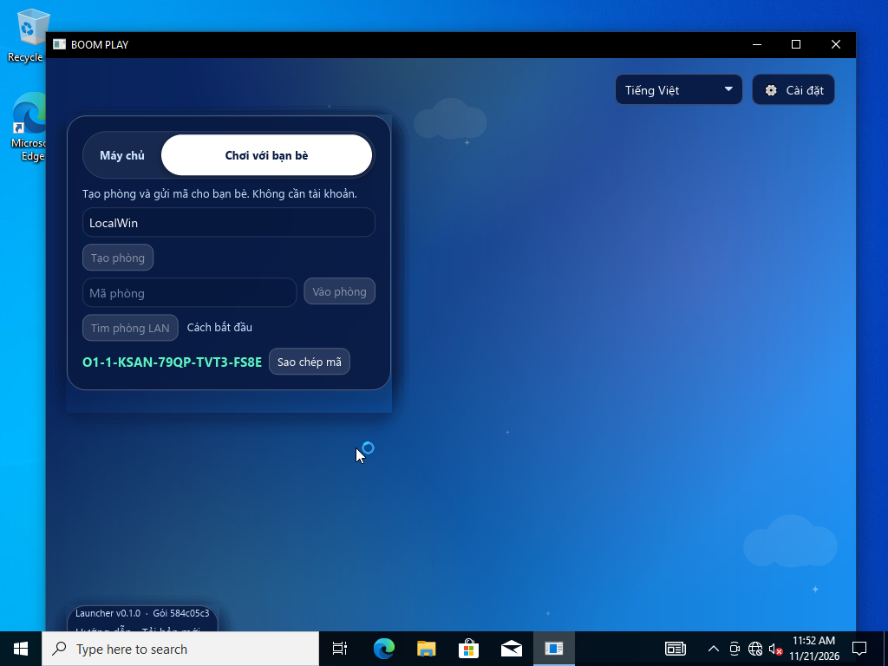
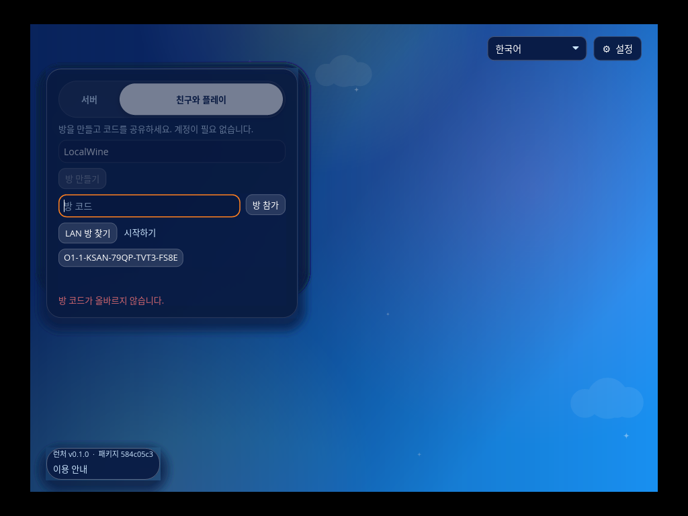
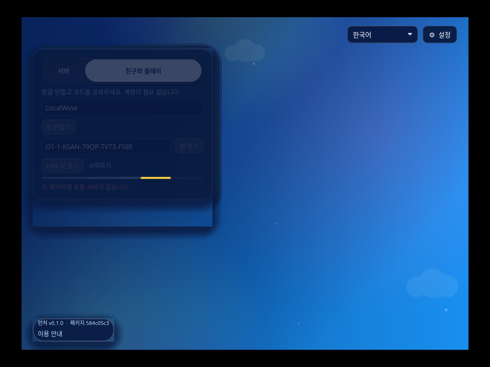

# BOOM PLAY player guide

<!-- overview -->
## Two ways to play

**Servers** is for communities that run their own server. You use an account for that server, which saves progress according to its settings.

**Play with friends** is for private sessions. One friend hosts the room, and nobody needs an account.

<!-- compare -->
## Compare the two modes

| Topic | Servers | Play with friends |
| --- | --- | --- |
| Who hosts? | The community runs a PC or VPS. | The friend who creates the room. |
| Account | A separate account for each server. | No account; just choose a name. |
| Progress | Saved by the server, according to its settings. | Does not carry over to community servers. |
| Content | Depends on the server's settings and supported features. | All supported items unlocked. |
| Connection | Bundled server today; LAN/Internet invites in S1 with no manual port forwarding for P2P. | Room codes over LAN or Internet in O1; no manual port forwarding. |
| How long? | Can stay up long term. | The room closes when the host leaves. |
| Players | Depends on the server and room limits. | Check the game room for available slots. |

<!-- choose -->
## Which should I choose?

- For a quick game with a few people, choose **Play with friends**.
- For a regular group that wants to keep items or progress, choose **Servers**.
- For a long-running community, consider a VPS or a PC that stays on 24/7. S1 setup steps are coming soon.

<!-- servers -->
## Get started with Servers

1. Open the launcher, choose **Servers**, and select the server included in your bundle. Wait until it is online.
2. Need an account? Choose **Create account** and keep the recovery code somewhere safe. The account belongs to the selected server.
3. Press **PLAY**, then sign in on the game's login screen.
4. To get a newer version, use **Download latest** if your bundle has the link. It opens Google Drive, where you can download the full bundle.

**Coming soon — S1:** Paste an invitation code in **Add server** to save a server. S1 will include instructions for hosting on Windows and Linux.

<!-- friends -->
## Get started with Play with friends

1. Open the launcher, choose **Play with friends**, and enter a **Character name**. The launcher remembers it for next time.
2. The host clicks **Host room**. When the code appears, click **Copy code** and share it privately with friends. The host's game opens automatically.
3. Friends paste the code and click **Join room**, or select the room from **Find LAN rooms**. Keep the launcher open while playing.
4. At the game's login screen, choose **Play trial 1P**. The game uses your launcher name. You can leave the account and password fields blank. In the lobby, one player creates a game room and the others join it.
5. If your package differs from the host's, use **Download latest** when the bundle provides a link. If the host closes the game or launcher, friends are told that the room closed.

Playing across networks needs a bundle with a working room directory. If the room cannot be found, check the code and ask the host whether their game is still open.

<!-- connection -->
## Can't connect

- Select the right bundled server, check your connection, and press **Retry**. If it still fails, ask the server operator whether the service is running.
- Start the game through the launcher so the connection is set up correctly.

<!-- version -->
## Different version or file errors

- Ask the server operator which version to use. If available, choose **Download latest** and download the full matching bundle. The launcher does not update automatically.
- If the launcher reports a file error, use **Settings → Check & repair files** and try again.

<!-- firewall -->
## Windows Firewall

- Run **Cai-dat-Windows.ps1** as administrator to allow inbound local network UDP for the launcher, companion and server.
- If you do not have permission, ask an administrator to allow local network UDP for `kr-player.exe`, `kr-prelogin.exe` and `friends-server/bin/kr-service.exe`. Keep Windows Firewall on.
- Start the launcher normally. Only the firewall setup needs administrator rights.
