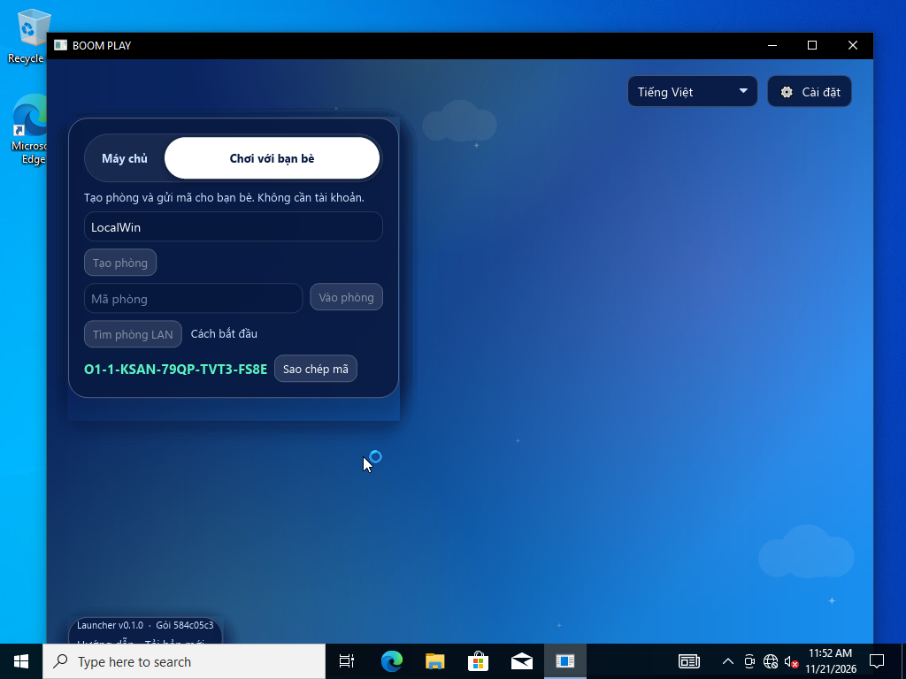
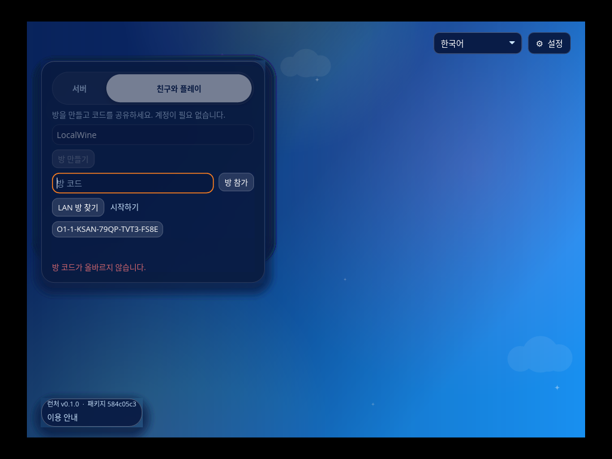
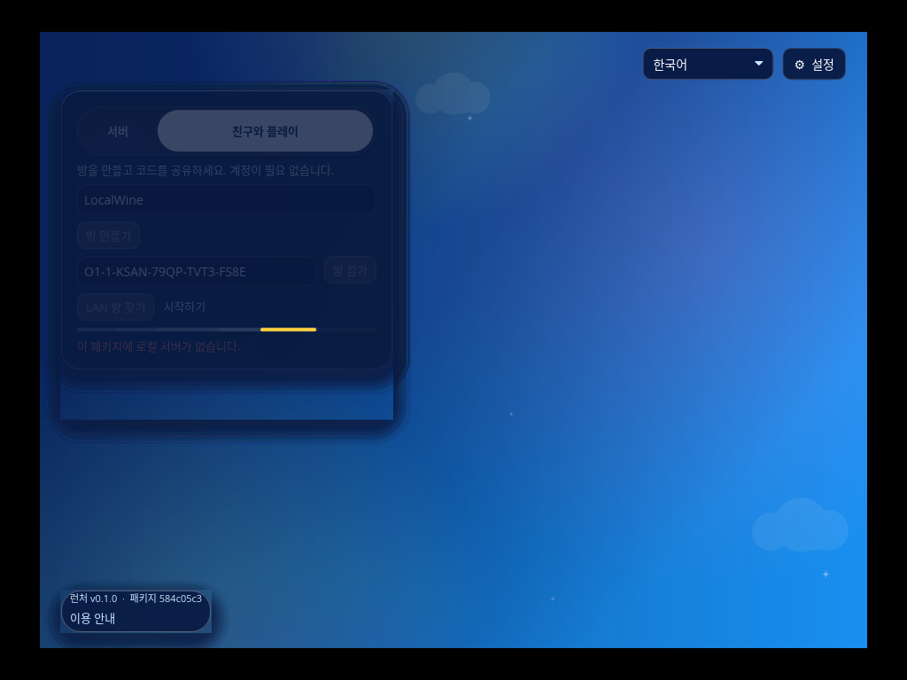

# BOOM PLAY 이용 안내

<!-- overview -->
## 두 가지 플레이 방식

**서버**는 커뮤니티에서 운영하는 서버에 접속하는 모드입니다. 서버별 계정을 사용하며 진행 상황은 해당 서버의 설정에 따라 저장됩니다.

**친구와 플레이**는 친구끼리 즐기는 모드입니다. 친구 한 명이 방을 만들며 계정은 필요하지 않습니다.

<!-- compare -->
## 두 모드 비교

| 항목 | 서버 | 친구와 플레이 |
| --- | --- | --- |
| 운영 주체 | 커뮤니티가 PC나 VPS에서 운영합니다. | 방을 만든 친구의 PC에서 실행됩니다. |
| 계정 | 서버마다 별도 계정을 사용합니다. | 필요 없습니다. 이름만 정하면 됩니다. |
| 진행 상황 | 서버 설정에 따라 서버에 저장됩니다. | 커뮤니티 서버로 옮겨지지 않습니다. |
| 콘텐츠 | 서버 설정과 지원 기능에 따라 다릅니다. | 지원하는 모든 아이템을 사용할 수 있습니다. |
| 연결 | 현재는 패키지에 포함된 서버를 사용합니다. S1에서는 LAN이나 인터넷에서 초대 코드로 접속하며 P2P 연결에 직접 포트를 열 필요가 없습니다. | O1에서는 LAN이나 인터넷에서 방 코드로 접속하며 직접 포트를 열 필요가 없습니다. |
| 이용 시간 | 서버를 계속 운영할 수 있습니다. | 방을 만든 사람이 나가면 방이 닫힙니다. |
| 인원 | 서버와 방의 인원 제한에 따릅니다. | 게임 방에 표시된 남은 자리를 확인하세요. |

<!-- choose -->
## 어떤 모드가 좋을까요?

- 몇 명이 잠깐 즐기려면 **친구와 플레이**를 선택하세요.
- 정기적으로 모이고 아이템이나 진행 상황을 유지하려면 **서버**를 선택하세요.
- 커뮤니티를 꾸준히 운영하려면 VPS나 24시간 켜 둘 수 있는 PC를 고려하세요. 설치 절차는 S1에서 안내할 예정입니다.

<!-- servers -->
## 서버 시작하기

1. 런처에서 **서버**를 선택한 뒤 패키지에 포함된 서버를 고르세요. 서버가 정상 상태가 될 때까지 기다리세요.
2. 계정이 없다면 **계정 만들기**를 누르고 복구 코드를 안전한 곳에 보관하세요. 계정은 선택한 서버에서만 사용할 수 있습니다.
3. **게임 시작**을 누른 뒤 게임의 로그인 화면에서 로그인하세요.
4. 새 버전이 필요하면 **최신 버전 받기** 링크가 있는 경우 눌러 주세요. Google Drive에서 전체 패키지를 받을 수 있습니다.

**출시 예정 — S1:** **서버 추가**에서 초대 코드를 붙여 넣으면 서버가 저장됩니다. Windows와 Linux에서 서버를 운영하는 방법도 S1에서 안내합니다.

<!-- friends -->
## 친구와 플레이 시작하기

1. 런처에서 **친구와 플레이**를 선택하고 **캐릭터 이름**을 입력하세요. 런처가 다음에도 이 이름을 기억합니다.
2. 방장은 **방 만들기**를 누릅니다. 코드가 나오면 **코드 복사**를 눌러 친구에게만 보내세요. 방장의 게임은 자동으로 열립니다.
3. 친구는 코드를 붙여 넣고 **방 참가**를 누르거나 **LAN 방 찾기**에서 방을 선택합니다. 플레이 중에는 런처를 닫지 마세요.
4. 게임 로그인 화면에서 **1P 체험**을 선택합니다. 런처에 입력한 이름이 사용되며 계정이나 비밀번호를 입력할 필요가 없습니다. 대기실에서 한 명이 게임 방을 만들고 나머지 친구가 참가합니다.
5. 패키지 버전이 다르면 링크가 있을 때 **최신 버전 받기**를 눌러 방장과 같은 패키지를 받으세요. 방장이 게임이나 런처를 닫으면 친구에게 방이 닫혔다는 알림이 표시됩니다.

서로 다른 네트워크에서 플레이하려면 방 코드 조회 서비스가 작동하는 패키지가 필요합니다. 방을 찾을 수 없으면 코드와 방장의 게임이 열려 있는지 확인하세요.

<!-- connection -->
## 연결할 수 없을 때

- 패키지에 포함된 서버를 올바르게 선택했는지 확인하세요. 인터넷 연결을 확인한 뒤 **다시 시도**를 누르세요. 그래도 연결되지 않으면 서버 운영자에게 실행 상태를 문의하세요.
- 연결이 올바르게 설정되도록 반드시 런처에서 게임을 시작하세요.

<!-- version -->
## 버전이 다르거나 파일 오류가 날 때

- 서버 운영자에게 필요한 버전을 확인하세요. **최신 버전 받기** 링크가 있다면 해당 버전의 전체 패키지를 받으세요. 런처는 자동으로 업데이트하지 않습니다.
- 파일 오류가 표시되면 **설정 → 파일 확인 및 복구**를 실행한 뒤 다시 시도하세요.

<!-- firewall -->
## Windows 방화벽

- **Cai-dat-Windows.ps1**을 관리자 권한으로 실행하면 런처, 연결 프로그램 및 서버가 로컬 네트워크에서 수신하는 UDP를 허용합니다.
- 권한이 없으면 관리자에게 `kr-player.exe`, `kr-prelogin.exe`, `friends-server/bin/kr-service.exe`의 로컬 네트워크 UDP 수신을 허용해 달라고 요청하세요. Windows 방화벽을 끄지 마세요.
- 런처는 일반 권한으로 실행하세요. 방화벽 규칙을 추가할 때만 관리자 권한이 필요합니다.
