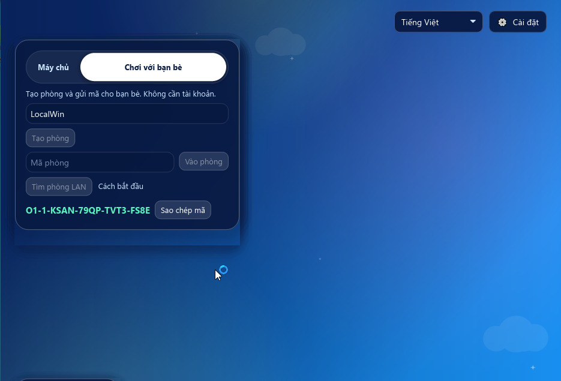

# Hướng dẫn chơi BOOM PLAY

<!-- overview -->
## Hai chế độ chơi

**Máy chủ** dành cho cộng đồng có máy chạy riêng. Bạn dùng tài khoản của máy đó và giữ tiến trình theo cấu hình của họ.

**Chơi với bạn bè** dành cho những buổi chơi riêng. Máy của một người bạn tạo phòng, không cần tài khoản.

<!-- compare -->
## So sánh hai chế độ

| Tiêu chí | Máy chủ | Chơi với bạn bè |
| --- | --- | --- |
| Ai chạy máy chủ? | Chủ cộng đồng chạy trên PC hoặc VPS. | Máy của người tạo phòng. |
| Tài khoản | Tài khoản riêng cho từng máy chủ. | Không cần; chỉ đặt tên. |
| Tiến trình | Lưu trên máy chủ, theo cấu hình. | Không chuyển sang máy chủ cộng đồng. |
| Nội dung | Theo cấu hình và tính năng máy chủ hỗ trợ. | Mở khoá toàn bộ vật phẩm được hỗ trợ. |
| Kết nối | Máy có sẵn trong gói; ở S1 dùng mã mời LAN/Internet, không cần tự mở cổng khi kết nối P2P. | Mã phòng qua LAN hoặc Internet ở O1, không cần tự mở cổng. |
| Thời gian | Có thể chạy lâu dài. | Phòng đóng khi người tạo thoát. |
| Số người | Theo giới hạn máy chủ và phòng. | Theo số chỗ trống hiển thị trong phòng. |

<!-- choose -->
## Nên chọn chế độ nào?

- Muốn chơi nhanh với vài người: chọn **Chơi với bạn bè**.
- Nhóm chơi thường xuyên, muốn giữ đồ hoặc tiến trình: chọn **Máy chủ**.
- Muốn phục vụ một cộng đồng lâu dài: cân nhắc VPS hay máy chạy 24/7. Quy trình tự dựng gói người chơi ở S1 vẫn sắp có.

<!-- servers -->
## Bắt đầu với Máy chủ

1. Mở launcher, chọn **Máy chủ**, rồi chọn máy có sẵn trong gói. Chờ trạng thái máy hoạt động.
2. Chưa có tài khoản? Bấm **Tạo tài khoản** và giữ mã khôi phục ở nơi an toàn. Tài khoản chỉ dùng cho máy đã chọn.
3. Bấm **CHƠI**, rồi đăng nhập tại màn hình trong game.
4. Muốn lấy bản mới? Nếu gói có liên kết, bấm **Tải bản mới** để mở thư mục Google Drive và tải gói đầy đủ.

**Sắp có — S1:** Dán mã mời trong mục **Thêm máy chủ** để lưu máy. S1 sẽ có hướng dẫn tự dựng máy chủ trên Windows và Linux.

<!-- friends -->
## Bắt đầu chơi với bạn bè

1. Mở launcher, chọn **Chơi với bạn bè** và nhập **Tên nhân vật**. Launcher nhớ tên này cho lần sau.
2. Người tạo bấm **Tạo phòng**. Khi mã xuất hiện, bấm **Sao chép** và gửi mã riêng cho bạn bè. Game của người tạo tự mở.
3. Người vào dán mã và bấm **Vào phòng**, hoặc chọn phòng trong danh sách **Tìm phòng LAN**. Giữ launcher mở trong lúc chơi.
4. Ở màn hình đăng nhập của game, chọn **Chơi thử 1P**. Game dùng tên đã nhập trong launcher; bạn không cần điền tài khoản hay mật khẩu. Vào sảnh, một người tạo phòng đấu và người còn lại vào phòng đó.
5. Nếu launcher báo khác phiên bản, tải cùng gói với chủ phòng bằng **Tải bản mới** (nếu gói có liên kết). Khi chủ phòng thoát game hoặc launcher, mọi người nhận thông báo phòng đã đóng.

Khi chơi khác mạng, cần gói có dịch vụ tra mã đang hoạt động. Nếu không tìm thấy phòng, kiểm tra mã và hỏi chủ phòng xem game còn mở không.

<!-- connection -->
## Không kết nối được

- Chọn đúng máy trong gói, kiểm tra mạng và bấm **Thử lại**. Nếu vẫn lỗi, hỏi người quản lý máy xem dịch vụ có đang chạy không.
- Mở game qua launcher để đường kết nối được khởi động đúng.

<!-- version -->
## Khác phiên bản hoặc lỗi tệp

- Hỏi chủ máy đang dùng bản nào. Nếu có nút **Tải bản mới**, mở link và tải gói đầy đủ đúng bản. Launcher không tự cập nhật.
- Nếu launcher báo lỗi tệp, mở **Cài đặt → Kiểm tra & sửa tệp** rồi thử lại.

<!-- firewall -->
## Tường lửa Windows

- Chạy **Cai-dat-Windows.ps1** bằng quyền quản trị để cho phép launcher, companion và server nhận UDP trong mạng nội bộ.
- Nếu không có quyền, nhờ quản trị viên cho phép `kr-player.exe`, `kr-prelogin.exe` và `friends-server/bin/kr-service.exe` nhận UDP từ mạng nội bộ. Không tắt tường lửa.
- Mở launcher bằng tài khoản thường; chỉ bước thêm quy tắc tường lửa cần quyền quản trị.
