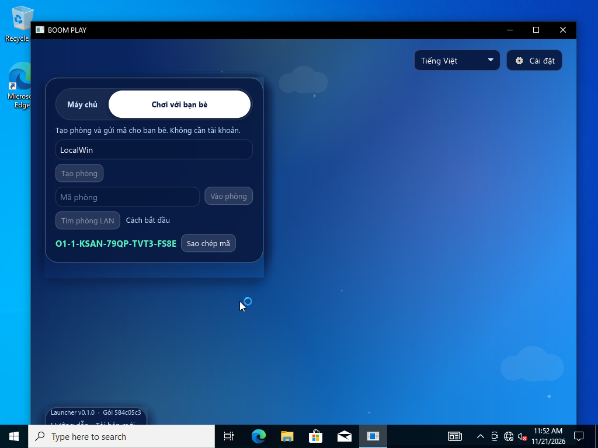
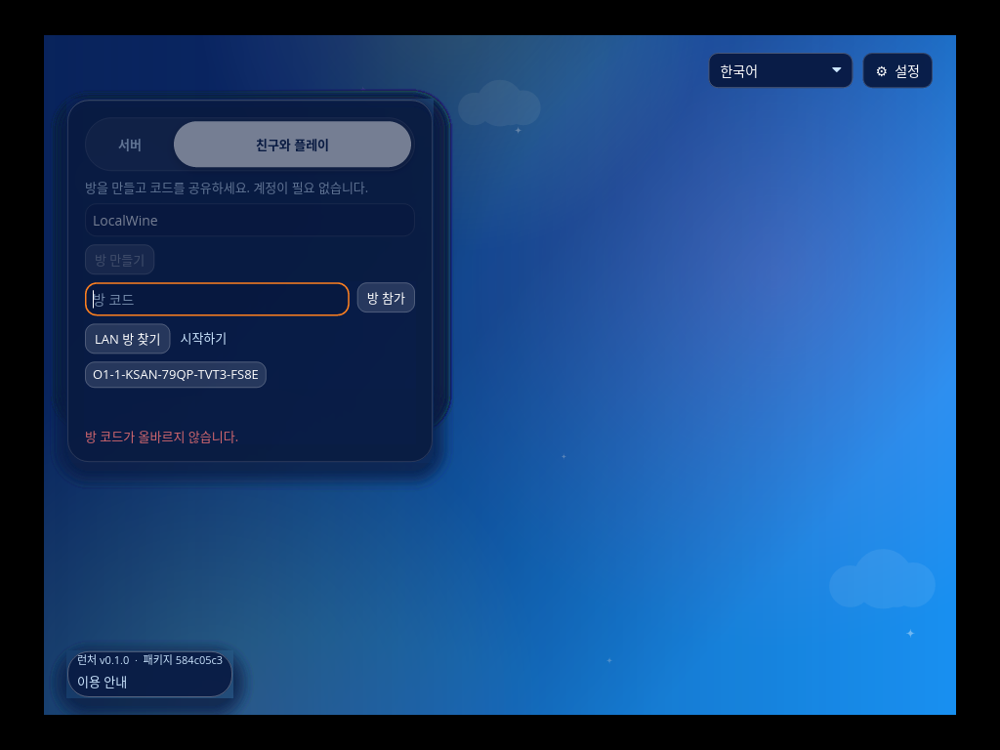
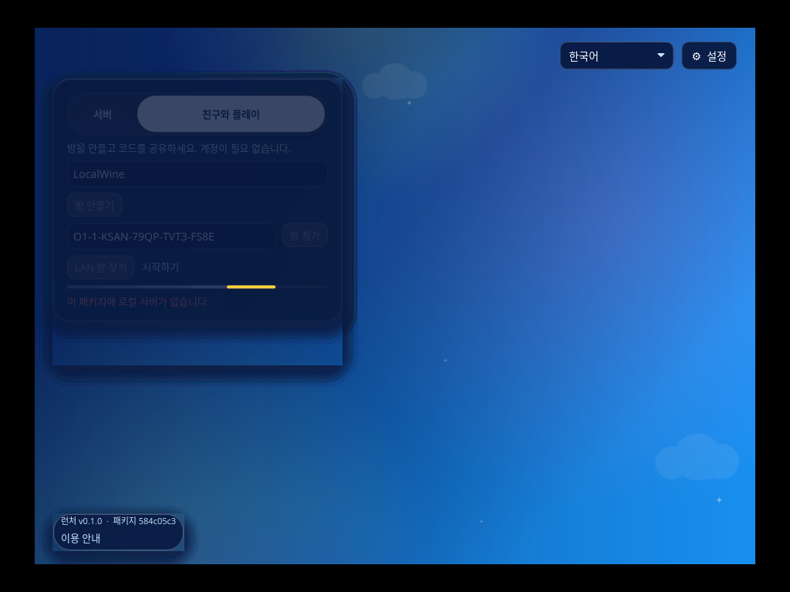
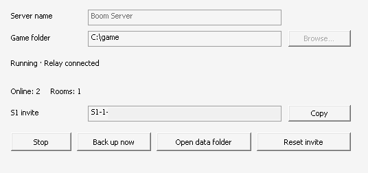

# Hướng dẫn chơi LANBoom

<!-- overview -->
## Hai chế độ chơi

**Server** dành cho nhóm chơi thường xuyên. Bạn dùng tài khoản riêng của từng Server để đăng nhập.

**Phòng riêng** dành cho buổi chơi với bạn bè. Một người làm Host, cả nhóm vào bằng mã phòng hoặc qua LAN. Không cần tài khoản.

<!-- compare -->
## So sánh hai chế độ

| Tiêu chí | Server | Phòng riêng |
| --- | --- | --- |
| Ai mở? | Admin mở Server trên PC hoặc VPS. | Host mở phòng từ Launcher. |
| Tài khoản | Mỗi Server dùng tài khoản riêng. | Chỉ cần nhập tên nhân vật. |
| Tiến trình | Lưu theo cài đặt của Server. | Không chuyển sang Server. |
| Nội dung | Theo tính năng Server hỗ trợ. | Dùng các vật phẩm phòng hỗ trợ. |
| Kết nối | Chọn Server mặc định hoặc thêm bằng mã mời S1. | Quét LAN hoặc dùng mã phòng O1. |
| Thời gian | Có thể mở liên tục. | Phòng đóng khi Host dừng game. |
| Số người | Theo giới hạn Server và bàn đấu. | Dành cho nhóm nhỏ. |

<!-- choose -->
## Nên chọn chế độ nào?

- Muốn chơi nhanh với bạn bè: chọn **Phòng riêng**.
- Muốn đăng nhập và chơi tiếp vào lần sau: chọn **Server**.

### Tải gói nào?

Người chơi tải **LANBooM_client.zip**, giải nén cả gói rồi bấm **LANBoom.exe**. Nếu cần tự mở Server, dùng **BoomServer-Windows.zip** cho PC Windows hoặc **BoomServer-Linux.tar.gz** cho máy Linux. Xem phần tự mở Server ở cuối file hướng dẫn.

<!-- servers -->
## Cách chơi qua Server

1. Chọn tab **Server**. Nếu Admin gửi mã S1, dán vào **Mã mời Server** và bấm **Thêm Server** hoặc Enter. Launcher lưu Server và chọn luôn để bạn kết nối.
2. Khi Server sẵn sàng, bấm **Tạo tài khoản** nếu bạn chưa có. Lưu mã khôi phục ra file .txt hoặc sao chép rồi cất ở nơi an toàn. Launcher chỉ hiện mã một lần.
3. Bấm **CHƠI**, rồi đăng nhập trong game. Khi cần dừng, bấm **Dừng game**.
4. Bấm **Xóa** bên cạnh một Server đã thêm để bỏ Server khỏi danh sách. Tài khoản vẫn do Server lưu.
5. Nếu gói có nút **Tải bản mới**, bấm để mở Google Drive và tải gói đầy đủ.

<!-- friends -->
## Cách dùng Phòng riêng

1. Chọn **Phòng riêng** và nhập **Tên nhân vật**.
2. Host bấm **Mở phòng riêng**. Khi thấy mã O1, bấm **Sao chép mã** rồi gửi riêng cho bạn bè. Launcher tự mở game.
3. Bạn bè dán mã và bấm **Vào phòng** hoặc Enter. Nếu chung mạng LAN, chọn dòng có tên Host trong danh sách **Phòng trong mạng LAN**. Launcher tự quét khi mở tab; bấm **Quét lại** nếu Host mới mở phòng.
4. Trong game, bấm **Chơi thử 1P**. Không cần nhập tài khoản. Phòng riêng chưa chơi được 2P chung máy. Vào sảnh rồi tạo bàn đấu để bạn bè vào chung.
5. Giữ Launcher mở trong lúc chơi. Khi Host bấm **Dừng game / Đóng phòng** hoặc thoát Launcher, cả phòng sẽ ngắt kết nối.







Khi chơi khác mạng, cần gói có dịch vụ tra mã đang hoạt động. Nếu không tìm thấy phòng, kiểm tra mã và hỏi Host xem phòng còn mở không.

<!-- connection -->
## Lỗi kết nối?

- Kiểm tra mạng và chọn đúng Server, sau đó bấm **Thử lại**. Nếu vẫn lỗi, hỏi Admin xem Server còn mở không.
- Luôn mở game bằng **LANBoom.exe**. Bấm **?** để xem hướng dẫn ngay trong Launcher.

<!-- version -->
## Sai phiên bản hoặc lỗi file

- Nếu Launcher báo khác phiên bản, tải đúng gói mà Admin hoặc Host đang dùng. Launcher không tự cập nhật.
- Nếu báo lỗi file game, mở **Cài đặt → Kiểm tra & sửa file** rồi thử lại.

<!-- firewall -->
## Cấp quyền Windows Firewall

Lần đầu mở phòng riêng, Windows có thể hỏi quyền để bạn bè cùng mạng LAN tìm được phòng. Chọn **Có** nếu bạn muốn cấp quyền. Nếu đã bỏ qua, mở **Cài đặt → Cấp quyền Windows Firewall** để thử lại. Giữ Windows Firewall bật.

<!-- Standalone guide appendix; the launcher embeds the sections above. -->

Tự dựng Server (S1)
--------------------------

Server S1 lưu tài khoản và kết quả trên máy bạn, nên máy cần bật trong lúc mọi người chơi. Gói server đã có sẵn dữ liệu luật chơi (map, vật phẩm, chỉ số nhân vật), bạn không cần chọn thư mục game.

**Windows**

1. Giải nén cả gói server Windows vào một thư mục. Mở **BoomServer.exe**.
2. Đặt **Tên Server**, bấm **Chạy**. Ô thông báo hiện từng bước chuẩn bị; chờ đèn trạng thái chuyển xanh và dòng **Đang chạy**.
3. Bấm **Sao chép** cạnh **Mã mời S1** (nút đổi thành **Đã chép ✓**) rồi gửi mã cho người chơi. Người chơi dùng **Server → Thêm Server** trong LANBoom.
4. Đóng cửa sổ thì Server vẫn chạy nền ở khay hệ thống. Bấm biểu tượng BoomServer để mở lại; chuột phải để **Sao chép mã mời** hoặc **Dừng & Thoát**. Bấm **Dừng** trước khi tắt máy. **Sao lưu** tạo bản sao dữ liệu và hiện tên File cùng giờ sao lưu. **Cài đặt** có chọn ngôn ngữ (Tiếng Việt / English / 한국어), thư mục nhận bản sao lưu, **Mở thư mục dữ liệu** và **Tạo mã mời mới** (mã cũ hết hiệu lực, người đang chơi bị ngắt). Khi có lỗi, nội dung đầy đủ hiện ở ô thông báo để đọc hoặc sao chép; bấm **Mở log** để xem Log.

Khi Windows Firewall hỏi quyền kết nối trực tiếp, bạn có thể cho phép trên mạng **Private**. Nếu từ chối hoặc router không mở được Port, BoomServer vẫn chạy qua relay. Nếu người chơi chưa vào được ngay, chờ dòng trạng thái báo **Đã kết nối relay** rồi thử lại.



**Linux**

1. Giải nén gói server Linux. Với Docker Compose, mở terminal trong thư mục vừa giải nén rồi chạy:

   ```sh
   export BOOM_NAME="Boom Club"
   docker compose -f deploy/compose.yaml up -d
   docker compose -f deploy/compose.yaml exec boom /opt/boom/bin/boom-server invite
   ```

2. Nếu dùng Linux có systemd và không muốn dùng Docker, chạy `sudo ./deploy/install.sh "Boom Club"`. Khi Server đã chạy, lấy mã bằng `sudo -u boom-server boom-server invite`.
3. Gửi mã mời S1 cho người chơi. Giữ volume dữ liệu Docker hoặc thư mục `/var/lib/boom-server` nếu cài bằng systemd; đó là nơi lưu danh tính Server, tài khoản và kết quả.

Xem thêm mã nguồn và tài liệu vận hành ở [repo GitHub](https://github.com/aquaplatinumberlitz/boom-kr-server).
