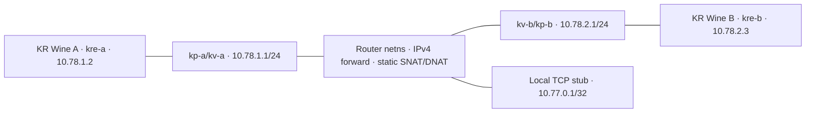

# LAN, WAN và Internet thật

[Mục lục](../PROTOCOL.md) · [Câu hỏi đang mở](../RESEARCH.md) · [Thứ tự việc](../PLAN.md#dashboard).

### KR Wine qua hai subnet/router; môi trường Wine được owner chấp nhận — CP192

[OwnerWine directive](../evidence/owner-directives/wine-accepted.json), [LANgiảlập directive](../evidence/owner-directives/emulated-lan.json),
[recipe/hash](../evidence/peer-endpoints/README.md#cp192), [câu hỏi kế](../RESEARCH.md#gap-lobby-identity-followup).
Wine là môi trường nghiệmthu thay Windows thật theo chủ dự án; **không còn yêu cầu WindowsVM/bareWindows**
để đónggate project. Giữ đúng Wineversion/copiedPEhash/patch/source và không claim đã đo API/Windows
chưa chạy. Record/rawcũ nói Windowsunknown là lịch sử quan sát, không blocker bắtchủdựcấpWindows.

Tái dùng CP191 nguyênBsoleRoller2wins/Start3 và CP190bundle/current47fixture/13sourcebytes; không nativebody
mới, không thay opcode/stat/guard/policy. Delta là flatbridge→hai L2subnet: A10.78.1.2/24 qua10.78.1.1,
B10.78.2.3/24 qua10.78.2.1; rootrouter/service10.77.0.1/32, childcóexplicitroute tớipeer/service, không
externaldefaultroute. SourceIP/dynamicUDPports vẫn quảngbá qua99/153; directTCPUDP, không NAT/relay.

Transportpreflight đối chứng forward0: UDPtimeout/Bkhôngnhận; forward1: UDPecho đúngtuple/A↔B,
TCPcảhai nguồn đếnrouterservice. Hai vethPCAP lưu27IPv4records, namespaces/sysctl/router chỉdisposable,
không đổi hostrouting. Đây là design/transport proof, nativeKRproof riêng bên dưới.

ActualKRroutedrun dùng hai CA+wineserver/Wine/currentcopy4b/portableproduction/normalManner/ExVillage01:
BnhặtRoller17ở2epoch, một165/view/B4→5/A5unchanged; normalAselfbomb/IDs1,2/native17→19/B21/175180
hai kết quảBwin/Ready2, actualBStart3/keys12345→12346→12347/nativeclock3/baselineB4/A5. Bốn peerwindows
qua2key có actualAPI/nativeapply/target/currentprogress; typed153remote10.78.1.2/10.78.2.3 vàactual99
UDPports được nối routedPCAPchecksum/wireSHA/tuple→nativeingress. Khép biến thể **routedhai-subnet**
trong môi trườnggiảlập đã chọn, không biến thành neworiginalserverlaw/Internet/NAT/relayproof.

Frame/helpers/getter/probe/inputbounds và policy giữ nguyên; frozeninputs/ownedcleanup theo recipe.
Vòng3active≥8s/noBomb/noThirdoutcome. HostEOF/rejoincontrol được giữởCP189190, không chạy/ghép vào
routedrun này. K6cInternet/NAT/relay/loss/jitter/generalaccount/4–8actualclient vẫn cần phép đo riêng;
không nânggate từtransportecho hoặc từviệc chủ dự án chấp nhận Wine/LANgiảlập.

### LAN giả lập được chủ dự án chấp nhận; reset B sau thắng — CP191

[Quyết định môi trường](../evidence/owner-directives/emulated-lan.json), [K6b decision](../evidence/peer-endpoints/k6b-acceptance.json),
[recipe/hash](../evidence/peer-endpoints/README.md#cp191), [acceptance/next](../PLAN.md#k6b-acceptance).
Chủ dự án không có hai máy và cho dùng giả lập; vì vậy **hai máy vật lý không còn là điều kiện K6b**.
Codex đối chiếu tiêu chí còn lại trên bằng chứng nguyên trạng; không suy namespace thành physicalhost,
không sửa recordCP189190 hoặc nhãn lịch sử notphysicalLAN, không dùng script tự đónggate.

Hai actualCA + hai wineserver trong childnetns khác nhau, mỗi host có NIC/veth/IP riêng .2/.3 vàroot
servicebridge .1, không defaultroute; actualTCPsource/99localIP/dynamicUDPports khớp. CP189typed153
remoteIP/port/key,1282PCAPrecords/EthernetIPUDPchecksum được nối wireSHA/source/desttuple→nativeAPI/
key/slot→target/currentprogress ở4A↔Bwindows/2keys. Cùngrun có2normalcontestedcycles/175180/Ready2/life;
normalAhostBack/nativeBslotclear/chief/Ajoin_Arejoin cólog trước trận. CP190bundledpendingBEOF/Acleanup/
fence là control riêng; không phải resumeaccountB saukill. **K6b đạt scope LANgiảlập này**, không Internet.

Phần còn thiếu cụ thể CP189 là statB sau thắng: `portable-B-winner-reset-r1` dùng nguyên bundleCP190,
47fixture/13sourcebytes/current291/copy4b. Chỉ normalBUp nhặt Roller17 ở hai vòng, A idle; hai nativeB124/
one165/view mỗi epoch, Bspeed4→5/A5unchanged. NormalASpace/realtrap17→death19/B21/175180/Bwin,
Ready/normalBStart2 rồiStart3; nativeclock snapshot cảhai view **B4/A5** ởcả3epoch. Đây là2 lần B5→4
postwinreset trongca đã đo; không universalitem/resetlaw hoặc forcedactor/gamecall. A4peerwindows/life/
keys12345/12346/12347/195seed vàsame2outcomes được kiểm; vòng3active≥8s khôngbom/kết quảthứ3.
Source/cache/nativegetters dùng lại, không thêm thân hàm RE mới. Raw/capture/pins/ownedcleanup giữ nguồn.

Authority vẫn nativeinput/client simulation/peerwrites + boundedservicepolicy fuse/drop/catalog/rank/
guards. EmulatedLAN shareskernel/host, chưa hardware/OSdiversity/realnetworklatency/loss/NAT/relay/
Internet/generalaccountresume/fullcodec/auth/142freshness/allmaps/inventory/4–8actualclient. K6c vàK7
vẫn mở; bước tiếp chuẩn bị topology routed/NAT cô lập cho phần khácbiệt, không gọi nó Internet đã nghiệmthu.

### Cấu hình IPv4 service và Ready sau return2 — CP141

**Implementation/emu_choice/design; kr_runtime/confirmed trong phạm vi đã đo.**
[Recipe, raw/hash và kiểm tra](../evidence/peer-endpoints/README.md#cp141). `ProbeService` nhận keyword
`bind_ip`, `peer_ips`; CLI `--bind-ip IPv4` và repeat `--peer-ip ROLE=IPv4` cho A/B/C. Mặc định bind
và mọi role là127.0.0.1, thiếu role giữ default; không tự lấy IP0/IP1 từ99. Đây là cấu hình operator,
không phục hồi NAT/identity/auth server gốc. IPv4 syntax/role được kiểm trước tạo selector; CLI cấm
role lặp và kiểm trước tạo output/đọc fixture. Không nhận multicast/limited broadcast, peer không
nhận0.0.0.0; bind0.0.0.0 được khai tường minh. Caller vẫn phải cô lập mạng theo recipe.

153 giữ prefix/key hiện hành,26 slot, zero-self và hai fallback zero; remote primary IPv4 lấy theo
role đối diện, port lấy actual99 hoặc proxy-port override đã có. Không đổi codec/seq/layout97byte
của profile hai active slot. C mới dùng địa chỉ C, không lấy lại A chỉ vì dùng chung slot0. State ghi
operator policy và địa chỉ listener thực. Unit test kiểm default/explicit/invalid/actual bind/roleC;
chúng không thay bằng chứng native.

Run CP141 dùng **module production trực tiếp**, bind10.77.0.1/peerA10.77.0.2/B10.77.0.3, bỏ cả
socket shim và packet153 shim; TCP forward local→stub vẫn giữ, không UDP proxy. Hai actual CA và
wineserver ở childnetns riêng,521 veth PCAP records, actual99port và bốn153/key/seq khớp. Cùng run
hai basic A118/17→19/currenttrapSHA/peer170/B21 → chosen survivor rank2,1/native175302/1803/110,
reset195/ID1→2/key12345→12346; barrier15,417/15,429s trước30s. Profile/guards giống CP140.

Sau return2, normal BReady tạo **actual C2S95 seq427**, SHA
`9c5c8820e607e8618c7363779d484305fdb38d18348e348863bef61713fc0c3b`.
A/B đọc thêm native110 full6/errors0 trước cleanup107; B pending4→0. Ảnh phòng hiện ready badge
cả hai view. Không Start3. Đếm toàn log B có110 cleanup muộn hơn observation; verifier cũ giả exact+1
trên toàn log đã fail và được giữ, phép kiểm cuối giới hạn trước cleanup107, ghép actual95/110 send.
Đây không là sửa raw hoặc hạ acceptance để bỏ lỗi parser.

Không movement bốn pha/item pickup/shared cascade/all-dead trong run này; không cộng CP139 vào thành
một fullmatch/K6a. Không đóng CP137 complex-route UI debt, auth/authority/generalreset/Windows vanilla/
LAN thật/NAT/Internet/gates. IP1/subtype39 vẫn opaque. Code đã kiểm, trạng thái PR/merge ở README;
AUD043 qua140, audit kếCP144. Bước tiếp duy nhất tại PLAN.

### Direct private TCP endpoint chain trên copy — CP146

**kr_runtime/confirmed hẹp; hosts/fixtureaddress là design.** [Recipe/raw/hash](../evidence/peer-endpoints/README.md#cp146).
Reuse CP006–008 WCP và CP015 typedredirect7 consumer. NewgameA/Bcopies có binary cùng SHAe9bb4766;
files-only hostmap cácservicehost→10.77.0.1, S→C7seq52 chỉ typedIPv4 `0x7f000001→0x0a4d0001`,
port3858/kind10/index0/header/tail giữ. Bỏ childTCPforward; rootmeasurementTCPproxy3858→23858 còn
để selectedsame/oldTCPguard, UDP khôngproxy. Profile riêng này chưa là configredirect production.

Read-only nativeconnect trước IAT16EA778 ở14F4923/14F4894 và backtrace8frames ghép actualaccept:

| Connection | Nativecallsite/caller | A endpoint | B endpoint | Nguồn/giới hạn |
|---|---|---|---|---|
| Bootstrap |14F4923←12368E2←1234875|10.77.0.1:3848|10.77.0.1:3838|Actualsockaddr/servicepeerA.2/B.3; portvariation observed, không fullselectionlaw|
| WCP |14F4894←13AEEE5←13AD6C5←1255C0B←1255A69←1234EAF|10.77.0.1:3848|10.77.0.1:3838|Actualsocket2; knownhello/eight hollowresponses, không dựngendpointlayouttừVN|
| Auth |14F4894←13AEEE5←13AD6C5←1255C0B←1255A69←110488D|10.77.0.1:3848|10.77.0.1:3848|Actualsocket3/op1/9/5/replies4/15/62/7; hostname/cachefieldcausechưaisolate|
| Channel |14F4894←13AEEE5←13ADA06←13AD97E←125540E←110182E|10.77.0.1:3858|10.77.0.1:3858|S2C7typedprivateIP→rootproxy→service23858; servicepeer.1 là proxy, khôngdirectclientpeer|

Không có child127forwardprocess, cả actualCA+wineserverNS kiểmđúng; không loginNexonthật.
Cùngrun2nativeclocks/175302/1803/110/reset/Ready và4peerwindows/nativekey/target/currentprogress,
BombFireeffects/8same4oldTCPguard; binary unchanged. C2S99IP0 vẫn actualNIC.2/.3 trongcađo,
không suy99field1publicIP/auth. Đây là modifiedWine/nativehollowauthfixture, khôngfullauth/K3gate.

Giới hạn đo: khi bỏforwardblock, harness bỏ nhầm khởi tạo UDPcapture; **khôngUDPPCAP trongrun này**.
Không gọi nativepeerreport là exactvethwirejoin, không ghép CP145PCAP vào run hiện tại. Frozenharness
không sửa giữarun; sẽkhôiphục capturetrướcphéptiếp. Trace TCP49joins, native2cycles/2080sourcejoins,
575peerjoins/70pickup/87guard/25Ready vàcopiedmodels táchscope. NoStart3/EOFfault/oldUDP trongrun.
Scope TCPbootstrap/WCP/auth/channelprivate route verified; originalIPcachecause/semantics/schema/
fullcodec/auth/realLAN/NAT/Internet/fullmatch/K6a/gates/CP137UI/sharedgeometry/fullinventory mở.
TiếpPLAN đưa endpoint7 thành explicitserviceconfig/defaultfixturepreserved rồiverifycaptuređầyđủ.

### Endpoint kênh cấu hình trong service và capture được khôi phục — CP148

**Design/implementation:** API `ProbeService(channel_ip=..., channel_port=...)` và CLI
`--channel-ip/--channel-port` chọn đích của variant7 đã đo ở CP015/146. Thiếu một nửa cặp,
IPv4 không hỗ trợ/unspecified/multicast/broadcast hoặc port không phải int1..65535 bị chặn;
variant khác prefix69/opcode7/result1/kind10/index0/body14/tailu16zero hoặc sequence khác52
bị từ chối trước selector/listen/output mutation. Metadata legacy `sequence:null` là gửi raw,
không phải seq0: fixed52 được kiểm bằng CRC của bytes fixture. Mặc định không sửa fixture;
khi có cặp, chỉ thay typedIP/port ở body6..11, giữ header37/seq52/tail và counter đường gửi cũ.
Đây là lựa chọn operator, không phải luật chọn channel/auth của server gốc.

**`kr_runtime/confirmed` hẹp:** hai copy Wine e9bb4766…/private virtualhosts chạy production CLI
với baseprofile nguyên bản (redirect fixture vẫn loopback/sequence:null), không customredirect7;
actual nativeconnect chọn10.77.0.1:3858 từ cấu hình service. First3 TCP trực tiếp service từA.2/B.3;
channel vẫn qua rootproxy phục vụ selectedTCPguard tới23858. Không childTCPforward/UDPproxy.
Cùng run có hai clock/175/180/reset/Ready95 và native110 sau return2, bốn cửa sổ movement/nativeapply,
Bomb/Fire effects,8same4oldTCPguard; **604 vethPCAP records** nối actual99/source/payload→nativeingress.
Hai loadingbarrier26.229/26.357s<30s; không tăng timeout hoặc ép state để qua.

[Recipe, failed startup, raw/hash, mô hình và audit](../evidence/peer-endpoints/README.md#cp148).
Run đầu dừng trước client vì kiểm mới đòi metadata52; baseprofile legacy khai null. Giữ raw/cleanup,
sửa hỗ trợ đúng raw-profile và chạy thư mục/freeze mới. Không sửa source/config giữa hai run đang chạy.
Run sau345.338s/exit0/1894raw;3905lifecycle/1374wire/537peer/70pickup/87guard/25Ready/53TCPconfig
joins tách với model:1338actor,348peergetter,2364flaggetter+2340array,330typedpacket,12native153,
43UDPCRC và3redirect-fixture cases. Fixture7 render từ service đưa vào native model **không** là
wire capture7; actual TCPconnect/recipient progress và socketpair regression là bằng chứng riêng.

Giữ CP146 thiếuPCAP như lịch sử; CP148 không thêm capture vào run cũ. CP1478slot vẫn một client
với roster tổng hợp. Windowsoriginal/fullauth/realLAN/NAT/Internet/fullmatch/K6a/gates,
CP137complexUI/sharedgeometry/fullinventory chưa giải. Sau cấu hình/capture, bước tiếp ở PLAN:
luồng channel trực tiếp service, bỏ rootguardproxy trên positive recipe; không lặp codec/oldUDP.

### Positive native channel trực tiếp service, không TCPproxy — CP149

**`kr_runtime/confirmed` hẹp**, [recipe/raw/hash/correction](../evidence/peer-endpoints/README.md#cp149).
Reuse CP148 productionendpointAPI/CLI/baseprofile/capture/currentcontroller; chỉ bỏ rootTCPguardproxy,
service nghe thẳng3858 thay23858. Mọi8actualnativeconnect (bootstrap/WCP/auth/channel củaA/B)
khớp serviceport; tất cảservicepeer làA`10.77.0.2` hoặcB`.3`, channel không còn nguồnproxy`.1`.
Files-onlyservicehostmap10.77.0.1/actualCA+wineserverchildnetns/privateveth/no route giữ;
khôngchildforward/TCPproxy/UDPproxy hoặc same-oldTCPinjection trong run này.

Cùng run352.599s/exit0/1334raw: hai nativeclock/175302/1803/110/resultreset/finalReady95,
bốn cửa sổ movement/source/key/handler/target/progress;586vethPCAPrecords nối actual99/source/
payload→nativeingress. Guardnegative chỉ có ở CP148, không ghép thành cùng-run ở đây.
Copye9bb4766…/base400000 giữ nguyên, service/profile nguyên CP148; khôngpatchbinary/DB/pack.

**Item scope partial:** R1actual124 chỉBomb16/kind0, hai view165 tăngcapacity1→2, powergiữ1;
actual118/159power1. R2Bomb16+Fire17/kind1 có hai view165/copygetterpower1→2,
actual118/159power2. Cảhai native158/195flags/worldprediction theo power thực và seedreset
được kiểm. Không có actual124Fire17/R1 trong stream và không165Fire ởhai view, chưa biết nguyênnhân.
Giữ lỗi `basic-power-assumption-failed.txt` khi checker kế thừa power2 cảhai vòng; report mới kiểm
các input đã quan sát và **không** ghi “đủ BombFirehai vòng”. Không sửa runtime/raw hoặc suy
proxy removal gây itemmiss; source/authority/performance/loss chưa có control phân lập.

3289lifecycle/1334wire/499peer/56observedpickup/25Ready/55directTCP joins tách với các model
getter/framer/flags/CRC. Render4ảnh sau return2/Ready đã xem; không CP137complexUIcausalfix.
Chưa fullmatch/K6a/Windowsoriginal/fullauth/LAN/NAT/Internet/8actualclients/fullinventory.
[PLAN](../PLAN.md#current-order) tiếp inputfeedback/pickup tối thiểu đang thiếu và đổi owner bom vòng2
sangB sau khi ledger item đủ; không RE lại codec/endpoint hoặc gọi gate từ hai chu kỳ basic.

### NAT: tuple nhận thực tế phải qua kiểm endpoint của slot — CP193

[Recipe, raw và hash](../evidence/peer-endpoints/README.md#cp193), [phép thử tiếp](../RESEARCH.md#gap-lobby-identity-followup).
Nguồn `kr_runtime`, confirmed trong hai cửa sổ input của từng run; topology/mapping là `design`.
Tái dùng CP045–047: ingress → lookup → queue/drain → consumer13E0E00 → handlerE66680, cùng contract99/153
và service CP190. Không RE lại codec/queue, không nhập ID/layout VN. Client copy Wine4b, service bundle,
profile/fixture và input Right giữ nguyên; chỉ thay endpoint được khai báo và cấu hình mạng trong namespace.

| Ca | Native KR quan sát được | Giới hạn |
|---|---|---|
| SNAT một chiều r1 | Native B vẫn thấy tuple A riêng/port99; peer và apply dương | Mapping chưa được quan sát; không dùng ca này để kết luận NAT hoạt động hoặc thất bại. Giả thuyết conntrack do luồng ngược chưa chứng minh |
| SNAT hai chiều, 153 vẫn khai báo địa chỉ riêng | A nhận nguồn10.78.1.1:30002; B nhận10.78.2.1:30001. Peer khác0, payload qua queue/drain; consumer game trả0 | Không thể dùng peer khác0 hoặc dequeue làm bằng chứng gameplay |
| Đối chứng endpoint riêng có thêm probe | Helper được gọi tại13E100A trả0 tại13E100F; consumer trả0 cả hai view/cửa sổ, không tới handler movement | Chỉ nhánh selector1/slot hiện dùng; không phải mọi grammar hoặc nguyên nhân mọi lỗi Internet |
| 153 khai báo tuple đã ánh xạ + DNAT tới port99 thực | Cùng nguồn sau SNAT; helper trả khác0, consumer15→13, exact SHA nối output → handler → apply; native key khớp, target và tọa độ hiện tại tiến ở cả hai chiều | Một epoch/hai pulse Right; chưa hai kết quả/reset hoặc Internet gate |

Cấu hình positive dùng tùy chọn service **đã có**: peer A10.78.2.1:30001, peer B10.78.1.1:30002.
Controller đọc port thực từ request99 rồi cài DNAT theo recipe đã cố định **trước153 đầu tiên**;
SNAT giữ nguyên hai chiều. Đây là mapping tĩnh do operator chọn trong mạng cô lập; không phải giao thức
NAT discovery/relay của server gốc. Không sửa packet, ép state hoặc gọi hàm game. Helper13DF710
chưa được RE thêm toàn thân; kết luận dựa trên callsite đã cache và giá trị trả về/runtime downstream.
Đổi IP/port cùng lúc và thêm DNAT phục vụ reachability, nên chưa tách riêng nguyên nhân IP với port.
Consumer còn nhận gói điều khiển3byte/selector0 và lượt đọc rỗng trả0. Verifier đầu đòi mọi output13
bị bác bỏ; bản sửa ghép input/output theo thread/thứ tự và chỉ yêu cầu movement15byte/selector1→13,
rồi nối exact SHA tới handler/apply. Giữ source/log lỗi; không loại return0 khỏi bằng chứng.

PCAP chỉ ở kv-a: frame A→B phía trước SNAT được nối bằng wire SHA với API B sau SNAT; chiều B→A
thấy nguồn sau SNAT. Không có capture Ethernet kv-b độc lập. Metadata `kind/limits` r2 còn chữ noNAT
kế thừa; giữ raw nguyên, lệnh iptables/counter và native API chứng minh mapping thực. Nhãn legacy
udp_proxy không mô tả proxy đang hoạt động; positive dùng tùy chọn port để quảng bá endpoint, không
forward bằng các socket legacy. K6c/K7 giữ mở. Bước kế tại CP193 đã được kiểm ở [CP194](#nat-two-cycles); công việc hiện hành ở [PLAN](../PLAN.md#current-order).

### Hai vòng Battle bình thường/reset qua mapping NAT tĩnh — CP194

[Tuple/consumer contract CP193](#nat-endpoint-control), [recipe/hash](../evidence/peer-endpoints/README.md#cp194),
[phép thử tiếp](../RESEARCH.md#gap-lobby-identity-followup). `kr_runtime`, confirmed trong current basic profile.
Tái dùng nguyên recipe CP192 hai B sole Roller/normal wins và CP193 mapped153/SNAT/DNAT; không đổi
client copy4b, fixture, opcode, service bundle hoặc policy. Cài DNAT theo port99 thực trước153 đầu tiên.

Cùng run có hai normal A selfbomb → trap/death → B21 →175/180/room, B Roller4→5→4 sau thắng,
Ready2 và normal B Start3. Ba clock/key12345→12346→12347 có baseline A5/B4 và195seed reset;
clock3 active≥8s, không bom hoặc kết quả thứ ba. Bốn peer windows qua hai key có exact capture wire SHA
→ API với tuple sau NAT → key/apply/target/current progress; typed153/IP/port/key được đối chiếu từng epoch.
Getter emulation trên bản copy tách khỏi native runtime; stat/gameplay không suy từ log service.

Đây là integration **mapping tĩnh do operator chọn**, không phải NAT discovery hoặc relay gốc. PCAP
ở kv-a: chiều A trước NAT, chiều B sau NAT, nối cùng payload tới native API; không capture kv-b riêng.
Startup tuần tự/ordinal admission, profile basic291/Manner/ExVillage01 và policy fuse/drop/rank/guards
giữ giới hạn cũ. Rejoin/host EOF dùng control cũ độc lập, không gán thành EOF qua NAT trong run này.
K6c Internet/K7 còn mở. Khoảng trống latency/loss tại CP194 đã có [CP195](#udp-netem-cycles);
lifecycle EOF hẹp có [CP196](#nat-netem-host-eof). Công việc hiện hành ở PLAN, không lặp tuple/codec/queue.

### Hai vòng qua NAT với UDP có delay/jitter/loss — CP195

[Contract mapping và chu kỳ CP194](#nat-two-cycles), [recipe/hash](../evidence/peer-endpoints/README.md#cp195),
[phép thử kế](../RESEARCH.md#gap-lobby-identity-followup). `kr_runtime`, confirmed trong profile basic hiện hành.
Tái dùng toàn bộ recipe CP194 và native oracles; chỉ thêm qdisc trước khi launch client. Hai router egress
kv-a/kv-b phân loại **chỉ UDP**: delay40±5ms, random loss5%, seed194. TCP giữ baseline; đây không phải
mô hình toàn WAN hoặc phép đo Internet thật. Các tham số là `design`, hiệu ứng qdisc/native là quan sát.

Transport control riêng: baseline64/64 echo/RTT trung vị0,036ms; drop100%0/3; delay/loss58/64/Bnhận61,
RTT trung vị80,544ms. Counter phase sau dùng delta: mỗi queue thêm3drop; tổngkv-b6 gồm3drop của ca
negative trước. Không lấy tổng counter tích lũy làm toàn drop của phase5%. Raw/script/report giữ nguyên.

Actual KR cùng run: hai normal B wins/Roller4→5→4, Aselfbomb/trap/death/B21/175180/room, Ready2 và
normal B Start3/ba clock/key/baseline A5/B4/195seed reset. Bốn peer windows qua hai key có mapped API,
exact PCAP wire SHA, key/apply/target/current progress. Qdisc mới có counter0 trước client, sau run thật
có delayed packets và drops ở cả hai queue; chỉ sáu lệnh add trước launch, không đổi qdisc trong run.
Không gán từng packet không thấy cho loss, không gọi RTT của transport control là native ping dưới GDB.

Bản copy Wine/client/profile/fixture/service và inputbounds không đổi, getter emulation tách runtime.
PCAP ở kv-a, đối chiếu pre/postNAT theo CP194; không capture kv-b riêng. Chưa NAT discovery/relay gốc/
Internet/general loss distributions hoặc disconnect qua NAT trong cùng run; EOF control cũ là độc lập.
K6c/K7 vẫn mở. Ca pending B-host EOF còn thiếu tại CP195 được kiểm riêng ở [CP196](#nat-netem-host-eof);
không ghép vào run hai vòng hoặc giữ next-step độc lập khỏi PLAN.

### Pending host EOF qua NAT/UDP qdisc; giới hạn timestamp và probe — CP196

[Mapping/UDP impairment CP194–195](#udp-netem-cycles), [recipe/hash](../evidence/peer-endpoints/README.md#cp196),
[phép thử tiếp](../RESEARCH.md#gap-lobby-identity-followup). `kr_runtime`, confirmed cho một epoch/forfeit có kiểm.
Tái dùng CP190 exact pending B-host EOF recipe, bundle/copy4b/profile47/CRC/native107/110/fence;
chỉ thay sang NAT/qdisc CP195 và thêm probe A thụ động trước kill. Không native body mới hoặc packet replay.

B normal Space sinh actual118/ID1/owner1/spawn9,3/power1;159 tới hai view. Kill đúng B PID/netns/prefix/
startticks/image còn4,914883s trước fuse6s. TCP EOF thật dẫn policy forfeit cho A; native A đọc175/180,
107 xóa slot1/ID2, chief110 và về phòng. Pending deadline bị reject `round_closed`, không158/17/19
thay thế; A giữ connection qua observation và kiểm quá deadline+4s. Đây là **forfeit control riêng**,
không normal ending hoặc trận thứ ba, không resume account/general reconnect/Internet gate.

Run r1 đã có service fence/nativeA175180107110 nhưng dừng ở breakpoint1256B3B với Python AssertionError
của live_positions sau chuyển cảnh12. CRC assert giữ nguyên; không có native SIGSEGV quan sát được.
Probe feedback-on còn mở, có thể đọc actor storage cũ. R2 chỉ đóng cửa sổ UDP/membership/feedback sau
2s từ kill, trước forfeit/chuyển cảnh; exact EOF verifier pass, không debugger stop. Đối chứng hỗ trợ giả
thuyết lifetime của probe, không tự chứng minh toàn nguyên nhân của run r1. R1 giữ partial/failure nguyên.

Ở r1, exact frame B→A đã có tại PCAP trước kill41,870ms; native hook ghi quan sát sau kill287,404ms,
handler currentkey/apply cũng được quan sát trước server gửi107. Đây là dữ liệu có sẵn trước kill với
quan sát/xử lý native muộn; timestamp GDB không phải thời điểm packet đến từ mạng. Nhãn report phân
tích đầu dùng chữ late được sửa nghĩa ở report v2, cả hai giữ nguyên. Không phải proof packet mới tới
sau kill, post-membership-clear hoặc bypass epoch/auth. R2 không thấy API sau kill trong cửa sổ đã arm;
không suy queue đã clear hoặc không còn gói cũ. UDP40±5ms/loss5%/TCPbaseline/sharedkernel giữ scope.

K6c Internet/K7 còn mở. Startup vẫn serial vì admission theo globalordinal đã đo CP190; sau nhánh mạng
hẹp này, PLAN chuyển công việc độc lập sang incoming admission trước bốn client, giữ acceptance Internet.

### K6c WAN giả lập — phạm vi mạng được nghiệm thu tại CP212

[Owner directive](../evidence/owner-directives/emulated-wan.json), [acceptance K6c](../PLAN.md#k6c-acceptance),
[đánh giá lại K7](../PLAN.md#k7-evidence-review), [evidence/hash](../evidence/peer-endpoints/README.md#cp212).
**Internet thật chưa kiểm**. `design` cho môi trường/policy; `kr_runtime/confirmed` cho hành vi trong
các run đã seal CP192–196/203–207. Không đổi contract wire, binary, DB, record complete hoặc raw cũ.

Topology trên là CP195 (CP196 dùng cùng recipe, port99 thực riêng mỗi run): ba netns root-router/A/B,
hai veth/subnet, mỗi KR có prefix/display/wineserver/CA PID riêng. Routes chỉ tới subnet peer và stub;
root không external/default route/NIC. Một host/kernel, không giả hai ISP/máy vật lý. Không TCP/UDP proxy.

| Thuộc tính thực cấu hình / quan sát | Phạm vi và giới hạn |
|---|---|
| Mapping UDP | CP195 A→B SNAT `10.78.2.1:30001`, B→A `10.78.1.1:30002`; DNAT tới port99 thực `10.78.1.2:9813` / `10.78.2.3:9963`. Payload153 khai báo mapped tuple; actual API/PCAP/currentkey/apply khớp. Port đích thay theo run, không hardcode9813/9963 làm luật client |
| Filtering | SNAT chỉ source/destination IP pair+UDP; DNAT giới hạn ingress interface/source IP/destination IP/UDP dport. Rule chain policy ACCEPT trong netns cô lập; không dynamic pinhole/Internet firewall model. Một peer destination, không đủ phân loại endpoint-independent/dependent/cone/symmetric theo RFC; chữ “symmetric SNAT” trong scaffold cũ chỉ hai chiều, không chứng minh NAT type |
| Delay/jitter/loss | Egress kv-a và kv-b: prio bands3/priomap all0; protocol17→1:3/netem delay40ms±5ms, randomloss5%, correlation0, seed194, limit1000, ecnfalse/gap0. Mỗi chiều UDP đi qua queue phía nhận; TCP baseline. Cài trước launch, không đổi giữa run; native counters0→631/493packets và43/37drops |
| Reordering/bandwidth | Không cấu hình `reorder`, rate/TBF/HTB hoặc bandwidth cap. Jitter có thể ảnh hưởng thứ tự; không có phép đo xác nhận/bao phủ reordering riêng hoặc băng thông Internet |
| MTU | Không có lệnh override/sweep MTU; router veth kv-a/kv-b ghi nhận1500, lo65536 trong raw ip-j-addr. Không chứng minh PMTU/fragmentation/MTU thấp |
| Latency control | Socket baseline64/64, drop1000/3, loss-delay58/64; RTTmedian0.036→80.544ms là control riêng. Không native ping/wirelatency promise dưới GDB hoặc attribution từng packet loss |
| Lifecycle/native | CP195 cùng2actual→2normalBwin/trap-dead trước175/result-room/Ready2/Start3/reset/4peerwindows; CP196R2 pendinghostEOF→nativeAclear-chief-room/fencepastdue4s riêng. Không ghép EOF thành run hai trận; R1 observerfailure/history giữ nguyên |

Nguồn đã đối chiếu: CP192 routed controls; CP193 private153 negative/mapped153+DNAT positive;
CP194 two cycles; CP195 qdisc/native/PCAP; CP196 bounded EOF; CP203–207 package/hardening/health/freshserver.
Không mở lại codec/consumer/stat/queue đã phục hồi hoặc port VN opcode/layout. Hai native proof và getter
Unicorn tách biệt. Raw và kết luận “chưa Internet/K6c/K7” tại CP cũ vẫn là lịch sử đúng thời điểm;
CP212 mới nghiệm thu môi trường WAN giả lập và đánh giá K7. Full Internet/ISP/CGNAT/mọi topology,
NAT discovery/relay gốc/fullUDP/accountresume ngoài proof, không dependency gate đã đạt.

### EOF thực của guest còn bom pending trên allTCPdirect — CP154

**`kr_runtime/confirmed` trong owned fault; forfeit/fence là `design/emu_choice`.**
[Recipe/raw/hash](../evidence/peer-endpoints/README.md#cp154). Reuse CP144 actualownedEOF/107/slotclear/
chief/110 và CP050/074/135 đã được dẫn ở nguồn đó; CP153 currentprofile/directroute/contest/loadinggate.
Không RE body native mới hoặc đổi production. Khác biệt đang kiểm là **bỏ proxy khỏi đường TCP**;
không áp benchmark pair-close hoặc latency proxy CP144 cho run này.

Cùng run có hai contestedcycles/Ready trước fault: hai actualFire124/currentkey mỗi vòng, A thắng
cả hai/B consumedreject, mộtFire165/view/onlyApower1→2/resetR2baseline. CP153 B thắng cả hai là run
riêng, không cố định winner/slot trong controller. Bốn pha peer input có nativeapply/currentprogress;
R1 bomA/ID1/power2 và R2 bomB/ID2/power1, currenttrapSHA→19/opposite21/native175180110/ranks2,1→1,2.
Hai frame Ready2 đã xem; không dùng forfeit để bù một normal ending còn thiếu.

Sau actualReady95/native110, normalAStart3 và actualA/B99/clock3/key12347. NormalBSpace tạo
actual118→bomID3/owner1/cell9,3/power1,159 cho cảhai; chỉ sau đó revalidate CA-B PID/prefix/netns/comm
rồi SIGKILL đúng copy B. Native/entity/EOF/timer được nối từ raw, không fake118/death hoặc gọi gamefunction.

| Phép đo | Kết quả cùng run |
|---|---|
| PID CA-B trong namespace/controller | 512 (đối chiếu ownership, không hardcode) |
| Fuse còn tại kill | 4.948958128s |
| ServiceEOF từ mốc sau signal | 41.417847ms |
| Barrier R1/R2/R3 | 4.993086s / 5.190699s / 4.960797s (<30s) |

Service nhận EOF trực tiếp của B.3→listener3858, `peer_eof=true/reason=eof`; khôngTCPproxy/childforward/
UDPproxy. Khoảng41ms là quan sát từ mốc record signal, không chứng minh trực tiếp nhanh hơn proxy
hoặc chính xác thời điểm kernel đóng socket. Generation3 abort; deadlinejob3 trả `round_closed`,
không158 bom3 và không B17/19 vòng3, kể cả khi chờ quá fuse+4s. Forfeit175/180 chỉ gửi A;
B đã bị dừng nên không có bằng chứng B nhận chúng.

A đọc175302/1803/errors0 lần3, rồi107 base6→rewind0→final1; slot1 expectedID2/actual2→0,
110full6/errors0 và nativechiefgetter1. Typed107 `[1,2,0]`;110 lấy đúng fixture slot_A `[0,2,0]`,
không suy layout từ chief1. Ảnh cuối đã xem: chỉ KRLocal, slotB trống/nútStart/chat guestleft.
**Hai normal endings + một forfeit, không phải ba trận hoàn chỉnh.** Không Start4/accountresume/
normalUIleave/halfclose/networkloss hoặc mọi EOF variant.

Run422,640s/exit0/1283raw/96frozeninputs; 50directEOFchecks/43first2cycle/84contest/24loadinggate/
14actualC2Sclaim/746peerassertions4windows,2664securefields+480peergetters native-model riêng.
1316loading assertions gồm rawhash/actual99; không suy model thành originalauthority. Production/
profile/deadline30s/2s165measurement/gateB32390onlyloading giữ; sourceCA/pack/DB không đổi.
[PLAN](../PLAN.md#current-order) tiếp tích hợp freshness còn thiếu trong cùng recipe, reuse CP145
exactoldUDP/currentkeydrop thay vì RE lại consumer; standalone CP145 không bị coi unknown.
Fullmatch/K6a/LAN/Internet/8client/Windows/fullauth/authority/generalreset/CP137UI vẫn mở.

### ExactoldUDP/currentpositive cùng hai contest và directEOF — CP155

**`kr_runtime/confirmed` trong copy Wine/virtualhosts, measurement replay là `design`.**
[Recipe/raw/hash/case partial](../evidence/peer-endpoints/README.md#cp155). Reuse CP145 R2 nguyên bytes
`topology.py/capture_udp.py/gdb_udp_membership.py`:4ownedveth tx/rx off trước launch, raw send socket
riêng,12 knownprobes/armedack/source tuple. Không mang TCPproxy của CP145 vào currentallTCPdirect.
CP1542contests/Ready/EOF3, production/profile/30s/2s165/B32390loadinggate giữ; không RE thêm body.

ActualR1B→A Ethernet59/UDP17 được chụp rồi replay AF_PACKET đúng bytes sau actualR2153/clock.
IPv4/UDP checksum residue0, KRpayload/CRC/MAC/IP/port/SHA không sửa; PCAP có cả original/replay,
A12probe armed trước send. Native ingress actualB.3/actual99port→registeredpeer≠0→inner15queue+19/
drain−19→selector0consumer13, wirekey59/current56/slot1→**E667C2keydrop, không exactapply**.
Payload SHA`ac7fa3b4df9d46b9a9262d19602cee20b688a66fce6f097ec5b30d07a870d80a`; EthernetSHA`32be49532b18bcbccbbb79d58b184655f6f0768df9fcf3498a7045c5176056d3`.
Cùng cửa sổ có **11 currentnormal full13 apply**; sau đó R2BRight có native target/currentprogress.

Đây là replay từ harness, không phải B tự phát frame cũ lần2; keybyte không là auth/toàn chốngreplay.
Standalone CP145 đã biết keydrop vẫn giữ phạm vi riêng; CP155 thêm **cùng-run integration** với
currentdirect/contested/effects/reset/outcomes/EOF, không trình bày consumer này như phát hiện mới.

Hai currentkeys12345/12346 có6actual124 (BombA+haiFireclaim/vòng); Awinner cảhai/Bconsumedreject,
oneFire165/view/onlyApower1→2 và R2baseline1. Cùng run4peerwindows, ID1/A/power2 rồi ID2/B/power1,
195nativeflags trước/sau158/reset seed, hai currenttrapSHA→19/opposite21/ranks2,1→1,2/175180110/Ready.
Statewriter và native175 snapshots ở **cảhai view**: loser56→1 trước rank, actor còn lại0 tại rankentry;
16 securestatewrappers được modelnative52A350 kiểm riêng. Đây không phải hai snapshot cùng tick hoặc
bằng chứng đồng thuận toànworld; state56/1 chỉ theo class/profile đã phục hồi ởCP029.

Sau hai normalendings/Ready, Start3/key12347/actualB118ID3pending; ownedBkill/directserviceEOF/fence
round_closed/no158/noB17,19, nativeAthirdforfeit175180107ID2→0/110chief1/roomBempty. NoStart4,
B đã dừng không nhận forfeit. Hai trận đã chơi và forfeit lượt3 phân biệt rõ.

**Partial trước đó giữ nguyên:** r1 đã có exactkeydrop/17currentapply và hai contest (B rồiA thắng),
nhưng dừng `alignnotstable:R2-A-contest-returnsetup`, không ending2/Ready/EOF3. Saukeyup cuối có
ba mẫuY289,214,214; chưa đủ3mẫu giống nhau trước hostbudget3s. Copyr2 chỉ tăng hostbudget lên6s
cho nhãn `contest-returnsetup`, vẫn3freshsamesamples/20pulse/.045s/tolerance cũ, không tăng loading30s.
Runr2 đi tiếp được không chứng minh nguyên nhân thiếu feedback/scheduling hoặc oldUDP gây inputstall.

Same-run scope còn thiếu TCP malformed/same-oldselected guards trong đường direct này; CP148
qua rootproxy đã đo riêng, fullauth/wholecodec/globalworld/generalreset/CP137UI/Windows/LAN/Internet/
8realclients vẫn mở. [PLAN](../PLAN.md#current-order) tiếp **đối chiếu acceptance K6a và audit CP156**
trước khi chọn đúng phép đo còn thiếu, không lặp oldUDP/contest/EOF hoặc tự nâng gate từ sốcheck.

### Host EOF hiện tại, đối chiếu acceptance và AUD047 — CP156

**`kr_runtime/confirmed` cho ownedfault; forfeit/promotion là `emu_choice/design`.**
[Recipe/run/hash/partial](../evidence/peer-endpoints/README.md#cp156). Reuse CP155combinedbaseline và
CP050/053knownclose/cleanup/promotion, CP107/129knownnative107/slotclear/chief/110; không RE body mới.
K6 yêu cầu host rời không treo survivor; guestEOFCP155 không thay thế hostEOF. TCPnegative CP148
qua proxy giữ boundedproof, không tự dựng thêm một yêu cầu K6a từ tiêu chí malformed của K7.

R2 cùng run giữ2contests/oldUDPnegative+currentpositive/4movementwindows/life56→1bothviews/195flags/
2nativeoutcomes/reset/Ready. WinnerB rồiA, bomnormalID1/A/power1 vàID2/B/power1; không forcewinner.
NormalStart3/actualA118 tạoID3/owner0/cell3,3/power1/159both, rồi revalidatePID/prefix/netns/comm và
SIGKILL đúng CA-A. Native/EOF/timer/promotion được nối từ raw; nofake118/99/death/clock/gamecall.
HostPID163, fuse còn5.113133827s; actualserviceEOF sau mốc signal-return42.465609ms.

Service trực tiếp đóngchannelA/reason=eof/finishgeneration3; deadlinejob3round_closed/no158/noA17,19.
B nhận chosenforfeit175/180 lần3,107slot0/ID1→0/base6→rewind0→final1,110full6/errors0 vàchiefgetter1.
Typed107 `[0,1,0]`;110 khớp known`promote_B`fixture, không suy layout từ chief1. ẢnhB chỉKRGuest ở
slot1 có nhãn chủ phòng/nútStart, slot0 trống/chatKRLocalleft. KilledA không nhậnforfeit; noStart4.
Hai normalendings vàthirdforfeit tách riêng; không ba trận hoàn chỉnh/UIBack/accountresume/halfclose/loss.

**R1partial:** sauR1normaloutcome, R2actual99/clock nhưng20pulse cănA199±20 chỉ159↔224/229,
FireR2chưa đượcclaim/hostfault chưa xảyra. R2copy chỉ đổi hai approach tolerance20→30, giữ assertion
Firechưa đượcclaim/tranh0.30s/20pulse/.045s/3freshstablesamples/returnbudget6s; production/profile/
30s/2s165/B32390loadinggate nguyên. Staging là lựa chọn controller, không RE luật motion hoặc causalfix.

**Đối chiếu thủ công K5/K6/K6a tại CP156** — dẫn về contract/raw, không thêm gate hoặc tracker:

| Điều kiện | Bằng chứng/giới hạn hiện tại | Phần chưa được coi đạt |
|---|---|---|
| Hai client/identity-slot riêng | 2actualCA/wineserver/privatevirtualhosts/8actualTCP/currentroster trong runCP156 | ModifiedWine cùngphysicalhost; không Windowscontrol/LAN/Internet |
| Movement hai chiều/bom hai phía | 4nativepeerwindows;2actual118/nativeID159158/195flags/reset | Không fullUDP/actorlocationauth/allmaps/chainvariant |
| Tranh item một kết quả | Haiactual124 mỗi2key/one165/view/onlywinnerpower/reset; nativegetter model riêng | Delay2s/firstarrival policy, không originalfairness/toàninventory |
| Hai phía trap/dead/result | Cảhaiview56→1 trước175/other0 tại rankentry,2chosenranks/results | Không snapshottoànworld cùngtick/originalserverauthority |
| Hai trận liên tiếp/reset | Cùngrun2normaloutcomes/Ready/key12345→12346/ID1,2/seed/stat/oldUDPnegative+currentpositive | Không toànpool/seq/low8wrap/lifetime ởmọivariant |
| Guest/host disconnect | CP155guestEOF làcontrol riêng; CP156hostEOF/Bpromotion cósame-runbaseline2normalcycles | Không đổi chúng thành normalUIBack/halfclose/loss/Start4/accountresume |
| Usable host UI leave | CP129known20286 opt-in được phục hồi; profile đoCP156 vẫn chưa bật mode đó | CurrentnormalhostBack runtimeintegration cònpending; không gọi SIGKILL làbấmthoát |

**Kết luận:** hành vi local trong selectedcopy/profile đã có bằng chứng mạnh; gateK0–K7/K6a không
được nâng ở CP156. Giới hạn originalauthority không làm mất bằng chứng policydesign cókiểm; ngược
lại không tự gán nó thành servergốc. NormalhostUIleave là công việc thực tế tiếp theo theo [PLAN](../PLAN.md#current-order),
không lặp entireconsumerRE hoặc quét fullclient trước. Blockdestroy/chain CP095/134 vẫn phạm vi riêng,
không gọi mapflags current1bomb là fullsharedgeometry/allmaps proof.

**Service/tool delta sau run cleanup:** `tools/export_probe_profile.py --host-battle-exit` xuất known
`battle_exit.mode=host_A_202_86`, tự kèm `host_back_rejoin.idle_A_to_B` và5alias đã đo. Defaultexport
và optionidle cũ giữbytes/declarations. 2exporttests/24hostpolicytests và46realfixturehash/servicepreflight
đãqua; source/export là `design`, **chưa** là nativeUI20286 trêncurrentprofile. MeasuredhostEOF không
bậtoptionnày và không thay source/config giữa run. Không đổi sender/receiver/nativebinary/pack/DB.

AUD047 đọc core docs→authority/currentcontracts→evidence vàraw/report/copyproducer/config/tests;
sửa authoritynavigation cũ/điềukiện demo quá rộng/PR226merge/hostEOF-vs-Back và nextstep. Counterqua156,
kỳtiếp160. Reviewđộc lậpwaived/Codexselfcheck; checker không tựchứngminh ngữnghĩa/đónggate.

### Thoát host bằng UI trên cấu hình direct hiện tại — CP157

**`kr_runtime/confirmed` trong copy Wine; policy forfeit/promotion là `emu_choice/design`.**
[Recipe/hash/partial](../evidence/peer-endpoints/README.md#cp157). Tái dùng CP129 host_A_202_86 và5 alias
qua exporter CP156; profile mới chỉ thêm hai mode exit/rejoin cùng5alias, giữ network/terrain/30s/
2s165/loading gate. Không có thân hàm RE mới, không đổi source/config trong run.

Run r2: hai actual contenders ở mỗi key12345/12346, winner B rồi A, mỗi view một165/item, chỉ winner
đổi power; hai bomnormal ID1/A/power1 vàID2/B/power1, 195flag/reset, hai native outcome/Ready. Có4
movement windows, old UDP key59/current56 drop/noapply cùng10 current applies. Start3/key12347
bằng nút thật, **không bom/không accepted17,19**; bấm nút thoát `(715,578)` theo CP129 tạo cặp actual
A202/22byte→86/empty, sequence liền nhau. Service match exact captured SHA/current membership,
variant active_host_A; native A stage11/lobby91 đọc50/50/errors0. Cảhai TCP channel còn mở tới mốc
hoàn tất, không EOF/SIGKILL/fakepacket/gamecall. B nhận chosen forfeit175/180 rồi107(slot0,ID1,0),
clearID1→0/basecursor6/rewind0/final1,110 full6/chief1. Ảnh A là sảnh với một room WAITING/1user,
B chỉ KRGuest slot1/nhãn chủ phòng/nútStart, slot0 trống. Không Start4/rejoin/account resume hoặc
ba trận normal. Năm packet202 khác ở các ending bị từ chối membership; không đồng nhất mọi202 với
cặp leave hợp lệ và không suy nghĩa năm opaqueu32 của202.

**Khác biệt life phải giữ:** phép kiểm strict thừa kế CP156 yêu cầu chỉ56→1 trước175 **FAILED** ở
B/R1/slot0. Raw protected+28 thực là56→0→56→1; 0 kéo dài41,121868ms, xuất hiện266,754171ms saufirst56.
A/R1 và cảhai viewR2 giữ56→1. Tại native175 entry cảhai view/hai vòng vẫn loser1/other0; 18 native
getter-model xác minh wrapper riêng, không chứng minh agreement liên tục. Giữ script/log strict lỗi;
`life-boundary-observation` ghi đúng chuỗi và final snapshot, không đổi thành strict pass.
Second56 có stack B51CF4/F73882/B4EAA6/E668B2/125DF33; state0 hiện chỉ biết shared caller B51CF4,
chưa có exactpacket/apply/stack cho nó. [CP104/105](udp-peer.md#ending-udp-state-apply) đã đo UDP ghi lại state
trong scope khác; dùng làm mỏ neo, **candidate** cho attribution cửa sổ mới, không tự gọi stale/oldround/
resurrection. Phép đo tối thiểu ở [RESEARCH](../RESEARCH.md#gap-contact-state), thứ tự duy nhất ở PLAN.

R1 partial76,699s/exit1: first B screen01 ImageMagick root capture timeout5s trướcRound1; controller
finally cleanup, A debugger disconnect ở cleanup không chứng minh native fault. R2 freshcopy/namespace
chỉ relocation path, giữ timeout5s/game30s/source/profile; không gọi rerun đạt là causal fix/stability proof.
R2 440,692s/exit0/1489raw/97frozen inputs;54UIchecks,84contest,44cycle,594peer/4windows,19oldUDP,
24loadinggate,26entity195flags,354native packet cases. Các model/assertion count không tự đóng gate.

CP157 giải current normal host UI integration của CP156; bằng chứng strict life CP155/156 vẫn nguyên
scope cũ, không bị backfill. Audit AUD047 qua156/kế160, reviewwaived/Codex self-check. K6a/fullmatch/
originalauthority/Windows/LAN/Internet/8client/generalreset/sharedgeometry/CP137complexUI giữ mở.

### Actual pending guest EOF sau hai normal cycles — CP144

**kr_runtime/confirmed trong owned fault; forfeit/helperclose là design/emu_choice.**
[Recipe, raw/hash và audit](../evidence/peer-endpoints/README.md#cp144). Reuse CP050 pendingEOF,
CP074/135 native107/slot-clear/chief, CP128 pendingnormalexit và CP143 virtualTCPguard/two cycles.
Không RE thêm nativebody hoặc chuyển opcode/layout VN. Bench socketpair mới xác nhận measurement
proxy cũ forward đúng bytes nhưng không truyền EOF ởc2s/raw_c2s/s2c. Bản copy helper mới đóng cặp
socket khi loop thoát, cùng3bench qua byte+EOF; không sửa frozenhelper/raw củaCP143. Đây là fullclose
measurement policy, không chứng minh TCP halfclose/backpressure/loss hoặc semantics native.

Cùng run mới vẫn đủ hai normal cycles/movement/item/12selectedTCPguard/reset/Ready, rồi normal
AStart3/current99/clock3/key12347; BnormalSpace tạo actual118 → ID3/slot1/cell9,3/power1,159 cảhai.
Chỉ sau actual118, revalidate `/proc/PID` comm/prefix/netns bằng actualownership rồi SIGKILL **CA-B
PID543**; A/service/proxy vẫn chạy. Fault khi bom còn4,877s trước fuse6s. ProxyB c2s EOF/pairclose
đi trước actualserviceBEOF (`peer_eof=true`, reason`eof`) sau46,569ms; hai hướng helper đóng cặp.

Service finish generation3 ngay, deadlinejob3→`round_closed`, **không158 bomB** dù quan sát quá hạn.
Không có B17/19 vòng3. Chosenforfeit chỉ phát175/180 cho A (Bđãdừng), không gọi đây là deathreport
hoặc luật server gốc. A đọc175302/1803/errors0 lầnba,107base6→rewind0→final1, slot1 expectedID2/
actual2→0,110full6/errors0 và chiefgetter1; ảnh cuối A phòng/slotBtrống/Start.110wire dùng pinned
slot_A body `[0,2,0]`, không suy `[0,1,1]` từ chief1/identity; draft giả định đó fail/được giữ.
Không Start4. Hai normal endings và thirdabort được phân biệt, không gọi thành ba trận hoàn chỉnh.

Barrier ba epochs29,724/29,037/29,337s trước deadline30s, margin vòng1 chỉ~0,276s. Đây là quan sát
của probe nặng, không kết luận do proxy/probe hoặc bảo đảm coldstart. Không kéo dài timeout chỉ
để gọi checkpass. Mặc định deadlineoff/chosenprofile30s giữ nguyên; giới hạn tái lập được ghi rõ.

Còn thiếu same-endpoint oldUDP trên directvirtualtopology trong chính run này; CP047/130 có scope
riêng. Fullinventory/accountresume/EOFvariants/halfclose/originalauthauthority/fullcodec/UDPgrammar/
physicalLAN/NAT/Internet/K6a/gates và CP137complexUI/sharedgeometry mở. AUD044qua144/kếCP148;
nextwork chỉ PLAN, không suy gate từbench/ảnh/kiểm script.

### Basic: pending B-host EOF, A cleanup/promotion và round fence — CP174

**`kr_runtime/confirmed` hẹp; chosen forfeit/fuse và observer là `design`.**
[Recipe/raw/hash](../evidence/peer-endpoints/README.md#cp174). Source-first CP155/156 ownedprocess EOF/
pendingjob/native107110/fence và CP173 exact basicB/A/peer/effects/reset/Start3; chỉ đổi fault role
thành currentBhost/A-survivor. Không newopcode/body/ItemAttr RE hoặc service/profile/sourcebinary/
DB/pack change. Owned PID, startticks, namespace, prefix, comm, hostexe, command và mappedcopied
PE path/SHA được khớp lại trước SIGKILL; chỉ process copy B trong topology run bị dừng.

R1 dừng trước fault ở R2-A-returnsetup: A đạt target/restore, Bsync ghi FileNotFoundError và tự
tắt sync breakpoint, không ACK trong3s. Gate reader `exists()`→`read_text()` có race với unlink của
controller. Controlledhosttest trên chính helper cũ tái hiện lỗi/noACK; directread/catch riêng
FileNotFound như gateoff khôi phục đúng savedstates. JSONhỏng vẫn lỗi, không nuốt mọi exception.
Filename của exception cũ không được ghi nên đây là hazard/cause candidate có đối chứng, không
chứng minh mọi syncFileNotFound từ cùng operation. R2 thêm filename cho errorlog; client/input/
production/targets/20pulse/.045s/tolerance12/3srestoreACK/30sload/fuse6s không đổi.

R2 fresh exactbasicexport/privatevirtualhosts/directservice, source/config frozen đến cleanup/seal:
hai normalcycles/keys12345→12346,6bom ownersB,A,A mỗi vòng/IDs1..6/powers1,1,2, native15939/15813/
samepointer/currentID và195before/after tuần tự/seedreset. Threepickups17/27/28/effects onlyA/stat/
hiddeneligibility/currentcell142 reset, A17→19/B21/native56→1/other0before175 ở cảhai view. Bốn
peerwindows A Right/BRight actualingress/key/slot/apply/targetchange/freshcurrentprogress giữ.

Sau Ready2 normalBStart3/actual104/key12347/native12199/clock, normalBSpace tạo **ID7/owner1/
row9col3/power1**, actual159 hai view. Dừng B còn5,117498130s trước original6sfuse; actualservice
TCP EOF đến trước fuse, roomgeneration3 abortroleB. Chỉ A nhận chosenforfeit175/return180, rồi actual
107slot1/id2/flag0: nativebase6/rewind0/end1, slotID2→0,110full6/errors0 và LOCAL_CHIEF_GETTER1.
A transport mở qua observation, ảnh A room chỉ còn KRLocal/chủ phòng/Startcolored đã xem. Không
click Start4, không gọi EOF là normalUIBack/accountresume/fullreconnect.

ID7 cójobdeadlinegeneration3 bị `round_closed`, không158; quan sát qua originaldue+4s. Native159
có7entries cảhai view,158 chỉ6; hai normal175180 trướcthirdStart của cảhai view, thêm thirdforfeit
chỉA. Mốc thời gian/first-two logprefix kiểm riêng, không đếm3forfeit thành3normal hoặc dùng
cleanupEOF cuối run thay fault. Nativepeer/nativegetter/models tách khỏi Pythonservice/log/render.

Khoảng trống kế: source `replacement_allowed` chỉ nhận Aclosed/Balive/hostB, `accept` chặnordinal>8
nếu không đúngpath. Read-onlyhost-model với capturedAalive/Bclosed/chiefA trảFalse, oldcaseAclosed/
Bhost trảTrue; **không phải actualCconnect**. ExistingROLE_SLOTS C0 trùngA0 nếu chỉ mởguard. Cần
actualadmissioncontrol rồi path hẹp vacant-slot1/CID3 nếu contract đủ; giữ oldB/Cslot0 tương thích.
Không dùng code source này làm KRnativebehavior. [PLAN](../PLAN.md#current-order) giữ thứ tự; newC
không là resumeaccountB. Fullauth/142freshness/generalreset/dependencies/K5K6a/fullmatch/LAN/Internet/
8actualclients/Windows vẫn mở. AUD051qua172/kế176, reviewownerwaived.

### A ở lại nhận identity mới C vào slot B đã rời — CP175

Nguồn [CP051](room-membership.md#service-replacement), [CP174](#basic-host-b-eof), fixture KR87/106/110/121/153;
[recipe, run và hash](../evidence/peer-endpoints/README.md#cp175). Legacy VN/KR chỉ dùng checklist
host/ready/slot khác identity; không nhập opcode/ID/layout VN. Không RE lại consumer đã phục hồi.

**Control `kr_runtime/confirmed`:** `A-survivor-control-r1` dừng trước EOF/C, 20 nhịp Up vẫn
x80/y399. R2 đưa A về hành lang x120 trước khi lên, giữ20 nhịp/45ms/tolerance12 và bounds cũ;
đạt hai vòng AB bình thường, B pendingEOF, A cleanup/chief và C plain Wine mới kết nối thực.
PID/startticks/prefix/mapped copied image SHA/namespace gắn với source10.77.0.3; service từ chối
ordinal9/`replacement_not_ready`, không nhận transport C hoặc xác lập ID3. C control khác host-model.
715 raw R1 và1459 raw R2 giữ nguyên; không gọi R1 đã kiểm admission.

**Implementation `design`:** flag profile `replacement_slot={"mode":"vacant_AB_slot"}` là opt-in;
default không đổi. Tám body hash/opcode KR được kiểm trước listen. Map slot theo từng service,
C vẫn identity3; chỉ đổi field slot đã biết trong87/106, giữ đuôi profile opaque. Slot1/unready và
Ready110 tái dùng trạng thái KR đã đo, guest106 phía C mô tả A hiện hành. Selector create hiện tại
được echo; sequence của A tiếp tục, C có sequence riêng. Admission giữ host/alive/map/cleanup/
refresh/no-pending-departure/no-active-round và pin connection survivor; không chỉ bỏ guard ordinal9.
Old B-survivor/Cslot0 và default regressions giữ. Specialized needle/rescue policy không được bật
cùng flag; Battle-exit A/B cũ vẫn giữ guard A/B, không tuyên bố C Back/reconnect tổng quát.

**Positive R2 `kr_runtime/confirmed` hẹp:** fresh C có auth setter ID3, ownslot1, ownmatch1,
Join87 đọc7/7/errors0, Ready95 và A104; roomgeneration4/key12348/roster A1-slot0+C3-slot1,
hai actual99/barrier30s, native121 đọc129/129/errors0 và cả A/C clock/endpoint, quan sát thêm8s.
Auth setter argument `slot=0` là context của setter, không nhầm với ownroomslot1. Hai vòng AB bình
thường, forfeit B vòng3 và A+C active vòng4 là ba phạm vi riêng; không AC outcome/reset/fullmatch.
Cleanup sau mốc quan sát có thể ghi abort, không tính đó là kết quả trận.

**PreReady discrepancy R2 và phép kiểm fix:** ảnh A thấy C đỏ trong khi C thấy mình vàng; sau Ready
và Start hai view đều vàng. Setup gửi C slot1/state32/unready110 chỉ sang C, còn A mới nhận player106
có state slot0 cũ. Fix gửi cùng110 sang A/currentseq ngay lúc C setup; không sửa đuôi106 hoặc ép actor.
R3 hết tổng thời gian sau11transport/Cchưa auth, chưa thực thi slot110 mới; không xác nhận fix.
Đối chứng `A-survivor-prestart-r2` dùng lại CP052/054: BguestEOF/Ahost→C Join/Ready/Start1.
Actual A110 có cùng body Cslot1/state32/unready, sequence tiếp bước3 sau C106 và trước C95;
native A đọc đầy đủ110, ảnh A trước Ready có redA/yellowC đúng. Ảnh C trước Ready còn đen,
kể cả screen35–40; không xác nhận render phòng C hoặc đoán nguyên nhân. Sau actual Ready/A104,
hai view render cùng map và native clock/121/153. Entry state/Ccapacity khác R2, không gọi đây
là runtime chỉ có một biến đổi hoặc backfill preReady/postpendingEOF/general team authority. 279 server tests kiểm mapping riêng,
old/default path, hash, slot/opaque tail/sequence, current selector, Ready/host/cleanup negative cases
và110 tới survivor trước Ready; unit test không là native oracle.

**Khoảng trống C capacity:** ở clock R2, secure getter native slot1 trên C đọc capacity/power/speed
2/1/4, khác policy C1/10 sao từ A trong profile thử. Start không dùng C118 nên không xác nhận policy
này phù hợp gameplay. Control prestart đã khai báo C2/7 theo slot1 B và getter native initial2 khớp. C118/reservation/
release/gameplay chưa đo; maximum7 vẫn là lựa chọn profile/reference tới khi kiểm. Không suy ID3 phải có stat của A hoặc biến
mỗi identity thành một cơ chế mới. [Phép kiểm tiếp](../RESEARCH.md#gap-disconnect-replacement),
[thứ tự](../PLAN.md#current-order). Windows nguyên bản, fullauth, general membership/authority/reset,
K0–K7/K5/K6a, LAN/Internet/tám client và gate giữ mở.

## VPS Internet bổ sung — network preflight, chưa nativegame

[Metadata/hash/limits](../evidence/peer-endpoints/vps-internet-preflight.json), [PLAN](../PLAN.md#current-order).
Owner cho agent riêng setup VPSOracleARM64/A1Flex/Ubuntu24.04.4. ClientKRx86/Wine vẫnởhostlocal, khônghaihostnative.
Networknonce12/12TCP-UDP quaWG **đóng gói hoàn toàn SSH/TCP22** trênInternet thật; PCAP trước/sauLinuxSNAT khớp
payloadSHA,3negativeegressENETUNREACH/no default-route; firewall/routes hostVPS nhưbaseline, Docker giữ.
WGMTU1280/veth1500/underlayNIC9000, khôngnetemlatency/jitter/loss/reorder/bandwidthcap; TCPcarrier córeliability/HOL khácUDP.
Topology/config/cleanup/keyexclusions ởmetadata/HANDOFFlocal, chỉnonceports41971/41972; chưa gameports/nativeKRrun.
BareUDP51837 gửi12/lượt2window nhưng0reply/0packettớiNIC; upstreamcauseunknown, khôngkếtluậnOCIduynhất.
InstanceprincipalGetVnic404/IAMthiếu, chưađọcNSG/SecurityList hoặcchỉnhcloudACL; ownerđangnhậnIAMbootstrapinstructions.
Không dùngnetworkaccept/nonce/SSH làmnativegameproof. K6cWANgiảlậpgiữscope, **Internet thật chưa kiểm** ởmứcgame/ISP/CGNAT.

## Môi trường thử Internet có allowlist tường minh — đang đo N1

Nguồn **design/design**, không phải khôi phục authority hoặc nghiệm thu gameplay. Cấu hình Rust thêm
`network_scope`: mặc định `private_lab` giữ điều kiện loopback/private cũ. `controlled_internet` chỉ dùng
với profile sảnh có roster hữu hạn, private/loopback bind và allowlist từng IPv4 unicast; không cho bind
wildcard, peer unspecified/multicast/broadcast, hoặc bỏ allowlist. Listener vẫn kiểm đúng allowlist trước
admission. Không thêm học endpoint, session-based transport identity hoặc thay wire/packet 153 trong bước này.

Tiền kiểm mạng có nonce/capture và cleanup riêng đã thông; không dùng nó làm native game proof. Lượt native
đầu có lỗi đọc JSON điều phối trước đăng nhập. Lượt kế đã quan sát native auth result0 trên hai KR; A
chủ động FIN channel sau frame17 đã tới transport (đối chiếu full SHA/sequence ở capture các đầu),
chưa có native17 consumer, own291/phòng hoặc99. Không có contract/gameplay/NAT/relay conclusion.
Phép tiếp dùng đối chứng đường frontend/account đã nghiệm thu và điểm native đóng channel; không
quét SDK hoặc retry input cũ khi không có observable mới. Recipe phải giữ source/config/input cố định,
ghi cổng native99 so post-NAT source thực, UDP từng chiều và native
receive/helper/apply; giữ acceptance [N1](../PLAN.md#rust-n1), không tự chọn nhánh direct/learning/relay.

Kiểm source: fmt/clippy/89 test Rust/locked build; 9 ca config/admission gồm private-default/public-negative,
explicit opt-in, unlisted socket, wildcard/empty/invalid peer/scope và cleanup; 59 ca account TCP mặc định
đạt. Đây là kiểm tổng hợp. Hồi quy R1b được chuẩn bị riêng rồi giữ WIP để tiếp N1, chưa merge/nghiệm thu R1.
Thông tin định danh/cấu hình truy cập, policy, topology và raw hạ tầng chỉ lưu `local/`, không đưa GitHub.

### Metadata IPv4 của login qua NAT — policy tường minh, native auth đã đo

Hai request native của đường account có frontend32 khớp token launcher vừa cấp và đúng hình dạng body61;
IP tự báo khác IP nguồn TCP mà server quan sát. Kiểm hẹp cũ `login_token(body, peer)` vì vậy từ chối trước
khi cấp identity. Đây là quan sát **kr_runtime/confirmed** của các request đã capture; không là authentication
hoặc NAT law của server gốc. Địa chỉ thực và raw giữ riêng trong `local/`.

Policy thử **design/design**: actor có thể khai báo `reported_login_ipv4` chỉ trong `controlled_internet`
với account adapter. Giá trị này kiểm field metadata của request; source TCP thật vẫn chọn peer/lease và
frontend vẫn dùng một lần, gắn account/player, connection/generation và channel handoff hiện hành. API
bridge mặc định giữ so sánh cũ; field mới không tự bật theo request hoặc suy identity từ IP tự báo. Config
private scope/không account/unspecified/multicast/broadcast bị từ chối trước listen. Chưa giải shared-NAT
transport binding, general session identity hoặc endpoint learning của R1f.

Kiểm source: fmt/clippy/90 Rust tests/locked build đạt; hai bộ59ca accountTCP (mặc định và metadata
khác transport) và5guardconfig đạt. Test bridge thêm wrong actualpeer/wrongmetadata/forged và replay frontend,
channel owner và revoke; bộTCP metadata dùng biến đổi input tổng hợp đã khai, không giả native traffic.
Native cùng backend/launcher CP258 và mapping đo từ request nhận authresult0 ở cảhaiKR/Wine; account/lease/channel
bindings từ backend là đối chiếu riêng, không suy native own291 từ logserver. Chưa có native own291/phòng.
Không quy mọi lỗi đóng sau17 của đường diagnostic cũ cho guard account này.

### Lỗi chờ channel và HTTP trong đường đóng — bằng chứng hẹp

Reuse CP073 [phân biệt launcher/main](bootstrap-codec.md#launcher-error-attribution) và CP201/213 empty-guard cùng recipe CP258;
không RE lại NMCO/provider hoặc parser toàn bộ. Copy4b SHA `4b781fbcea21e0f6294c729b63be86ab2953d60ad83b0d0c9219359f826107ed`:
native hai role đi `96A15A → 96A4EB → 96E300 → abort`. Lượt passive kế xác nhận input tại `96A480`
size0/capacity15, cùng thread hit throw96E2D0 rồi SIGABRT (**kr_runtime/confirmed** trong hai lượt đo).
Chưa gán nguyên nhân HTTP upstream/DNS/network/timing từ stack hoặc JSON rỗng.

Đối chứng bản copy8d SHA `8d7194fd4f9a5a798282fc995f2d880ff0a702ffc1e61ca06aba221632f7e16a` dùng guard cũ:
input0→native emptyoutput0 đã quan sát, sau đó cảhai SIGILL tại2260DF8 trong cleanup. Không claim guard sửa
startup, không sửa trap/force success. Sourceclient/bảncopy4b/raw cũ giữ nguyên; prefixes được dùng lại sau cleanup,
không nhận fresh-prefix reliability. Runtime/raw/hash/cleanup nằm trong [metadata](../evidence/rust-service/controlled-network.json).

R7 trên original4b đã quan sát URL actual của đường CEMcontent, `InternetOpenUrlA` trả0 ở hai role,
không đi send/readHTTP rồi input0→throw. Không fetchURL/Nexon; LastError từ register-only TEB lookup chưa lấy được,
mã lỗi cụ thể vẫnunknown. **Đối chiếu thứ tự native log sửa hướng điều tra:** cảhai có modalresult2 với return1113AA0,
modalclose110747A/11074A0 và globalclose1254CED **trước** HTTP. Vì thế HTTPthrow là lỗi phát sinh sau khi đường
đóng đã bắt đầu, chưa là nguyên nhân channel đầu tiên. Không dựng contentstub hoặc tiếp bypassparser để giải N1.
Reuse cached CP015postwait `1113A7B..1113AA0`: compareelapsed/threshold rồi đặtresult2 là staticlocator,
chưa xác nhận elapsed/threshold thực tại runtimeN1. Phép tiếp ở [RESEARCH](../RESEARCH.md#gap-rust-service) đo
timer/recv/packet17 tại cửa sổ trướcmodal, giữ server/client/input ổn định; không broadSDK hoặc truy cập Nexon. Các importIAT được parser PE đối chiếu exactcopy: InternetOpenA16EA708,
InternetOpenUrlA16EA704, HttpSendRequestA16EA6F8, InternetReadFile16EA700, GetLastError16EA48C.
Import mapping là locator tĩnh; R7 URL/openreturn là native, không có response thành công. Native auth thành công chưa là nghiệm thu N1;
actual99/153/nativeUDP/helper/apply/hai outcomes/reset/Start3/sharedNAT vẫn thiếu. Không công bố topology/IP/OCI thật.

## Native account/basic trên đường Internet đã đo — CP261, N1 còn mở môi trường

[Metadata/hash/recipe](../evidence/rust-service/internet-observation.json), [acceptance](../PLAN.md#rust-n1),
[gap/phép tiếp](../RESEARCH.md#gap-rust-service). Source **kr_runtime/confirmed** chỉ trong phạm vi native dưới đây;
policy/config và topology operator chọn là **design/design**. Source ARM `3f36acaf...`/admin `74d7079c...` giữ CP260;
source Rust không đổi trong bốn lượt CP261. Copy4b/Wine giữ nguyên, prefixes tái sử dụng sau exact cleanup.
Không gọi hai client modifiedcopy là vanilla, freshprefix hoặc toàn bộ client/gameplay.

### Field51 của login là nguồn ngưỡng chờ đã đo

Reuse CP058 [53directfield/56logicalfield](lobby-profile.md#auth-profile), CP015postwait cache và CP260rawchronology;
không đi lại authcrypto/JSON/provider. CP058 field51 `u16`, native reader return10FEA64, cursor121 khi tên7byte.
Static4b exactbytes: setter13B4010 ghi `cache+194h`; getter13B4030 đọc trường này; call111380B rồi
1113813 ghi AX vào `dialog+460h`. NativeR8 tại1113A7B/1113A98 đo threshold0, elapsed160/174 vàtakenbranch
elapsed>threshold. CaptureA fullframe17 tới veth khoảng5,887ms sau nhánh timeout (cùnghost timestamps).
Không đổi threshold trong bộ nhớ; oldCP015 timeout.gdb cóghi30000 chỉ là control lịch sử, không reuse như passiveprobe.

R9/R10 chỉ đổi **replyauth logicalfield51/body121..122 từ0→30000**, giữ header/length/otherfields,
CRC/codec theo fixture. R10 actualsetterarg30000/oldcache10000→cache194=30000→nativepostcallAX30000→
dialog460=30000→firsttick168/181<30000→native17→own291/render ởcảhai. Đây là **field→consumer contract** đãđo;
30000 là policy thửserver, **chưa biết default/giới hạn gốc**, không đổi ý nghĩa53fieldunknown khác hoặc authauthority.
Chỉ tên7byte/count1 hiệncó; vị trí field phụthuộc layout/name, không dùng offset121 cho genericprofile.

R9 mộtBpositive/Adelayeddenial giữriêng: exactfrontend đúng nhưng servercùngPCAP SYN→request84,744s>TTL60.
Không lấy143s lệchtimestamp haihost làm latencyproof. R10 chỉ tăng configfront-endTTL60→120 trong rangeđãhỗtrợ,
không tắt expiry/replay/ownercheck. R9 GDBFinish getterreturn cho marker sai đãloại; R10 dùng exactpostcall1113810.
REAlookupchờ450s không trảthânhàm; privateanalysisworker đãcleanup. ExactPE/capstone boundedfallback/cache
được ghiđúngnguồnordinarytools, không nhận làREA Evidence hoặc toànfunctiongraph.

### Đường account và trận đã chạy

R10: hai backendaccount/session/frontend riêng→nativeauth137/ID-name-echo→hai channel→own291/render,
fixedroom/create-join/hostback-rejoin/Ready/loading→haioutcomesđối nghịch/175302/1803→reset→Ready/Start3.
ServerNIC PCAP reassembly752records,106reply exactopcode/sequence/length/SHA đốichiếulog chỉ làm index;
native actualrequest/reader/state vàSQLite snapshot quiescent làm đốichứng quyền. Hai tênKRLocal/KRGuest,
IDs1/2/slots0/1/profileversion1 giữ suốt đường; không genericprofile/multiroom hoặc fullM5.
Nativepre175state `[1,0]` rồi`[0,1]` ởcảhai view, ranks`[2,1]` rồi`[1,2]`; cleanread302/292/3 và3clock/reset/mapseed.
91raw đãseal/178inputkhôngđổi/cleanupđúng;2.286copied4b52A350getterchecks là kiểm model sau run, khônginferiorcalls.
Ảnh đãxem haioutcomes vàthirdclock01:53; UI cùngnativeproof, không suy từprocess/logserver.
NativeInternetexpiry/revoke/disconnect/stale khôngmớiđo ởrun này; CP258LANlifecycle vẫn là nguồnriêng theo binarycũ.

### 99/153, nguồn sau NAT và native UDP

Ba actual99/153 mỗiidentity đãdecode từserverNIC và giữhash, nativeportgetter khớpwire99. Aselfport khác
nguồnUDP sauNAT tại captuređầuxa; Bnativeingress thấynguồnđó,40native sendto gọi đúngcổngquan sát,
**khác cổngA trong153**. Không sửa99/153/payload; Bđã có cậpnhậtendpoint từnguồnnhận trong đường đãđo.
Ba actualnativeframer153/payload97/return0 mỗirole khớp actualwire; nativeUDPkey/endpoint/apply
đượckiểm riêng. Marker`peer_end` dùngGDBFinishBreakpoint trảpayload10/21/cursor0 bịloại, khôngclaimexact
153handler-endcursor/errors. Không nhận TCPđếntransport làconsumerproof hoặc chạy lạiKRchỉđểsửareport.

78nativeingress/77complete packethelper→keycompare/currentremoteactor→apply/cursor13;78native-send/rawhash
join quaApreNAT/Buplink/publicNIC, cảhai chiều vàhai vòng cóthayđổi state/fields trên actorpeer.
Captuređầuxa cócloud1:1privatevantage nên không tìmpublicdestination ởNIC; join bằngfullUDPpayloadSHA/sourceport,
không đoán packet từcount. Captureduplicate/dropped/window coverage đượcghi; đây không tấtcảgameUDP.
Môitrường thật/giới hạn/route/NAT/mapping/filter/MTU1280 vàtunnelcarrierđượcpin riêngtronglocal theo chỉđạoprivacy.
Không chènnetemlatency/jitter/loss/reordering/bandwidth artificial ởlượt này; khôngclaim linkkhôngmấtgói hoặcNATclassphổquát.
Nhánh(a) trực tiếp **trong đường đãđo** cóproof; không cầnserverhọcport/relay ởđườngnày. Không nâng thànhmọiNAT/ISP.

### Ca chung NAT và điều kiện gate còn thiếu

R11: hai KR/privateNIC đi cùnguplink, serverNIC thấy cùngpublicsource/khácTCPports; cảhai frontend đượcbackend
cấpđúngaccount/player vàbindđúngactualsharedpeer. Aauth0/own291/rendergiữ8s; B61byte đúngtoken nhưngmetadataIP
khácactorA bịlookup`actors[peer]` từchối, nativeauth1/nogrant. SQLite/actualargv/request/response/UI đãkiểm.
Đây là giới hạn hiệncó của fixedIPactorprofile; **chưa có sharedNATtwo-accountgame support**, R1f phải lấyidentity/
transport/membership từsession/lease, metadata khôngđược chọn principal bằngpublicIP. Khôngtắt metadata/tokencheck
để tựcoi caâm tínhlàhỗtrợ. R11raw45files/180frozen/cleanupđạt; khôngUDP/gamemeasurement ca này.

**N1 vẫn OPEN:** PLAN yêu cầu mộtuplink diđộng/CGNAT củaISP. Bằngchứnghiệncó xácnhậnInternet/publictuple/
portremap, chưa cóowner/operatorrecord chứngnhậnloạiuplink. Nhãnagentcũ “mobile/CGNAT” khôngcóprovenance
đượcloại, oldraw/sealskhôngsửa. Khôngsuy từIPprefix, khônggiảđịnhISP/CGNAT hoặc tựrelaxacceptance.
Chờ thôngtinmôitrường rồi đo đúngkhoảngtrống nếu cần; đừng chạy lại JSONguard/broadSDK hoặc coi cổngremap làCGNATproof.
K6cWANgiảlập/K7scopegiữ; Internetthật đãđo đườngnày, **ISP/CGNATthựctế chưađượcxácnhận**; chưanghiệmthuN1hoànchỉnh.

## N1 — quyết định phạm vi Internet thật — CP264

Nguồn **kr_runtime/confirmed** trong đúng đường đã đo CP261 và **owner directive** cho uplink/phạm vi chấp nhận;
[quyết định và đối chiếu acceptance](../evidence/rust-service/n1-acceptance.json), [PLAN](../PLAN.md#rust-n1-result).
Chủ dự án xác nhận uplink đợt đo là hotspot điện thoại4G; không suy NAT class/CGNAT từ IP hoặc nhãn agent cũ.
CP261 đã đo hai KR/Wine account→profile→phòng/basic→hai kết quả đối nghịch/reset→trận tiếp, native UDP hai chiều,
99 khác cổng sau NAT, remote trả về observed-source; shared-NAT negative ghi rõ binding limit. Đối chiếu lại1124 pin
CP261 không thiếu/sai hash. Run, client4b, binary ARMCP260 và fixtures/TTL của CP261 giữ nguyên, không chạy native mới.

**RUST-N1 passed đúng phạm vi: ít nhất một phía tới được theo địa chỉ server báo.** Đây là quyết định mới theo
[owner source](../evidence/owner-directives/n1-uplink-and-result.json), thay trạng thái open do thiếu fact ởCP261–263;
record/audit/raw và metadata `internet-observation.json` của mốc cũ bất biến, vẫn mô tả lúc đó.
Không chứng nhận cả hai phía NAT đổi cổng: N1b mở riêng, tối đa hai native runs sau R1e/trước R1f theo PLAN.
Không chứng nhận shared-NAT gameplay, mọi NAT/ISP/CGNAT/IPv6/fullM5/production; shared-NAT cần R1f.
K6c/K7 WAN giả lập giữ scope đã đạt, không đưa Internet thành dependency gate cũ. Hạ tầng/topology thực chỉ local.

## N1b — hai phía NAT đổi cổng: kết quả âm — CP266

Nguồn **kr_runtime/confirmed** trong recipe và cửa sổ đã đo; [metadata/hash](../evidence/rust-service/n1b-dual-nat.json),
[kết luận và việc tiếp](../PLAN.md#rust-n1-result). R1e đã merge PR344; phép mạng dùng lại ARM service/admin CP261,
copy4b/Wine và toàn fixture/account/lifecycle/observer đã có. Không chứng nhận native binary R1e mới.

Hai lượt giữ nguyên server source/config/fixture; phía B đổi sang SNAT ngẫu nhiên có stateful return, bỏ DNAT public.
Lượt1 không có ngoại lệ ingress ở cloud nên thiếu góc nhìn cổng A sau NAT. Sau seal/cleanup/quiescence, lượt2 chỉ
cho nguồn peer đã allowlist đi qua cloud ở cổng B tự báo để quan sát; vẫn không DNAT tới B. Cấu hình NAT/filtering,
MTU, route, carrier, thông số impairment thực và giới hạn mô phỏng được pin đầy đủ **trong local**, theo chỉ đạo riêng tư.
Không cấu hình netem delay/jitter/loss/reorder/bandwidth; độ trễ/mất gói Internet thực không được suy thành tham số đặt.

PCAP serverNIC được ráp TCP theo accepted tuple và sequence, decode độc lập packet99/153: native getter bằng cổng99;
153 vẫn quảng bá cổng tự báo. Lượt2 đối chiếu hash payload từ native send→preNAT→public capture, thấy cả hai cổng sau
NAT khác cổng quảng bá. Trong các cửa sổ input movement của cả hai vòng, native chỉ gửi tới địa chỉ/cổng153; cả hai
không có ingress/helper UDP. Capture không có UDP tới namespace service để server học mapping. Số mẫu/capturejoins
và cửa sổ hữu hạn ở report local, không diễn giải mọi datagram hoặc mọi protocol của client.

Cả hai recipe vẫn nhận hai kết quả/reset và Start3 qua TCP. Đây là đối chứng cho việc **lifecycle TCP chạy không đồng
nghĩa UDP peer hoạt động**. Không nhận kết quả/trận đó là nghiệm thu đồng bộ gameplay qua hai NAT.
Kết luận nhánh(c) cho recipe hiện hành: cần lát cắt thiết kế relay/endpoint trước R1f. Học cổng trên server chưa là
fix đủ bằng chứng vì chưa có UDP đến service; không suy client không bao giờ hỗ trợ cơ chế khác.

Hai run đóng resource đúng recipe, raw/seal giữ nguyên; đối chiếu ACL/rules/routes với baseline, controller/namespace/
listener đã cleanup và mọi file remote khớp tar cuối. Parent-owned uplink được đóng riêng. Lượt1 và đối chứng lượt2
không trộn thành một runtime; không thêm lượt3 hoặc thay input khi run đang chạy.
N1 CP264 vẫn đạt scope một phía tới được; K6c/K7 WAN giả lập giữ nguyên. Relay chưa triển khai, shared-NAT identity,
full M5, native cuối R1 và vận hành 50 người còn riêng. Thông tin thực về VPS/OCI/access/topology không đưa lên GitHub.

<!-- protocol-topic-content-end -->
